# Wireshark困境：为何TLS通信以RST结束？

你好，我是胜辉。今天谈谈 RST 的问题。

正常来说，一个 TCP 连接，无论是通过 TLS 间接地承载 HTTP，还是直接承载 HTTP，其连接关闭的过程都应该遵照 TCP 协议，以四次挥手为结束。也就是下图这样：

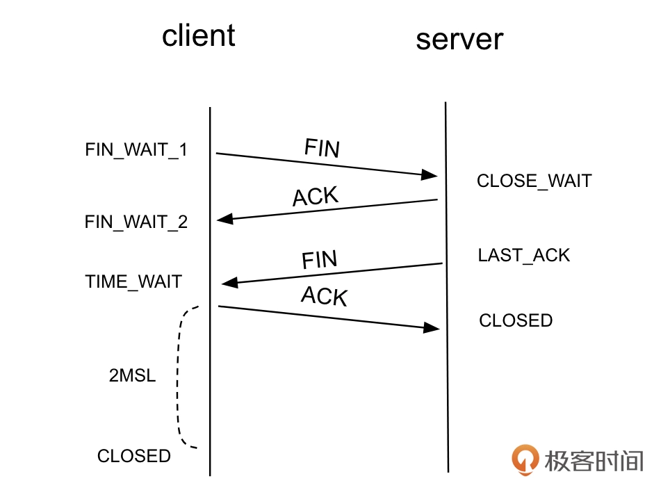

不过，如果你抓取过 TLS 相关的报文，会发现有时候 TCP 连接的关闭不是以图上的 FIN，而是以 RST 报文结束的。RST 一般意味着 TCP 关闭过程有错误。然而，当你真的去检查应用层事务的具体情况时，又可能会发现其实这些事务都正常完成了。但是，应用程序日志里却记录了连接异常中断之类的报错。

那这种 RST 引起的错误，到底应该是报啊，还是报啊，还是报啊？（郭德纲附体）

有一次我们也遇到类似的情况。应用开发团队说，他们的应用经常会遇到 connection wasclosed prematurely 这样的报错：

HTTPTransportException: Transport outbound I/O exception in xxxServiceV1:java.util.concurrent.ExecutionException: java.io.IOException:connection was closedprematurely, at service location:xxx字面意思就是 TCP 连接被提前（prematurely）关闭了，看着就不正常，得找找原因。

## 抓包分析

## Tcpdump 和 Wireshark 分析

我们在客户端做了抓包，看一下这个抓包文件在 Wireshark 里打开后的样子：

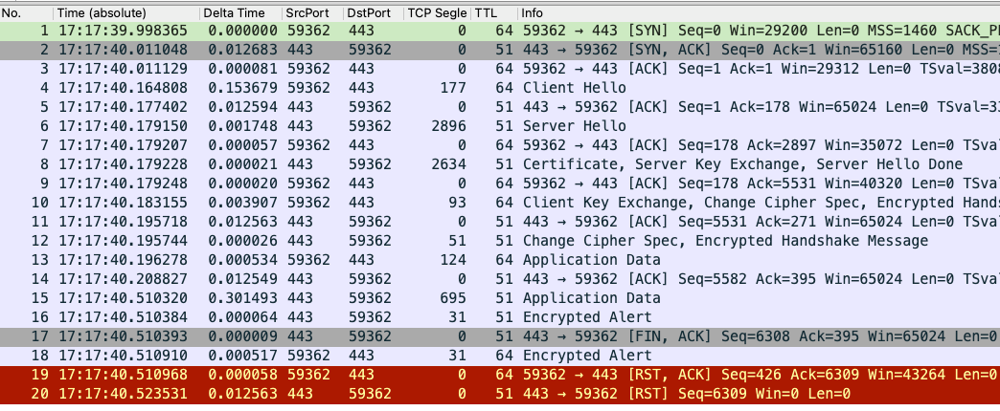

我们确实看到了 TCP RST 报文，而在 RST 之前还有 Encrypted Alert（18 号报文），看起来好像跟 RST 有关。Encrypted Alert 是什么东西呢？

要对 TLS 做进一步分析，能先解密是再好不过了。正好，这次抓包的同事也导出了 SSL keylog，打开 Wireshark 的 Preferences…菜单，在 Protocols 下面找到 TLS，如下图所示，输入log 文件路径即可对报文做解密。

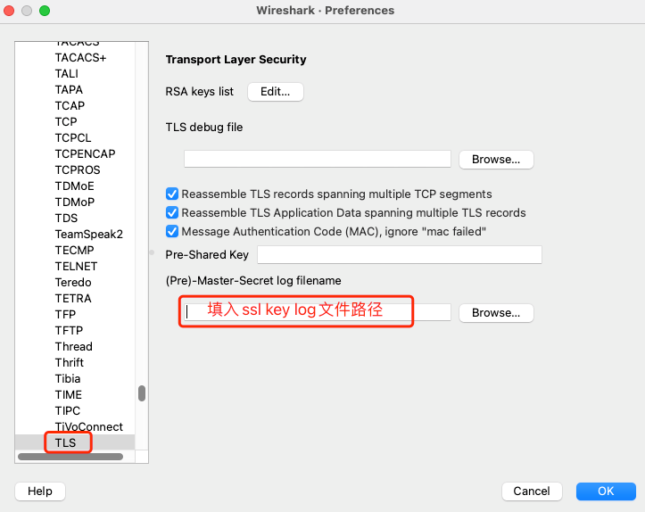

- 注：TLS 解密相关的知识点在第 20 节有详述，如果你感兴趣可以去温故知新。

解密后的报文是这样的：

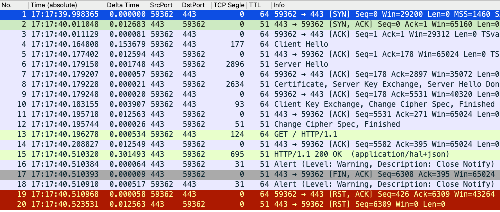

这下就清晰多了。原来 16 和 18 号报文的这种 Encrypted Alert，其实是 TLS close_notify 消息。排查又前进了一步了，不过 TLS close_notify 又是何物呢？

## TLS close_notify 规范

RFC5246 定义了 TLS1.2 规范，其中就包括了Closure Alerts 的约定。我们来看看它是怎么说的：

- 7.2.1. Closure AlertsThe client and the server must share knowledge that the connection isending in order to avoid a truncation attack. Either party mayinitiate the exchange of closing messages.close_notifyThis message notifies the recipient that the sender will not sendany more messages on this connection. Note that as of TLS 1.1,failure to properly close a connection no longer requires that asession not be resumed. This is a change from TLS 1.0 to conformwith widespread implementation practice.Either party may initiate a close by sending a close_notify alert.Any data received after a closure alert is ignored

第一段解释了设计 Closure Alerts 的原因是避免截断攻击（truncation attack）。通过显式地发送 Closure Alerts，我们可以明确告知对方：“我这边的数据都发完了，后续也不再发了”。反过来说，如果一方跳过了发送 Closure Alerts 的步骤而直接发了 TCP FIN 报文，那就破坏了这些约定，意味着这样的 TCP 挥手可能是攻击者发起的截断攻击。

第二段和第三段说的是：在应用层事务完成后，如果 TLS 通信的任意一端想要结束这次 TLS通信，就需要显式地发送 close_notify，表明自己不会再往这个 TLS 信道里写入数据了。下图展示了 client 主动发送 TLS close_notify 直至完成 TCP 挥手的全过程。当然，就像 RFC 中说的那样，任意一端都可以主动发起 TLS close_notify，所以下图只是其中的一种情况。

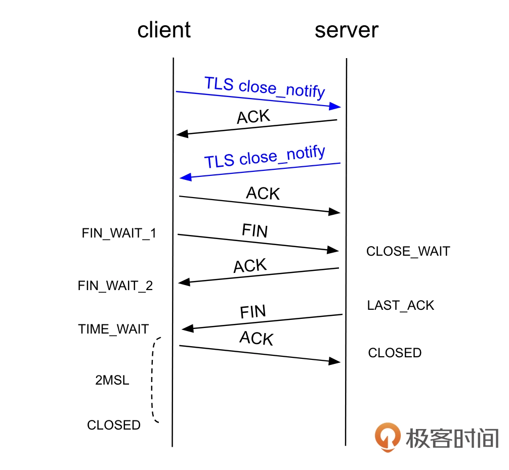

那么另一端在接收到 close_notify 后需要做什么呢？主要两件事：

1. 即使后续再接收到更多的 TLS 数据，也要丢弃。

2. 自己也需要发送 close_notify，完成双向的 TLS 信道关闭。

听起来是不是很像 TCP 挥手？考虑到 TCP/IP 模型的分层设计，这种从上到下在各自层级关闭信道的做法确实保持了一贯的风格，有条不紊。

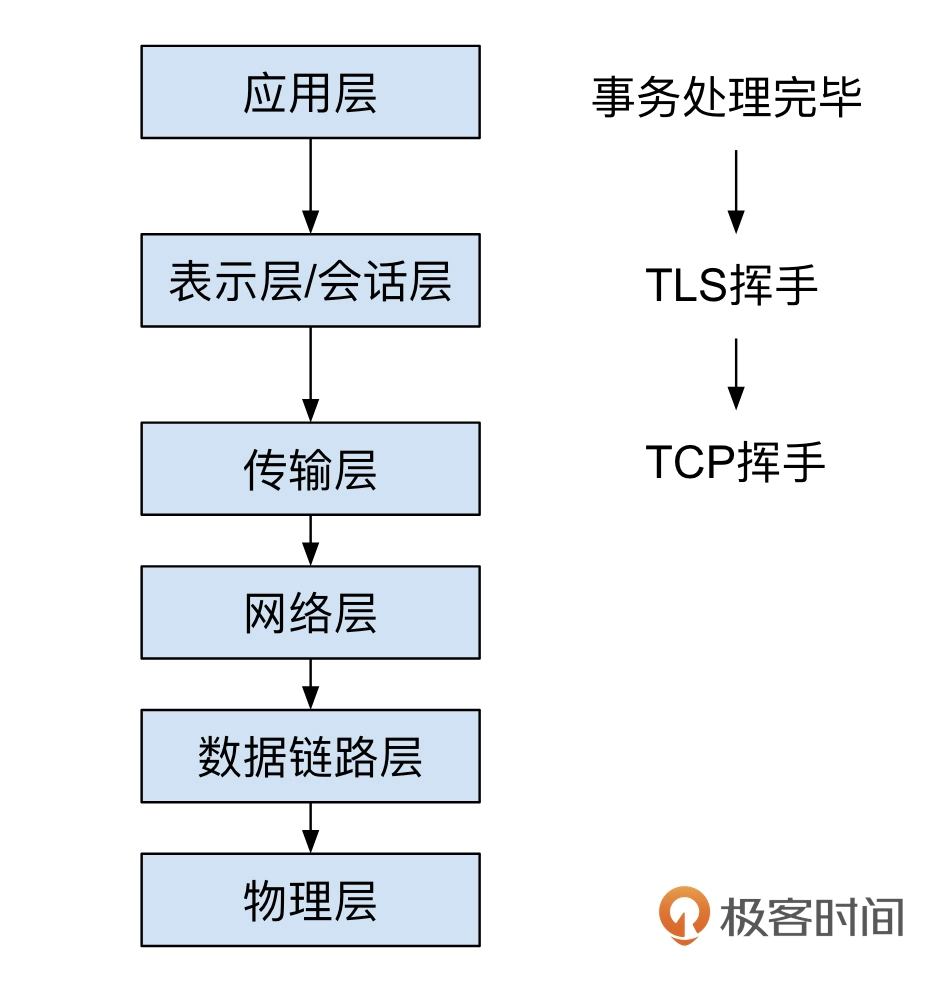

然而，现实情况却是各种“不讲武德“。世界各地的开发工程师们对 RFC 条款产生了不同的理解，导致现实情况中结束 TLS 通信的形式也多种多样。比如：

1. 收到对端发出的 TLS close_notify 消息后，没有发送自己的 TLS close_notify，直接启动了TCP 挥手。

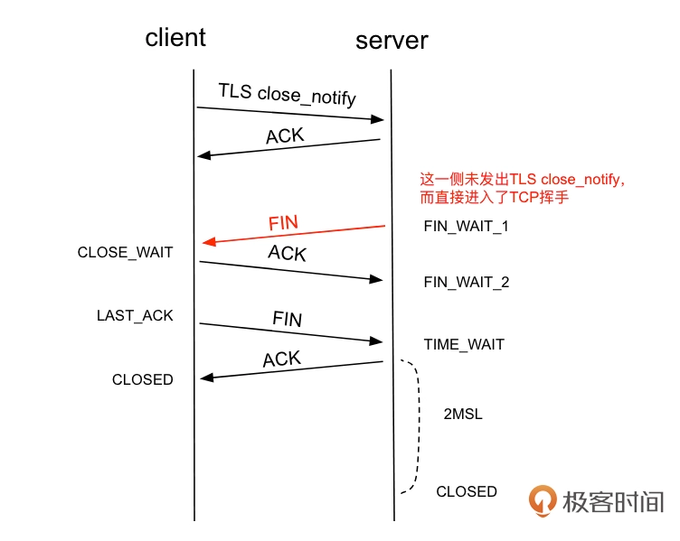

2. 自己发出 TLS close_notify 后，对端也回复了 ACK，此时未等待对端继续发送同样的 TLSclose_notify，就直接启动了 TCP 挥手。

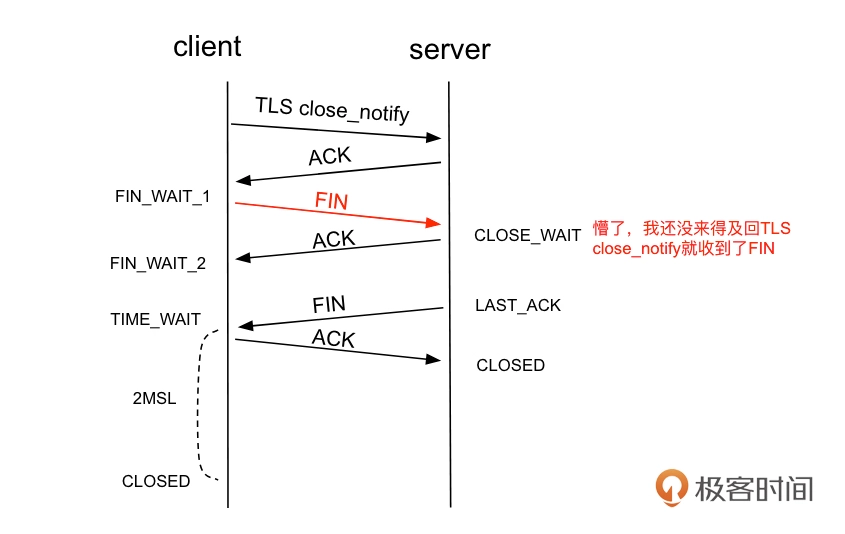

3. 更有甚者，一方发送了 TLS close_notify 之后，还没等对方回复 ACK，自己的 TCP FIN 也随即发出，导致了更加诡异的现象。其实，这就是本次案例中的情形：服务端连续发送了 TLSclose_notify 和 TCP FIN 这两个报文。显然没有给客户端留出必要的时间窗口来完成双向的TLS 关闭。

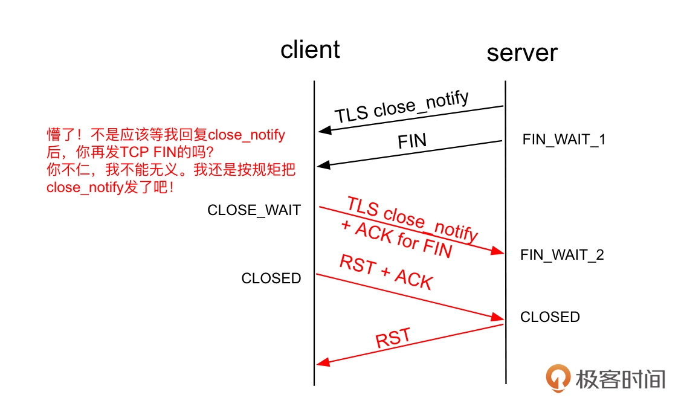

让我们重点关注 TCP 挥手前后的部分：

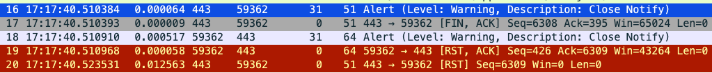

16 号报文：服务端发出 TLS close_notify

17 号报文：服务端发出 TCP FIN

18 号报文：客户端发出 TLS close_notify

19 号报文：客户端发出 TCP RST + ACK

20 号报文：服务端发出 TCP RST

结尾的两个 RST 是因何而来的呢？Wireshark 里已经没有更多的信息了。我们隐约觉得，Wireshark 在这个问题上恐怕帮不上太多。

## Wireshark 困境

明明看到不合理的行为，但却无法进一步推导出造成它的原因，这是只用 Wireshark 做分析时常会陷入的困境，可以称之为“Wireshark 困境”。

有一种民间艺术叫皮影戏，民间艺人用双手操控人偶，就可以在幕布上展现出生动的剧目。如果把 TCP 比作皮影戏，那么我们抓取到的报文相当于皮影戏的表现效果，而应用程序和内核逻辑则是后台艺人的双手。直接从抓包来看，难以看清程序和网络之间联动的逻辑，这就好比我们看得懂皮影戏，但未必知道怎么做出这场皮影戏。


我们要去后台看看，那里有不一样的精彩。

## 内核分析

内核的“内”，是相对外壳的“外”而言的。比如 Shell 就是一个最常见的外壳，它是系统管理员通过各种命令跟内核进行沟通的渠道。而对于 Linux 上运行的应用程序来说，与内核的交互一般通过各种系统调用（syscall）来实现。

- 在本专栏的第 21 节中，我们也有提到内核的一些初步知识。

通过阅读和分析 Linux 内核的源代码，我们可以搞清楚程序和网络之间错综复杂的关系，从而定位出一些奇怪的网络问题的根源所在。而且，因为这种理解是建立在对内核代码的剖析之上的，我们往往可以通过这种分析，找到根治问题的方法。比如选用某种特定的内核参数值，或者切换到没有相关 Bug 的特定的内核版本，甚至自己开发内核模块然后动态加载来解决问题等等。

## 应用程序如何用 TCP 收发数据

应用程序跟 TCP 的交互，是通过把套接字文件描述符（sockfd）作为参数传给系统调用来间接实现的。网络读写方面的系统调用有很多个，为了简化讨论，我们姑且用 send 和 recv 来分别代表写和读。以下是典型场景：

1. 客户端发送请求，用的系统调用是 send，其主要入参是 sockfd。

2. 服务端接收请求，用的是跟 send 对等的系统调用 recv，其主要入参同样是 sockfd。当然，由于两端是不同的系统，对同一个 TCP 连接的 fd 编号一般是不同的。

3. 随后客户端接收到响应的数据，也同样调用 recv 来读取它，以此类推。

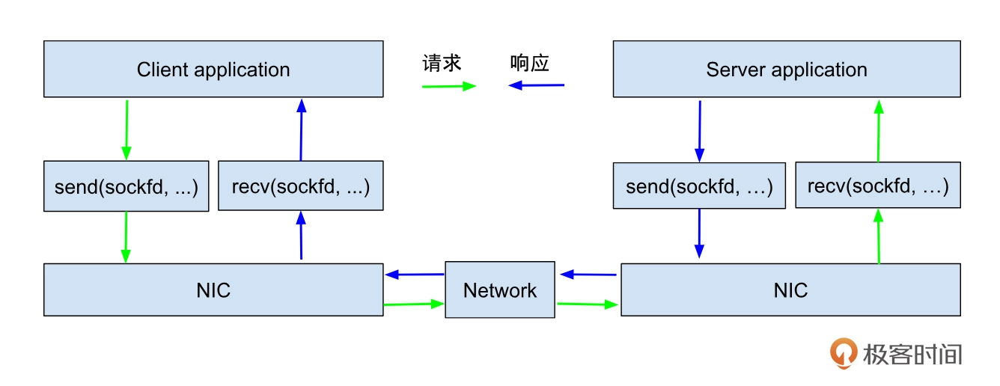

值得注意的是，应用程序无法直接操纵 TCP 报文的元信息。包括 TCP 报文的 flag（ACK/SYN/ RST/PSH 等）、确认号、序列号等在内的 TCP 元信息，都是由内核管控的。应用程序能主导的只是 TCP 载荷，也就是 TCP 层之上的内容。

我们用寄快递这个例子来类比，就很容易理解 TCP 为什么这么设计了。如果说应用程序是寄件人，而内核 TCP/IP 协议栈是快递商，那么寄件人只需要把物品（相当于 TCP 载荷）交给快递商（相当于内核）即可，至于后者怎么选择快递单号（相当于 TCP 序列号）和具体哪条高速公路（相当于 IP 路由），就不需要去关心了。

## 应用程序如何发起 TCP 挥手

既然应用程序不能直接操控 TCP 报文，那内核怎么知道何时给 TCP 报文打上 SYN/FIN/RST等标志位呢？

事实上，应用程序只是通过系统调用告诉内核：“你可以去建立 / 关闭连接了”，然后内核会完成这件事，包括设置标志位。以挥手为例，内核提供了两个不同的系统调用来完成 TCP 挥手：

1. close()：同时关闭读和写两个方向。

2. shutdown()：有三种不同的用法，分别是关闭读（用 SHUT_RD 参数）、关闭写（用SHUT_WR 参数）、同时关闭读和写（用 SHUT_RDWR 参数）。

正常情况下，在应用程序调用这两个系统调用的时候，内核用 TCP FIN 完成挥手。那这次出现的两个 RST 是怎么来的呢？要知道，一个类似 set_sock_flag() 的系统调用是不存在的。RST 是一个效果，在应用程序和内核处在某种状态组合时，RST 才会发生。

## 内核如何“制造”RST 报文

在 Linux 内核中，尽管引发 RST 的路径错综复杂，但生成 RST 报文本身的代码倒也简单，涉及两个函数。分别是：

1. tcp_send_active_reset()：从名称上就能看出来，这是内核自己主动发送 RST。它经常在连接关闭阶段被调用到。

2. tcp_v4_send_reset()：上面的函数是主动发送 RST，而当前这个函数则是被动式发送 RST了，其触发原因一般是收到了异常报文。比如，有时候由于路由错乱或者恶意攻击，我们可能会收到不属于任何已知连接的 TCP 报文，此时内核就有可能用 RST 来回击。

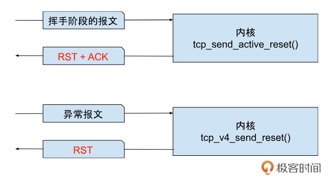

- 注：这里只是挑选了两个典型场景来方便你理解，并不是说它们只处理图中的情况。

不难想象，很多情况都能走到这两个函数，从而触发 RST。我们是否可以先形成一个猜想，然后去验证这个猜想是否成立？这样可以提升排查的效率。

让我们再次审视抓包文件。

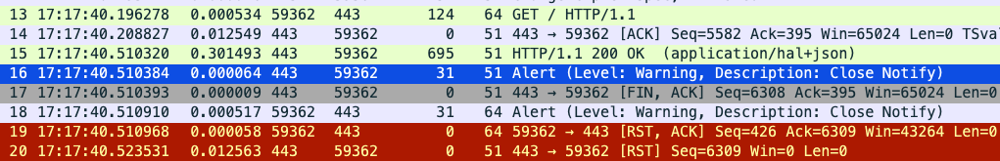

17 号报文是服务端发出的 FIN，意思是服务端已经关闭连接了。那么具体用的是 close() 还是shutdown() 呢？由于 HTTP/1.x 协议是一种“一问一答”的协议，而 15 号报文里已经给出了HTTP 回答，意味着事务已经处理结束，那么服务端用 close() 来关闭连接是比较合适的。事实上，这也是很多软件在处理 HTTP/1.x 时的普遍做法。

这里你可能注意到了一个问题：既然 17 号报文已经是 FIN 了，为什么客户端在收到了 FIN 之后，还要在它发出的 18 号报文里携带数据（即 TLS close_notify 消息）呢？TCP 允许在挥手阶段也发送数据吗？

## TCP 还能半关闭？

我们需要澄清一个概念：TCP 是全双工的，读和写可以同时关闭；也可以先关闭一个方向，即半关闭，最终再进入全关闭。从系统调用的视角来看，TCP 通信的一方收到 FIN 后，无法直接判断对方用的是 close(sockfd) 还是 shutdown(sockfd, SHUT_WR)。当然，一定是其中之一。

这次，当客户端收到服务端的 FIN 后，客户端能确定的是至少服务端的写方向关闭了，不会有新的数据从服务端发过来了。但是，服务端的读方向也必然关闭了吗？其实不一定。此时客户端发出的新数据依然有机会被服务端处理。

因此，从 TCP 规范来说，18 号报文（客户端收到 FIN 后发出的 TLS close_notify）尽管别扭，却也合法。其实，我们再比较一下这两组报文，会发现它们非常相似：

1. 16 和 17 号报文是服务端发出的，是 TLS close_notify 和 TCP FIN+ACK

2. 18 和 19 号报文是客户端发出的，是 TLS close_notify 和 TCP RST+ACK

各自的 close_notify 发出后，没等对方回复 close_notify 就急着关闭连接了。是不是像两个正在吵架的倔老头，都只管自己说话，也不听对方说什么，最后不欢而散？

“不听对方说话”，用内核网络的术语来说就是“不读取接收缓冲区中的数据”。此时，一个猜想初步形成：是不是在接收缓冲区还有数据未被读取的时候，应用程序就调用了 close()，从而触发了 RST+ACK？

在内核代码中，TCP 的 close() 系统调用主要由 __tcp_close() 函数实现，其中就有一段逻辑与接收缓冲区中是否仍有未读数据有关。代码如下：

https://elixir.bootlin.com/linux/v6.16.5/source/net/ipv4/tcp.c#L3146

```
void __tcp_close(struct sock *sk, long timeout)
{
   ......
   if (unlikely(tcp_sk(sk)->repair)) {
       sk->sk_prot->disconnect(sk, 0);
   } else if (data_was_unread) {
       /* Unread data was tossed, zap the connection. */
       NET_INC_STATS(sock_net(sk), LINUX_MIB_TCPABORTONCLOSE);
       tcp_set_state(sk, TCP_CLOSE);
       tcp_send_active_reset(sk, sk->sk_allocation,
                     SK_RST_REASON_TCP_ABORT_ON_CLOSE);
```

在第 6 行，内核会判断是否在接收缓冲区中还有未读数据（data_was_unread）；如果有，则执行第 8 到 11 行的代码。第 10 行就是调用 tcp_send_active_reset()，发出 RST+ACK。

那为什么就不能用 FIN 呢？我们可以用反证法来论证一下。如果用 FIN 会怎样？对端就会认为这这次挥手正常完成，隐含的意思就是所有数据都被应用程序正常读取了。这不是跟事实相违背吗？因此，用 RST 比 FIN 更合理。但是我们也知道，收到 RST 通常会让应用程序不高兴，因为内核返回给它的是一个错误码。

## Wireshark 和内核代码的对照

现在猜想有了，可疑的内核代码也找到了。让我们把 Wireshark 里展示的信息，和 close() 的内核代码放在一起比对，看看能佐证我们的猜想吗？

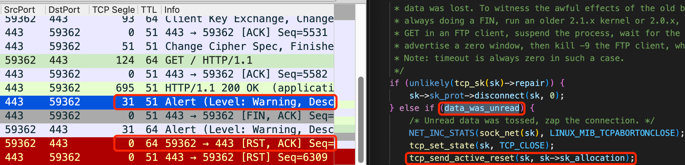

左边 Wireshark 截图里显示，TLS close_notify 消息（31 字节）和 TCP FIN 这两个报文紧挨着从服务端发到了客户端。右边是内核代码，当客户端调用 close() 时，由于没有读取数据（即 31 字节的 TLS 消息），导致客户端内核走到 tcp_send_active_reset()，发出RST+ACK，而不是 FIN。

可见，代码和 Wireshark 中观察的现象是吻合的，猜想成立。

- 当然，如果有条件，建议在复现问题的时候再运用一些 runtime 的 Debug 技术（比如用eBPF 打印函数栈和相关实时变量值等），会更快更准地定位问题。

读到这里，你可能会问：数据没有被读取，不影响应用吗？其实，这次的未读数据并不是应用层 HTTP 的数据，而只是表示层的 TLS close_notify 消息，所以对应用层事务的完整性并没有产生任何影响。

我们用 tls_shutdown() 代表 TLS 库里的 TLS 关闭函数，它位于用户空间，用来发起 TLS 挥手。这次的客户端跟服务端一样，应该都是连续调用了 tls_shutdown() 和 close()，中间没有停顿，也没有调用 recv()。

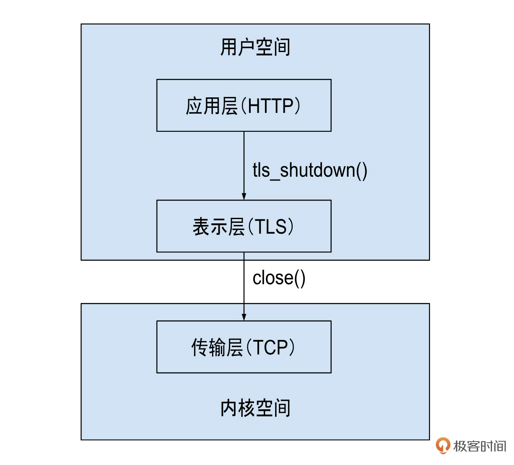

由于 HTTP 响应是服务端发出的，自然服务端比客户端更早知道事务完成，所以服务端更早发起 tls_shutdown() 和 close() 也顺理成章。这也是为什么我们会看到服务端先于客户端发出了TLS close_notify 和 TCP FIN。

当然，分析到这里，依然有很多问题要回答。比如，客户端不读取完 TCP 接收缓冲区中的所有数据，怎么就能读取到 FIN 呢？另外，抓包里最后一个不带 ACK 的 RST，又是怎么触发的？

## 如何跳过数据，直接感知 FIN

客户端能跳过数据，直接感知到 FIN？这确实跟我们对 TCP 数据流的朴素理解相违背。TCP的数据和 FIN 是有顺序的，哪怕因为网络原因乱序到达，内核也会把它们捋一捋，按序列号排成队。因此，在内核的接收缓冲区中，FIN 排在数据之后，这一点毋庸置疑。但是要注意，“按顺序”只是内核必须遵循的，但应用程序不一定。我们来理解一下这个反直觉的事实。

现代网络程序要处理大量的 TCP 连接，如果只是简单地不停去轮询 socket，那么效率就很低。所以，内核提供了 select、poll、epoll 等 IO 多路复用技术，使得高性能处理海量 socket成为了可能。应用程序在这些多路复用 API 上注册了自己关注的 socket 后，就可以去做其他事情了。当 socket 有事件发生时（比如收到新数据、收到 FIN 等），内核会把相应的事件通知到应用程序，后者再按需处理。

以 poll 机制为例，在数据到达的时候，应用程序会收到 POLLIN 事件；而 FIN 到达的时候，应用程序收到的则是 POLLHUP 事件。数据和 FIN 同时到达，就会同时收到这两个事件。如果程序逻辑是只要收到 POLLHUP 就直接调用 close()，比如程序这样写：

```
if (events & POLLHUP) {
   tls_shutdown(mytls);
   close(sockfd);
}
```

那么 POLLIN 和 POLLHUP 同时到达时，只有 PULLHUP 被处理，就会形成“未读取数据就close()”的现象。这就是“跳过数据直接读到 FIN”这件反直觉的事能发生的原因。

我们把关键步骤概括成下面这张图：

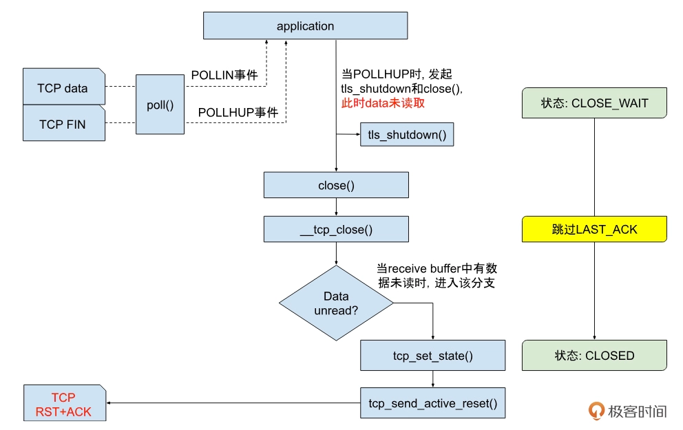

- 注：感兴趣的同学可以按这个思路写出程序，复现这个 RST+ACK 的行为。

如果说每次网络问题的排查是一次拼图游戏，那么现在这次拼图，除了结尾的那个 RST 报文还待查以外，其他方面已经比较清楚了。我们来看一下这完成了一大半的拼图的样子。

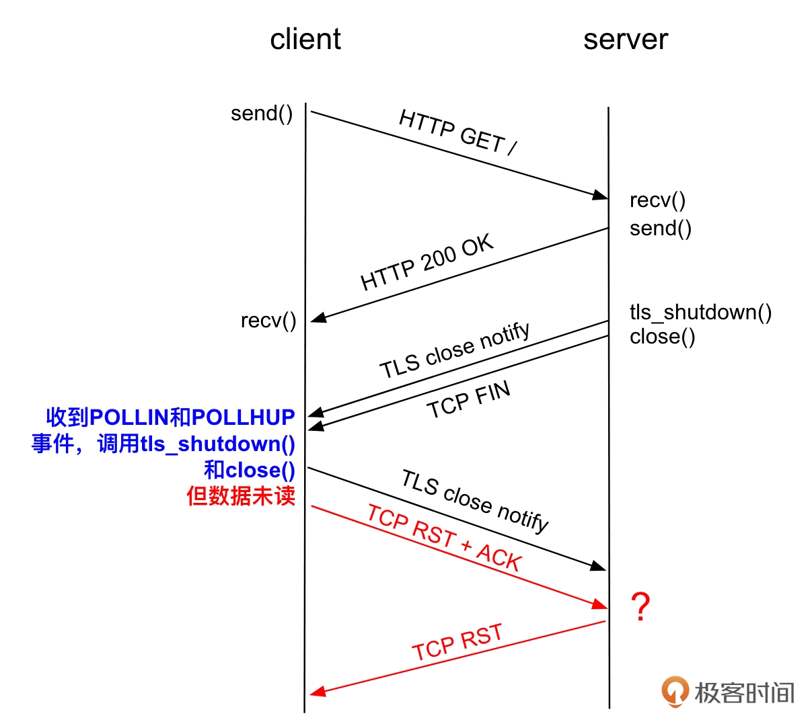

## 最后的 RST 是怎么触发的？

在内核中，入向的 TCP 报文经过的函数路径大体上分为两种情况：

1. 对于 ESTABLISHED 状态的连接：

tcp_v4_rcv() -> tcp_v4_do_rcv() -> tcp_rcv_established()

2. 对于其他状态的连接：

tcp_v4_rcv() -> tcp_v4_do_rcv() -> tcp_rcv_state_process()最后的 RST 出现时，连接处于非 ESTABLISHED 状态，符合情况 2，所以基本可以判定，RST 就是在 tcp_rcv_state_process() 函数这里触发的。

接着我们从服务端的视角做分析。客户端发来了连续两个报文，分别是 TLS close_notify 和RST+ACK，然后服务端自己回复了 RST。我们先来看 TLS close_notify 报文，它的确认号是6309。


我们用小本本记下来，这个数字很重要。往前翻，找到服务端发出的 FIN 报文，它的序列号是6308，这是第二个重要数字，也记到小本本里。


我们发现，6309 = 6308 + 1。一方的报文的确认号是另一方的 FIN 的序列号加一，你应该明白这意味着什么吧？

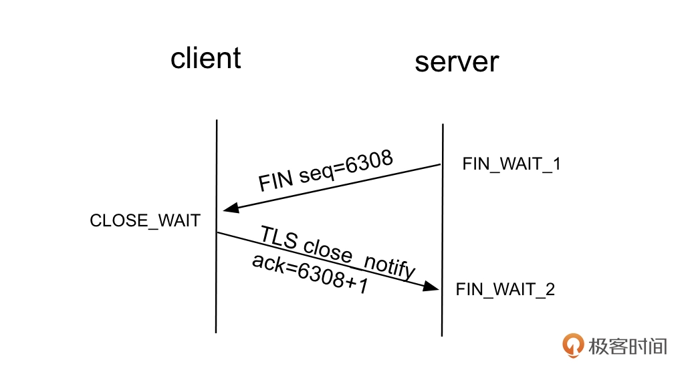

这个 TLS close_notify 的确认号，就是对 FIN 的确认。

在 TCP 状态机的设计里，主动发起挥手的一方会依次进入以下状态：

FIN_WAIT_1 -> FIN_WAIT_2 -> TIME_WAIT -> CLOSED

而另一方的状态流转路径则是：

CLOSE_WAIT -> LAST_ACK -> CLOSED

- 以上是标准流程，不考虑同时发 FIN、收到 RST 等特殊情况。

不同于标准流程，这次服务端的 TCP 状态流转过程如下：

1. 发出 FIN 时，首先进入 FIN_WAIT_1 状态，属于标准流程。

2. 接着收到 TLS close_notify，发现其确认号针对的是 FIN，于是进入 FIN_WAIT_2，此时依然标准。

3. 由于这个报文本身又携带数据，而 close() 导致读写两个方向都已关闭，于是新数据触发了特定条件，TCP 进入 CLOSED 状态，并发出 RST。

相关代码：https://elixir.bootlin.com/linux/v6.16.5/source/net/ipv4/tcp_input.c#L6785

```
int tcp_rcv_state_process(struct sock *sk, struct sk_buff *skb)
{
   ......
   case TCP_FIN_WAIT1: {
       ......
       tcp_set_state(sk, TCP_FIN_WAIT2);
       ......
   if (TCP_SKB_CB(skb)->end_seq != TCP_SKB_CB(skb)->seq &&
       after(TCP_SKB_CB(skb)->end_seq - th->fin, tp->rcv_nxt)) {
     /* Receive out of order FIN after close() */
     if (tp->syn_fastopen && th->fin)
       tcp_fastopen_active_disable(sk);
     tcp_done(sk);
     NET_INC_STATS(sock_net(sk), LINUX_MIB_TCPABORTONDATA);
     return SKB_DROP_REASON_TCP_ABORT_ON_DATA;
   }
       ......
   }
   ......
}
```

第 6 行把状态从 FIN_WAIT_1 转到 FIN_WAIT_2。第 8 行判断是否又收到了新数据，显然TLS close_notify 是 TCP 数据，于是满足 if 条件，程序执行到第 15 行，tcp_rcv_state_process() 返回非 0 值。

正是这个非 0 值，导致了 tcp_v4_do_rcv() 进入 reset 逻辑。在 net/ipv4/tcp_ipv4.c 文件中（https://elixir.bootlin.com/linux/v6.16.5/source/net/ipv4/tcp_ipv4.c#L1948）：

```
int tcp_v4_do_rcv(struct sock *sk, struct sk_buff *skb)
{
   ......
 reason = tcp_rcv_state_process(sk, skb);
 if (reason) {
   rsk = sk;
   goto reset;
 }
 return 0;
reset:
 tcp_v4_send_reset(rsk, skb, sk_rst_convert_drop_reason(reason));
```

由于 tcp_rcv_state_process(sk, skb) 返回非 0 值，第 5 行的 if 条件满足，于是 goto reset，执行 tcp_v4_send_reset()，最终有了结尾的 RST。

我们概括一下其中的逻辑主线：

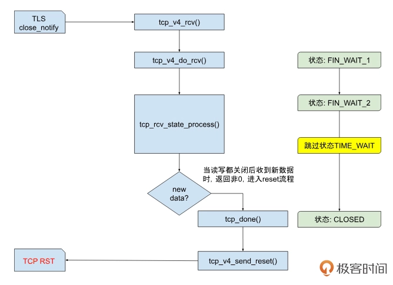

客户端一侧的状态又是如何变化的呢？

1. 收到服务端发来的 FIN 后，客户端进入 CLOSE_WAIT，此时是标准的。

2. 客户端调用了 close()，TCP 状态从 CLOSE_WAIT 直接进入 CLOSED，然后发出RST+ACK。

为什么客户端的状态变迁也是不标准的呢？依然是前面分析过的 __tcp_close() 这段代码（https://elixir.bootlin.com/linux/v6.16.5/source/net/ipv4/tcp.c#L3146）：

```
void __tcp_close(struct sock *sk, long timeout)
{
   ......
   if (unlikely(tcp_sk(sk)->repair)) {
       sk->sk_prot->disconnect(sk, 0);
   } else if (data_was_unread) {
       /* Unread data was tossed, zap the connection. */
       NET_INC_STATS(sock_net(sk), LINUX_MIB_TCPABORTONCLOSE);
       tcp_set_state(sk, TCP_CLOSE);
       tcp_send_active_reset(sk, sk->sk_allocation,
                     SK_RST_REASON_TCP_ABORT_ON_CLOSE);
```

当客户端收到 FIN 后，先进入 CLOSE_WAIT 状态，意思是等待自己的 close()。然后自己调用 close()，但随即符合 data_was_unread 条件，于是在第 9 行把连接状态设置为TCP_CLOSE，跳过了 LAST_ACK。接着在第 10 行执行 tcp_send_active_reset()，发出了RST+ACK。

下图展示了两端各自的 TCP 状态变迁过程：

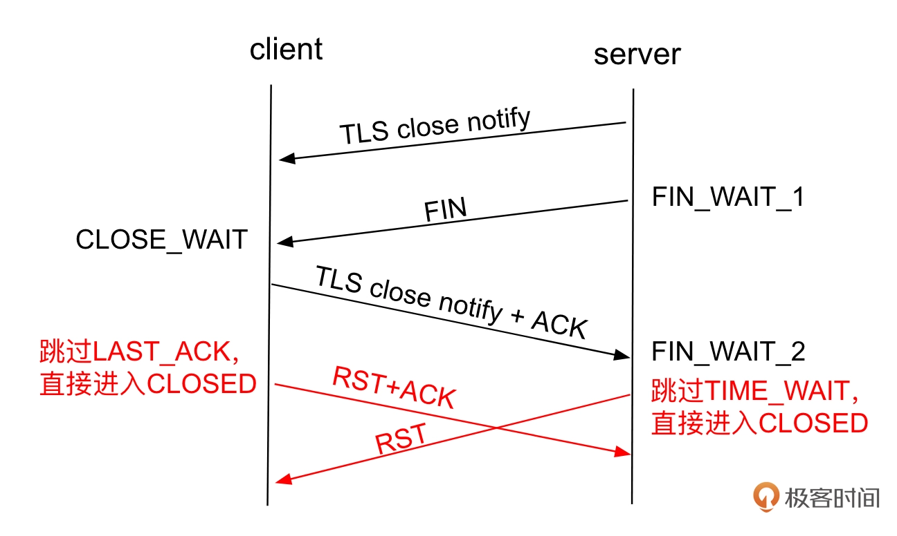

要注意，最后的 RST 其实是 TLS close_notify 触发的，而不是 RST+ACK。所以我把 RST 的发出时间点放在 RST+ACK 的到达时间点之前，在图上就出现了两条线交叉的情况。

## 解决方案

这次案例的服务端是代理软件 envoy。尽管根因在代码逻辑上，但是好在 envoy 自身提供了一个叫做 delayed_close_timeout 的参数，所以我们无需改动代码本身，只要调整这个参数就能解决问题。

它的原理很简单：在 close() 之前增加 1 秒钟的延迟。启用它之后，服务端在 tls_shutdown()后再过一秒才会调用 close()。于是，客户端的 POLLIN 和 POLLHUP 事件就会错开一秒。客户端收到 POLLIN 事件后读取数据并做处理，这是方案的关键。过一秒之后再收到 POLLHUP事件并发起 close()，此时接收缓冲区已经没有未读数据了，自然也不会产生 RST+ACK。

我画了整个流程，方便你理解其中的门道。

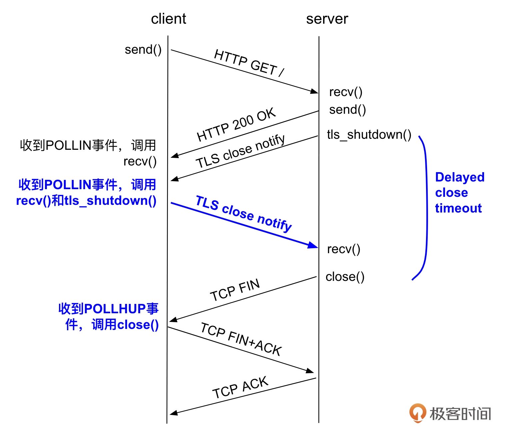

## 小结

这一次，我们借助 Wireshark 和内核代码的知识，对 TLS 通信结束阶段出现 RST 的现象做了一次比较深入的剖析。我们了解到 TLS close_notify 是 TLS 通信结束阶段的一种消息类型，用来完成 TLS 挥手。由于各种 TLS 实现之间的差异，我们可能会看到 TLS 挥手不规范引发的 RST。

如果抓包的时候也获取了 SSL key log 文件，那么把它导入到 Wireshark 后，我们就能看到Alert 的具体类型，比如 TLS close_notify。当然，获取 SSL key 毕竟不太方便，而且多数情况下这种 TLS 通信结尾的 Encrypted Alert 通常就是 close_notify，所以没有条件做解密时，姑且把它当作 close_notify 也不影响排查的大方向。

就排查策略来说，根据问题是否由网络传输状况引发，我们可以把网络故障分为两大类：

1. 问题在网络本身。网络阻塞、网络延迟、防火墙干扰、两端的乱序和重传等，都归于此类。对于这类问题的排查策略，一般是借助 Wireshark 分析。

2. 问题在应用程序或者内核。不正确的程序行为、内核在某种特定情况下的特殊表现等，属于这一类别。这类问题的排查策略，是在 Wireshark 的基础上结合一些内核的知识，只有这样才能把奇奇怪怪的 TCP 行为给拆解明白。

## TCP 和内核的关系

关于 TCP 和内核的关系，我们需要知道：TCP 协议栈属于 Linux 内核提供的能力，所有 TCP协议相关的特性都由内核实现。比如 TCP 标志位（SYN/FIN/RST 等）就是内核根据具体情况后作出的设置，而应用程序无法直接操控它们。

在一些特殊情况下，内核关闭 TCP 连接的时候用的控制报文是 RST。这次遇到的两个 RST很有代表性，分别是：

1. 客户端应用程序在调用 close() 时，相应的 socket 接收缓冲区还有未读数据，这会导致内核用 RST+ACK 来结束该连接，TCP 状态也从 CLOSE_WAIT 直接进入 CLOSED。

2. 服务端内核在连接处于 FIN_WAIT_2 状态时又接收到新的数据，内核会用 RST 回应，TCP状态也从 FIN_WAIT_2 直接进入 CLOSED。

## 内核网络代码的分析

由于自己接触内核网络的时间也不长，为了更好地和你探讨内核网络的技术，我专门学了一招“班门弄斧”，在此分享一些肤浅的经验。

首先，要熟悉内核网络和应用程序之间的接口。包括这些系统调用的使用方式，以及它们在内核代码中的主体逻辑。以下是常见的跟网络相关的系统调用：

连接建立：socket, listen, bind, accept, connect

连接调整：getsockopt, setsockopt, fcntl, ioctl

连接传输：write, read, send, recv, sendmsg, recvmsg, sendto, recvfrom

连接关闭：shutdown, close

初期我们也可以先通过 man 命令（比如 man close），快速了解它们的使用细节。等有一定基础后，再慢慢啃相关的内核代码。

其次，要熟悉内核网络代码布局。我们需要知道 IP 层、TCP 层、socket 接口等相关的代码在哪些目录下面，分别有哪些主要的文件。有了这些信息，我们就不容易迷失在浩瀚的内核世界里。以下是一些重要目录及其功能：

1. net/core 目录：核心的网络架构框架。

2. net/ipv4 目录：IPv4 协议栈及其 TCP、UDP、ICMP 等协议实现。

3. net/ipv6 目录：IPv6 协议栈及其 TCP、UDP、ICMP 等协议实现。

4. include/net 目录：内核网络代码的头文件。

5. net/netfilter 目录：netfiler 框架以及 iptables 的实现。

6. drivers/net 目录：网络设备驱动文件。

我整理了一份简要的内核网络文件分布图，供你参考。

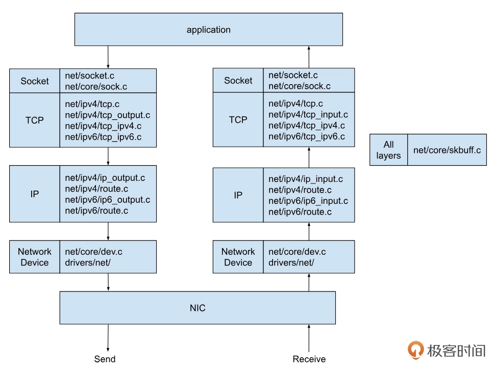

最后，要做到理论和实践结合。把内核代码分析跟常用工具比如 tcpdump、Wireshark 等结合起来，才能达到更好的效果。查问题 1 小时的收获，也许要超过纯看代码 10 小时呢。通过不断解决实际问题，对内核的理解自然不断提升。

顺便介绍一个好用的内核源码网站，https://elixir.bootlin.com/ 。在左侧列表中选择你要查的特定版本，在右上角的 All symbols 搜索框中输入函数名、变量名等，就能快速找到对应代码。无论是自己做快速分析，还是给他人分享代码片段，都十分方便。

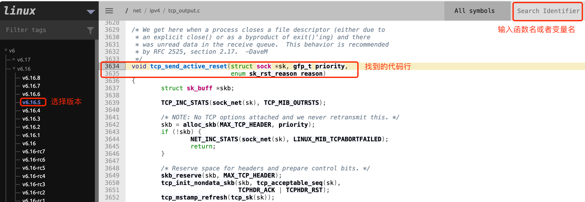

## 思考题

抓包里的最后一个报文 RST 本身不带 ACK 标志位。你知道是为什么吗？从代码层面找下原因，然后我们在评论区一起讨论吧。
