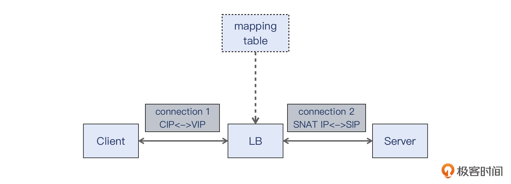
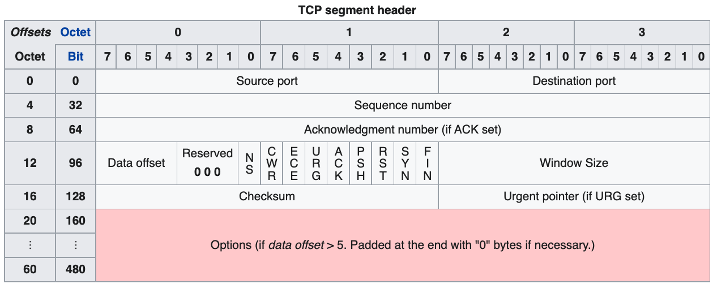
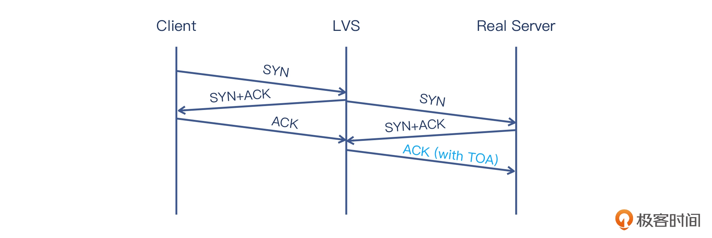
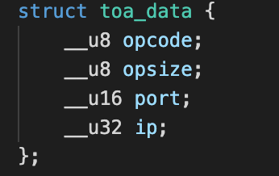
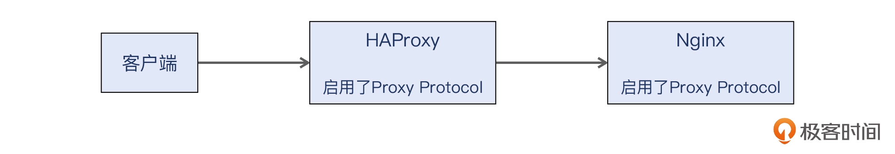
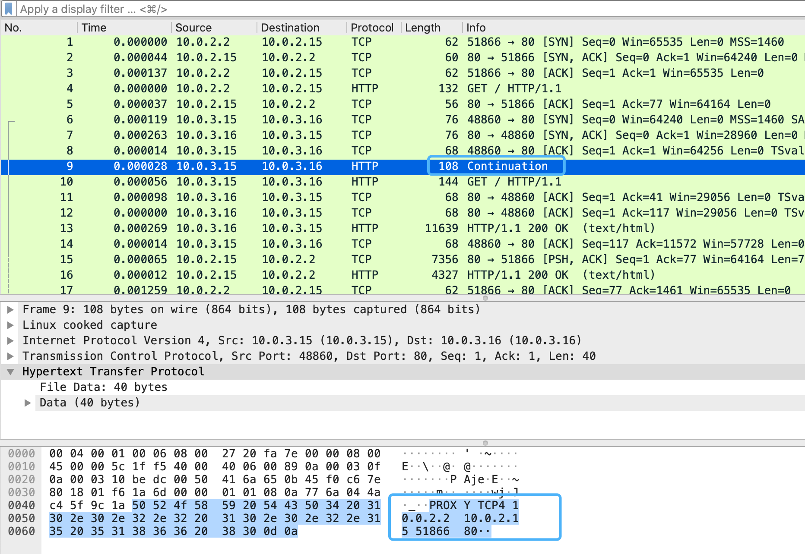
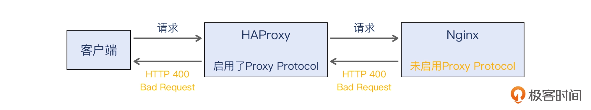
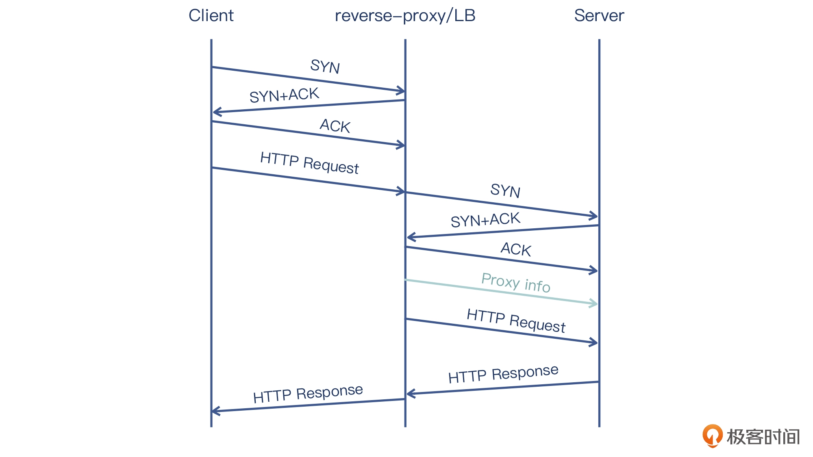
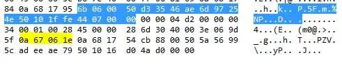
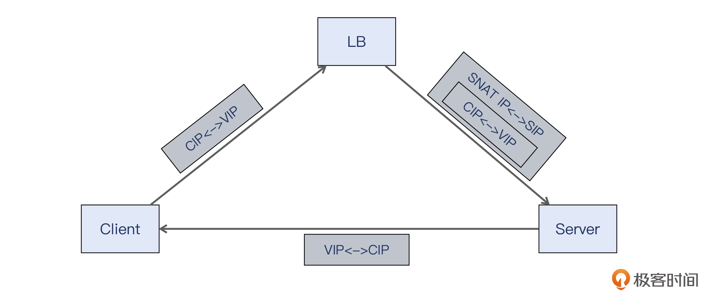

# 不定期加餐（一）-八仙过海，各显神通：透传真实源IP的各种方法

你好，我是胜辉。这节加餐课，我们来聊聊透传真实源 IP 的各种方法。

在互联网世界里，真实源 IP 作为一个比较关键的信息，在很多场合里都会被服务端程序使用到。比如以下这几个场景：

- 安全控制：服务端程序根据源 IP 进行验证，比如查看其是否在白名单中。使用 IP 验证，再结合 TLS 层面和应用层面的安全机制，就形成了连续几道安全门，可以说是越发坚固了。

- 进行日志记录：记下这个事务是从哪个源 IP 发起的，方便后期的问题排查和分析，乃至进行用户行为的大数据分析。比如根据源 IP 所在城市的用户的消费特点，制定针对性的商业策略。

- 进行客户个性化展现：根据源 IP 的地理位置的不同，展现出不同的页面。以 eBay 为例，如果判断到访问的源 IP 来自中国，那就给你展现一个海淘页面，而且还会根据中国客户的

- 特点，贴心地给你推荐流行爆款。

虽然源 IP 信息有这么多用处，但是现实情况中，这个源 IP 信息还不是那么好拿。这个原因有很多，最主要的还是跟负载均衡（LB）的设计有关系。

一般来说，用户发起 HTTP 请求到网站 VIP，VIP 所在的 LB 会把请求转发给后端，一前一后分别有两个 TCP 连接。

- 前一个 TCP 连接的客户端 IP 是 CIP，服务端 IP 是 VIP。

- 后一个 TCP 连接的客户端 IP 是 LB 的 SNAT IP，服务端 IP 是 SIP。

由此，我们可以得到以下示意图：



在这个过程中，LB 把这两个表面上没有任何联系的 TCP 连接“映射”了起来，所以也只有 LB知道，从哪个真实源 IP（这里的 CIP）来的请求被转发到了哪一个后端的连接上去了。

在这种设计之下，可怜的服务端（SIP）却只能看到 LB 的 SNAT IP，对 CIP 是一无所知，就导致了上面说的好几个功能一个都用不上。

不过别急，我们有这么几种方法来解决这个难题。我会按网络层级来一一介绍，分别是应用层方法、传输层方法，还有网络层方法。

我们先看应用层方法。

## 应用层方法

在这一层，Web 协议的制定者们想到了一个巧妙的办法：既然 HTTP 协议比较灵活，那就可以设计一个新的 header，用来传递真实源 IP，它就是 X-Forwarded-For。这个标准最初是Squid 的开发工程师提出的，很快受到了业界的支持，各种 web 服务器都早已支持了这个header。

- 补充：Squid 是应用最为广泛的代理和缓存软件之一。

X-Forwarded-For 的形式跟其他 HTTP header 一样，也是 key: value 的形式。key 是 X-Forwarded-For 这个字符串，value 是一个 IP 或者用逗号分隔开的多个 IP，也就是下面这样：

```
X-Forwarded-For: ip1,ip2,ip3
```

那为什么会有多个 IP 的情形呢？因为一个 HTTP 请求，可能会被多个 HTTP 代理等系统转发，每一级代理都可能会把上一个代理的 IP，附加到这个 X-Forwarded-For 头部的值里面。最左边的 IP 就是真实源 IP，后面跟着的多个 IP 就是依次经过的各个代理或者 LB 的 IP。

我们来看个例子。下面是截取的某个抓包文件的 HTTP 请求的部分，能看到 X-Forwarded-For头部，它的值为真实源 IP。同时也看到还有另外一个头部 X-Forwarded-Proto，它的值为真实客户端跟这个代理之间通信的协议，此处为 HTTP，当然也可以是 HTTPS。


不过，X-Forwarded-For 这个标准，虽然用一种相对低的成本解决了“服务器不能获取真实源IP”的问题，但它本身还是有一些不足的，我们来看一下。

- 源 IP 信息的伪造问题

这也是它最大的问题，因为这个头部本身没有任何安全保障机制，攻击者完全可以任意构造X-Forwarded-For 信息来欺骗服务端。

比如，如果攻击者知道服务端对某个 IP 段来的请求进行特殊处理（比如会提供更大力度的优惠券），那么攻击者就可以在发送请求时候，构造一个 X-Forwarded-For 头部，它的值就是这个段内的某个 IP。

当服务端收到请求时，认为 X-Forwarded-For 里排在最左边的 IP 是真实 IP，而事实上这个是伪造出来的，所以可想而知，这个请求就可以获取它原本不应该得到的特权了。

- 重复的 X-Forwarded-For 头部

HTTP 协议本身并不严格要求 header 是唯一的，所以有些情况下，HTTP 请求可能会携带两个或者更多的 X-Forwarded-For 头部。

造成这个现象的原因是，某些代理或者 LB 并不是严格按照协议规定的，把 IP 附加到已有的X-Forwarded-For 头部，而是自己另起一个 X-Forwarded-For 头部，那么这样就导致了重复的X-Forwarded-For。

对于服务端来说，在收到这种请求的时候，可能会导致信息识别上的错乱。比如某些服务端的逻辑是读取第一个 X-Forwarded-For，而另外一些服务端程序可能是读取最后一个，并无定法。

- 不能解决 HTTP 和邮件协议以外的真实源 IP 获取的需求

X-Forwarded-For 解决了 HTTP 的透传真实源 IP 的需求，但是事实上，很多应用并不是基于HTTP 协议工作的，比如数据库、FTP、syslog 等等，这些场景也需要“获取真实源 IP”这个功能。但是前面说的 X-Forwarded-For，只能为 HTTP/ 邮件协议所用，那其他这么多协议和应用难道就成了没妈的孩子，永远不能获取到真实源 IP 了吗？

这时候，传输层的方法就上场了。

## 传输层方法

在传输层这一层，有不止一种办法可以实现真实源 IP 透传，让我来逐一介绍。

### TOA 和 TCP Options

TOA 全称是 TCP Option Address，它是利用 TCP Options 的字段来承载真实源 IP 信息，这个是目前比较常见的第四层方案。不过，这并非是 TCP 标准所支持的，所以需要通信双方都进行改造。也就是：

- 对于发送方来说，需要有能力把真实源 IP 插入到 TCP Options 里面。

- 对于接收方来说，需要有能力把 TCP Options 里面的 IP 地址读取出来。

这里，我们先来看一下 TCP Options 在 TCP header 里面的位置：



- 图片来源

可见，TCP Options 是可变长的，最长为 40 字节（第一列的偏移量 20 到 60 字节之差）。每个 Option 项由三部分组成：

- op-kind；

- op-length；

- op-data。

TOA 采用的 kind 是 254，长度为 6 个字节（用于 IPv4）。我们来看一下 TOA 的工作原理示意图：



我们可以到 Github 上TOA 的 repo了解到更多的实现细节。比如，我们可以看一下 TOA 源码中 toa_data 的数据结构：



可见，opcode（op-kind）是一个字节，opsize（op-length）是 1 个字节，端口（客户端的）是 2 个字节，ip 地址是 4 个字节，也就是 TOA 传递了真实源 IP 和真实源端口的信息。

TOA 具体的工作原理是，TOA 模块 hook 了内核网络中的结构体 inet_stream_ops 的inet_getname 函数，替换成了自定义函数。这个自定义函数会判断 TCP header 中是否有 op-kind 为 254 的部分。如果有，就取出其中的 IP 和端口值，作为返回值。

这样的话，当来自用户空间的程序调用 getpeername() 这个系统调用时，拿到的 IP 就不再是IP 报文的源 IP，而是 TCP Options 里面携带的真实源 IP 了。比如服务器加载 TOA 后（当然LB 也要支持 TOA），那么在 access log 里面的 remote IP 一列，就会是真实源 IP；而不加载TOA 模块的话，就只是 LB 的 SNAT IP 了。

### Proxy Protocol

这个方案是 HAProxy（另外一个广泛应用的反向代理软件）工程师提出的。它的实现原理是这样的：

- 客户端在 TCP 握手完成之后，在应用层数据发送之前，插入一个包，这个包的 payload 就是真实源 IP。也就是说，在三次握手后，第四个包不是应用层请求，而是一个包含了真实源 IP 信息的 TCP 包，这样应用层请求会延后一个包，从第五个包开始。

- 服务端也需要支持 Proxy Protocol，以此来识别三次握手后的这个额外的数据包，提取出真实源 IP。

我们可以看一下它具体的工作原理：


那么目前，除了 HAProxy 以外，其实也有不少软件已经支持了 Proxy Protocol，比如 Nginx，以及各大公有云的服务，比如 AWS（亚马逊云）和 GCP（谷歌云）。我们还是拿鲜活的抓包信息来展示一下。测试环境是：client -> HAProxy (enabled with proxy protocol as proxy) ->nginx (enabled with proxy protocol as server)。



首先，我们从客户端发起 HTTP 请求，然后在 HAProxy 上抓包，获取信息如下：



可见，整个抓包文件中第 9 个包（也就是服务端连接的第四个包），就是那个关键的携带了真实源 IP 信息的包，我们可以直接在 Wireshark 下方的报文详情里看到它的文本格式的内容：

```
PROXY TCP 10.0.2.2 10.0.2.15 51866 80
```

其中，10.0.2.2 就是真实源 IP，10.0.2.15 是 VIP，51866 是真实源端口，80 是 VIP 端口。

而这里你要知道，默认的 HAProxy 和 Nginx 配置都是不启用 Proxy Protocol 的，所以需要额外进行这些配置。

另外，如果中间 LB（这个例子里是 HAProxy）启用了 Proxy Protocol，而后端服务器（这个例子里是 Nginx）没启用，那么客户端会收到 HTTP 400 bad request。究其原因，是因为不启用 Proxy Protocol 的 Nginx，会认为握手后的第一个包并没有遵循 HTTP 协议规范，所以给出了 HTTP 400 的报错回复。



### NetScaler 的 TCP IP header

这是 Citrix（也就是 NetScaler 的厂商）提供的自家的方案。它的原理跟 Proxy Protocol 是类似的，也是在握手之后，立即发送一个包含真实源 IP 信息的 TCP 包，而差别仅仅在于数据格式不同。也就是说，这个方式的原理也可以借用 Proxy Protocol 的那张图来说明：



然后，后端服务器也需要进行适当改造以支持这个行为，也就是需要读取相应字段，提取出源IP 信息。

我们可以来看一下Citrix 官网文档中的例子：



可见，在握手的三个包之后，第四个包里面包含了真实源 IP 信息。也就是图中黄色高亮的部分：0a 67 06 1e。换算成十进制就是 10.103.6.30。

这种算是私有协议了，支持场景会比 Proxy Protocol 更少一些，所以需要服务端开发人员对此进行代码改造，来让应用程序能够识别这个包里面的信息。

## 网络层方法

不过，既然事关 IP 信息的传递，怎么 IP 层自己反而没有办法呢？事实上，在这一层确实也有办法，比如利用 IPIP 这样的隧道技术。简单来说，就是用“三角模式”来实现直接的源 IP 信息的透传。但它的实现原理，跟前面介绍的几个就有比较明显的区别了。

- 传输层和应用层：把真实源 IP 当做 header 的一部分，传输到后端。

- 网络层：直接把真实源 IP 传输到后端。

让我们看一下三角模式示意图：



具体的 IPIP 隧道加三角模式的配置细节网上很容易搜到，这里就不赘述了。显而易见，这种模式里，客户端地址（CIP）是被服务端直接可见的，看起来貌似最为直接，也不需要任何应用层和传输层的改造。

不过，这种方式的缺点也比较明显。

- 配置繁琐，扩展性不佳：IPIP 隧道（或者其他隧道技术）需要在 LB 和服务端都进行配置，VIP 也需要在服务端上配置。我们知道，步骤越多，出错概率就越大，在系统架构选型的时候，我们要注意控制这些变量的数目，使得系统易于维护。

- LB 无法处理回包：因为回包不再经过 LB，那么对应用回复的处理就无从实现了，比如对HTTP Response 的改写，就没办法在 LB 环节做了。如果需要有这些逻辑，那么我们要把这部分逻辑回撤到服务器本身来处理。

- 补充：当然如果 LB 跟后端服务器在同一个二层网络里，可以把 LB 配置为服务器的网关，使得 HTTP 响应报文也经过 LB，不过这个前提条件相对苛刻。

## 小结

这节课，我们主要学习了几种透传真实源 IP 的方法。其中，应用层透传真实源 IP 的方法，是利用 X-Forwarded-For 这个头部，把真实源 IP 传递给后端服务器。这个场景对 HTTP 应用有效，但是对其他应用就不行了，所以还要看另外两大类方法。

那么，针对传输层主要是有三种方法：

- 扩展 SYN 报文的 TCP Options，让它携带真实源 IP 信息。这个需要对中间的 LB 和后端服务器都进行小幅的配置改造。

- 利用 Proxy Protocol。这是一个逐步被各种反向代理和 HTTP Server 软件接纳的方案，可以在不改动代码或者内核配置的情况下，只修改反向代理和 HTTP Server 软件的配置就能做到。

- 利用特定厂商的方案，如果你用的也是 NetScaler，可以利用它的相关特性来实现 TCP 层面的真实源 IP 透传。不过这也需要你修改应用代码来读取这个信息。

而在网络层，我们可以用隧道 +DSR 模式的方法，让真实源 IP 直接跟服务端“对话”。这个方案的配置稍多，另外 LB 也可能无法处理返回报文，所以你需要评估自己的需求后再决定是否采用这一方案。

最后，学完了这节课，你也要清楚，在实际的工作中，其实并没有一个普适于一切场景的获取真实源 IP 的方案，而是应该根据不同的需求和基础架构特点，来选取最适合自己的那一个。我想这个原则，无论对于获取真实源 IP 这个场景，还是其他任何技术选型，都应该是我们遵守的法则。就算是衣服的均码，也有人穿着不合身呢。要想展现你的身材，恐怕只有量身定做，才最为靓丽。当然，前提是你知道这些选项的存在。

## 思考题

今天的加餐就到这里，最后也给你留一道思考题：假设你的应用是一个自己开发的基于 TCP的应用，部署在 LB 后面，那你会选择用上面介绍的那种方法来透传真实源 IP 信息呢？

欢迎在留言区分享你的答案，也欢迎你把今天的内容分享给更多的朋友。
