# 抓包分析工具再探：Wireshark

你好，我是胜辉，今天我们再来系统性地聊一聊 Wireshark。

Wireshark 软件的前身是 Ethereal。我们在第二讲提到过，由于商标授权的原因，Ethereal 在2006 年被改名为了 Wireshark。显然，这个词由 Wire 和 Shark 两个部分组成。Wire 代表网络世界，Shark 则是依靠敏锐的感官精准捕食的鲨鱼。如果说问题根因是猎物，那么我们使用Wireshark 找到根因的过程，就好比一次网络世界的狩猎之旅。

今天，就让我们从整体界面开始了解这条犀利的“线上鲨鱼”吧！

## 主界面介绍

Wireshark 的主界面包括三大部分：报文列表区域、报文详情区域、报文字节区域。

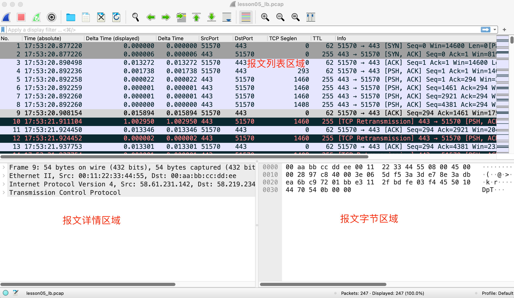

### 报文列表区域

首先是报文列表区域。在这里，每个报文项来自 pcap 文件中的基本单元，通常是单个 TCP或者 UDP 报文。当然，也可以是第三层的其他协议类型，比如 ARP 报文或者 ICMP 报文等。

这里的知识点也值得留意。表面上“一个 TCP 报文”似乎很容易理解，但怎么界定“一个”呢？

从抓包文件的消费者 Wireshark 的角度来看，它认为的“一个 TCP 报文”，其实就对应着 pcap（以及类似的格式包括 cap、pcapng 等）文件里的一个信息单元，这个信息单元包括：

- 报文编号：这个容易理解，就是个从 1 开始递增的序号。越晚抓到的报文，编号越大。注意，这里的编号本身不是 pcap 文件中的信息，而是 Wireshark 为了方便我们使用，按照信息单元的顺序在界面上展示的编号。

- 时间戳：报文被抓取到的时间戳。在 pcap 格式里这个精度是微秒，也就是 0.001 毫秒。而在新的 pcapng（pcap next generation）里，时间戳可以精确到纳秒，即 0.001 微秒，也就是比 pcap 提升了 3 个数量级。

- TCP 头部信息：这就多了，包括序列号、确认号、载荷长度等等，也是 TCP 性能分析所依赖的核心信息。

从抓包文件的生产者比如 tcpdump 程序的角度来看，“一个 TCP 报文”就是在内核网络的抓包hook 点获取到的网络数据。我们可以用下图来概括地表示整个过程：

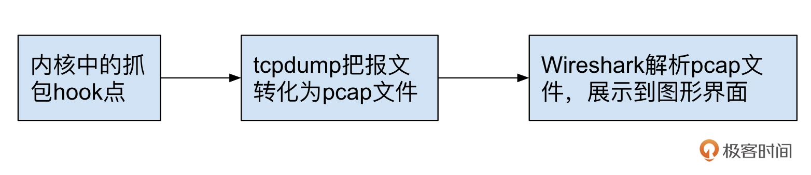

另外，“一个 TCP 报文”的长度又是如何确定的呢？如果你对 IP 头部有一定的了解，应该知道有一个 Total Length 字段，其代表了整个 IP 报文的长度。根据这个信息，一个 TCP 报文（严格来说是一个 TCP 段，即 TCP segment）的边界就确定下来了。

我们来看一个例子。下图中，4 号报文的 TCP 载荷为 293 字节。加上 IP 头部 20 字节和 TCP头部 20 字节，形成的总的 IP 报文的长度为 293 + 20 + 20 = 333 字节。截图中，IP 头部的Total Length 字段值就是 333 字节无误。

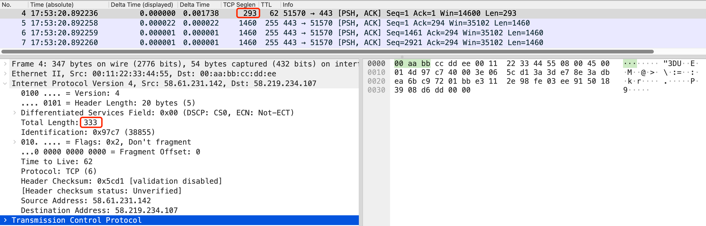

“一个 UDP 报文“的长度也是类似的，通过 IP 头部里的 Total Length 字段，可以获知 IP 层包含 IP 头部和 IP 载荷在内的大小。

### 报文配色和专家信息

Wireshark 默认提供了一套醒目的配色方案，为我们排查带来了很多便利。下面介绍两种最常见的配色。

对于 TCP 重传和重复确认等场景，Wireshark 的配色方案是黑底红字。比如下面的报文 10、12、14 都是 TCP 重传报文，一般意味着网络状况不稳定，有丢包的情况发生。

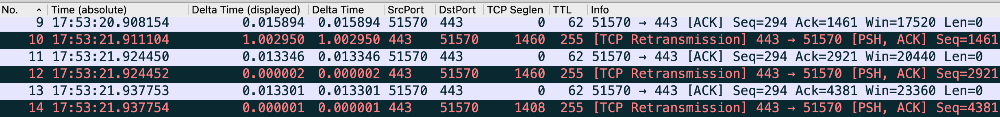

对于挥手阶段的异常状况比如 RST 报文，Wireshark 会配以红底黄字。比如下面的报文 72 和74 都是 TCP RST 报文，也就意味着这次挥手是存在问题的，需要加以重视。

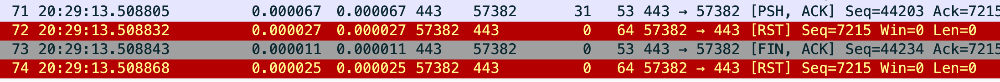

跟报文配色的作用类似，专家信息也给我们快速获取整个抓包文件的状况提供了便利。在主界面的左下角有一个不起眼的圆形图标，那里就藏着专家信息。

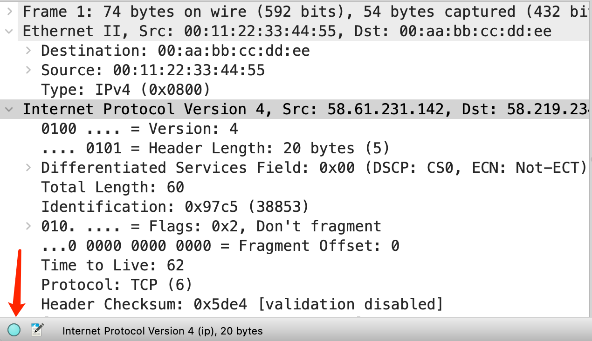

点击它，就可以进入专家信息界面，快速获取到整个抓包文件里的网络状况。比如是否有重传、握手异常、挥手异常等，都一目了然。

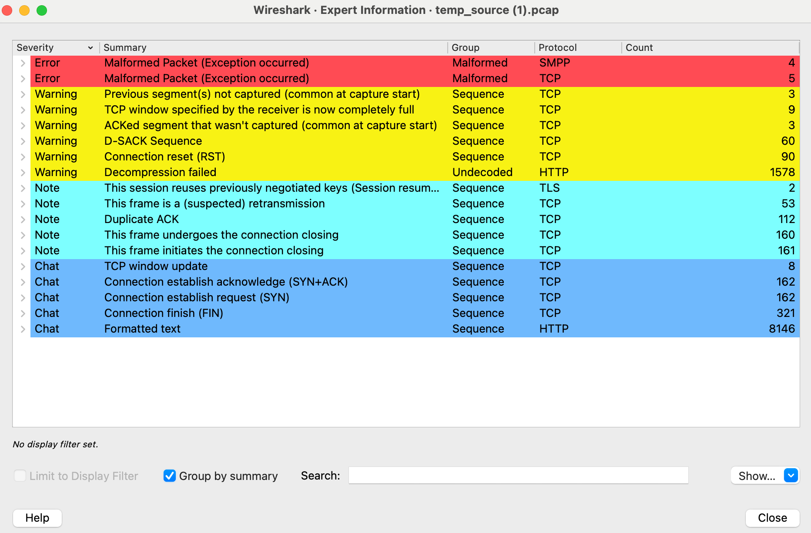

### 报文详情区域

报文详情区域也可以称为协议栈区域。在这里，我们可以清晰地看到 TCP/IP 模型的协议层级。

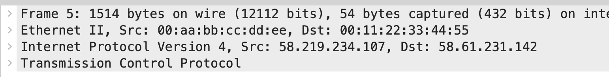

上图中展示的协议栈层级依次是：

- Frame

- Ethernet II

- Internetl Protcol Version 4

- Transmission Control Protcol

不难看出，协议栈之所以被称为“栈”，是因为其设计体现了“栈”的特点。应用层数据往下发给操作系统内核后，依次被加上了 TCP 头部、IP 头部、二层帧头部，最后以电平信号等方式从网络介质（双绞线、光纤、无线等）传输出去。接收方则进行逆向操作，在接收到底层的二层帧后，逐步剥离这些头部。先剥离二层帧头部，然后是 IP 头部，TCP 头部。去掉这些头部后剩下的就是 TCP 载荷，然后操作系统内核就把这些 TCP 载荷数据上报给监听在这个端口的应用程序，由后者进行处理。

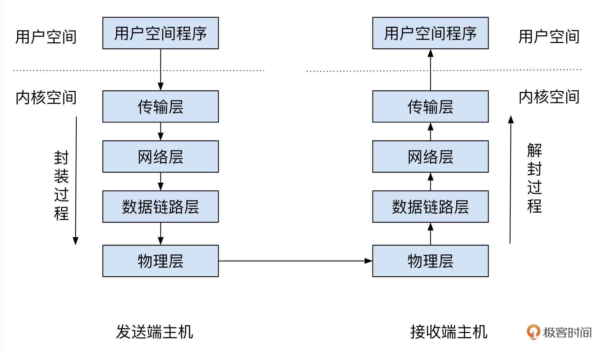

顺便提一下，对于应用由 TLS 加密的情况，由于内核一般不直接支持 TLS 的处理，所以用户空间会存在两层程序。在发送端，用户空间程序会把数据交给 TLS 库，后者对数据进行加密，然后把密文作为 TCP 的载荷，交由内核继续处理，后续过程与上图相同。接收端也进行逆向工程，内核把 TCP 载荷交给 TLS 库，后者解密后把明文转交给应用程序。

上述的整个添加头部和剥离头部的过程，跟”栈“概念中的入栈、出栈的过程类似，所以称其为“栈”是很生动的。

### 报文字节区域

在报文字节区域里，我们可以“看到”网络上传输的字节信号。这个区域的左侧是用十六进制展示的字节信号，右侧是这些字节信号的 ASCII 编码。新手可能不太关注这个区域，实际上这里用处很大，特别是对于明文传输的信息（比如未加密的 HTTP 协议），这个区域的作用就更明显了。

比如，在 RFC 规范中，HTTP 请求头部（HTTP headers）和请求体（HTTP body）之间需要用两个 CRLF（即两个\r\n）来分隔。但是，有些 HTTP 客户端没有遵循 RFC 规范去设置这种分隔行，自然会导致报错。这种异常，在报文列表区域或者报文详情区域是无法被发现的。但是在报文字节区域，我们可以明确看到错在哪里。比如，某些情况就是 HTTP 请求少了一个CRLF 导致了异常。

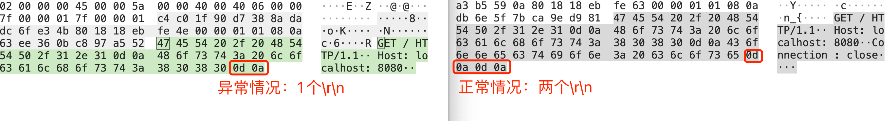

## 字段信息介绍

介绍完主界面三个区域之后，我们对 Wireshark 的骨架就有了初步了解。接下来，让我们看一下 Wireshark 展示信息的方式，主要有两种：原始信息和解读类信息。

### 原始类信息

原始类信息就是报文本身自带的信息，Wireshark 直接根据 RFC 规范对这些协议头部进行解析，就获得了这些原始类信息。

在第二层数据链路层，原始类信息包括：源 MAC 地址、目的 MAC 地址、报文类型（指的是其承载的上一层的协议，最常见的是 IPv4 和 IPv6）。

在第三层网络层，原始类信息包括：源地址、目的地址、总长度、TTL、协议类型（其上层传输层协议比如 TCP）、头部校验和等等。在这一层的多种协议中，IPv4 协议还包括了一个可选的扩展头部（IP Options），可以提供更多的功能和灵活性。但缺点也很明显，比如造成网络设备的额外开销并引起延迟，所以不推荐使用。

在第四层传输层，原始信息包括：源端口、目的端口、序列号、确认号、头部长度、标志、窗口、校验和等等。跟 IP 协议类似，TCP 协议也提供了一个可选的扩展头部（TCP Options）。这些概念在我们专栏里反复提及，这里就不继续展开了。

在应用层，Wireshark 会对特定的应用层协议提供针对性的解读，从而使我们能读取到这些应用层的原始信息。最常见的就是 HTTP、MySQL 等协议，Wireshark 都能按其规范，解析成对应的 HTTP 或 MySQL 层面的术语，方便我们理解这个过程。

### 分析类信息

跟原始类信息相比，其实分析类信息更为重要。

什么是分析类字段呢？一个网络报文，其原始类信息是“白纸黑字”写在报文里的，相当于“自述”。但仅有这些信息还不够，最好还有一些“他述”，来提供一种旁白解读，帮助我们更好地理解网络状况。Wireshark 的分析类信息就是这种“他述”。

也许你也注意到，Wireshark 展示的报文信息，有些在后面带方括号。比如下面这个图里的情形：

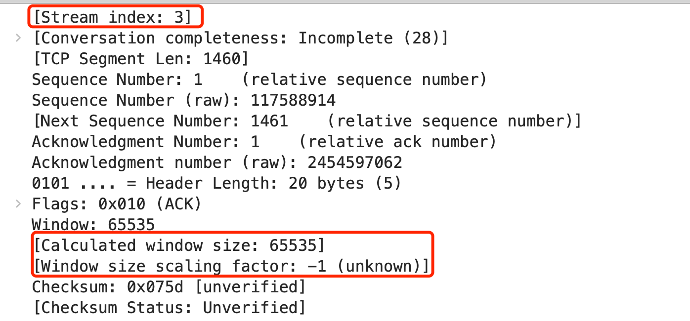

新手可能会冒出来很多问题：

1. [Stream index: 3] 是什么意思呢？似乎 TCP 头部里没有一个叫 Stream index 的字段啊？

2. [Calculated window size: 65535] 似乎是指计算得到的窗口值？为啥还要计算，每个 TCP报文不是本来就自带窗口值吗？

3. [Window size scaling factor: -1 (unknown)] 这个 scaling factor 是啥东西？-1 (unknown) 又是啥报错？

其实，这些方括号里的就是分析类信息。我们来做一下阅读理解：

1. Stream index: 3。通常一个抓包文件会包含多个 TCP 流，它们按时间排序分配到一个index 值（index 从 0 开始）。这里的 index 为 3，说明这个报文属于第四个 TCP 流。

2. 随后是两个关于窗口的信息，说明 Wireshark 尝试用窗口扩大因子去计算出实际生效的窗口值。由于协议设计的关系，TCP 窗口扩大因子只存在于握手报文里，而这个抓包文件里不含握手报文，因而不知道扩大因子的值（红框中的 unknown 的原因），也就导致Wireshark 无从计算出正确的实际窗口值。这种情况下，Wireshark 给出的实际窗口值跟未扩大的原始窗口值一致（在这里都是 65535）。

- 注：为了提升 TCP 的传输性能，网络专家们制定了RFC1323，其中包括了扩展 TCP 窗口以提升网络带宽利用率的改进方案。这是一个应用很广泛的 RFC，在网络排查场景里的出现频率也很高，所以推荐你认真阅读这篇 RFC，可以说它是 TCP 分析中的武林秘籍。

TCP 属于很复杂的协议，因为要考虑的事情本身就非常多，使得它没办法变得简单。以拥塞控制为例，在探测到拥塞发生时，发送方可能会重传一些 TCP 报文，以确保接收方能够收到这些报文。在这些被重传的 TCP 报文身上，本身却不带任何直接说明“我是一个重传报文”的信息，要不然报文会更加臃肿。

如何判断一个报文是不是重传的呢？我们首先可以想到的是，通过比对这个 TCP 流前后的报文来找到重传。如果发现某些报文的序列号曾经出现过，那么后出现的同序列号的报文就是重传报文了。不过，前后报文有几十上百个，难道我们要挨个地用肉眼甄别出来吗？

分析类字段就在这里帮上大忙了。比如我们在过滤器输入框输入"tcp.analysis"，就会自动弹出很多分析类字段（下图）。选中其中一个，就会过滤出带有这个分析类字段的报文了。要找到重传报文，只需选择 tcp.analysis.retransmission（超时重传）或者tcp.analysis.fast_retransmission（快速重传）即可。是不是很简单？

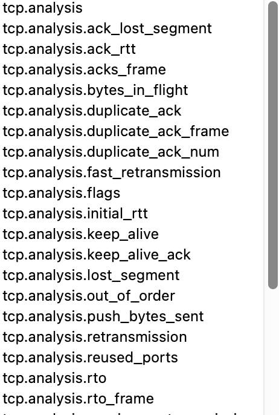

说到这里，我们也要提一下给报文列表区域编辑自定义字段的重要性了。在使用 Wireshark 的经验越来越丰富后，我们一定要做一件事情，就是持续迭代这些字段。为什么呢？

### 对字段做定制

随着我们对 Wireshark 和 TCP/IP 协议栈的了解越来越深入，对分析工作的需求也会越来越细致。此时，默认展示的字段就不能满足我们的要求了。比如，默认情况下报文列表区域包含source address（源地址）和 destination address（目的地址）这两个列。而我个人习惯按TCP 流展开分析，大多数时候 source port（源端口）和 destination port（目的端口）就足以区分客户端和服务端了，所以我会去掉前面说的两个地址列，增加两个端口列。

另外，分析 TCP 时候经常要比对序列号，尤其是它的连续性，那么 next sequence number（下个序列号）就很重要了，所以我还会加上这个 tcp.nxtseq 列。

所以说，为了更好地做网络分析，我们需要做两件事：

1. 添加自己所需的列

2. 淘汰用处不大的列

添加自定义列的做法有两种。第一种，是直接从列表中选择。在标题栏任意处右单击，打开列选择菜单，在下拉列表中选择自己需要的字段即可。但是，这种方法不能涵盖所有可选的字段。

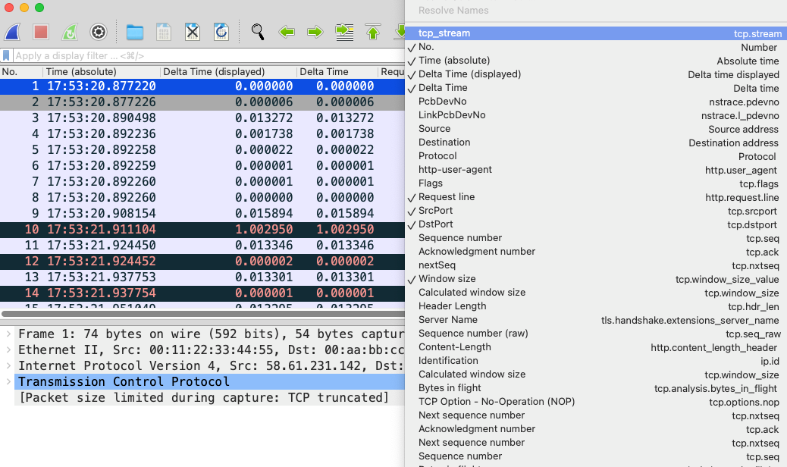

第二种是选择 custom（自定义）类型，然后输入字段表达式，比如 tcp.nxtseq、ip.ttl 等，这就可以支持任何可选字段了。做法是，在刚才右单击弹出的菜单中，选择 ColumnPreferences…，然后在新菜单中，点击“+”号按钮：

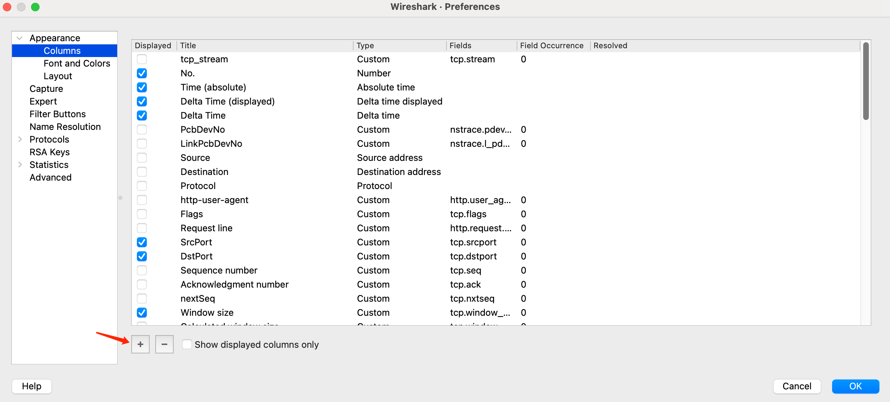

在随后弹出的菜单中，双击 Type 栏，并选择 Custom，然后输入自定义的 query：

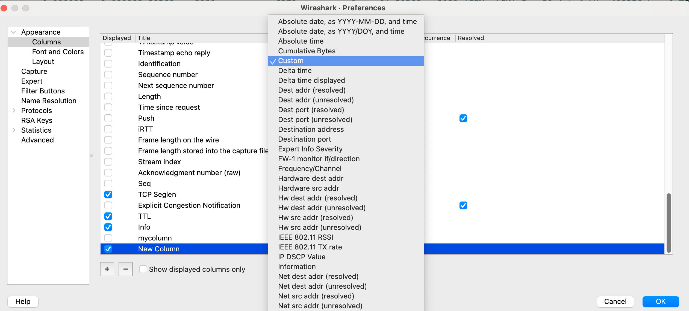

Wireshark 会根据我们的输入字符串，自动展示以这个字符串开头的可用的查询语句。比如输入"tcp.a"，可以看到如下 query 列表：

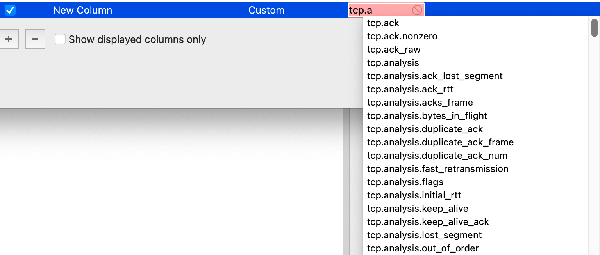

然后根据自己口味在菜单中作出选择，不再赘述。

## 内含的工具

一般来说，大多数网络问题可以直接在报文列表区域看出端倪。比如丢包和重传就会有醒目的配色，提醒我们此处异常。但是，如果想知道某条 TCP 流的整体状况并进行性能调优，单纯在报文列表区域上下拖动并观察颜色的变化，恐怕就不够了。比如下面这些需求：

1. 想知道 TCP 流从开始到结束期间不同时间段的传输速度。

2. 如果速度不佳，想分析找到传输速度的瓶颈。

那么 Wireshark 能否给我们提供更全面的信息来辅助判断呢？其实，它自带的子工具就可以提供我们需要的“全景视图”。

### TCP stream graphs

TCP stream graphs 是一个工具套装，包含五个子工具。用好了它们，我们的段位就可以从青铜升级到白银。我们来挨个检视一下这套“白银圣衣”的组件。

Time sequence (Stevens)：序列号随时间变化的趋势图。下图中，横坐标为时间轴，纵坐标为序列号，随着时间推进，序列号数值稳定上升，说明这次传输的状态比较稳定。

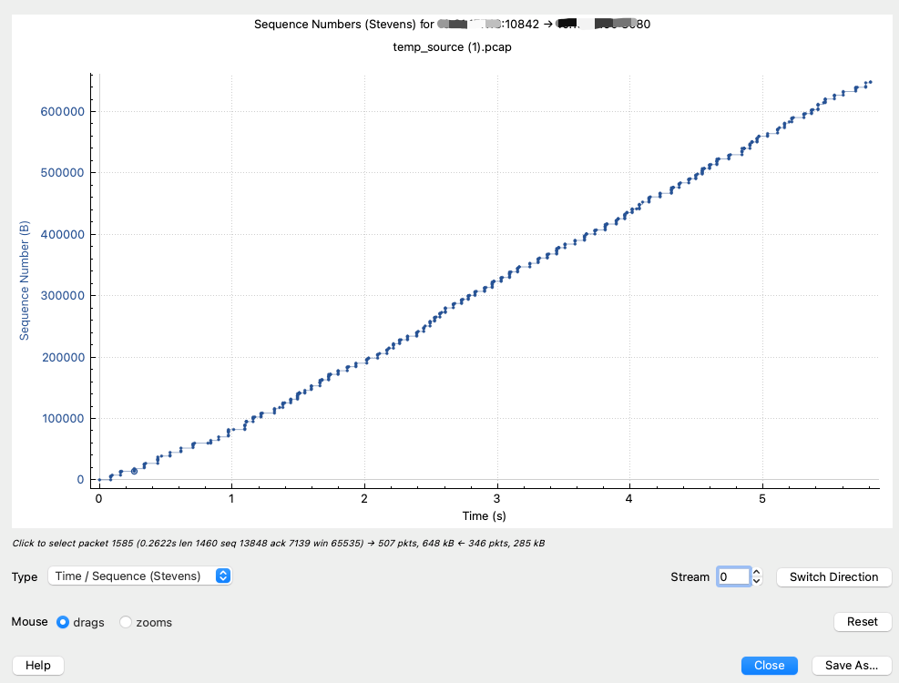

你可能会有疑问：“TCP 是全双工传输的，这是一个方向上的情况，那另外一个方向的呢？”这简单，点击“Switch Direction”按钮，就可以切换到另外一个方向的趋势图了。

如果这个曲线里出现平台（就是随着时间增加，序列号不增加或增加很小的情况），那么一般意味着传输发生了停滞，需要重点关注这个时间段内的情况，这里往往是提升传输质量的重要突破口。

Time sequence (tcptrace)：跟上面的类似，也是序列号随着时间变化的曲线。

Throughput：TCP 层面网络吞吐的图，跟另外一个工具 I/O Graphs 类似。两者的区别在于是否计入第二层和第三层的头部的大小，所以对于同一个抓包文件，我们在 TCP StreamGraphs 的 Throughput 工具和 I/O Graphs 工具里看到的流量值会有一点小小的差异。

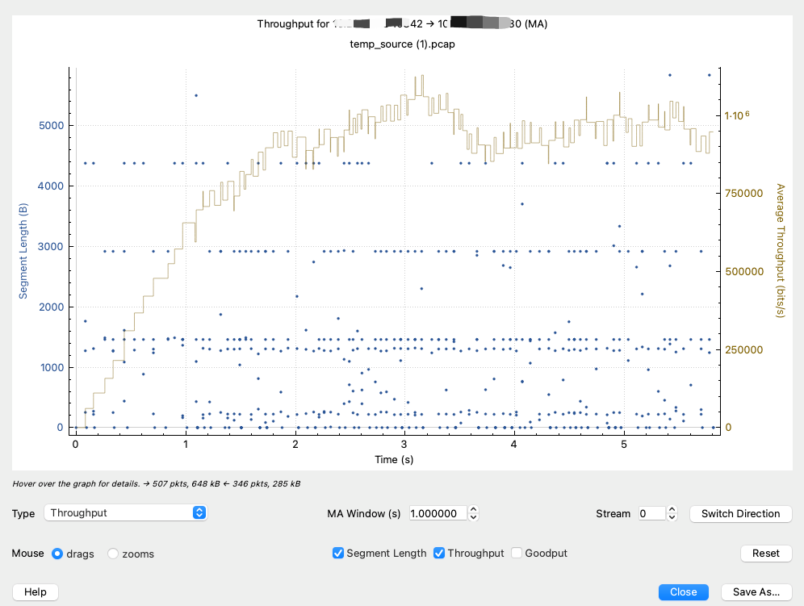

Round Trip Time：TCP 层面的往返时间。

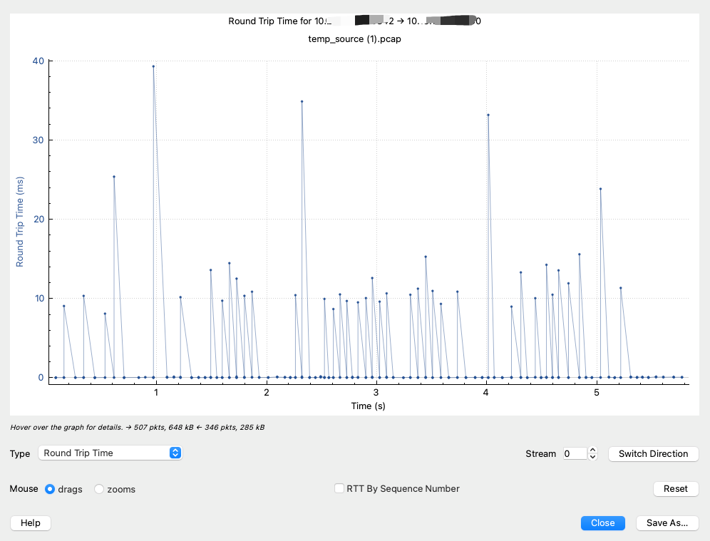

上图的例子中，Round Trip Time 在 0 和 40ms 之间剧烈波动。而在我们印象中，Round TripTime 不是应该很稳定吗？其实，这里的往返时间特指 TCP 报文从发出到被确认的时间差。而一般意义上的往返时间，是指物理条件造成的网络时延，这种确实不太会波动。

TCP Round Trip Time 波动较大的问题跟 TCP 本身设计有关。在 TCP 中，其实接收端不是每次一旦收到报文就立刻回复确认报文的，而是常常会延迟一会儿再确认。这有 2 大原因：

1. 预期的延迟：TCP 延迟确认（delayed ACK）是一种很常见的优化机制，但副作用是造成了确认的延迟。

2. 非预期的延迟：由于主机 CPU、缓存等资源的限制，或者途经的网络不稳定，确认报文也可能有被延迟发出或者延迟到达。

当然，如果 TCP Round Trip Time 偏大（比如超过了 200ms），那么一定有什么环节出了问题，需要去深究一下。这也是这个子工具在网络调优方面的意义所在。

Window Scaling：查看 TCP 窗口和在途字节数的变化情况。

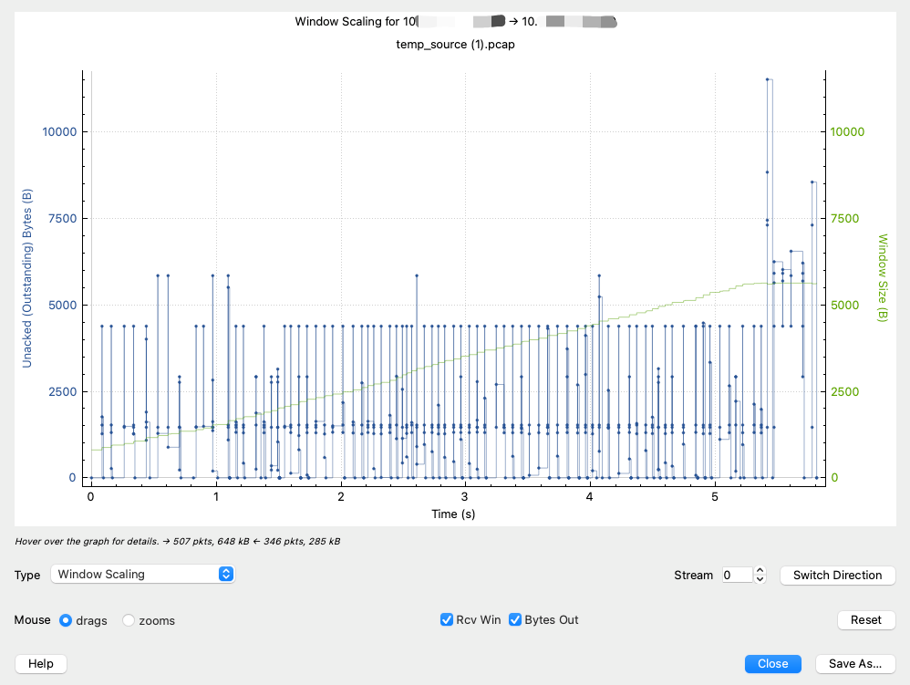

这个坐标系里有两个 Y 轴，左侧 Y 轴是 A 的未确认字节（也就是在途字节数）的数值，右侧Y 轴是 B 的窗口大小的数值。两个值用不同的颜色表示，共存在这个坐标系上。这里说的 A和 B 表示通信的一方和另一方，我们可以通过点击右下角的“Switch Direction”按钮来切换 A和 B。

另外，你进入 TCP Stream Graphs 的任何一个子工具，可以在界面左下角 Type 这里选择切入其他子工具的。或者说这多个子工具底层是通用的，区别仅在于展示的信息不一样。

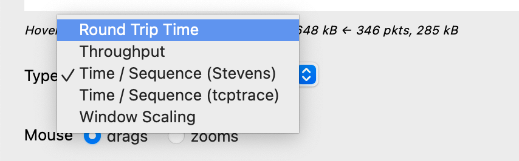

### I/O Graphs

对于传输速度等分析场景来说，是否有重传往往并不重要，我们最关注的是整体的数据传输状况，那么这时候我们应该借助 I/O Graphs 提供的强大功能。这个子工具可以给我们展现一个或者多个 TCP 流在网络 I/O 视角下的流量图，很方便我们判断整体传输速度、特定时间点的速度快慢等。

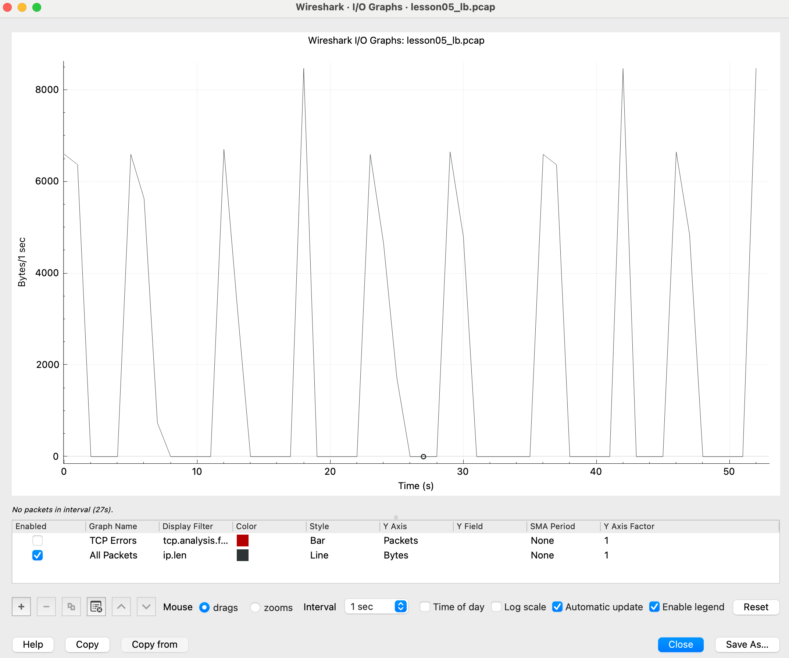

更多细节可以参考 09 讲《长肥管道：为何文件传输速度这么慢？》里关于 I/O Graphs 的部分。

### HTTP 工具集

随着微服务的发展，越来越多的基础组件和业务组件都用 HTTP 协议来实现联动，所以 HTTP协议工具也很有用。在 Wireshark 的 Statistics 下拉菜单里，鼠标移动到 HTTP，右侧自动弹出几个字工具，分别是 Packet Counter、Requests、Load Distribution，还有 RequestSequences。

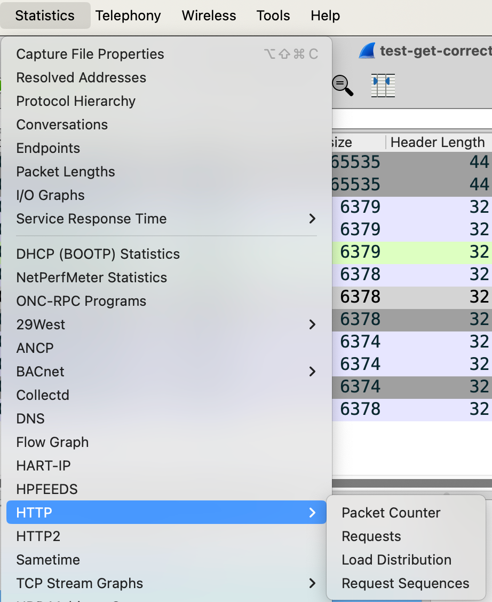

使用 HTTP 工具集，我们很容易获取到 HTTP 层面的信息，比如 HTTP 各种状态码（2xx、3xx、4xx、5xx 等）的占比、HTTP 各种方法的占比等等。这些信息再结合应用层日志就容易推进排查了。

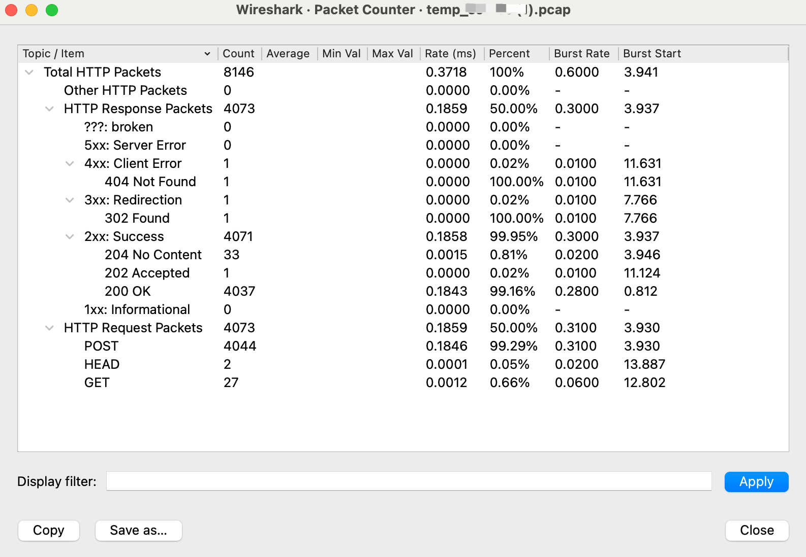

## 小结

这一节，我们首先对 Wireshark 界面的三大区域，即报文列表区域、报文详情区域、报文字节区域做了整体性的了解，也初步学习了每个区域的作用和使用场景。一般来说，以下这些不太复杂的网络问题，都可以通过对这三大区域的信息进行分析而解决：

- 网络上有丢包和重传：重点分析被提示为 TCP Dup Ack 和 TCP Retransmission 的报文。

- 网络上有丢包和超时：重点分析被提示为 TCP Fast Retransmission 的报文。

- 握手或者挥手有异常：重点分析 RST 等报文。

- 接收窗口满：重点分析被提示为 TCP Window Full 的报文。

后半部分我们学习了 Wireshark 的几个子工具的使用，包括 TCP stream graphs、I/Ographs、HTTP 工具集等。其中，TCP stream graphs 可以说是其中的大杀器，用好了可以杀敌于无形，尤其适用于网络性能优化场景。本专栏中不少案例就是使用 TCP stream graphs得以解决的。包括：

- 09 ｜ 长肥管道：为何文件传输速度这么慢？

- 10 ｜ 窗口：TCP Window Full 会影响传输效率吗？

- 11 ｜ 拥塞：TCP 是如何探测到拥塞的？

你可以复习这些章节，深入了解下 TCP stream graphs 的强大能力。

## 思考题

1. 你有没有给 Wireshark 添加过自定义字段？跟我们分享一下你常用的自定义字段，以及你是怎么用它来解决具体问题的。

2. 有什么信息你想获取，但没有在 Wireshark 工具里找到的？说出来，我们一起想想办法。

如果你有新的想法，欢迎在留言区和我一起分享和交流，我们下一节见。
