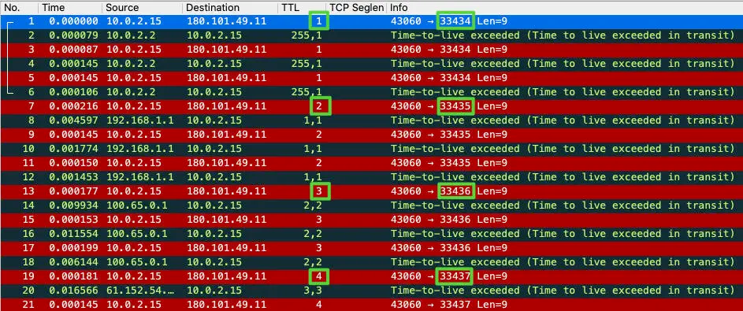
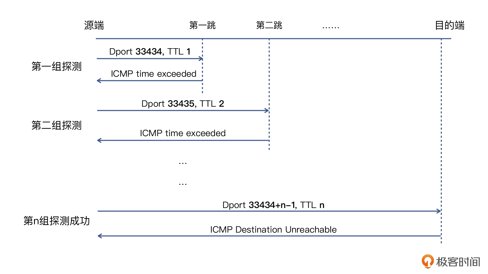
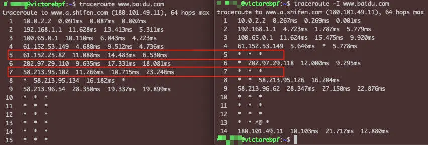
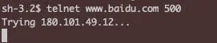
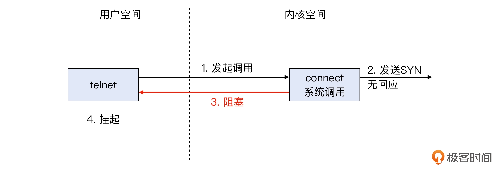
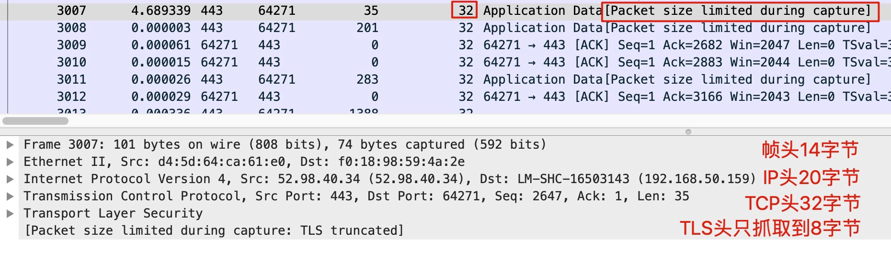
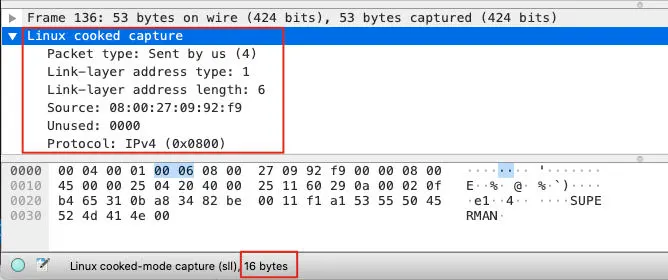
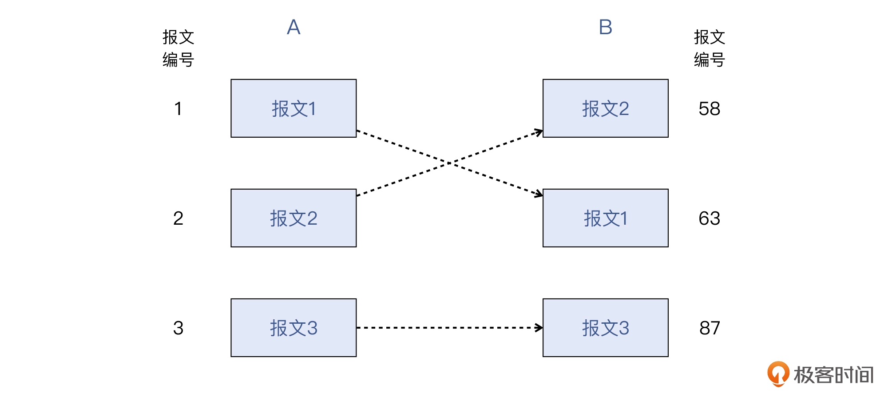
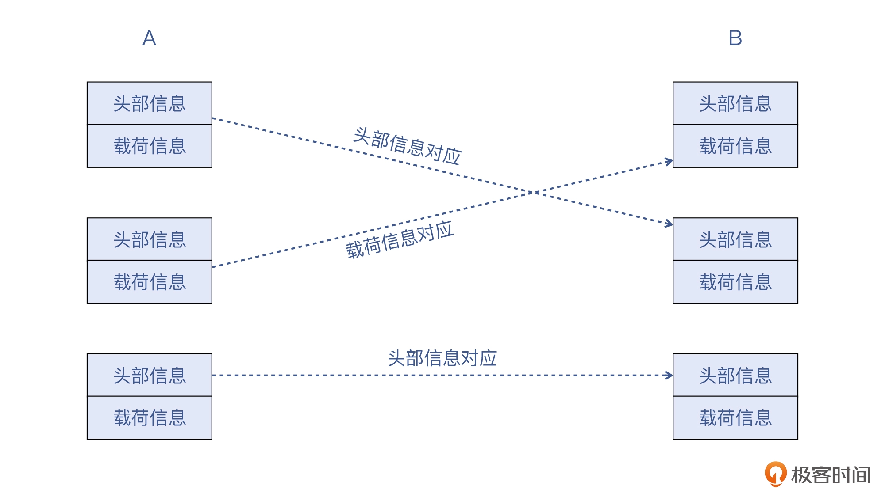

# 答疑（一）-第1~5讲思考题答案

你好，我是胜辉。

不知不觉，咱们已经完成预习篇、实战一的 TCP 真实案例篇，还有实战二的应用层真实案例篇的学习了。一路走来，我自己完成了 20 多讲的备课，过程中是辛劳和满足相伴。当然你也很不容易，坚持学完 20 多讲，一共投入的时间也接近 20 个小时，这个过程本身就是一种小小的成就。

由于课程涉及的网络知识面还是比较广泛的，如果你还有不少没看懂的地方，也别着急，这是很正常的情况。就我自己来说，最初看那些 TCP/IP 概念的时候也是摸不到头脑，后来我就是反复看，从不同的资料、不同的案例来入手，才逐步建立起自己的理解。

正因为通过问题来理解概念是一种很好的学习方法，所以我在每节课的后面，都留有一两个思考题，希望可以促进思考。这些问题，有些比较容易，有些可能略有难度。所以我整理了答疑篇，一方面给出答案供你参考，一方面也正好把课程里没有覆盖到的细节给你展开一下，作为内容上的补充。总之，我希望通过这个答疑环节，能帮助你把看过的知识都真的消化掉，成为你自己知识体系的一部分。

## 01 讲的答疑

### 思考题

1. traceroute 默认是用 UDP 来做探测的，那这个又是基于什么原理呢？通和不通，我们会收到怎样的回复？

2. 有时候运行 telnet 后命令就挂起，没有响应了，这说明了什么问题呢？

### 答案

关于第一个问题，我看到很多同学的回答都已经很到位了，比如以 @webmin 同学的回答为例：

- traceroute 使用 UDP 探测时，初始时把 TTL 设置为 1，经过路由器时 TTL 会被减 1，当TTL 变为 0 时，包被丢弃，路由器向源地址发回一个 ICMP 超时通知（ICMP TimeExceeded Message）。源收到这个通知，就会把下一次发送的包的 TTL 在原来的基础加1，这样就可以多前进一步。探测时使用了一个大于 30000 的端口号去连接，随着 TTL 的增加端口也会加 1，目地服务器在收到这个数据包的时候，会返回一个端口不可达的 ICMP错误信息（ICMP Port Unreachable），当源地址收到 ICMP Port Unreachable 包时，会停止 traceroute。

在我的 Ubuntu 虚拟机上，traceroute 使用的起始 UDP 目的端口是 33434，然后每次探测的TTL 加一的同时，UDP 目的端口也加一，每次探测会发送 3 次探测报文。也就是下图这样：



当时的 traceroute 命令行的输出是这样的：

```
traceroute www.baidu.com
traceroute to www.a.shifen.com (180.101.49.11), 64 hops max
 1   10.0.2.2  0.082ms  0.177ms  0.088ms
 2   192.168.1.1  4.634ms  1.811ms  1.488ms
 3   100.65.0.1  9.972ms  11.511ms  6.189ms
 4   61.152.54.125  16.296ms  3.576ms  4.095ms
 5   61.152.24.102  7.329ms  6.786ms  11.987ms
 6   202.97.71.6  28.938ms  10.568ms  10.069ms
 7   58.213.95.2  15.036ms  9.831ms  17.043ms
 8   *  *  *
 9   58.213.96.54  16.843ms  10.329ms  15.989ms
10   *  *  *
11   *  *  *
12   *  *  *
13   *  *  *
14   *  *  *
15   *  *  *
16   *  *  *
```

这次 traceroute 没有停住，而是一直到 64 跳的限制后才停止（因为输出过长，我没有把全部

```
的信息复制过来）。当然，一般实践中你看到连续六七个以上的*，基本就可以判定是目的端
```

对 UDP 无响应，可以按下 Ctrl + C 终止了。

我把整个流程的实现原理，概括成了下面的示意图，希望能帮助你理解：



然后，我们再用 ICMP 模式做一次 traceroute，输出如下：

```
$ traceroute -I www.baidu.com
traceroute to www.a.shifen.com (180.101.49.12), 64 hops max
 1   10.0.2.2  0.105ms  0.229ms  0.173ms
 2   192.168.1.1  8.972ms  1.725ms  1.326ms
 3   100.65.0.1  9.850ms  7.893ms  7.311ms
 4   *  *  61.152.53.149  5.579ms
 5   *  61.152.25.230  20.238ms  5.204ms
 6   *  *  *
 7   *  58.213.94.114  21.249ms  *
 8   58.213.94.126  13.869ms  *  *
 9   58.213.96.54  11.736ms  10.094ms  10.644ms
10   *  *  *
11   *  *  *
12   *  *  *
13   180.101.49.12  24.780ms  9.443ms  10.201ms
```

这次就能顺利完成了，这是因为目的 IP 对 ICMP 是有回复的，所以 traceroute 就在最后一跳，也就是第 13 跳顺利停止了。

这里还有个小技巧。你有没有发现 UDP 和 ICMP 这两种模式下，路径信息是可以互补的？比如 UDP 模式下没有显示第 5 和第 7 跳的 IP，但是 ICMP 模式下就有。这就是为什么我建议你把两种模式分别跑一下，这样可以获取到尽可能完整的路径。



第二个问题是关于 telnet 挂起。这里说的“挂起”，是指没有进一步的反应了，比如像下图这样：



究其原因，就是 telnet 发送了 SYN 后没有收到 SYN+ACK。我们在第 21 讲提到了系统调用，那么对于 telnet 这样的用户空间程序来说，它要发起 TCP 连接，就必须调用 connect()这个系统调用，后者会负责发出 SYN。但是 SYN 发出去后，对端没有回复 SYN+ACK，这就导致 connect() 阻塞，telnet 程序也只好等在那里，表象上就是挂起了。

你可以参考这个示意图来理解整个过程：



当然，在第 21 讲我们也学习过 strace 这个工具了，所以我们可以用 strace 来验证这个过程。直接运行下面的命令：

```
strace telnet www.baidu.com 500
```

就能看到，strace 停留在 connect() 系统调用这里了：

```
......
socket(AF_INET, SOCK_STREAM, IPPROTO_IP) = 3
setsockopt(3, SOL_IP, IP_TOS, [16], 4)  = 0
connect(3, {sa_family=AF_INET, sin_port=htons(500), sin_addr=inet_addr("45.113.19
```

## 02 讲的答疑

### 思考题

1. 请你用偏移量方法，写一个 tcpdump 抓取 TCP SYN 包的过滤表达式。

2. 如果确定问题是在 IP 层，tcpdump 命令如何写，可以做到既找到 IP 层的问题，又节约抓包文件大小呢？

### 答案

很多同学都写出了正确的偏移量的过滤表达式，也就是：

```
tcpdump 'tcp[13]&2 != 0'
```

当然，这个题目没有指明是一定只要 SYN 包，我们用上面这条命令可以抓到 SYN 和SYN+ACK 这两种报文。而如果要指定只抓取 SYN 包而不抓取 SYN+ACK，可以用下面的表达式：

```
tcpdump 'tcp[13]|2 = 2'
注意：这里的运算符是“|”，也就是字符或运算符。
```

第二个问题的关键点是 tcpdump 的 -s 参数，我们通过它可以指定要抓取的每个报文的大小。不过那就有个问题了，这里的“报文”是指 IP 分组还是二层帧呢？

虽然 tcpdump 名称里是 tcp，实际上它能抓取 udp、ip、icmp 等等各种报文，因为它抓取的就是第二层的帧。所以说，这里的“报文大小”，指的是二层帧的大小。我在第 2 讲里也贴了一张图，展示了在某一次抓包里，一个报文的各层占用的字节数：



一般来说，IP 头部就是 20 字节，加上帧头 14 字节，所以理论上我们只要抓取前 34 字节的报文，就可以获取到二层和三层的信息了。

不过且慢，有个同学报告了一个问题：

```
老师，对于“问题 2”我有个疑问。我最开始用的命令是“tcpdump -i any -s 34”，发现 -
```

- s 写成 34，就抓不到网络层的目的地址字段，用 Wireshark 分析后发现，帧头（不知道还

```
叫不叫这个，Wireshark 显示为 Linux cooked capture v1）占了 16 个字节，写成
36 就能把信息抓全了，但是写成“tcpdump -i eth0 -s 34”就可以抓全。
```

这个问题我之前也没留意到，于是去查证了一下。原来在 tcpdump 里，对于 any 这个接口，它在输出帧头的时候用了一种叫 Linux cooked capture v1 的格式，这个格式的长度是 16 个字节，而以太网帧是 14 字节。这就造成了 2 个字节的差异，也就是按原先的 34 字节去抓取就不够了，所以要扩大到 36 字节才可以抓到完整的 IP 头部。

我们看一个例子：



- 补充：上面的 traceroute udp 模式的示例文件就是用 -i any 模式抓取的，所以它的二层帧

```
头就是 Linux cooked capture v1 格式。
```

另外，“IP 头部 20 字节”这个描述，其实还有一个隐含的前提：IP 头部没有做扩展（Options）。跟 TCP 类似，IP 头部也可以扩展，但是一般用的比较少，在公网上 IP Options的报文有可能被丢弃，所以很少被采用。我们在内网也曾经做过实验，启用了 IP Options，结果发现虽然内网设备可以支持 IP Options，但是延迟增加了很多，所以最后还是取消了它。

## 03 讲的答疑

### 思考题

1. 在 Linux 中，还有一个内核参数也是关于握手的，net.ipv4.tcp_synack_retries。你知道这个参数是用来做什么的吗？

2. 如果握手双方，一方支持 Window Scale，一方不支持，那么在这个连接里，Window Scale最终会被启用吗？你可以参考RFC1323，给出你的解答。

### 答案

第一个问题是关于 Linux 内核参数的。对于各种网络相关的内核参数来说，最快捷的方法可能就是直接在 Linux 主机里面查看 TCP 的手册了，也就是执行：

```
man tcp
```

然后搜索 tcp_synack_retries 就可以了，也就是这个部分：

- tcp_synack_retries (integer; default: 5; since Linux 2.2)The maximum number of times a SYN/ACK segment for a passive TCP connection will beretransmitted. This number should not be higher than 255.

也就说，这是 TCP 回复 SYN+ACK 后等不到 ACK 时，需要重试的次数。

第二个问题是关于 Window Scale（下面简称 WS）在握手中的具体实现。就像我题目里说的，你可以直接去找到RFC1323，然后找到这部分的内容：

- This option may be sent in an initialsegment (i.e., a segment with the SYN bit on and theACK bit off). It may also be sent in a <SYN,ACK> segment, but only if a Window Scaleoption was received in the initialsegment. A Window Scale option in a segment without aSYN bit should be ignored.

直译过来就是：这个 WS 选项可以在 SYN 包中，也可以在 SYN+ACK 包中。但只有收到的SYN 中有这个 WS 选项，回复的 SYN+ACK 才可以加上这个选项。如果收到的报文不带 SYN标志位但却带上了 WS 选项，这样的 WS 应该被忽略。

也就是说，如果发过来的 SYN 里不带 WS 选项，那回复的 SYN+ACK 也不应该带 WS，自然这次的连接里也就不会用上 WS 了。简单来说，只要有一方不支持 WS，这次的连接里就不会用 WS。

## 04 讲的答疑

### 思考题

1. 如果要在 Wireshark 中搜索到挥手阶段出现的 RST+ACK 报文，那么这个过滤器该如何写呢？

2. 你有没有通过抓包分析，解决过应用层的奇怪问题呢？你是怎么做的呢？

### 答案

第一个问题里挥手阶段出现 RST 的现象， 这个已经不是用 FIN 完成的标准挥手过程了，而是出现了异常。不过从报文特征来说还是比较直接的，就是既要带 RST 标志位，也要带 ACK 标志位，所以答案就是：tcp.flags.ack==1 and tcp.flags.reset == 1。

第二个问题是开放式的，比如 @江山如画同学分享了一个挺有意思的案例，是双方时钟不同步导致了 TLS 握手失败。时钟问题也是一个挺有“存在感”的问题，时不时会在各种故障中扮演一点角色，我们可以在排查没什么方向的时候，也可以查一下时钟。

另外说到 TLS 握手的问题，我在第 19 讲里介绍了两个典型案例，也是刚过去不久的一讲，我想你应该还有印象。

## 05 讲的答疑

### 思考题

这节课里，我介绍了使用裸序列号作为定位两侧同个报文的手段。那么要定位两侧的同个报文，除了这个方法，还有哪些方法呢？你可以从网络七层模型出发，给出自己的思考。

### 答案

定位两侧同个报文，是一个比较关键的技术点，因为抓包分析的一个重要任务，就是对比两侧抓包文件中的报文，从而判定丢包、乱序、重传等行为的严重程度和原因，由此才能针对性地做进一步排查乃至找到解决方案。如果不能找到“同个报文”，那刚才说的一系列工作就无从谈起了。



- 补充：A 和 B 对报文的编号一般是不同的，因为各自抓取报文的起始时间、抓取条件等都可能不同，就会导致抓取到的报文互有交集。

比如上面就是一个典型的 TCP 问题的场景，也就是报文顺序发生了变化，这个现象就是“乱序”：发出 1、2、3，收到的却是 2、1、3。那么显然，我们需要在两侧的抓包文件里，找到对应的同个报文。事实上，现在说的 1、2、3，是 A 的抓包文件里的报文编号，而 B 那边有自己的视角和报文编号，跟 A 是完全不同的。

我在第 5 讲里介绍的方法，是用了裸序列号（原始序列号），因为 TCP 报文的这个序列号在传输中是不会变化的，所以这就是一个很好的确定报文的方法。其实，这属于第一大类方法：按照 TCP 报文的元信息，也就是 TCP 头部的特征去找到对应的报文。

既然确定了这个大类的方法原则，你很容易举一反三，想到其他的方法。比如：

- 用 TCP 确认号，比如下面这个过滤器：

```
tcp.ack_raw == 754313633
```

- 如果有 TCP timestamp 扩展，就用 TCP timestamp，比如下面两种过滤器：

```
tcp.options.timestamp.tsval == 2947948748
tcp.options.timestamp.tsecr == 3209788920
```

- 如果有 TCP SACK 扩展，就用 SACK 号，比如用过滤器：

```
tcp.options.sack_le == 1234
```

而第二个大类的方法，是利用 TCP 的载荷本身的特征去找到对应的报文。比如 HTTP 是文本协议，那么我们用下面这个过滤器，就可以找到含有这个字符串的报文：

```
tcp contains "id=abcdafeafeagfeagfaraera1242dfea"
```

其实换成以下这几种方式，也是一样的效果：

```
frame contains "id=abcdafeafeagfeagfaraera1242dfea"
ip contains "id=abcdafeafeagfeagfaraera1242dfea"
http contains "id=abcdafeafeagfeagfaraera1242dfea"
```

这个示意图，也表示了这样的两大类寻找对应报文的方法：



不过，你看了这张图，会不会以为我们每个报文都要这么找对应关系呢？那当然不用了，每个TCP 流只要找一个关键报文，然后根据这个报文去做 Follow -> TCP Stream 就好了。

## 小结

以上就是针对课程前 5 讲思考题的参考答案和拓展解读，希望能给你一些启发。另外，也非常感谢你对课后思考题的仔细思考和认真解答。在看留言的过程中，我从大家的答复中也看到了更加全面或是更加深入的思考，我自己受益匪浅。

接下来，我还会针对剩余的课后思考题，以及你的提问来作出解答。有任何问题，还是跟以前一样，欢迎你在留言区跟我交流，我们一同成长。
