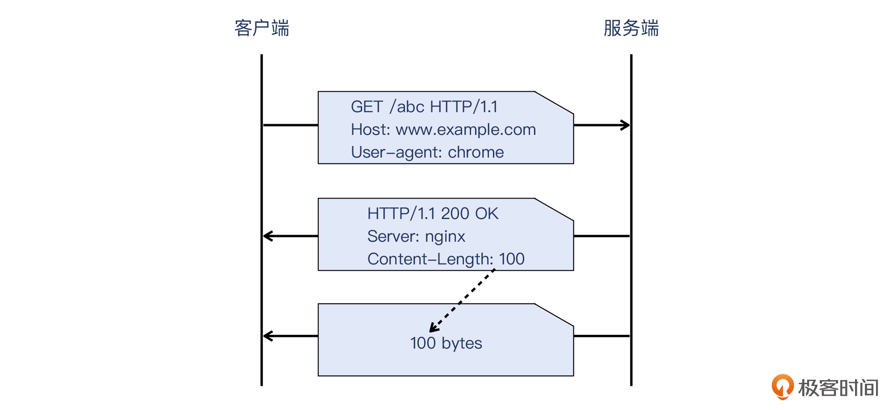
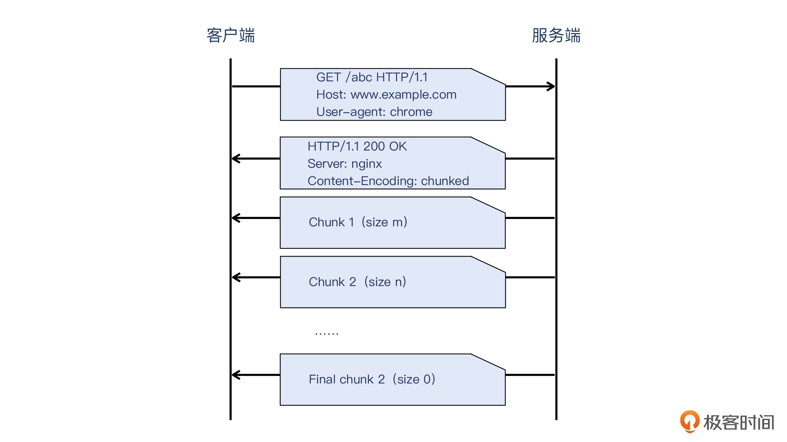
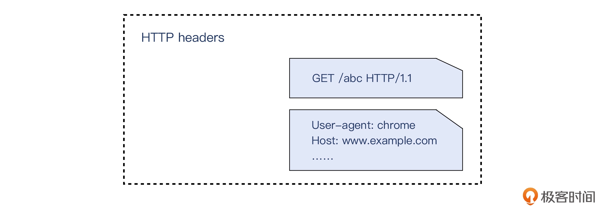
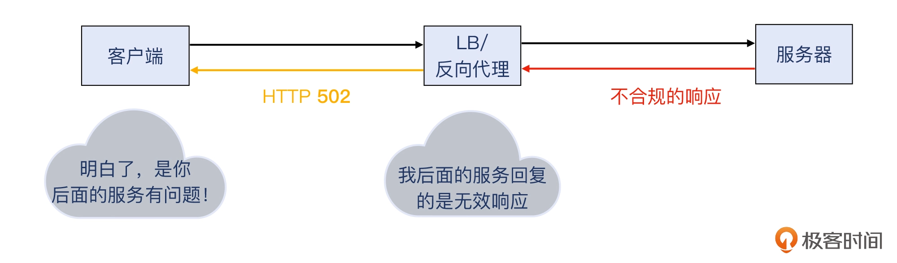
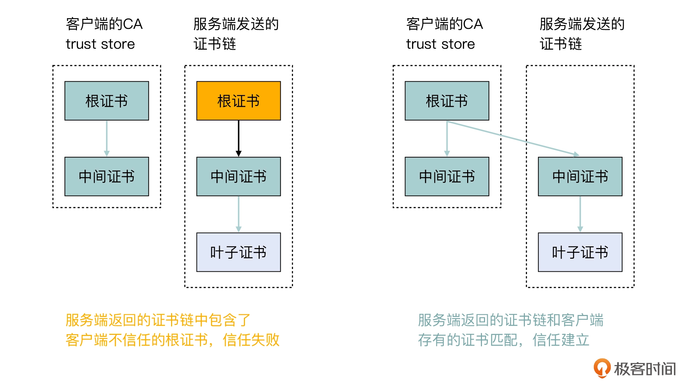

# 答疑（四）-第16~20讲思考题答案

你好，我是胜辉。

今天咱们的思考题解答就要进入到第 16~20 讲了。在第 16 到 18 讲里，我们通过几个应用层的案例，回顾了排查 HTTP 异常状态码的方法，也学习了偶发性问题的排查思路和技巧。在第19 和 20 讲里，我们更是系统性地学习了 TLS 相关的知识，比如 TLS 密码套件、握手协商等细节，最后又对 TLS 解密这个敏感而实用的话题，进行了深入的探讨。

那么，结合了解密技能和应用层排查技能，相信你对应用层的网络难题的排查，也增加了不少把握。接下来，就让我们继续进入答题环节，先来看第 16 讲的思考题。

## 16 讲的答疑

### 思考题

1. 在 HTTP 请求里，我们用 Content-Length 表示了 HTTP 载荷，或者说 HTTP body 的长度，那有时候无法提前计算出这种长度，HTTP 是如何表示这种“动态”的长度呢？

2. HTTP 请求的动词加 URL 部分，比如 GET /abc，它是属于 headers，还是属于 body，或者哪种都不属于，是独立的呢？

### 答案

第一个问题的核心知识点，是 HTTP 的数据传输中，对于数据边界的约定。我们知道，在计算机世界中，数据就是由 0 和 1 表示的一连串的二进制数字，而这一连串数字的起始和结束的位置就很关键了。如果结束位置无法确定，那么显然根本无法正确读取到数据。

举个例子，如果我们从网络上收到一段数字 01010101，而变量 A 在它的前部，假如 A 的长度为 4 个 bit，那就是 0101，十进制的值是 5。假如 A 的长度为 5 个 bit，那就是 01010，它的十进制值就是 10 了，跟之前完全不同。

- 补充：为了简化讨论，这里略过了大小端字节序的问题。

现在网络的带宽很大，每秒钟都可能传送着几十上百兆的数据，所以宏观上看，网络数据的传输好像是大批量地“并行”进行的。但在微观尺度里，比如在纳秒这个时间尺度上看，数据依然是一个一个 bit（0 或者 1）地进行发出和接收，依然是“顺序的”。而在网络的每一层，都有相应的头部字段规定了载荷的开始位置（offset）和长度（length）。有了这些信息，接收端就可以正确读取这些数据了。

我们可以具体到 HTTP 这一层来看，它的请求和响应报文，也是同样的：先头部（headers）后载荷（body）。那 HTTP 头部的结束位置在哪里呢？这个在第 16 讲里我们就提到过，它不是用某个长度字段，而是用两个 CRLF 这样的字符定义了头部的结束位置。

而 HTTP 载荷的结束位置，又是如何定义的呢？其实有两种情况。一种就是最常见的，用Content-Length 头部直接定义出载荷的长度，非常直接。接收端只要读取到这个长度的数据时，就知道已经读取到了完整数据了。



另外一种，就是针对“动态长度”的数据，HTTP 用 Content-Encoding: chunked 这个头部，声明了块传输的方式。

这里说的数据为什么是“动态”的呢？是因为这些数据，无法在发送 HTTP 响应的开始阶段就确定下来，那么服务端就需要通过这种块传输的方式，一边计算出一部分数据，一边发送这些数据块（也就是 chunk），这就是所谓“动态”了。也正是通过这种方式，解决了“既要传输数据，又无法在传输开始时就知道数据大小”的矛盾。

不过，chunk 传输源源不断，那客户端怎么知道哪个 chunk 是结束呢？其实，每个 chunk 的开头的信息就是这个块的长度值，而如果这个长度是 0，就表示这是最后一个 chunk 了，这也就是结束的位置。示意图如下：



第二个问题可能是不少人忽视的一个知识点。我们知道，Server、Host 等 header 就是明确的HTTP 头部，而在这些 header 之前的“GET /abc HTTP/1.1”（也就是方法 + URL + 版本号），虽然形式上并不是像其他 header 那样的键值对，但它确实也属于 HTTP 头部。

其实这个知识点在这一讲的案例里就有体现。当时 HAProxy 把后端 HTTP 400 转义为前端HTTP 502，其原因就是在于：HAProxy 的代码里，定义了 HTTP 头部大小不能超过 8KB 的逻辑，而 GET URL 正是属于这 8KB 中的一部分。



## 17 讲的答疑

### 思考题

1. 如果 LB / 反向代理给客户端回复 HTTP 503，表示什么呢？如果 LB / 反向代理给客户端回复 HTTP 500，又表示什么呢？

2. 这节课里，我介绍了使用应用层的某些特殊信息，比如 uuid 来找到 LB 两侧的报文的对应关系。你有没有别的好方法也可以做到这一点呢？

### 答案

第一个问题，考查的是我们对 HTTP 503 跟 500 的不同语义的理解，以及这两个状态码跟 LB的关系。我在课程里提过，LB 是中间设备，它本身一般不会出现 HTTP 500。如果后端有HTTP 500，LB 就直接透传给客户端。而如果后端出现了服务不可用，比如 LB 到后端服务的健康检查失败，LB 无法找到一个可用的后端服务器，那么 LB 就会回复 HTTP 503 给客户端。

也正是通过 HTTP 503，LB 表达了这层意思：“我自己是没问题的，但是后端服务器都处于不能干活的状态”。

类似的情况是 HTTP 502，也就是 LB 后端的服务器返回了不合规的 HTTP 响应。你也可以再次复习一下课程里的这张图：



第二个问题也没有标准答案。其实只要在你的环境里有类似的 id，能通过它区分不同的 HTTP请求就可以了，无论它是叫 uuid，还是 traceid，或者是 transaction id。然后各种 contains 过滤器，也就是我们在答疑二里对07 讲做解答时候提到的这些：

```
应用层可以是 http contains "abc"；
传输层可以是 tcp contains "abc"；
网络层可以是 ip contains "abc"；
数据链路层可以是 frame contains "abc"。
```

## 18 讲的答疑

### 思考题

1. 前面我介绍了使用 tshark 来找到耗时最高的 HTTP 事务的方法。关于 tshark，你自己还有哪些使用经验呢？

2. 在“是否还有其他可能？”这里，我提到了可能的重传。如果要验证是否真的存在这种重传，你觉得应该做什么呢？

### 答案

第一个问题，@Realm 同学做了很好的回答：

```
tshark -R "tcp.analysis.retransmission ||
tcp.analysis.out_of_order" 通过 -R 指定过滤条件，抓重传和乱序的包。
```

tshark 是随着 Wireshark 一起被安装到系统里的工具，它的各种过滤器等特性跟 Wireshark 是一样的，所以能在命令行里面做同样的分析工作。

```
补充：不过可能是版本的区别，如果你运行 tshark -R
"tcp.analysis.retransmission || tcp.analysis.out_of_order" -r
file.pcap 报错，把 -R 改为 -Y 就可以执行了，或者在 -R 前面加上 -2。
```

像上面的 tcp.analysis 是一个很大的过滤器的集合。要查看 tcp.analysis 的各种分支，你可以这样做：

- 在 Wireshark 的过滤器输入框里输入 tcp.analysis，很多相关的过滤器就会被提示出来。

- 在命令行里执行 tshark -G | grep tcp.analysis，一部分输出如下：

```
$ tshark -G | grep tcp.analysis
F  SEQ/ACK analysis  tcp.analysis  FT_NONE  tcp    0x0  This frame has some of th
F  TCP Analysis Flags  tcp.analysis.flags  FT_NONE  tcp    0x0  This frame has so
F  Duplicate ACK  tcp.analysis.duplicate_ack  FT_NONE  tcp    0x0  This is a dupl
F  Duplicate ACK #  tcp.analysis.duplicate_ack_num  FT_UINT32  tcp  BASE_DEC  0x0
F  Duplicate to the ACK in frame  tcp.analysis.duplicate_ack_frame  FT_FRAMENUM
F  This is an ACK to the segment in frame  tcp.analysis.acks_frame  FT_FRAMENUM
F  Bytes in flight  tcp.analysis.bytes_in_flight  FT_UINT32  tcp  BASE_DEC  0x0
F  Bytes sent since last PSH flag  tcp.analysis.push_bytes_sent  FT_UINT32  tcp
F  The RTT to ACK the segment was  tcp.analysis.ack_rtt  FT_RELATIVE_TIME  tcp
F  iRTT  tcp.analysis.initial_rtt  FT_RELATIVE_TIME  tcp    0x0  How long it took
F  The RTO for this segment was  tcp.analysis.rto  FT_RELATIVE_TIME  tcp    0x0
F  RTO based on delta from frame  tcp.analysis.rto_frame  FT_FRAMENUM  tcp    0x0
F  This frame is a (suspected) retransmission  tcp.analysis.retransmission  FT_NO
F  This frame is a (suspected) fast retransmission  tcp.analysis.fast_retransmiss
.   .....
```

tshark 加上 -G 参数会输出所有可用的过滤器，数量多达 20 万个（你没看错）。这个大宝藏，值得我们去多多探索和挖掘一下。

至于第二个问题，要搞清楚服务端是否有重传，最直接的办法就是在服务端也做抓包。这样的话，有没有重传就一目了然了。当然，在客户端抓包的话，也经常能通过乱序等现象推导出对端发生了重传，但不能保证涵盖所有的重传情形。

## 19 讲的答疑

### 思考题

1. 我们知道 TCP 是三次握手，那么 TLS 握手是几次呢？

2. 假设服务端返回的证书链是根证书 + 中间证书 + 叶子证书，客户端没有这个根证书，但是有这个中间证书。你认为客户端会信任这个证书链吗？

### 答案

第一个问题是 TLS 握手的基本知识。不考虑 TLS session 复用或者 TLS1.3 的 1RTT，甚至0RTT 这种特殊情况，一般情况下 TLS 握手是四次。

- 第一次握手：客户端发送 Client Hello。

- 第二次握手：服务端发送 Server Hello 和 Certificate 等消息。

- 第三次握手：客户端发送 ClientKeyExchange 和 ChangeCipherSpec 等消息。

- 第四次握手：服务端发送 ChangeCipherSec 和 Finished。

在 RFC5246 的Handshake Protocol Overview的第 35 页，也有关于这个知识点的详述，我把其中的关键部分引用到这里，供你参考。

```
     Client                                               Server
     ClientHello                  -------->
                                                     ServerHello
                                                    Certificate*
                                              ServerKeyExchange*
                                             CertificateRequest*
                                  <--------      ServerHelloDone
     Certificate*
     ClientKeyExchange
     CertificateVerify*
     [ChangeCipherSpec]
     Finished                     -------->
                                              [ChangeCipherSpec]
                                  <--------             Finished
     Application Data             <------->     Application Data
```

第二个问题是关于证书信任链的知识。我们知道，PKI 的信任不是凭空来的，而是有一个起点，而这个起点就是客户端保存的根证书。有了它，一系列信任才能建立起来。而在这个问题里，由于客户端并没有这张根证书，而服务端返回的证书链又绑定了这张不被信任的根证书，那么信任链就无法建立了。

在这个问题里，客户端有这张中间证书却不能信任这个证书链，你可能对这一点感觉费解。其实这个题目里隐含了一个信息：这张中间证书是被两张根证书都做了签名的，否则服务端也不会把这个根证书放在证书链里一同返回。但是这个证书链强制把中间证书绑定到客户端不信任的根证书，就导致验证失败了。

为了帮助你理解，我们可以换一种场景：如果服务端返回的证书链中，只有这张中间证书和叶子证书，那么因为客户端可以把这张中间证书跟自己信任的根证书关联起来，就可以建立信任。

我们可以再看一下这两种情形下的对比示意图，就更能明白了：



## 20 讲的答疑

### 思考题

1. DH、DHE、ECDHE，这三者的联系和区别是什么呢？

2. 浏览器会根据 SSLKEYLOGFILE 这个环境变量，把 key 信息导出到相应的文件，那么 curl也会读取这个变量并导出 key 信息吗？

### 答案

第一个问题，很多同学都答得很好了。我在这里引用一下 @那时刻同学的回答：

- DH 算法是非对称加密算法，因此它可以用于密钥交换，该算法的核心数学思想是离散对数。

- 根据私钥生成的方式，DH 算法分为两种实现：

- 第一种，static DH 算法，这个算法实际已经被废弃了，因为它算法不具备前向安全性。

- 第二种，DHE 算法，这是现在比较常用的，也就是让双方的私钥在每次密钥交换通信时，都是随机生成的、临时的。

- 不过，DHE 算法由于计算性能不佳，需要做大量的乘法，所以为了提升 DHE 算法的性能，就出现了现在广泛用于密钥交换算法——ECDHE 算法。它是在 DHE 算法的基础上，利用 ECC 椭圆曲线特性，可以用更少的计算量计算出公钥，以及最终的会话密钥。

而第二个问题是一个实践性的问题，不少同学也去实证了。其实也花不了几分钟时间，就能收获一个不错的知识点，有没有觉得这个片刻也挺有意义呢。

好了，今天的答疑就到这里。这些答案，有没有在你的预期以内呢？如果还有新的问题，也欢迎在留言区提问，我们一起进步、成长。
