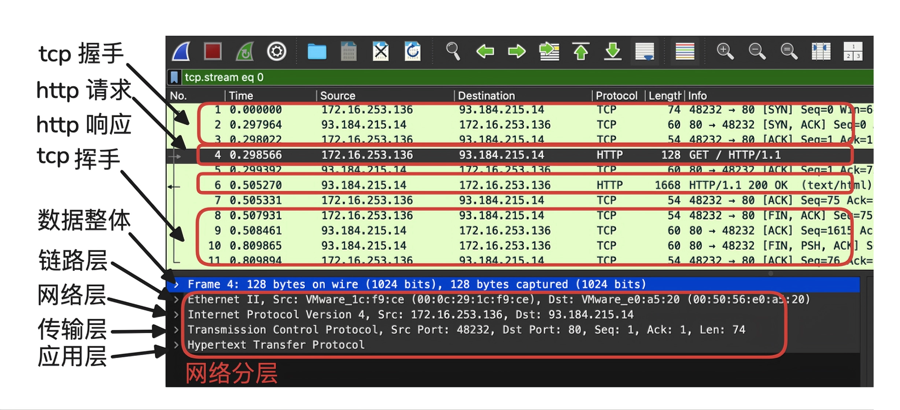
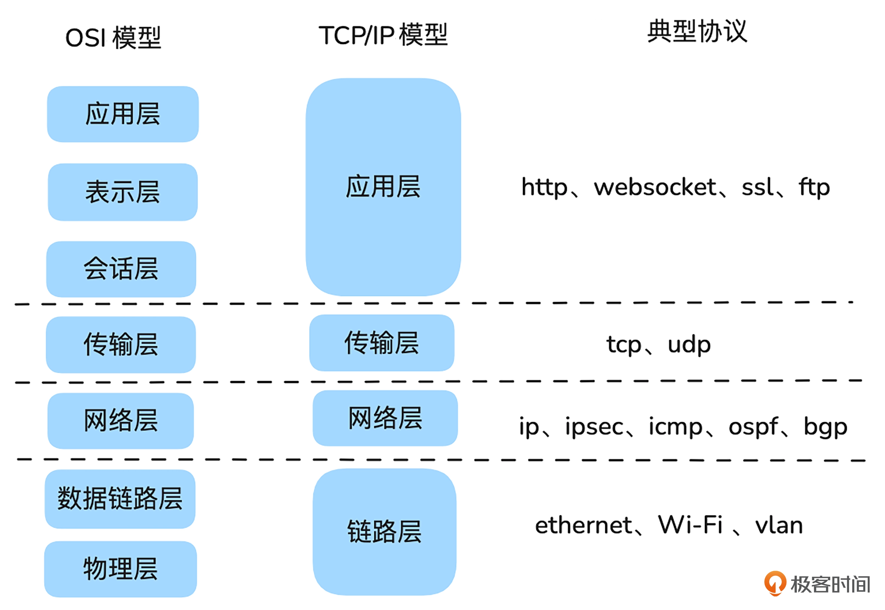
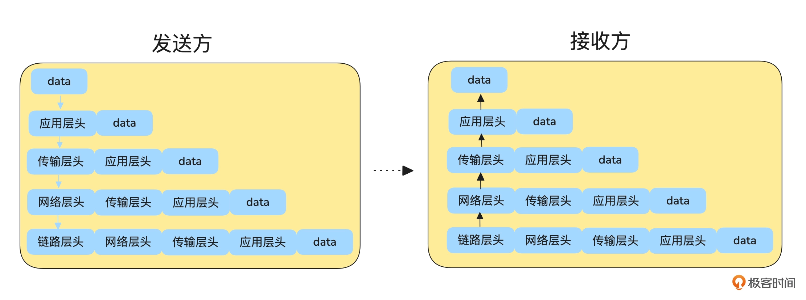
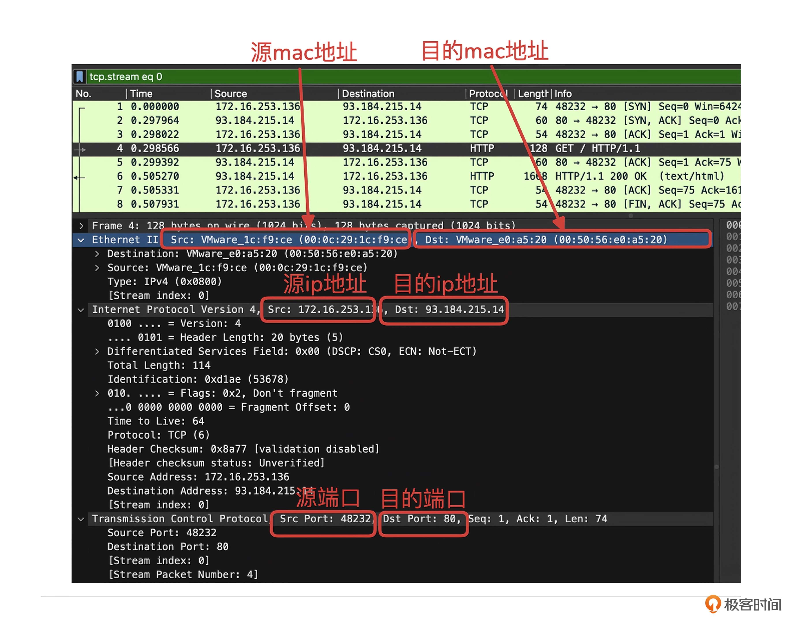
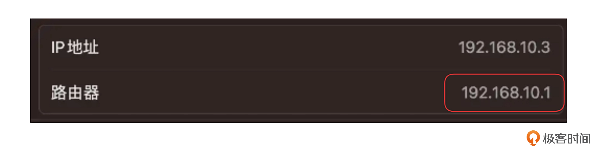
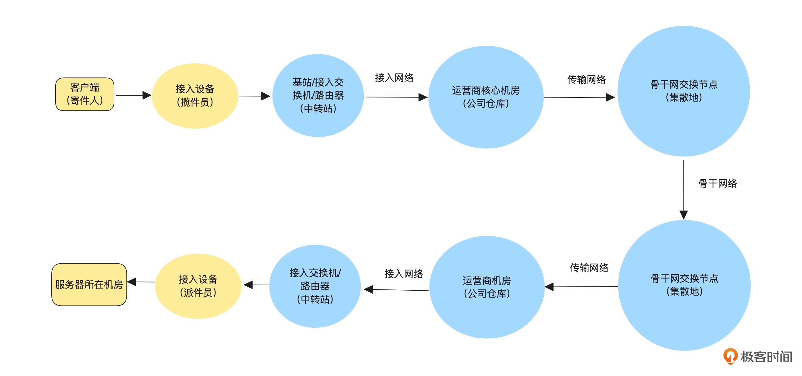
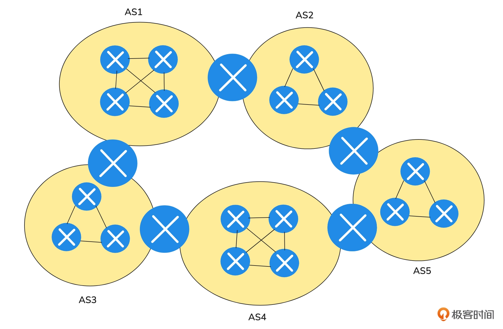
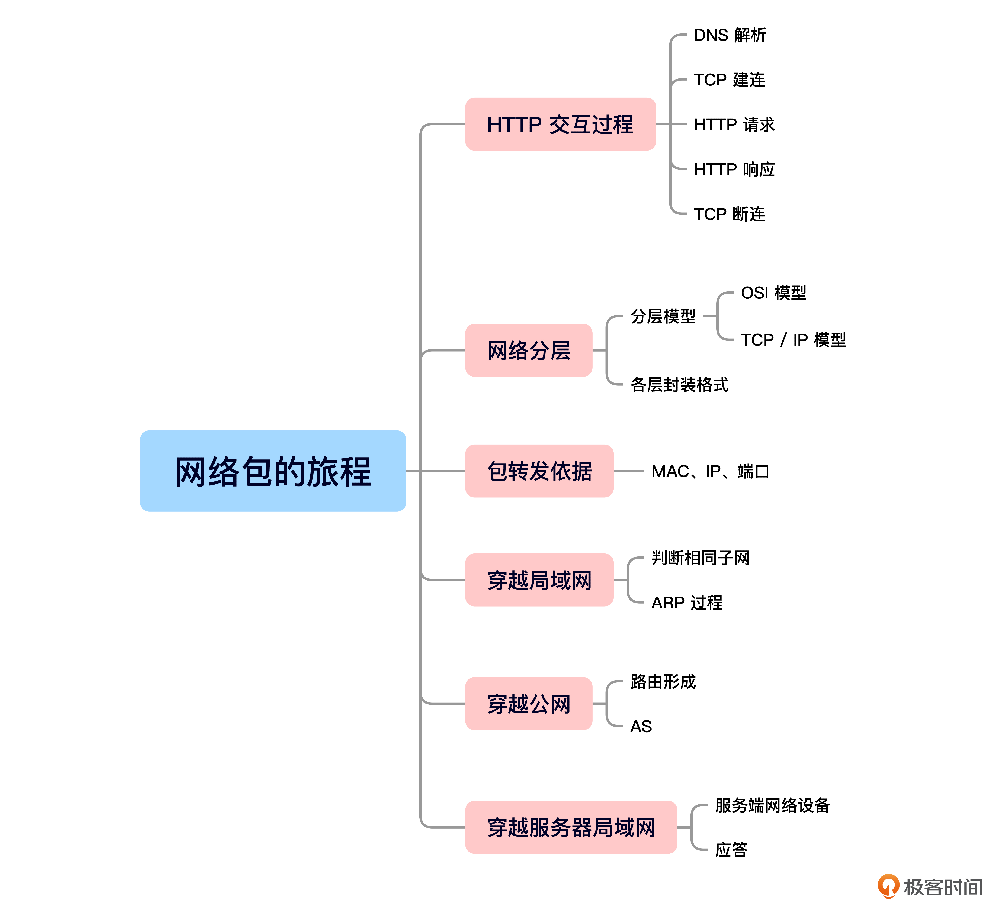

# 01 | 一个数据包的网络之旅：网络是如何工作的？

你好，我是谢友鹏。

你是否曾好奇，互联网究竟是如何运作的？我们都知道“客户端 - 服务端”网络模型，但实际上，客户端和服务端之间可能相隔万里。

数据包是如何在这个庞大的网络中传输的呢？今天，我们将通过一个数据包的“网络之旅”来揭示这一过程。

## 旅行前的准备工作

开始之前先提醒一下，这门课里设计的实验环节比较多，如果你是网络新手，请在开始旅程之前先阅读一下导读里关于课程实验环境、问题定位思路和网络问题排查工具的相关章节。

## 旅程开始

首先，让我们通过一个 HTTP 请求来观察数据包的旅程。

```
#发起一个http请求。
$ curl -o /dev/null -v http://example.com
 % Total    % Received % Xferd  Average Speed   Time    Time     Time  Current
                                Dload  Upload   Total   Spent    Left  Speed
 0     0    0     0    0     0      0      0 --:--:-- --:--:-- --:--:--     0* H
* IPv6: 2606:2800:21f:cb07:6820:80da:af6b:8b2c
* IPv4: 93.184.215.14
*   Trying 93.184.215.14:80...
*   Trying [2606:2800:21f:cb07:6820:80da:af6b:8b2c]:80...
* Immediate connect fail for 2606:2800:21f:cb07:6820:80da:af6b:8b2c: Network is u
* Connected to example.com (93.184.215.14) port 80
> GET / HTTP/1.1
> Host: example.com
> User-Agent: curl/8.5.0
> Accept: */*
>
< HTTP/1.1 200 OK
< Accept-Ranges: bytes
< Age: 422312
< Cache-Control: max-age=604800
< Content-Type: text/html; charset=UTF-8
< Date: Tue, 19 Nov 2024 16:01:26 GMT
< Etag: "3147526947"
< Expires: Tue, 26 Nov 2024 16:01:26 GMT
< Last-Modified: Thu, 17 Oct 2019 07:18:26 GMT
< Server: ECAcc (sed/58C9)
< Vary: Accept-Encoding
< X-Cache: HIT
< Content-Length: 1256
<
{ [1256 bytes data]
100  1256  100  1256    0     0   2600      0 --:--:-- --:--:-- --:--:--  2600
* Connection #0 to host example.com left intact
```

接下来我们分析一下刚刚的结果，看看一个 HTTP 请求经过了哪些过程。

当我们发起请求时，首先会进行域名解析，将域名转化为 IP 地址。如下所示：

```
* Host example.com:80 was resolved.
* IPv6: 2606:2800:21f:cb07:6820:80da:af6b:8b2c
* IPv4: 93.184.215.14
```

在这里，域名 example.com 被解析成了 IPv6 和 IPv4 地址。域名解析可以理解为通过全球维护的庞大数据库来查找与域名对应的 IP 地址。关于域名解析更详细的原理，我们后续第十三节课中还会进一步讲解。

接下来，我们的机器就会尝试与解析出的 IP 所在机器的 80 端口建立 TCP 连接。

```
*   Trying 93.184.215.14:80...
*   Trying [2606:2800:21f:cb07:6820:80da:af6b:8b2c]:80...
* Immediate connect fail for 2606:2800:21f:cb07:6820:80da:af6b:8b2c: Network is u
* Connected to example.com (93.184.215.14) port 80
```

成功与 93.184.215.14 机器的 80 端口建立了 TCP 连接后，开始发送 HTTP 请求。

```
> GET / HTTP/1.1
> Host: example.com
> User-Agent: curl/8.5.0
> Accept: */*
```

最后，服务器返回了 HTTP 200 OK 的响应。

```
< HTTP/1.1 200 OK
< Accept-Ranges: bytes
< Age: 422312
< Cache-Control: max-age=604800
< Content-Type: text/html; charset=UTF-8
< Date: Tue, 19 Nov 2024 16:01:26 GMT
< Etag: "3147526947"
< Expires: Tue, 26 Nov 2024 16:01:26 GMT
< Last-Modified: Thu, 17 Oct 2019 07:18:26 GMT
< Server: ECAcc (sed/58C9)
< Vary: Accept-Encoding
< X-Cache: HIT
< Content-Length: 1256
<
{ [1256 bytes data]
100  1256  100  1256    0     0   2600      0 --:--:-- --:--:-- --:--:--  2600
* Connection #0 to host example.com left intact
```

要进一步了解网络数据包的细节，我们可以通过抓包工具进行分析。你可以使用 tcpdump 抓取与 example.com 的通信数据包。

```bash
sudo tcpdump host example.com -w example.com.pcap
```

然后用 Wireshark 打开 example.com.pcap 文件，跟踪数据包的流向。



在 Wireshark 找到要查看报文的任意一个包，然后右键 -Follow-Tcp Stream 来跟踪这个 tcp流。从图中我们可以看到 tcp 三次握手、http 请求和响应，以及 tcp 挥手的过程。

选中一个 http 包，可以看到网络协议是分层的，接下来我们学习一下网络的分层模型。

### 网络分层模型

我们经常听说的有 OSI 和 TCP/IP 两种网络分层模型，它们的对应关系如下图所示：



OSI 模型将网络划分为 7 层——物理层、数据链路层、网络层、传输层、会话层、表示层和应用层。而 TCP/IP 模型对这些层级进行了简化，将 OSI 模型中的物理层和数据链路层合并为链路层，将会话层、表示层和应用层合并为应用层，同时保留了传输层和网络层。

尽管现在大多数场景中更常用的是 TCP/IP 模型，但在描述协议时，仍普遍沿用 OSI 模型的分层编号。例如，TCP 和 UDP 通常被称为 “4 层协议”，而 HTTP 则被称为 “7 层协议”。我们的课程中默认也采用这种命名规则，以保持一致性。

在 Wireshark 中使用鼠标点击左侧的每一层，可以在右侧看到对应的层级数据。从链路层到应用层，每一层的数据都是对下一层的进一步封装。

网络中各层的封装关系如下图所示。



我们以 HTTP 网络请求为例， 梳理一下各层的封装关系。

在发送方，用户程序需要传输的数据会经过逐层封装。首先添加应用层的 HTTP Header，然后是传输层的 TCP Header，接着是网络层的 IP Header，最后在链路层添加以太网帧的帧头和帧尾，包括源 MAC 地址、目的 MAC 地址等链路层信息，最终形成网络中传输的完整数据包。

在接收方，数据包会按相反的顺序逐层解封装。接收设备从链路层开始解析数据，依次解读网络层、传输层和应用层的信息，最后将数据传递给接收方的应用程序。

接下来，我们在 Wireshark 将每一层点开，看看里面是什么内容，我在图中标注了各层在收发网络数据包时所依赖的关键地址信息。



从中可以看到链路层依赖的是 MAC 地址，网络层依赖的是 IP 地址，而传输层则依赖端口号。其中，目的端口号是 http 请求默认的 80 端口，源端口号由内核自动分配。

## 穿过客户端局域网

讲到这里，你可能会有一个疑问：我们发起请求时只指定了域名。前面已经提到，域名通过解析得到了 IP 地址，那么目的 MAC 地址怎么来的呢？

首先，网络设备通常通过交换机组成局域网，再借助路由器等转发设备与其他局域网通信。在局域网内，可以通过 ARP 广播实现从 IP 地址到 MAC 地址的查找。

如果目标 IP 地址和发起方的 IP 地址属于同一子网，就可以直接通过 ARP 查询到对方的 MAC地址，并将网络包发送给对方。

如果目标 IP 地址不在同一子网，就需要根据路由表查询，找到发往目标 IP 的下一跳设备的MAC 地址，将网络包发送到下一跳设备，由它继续转发至最终目的地。

### 子网判断方式

这里以我们的网络包为例，给出判断目标 IP 地址和自己是否属于同一子网的方法。

```
#查看源ip地址的子网掩码
$ ifconfig
ens33: flags=4163<UP,BROADCAST,RUNNING,MULTICAST>  mtu 1500
       inet 172.16.253.136  netmask 255.255.255.0  broadcast 172.16.253.255
       inet6 fe80::20c:29ff:fe1c:f9ce  prefixlen 64  scopeid 0x20<link>
       ether 00:0c:29:1c:f9:ce  txqueuelen 1000  (Ethernet)
       RX packets 74  bytes 10449 (10.4 KB)
       RX errors 0  dropped 0  overruns 0  frame 0
       TX packets 68  bytes 10926 (10.9 KB)
       TX errors 0  dropped 0 overruns 0  carrier 0  collisions 0
#可以看到IP 172.16.253.136的子网掩码是 255.255.255.0。
1、计算本机网络地址。
将本机IP和子网掩码转换成二进制，进行"按位与"运算。
IP 地址:       10101100.00010000.11111101.10001000
子网掩码:       11111111.11111111.11111111.00000000
按位与运算:     10101100.00010000.11111101.00000000
计算得到的网络地址是：172.16.253.0
2、 计算目的IP的网络地址。
将目的IP与自己的子网掩码转换成二进制，进行"按位与"运算。
目的 IP 地址：93.184.215.14
目标 IP:         01011101.10111000.11010111.00001110
子网掩码:       11111111.11111111.11111111.00000000
按位与运算:     01011101.10111000.11010111.00000000
计算得到的网络地址是：93.184.215.0
3、 判断是否在同一子网
根据上面的计算结果，他们的网络地址不同。因此，目标 IP 和本机不在同一个子网。
```

经过计算，目的 IP 和发起方设备不在同一个子网，所以需要根据目标 IP 查找路由表，查找下一跳是哪个 IP。

```
$ ip route get 93.184.215.14
93.184.215.14 via 172.16.253.2 dev ens33 src 172.16.253.136 uid 1000
   cache
```

这条路由表明，当本机需要访问 93.184.215.14 时，它会将数据包先发送到 172.16.253.2，该网关将负责将其转发到更远的目的地。

使用刚刚子网计算的方法可以知道，下一跳 IP 172.16.253.2 与自己在同一个子网，可以通过MAC 地址将网络包转给它，通过 ARP 广播就能查询同一个子网里面 IP 地址对应的 MAC 地址。

我们可以按照下面的方法抓包，然后使用 curl 发起 http 请求，从而观察到 ARP 广播查询的过程。

```
#新开启一个终端，用下面命令抓包，其中-i ens33表示，抓取ens33网卡的报文，ifconfig 可以查看自己
$ sudo tcpdump -i ens33 arp -e -nn
tcpdump: verbose output suppressed, use -v[v]... for full protocol decode
listening on ens33, link-type EN10MB (Ethernet), snapshot length 262144 bytes
#清理172.16.253.2的arp缓存
$ sudo arp -d 172.16.253.2
#然后在该机器其他终端再次发起http请求。
$ curl -o /dev/null -v http://example.com
#抓包终端可以看到以下信息。
09:34:02.191539 00:0c:29:1c:f9:ce > ff:ff:ff:ff:ff:ff, ethertype ARP (0x0806), le
09:34:02.192303 00:50:56:e0:a5:20 > 00:0c:29:1c:f9:ce, ethertype ARP (0x0806), le
```

从抓包信息可以看到，设备广播了一条 ARP 请求，相当于拿着大喇叭吼了一嗓子，问172.16.253.2 的 MAC 地址是谁？这条广播信息会在同一个子网传播，当 172.16.253.2 设备收到后，一看是问自己的 MAC 地址，就根据报文中源 MAC 地址回复一条单播，告知自己的MAC 地址。

IP 和 MAC 地址的对应关系会被缓存成 ARP 表，我们可以通过如下命令查看：

```
$ arp -n
Address                  HWtype  HWaddress           Flags Mask            Iface
172.16.253.254           ether   00:50:56:e7:89:08   C                     ens33
172.16.253.2             ether   00:50:56:e0:a5:20   C                     ens33
172.16.253.1             ether   f2:18:98:20:9d:66   C                     ens33
```

现在你知道报文中的目的 MAC 地址是怎么来的了吧。

封装完链路层的数据，网络报文就从网卡发出，离开了发起方。

我们用 traceroute 查看，数据包从设备发出后，到最终目的地一共经过了哪些 IP。

```
$ traceroute 93.184.215.14
traceroute to 93.184.215.14 (93.184.215.14), 30 hops max, 60 byte packets
1  _gateway (172.16.253.2)  0.680 ms  0.607 ms  0.547 ms
2  192.168.10.1 (192.168.10.1)  8.523 ms  8.201 ms  8.133 ms
3  Broadcom.Home (192.168.1.1)  10.285 ms  10.077 ms  10.025 ms
4  172.17.0.1 (172.17.0.1)  13.941 ms  13.888 ms  14.167 ms
5  221.131.217.121 (221.131.217.121)  12.119 ms  11.972 ms  12.531 ms
6  211.138.114.217 (211.138.114.217)  12.017 ms 211.138.114.213 (211.138.114.213
7  * * *
8  183.248.141.137 (183.248.141.137)  10.515 ms  10.417 ms  10.896 ms
9  221.183.47.169 (221.183.47.169)  10.627 ms  10.529 ms  10.902 ms
10  221.183.89.65 (221.183.89.65)  13.114 ms  13.109 ms  12.962 ms
11  221.183.89.70 (221.183.89.70)  14.019 ms  13.906 ms *
12  221.183.89.181 (221.183.89.181)  13.436 ms  13.334 ms *
13  223.120.12.149 (223.120.12.149)  182.562 ms  182.838 ms  182.606 ms
14  223.120.6.54 (223.120.6.54)  140.306 ms  153.883 ms  153.614 ms
15  152.195.93.204 (152.195.93.204)  153.637 ms  139.853 ms  153.656 ms
16  example.com (93.184.215.14)  186.087 ms  185.938 ms  185.859 ms
17  example.com (93.184.215.14)  202.713 ms  202.626 ms  202.520 ms
```

可以看到，该数据包先是在内网的几个 IP 中转，其中 172.16.253.2 是我虚拟机的 nat 网关。这点可以在下面的虚拟机配置文件中确认。

```
#配置文件/Library/Preferences/VMware\ Fusion/vmnet8/nat.conf
# NAT gateway address
ip = 172.16.253.2
netmask = 255.255.255.0
```

192.168.10.1 是我家里的路由器，可以通过电脑 wifi 的信息看出。



再之后的 192.168.1.1、172.17.0.1 无法确认，应该是运营商部署在家的设备。

## 穿越公网

从上面 traceroute 的结果可以看到，从 IP 地址 221.131.217.121 开始，数据包进入了公网。在百度中输入这个公网 IP，可以查到其大致的地理位置信息。根据查询结果，我们发现数据包从浙江出发，经上海、香港，最后到达美国。那么问题来了，这么远的公网路程，数据包是如何被精准地传递到目标服务器的呢？

数据包在公网中的传输过程就好比快递的配送过程。源 IP 地址就像寄件人的地址，而目标 IP地址则是收件人的地址。数据包从发送方到接收方需要经过多次中转，这就像快递包裹从寄件人手中出发，经过揽件点、分拣中心、集散地、运输枢纽等节点，最后到达收件人手中。我为此绘制了一张示意图，简单地表达了这一传输过程：



在这个过程中，每个路由器会根据自己的路由表决定数据包的下一跳转发路径，就像快递分拣中心根据包裹的目的地规划下一步的运输路线。

看到这。我们很自然就会想到一个问题——路由表如何能够容纳全球所有路由器的路径信息？

为了解决这个问题，互联网采用了一种“分而治之”的方式：将网络划分为多个自治系统（Autonomous Systems，AS）。每个 AS 就像快递公司的一家分公司，负责管理自己的网络范围，并对外发布路由信息。

比如，一个 AS 可以告诉其他 AS：某些 IP 地址段可以通过它到达。这样，路由表不需要存储所有详细路径，而只需记录到其他 AS 的下一跳路由信息，大大减少了复杂性。你可以参考后面的示意图来理解。



在每个 AS 内部，路由器会通过内部网关协议（IGP），比如 OSPF、RIP 等，来互相传递路由信息。而 AS 之间则使用边界网关协议（BGP）进行路由信息的交换与发布。BGP 类似于快递公司之间的协商机制，用来约定包裹的交接点。例如，一个 AS 会通过 BGP 告诉邻近 AS它可以通往哪些 IP 段，其他 AS 则根据这些信息选择最佳的传输路径。

## 穿越服务端局域网

最终，我们发出的数据包在路由表的指引下，穿越层层公网，成功抵达目标服务器所在的机房。接下来，数据包需要通过企业内部的网络设备，包括路由器、防火墙和负载均衡器（LB）等，最终被送达目标服务器。在服务器端，数据包会逐层解封装，提取出其中的数据，并根据端口号将其交给对应的应用程序处理。

当应用程序生成响应数据后，会将其交给操作系统内核。内核随后会进行网络包的封装处理，将源 IP 和源端口修改为响应包的目标 IP 和目标端口，最终将响应包发回发起方，实现完整的请求 - 响应过程。

## 小结

今天的内容就是这些，我给你准备了一个思维导图回顾要点。



这节课，我们使用了 curl 发起了一个 HTTP 请求，开始了数据包的网络之旅。通过这次旅程，我们理解了数据包从客户端发出到服务器响应的每一个环节。

通过观察 curl 的详细信息，我们了解到请求过程中包含 DNS 解析、TCP 建立连接、HTTP 请求、HTTP 响应和 TCP 断开连接等环节。

之后通过抓包，我们分析了数据包的网络结构，进一步学习了网络分层的概念，特别是 OSI模型和 TCP/IP 模型，以及它们各层之间的封装关系。这个部分，你需要重点掌握数据在不同层级的处理方式。

抓包的过程中，我们注意到数据包中包含了 MAC 地址。为了弄清楚 MAC 地址的来源，我们还探讨了如何判断设备是否在同一子网内，并学习了子网内 ARP 请求和响应的过程，理解了局域网中设备是如何通过 ARP 协议相互发现的。

接着，我们通过 traceroute 工具观察到数据包从局域网穿越到公网。这部分的重点是了解网络层如何根据路由进行转发，还有互联网中的自治系统（AS）以及不同自治系统之间的路由组织关系。

最终，数据包成功到达了目标服务器所在的局域网。我们简要描述了数据包在局域网中通过哪些设备，最终到达目标服务器并产生响应的过程。

网络数据包的旅程告一段落，我们的网络架构实践之旅正式开始了。

## 思考题

1. 网络为什么要分层？

2. 请求和应答的数据包所经过的路由器等网络设备一定是相同的吗？

欢迎你在留言区和我交流互动，如果这节课对你有启发，也推荐你分享给身边更多朋友。

## 拓展阅读

如果你想系统学习网络理论知识，推荐读一读《TCP/IP 详解（卷 1）：协议》和《计算机网络（第 8 版）》
