# 02 | 架构设计思考：网络架构设计要考虑哪些要素？

你好，我是谢友鹏。

在上节课，我们通过一个数据包的网络之旅，了解了从客户端到服务器之间发生的各种网络行为，初步掌握了网络的基本运作方式。

然而，现实中的网络传输要比理论描述复杂得多。那么，网络架构设计到底需要考虑哪些关键要素呢？今天这节课，我们将深入分析“网络”的核心职责以及“架构”设计时需要权衡的因素，帮助你更全面地理解网络架构的构建原则，也为接下来的学习提供一个全局视角。

## 网络的职责

首先我们先聊一聊“网络”的职责，从用户的角度出发，网络有三大基本职责：稳定、高效和安全。这些职责不仅决定了用户对网络服务的直观感受，更深刻影响着网络产品的口碑和生存空间。

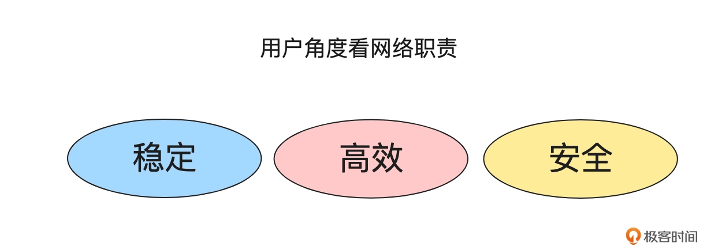

首先，稳定是网络服务的立命之本。想象一下，如果你正在打游戏，刚准备击败对手，却突然掉线了，你的心情会如何？又或者，你在超市排队付款，掏出手机准备扫码，却发现网络卡住，付款失败，身后的人都在催促，你是否会感到焦躁甚至恼火？

其次，高效是网络的核心竞争力。在今天这个追求“秒开”的时代，网络体验的好坏直接影响用户的选择。想一想，如果有两个会议软件，一个运行流畅、语音清晰，另一个却经常卡顿、声音断断续续，选择哪一个不言自明。

最后，安全是网络服务的底线。安全追求是让用户“用得放心”。试想，如果你的网盘在存储文件时被黑客攻击，私密文件被泄露，你还会继续使用这个网盘吗？或者，如果家里的智能摄像头被入侵，家庭生活变成了网上的现场直播，你是否会感到恐惧和不安？

从网络自身发展的角度来看，网络架构演进必须可扩展。网络的扩展要遵循两个重要前提——兼容和无感。

网络设备的种类和数量庞大，遍布全球，几乎无法做到让所有设备同时完成升级。因此，网络协议的升级换代往往需要带着存量的“尾巴”前行。也就是说，新技术的引入必须与现有的网络基础设施保持良好的兼容性。

网络的升级和演进，理想状态下应该做到让业务和现有服务“无感”或“少感”。这种“润物细无声”的升级模式，既是网络发展的挑战，也是其成功落地的关键。

## 架构的考量

下面我们围绕网络的稳定、高效、安全和无感四个职责，探讨怎样进行网络架构设计。

### 高可靠架构

首先，要想设计稳定的架构，需要先考虑造成不稳定的因素是什么？我认为软件工程中最大的风险来源于“变化”。这里的变化包括主动的变化，比如代码发布、配置变更、机房迁移、基础设施升级等，也包括被动的变化，比如流量突然增长、畸形请求、依赖系统故障、机器故障、自然灾害等。

针对主动的变化，可以提前做好防御设计，比如通过设计可灰度、可监控、可回滚的技术方案，最小化的减少故障影响范围。

针对被动的变化，需要从架构层面做好预防，设计面向失败的架构。网络领域面向失败的架构设计可以从面向单点、面向异常、面向突发和面向乱序几个方向进行考量，接下来我们逐一讲解。

我们先来学习面向单点的架构设计。可以通过冗余来提高单点的可靠性。我画了一个用户请求的网络路径简图，来梳理一下有哪些单点问题。

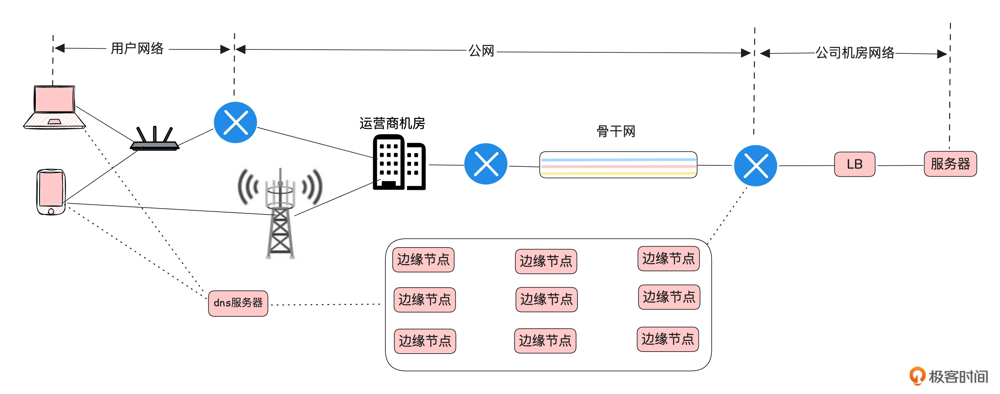

如上图所示，从客户端到服务器的网络可以分成三段。

第一段是客户端接入到运营商的网络，这一段我们可控的是客户端的行为，比如通过一个域名解析出多个 IP 来避免单点城市、单点运营商等问题。

第二段是运营商的网络到目标服务器所在的数据中心。这一段的底层网络由运营商和云服务提供商管理，包括路由器、交换机、光纤连接等设备。我们无法完全控制这部分的网络质量，但是可以通过部署边缘节点通过链路冗余避免单点故障。

第三段是从数据中心到目标服务器的网络。这一段涉及到数据中心内部的网络架构，是最可控的一部分。通过机器冗余（主备、集群等）、机房冗余、带宽冗余等多种手段可以提升可靠性。

其次，我们看一下面向异常的架构设计。

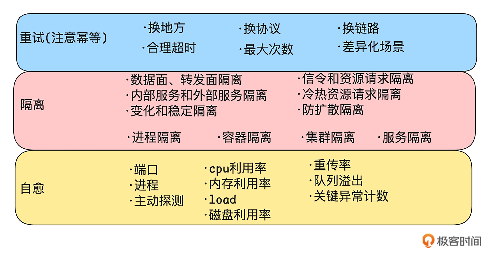

如上图所示，面对未知的异常，我们可以通过重试、隔离和自愈来提高架构的稳定性。

首先，重试可以提升成功率。重试的前提是服务支持幂等性，也就是说，重复请求不会引发不一致或不期望的副作用。有效的重试方式是根据场景变化来选择不同的重试方式。例如，当某个城市的服务器出现问题时，可以尝试切换到另一个城市的服务器进行重试；如果某种协议失败，可以尝试更换为另一种协议。重试时需要设置合理的超时时间和最大重试次数，以避免对下游系统造成过大的压力。

其次，隔离可以有效隔离影响和防止问题的蔓延。对于网络稳定性来说最重要的是保持转发面不中断，所以可以将转发面和控制面进行隔离。其次还有一些常用的需要隔离的情况，如信令类请求和资源类请求隔离、内部服务和外部服务隔离等。常用的隔离手段有进程隔离、容器隔离、集群隔离和服务隔离。

最后，当确认节点已经发生严重故障时，可以通过自愈机制主动恢复。自愈是指系统在遇到严重问题时，能够通过自动化手段修复自身或恢复到稳定状态。在网络领域，严重问题通常包括：端口无法访问、进程异常终止，或是关键系统参数（如 CPU 利用率、内存利用率、系统负载等）达到严重阈值。此外，TCP 半连接队列溢出、全连接队列溢出等网络参数异常情况也属于需要自愈机制介入的严重故障。

之后，我们看一下面向突发的架构设计。

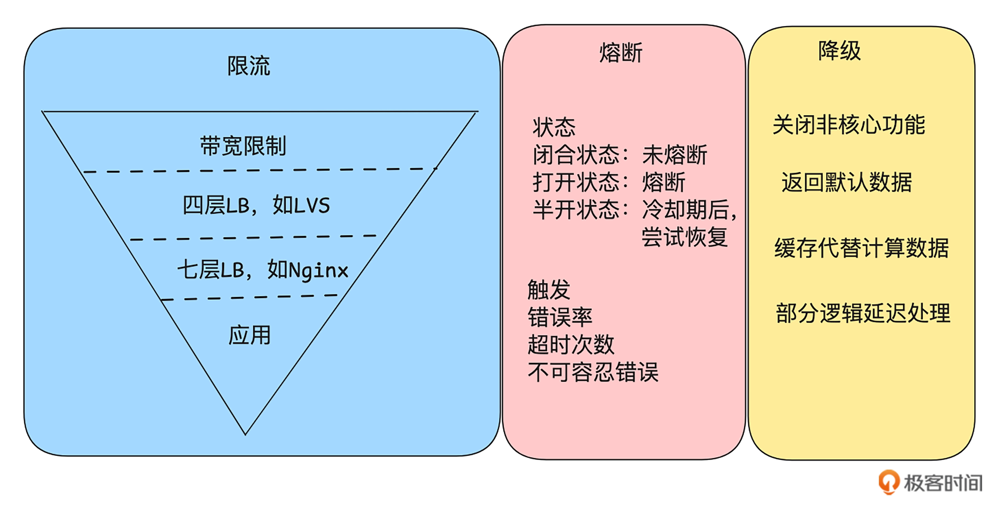

如上图所示，面对突发我们可以进行限流、熔断和降级等手段来增加整体架构的可靠性。

首先，面对突然增长的流量，可以通过限流来保护系统本身和上游服务。网络中不同系统的抗负载能力，按照流量的中转方向应该成到三角形状。

其次，在依赖的系统或上下游服务出现故障时，可以通过熔断来缓解故障。熔断是一种防止故障蔓延的机制，类似于电路中的保险丝。它用于监控服务或系统组件的健康状态，并在检测到异常时自动停止与故障组件的交互，防止问题扩展并影响其他系统部分。

熔断器通常有三种状态：

1.闭合状态：系统正常工作，所有请求可以通过。如果某一部分服务出现异常（如超时、失败），熔断器会记录失败次数，并判断是否进入打开状态。

2.打开状态：当连续失败的请求达到设定阈值时，熔断器进入打开状态。此时，所有请求都会被拒绝，直接返回错误或默认数据，避免继续对故障服务进行请求，保护系统其他部分的正常运行。

3.半开状态：在冷却期结束后，熔断器进入半开状态。此时，熔断器会尝试放行少量请求，以验证服务是否恢复正常。如果请求成功，熔断器重新进入闭合状态，继续正常运行；如果失败，熔断器再次进入打开状态。

熔断机制有助于快速隔离故障，防止问题扩散到整个系统，同时为故障修复提供时间。

除了熔断外，还可以通过降级来降低故障影响。比如关闭一些非核心的功能、使用默认或缓存的老数据来替代网络交互获取新数据等。

最后，网络有乱序的特点，所以要面向乱序进行架构设计。下面通过一个例子来说明针对网络乱序架构设计的方法。

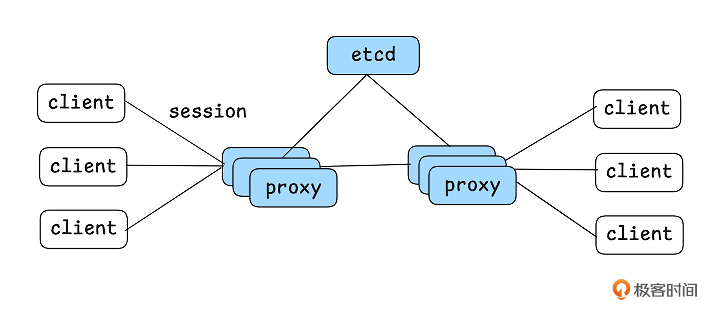

如图所示，假设我们有一个基于 ID 的代理系统，每个客户端连接到一个代理（proxy），并发送注册请求，将自己的 ID 发送给代理。代理通过 etcd 同步连接和 ID 的关系到其他代理后，就可以进行基于 ID 的转发。

问题发生在客户端注册后，如果连接异常，客户端很快会发起第二次连接和注册。第二次可能连接到一个不同的代理，而且无法保证第二次注册信息一定比第一次的注册信息晚同步到所有代理。如果第一次的注册信息更新较晚并覆盖了第二次的注册信息，其他代理就会同步到错误的连接和 ID 关系，导致消息转发失败。

为了解决这个问题，我们可以在客户端注册时附加一个递增的注册号。然后，所有代理收到同步信息时，只需用较大的注册号覆盖较小的注册号（如果收到比当前更小注册号的同步消息则忽略），从而确保同步到最新的注册信息，避免网络乱序带来的问题。

### 高性能架构

搞定高可靠架构的设计思路后，我们来学习网络的高性能架构设计考量。首先，我们先看一下，端到端网络中有哪些常见影响效率的地方。

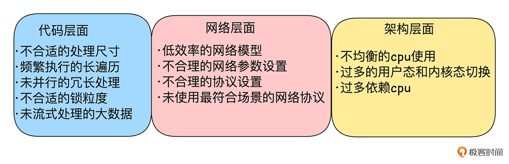

如上图所示，我将端到端的网络性能影响划分为代码层面、网络层面和架构层面。

首先，要解决的是代码层面的低效率问题。常见的低效代码有不合适的处理尺寸 (如单次系统调用读取或写入数据时候使用的 buffer 过小)、频繁执行的长遍历操作、未并发的处理、不合适的锁粒度，以及未流式处理的大数据等。

代码层面的效率问题，可以通过 USE 方法观测。所谓 USE 分别对应以下三点内容：

1.Utilization（利用率）：反映资源的繁忙程度。例如，大量计算密集型任务可能会导致 CPU利用率高，这被称为“on-CPU 消耗”。

2.Saturation（饱和度）：反映资源的排队情况。除了资源不足以满足需求，导致其他任务无法获得资源外，还可能是任务被锁阻塞，或者系统调度过于频繁等原因。对于 I/O 密集型任务，除了关注利用率外，还需要分析饱和度，这就是 Off-CPU 分析。

3.Errors（错误）：反映系统中出现的错误情况。

其次，要关注网络层面的效率问题。常见的网络层面效率问题有低效率的网络模型，比如为每个请求分配一个线程、不合理的网络参数设置，比如应用层通过 socket 设置 tcp 的接收 buffer过小、不合理的协议设置，如设置过小的 mtu，或者未开启 tcp 的 win scale 等。

最后要关注的是架构选型。比如 Cloudflare 在其关于 Pingora 的博客“将 Cloudflare 连接到互联网的代理”中提到，构建 Pingora 的一个重要原因就是对性能的极致追求。在Cloudflare 团队对 Nginx 的性能调优的过程中，团队发现多进程模型在进一步提升性能方面存在一些瓶颈：

```
1.多进程模型中的 CPU 负载不均衡：在 Nginx 的多进程 epoll 模型中，内核对于 listen 文
```

件描述符的处理存在一个问题——内核在不同 CPU 之间的轮询并不均匀，这导致某些 CPU

```
负载过高，而其他 CPU 负载较低。即使启用了 SO_REUSEPORT，内核也会为每个进程分配
```

独立的队列，一旦某个 CPU 过载，内核无法将其队列的任务重新分配给其他 CPU，结果是部分 CPU 上的任务处理时间大幅增加。

2.进程间连接复用的缺失：在多进程模型中，由于无法跨进程复用已建立的连接，每个进程都必须独立进行连接的建立和管理，这导致了较大的连接开销和性能瓶颈。

我们暂且不谈多进程模型和多线程模型的优缺点，在 cloudflare 对性能的调优过程可以看出，在对性能追求到一定程度后，再想提升，就要死磕一些和内核甚至硬件的交互了。

除了对网络处理模型做到极致追求，还可以通过使用 DPDK、ebpf 等技术避免用户态和内核态的反复切换，来减少性能开销。甚至可以通过软硬件的结合来减轻 CPU 的负担。

前面，我们的思路都聚焦于提升端到端的速度。但换个角度看，采用就近处理的方式，或许能实现更为显著的效率提升。这就好比无论我们怎样提升车速，去往 5 公里外的超市，都比不上在家门口的小卖铺购物来得快速。因此，除了传统客户端 - 服务器（CS）模型的框架，我们还可以引入了“边缘节点”，通过遍布各地的边缘节点来进行加速和优化。

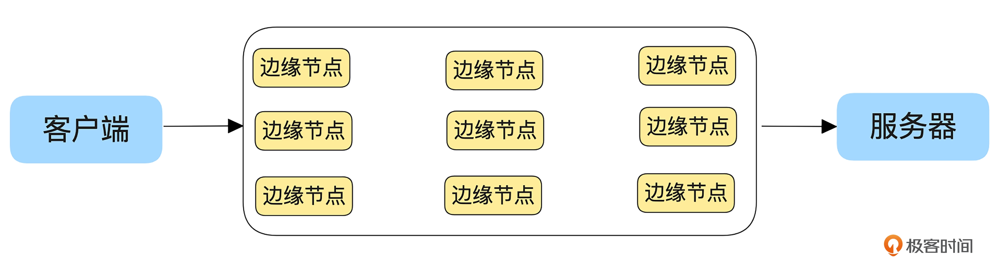

比如 CDN 就是通过边缘节点就近返回资源的典型架构实现。另外还可以通过边缘节点终结网络连接，以及通过双边的边缘节点实现优质路径选择等方式来提升整体性能。

### 高安全架构

掌握了网络高性能架构的设计思路后，我们继续考量一下从安全角度的网络架构设计思路。


如上图所示，我们可以从公网安全传输、接入安全和应用安全三个维度进行安全防护。

首先，在公网传输中，确保数据安全至关重要。我们可以通过使用 TLS、VPN 等协议来解决加密、认证、防重放和完整性校验等问题，从而保障数据在传输过程中的机密性和完整性。

其次，接入层作为内外网的“门禁”，需要承担起防御外部威胁的责任。通过部署 DDoS 高防设备和边界防火墙等设备，可以有效清洗恶意流量，减少潜在风险。

最后，在应用层有很多威胁，常见的安全威胁如 SQL 注入和跨站请求伪造（CSRF）等，可以通过使用 WAF（Web 应用防火墙）来进行有效防护。

### 可拓展架构

在完成用户视角下网络的高可靠、高性能和高安全架构设计后，我们接下来从网络自身的角度，探讨如何设计可扩展的架构。

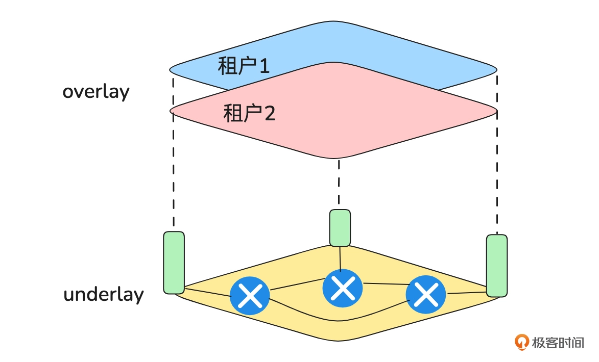

在可扩展架构设计中，除了需要兼容现有的网络协议外，最常用的方法是“加一层网络”。如上图所示，网络通常被划分为 underlay 和 overlay 两个平面。underlay 网络运行现有的网络协议，负责基本的网络连接和数据传输；而 overlay 网络则运行新的扩展协议，提供灵活的网络功能和更高层次的服务，支持网络的弹性扩展和灵活管理。

## 一些里程碑式的网络架构思想

除了前面围绕网络职责演进的架构考量外，还有一些关键的架构思想对网络发展具有重要影响。接下来，我们将回顾这些核心思想。

### SDN

SDN（Software-Defined Networking）是另一种革命性的架构，它提出将网络的控制面与数据面分离，集中管理网络资源，从而实现网络的动态配置、优化和自动化管理。

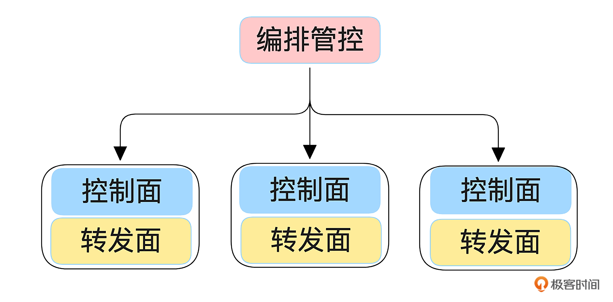

这一思想使得网络不再依赖于传统的路由器和交换机上的控制逻辑，网络管理员可以通过编程的方式智能化地控制流量、调度资源。Google B4 网络在 SDN 上的成功落地，激发了越来越多的企业开始探索 SDN、SD-WAN 以及自动化网络优化技术。

### NFV

NFV（Network Functions Virtualisation）的概念源自通信行业，由欧洲电信标准协会（ETSI）提出。旨在将传统的网络功能（如路由器、交换机、防火墙等）从专用硬件中解耦，转移到通用的硬件平台上。

NFV 由网络功能虚拟化基础设施、虚拟化网络功能、管理和编排三个部分组成。

- 第一部分是 NFVI（Network Functions Virtualization Infrastructure，网络功能虚拟化基础设施），它相当于云计算中的 iaas 层。其对计算、网络、存储等硬件资源进行虚拟化后，以虚拟化的方式提供给上层使用。

- 第二部分是 VNF（Virtual Network Functions，虚拟化网络功能），也就是实现网络功能（转发、IP 配置等）的软件应用，相当于云计算中 PaaS。在 NFV 架构中，各种 VNF 在NFVI 的基础上实现，由于 NFVI 是标准化的架构，使得不同的 VNF 获得了通用性，不再依赖于原来的专用设备。

- 第三部分是 MANO（OManagement and orchestration, 管理和编排）。MANO 用于管理各VNF 以及 NFVI 的统一框架，相当于云计算中的 SaaS。

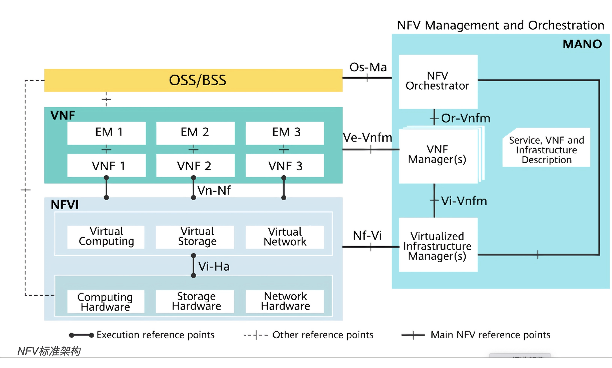

（图片来自什么是 NFV？）

NFV 不仅使网络不再依赖传统硬件，且支持多厂商互通，推动了网络资源的异构化和灵活配置。

### 云计算

随着 SDN、NFV、虚拟化技术的发展，云计算的应用得到了大规模落地。云计算通过“弹性”模型，按需提供资源，降低了中小企业搭建网络服务的门槛，提升了效率并降低了成本。云计算不仅改变了传统 IT 基础设施的建设模式，还推动了更多的企业和厂商将服务部署到云端。

不难发现，这些关键思想都在为网络的高可靠、高效率、高安全以及可扩展奠定基础。

## 小结

今天的内容就是这些，我给你准备了一个思维导图回顾要点。

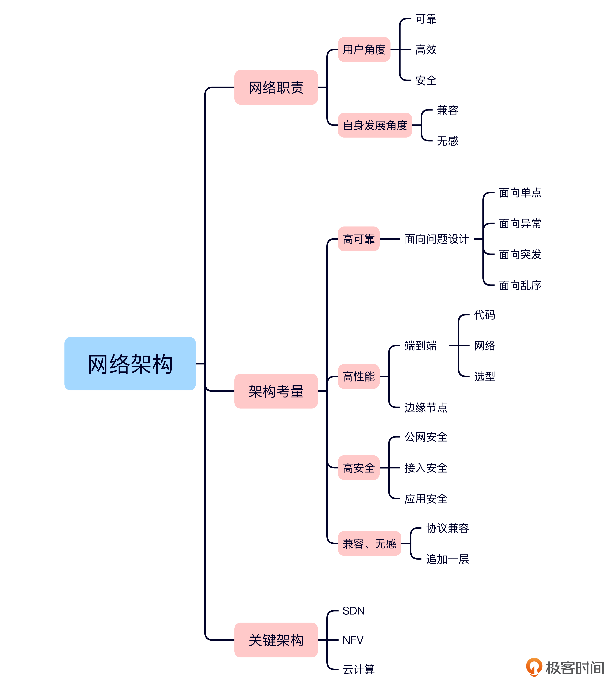

这节课，我们探讨了“网络”和“架构”这两个核心概念。

我们从用户的角度分析了网络的三大基本职责：可靠、高效和安全。与此同时，从网络系统自身的角度出发，网络架构设计还需要考虑“兼容性”和“无感”升级，以保证网络在发展过程中既能支持新技术，又不会影响现有服务。

随后，我们围绕网络的基本职责，学习了高可靠、高性能、高安全以及兼容和无感架构的设计思路。高可靠架构设计需要面向故障，考虑单点故障、异常、突发和乱序等问题；高性能架构从代码、网络和架构选型三个层面进行性能优化，并可以通过引入边缘节点进一步提升效率；高安全架构涵盖了公网传输、安全接入和应用安全等方面；在兼容和无感架构中，除了考虑协议兼容，还可以通过增加一层网络实现无感演进。

之后我们从网络发展视角，学习了 CDN、SDN、NFV 和云计算的架构思想。最后，我们将网络与架构结合起来，结合网络全局概览图将网络分成了三个部分，探讨了每部分的技术要点。

这节课偏宏观架构分析，在接下来的课程中，我们将从网络的核心职责和发展演变的角度，探讨如何解决实现高可靠、高性能和高安全性，同时兼顾“兼容”和“无感”的可扩展方案的挑战，敬请期待。

## 思考题

1. 关于“高可靠”除了架构层面的预防，你还能想到什么提升系统稳定性的手段？

2. 你是怎么看待云计算时代的“弹性”的？

欢迎你在留言区和我交流互动，如果这节课对你有启发，也推荐你分享给身边更多朋友。
