# 03 | 主备-怎样防范单点故障？

你好，我是谢友鹏。

相信很多人都听过“墨菲定律”——凡是可能出错的事情，总会出错。在高并发的网络实践中，这条定律常常得到验证，无论是服务器宕机、机房故障，还是通往一个城市的光纤被意外切断，都可能导致网络服务中断。因此，在网络架构设计时，我们要具备“底线思维”，假设任何一个单点都会出问题，以此设计出高可用的网络架构。

“主备”架构便是应对单点故障的有效手段之一。今天这节课，我们就结合案例深入学习一下如何从多机器、多机房、多城市的维度设计主备网络架构，确保系统的稳定、可靠。

## 主备架构要思考的几个问题

主备架构，顾名思义，是由一主和一备或多备组成的架构。在这种设计，主负责处理所有请求，而备保持待命状态。当主发生故障时，备可以迅速接管，确保服务的连续性。

对于喜欢探究原理的同学来说，可能会产生以下疑问：

- 如何确认哪个是主，哪个是备？

- 系统如何判断主出现故障？

- 如何确保请求只发送给主，而不发送到备？

下面让我们依次剖析多机器、多机房、多城市几个维度的主备架构，解开以上疑问。

## 多机器主备

设想这样一个场景：你需要为某企业的一个部门搭建一个私有化的基于 HTTP 的网络服务，该服务提供一个 IP 和端口，供其他部门访问。从企业安全的角度出发，部门之间设置了防火墙，部门之间只能使用防火墙白名单的 IP 进行访问。因此对外提供的 IP 一经加入白名单就不容易变动。

基于底线思维，你可能立马考虑单到台服务器的风险。如果服务器出现故障，服务将被中断。如果你有云端部署经验，或许会想到通过负载均衡器（Load Balancer, LB）来实现这一需求。通过 LB 将请求分配到多个服务器，可以有效提高服务的高可用性。

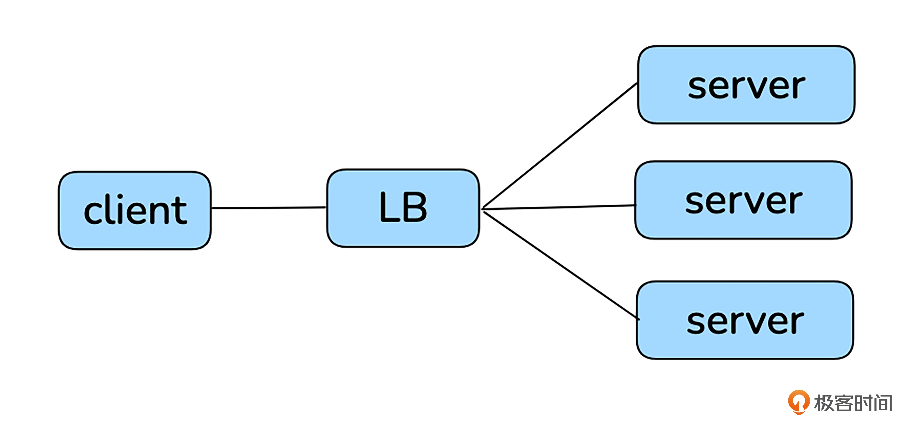

LB 的主要功能包括以下几点：

- 配置上游 server 的 IP 和端口。

- 对外提供一个 vip（virtual ip）和监听端口，请求通过 vip 和监听端口进入 LB。

- 支持一定的调度算法将请求转发到 server 的配置端口。

- 支持健康检查，能自动剔除不健康的 server。

有 LB 之后，就有了稳定的 vip，LB 后面可以对接很多 server，任意 server 故障都能通过健康检查摘除。不过，这样 server 的确具备高可靠性了，但 LB 自身不就成了单点了吗？

别急，虽然我们在云厂商创建 LB 时候，只在控制台上创建了一个实例，但其背后并不是一台机器在服务，比如阿里云官方文档给出的架构图是这样的：

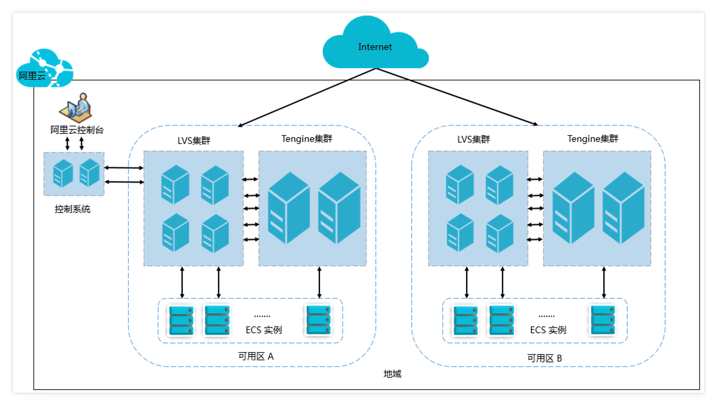

文档还贴心地告诉了我们以下细节：

- 四层 LB 采用 LVS（Linux Virtual Server）+ Keepalived 的方式实现负载均衡。

- 七层是基于 Tengine（Nginx 的定制版本）来实现的。

这里的 Keepalived 是一个开源项目，该项目的官网有这样两句话：

- The main goal of this project is to provide simple and robust facilities for loadbalancingand high-availability to Linux system and Linux based infrastructures.（项目的主要目标是为 Linux 系统和基于 Linux 的基础设施提供简单而健壮的负载平衡和高可用性设施。）

- On the other hand high-availability is achieved by VRRP protocol. (另一方面通过 VRRP 协议实现了高可用性。)

从中可以看出，基于 Keepalived 可以实现 LB 的高可靠性。另外，Keepalived 很大程度是通过 VRRP（Virtual Router Redundancy Protocol，虚拟路由冗余协议）来实现高可靠性的，所以我们有必要先了解一下这个协议。

### VRRP

从虚拟路由冗余协议这个名字，我们可以提取到三个关键信息。

虚拟，也就是将多个真实设备组成一个虚拟设备。外部看到的是一个虚拟设备，通过 vip（virtual ip）访问，而没有真实设备的视角；冗余，即通过冗余来实现高可用。主备中的备可以认为是一种冗余，平时不起作用，关键时刻再上场。路由，这是一个作用在三层（网络层）的协议。

一个虚拟设备通常由多个设备（一主多备或一主一备）组成。比如后面的图里就是一主多备的情况。

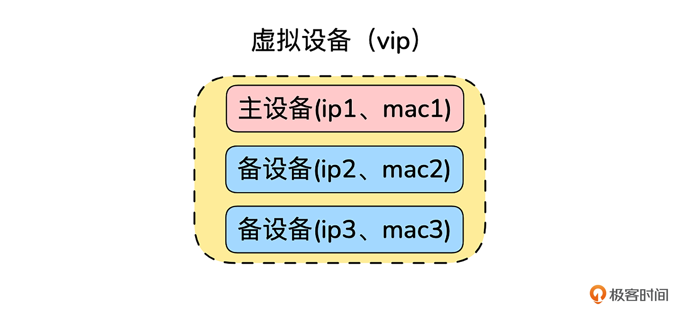

只要我们掌握了 VRRP 协议，课程开头的几个问题也就将迎刃而解了。

首先是第一个问题，怎样确认哪个机器是主，哪个机器是备？

每个 vrrp 接口会配置一个优先级，在接口启动的时候会判断优先级是否为 255，如果优先级是 255，则进入主状态，否则进入备状态。

vrrp 的状态在运行过程会发生变化，具体流程你可以参考下图。

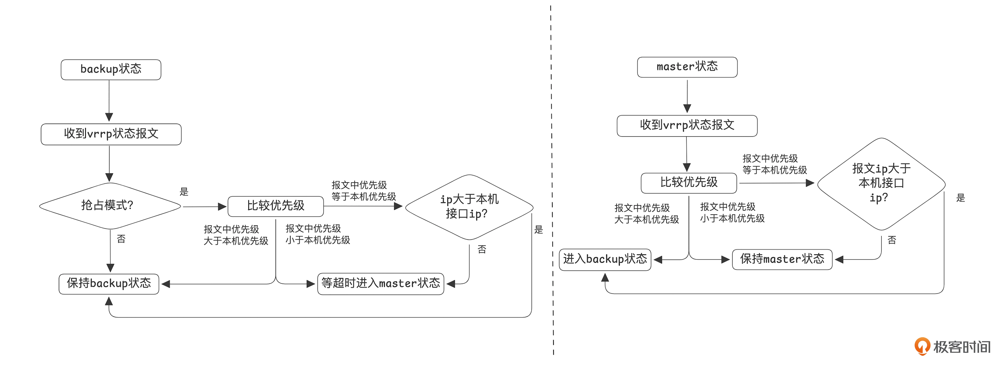

如上图所示，主备抉择的首要因素是优先级，如果优先级相同，则比较 IP 地址。

第二个问题是，怎样知道主机器不可用？

这里涉及一个通告机制。主设备会周期性地向设备发送 VRRP 通告报文，通告其配置信息和工作状况。如果备设备没有在约定时间内收到主设备的通告信息，就知道是主设备出现故障了。

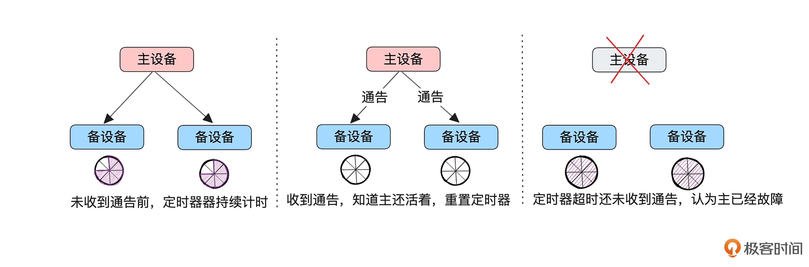

最后是第三个问题，怎样让网络数据包只发送到主设备，而不发送到备设备？

只有主设备进行 vip 的 arp 通告。网络是分层的，最终通过封装 MAC 地址将报文发往对端，所以只要让报文发起方在 arp 请求（通过 IP 地址址查询 MAC 地址）时得到的是主设备的MAC 地址，报文就会发往主设备。

如图所示，虚拟设备组里的设备，只有自己状态为主的时候才会响应 vip 的 arp 请求，所以vip 对应的 MAC 地址始终是主设备的 MAC 地址。

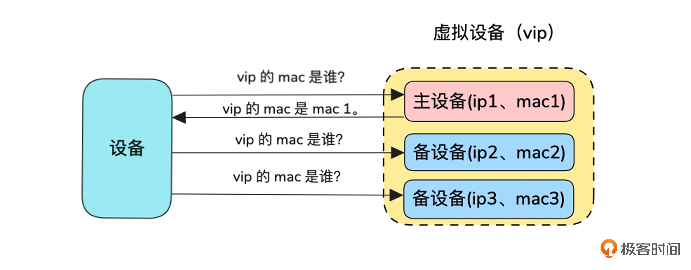

### 主备 LB 实战

至此，我们对 VRRP 协议已经有了初步的了解，可以开启实战环节了。

### 实验设计

延续刚刚的案例，为了避免 LB 的单点问题，可以使用多个 Nginx 以主备模式组成一个虚拟LB 对外提供服务，LB 的 upstream 是由多个提供业务功能 server 组成的。

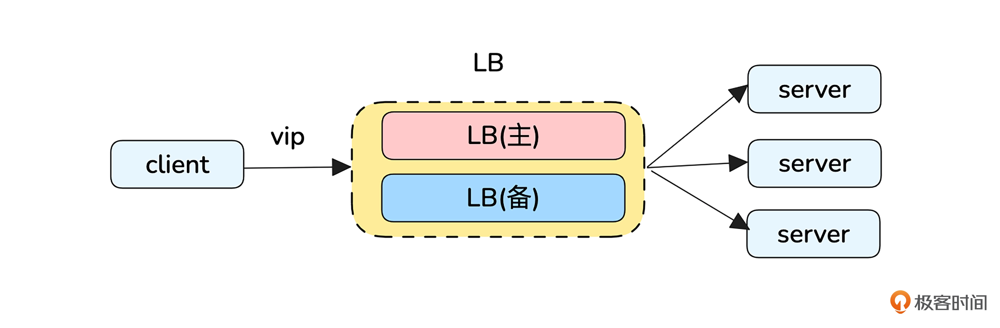

这个架构下 server 已经具备高可靠性，我们实验的目的是讨论 LB 的高可靠性。

为了方便实验，我们简化一下模型，让两台机器 LB1 和 LB2 以主备方式组成一个虚拟的 LB，虚拟 LB 的 vip 为 172.16.253.100，监听端口为 80。

虚拟 LB 将 80 端口收到的请求转发给 server 的 8080 端口。server 的 8080 端口提供 HTTP服务，收到请求后回复 200 OK 应答，并在响应头携带对端 IP，以便观察请求是经过哪个 LB设备发出的。LB 的代理功能通过 Nginx 实现，LB 之间主备通过 Keepalived 实现。

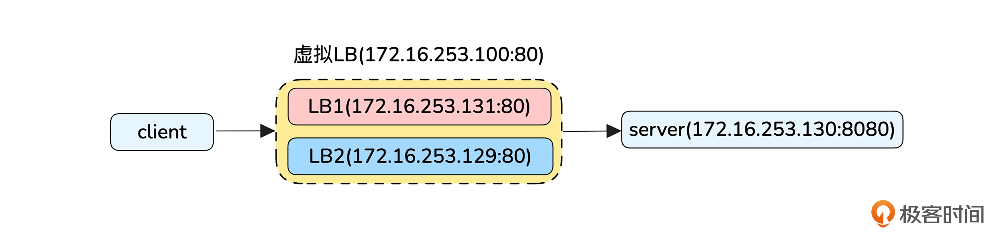

如果你的实验环境不同，一些操作细节会略有差别，请自行调整，课程操作时的环境信息如下：

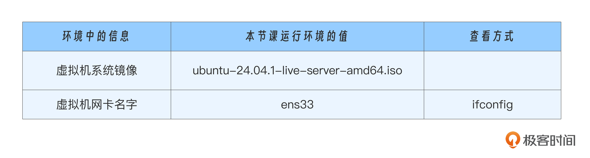

实验配置文件为 master_and_backup_architecture，你需要根据自己的实际环境酌情修改。

### 开始实验

接下来我们正式进入动手环节，首先我们要搞定 server 和 LB 的配置。

配置 server首先在模型的 server 上安装 Nginx，并将 Nginx 配置成在本机验证 http 能够成功访问server。

具体操作是将 Nginx 配置 /etc/nginx/nginx.conf 的内容修改为 nginx.conf 的内容，该 Nginx服务回会监听 8080 端口，接收到 http 请求后回复 200 ok，并在响应头插入 X-Remote-IPheader，内容为对端 IP。

```
#安装nginx
$ sudo apt-get install -y  nginx
#查看版本
$ nginx -v
nginx version: nginx/1.24.0 (Ubuntu)
#查看nginx进程
$ ps -ef | grep nginx
root        2440       1  0 06:10 ?        00:00:00 nginx: master process /usr/sb
nobody      2441    2440  0 06:10 ?        00:00:00 nginx: worker process
nobody      2442    2440  0 06:10 ?        00:00:00 nginx: worker process
#修改nginx配置/etc/nginx/nginx.conf
#杀掉已经启动的nginx进程
$ sudo pkill nginx
# reload加载新的nginx配置文件，如果机器上没有nginx进程，去掉-s reload直接启动即可。
$ sudo nginx -s reload
#查看nginx和指定配置文件
$ ps -ef | grep nginx
root        2324       1  0 06:15 ?        00:00:00 nginx: master process nginx
nobody      2325    2324  0 06:15 ?        00:00:00 nginx: worker process
nobody      2326    2324  0 06:15 ?        00:00:00 nginx: worker process
#本机验证http请求
$ curl -v http://127.0.0.1:8080
*   Trying 127.0.0.1:8080...
* Connected to 127.0.0.1 (127.0.0.1) port 8080
> GET / HTTP/1.1
> Host: 127.0.0.1:8080
> User-Agent: curl/8.5.0
> Accept: */*
>
< HTTP/1.1 200 OK
< Server: nginx/1.24.0 (Ubuntu)
< Date: Sat, 02 Nov 2024 06:38:08 GMT
< Content-Type: text/plain
< Content-Length: 0
< Connection: keep-alive
< X-Remote-IP: 127.0.0.1
<
* Connection #0 to host 127.0.0.1 left intact
```

我们分别在两个 LB 设备安装并运行 Nginx，Nginx 监听 80 端口，并通过 upstream 的方式反向代理到 server 的 8080 端口。Nginx 安装、启动方法和前面一样，区别在于配置文件的内容，LB1、LB2 的配置文件分别参考 lb1/nginx.conf、lb2/nginx.conf。

注意 upstream 中的 server ip 替换成你自己实验时候 server 的 IP。安装好以后，可以在本机验证一下通过 LB 访问 server 是否成功。

```
#验证经过LB代理http请求
$ curl -v http://127.0.0.1:80
*   Trying 127.0.0.1:80...
* Connected to 127.0.0.1 (127.0.0.1) port 80
> GET / HTTP/1.1
> Host: 127.0.0.1
> User-Agent: curl/8.5.0
> Accept: */*
>
< HTTP/1.1 200 OK
< Server: nginx/1.24.0 (Ubuntu)
< Date: Sat, 02 Nov 2024 06:46:42 GMT
< Content-Type: text/plain
< Content-Length: 0
< Connection: keep-alive
< X-Remote-IP: 172.16.253.129
<
* Connection #0 to host 127.0.0.1 left intact
```

配置 LB接下来我们来配置 LB，让两个 LB 设备通过 Keepalived 组成主备。

LB1 和 LB2 的配置需要分别参考 lb1/keepalived.conf 和 lb2/keepalived.conf，注意根据自己实验内容修改配置中的参数，尤其注意 interface 和 virtual_ipaddress。interface 为网卡名称，virtual_ipaddress 为虚拟路由器的 IP，该 IP 要使用同一局域网下，并且没被占用的IP（可以使用同一个网段，但 ping 不通的 IP 地址）。

```bash
#安装keepalived
sudo apt-get install -y keepalived
#查看版本
$ keepalived -version
Keepalived v2.2.8 (04/04,2023), git commit v2.2.7-154-g292b299e+
#修改配置文件/etc/keepalived/keepalived.conf的内容，注意不修改文件名。
#启动keepalived
$ sudo systemctl start keepalived
#查看keepalive状态,可以看出当前设备处于主(MASTER)还是备(BACKUP)状态。
$ sudo systemctl status keepalived
#这时候可以配置的vip发现是能通的。
$ ping 172.16.253.100
PING 172.16.253.100 (172.16.253.100) 56(84) bytes of data.
64 bytes from 172.16.253.100: icmp_seq=1 ttl=64 time=1.24 ms
64 bytes from 172.16.253.100: icmp_seq=2 ttl=64 time=1.04 ms
```

主备实验

至此，我们多机器主备架构就搭建完成了，同一个局域网的任意机器可以通过 vip 访问我们的服务。通过响应头 X-Remote-IP 的值，就能观察到网络包是通过哪个 LB 设备发过来的。

```bash
curl -v http://172.16.253.100:80
*   Trying 172.16.253.100:80...
* Connected to 172.16.253.100 (172.16.253.100) port 80
> GET / HTTP/1.1
> Host: 172.16.253.100
> User-Agent: curl/8.5.0
> Accept: */*
>
< HTTP/1.1 200 OK
< Server: nginx/1.24.0 (Ubuntu)
< Date: Sat, 02 Nov 2024 07:51:17 GMT
< Content-Type: text/plain
< Content-Length: 0
< Connection: keep-alive
< X-Remote-IP: 172.16.253.131
<
* Connection #0 to host 172.16.253.100 left intact
```

结合前面的代码，我们发现正常场景里网络包是通过主设备发过来的，那么我们再来看看主备切换场景的情况.

具体实验方法就是，我们直接把当前主设备 LB1 的虚拟机关掉，发现依然可以通过 vip 访问服务，并且备设备已经变成主设备。

```
#依然能通过vip访问服务，但是X-Remote-IP已经变成原来备设备的ip，说明主备切换了。
$ curl -v http://172.16.253.100:80
*   Trying 172.16.253.100:80...
* Connected to 172.16.253.100 (172.16.253.100) port 80
> GET / HTTP/1.1
> Host: 172.16.253.100
> User-Agent: curl/8.5.0
> Accept: */*
>
< HTTP/1.1 200 OK
< Server: nginx/1.24.0 (Ubuntu)
< Date: Sat, 02 Nov 2024 07:55:37 GMT
< Content-Type: text/plain
< Content-Length: 0
< Connection: keep-alive
< X-Remote-IP: 172.16.253.129
<
* Connection #0 to host 172.16.253.100 left intact
#观察备设备状态发现已经变成主，搜STATE字可以发现: (VI_1) Entering MASTER STATE
$ sudo systemctl status keepalived
```

另外我们还可以实验一下主设备故障恢复时，主备切换（恢复最初主备状态）的情况。

我们将主设备开机，这个时候再用 curl 请求发现 X-Remote-IP 已经变成了 LB1 的 IP，这说明VRRP 优先级机制生效了，LB1 又变成了主设备。如果不能顺利恢复，请检查下 nginx 和Keepalived 进程是否都在，如果不在，请提前设置开机自动启动这两个进程。

## 多机房主备

刚刚我们实现了同一个机房下多个机器的主备架构。如果现在系统的可靠性需求进一步增强，这个部门有两个机房，期望任意一个机房挂了服务不要中断，我们又该如何设计主备机房架构呢？

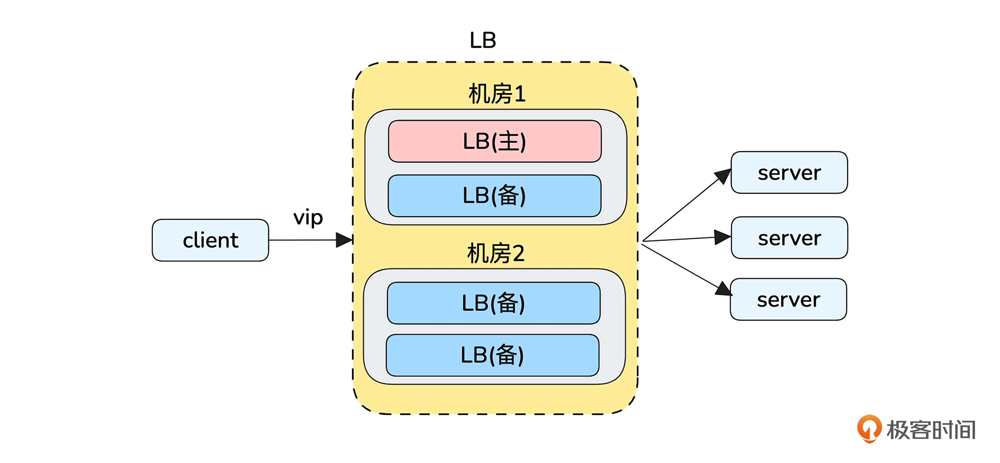

这个需求可以利用路由最长掩码匹配规则来实现。

### 路由最长掩码匹配规则

路由最长掩码匹配规则指的是当有多个路由可以匹配同一个目标 IP 地址时，路由器会选择“前缀最长”的那个路由，即子网掩码最具体、匹配位数最多的路由，这就是“最长匹配”。

我举个例子，这样你更容易理解。例如，如果路由器有以下两条路由：

- 路由 1: 172.16.0.0/26

- 路由 2: 172.16.0.0/27

```
当数据包的目标地址为 172.16.0.10 时，虽然两个路由都可以匹配，但 172.16.0.0/27
```

是更具体的匹配（掩码更长），因此路由器会选择这条路由。

（注意：子网掩码用于划分 IP 地址的 网络部分和 主机部分。掩码越长，表示网络部分占的位数越多，主机部分就越少，因此可用的 IP 地址就越少。为了方便表达，课程后面用“小网段”表示子网掩码更长的网段，“大网段”表示子网掩码更短的网段。）

### 多机房主备架构方案

那么主备机房的架构可以这样设计：

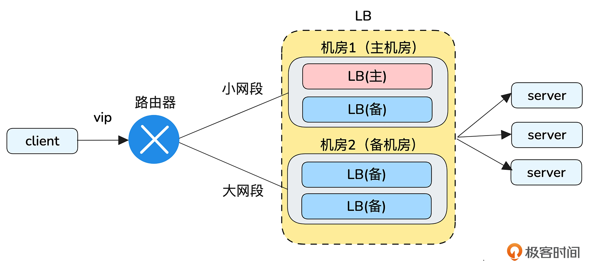

- 主备机房分别通过动态路由协议发布大小两个掩码匹配长度的路由。

- 无故障时，vip 同时匹配到主备机房的路由，按照路由最长匹配原则，会使用掩码更长的主机房。当主机房故障时，路由将会自动失效，vip 只能匹配到备机房。

## 多城市主备

现在我们已经实现了多机房、多机器的容灾，此时客户又提出了需求，要求跨城市容灾，又该怎么办呢？

如果你留意过主流云厂商的 LB 产品，会发现几乎找不到跨城市容灾的。

这有两方面的原因，一是网络延迟与性能，二是成本上的考量。

先看网络延迟与性能的问题。跨城市的数据传输不可避免地会增加延迟，因为数据需要在较远距离内传输。另外，负载均衡器需要快速检测后端服务器的状态，跨城市连接增加了探测时间，可能导致不准确的健康检查结果，影响整体负载均衡的稳定性和效率。

还有成本的考虑。由于跨城市传输需要占用更多的带宽资源和更复杂的网络结构，云厂商提供这类服务的成本会显著上升。

你需要注意的是，这里所说的 LB 不适合跨城市容灾，不代表所有应用都不适合跨城市容灾。相反，像存储、数据库等应用，为了提高可靠性至少是两地三中心部署的。四层以及四层以上的跨城市容灾能力是比较容易满足的，而 LB 这种在三层容灾的产品考虑到以上因素一般不会设计跨城市容灾。

那我们的需求怎样做跨城市的容灾呢？可以为每个城市提供一个 LB，然后在客户端做主备选择。如果客户没有要求尽量用主城市提供服务的话，可以将多个 vip 绑定到一个域名，客户端通过域名轮询访问两个城市的服务。

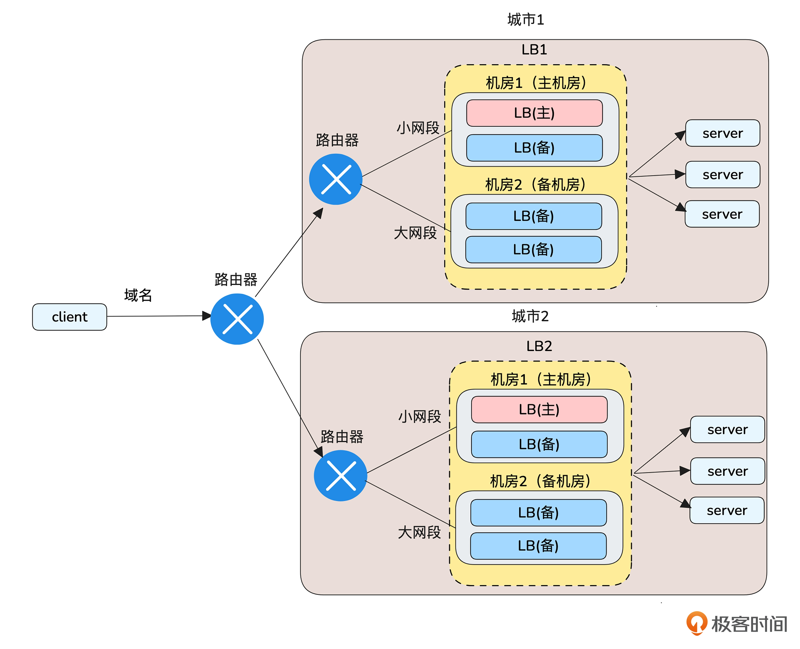

## 主备切换的信心问题

关于主备架构的实战，今天就讲到这里。最后我们再聊一个企业应用主备架构中面临的实际问题，备链路长期不用，你可能会担心出现故障那一瞬间会不会掉链子。这里给出增强主备切换的信心的两个小建议。

- 故障演练：有准备的切换总比没准备的故障更容易对付，日常可以主动故障演练，以确保备链路关键时刻不掉链子。

- 业务分级 + 小流量试跑：可以将业务按重要程度分级，然后选一些重要程度低的业务，日常在备链路上运行小部分流量。

## 小结

今天的内容就是这些，我给你准备了一个思维导图回顾要点。

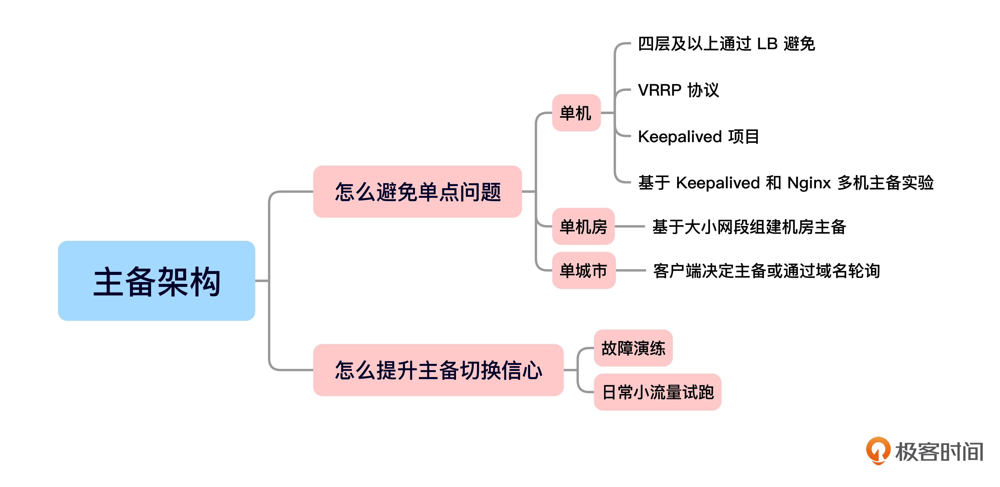

为了提升架构的稳定性，我们首先要具备底线思维，避免任何单点问题。

之后我们设定了一个虚拟的需求，分别从多机器、多机房和多城市角度推演设计了主备架构。

在多机器主备实战中使用了 VRRP 协议，我们学习了该协议实现主备的基本原理，并通过Keepalived 进行了基于 Keepalived 的 Nginx 主备 LB 实验。在多机房主备架构实战中，我们学习了路由最长掩码匹配规则。在多城市主备中，我们分析了网络层跨城市主备的问题，并设计了基于域名的多城市可靠性方案。

最后，我还给你分享了两条实操经验，在真实生产环境中，可以通过故障演练和业务分级 + 日常小流量运行来增加主备切换的信心。

关于主备，我们就讲到这里。“主备”只是提升网络稳定性的架构思想之一，我们将在后面的课程继续分析其他架构思想，欢迎继续学习。

## 思考题

1. 网络架构中除了多设备、多机房、多城市外，你还知道哪些地方需要避免单点来保障高可靠呢？

2. 多机器主备实验中，我们基于 Keepalived 实现的 VRRP 功能组成主备。如果主设备没有宕机，但是 Nginx 进程不存在了，服务还可用吗，如果不可用了，有没有什么优化方法？

欢迎你在留言区和我交流互动，如果这节课对你有启发，也推荐你分享给身边更多朋友。

## 拓展阅读

如果你想全面深入地了解 VRRP 协议，我推荐你去了解一下 RFC，VRRP 的主要 rfc 如下：

- RFC 2338 ：VRRP 的第一个正式版本（Version 2）。这个版本主要用于 IPv4 网络，并且支持多个路由器通过一个虚拟 IP 地址来进行冗余。它提供了主路由器选举机制，确保当主路由器发生故障时，其他路由器能够接管虚拟 IP。

- RFC 3768 ：引入了 VRRP 的第三个版本（Version 3），该版本支持 IPv6。它与 RFC2338 在基本概念上是相似的，但进行了更新和扩展，以支持 IPv6 转发和相关特性。同时，RFC 3768 还对协议的工作机制进行了更详细的描述，并解决了一些安全性和配置问题。

- RFC 5798：主要聚焦于增强 VRRP Version 2 和 Version 3 的功能与灵活性。该版本对协议进行了进一步的规范化，确保不同厂商设备间的互操作性，并引入了一些新的特性，如更灵活的负载均衡和状态监控能力。
