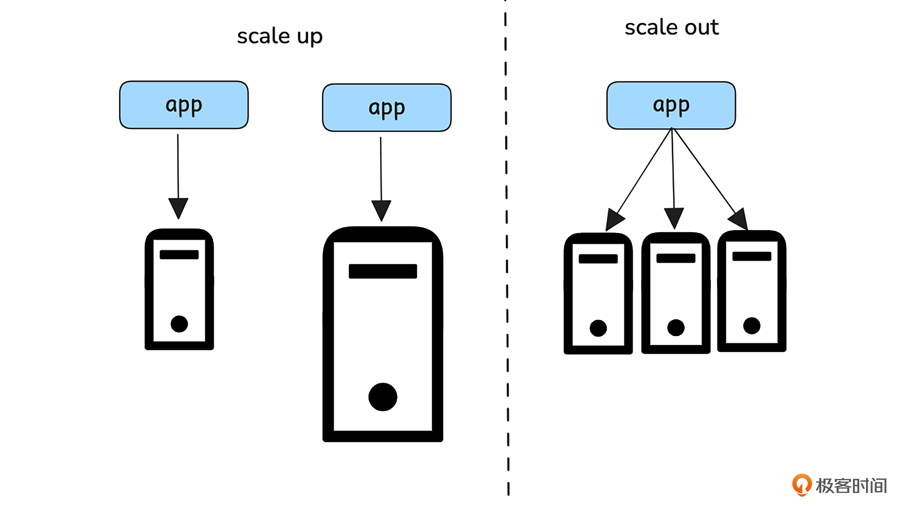
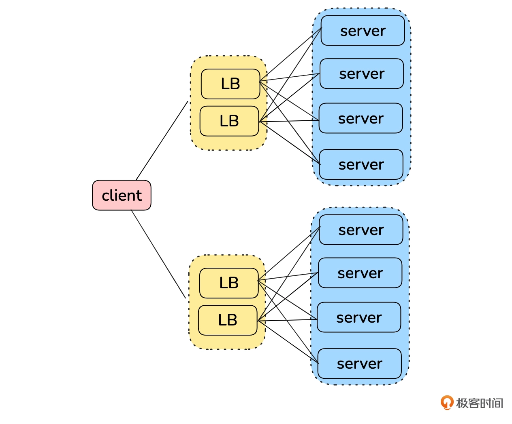
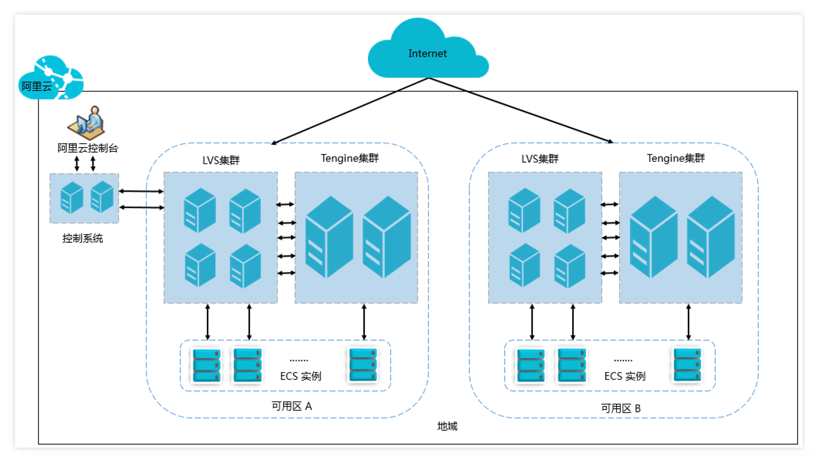
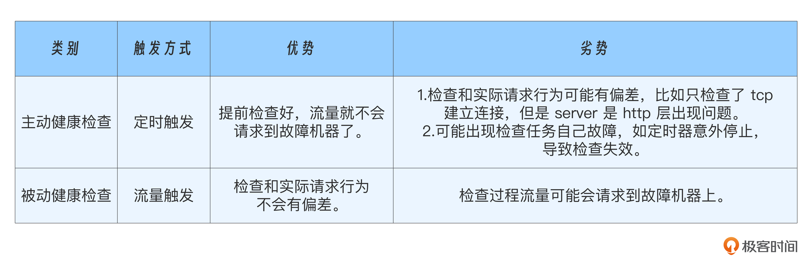
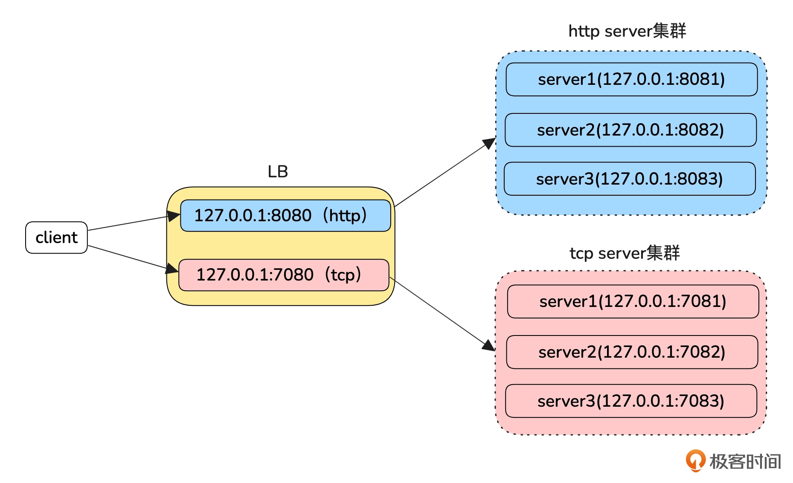
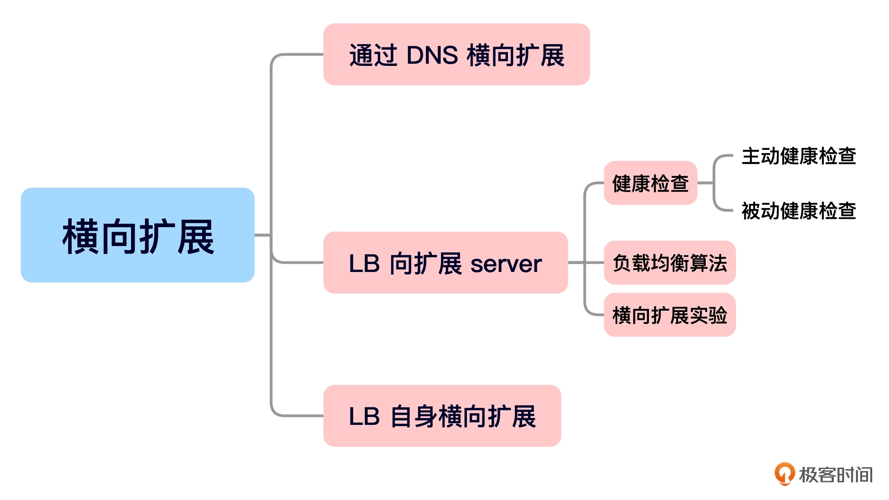

# 04 | 集群（上）：怎样实现横向扩展？

你好，我是谢友鹏。

你是否经历过这样的情景？系统最初只用几台服务器就能轻松应对业务需求，运行稳定、毫无压力。但某天，随着业务量飙升，服务器频繁告警，用户投诉增多，甚至网站直接宕机。

面对这种情况，我们有两种解决方案：一种是纵向扩展（Scale Up），即通过增加服务器的性能来提升处理能力；另一种则是横向扩展（Scale Out），也就是通过增加服务器的数量来分担负载。



接下来的两节课，我们将通过深入探讨横向扩展的策略，分析网络路径上各个转发设备的横向扩展方法。通过这些方案，我们将一步步构建出弹性和抗压性更好的集群系统，让你的架构能够应对更高的流量和更复杂的业务场景。

## 横向扩展架构要思考的几个问题

所谓横向扩展就是将多个具有相同功能的机器组建成一个集群，整体对外提供服务，如果集群性能不够了，可以通过增加机器解决。关于横向扩展，我们有两个问题需要想清楚。

- 怎样将请求按照预期算法调度到各个机器上？

- 怎样避免将请求调度到故障的机器上？

## 整体网络架构的横向扩展

为了解决以上疑问，我们需要先了解整体网络架构的横向扩展过程，理清网络请求各个环节的横向扩展点。

如图所示，从客户端发出的请求经过 LB 到达服务器的过程中，至少有三个关键节点可以进行横向扩展。首先，客户端可以在多个 LB 集群之间进行轮询。其次，可以组建 LB 集群来提升分发能力。最后，可以扩展服务器集群以应对更大流量。



其中，客户端到 LB 集群的横向扩展能力可以通过一个域名绑定多个 IP 来实现。比如，我们现在解析一下淘宝的域名：

```
$ dig taobao.com
; <<>> DiG 9.18.28-0ubuntu0.24.04.1-Ubuntu <<>> taobao.com
;; global options: +cmd
;; Got answer:
;; ->>HEADER<<- opcode: QUERY, status: NOERROR, id: 20228
;; flags: qr rd ra; QUERY: 1, ANSWER: 8, AUTHORITY: 0, ADDITIONAL: 1
;; OPT PSEUDOSECTION:
; EDNS: version: 0, flags:; udp: 65494
;; QUESTION SECTION:
;taobao.com.      IN  A
;; ANSWER SECTION:
taobao.com.    5  IN  A  59.82.43.234
taobao.com.    5  IN  A  59.82.44.240
taobao.com.    5  IN  A  59.82.122.165
taobao.com.    5  IN  A  59.82.43.238
taobao.com.    5  IN  A  59.82.121.163
taobao.com.    5  IN  A  59.82.43.239
taobao.com.    5  IN  A  59.82.122.140
taobao.com.    5  IN  A  59.82.122.130
;; Query time: 23 msec
;; SERVER: 127.0.0.53#53(127.0.0.53) (UDP)
;; WHEN: Tue Nov 12 15:57:52 UTC 2024
;; MSG SIZE  rcvd: 167
```

可以看到一个 taobao.com 域名解析出了 8 个 IP 地址，这样客户端可以灵活地使用这些域名进行负载分配。

例如，通过轮询来使用不同 IP，便实现了客户端到 LB 之间的横向扩展。即使客户端策略是优先使用第一个 IP，当第一个不可用时再依次使用后续的 IP，调度系统也可以为不同地区的客户端返回不同顺序的 IP 地址，从而分散客户端到 LB 集群的请求负载。需要注意的是如果机器故障了 DNS 是不会感知的，需要客户端使用健康检查机制摘除流量。

那剩下的两个横向扩展点存在什么样的依赖关系呢？服务器集群的扩展依赖于 LB。服务器使用 LB 来构建集群，而当单台 LB 无法满足处理需求时，就需要多个 LB 组建集群来进一步提升分发能力。这里你先有个印象就行，我们后面两节课还会详细讨论。

## server 横向扩展原理

这节课我们把重点放在用 LB 横向扩展 server 上。

LB 选择我们先选择一种 LB 来展开接下来的环节。LB 可以选择硬件负载均衡，如 F5 BIG-IP 系列、A10 Thunder 系列等，也可以选择软件负载均衡如 Nginx、Envoy、Pingora，四层负载均衡甚至直接可以用 Linux 自带的 LVS。

阿里云官网给出了一张 LB 的架构图，可以看出四层负载均衡是基于 lvs 实现的，七层负载均衡是基于 Tengine（阿里基于 Nginx 开源的加强版 Nginx 项目）。我们干脆也用这个架构来实验，不过我们拆分一下，今天这节课专注使用 LB 横向扩展 server，四、七层 LB 都用Nginx 实现。



(图片来自阿里云官网）

LB 选定后，我们回答前面提出的第一个问题“怎样将请求按照预期算法调度到各个机器上?”

LB 是通过负载均衡算法来实现这个功能的。

所谓负载均衡算法就是选取下游 server 的方式，常见的几种算法如下：

- 轮询（RR）：最常用的负载均衡方法，每次请求都换一个后端 server。

- 加权轮询（WRR）：轮询基础上支持配置权重，适合后端服务器性能不均的情况。

- 最少连接（LC）：一般针对四层负载均衡，选择连接最少的后端服务器，期望通过这种方式，让后端服务器的资源消耗尽量平衡。

- 加权最少连接（WLC）：最少连接基础上配置权重，注意考虑后端服务器性能本身的差异。

- 一致性哈希（CONNASH）： 适合按请求资源分配机器的场景，如通过这种方式提升 cdn命中率。

不同的负载均衡策略可以根据实际情况选择，提供不同的性能优化和容错能力。

接下来我们再来解决第二个问题——“怎样避免将请求调度到故障的机器上？

LB 会通过健康检查来解决这个问题。健康检查即 LB 按照某种规则对下游系统做探测，如果发现下游某个 server 不可用，能自动摘除到这个 server 的流量。如果故障 server 恢复了，LB 能自动添加回这个 server 的流量。按照触发时机，健康检查分为主动健康检查和被动健康检查。

主动健康检查就是请求还没来就主动探测，等请求来的时候已经检查好了，请求就不会到达故障机器上了。主动健康检查一般为定时触发。被动健康检查就是把请求当作检查，如果请求失败了，做个记录，规定时间内达到一定失败次数就认定机器故障，然后摘流。显然这种方式请求会走到故障机器上，导致失败，不过我们可以结合重试来兜底。

我把他们的特点和优劣总结在下面的表格里供你参考。



Nginx 的开源版本只支持被动健康检查，我们接下来实验使用这种方式，你可以先打开手册了解一下。如果想用主动健康检查也可以使用 GitHub 上的第三方模块或使用 Tengine。另外，我们今天实验还用到了 Nginx 的重试，如果你想了解更多，可以通过手册了解一下。

## server 横向扩展实战

现在我们已经了解了横向扩展的基本原理，让我们开始动手实践吧。

### 实验设计



为了简化部署环境，今天的实验全部在一台机器完成。我们将会使用不同端口模拟不同服务：使用 8080 端口作为 http LB 的监听端口，8081、8082、8083 端口作为其后端的可横向扩展的 http 集群。使用 7080 端口作为 tcp LB 的监听端口，7081、7082、7083 端口作为其后端的可横向扩展的 tcp 集群。

LB 的负载均衡算法使用默认的轮询算法，健康检查使用被动健康检查，然后结合重试，为检查失败的请求兜底。

### 开始实验

我们先完成一些配置操作，然后就能模拟服务了。

### 配置 server

首先，我们启动实验涉及的两种 server。此实验使用 Python 3 代码编写的 HTTP 和 TCPserver，并通过 curl 和 nc 模拟客户端发起请求。如果你的实验环境尚未安装这些工具，请提前安装。

我写了一个 servers.py 脚本，该脚本监听本机的 3 个端口作为 HTTP 服务、3 个端口作为TCP 服务。对于不同类型的服务器，HTTP 服务器会响应 GET 请求并返回“HTTP Server on <端口号 >”，TCP 服务器会在完成连接后返回“TCP Server on < 端口号 >”。不同服务器返回的端口号有助于我们在后续实验中清楚地观察每个请求对应的响应来自哪个服务器。

我们将脚本复制到实验机器并启动，然后在另一个终端上模拟客户端请求，验证 server 是否能正常工作，操作示例如下：

```
#执行脚本启动各种server服务
$ sudo python3 servers.py start
#开启另一个终端
#挑一个http server验证，直接访问是否能成功
$ curl http://127.0.0.1:8081 -v
*   Trying 127.0.0.1:8081...
* Connected to 127.0.0.1 (127.0.0.1) port 8081
> GET / HTTP/1.1
> Host: 127.0.0.1:8081
> User-Agent: curl/8.5.0
> Accept: */*
>
* HTTP 1.0, assume close after body
< HTTP/1.0 200 OK
< Server: BaseHTTP/0.6 Python/3.12.3
< Date: Wed, 13 Nov 2024 13:14:56 GMT
< Content-type: text/plain
<
HTTP Server on 8081
* Closing connection
#挑选一个tcp server测试一下
$ nc  127.0.0.1 7081
TCP Server on 7081
```

### 配置 LB

确认好 server 功能没问题后，我们来启动 LB。本实验 LB 使用 Nginx。我写了一份 Nginx 配置文件 nginx.conf，该配置实现了 HTTP 和 TCP 的反向代理功能，未配置负载均衡算法，Nginx 默认使用轮询算法，配置了健康检查和失败重试功能。

在启动 LB 之前，需要说明，我们的 TCP 负载均衡功能是通过 Nginx 的 stream 模块实现的，但使用命令行安装的 Nginx 版本通常不包含该模块。当前高版本的 Nginx 默认以动态方式加载 stream 模块，因此需要根据你的 Nginx 版本和模块支持情况进行相应的调整，特别注意配置文件中 load_module 对应的一行。

具体操作步骤如下：

1. 执行 nginx -V 命令，检查 Nginx 是否支持 stream 模块。如果输出中包含 --with-stream=dynamic，说明 stream 模块是动态加载的，此时你可以按照后续实验步骤继续操作。

2. 如果输出中显示 --with-stream，说明 stream 模块已经被编译进 Nginx 二进制文件。此时，需要删除配置文件中动态加载 stream 模块的这一行：

```
load_module modules/ngx_stream_module.so;
```

之后其他操作与动态加载的方式相同。

3. 如果这两个情况都没有出现，那么你的 Nginx 版本可能较旧，或者未包含 stream 模块。在这种情况下，建议将 Nginx 升级到 1.9.0 或更高版本，并确保安装了包含 stream 模块的版

- 本。你可以使用源码编译并启用 stream 模块，具体步骤请参考：use_nginx_with_stream。

现在我们可以正式实验了，我以动态加载 stream 方式的 Nginx 为例，配置并启动 Nginx。

```
#注意我实验时候nginx是--with-stream=dynamic的
$ nginx -V
nginx version: nginx/1.24.0 (Ubuntu)
built with OpenSSL 3.0.13 30 Jan 2024
TLS SNI support enabled
configure arguments: --with-cc-opt='-g -O2 -fno-omit-frame-pointer -mno-omit-leaf
#安装动态扩展模块，包含了ngx_stream_module.so
$ apt-get install nginx-extras
#拷贝配置文件到/etc/nginx/nginx.conf
#reload nginx使配置文件生效，如果你的nginx之前没启动，去掉-s reload，直接启动即可
# sudo nginx -s reload
#检查进程已经正常启动
$ ps -ef | grep nginx
root        3718       1  0 13:53 ?        00:00:00 nginx: master process /usr/sb
www-data    4285    3718  0 14:13 ?        00:00:00 nginx: worker process
www-data    4286    3718  0 14:13 ?        00:00:00 nginx: worker process
root        4393       1  0 14:17 ?        00:00:00 nginx: master process nginx
nobody      4576    4393  0 15:52 ?        00:00:00 nginx: worker process
nobody      4577    4393  0 15:52 ?        00:00:00 nginx: worker process
```

至此配置工作完成，我们可以开始测试 LB 的功能了。首先多次模拟客户端请求，观察是不是按照轮询的方式请求到后端服务器。

```
#连续多次http请求，观察HTTP Server on 的端口号，可以看到请求被轮询到每个server上。
$ curl -v http://127.0.0.1:8080/test
*   Trying 127.0.0.1:8080...
* Connected to 127.0.0.1 (127.0.0.1) port 8080
> GET /test HTTP/1.1
> Host: 127.0.0.1:8080
> User-Agent: curl/8.5.0
> Accept: */*
>
< HTTP/1.1 200 OK
< Server: nginx/1.24.0 (Ubuntu)
< Date: Thu, 14 Nov 2024 13:31:42 GMT
< Content-Type: text/plain
< Transfer-Encoding: chunked
< Connection: keep-alive
<
HTTP Server on 8081
* Connection #0 to host 127.0.0.1 left intact
$ curl -v http://127.0.0.1:8080/test
*   Trying 127.0.0.1:8080...
* Connected to 127.0.0.1 (127.0.0.1) port 8080
> GET /test HTTP/1.1
> Host: 127.0.0.1:8080
> User-Agent: curl/8.5.0
> Accept: */*
>
< HTTP/1.1 200 OK
< Server: nginx/1.24.0 (Ubuntu)
< Date: Thu, 14 Nov 2024 13:31:43 GMT
< Content-Type: text/plain
< Transfer-Encoding: chunked
< Connection: keep-alive
<
HTTP Server on 8082
* Connection #0 to host 127.0.0.1 left intact
$ curl -v http://127.0.0.1:8080/test
*   Trying 127.0.0.1:8080...
* Connected to 127.0.0.1 (127.0.0.1) port 8080
> GET /test HTTP/1.1
> Host: 127.0.0.1:8080
> User-Agent: curl/8.5.0
> Accept: */*
>
< HTTP/1.1 200 OK
< Server: nginx/1.24.0 (Ubuntu)
< Date: Thu, 14 Nov 2024 13:31:43 GMT
< Content-Type: text/plain
< Transfer-Encoding: chunked
< Connection: keep-alive
<
HTTP Server on 8083
* Connection #0 to host 127.0.0.1 left intact
#tcp测试多次，正常轮询
$ nc 127.0.0.1 7080
TCP Server on 7081
$ nc 127.0.0.1 7080
TCP Server on 7082
$ nc 127.0.0.1 7080
TCP Server on 7083
```

接着我们模拟一个 server 故障的场景，看是 Nginx 是否正常请求，并摘流。我们先用 ctrl+c终止 server 服务，然后修改 servers.py 脚本将 8081、7081 和 6081 端口注释掉，然后再重新启动，接着继续发起请求，这里以 http 请求为例。

```
$ curl -v http://127.0.0.1:8080/test
*   Trying 127.0.0.1:8080...
* Connected to 127.0.0.1 (127.0.0.1) port 8080
> GET /test HTTP/1.1
> Host: 127.0.0.1:8080
> User-Agent: curl/8.5.0
> Accept: */*
>
< HTTP/1.1 200 OK
< Server: nginx/1.24.0 (Ubuntu)
< Date: Thu, 14 Nov 2024 13:51:55 GMT
< Content-Type: text/plain
< Transfer-Encoding: chunked
< Connection: keep-alive
<
HTTP Server on 8082
* Connection #0 to host 127.0.0.1 left intact
$ curl -v http://127.0.0.1:8080/test
*   Trying 127.0.0.1:8080...
* Connected to 127.0.0.1 (127.0.0.1) port 8080
> GET /test HTTP/1.1
> Host: 127.0.0.1:8080
> User-Agent: curl/8.5.0
> Accept: */*
>
< HTTP/1.1 200 OK
< Server: nginx/1.24.0 (Ubuntu)
< Date: Thu, 14 Nov 2024 13:51:56 GMT
< Content-Type: text/plain
< Transfer-Encoding: chunked
< Connection: keep-alive
<
HTTP Server on 8083
* Connection #0 to host 127.0.0.1 left intact
$ curl -v http://127.0.0.1:8080/test
*   Trying 127.0.0.1:8080...
* Connected to 127.0.0.1 (127.0.0.1) port 8080
> GET /test HTTP/1.1
> Host: 127.0.0.1:8080
> User-Agent: curl/8.5.0
> Accept: */*
>
< HTTP/1.1 200 OK
< Server: nginx/1.24.0 (Ubuntu)
< Date: Thu, 14 Nov 2024 13:51:57 GMT
< Content-Type: text/plain
< Transfer-Encoding: chunked
< Connection: keep-alive
<
HTTP Server on 8082
* Connection #0 to host 127.0.0.1 left intact
```

可以发现，每次都能成功，说明我们的 LB 已经可以成功容错。

怎么观察是健康检查和重试起的作用呢？

我们可以一边请求一边观察日志。在 10s 内多次发起请求，可以发现前面几次是会尝试 8081端口的，后面就直接跳过了该端口的访问，直到下一个周期才会继续尝试。

```javascript
$ tail -f /var/log/nginx/error.log
2024/11/14 13:46:09 [error] 5423#5423: *39 connect() failed (111: Connection refu
2024/11/14 13:51:08 [error] 5558#5558: *1 connect() failed (111: Connection refus
2024/11/14 13:51:12 [error] 5559#5559: *4 connect() failed (111: Connection refus
2024/11/14 13:51:55 [error] 5558#5558: *13 connect() failed (111: Connection refu
```

今天实验就到这里，tcp 的健康检查实验就留给你课后自己尝试了。

## 小结

今天的内容就是这些，我给你准备了一个思维导图回顾要点。



为了应对业务增长和流量增加，我们学习了横向扩展的架构。首先，我们分析了在整体网络架构中实现横向扩展的关键点，包括客户端通过 DNS 实现横向扩展、通过负载均衡器（LB）实现服务器的横向扩展，以及 LB 本身如何实现横向扩展。

接着，我们掌握了通过 LB 横向扩展服务器的核心要点，重点讲是负载均衡算法和健康检查。最后，我们结合实验展示了如何使用 Nginx 作为负载均衡器，实现了四层和七层的服务器横向扩展，确保请求的有效分发和故障恢复。

今天我们学习了如何使用 LB 搭建可横向扩展的服务器集群。下节课我们将探讨 LB 本身的横向扩展架构，欢迎继续学习。

## 思考题

1. 按照今天的实验，横向扩容一台 http server 应该怎样操作？

2. 可以使用 tcp 代理 http 请求吗？如果可以，为什么还需要 http 类型的 LB 呢？

欢迎你在留言区和我交流互动，如果这节课对你有启发，也推荐你分享给身边更多朋友。

## 扩展阅读

如果你想进一步了解 Nginx 主动和被动健康检查可以读一下这篇文章：Active or PassiveHealth Checks: Which Is Right for You?
