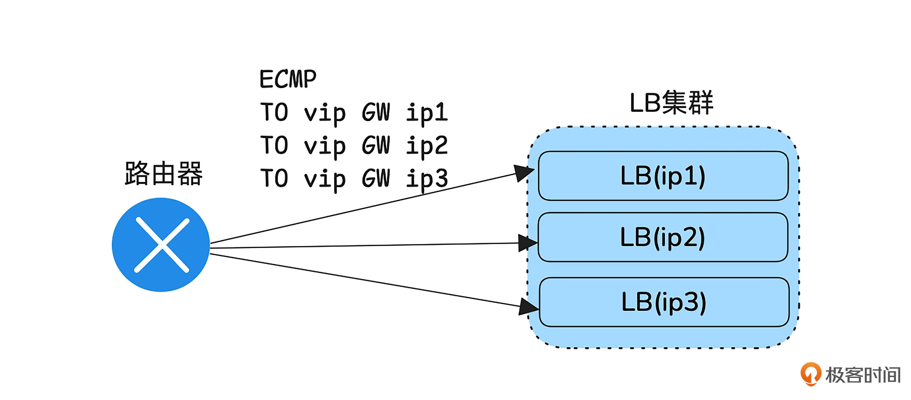
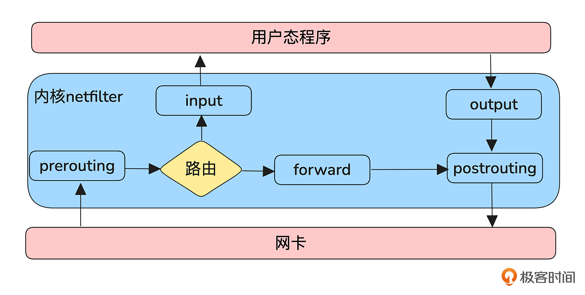
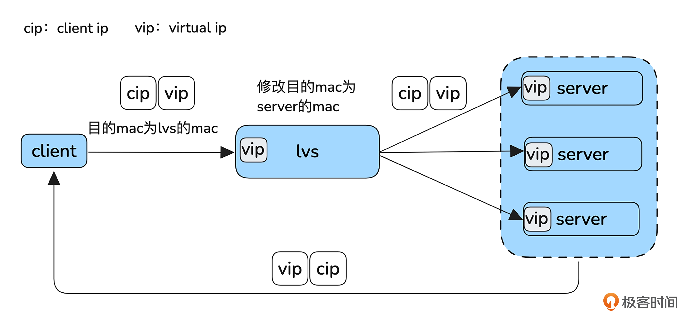
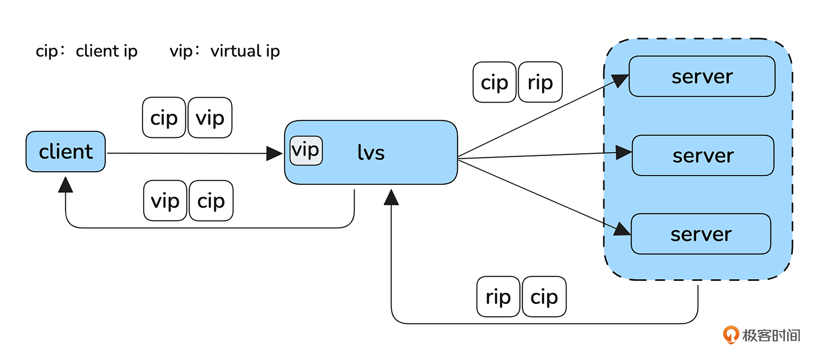
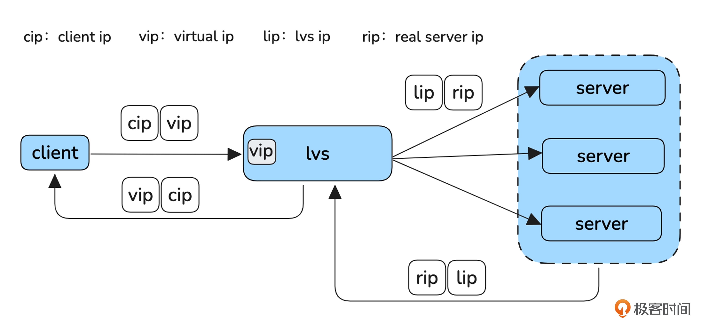
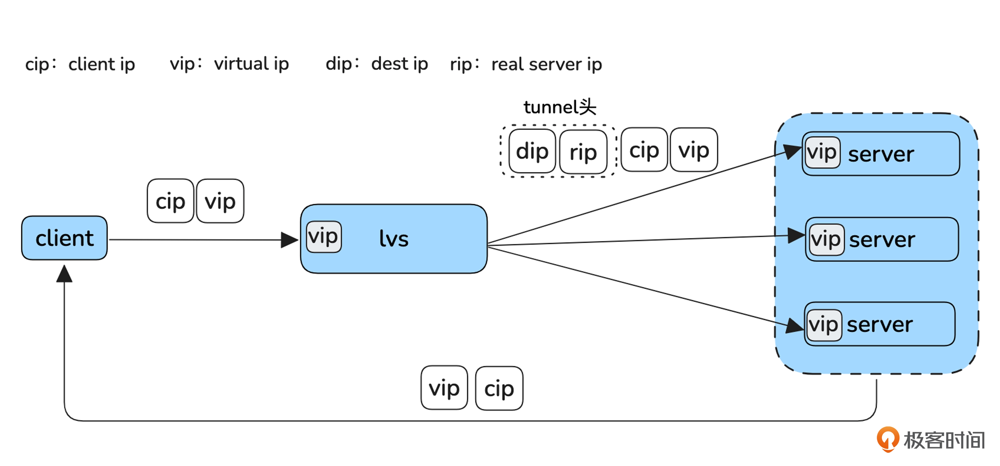
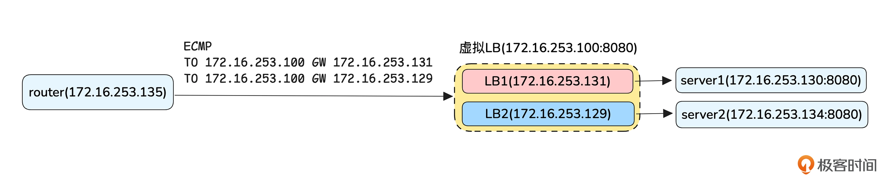
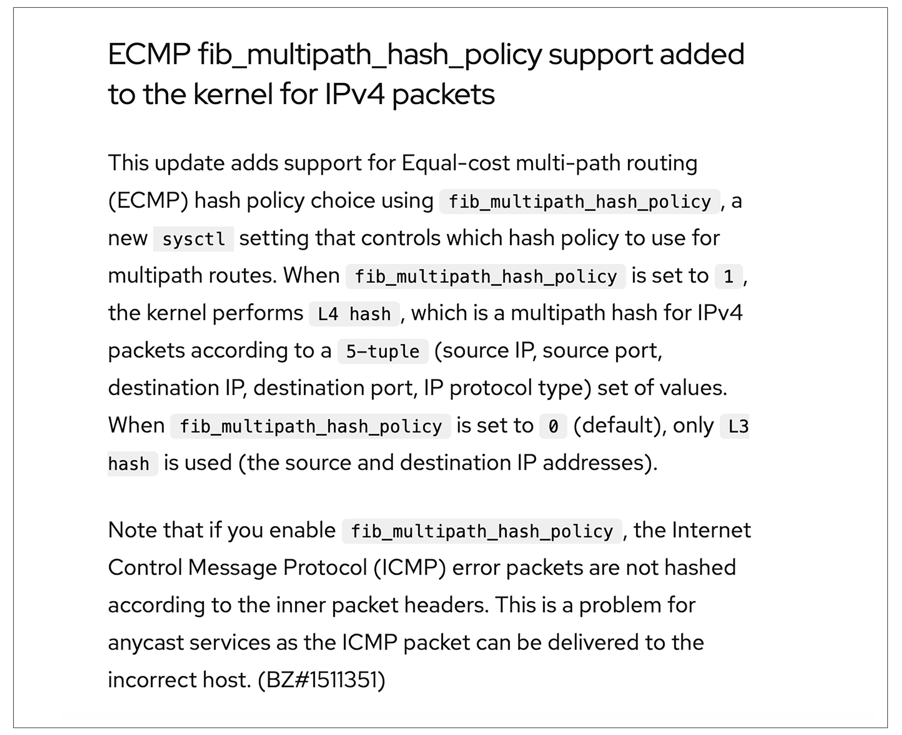
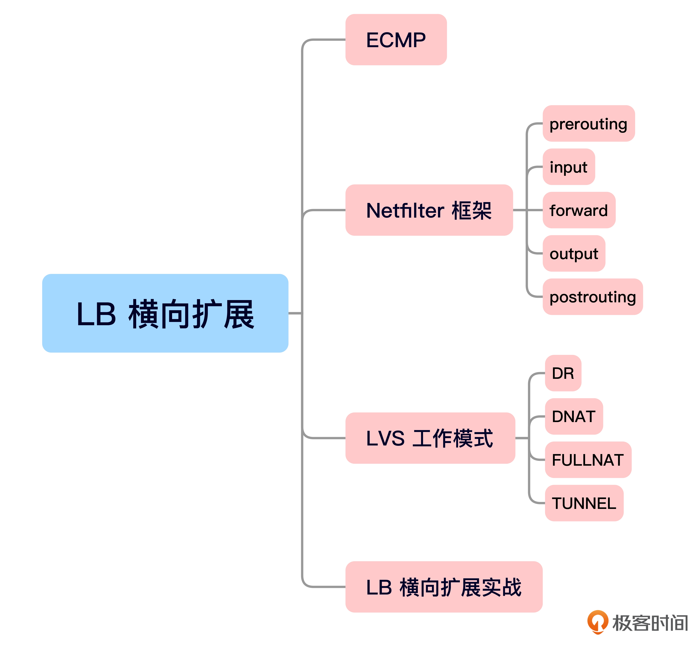

# 05 | 集群（下）：怎样实现横向扩展？

你好，我是谢友鹏。

上一节课我们分析了网络横向扩展架构，并且已经知道可以通过 DNS 进行横向扩展、也可以通过 LB 扩展下游服务，今天这节课我们重点关注 LB 自身怎样横向扩展。

我们将以 LVS 作为负载均衡器来进行原理分析和实验。

## LB 横向扩展原理

我们可以从负载均衡器（LB）如何横向扩展上游服务的原理入手，来探寻其自身的扩展方式。负载均衡器能够决定请求应发送到哪个下游机器，因此可以有效分担上游流量。按照这个思路，横向扩展 LB 实际上是需要从其下游看请求的流向。

当请求到达机房时，LB 通常是第一个代理设备。请求会先由路由器转发给 LB。之前第三节课我们说过，在主备机房架构中，路由器会根据最长掩码匹配的原则选择路由。那如果存在多个等长掩码的路由，路由器会怎样选择呢？

### ECMP

这时，路由器就会在这些路由之间进行负载分担。这一特性为负载均衡器的横向扩展提供了可能。通过 ECMP（等价多路径路由），可以在多个路由之间分担流量 ，从而实现负载均衡器的横向扩展，提升系统的吞吐量和容错能力。



现在我们已经知道怎样让请求包负载分担地到达 LB 上了，接下来我们会使用 LVS 作为 LB，分析其工作原理。

### Netfilter 框架

LVS 是集成到 Linux 内核的一个功能，它依赖于 Netfilter 框架，所以我们要先熟悉一下这个框架。



如图所示，Linux 内核处理进出网络协议栈的数据包分为 5 个不同的阶段，Netfilter 通过这 5个阶段注入钩子函数来实现对数据包的过滤和修改。

这 5 个阶段分别是：

- prerouting：路由前阶段，发生在内核对数据包进行路由判决前。

- input：本地上送阶段，发生在内核通过路由判决后。如果数据包是发送给本机的，那么就把数据包上送到上层协议栈。

- forward：转发阶段，发生在内核通过路由判决后。如果数据包不是发送给本机的，那么就把数据包转发出去。

- output：本地发送阶段，发生在对发送数据包进行路由判决之前。

- posting：路由后阶段，发生在对发送数据包进行路由判决之后。

从中可以看到，一个数据包到达本机后有两个主要路径，一个是要上送到用户态的路径为prerouting->intput-> 用户态处理 ->output->postrouting，另一个是 prerouting->forwarding->postrouting 。这两条路径是依据路由判别的，所以要想在应用程序收到网络包，本机一定要有这个包的目的 IP，这个是今天实验环境一个重要依据。

### LVS 工作模式

接下来我们看看 LVS 是怎样通过 Netfilter 框架实现转发的，其对应的内核实现 IPVS 在Netfilter 的 input、forward 和 posting 阶段都进行 hook 来实现自己的逻辑，也就是说 LVS 可以对发给其本机和经过其转发的报文进行修改，来达到负载均衡的功能。

LVS 有 4 种工作模式，我们逐一分析看看 。

第一种是 DR 模式（Direct Route）。



客户端发送的报文目标 IP 是 VIP，报文首先会到达 LVS。接着，LVS 会将报文中的目标 MAC地址替换为一个后端服务器的 MAC 地址，并将报文转发出去。由于报文的目标 MAC 地址是服务器的地址，报文最终会到达目标服务器。

由于 LVS 并没有修改报文的 IP 地址，服务器收到的报文四元组为：客户端 IP 地址、客户端端口、VIP 地址和目标端口。服务器会根据这个四元组进行响应，并将响应发送到客户端的 IP地址。此时，响应报文会直接返回客户端，而无需经过 LVS，因为响应是直接从服务器发出的。

需要注意的是，虽然服务器接收到的报文目的地址是 VIP，但根据 Netfilter 的处理流程，服务器必须路由到 INPUT 链，才能进入本机处理流程。因此，服务器的网络接口上也需要配置VIP，但不能通过 ARP 广播将 VIP 公开，以避免请求直接到达服务器而绕过 LVS。

这种转发方式的优势是，只修改 MAC 地址，不涉及 IP 层的改动，且响应不经过 LVS，直接返回客户端，这样就提高了效率。但是因为 LVS 必须知道 Server 的 MAC 地址，所以它们必须部署在同一个局域网。

接下来我们看 DNAT 模式。



在这种模式下，LVS 会将收到的报文目标 IP 修改为服务器的 IP 地址。当服务器收到报文后，会根据源 IP 进行应答。从四层协议的角度来看，这个应答报文是直接发送到客户端的。然而，由于客户端发送报文时目标 IP 是 VIP，如果应答报文的源 IP 是服务器的 IP，则 TCP 四元组将不匹配，导致客户端无法正确识别应答报文，最终丢弃这个包。

为了避免这种情况，应答报文必须再次经过 LVS 进行处理。具体来说，尽管从四层的角度应答报文不经过 LVS，但从三层的角度，应答报文必须经过 LVS。

那应该如何解决这个问题呢？

一个有效的解决方案是通过路由配置，将 LVS 设置为服务器发送到客户端的默认网关。这样，经过 LVS 的报文会触发 LVS 内核中的 Netfilter forward 钩子进行处理，LVS 会在此过程中将报文的源 IP 地址替换回 VIP。这样就确保了报文能够正确地传递回客户端，并且保持四元组的一致性。

看懂了 DNAT 模式，我们再看 FULLNAT 模式就简单多了。



可以看到 FULLNAT 与 DNAT 的区别在于，LVS 不仅把请求的目的 ip 换成 Server，同时还把源 IP 换成自己的 IP 了。这样 Server 的应答报文就顺理成章地到达 LVS，LVS 再做一次转化将目的 IP 换成客户端 IP，源 IP 换成 vip 就可以了。

最后，我们看一下 Tunnel 模式。



Tunnel（隧道）模式是指 LVS 将发往 Server 的报文外面又封装了一层报文，原来的报文变成了新报文的数据部分，这就要求 Server 上必须有对应 tunnel 的解封装软件将 tunnel 头剥离，然后剩下的包就和 DR 模式一样了，应答也和 DR 模式一样。这样加一层 tunnel 的好处是LVS 机器和 Server 机器不必非要部署在同一个局域网里面了。

## LB 横向扩展实战

搞清楚理论后，我们开始今天的实战环节。

### 实验设计



本次实验的目的是实现 LB 的横向扩展，最终期望看到的结果是通过 vip 访问 LB 集群的时候，一部分流量经过 LB1、一部分流量经过 LB2。为了方便观察到这个结果，我们让 LB1 收到请求后只转发给 server1，LB2 收到请求后只转发给 server2，然后 server1 和 server2 收到请求后返回 header 中 X-Host 带有不同的值。

路由部分，router、LB1 和 LB2 之间通过 OSPF 动态路由协议相互发布路由，OSPF 功能通过 Linux 的开源软件 frr 来实现。虚拟 LB 部分，LB1、LB2 之间还是通过 keepalived 来组成一个虚拟的 LB，有了 ECMP 来横向扩展，我们就不需要再使用 VRRP 功能了，而是使用virtual server 组网。本次实验我们使用 LVS 的 DR 模式转发。server1、server2 还是使用Nginx 来实现 http server，当然，这部分你也可以使用其他任意方式实现。

根据 LVS 的转发原理，我们已经知道 LVS 的 DR 模式不会修改 IP 地址，只是修改了 MAC，所以 server 上收到请求的目的 IP 就是 vip。为了能让 Server 处理该报文，我们需要在 Server的接口上配置 vip，但是为了防止报文不经过 LB 直接到达 Server，需要关闭其 ARP 广播功能。

实验开始前，我们先熟悉一下要用到新软件 frr，它是一个实现了各种路由功能的开源项目，可以运行在 Linux 上。使用的时候先编辑 /etc/frr/daemons 文件开启对应 daemon 进程，然后systemctl daemon-reload 让修改生效，之后就可以通过配置文件、命令行或一些接口来配置路由了，更详细的说明你可以参考其官方文档。

### 开始实验

我们先关闭所有机器上防火墙策略，并开启转发功能，这个是实验成功的前提。

关闭防火墙操作如下：

```
systemctl stop firewalld
systemctl disable firewalld
```

我们可以通过 sudo systemctl status firewalld 来验证防火墙是否关闭了。

```
之后是开启 forward 转发功能的操作。首先，编辑 /etc/sysctl.conf 文件。如果有以下配
```

置，将值修改为 1，没有的话，添加即可。

```
net.ipv4.ip_forward = 1
net.ipv6.conf.all.forwarding = 1
```

退出编辑后，我们需要执行以下命令。

```
#让/etc/sysctl.conf文件修改生效
$ sudo sysctl -p
#验证转发功能是否开启
$ sudo sysctl net.ipv4.ip_forward
net.ipv4.ip_forward = 1
#我们实验用不到ipv6可以不用管v6的情况
```

下面开始实验配置，首先要配置 Server。

和上一节非常相似，我们还是用 Nginx 提供 http 服务，只是增加了一行添加 X-Host 头的配置，server1 和 server2 的 nginx 配置，你可以参考 server1/nginx.conf 和server2/nginx.conf。修改完配置，我们 reload nginx 让配置生效。

```
#修改/etc/nginx/nginx.conf
#reload nginx让配置生效
$ sudo nginx -s reload
2024/11/10 11:55:14 [notice] 4257#4257: signal process started
#本机进行功能验证，X-Host符合预期。
$ curl http://127.0.0.1:8080 -v
*   Trying 127.0.0.1:8080...
* Connected to 127.0.0.1 (127.0.0.1) port 8080
> GET / HTTP/1.1
> Host: 127.0.0.1:8080
> User-Agent: curl/8.5.0
> Accept: */*
>
< HTTP/1.1 200 OK
< Server: nginx/1.24.0 (Ubuntu)
< Date: Sun, 10 Nov 2024 11:55:34 GMT
< Content-Type: text/plain
< Content-Length: 0
< Connection: keep-alive
< X-Remote-IP: 127.0.0.1
< X-Host: server1
<
* Connection #0 to host 127.0.0.1 left intact
```

然后在 server 的环回口配置配置 vip，并关闭 ARP 功能。

```
#进入root用户
$ sudo bash -c bash
#忽略lo口ip的arp请求，只响应目的IP地址为接收网卡上的本地地址的arp请求。
$ sudo  sysctl -w net.ipv4.conf.lo.arp_ignore=1
#发送ARP通告时，不使用lo口上的ip地址
# sudo sysctl -w net.ipv4.conf.lo.arp_announce=2
#lo:0的虚拟接口，并为其分配了IP地址
# /sbin/ifconfig lo:0 172.16.253.100 broadcast 172.16.253.100 netmask 255.255.255
# 为172.16.253.100设置了静态路由，指明所有访问该IP的流量应该通过虚拟接口lo:0
# /sbin/route add -host 172.16.253.100 dev lo:0
#查看配置结果
$ ifconfig
ens33: flags=4163<UP,BROADCAST,RUNNING,MULTICAST>  mtu 1500
       inet 172.16.253.134  netmask 255.255.255.0  broadcast 172.16.253.255
       inet6 fe80::20c:29ff:fead:6136  prefixlen 64  scopeid 0x20<link>
       ether 00:0c:29:ad:61:36  txqueuelen 1000  (Ethernet)
       RX packets 6606  bytes 2790029 (2.7 MB)
       RX errors 0  dropped 0  overruns 0  frame 0
       TX packets 4253  bytes 581633 (581.6 KB)
       TX errors 0  dropped 0 overruns 0  carrier 0  collisions 0
lo: flags=73<UP,LOOPBACK,RUNNING>  mtu 65536
       inet 127.0.0.1  netmask 255.0.0.0
       inet6 ::1  prefixlen 128  scopeid 0x10<host>
       loop  txqueuelen 1000  (Local Loopback)
       RX packets 712  bytes 55712 (55.7 KB)
       RX errors 0  dropped 0  overruns 0  frame 0
       TX packets 712  bytes 55712 (55.7 KB)
       TX errors 0  dropped 0 overruns 0  carrier 0  collisions 0
lo:0: flags=73<UP,LOOPBACK,RUNNING>  mtu 65536
       inet 172.16.253.100  netmask 255.255.255.255
       loop  txqueuelen 1000  (Local Loopback)
```

接下来，我们继续配置 LB1、LB2 上的 Keepalived，实现 virtual LB 功能。

分别修改 LB1、LB2 的 Keepalived 配置 /etc/keepalived/keepalived.conf，内容参考lb1/keepalived.conf 和 lb2/keepalived.conf，然后重新启动 Keepalived 使配置生效。

```
#重新启动keepalived
$ sudo systemctl restart keepalived
#检查keepalived的状态
$ sudo systemctl status keepalived
 keepalived.service - Keepalive Daemon (LVS and VRRP)
    Loaded: loaded (/usr/lib/systemd/system/keepalived.service; enabled; preset:
    Active: active (running) since Sun 2024-11-10 15:49:22 UTC; 6s ago
      Docs: man:keepalived(8)
            man:keepalived.conf(5)
            man:genhash(1)
            https://keepalived.org
  Main PID: 5388 (keepalived)
     Tasks: 2 (limit: 4556)
    Memory: 1.8M (peak: 2.1M)
       CPU: 10ms
    CGroup: /system.slice/keepalived.service
            ├─5388 /usr/sbin/keepalived --dont-fork
            └─5391 /usr/sbin/keepalived --dont-fork
Nov 10 15:49:22 server1 Keepalived[5388]: Command line: '/usr/sbin/keepalived' '-
Nov 10 15:49:22 server1 Keepalived[5388]: Configuration file /etc/keepalived/keep
Nov 10 15:49:22 server1 Keepalived[5388]: NOTICE: setting config option max_auto_
Nov 10 15:49:22 server1 Keepalived[5388]: Starting Healthcheck child process, pid
Nov 10 15:49:22 server1 Keepalived_healthcheckers[5391]: Initializing ipvs
Nov 10 15:49:22 server1 Keepalived_healthcheckers[5391]: Gained quorum 1+0=1 <= 1
Nov 10 15:49:22 server1 Keepalived_healthcheckers[5391]: Activating healthchecker
Nov 10 15:49:22 server1 systemd[1]: Started keepalived.service - Keepalive Daemon
Nov 10 15:49:22 server1 Keepalived_healthcheckers[5391]: Activating BFD healthche
Nov 10 15:49:22 server1 Keepalived[5388]: Startup complete
```

然后分别在 LB1、LB2 的回环口配置 vip。

```
$ sudo ifconfig lo:0 172.16.253.100 netmask 255.255.255.255 up
$ ifconfig
ens33: flags=4163<UP,BROADCAST,RUNNING,MULTICAST>  mtu 1500
       inet 172.16.253.129  netmask 255.255.255.0  broadcast 172.16.253.255
       inet6 fe80::20c:29ff:fedf:3ccc  prefixlen 64  scopeid 0x20<link>
       ether 00:0c:29:df:3c:cc  txqueuelen 1000  (Ethernet)
       RX packets 19693  bytes 15226238 (15.2 MB)
       RX errors 0  dropped 0  overruns 0  frame 0
       TX packets 5594  bytes 638002 (638.0 KB)
       TX errors 0  dropped 0 overruns 0  carrier 0  collisions 0
lo: flags=73<UP,LOOPBACK,RUNNING>  mtu 65536
       inet 127.0.0.1  netmask 255.0.0.0
       inet6 ::1  prefixlen 128  scopeid 0x10<host>
       loop  txqueuelen 1000  (Local Loopback)
       RX packets 318  bytes 27547 (27.5 KB)
       RX errors 0  dropped 0  overruns 0  frame 0
       TX packets 318  bytes 27547 (27.5 KB)
       TX errors 0  dropped 0 overruns 0  carrier 0  collisions 0
lo:0: flags=73<UP,LOOPBACK,RUNNING>  mtu 65536
       inet 172.16.253.100  netmask 255.255.255.255
       loop  txqueuelen 1000  (Local Loopback)
```

最后，配置 LB1、LB2 和 router 的 frr，让 router 通过 ospf 动态路由协议学到 LB1、LB2的 ECMP 路由。

第一步需要我们安装并查看 frr 版本。

```
#安装frr
$ sudo apt install frr frr-pythontools frr-doc
#查看frr版本
$ sudo vtysh -c "show version"
FRRouting 8.4.4 (server5) on Linux(6.8.0-48-generic).
Copyright 1996-2005 Kunihiro Ishiguro, et al.
configured with:
   '--build=x86_64-linux-gnu' '--prefix=/usr' '--includedir=${prefix}/include' '
```

然后编辑 frr 的 daemons 配置文件，开启 ospf 的 daemon，修改结果参考daemons，然后reload daemons 使配置生效。

```
#开启对应路由的daemon，需要编辑/etc/frr/daemons，并在对应功能后选择yes或on
$ sudo vi /etc/frr/daemons
#文件中修改此值ospfd=yes
#reload daemon让配置生效
$ sudo systemctl daemon-reload
```

然后修改 frr 的配置文件，router、LB1、LB2 的配置文件分别参考 router/frr.conf、lb1/frr.conf 和 lb2/frr.conf，然后启动 frr 功能。

```
#启动frr
$ sudo systemctl enable frr
$ sudo systemctl start frr
# 如果已经启动过frr，这里执行sudo systemctl restart frr
# 可以通过$ sudo systemctl status frr 查看frr的运行状态
# 可以通过$ sudo vtysh -c "show running-config"查看frr正在运行的配置
#可以查看到ospf进程
$ ps -ef | grep ospf
root        4870       1  0 16:07 ?        00:00:00 /usr/lib/frr/watchfrr -d -F t
frr         4888       1  0 16:07 ?        00:00:02 /usr/lib/frr/ospfd -d -F trad
```

以上操作全部完成后，router 上查询 vip 应该是到 LB1、LB2 的等价路由。

```
#router上看到LB1、LB2两个ospf邻居。
$ sudo vtysh -c "show ip ospf neighbor"
Neighbor ID     Pri State           Up Time         Dead Time Address         Int
172.16.253.129    0 Full/DROther    22m01s             3.146s 172.16.253.129  ens
172.16.253.131    0 Full/DROther    21m56s             3.306s 172.16.253.131  ens
#router上通过ospf学到了去vip：172.16.253.100/32有两条等价的路由。
$ sudo vtysh -c "show ip route ospf"
Codes: K - kernel route, C - connected, S - static, R - RIP,
      O - OSPF, I - IS-IS, B - BGP, E - EIGRP, N - NHRP,
      T - Table, v - VNC, V - VNC-Direct, A - Babel, F - PBR,
      f - OpenFabric,
      > - selected route, * - FIB route, q - queued, r - rejected, b - backup
      t - trapped, o - offload failure
O   172.16.253.0/24 [110/1] is directly connected, ens33, weight 1, 00:22:12
O>* 172.16.253.100/32 [110/1] via 172.16.253.129, ens33, weight 1, 00:21:58
 *                           via 172.16.253.131, ens33, weight 1, 00:21:58
```

如果你的操作没有成功，可以趁机先学习 OSPF 的工作原理，然后结合收集到的信息进行分析，以下命令或许可以帮助到你收集一些信息。

```bash
#查看 OSPF 邻居状态
sudo vtysh -c "show ip ospf neighbor"
#查看 OSPF 路由信息
sudo vtysh -c "show ip route ospf"
#查看 OSPF 数据库
sudo vtysh -c "show ip ospf database"
#查看 OSPF 接口状态
sudo vtysh -c "show ip ospf interface"
#查看 OSPF 统计信息
sudo vtysh -c "show ip ospf statistics"
#抓包观察，ospf协议号是89
sudo tcpdump -i any -n ip proto 89 -vv
```

上面的配置完成后，我们就可以验证 LB 的横向扩展功能了。

```
#在router上通过curl访问虚拟LB的地址，然后通过X-Host观察请求经过哪个LB转发的。
$ curl http://172.16.253.100:8080 -v
*   Trying 172.16.253.100:8080...
* Connected to 172.16.253.100 (172.16.253.100) port 8080
> GET / HTTP/1.1
> Host: 172.16.253.100:8080
> User-Agent: curl/8.5.0
> Accept: */*
>
< HTTP/1.1 200 OK
< Server: nginx/1.24.0 (Ubuntu)
< Date: Sun, 10 Nov 2024 16:46:36 GMT
< Content-Type: text/plain
< Content-Length: 0
< Connection: keep-alive
< X-Remote-IP: 172.16.253.135
< X-Host: server2
<
* Connection #0 to host 172.16.253.100 left intact
```

如果你多执行几次，可能会发现请求总是经过同一个 LB 转发到 server 的，而不是我们期待的负载分担，这是为什么呢？

这与 ECMP 的实现有关，我们在redhat 的文档可以看到后面这段描述。



这段内容大致可以这样理解。Linux 在处理 ECMP 路由的时候不是逐包负载分担转发的，而是根据一些转发数据进行 hash，碰撞到哪个路径，就走哪个路径。hash 参数和net.ipv4.fib_multipath_hash_policy 的配置有关。如果该值为 0，只按照源、目的 IP 进行hash；如果该值为 1，会按照 5 元组（源 IP、源端口、目的 IP、目的端口、协议类型）进行hash。

我们可以用后面的命令查询一下该值。

```
$ sysctl net.ipv4.fib_multipath_hash_policy
net.ipv4.fib_multipath_hash_policy = 0
```

默认是 0，我们在同一个设备，多次向同一个 vip 请求，源、目的 IP 总是相同的，hash 结果一定是相同的，这造成了，一直使用同一个 LB 转发。我们修改一下这个参数，再多次请求看看。

```
#修改参数
~$ sudo sysctl -w net.ipv4.fib_multipath_hash_policy=1
net.ipv4.fib_multipath_hash_policy = 1
#多次执行curl，观察X-Host是否为同一LB
#curl http://172.16.253.100:8080 -v
```

果然这次有的请求到 LB1，有的请求到 LB2 了。

因为修改后会按照五元组 hash，而每次 curl 源端口都是变化的，所以五元组就发生了变化，进而导致 hash 结果会变化。事实上，你也可以不修改 fib_multipath_hash_policy 参数，而是在 router 上多创建一些 lO 接口，并配置不同的 IP 地址，然后通过指定源 IP 的方式发送请求，这样也能观察到一些请求通过 LB1 转发，一些请求通过 LB2 转发的效果。

```bash
#改回为fib_multipath_hash_policy为0
$ sudo sysctl -w net.ipv4.fib_multipath_hash_policy=0
net.ipv4.fib_multipath_hash_policy = 0
#新增lo口并添加新ip地址
$ sudo ifconfig lo:1 172.16.253.200 netmask 255.255.255.255 up
$ sudo ifconfig lo:2 172.16.253.201 netmask 255.255.255.255 up
$ sudo ifconfig lo:3 172.16.253.202 netmask 255.255.255.255 up
#指定源ip发送请求
curl -v http://172.16.253.100:8080 --interface 172.16.253.200
curl -v http://172.16.253.100:8080 --interface 172.16.253.201
curl -v http://172.16.253.100:8080 --interface 172.16.253.202
```

## 小结

今天的内容就是这些，我给你准备了一个思维导图回顾要点。



今天这节课中，我们深入探讨了负载均衡（LB）如何进行横向扩展。

首先，我们讨论了 ECMP（等价多路径路由）如何支持流量分担。当多个等长掩码的路由存在时，路由器会选择进行负载分担，这样可以在多个路径之间均匀分配流量，确保系统的高效运行。

之后我们又深入学习 LVS（Linux Virtual Server）作为负载均衡器的工作原理，重点讲解了其依赖的 Netfilter 框架。通过 Netfilter 框架的不同阶段（如 prerouting、input、forward 和postrouting），LVS 能够对数据包进行精确地转发和修改，实现负载均衡功能。

特别要注意的是，LVS 通过多种模式（如 DR 模式、DNAT 模式、FullNAT 模式和 Tunnel 模式）实现不同的负载均衡策略，每种模式根据特定的需求进行数据包的处理和转发，保证请求能够均匀分配到各个后端服务器。

最后是 LB 横向扩展的实战环节。我们搭建了基于 LVS 的负载均衡系统，在实验中，我们通过使用 LVS 的 DR 模式、Keepalived 的虚拟 LB 配置、以及通过 OSPF 协议实现的动态路由，成功实现了 LB 集群的横向扩展。通过这种方式，不同的流量可以被有效地分配到不同的负载均衡器，从而提升了整体系统的性能和可靠性。

强烈建议你跟着课程讲解动手练习一下，这样你不仅能对 LB 的横向扩展理论有个更深入的理解，也能掌握通过 LVS 实现高效负载均衡的实践能力。

## 思考题

1. 在 LVS 的 DR 模式下，为什么需要在服务器的网络接口上配置 VIP 地址，但又不让 VIP 通过 ARP 广播公开？如果直接将 VIP 广播给所有设备会带来什么问题？

2. 按道理说，完全按包负载分担会让请求更均匀地在多个等价的路径中转发，那为什么实现ECMP 的时候是，按照五元组或源目的 IP 来 hash 选择走哪条路由，而不是完全按包负载分担呢？

欢迎你在留言区和我交流互动，如果这节课对你有启发，也推荐你分享给身边更多朋友。

## 扩展阅读

iptable 更为详细的数据转发图可参考 Netfilter-packet-flow.svgNetfilter-packet-flow.svg
