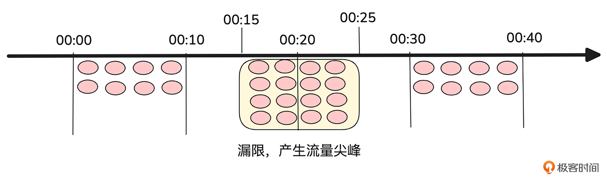
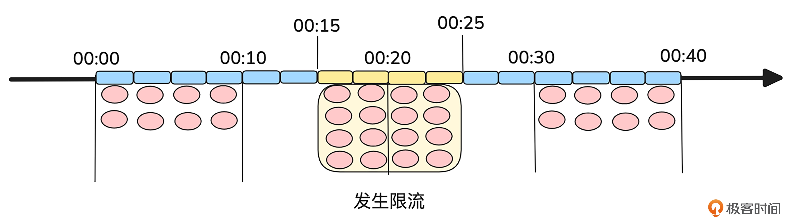
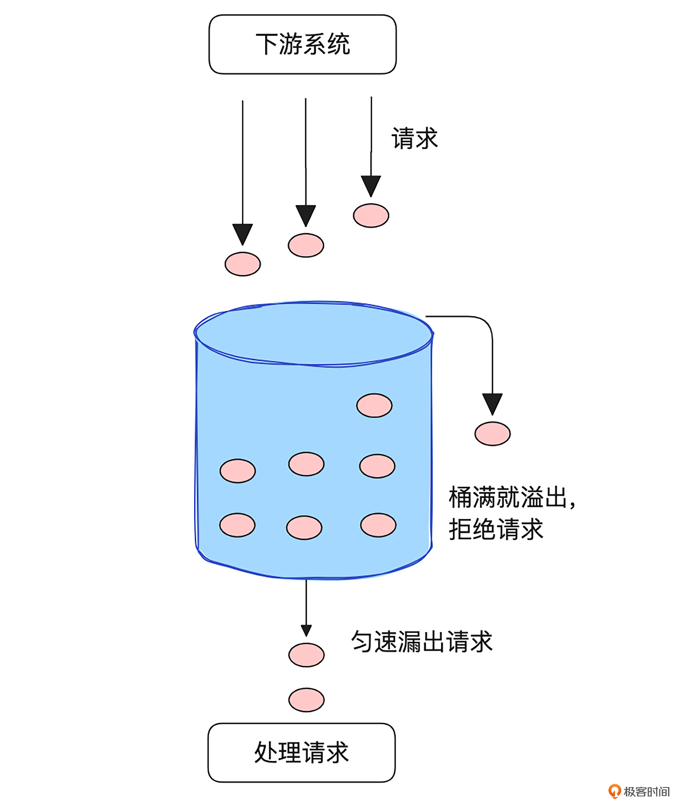
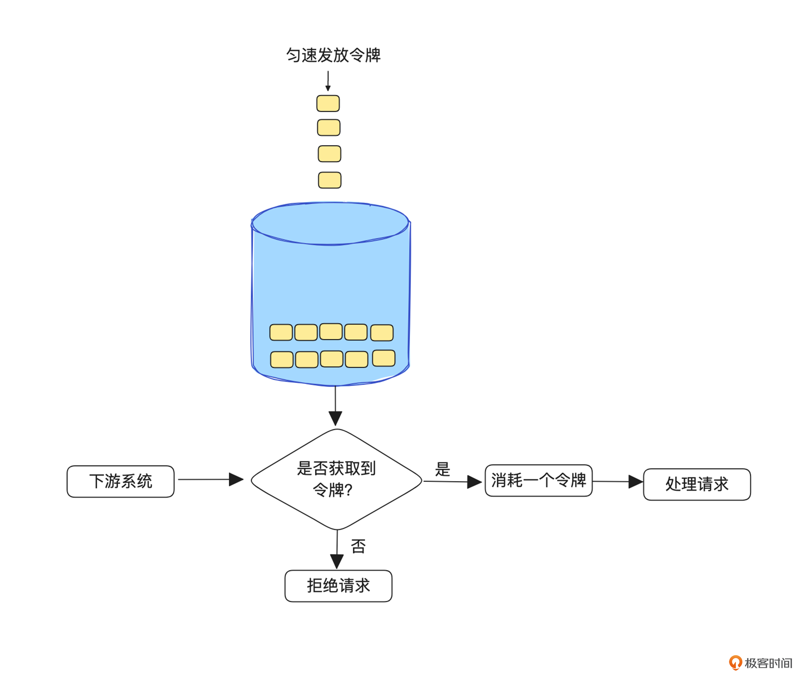
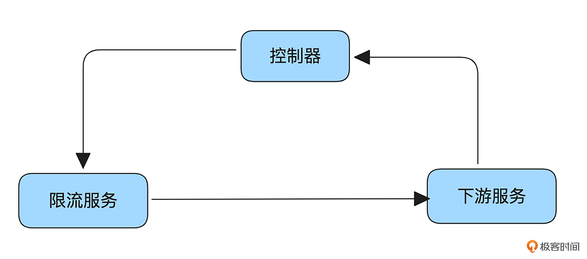
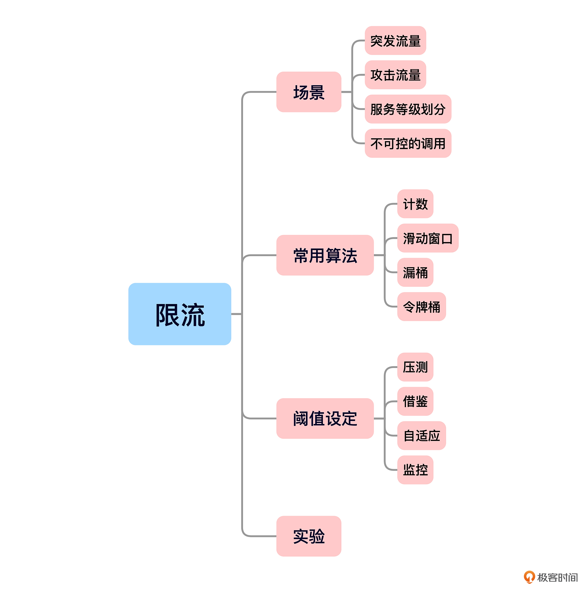
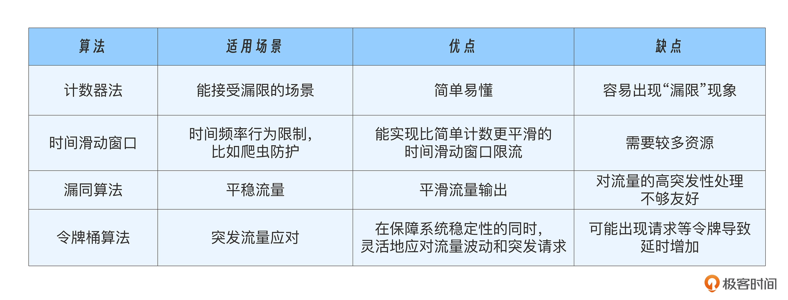

# 06 | 限流：怎样防止应用被打垮？

你好，我是谢友鹏。

在当今互联网应用中，流量的激增往往是不可预见的，无论是因为短期促销活动的推动，还是因为某些突发事件的影响。

例如，一场热门商品的限时促销，可能会瞬间吸引大量用户涌入，服务器瞬间负荷过重，导致应用崩溃，甚至影响到正常业务的运营。而在云存储服务等应用中，针对不同等级的会员，流量需求差异较大，基础服务往往需要防止高频次调用的用户占用过多资源，影响整体性能。

更严重的是，网络攻击手段也在不断升级，恶意流量也可能以惊人的速度涌入，试图击垮整个系统。在这种背景下，限流作为一种有效的流量控制手段，显得尤为重要。它不仅能有效防止单个请求过载系统，还能够保障不同流量来源的公平性，保护系统免受攻击或异常流量的影响，确保用户体验不受破坏。

今天我们就来学习一下限流的方案。

## 常用限流算法

限流的实现离不开算法，我们看看常用的算法有哪些。

### 计数器

最简单的算法是“计数器”法。每分钟统计一次请求数量，超过设定的阈值就拒绝请求，这听起来很简单对吧？

但是，这种简单粗暴的统计方法可能会导致“漏限”产生“尖峰流量”的问题，导致流量暴涨时系统依然无法承受。我们可以通过一个示意图来说明这个问题：



假设一个系统每 10 分钟只能处理 8 个请求，如果按 10 分钟为单位进行统计，请求超过 8 就拒绝，10 分钟过后计数清零。

结合上图我们可以看到，00:00-00:10 的 8 个请求都通过了，没问题。但如果 00:10 之前没有请求，且 00:15-00:20 之间来了 8 个请求，那么这些请求都将通过，此时计数被清零。接下来，00:20-00:25 又来了 8 个请求，这也是完全通过的。

问题来了，00:15-00:25 之间是 10 分钟的时间窗口，但却通过了 16 个请求，超出了限流设定，导致系统出现问题。

计数器限流的方法问题在于统计限流的周期粒度过大，容易漏掉跨越多个统计周期的流量峰值，导致“漏限”现象。

### 时间滑动窗口

为了避免计数器限流中的问题，我们可以使用时间滑动窗口限流。这个方法的核心思想是将时间窗口切割得更细，并实时更新请求统计数据，从而平滑流量波动。

具体方法是将一个大的时间窗口分割成多个小的时间段，每个时间段都有独立的计数，随着时间推移，窗口会不断“滑动”，从而避免跨周期的洪峰流量。

我们同样结合一张示意图来理解。



这次我们不按照 10 分钟为一个周期来统计，而是将 10 分钟划分为 4 个 2.5 分钟的小周期进行统计。每当有请求到来时，我们会计算这 4 个周期内请求的总和，如果总和超过了设定的阈值 8，就触发限流。随着时间的推移，统计窗口会向前滑动，这样就能实现比简单计数更平滑的时间滑动窗口限流。

如上图所示，在 00:10 到 00:15 这两个小周期没有请求，00:15 到 00:20 这两个小周期分别来了 4 个请求。那么，在 00:20 开始的周期会根据当前周期和之前三个周期的请求数量进行统计——当前周期 0 个请求，加上之前两个周期分别为 4 个和 4 个的请求，最终的总数是 8 个，刚好达到限流阈值。

因此，在这个周期内的请求都会被限流。之后，我们继续按照相同的计算方法处理下一个周期。如果前面三个周期的总和已经是 4+4+0=8，再加上当前周期的请求数，依然会超过阈值，所有请求都会被丢弃。

时间滑动窗口限流需要动态地管理请求的时间戳，随着时间的推移不断移除过期的请求，并计算当前窗口内的请求数。这就要求系统能够高效地存储和管理这些请求数据，处理大量的动态更新和过期操作。

### 漏桶

相对于计数类的限流算法，工程中更常使用的是漏桶算法。漏桶算法的核心思想是通过一个固定容量的“漏桶”来容纳请求流量，当请求超出桶容量时将被丢弃。不论请求流入漏桶的速度如何，漏桶都会均匀地将请求漏出。我画了个示意图，方便你理解。



漏桶算法的最大优势在于其能够平滑流量输出，保证请求以恒定的速率被处理，从而避免了短时间内大量请求的积压。然而，漏桶算法的缺点是对流量的高突发性处理不够友好。如果请求的流量超过了桶的处理能力，多余的请求将被丢弃。因此，漏桶算法适用于需要流量平稳输出，并且可以容忍在高峰时段部分请求被限流的场景。

后面这三类场景就比较适合采用漏桶算法。

1. 稳定的流量输出要求：漏桶算法非常适合那些要求以固定速率稳定处理请求的场景。特别是在带宽和资源有限的情况下，比如音视频流媒体服务，需要保证流量的平稳性，避免因瞬时流量过大而导致服务器资源的过载。

2. 网络带宽控制：在带宽有限的情况下，漏桶算法能够有效地平稳输出流量，避免短时间内的流量高峰对网络带宽造成冲击，防止网络出现过载情况。

3. 防止突发流量压垮系统：对于一些对瞬时流量不敏感，但要求长期保持流量平稳的应用（例如日志采集系统或批量数据处理），漏桶算法能够避免短期内流量过大，影响系统稳定性，确保系统能够平稳运行。

总结来说，漏桶算法特别适合用于那些对流量的平稳输出有较高要求，且能够接受一定程度的请求丢失的场景。

### 令牌桶

令牌桶算法是另一种非常实用的限流算法，它通过向桶中均匀发放令牌来限制流量。当请求到达时，系统会尝试从桶中取令牌，如果有令牌则允许请求通过，否则拒绝请求。令牌桶允许一定的流量突发，因为令牌桶中可以存储一定数量的令牌，从而允许短时间内较大的流量涌入。



令牌桶算法适合用于那些能够容忍短时间流量突增的场景，同时又希望在长期内保持流量的总体稳定性。其核心优势在于，虽然允许短期内流量突发，但它通过令牌的积累机制，确保了在流量过高时能够及时限制请求，从而避免系统过载。

后面这三类场景比较适合采用令牌桶算法。

1. API 网关服务中的流量控制。如果某些 API 的调用频率过高，可以通过令牌桶来限制流量的峰值。令牌的生成速率控制了请求的平均处理速率，而令牌的积累则使得系统能够在流量突增时，继续接受一定数量的请求。

2. 秒杀活动：秒杀活动短时间会涌入很多请求，属于流量突增场景，一旦请求量超过了系统的承载能力，就会根据令牌的消耗情况逐渐限制流量进入系统，避免服务过载。这样既能让合

- 适的、秒杀成功的请求放行到后端得到处理，又能避免系统过载。

3. 实时流量控制：例如即时通讯、金融交易等，令牌桶算法能够平衡实时流量和突发流量之间的需求。在这些场景中，令牌桶可以有效地控制流量波动，同时防止因请求过多导致系统崩溃。

总体来说，令牌桶算法适合那些需要动态调节流量并能够容忍短期突发流量的场景，它能够在保障系统稳定性的同时，灵活地应对流量波动和突发请求。

## 怎样设定限流阈值？

学会限流算法是第一步，但在实际应用中，另一个关键问题是限流阈值应该设定为多少？

一个常见的做法是通过压测来确定阈值。你可以根据具体场景设定一些压测指标，比如请求完成的平均耗时、95 分位的平均耗时、成功率等。你可以逐步增加压测流量，直到某个指标变得不可接受为止。此时，你可以选择稍微低于这个“临界点”的值作为限流阈值，以便为系统留出足够的 buffer，应对突发流量。

那么，我们如何估算压测出的阈值是否合理呢？

首先，可以借鉴类似系统的阈值作为参考标准。例如，如果在相同硬件和配置下，某个类似的C 语言应用的限流阈值为 5000 QPS，你可以在你的系统上进行类似的压测，看看是否能处理相同规模的流量。这样，至少可以确保在相同规格的机器上，你的系统大致能应对类似的负载。

其次，压测到系统的极限后，分析瓶颈所在，看看是否需要进行优化。

除了手动设定限流阈值外，还可以采用自适应限流的方式。这种方式可以通过实时收集下游服务的指标数据（如 CPU 利用率、负载值、网络重传率、内存使用率和错误情况等），结合限流系统的请求耗时和成功率等指标，负反馈式地动态调整限流阈值。例如，当下游系统的 CPU利用率过高时，限流系统可以降低阈值，减轻下游服务的压力。



然而，自适应限流也存在一些缺点。首先，如上图所示，它需要一个控制器等角色来采集下游服务的各类指标，并将数据反馈给限流系统，这样系统的复杂度和依赖关系会增加。其次，限流的精度很大程度上取决于指标设定的合理性和负反馈周期的时效性，因此需要仔细调整和优化，避免反馈周期过长或反馈数据不准确导致限流效果不理想。

无论使用哪种方式限流，都要做好监控和告警，及时发现指标劣化趋势，然后做出分析和调整。

## Nginx 限流实战

接下来又到了实战巩固的环节。让我们来做一个基于 Nginx 的限流小实验。

这个实验将会通过配置 Nginx 实现基于单机限流的 HTTP 请求控制。步骤包括安装并配置Apache HTTP 服务作为后端，再配置 Nginx 作为反向代理并启用限流功能，最后验证限流效果。

首先，我们需要安装 Apache HTTP 服务并验证其能够正常工作。

```
#我这里使用了apache2作为http server，你也可以使用任何其他软件。
$ sudo apt install apache2
# 启动 Apache 服务，并查看服务启动状态
$ sudo systemctl start apache2
$ sudo systemctl status apache2
apache2.service - The Apache HTTP Server
    Loaded: loaded (/usr/lib/systemd/system/apache2.service; enabled; preset: en
    Active: active (running) since Sat 2024-11-30 15:12:12 UTC; 1min 26s ago
      Docs: https://httpd.apache.org/docs/2.4/
  Main PID: 2147 (apache2)
     Tasks: 55 (limit: 4556)
    Memory: 5.4M (peak: 5.9M)
       CPU: 67ms
    CGroup: /system.slice/apache2.service
            ├─2147 /usr/sbin/apache2 -k start
            ├─2149 /usr/sbin/apache2 -k start
            └─2150 /usr/sbin/apache2 -k start
#进行验证
$ curl -v  -o /dev/null http://localhost:80
* Host localhost:80 was resolved.
* IPv6: ::1
* IPv4: 127.0.0.1
 % Total    % Received % Xferd  Average Speed   Time    Time     Time  Current
                                Dload  Upload   Total   Spent    Left  Speed
 0     0    0     0    0     0      0      0 --:--:-- --:--:-- --:--:--     0*
* Connected to localhost (::1) port 80
> GET / HTTP/1.1
> Host: localhost
> User-Agent: curl/8.5.0
> Accept: */*
>
< HTTP/1.1 200 OK
< Date: Sat, 30 Nov 2024 15:17:25 GMT
< Server: Apache/2.4.58 (Ubuntu)
< Last-Modified: Sat, 30 Nov 2024 15:12:09 GMT
< ETag: "29af-62822bd461fce"
< Accept-Ranges: bytes
< Content-Length: 10671
< Vary: Accept-Encoding
< Content-Type: text/html
<
{ [10671 bytes data]
100 10671  100 10671    0     0  2560k      0 --:--:-- --:--:-- --:--:-- 3473k
* Connection #0 to host localhost left intact
```

接下来，我们安装 Nginx，并配置它将请求从端口 8080 转发到本地的 Apache 服务（端口80）。同时，我们要为 Nginx 配置单机限流，限流值设置为 1 请求每秒，并允许 1 个突发请求。其中，记得将 Nginx 配置文件 /etc/nginx/nginx.conf 替换为 nginx.conf。

```
#安装nginx
$sudo apt-get install nginx -y
#修改/etc/nginx/nginx.conf
#启动nginx，如果你已经启动过了，想让配置生效，可以用sudo nginx -s reload。
$ sudo nginx
#通过curl进行验证
$  curl -v  -o /dev/null http://localhost:8080
* Host localhost:8080 was resolved.
* IPv6: ::1
* IPv4: 127.0.0.1
 % Total    % Received % Xferd  Average Speed   Time    Time     Time  Current
                                Dload  Upload   Total   Spent    Left  Speed
 0     0    0     0    0     0      0      0 --:--:-- --:--:-- --:--:--     0*
* connect to ::1 port 8080 from ::1 port 55180 failed: Connection refused
*   Trying 127.0.0.1:8080...
* Connected to localhost (127.0.0.1) port 8080
> GET / HTTP/1.1
> Host: localhost:8080
> User-Agent: curl/8.5.0
> Accept: */*
>
< HTTP/1.1 200 OK
< Server: nginx/1.24.0 (Ubuntu)
< Date: Sat, 30 Nov 2024 15:46:08 GMT
< Content-Type: text/html
< Content-Length: 10671
< Connection: keep-alive
< Last-Modified: Sat, 30 Nov 2024 15:12:09 GMT
< ETag: "29af-62822bd461fce"
< Accept-Ranges: bytes
< Vary: Accept-Encoding
<
{ [10671 bytes data]
100 10671  100 10671    0     0  2790k      0 --:--:-- --:--:-- --:--:-- 3473k
* Connection #0 to host localhost left intact
```

我们将发送 3 个快速请求到 Nginx，观察限流效果。根据配置，每秒最多允许 1 个请求，并且允许 1 个突发请求。执行以下命令发送 3 个并发请求：

```
$ for i in {1..3}; do curl -s -o /dev/null -w "%{http_code}\n" http://localhost:8
[1] 3825
[2] 3826
[3] 3827
200
[1]   Done                    curl -s -o /dev/null -w "%{http_code}\n" http://loc
200
503
[2]-  Done                    curl -s -o /dev/null -w "%{http_code}\n" http://loc
[3]+  Done                    curl -s -o /dev/null -w "%{http_code}\n" http://loc
```

可以看到有，2 个请求返回 http 200 状态码表示正常处理，1 个被限流返回 http 503 状态码，符合我们的预期。

## 小结

今天的内容就是这些，我给你准备了一个思维导图回顾要点。



今天，我们从突发流量、服务等级区分、不可控的服务调用和攻击场景出发，认识到限流在保障系统稳定性中的重要性。

接着，我们学习了几种常见的限流算法，包括计数器法、时间滑动窗口、漏桶算法和令牌桶算法。每种算法有其特定的适用场景和优缺点。



我们还讨论了如何合理设定限流阈值、评估压测值的合理性，以及如何实现自适应限流。最后，我们结合 Nginx 进行了限流配置的实践演示，希望你课后亲自动手试试看。

## 思考题

1. 既然“计数”限流法中流量突增问题是因为计数范围太大了，那为什么不直接将计数范围调小，而是采样滑动窗口？

2. 如果令牌桶令牌一直没被消费导致，桶满了，还能继续往里面放令牌吗？

欢迎你在留言区和我交流互动，如果这节课对你有启发，也推荐你分享给身边更多朋友。

## 扩展阅读

你可以尝试自由调整实验配置，然后动手测试，可能会遇到一些与预期不符的现象。结合rate-limiting-nginx 这篇博客，看看能否收获一些新发现。欢迎在评论区分享你的经验！
