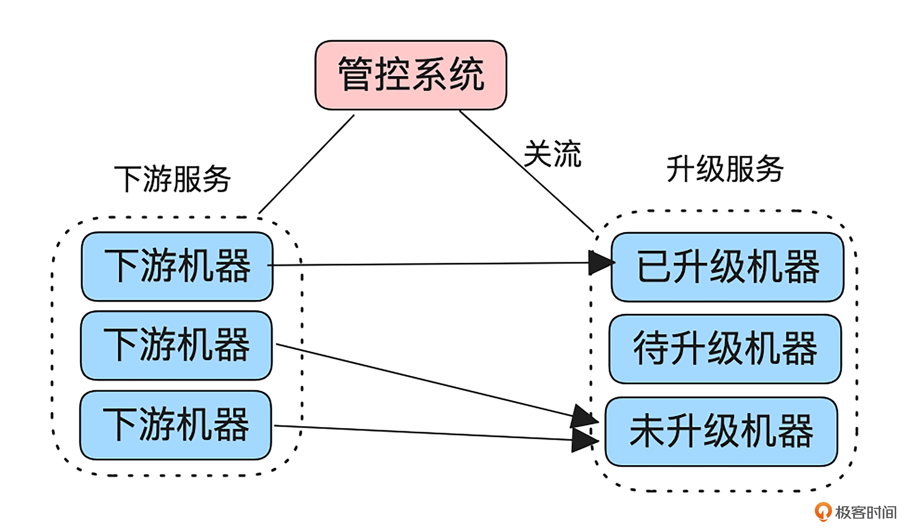
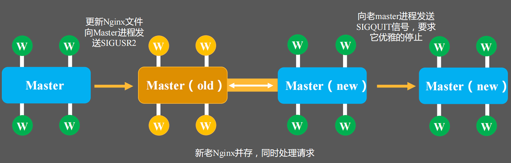
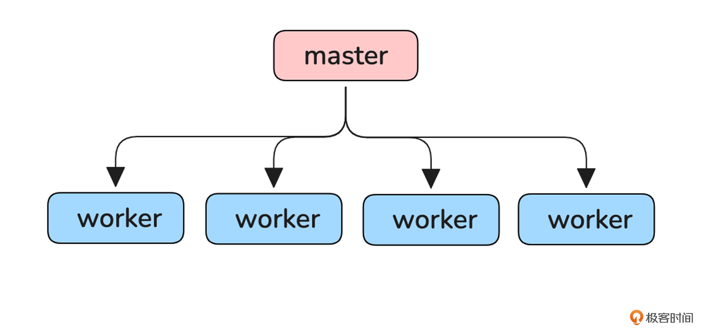
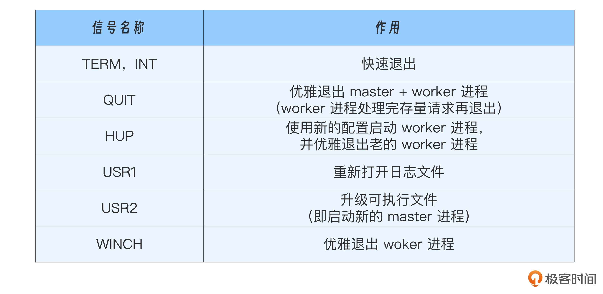
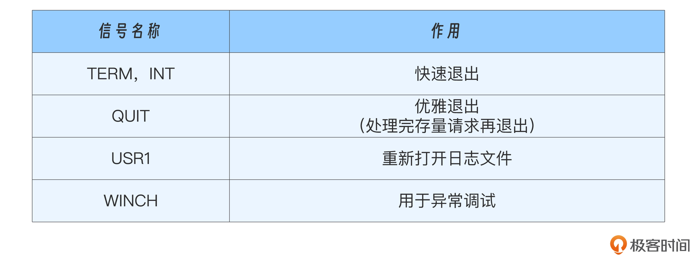
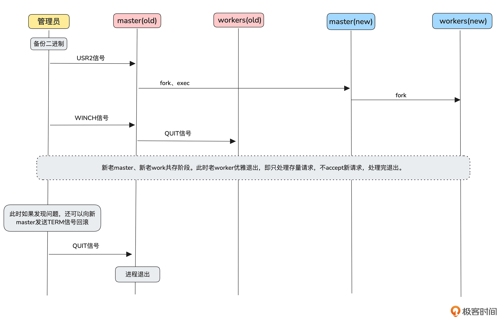
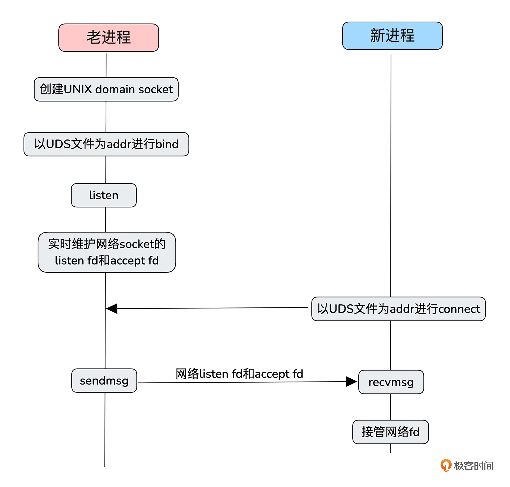
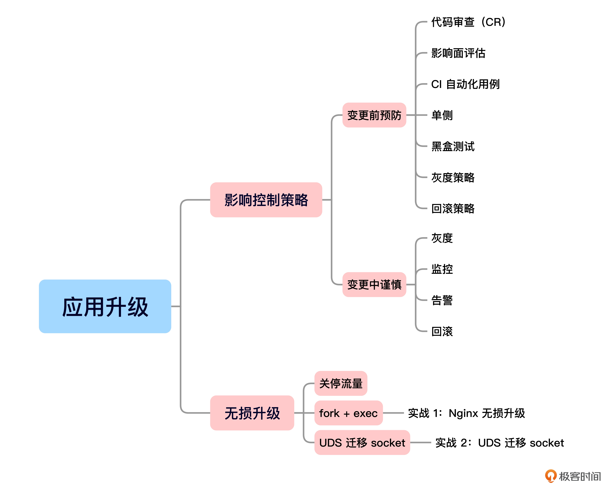

# 07 | 控影响：怎样可靠升级服务？

你好，我是谢友鹏。

在软件生命周期中，服务升级是不可避免的。无论是引入新功能、修复漏洞，还是提升性能和安全性，升级都是企业技术进步的重要组成部分。然而，变更操作往往伴随高风险，因此如何在升级过程中确保服务的高可用性，并最大程度地减少对用户的影响，始终是技术团队和业务部门需要重点关注的问题。

这节课我们就来看看如何在服务升级中有效控制影响，确保升级的可靠性。之后，我们还会深入分析网络服务如何实现无中断升级。

## 变更风险控制策略

变更的影响可以从变更前的预防、变更中的谨慎操作来进行控制。

变更前的风险控制主要聚焦于预防，我始终秉承的原则是——预防比救火更为重要。在这个阶段，预防风险的核心是准确评估变更的影响面。只有充分评估影响面，我们才能做出有效的测试和观察计划，并与测试团队进行高效的沟通。

然而，变更往往充满不确定性，我们难以保证每一次变更都能准确评估出影响。因此，除了依赖影响评估外，我们还需要设计一些兜底的流程来应对潜在风险，一些实践中证明有效的措施包括代码审查（CR）、构建 CI 基本用例、单元测试覆盖、黑盒测试。

除了这些技术性的预防措施，还需要提前设计好灰度发布和回滚策略，以应对潜在的失败风险。常见的灰度维度有：白名单、用户 ID、设备 ID、地域、服务端机器、业务类别、流量比例等。

而回滚策略则是预防变更失败的关键，应确保在发生问题时能够迅速恢复到先前版本。另外，为了实现快速回滚，可以对风险较大的改动用动态开关控制，这样发现问题的时候就能及时关闭。

变更中的风险控制，最重要的就是控制灰度节奏、实时的监控与告警以及迅速回滚机制。

控制灰度节奏的核心目标是，在变更过程中，最大限度地减少潜在问题对系统和用户的影响。一方面，合理的灰度发布能够将问题限制在最小范围内，确保一旦出现故障，能够及时回滚，降低损失；另一方面，灰度策略还需要留出足够的时间来观察系统行为，特别是对于一些需要时间积累才能显现的问题（如内存泄露）。通过控制灰度节奏，可以确保系统在逐步放量的过程中，能够及时发现并解决潜在的风险。

监控与告警是为了及时的发现问题。一些常用的监控和告警指标包括以下几项：

- 服务可用性指标，如请求成功率、响应时间等。

- 资源消耗：如 CPU、内存、带宽使用情况等。

- 错误日志：如异常日志、系统报错等。

告警除了可以根据设定阈值进行判断，还可以根据趋势和变化进行设定。此外，监控和告警的内容最好与灰度的内容能够对齐，以便在尽量小范围的异常及时发现。

## 不中断服务的升级方式

学习完变更的风险控制策略，我们学习一下服务升级中经常关注的另一个话题，怎样实现不中断用户请求的升级服务？

### 控制面进行流量开关控制

在多级服务架构中，可以通过管控系统协调待升级的服务和下游服务之间的交互，来减少升级对客户端请求的影响。具体做法是，将待升级的机器进行关流操作，即暂时停止从下游接收流量，确保将升级过程对正常业务流量的影响降到最低。



此外，还可以结合 HTTP 协议的特性，进一步优化下游影响控制：

```
HTTP/1.x 中的 “Connection: Close”：在升级前，可以通过返回带有 Connection:
Close 的响应头，通知客户端主动断开与当前服务的连接并重新建立连接。
```

2. HTTP/2 中的 Goaway 帧：在 HTTP/2 协议中，升级服务可以发送一个 Goaway 帧，明确通知客户端终止与当前服务的连接。

通过这些措施，下游系统可以在升级过程中快速感知到连接变化，与新进程或其他节点重新建立连接，来减少对客户端请求的影响。

### fork 结合 exec 实现新老进程过渡

前面我们学习了在管控系统的协调下进行升级，下面我们看看在没有管控架构进行流量协同的情况下，如何原地升级。

### 原理

首先，可以通过 fork 结合 exec 的方式，在进程级别实现新老服务的平滑过渡。fork 操作可以让子进程继承父进程的资源，例如监听的端口和打开的文件描述符（FD），从而继续接受新的连接。

exec 操作允许新进程加载新的二进制程序或配置文件，从而实现服务功能的更新。Nginx 的热升级就是采用的这种方式。



（图片来自：如何在高并发环境中灰度升级 Nginx？）

如图所示，Nginx 的升级流程步骤分这样几步。

1. 启动新进程，同时保持老进程运行。

2. 老进程继续处理未完成的请求，但不再接受新请求。同时新进程开始接受新的请求。

3. 老进程完成所有请求后，关闭连接并退出。

要想完全理解 Nginx 的升级过程，就需要弄明白 Nginx 的进程模型。我画了一个生产中 Nginx最常使用的 master-worker 进程模型。



在我们与 Nginx 交互的时候，其实就是与 Nginx 的 master 进程进行交互的。master 作为管理进程会 fork 出多个 worker 字进程用于处理网络请求。也就是说，虽然升级过程我们操作的是 master 进程，但是 master 进程最终会通过某种方式通知到 worker 进程，让 worker 进程来执行对应的网络行为。无论 master 还是 worker，都是通过信号处理来接收这些通知的。

我把 Nginx 常用的信号列成表格供你参考。

master 支持的信号：



worker 进程支持的信号：



了解了进程模型和信号量，我们再来看 Nginx 详细的升级过程就会容易很多。你可以参考后面的示意图看一下。



首先，管理员先备份原来的二进制。

接着管理员向正在运行的 master 进程发送 USR2 信号，老 master 进程收到这个信号后会通过 fork 和 exec 的方式创建新 master，新 master 会 fork 出新 worker。

然后，管理员向老 master 发送 WINCH 信号，老 master 进程收到信号后，向老 worker 进程发送 QUIT 信号，以便老 worker 优雅退出，此时，新老进程共存。

这个时候管理员还有一个后悔的机会，如果发现有问题，可以向新 master 进程发送 TERM 信号，新 master 收到这个信号会快速退出，并且老 master 会 fork 出 worker。如果管理员继续向老 master 发送 QUIT 信号，老的 master 进程也会退出，完成升级。

### 实战 1 Nginx 热升级实验

原理搞清楚了，我们再结合实战验证一下前面所学。

第 1 步，先找到 nginx.pid 文件，并查看其内容，可以发现其记录的是当前 master 的进程号。

```
$ ps -ef | grep nginx
root         974       1  0 15:59 ?        00:00:00 nginx: master process /usr/sb
nobody       975     974  0 15:59 ?        00:00:00 nginx: worker process
nobody       976     974  0 15:59 ?        00:00:00 nginx: worker process
$ cat /run/nginx.pid
974
```

第 2 步，备份旧的 Nginx 二进制文件，并将 Nginx 替换为新的二进制文件。

第 3 步，向 master 进程发送 USR2 信号，老进程会创建新的 master 和 worker，此时新老进程并存。

```
#发送USR2信号。
$ sudo kill -USR2 `cat /run/nginx.pid`
#查询nginx进程，发现新老进程共存。
$ ps -ef | grep nginx
root         974       1  0 15:59 ?        00:00:00 nginx: master process /usr/sb
nobody       975     974  0 15:59 ?        00:00:00 nginx: worker process
nobody       976     974  0 15:59 ?        00:00:00 nginx: worker process
root        7991     974  0 16:13 ?        00:00:00 nginx: master process /usr/sb
nobody      7992    7991  0 16:13 ?        00:00:00 nginx: worker process
nobody      7994    7991  0 16:13 ?        00:00:00 nginx: worker process
#可以看出nginx.pid已经变成新master进程号。
$ cat /run/nginx.pid
7991
#此时老进程号已经被转放到nginx.pid.oldbin文件中。
$ cat /run/nginx.pid.oldbin
974
```

第 4 步，向老 master 进程发送 WINCH 信号，老 master 进程会通知老 worker 优雅退出。

```
#发送WINCH信号
$sudo kill -WINCH `cat /run/nginx.pid.oldbin`
#此时如果老的连接都已经关闭，观察进程很快就能发现老worker退出了
$ ps -ef | grep nginx
root         974       1  0 15:59 ?        00:00:00 nginx: master process /usr/sb
root        7991     974  0 16:13 ?        00:00:00 nginx: master process /usr/sb
nobody      7992    7991  0 16:13 ?        00:00:00 nginx: worker process
nobody      7994    7991  0 16:13 ?        00:00:00 nginx: worker process
```

之所以这个时候还留有老的 master，是用来作为“后悔药”来回滚的。此时如果向新 master 发送 TERM 信号，新 master 和新 worker 会退出，同时老 master 会创建出 worker 继续工作。

第 5 步，向老 master 发送 QUIT 信号，完成升级。

```
#发送QUIT信号。
$ sudo kill -QUIT `cat /run/nginx.pid.oldbin`
#可以看到老master退出，完成升级。
$ ps -ef | grep nginx
root        7991       1  0 16:13 ?        00:00:00 nginx: master process /usr/sb
nobody      7992    7991  0 16:13 ?        00:00:00 nginx: worker process
nobody      7994    7991  0 16:13 ?        00:00:00 nginx: worker process
```

### 这种实现的缺点

这种 fork 的升级方式，新进程虽然在 fork 一瞬间就继承了老进程的资源，但是新老进程还是在各自的地址空间和上下文中运行，因此老的连接还是要在老进程中处理。

那么怎样退出老的进程影响会比较小呢？我给你提供三种策略。

1. 直到没有请求时候再退出。这种方式，新老进程共存时间会很长，占用资源较多。

2. 定时退出。能保证资源在可预期的时间内释放，但是客户端仍然使用的连接就会被 reset。

3. 固定时间退出，比如每天 00:00，用户活跃度比较低的时候再退出。影响小，但是老进程存在的时长取决于发布时间。

### unix doman socket 实现 Socket 转移

但是，无论使用以上哪种方式优雅退出，对于始终保持“长连接”的使用场景都会断开连接。为了，在最大程度上减少升级对用户连接的影响，socket 转移的方案应运而生。

### 原理

Linux 内核已经可以通过 UDS（Unix Domain Socket）实现 socket fd 的转移功能。envoy 和mosn 的无损热升级就是采用的这种方式。

我画一个简图来帮助你理解通过 UDS 在新老进程转移 socket 的过程。



从图中可以看出，UDS 与网络 Socket 的通信方式很像，主要区别在于地址形式。网络Socket 使用 IP 地址加端口号作为地址，而 UDS 则通过文件系统中的路径表示，通常以 .sock结尾。这些 Socket 文件可以被系统进程访问，允许多个进程同时打开同一个 UDS 进行通信。而这种通信完全发生在系统内核中，不涉及网络传播。

其收发函数如下所示。

```javascript
ssize_t sendmsg(int sockfd, const struct msghdr *msg, int flags);
ssize_t recvmsg(int sockfd, struct msghdr *msg, int flags);
```

### 实战 2 UDS 转移 socket 实验

接下来我们进入第二个实战环节。

实验介绍

这里有一个开源的通过 uds 转移 socket 的代码 socket-takeover。代码中有一个 client 和server，我为你说明一下其功能和主要实现。

- client：在 client_send 函数循环间隔 100ms 发送一个递增的 seqnum，如果发送或接收失败就退出循环，如果接收到的 seqnum 和发送的不一致，就打印“Seqnum discontinuity!!!”。client 的作用就是模拟客户端并能观察到请求失败的情况。

- server：在 server 启动过程中，是否进行 socket 转移取决于是否指定了 -T 参数。

对于非 takeover 流程，服务器会单独创建一个线程来监听 socket takeover 任务，主要通过takeover_channel_task 函数实现。该函数调用 takeover_listen 创建并监听 Unix DomainSocket (UDS)。当其他进程发起 takeover 请求时，服务器通过 sendmsg 将保存于全局变量中的监听 fd 和全局链表 tcp_peers 中保存的已接收连接 fd 传递到对端进程。在整个过程中，服务器还会单独启动一个线程处理网络请求。这个线程通过全局变量维护即将转移的 fd，确保请求的正常处理。

对于 takeover 流程，首先，在 takeover_fetch 函数向 uds server 发起请求，并通过 recvmsg接收返回的 fd 列表。对每个 fd，设置其连接的对端地址，并在 tcp_peer_task 函数中不断地读取该连接上的数据，将读取到的数据原封不动地返回给对方。一个独立线程负责处理takeover server 任务，具体通过 takeover_channel_task 函数来执行。该线程还负责处理listen 的 accept 逻辑，确保连接可以顺利建立并进行后续的数据传输。

开始实验首先，我们将socket-takeover代码下载到 Linux 环境，然后安装编译工具。

```bash
sudo apt install make
sudo apt-get install -y gcc
```

接着分别进入 client 和 server 目录执行 make 编译文件。

```
#编译client
~/socket-takeover/client$ make
#查看编译结果
~/socket-takeover/client$ ls
client  main.c  main.o  Makefile
#编译server
~/socket-takeover/server$ make
#查看编译结果
~/socket-takeover/server$ ls
data.h  list_head.h  main.c  main.o  Makefile  server
```

先后运行 server 和 client，这时你会观察到 seqnum 序号是连续增长的，证明请求没有失败。

```
#开始服务端服务。
~/socket-takeover/server$ ./server -a 127.0.0.1 -p 1234 -t ./test.sock
#客户端持续访问。
~/socket-takeover/client$ ./client -a 127.0.0.1 -p 1234
#服务端打印seqnum序号是连续增长。
```

在 server 执行 socket 转移，观察序号在新 server 依旧连续增长，证明转移过程请求没有失败。

```go
#触发socket转移。
~/socket-takeover/server$ ./server -T ./test.sock
#老进程打印
[127.0.0.1]:57488 - seqnum:2820
[127.0.0.1]:57488 - seqnum:2821
[127.0.0.1]:57488 - seqnum:2822
Accepting connection from Takeover channel
Current fd_array:={[3][4]}
[127.0.0.1]:57488 - seqnum:2823
Holding connection with Peer [127.0.0.1]:57488 (fd:4)
Releasing Peer [127.0.0.1]:57488 (fd:4)
tcp_peer_release(): Tcp peers released...
#新进程打印
Starting connection with Peer [127.0.0.1]:57488 (fd:5)
Starting Takeover channel on [./test.sock] domain socket
[127.0.0.1]:57488 - seqnum:2824
[127.0.0.1]:57488 - seqnum:2825
[127.0.0.1]:57488 - seqnum:2826
```

至此，我们的实验就结束了。

## 小结

今天我们学习了应用升级过程的影响控制相关知识，包括一些影响控制策略和无损升级的方法。我给你准备了一个思维导图回顾要点。



首先我们了解了影响控制策略，包括变更前的预防策略，有影响面评估、CR、CI、测试、灰度等，以及变更中的谨慎操作，比如灰度、监控、告警和快速回滚。

之后我们重点学习了无损升级的技术，主要有通过控制面进行流量关停，fork 结合 exec 实现新老进程共存（Nginx 等项目使用），以及 UDS 迁移 socket（envoy 等项目使用）。为了让你充分了解无损升级的过程，我们还完成了 Nginx 无损升级和 UDS 迁移 socket 这两个实战。

## 思考题

1. 如果升级过程直接关闭老进程，再马上打开新进程，用户的网络会有什么表现？

2. 你有没有在应用升级过程中踩过什么坑，今天的知识能帮你避过这个坑，或者减小影响吗？

欢迎你在留言区和我交流互动，如果这节课对你有启发，也推荐你分享给身边更多朋友。
