# 10 | 纵向扩展（下）：怎样通过架构优化提高单机性能？

你好，我是谢友鹏。

在前两节课中，我们分别从应用层代码和网络模型、协议的角度探讨了如何提升单机性能，今天我们将进入单机性能优化的第三个层面，讨论如何简化处理路径或用硬件为 CPU 分担压力，来进一步提升性能。

### 瓶颈来源

我们先看一下应用程序通过 Linux 内核发送和接收一个网络包的主要流程。

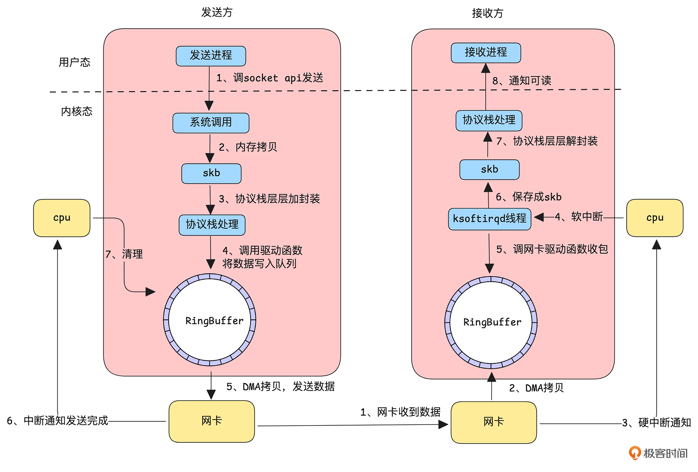

如上图所示，发送方一个数据包要经过以下流程。

1. 发送方的应用程序通过调用 socket API 告知内核有数据要发送，随后进入系统调用，完成从用户态到内核态的切换。

2. 内核态接收到数据后，将其拷贝到 skb（socket buffer）结构中，供协议栈处理。

3. 协议栈对数据进行分片、封装等处理。

4. 经过协议栈处理的数据通过驱动程序将数据到 RingBuffer。

5. 调用网卡发送函数，此时网卡利用 DMA 将数据从 RingBuffer 拷贝到网卡缓存并开始发送。

6. 发送成功后（TCP 需等待接收到 ACK），网卡通过中断通知 CPU，

7. CPU 再清理 RingBuffer 中的数据。

接收方收到一个数据包到通知应用进程数据可读，要经过以下流程：

1. 网卡接收到数据。

2. 网卡通过 DMA 将数据直接拷贝到 RingBuffer。

3. 网卡通过硬中断通知 CPU 有新数据到达。

4. 简单处理后，触发软中断通知专用线程进行处理。

5. 软中断处理线程调用网卡驱动从 RingBuffer 中读取数据包

6. 数据被保存成 skb 结构。

7. 数据进入协议栈，经过解封装等处理。

8. 处理完成后，内核通知应用程序有数据可读。

这样的交互容易在以下地方形成性能瓶颈。

第一，用户态和内核态切换引起的开销，因为每次切换都需要保存当前的上下文（比如寄存器的值、调用栈等），并在切换完成后恢复。第二，内存拷贝，系统调用收发数据时候会进行内存拷贝。第三，协议栈层层处理，流程较多。

另外，内核还有一些图中未画出的处理流程，我们目前通过图片把握数据在内核中的 datapath即可。

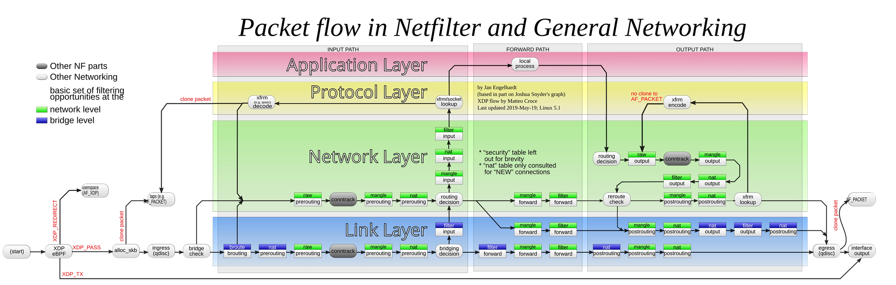

(图片来自：Netfilter-packet-flow.svg)

### 纯用户态流量转发

既然用户态与内核态的频繁交互会带来如此多的性能瓶颈，那么是否可以绕过内核协议栈，在用户态直接完成整个网络数据的处理呢？为了解决这一问题，DPDK（Data PlaneDevelopment Kit，数据平面开发套件）应运而生，它能通过绕过内核协议栈，直接在用户态高效处理网络数据，大幅提升了数据处理性能。

DPDK 提供了一组高效的库和驱动，允许应用程序直接访问网卡硬件，在用户态完成数据包的接收与发送，绕过了传统的 Linux 内核协议栈，从而显著降低上下文切换和数据拷贝的开销。通过硬件支持的功能，例如 SR-IOV（单根 I/O 虚拟化） 和 数据包分类过滤（PacketClassification Filtering），DPDK 可以高效地实现数据流的分流和处理。

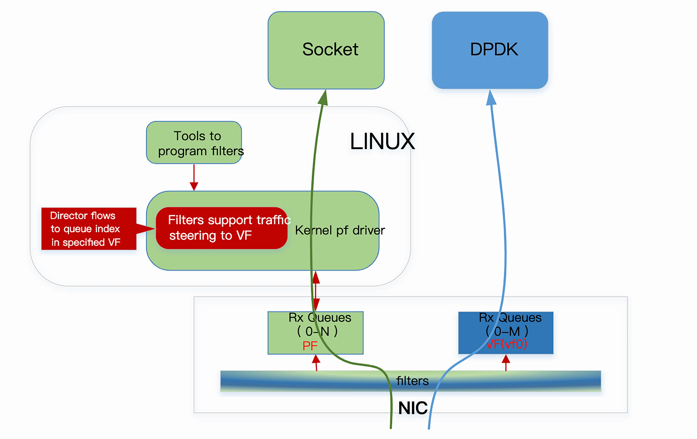

（图片来自：Flow Bifurcation How-to Guide）

如图所示，数据包分类过滤技术使网络适配器能够根据特定规则将流量分配到不同的接收队列。这些队列可以属于内核态（由传统的 Linux 驱动处理）或用户态（由 DPDK 应用直接处理）。例如，控制平面流量可以定向到 Linux 网络协议栈，而性能敏感的数据平面流量则可以直接交给 DPDK 应用处理，从而实现更高效的网络流量管理。

此外，利用 SR-IOV 技术，网卡能够将物理适配器划分为多个虚拟功能（Virtual Functions,VF），并通过目标 MAC 地址将流量精确地定向到相应的虚拟功能。这种硬件加速的流量分流机制不仅简化了数据包的处理路径，还能大幅减少 CPU 的负担。

### 纯内核态转发

虽然 DPDK 这种纯用户态的网络处理方式在一定程度上提高了网络处理的性能，但它需要应用程序直接接管数据包的收发，增加了对硬件资源的依赖。那有没有一种方案，能像 SDN 中“控制面和转发面分离”的思想一样，在用户态下发一些控制表，然后由内核态高效地完成数据包的转发呢？

近些年火热的 eBPF（Extended Berkeley Packet Filter） 技术就提供了这样的能力。

eBPF 可以安全、高效地在内核运行一段自定义的沙箱程序，从而在不修改内核源码或加载内核模块的情况下，安全、高效地扩展内核功能。

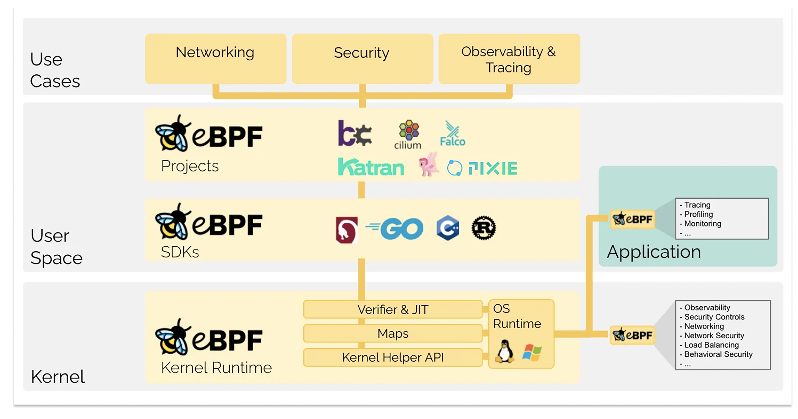

（图片来自：ebpf.io/what-is-ebpf）

如上图所示，为了安全、便捷地扩展内核能力，eBPF 在内核层面提供了 Verifier（校验器）和 JIT（即时编译） 等功能。此外，eBPF 还提供了多种语言的 SDK，供用户态应用调用，使开发者能够灵活地在用户空间将自己的逻辑嵌入到内核运行时中。

近些年，基于 eBPF 的能力，在网络、安全、内核观测和追踪方向发展出了一系列典型项目。我用表格列了几个典型项目，供你参考。

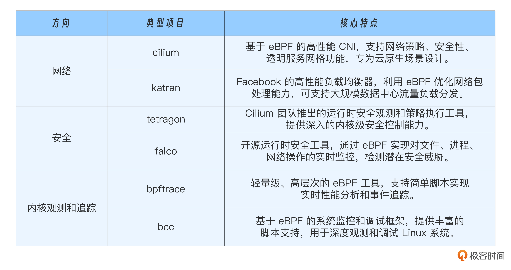

回到今天的网络性能话题，如果你希望在内核中运行自定义的转发逻辑，就需要将其嵌入到内核的网络处理钩子中。通过这种方式，eBPF 的转发逻辑能够在事件触发时执行。如果你想了解网络数据包生命周期中关键的 eBPF 处理点，可以参考 Cilium 项目提供的 ebpf-datapath文档。

我画了一个基于 eBPF 的交互简图，方便你了解其基本运作流程。

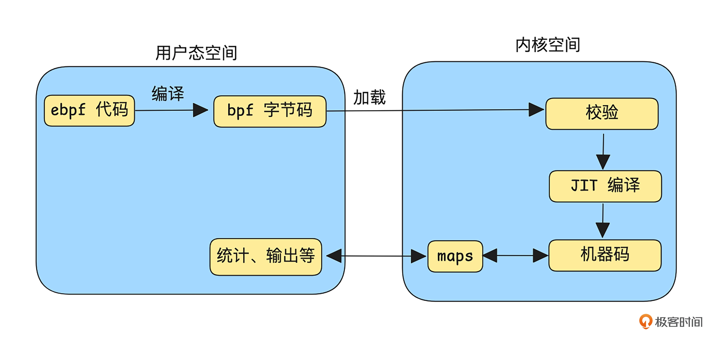

如上图所示，开发者可以在自己的项目定义用户态的控制逻辑，比如过滤规则或转发表，并将这些代码编译成 bpf 字节码，之后通过 sdk 将 bpf 字节码加载到内核中。

在内核层面，这些程序会通过 eBPF 验证器的检查，以确保程序不会造成安全隐患，比如死循环或非法的内存访问。一旦检查通过，便会将 bpf 字节码编译成机器码，挂载到内核的关键钩子点（hook）上，实现用户态下定义规则、内核态高效执行的工作模式。用户态和内核态还能直接通过 maps 进行数据传递，实现运行结果查看、统计等功能。

### 软硬件结合

和以往需要穿越用户态和内核态的转发方式相比，纯用户态或纯内核态的网络转发方式，性能得到了一定提升。然而，所有的处理依然依赖于 CPU，随着流量规模的增加，CPU 处理能力就会逐渐成为瓶颈。为了解决这一问题，可以将一部分网络处理工作（比如分包、组包、校验和、tunnel 加解封装等）卸载到其它硬件，也可以将转发面可以进一步拆分成“快平面”和“慢平面”两部分。

接下来，我们重点学习一下通过“快慢平面”来进一步提升性能的方法。

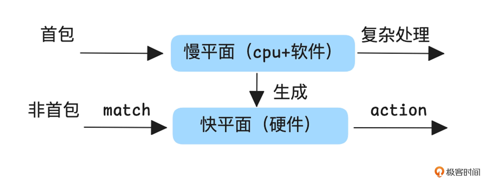

如上图所示，软件和 CPU 构建的慢平面负责处理复杂的网络处理逻辑，而硬件构建的慢平面则负责处理简单的 match-action 逻辑。比如通过五元组进行匹配快平面的转发表，如果匹配上则快速转发，未匹配上则回到慢平面，进行解析、ACL 校验、路由等一些列处理。在慢平面转发数据包的同时，生成快平面的转发表，以便后续数据能通过快平面高效转发。

我列了几个常见的硬件选型，供你参考。

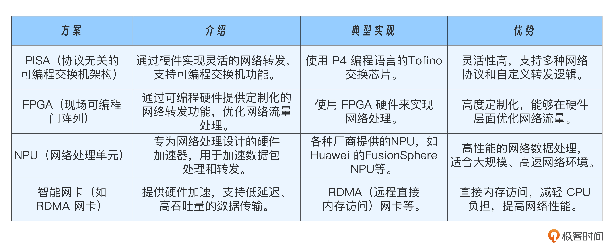

### 单机架构演进：性能与灵活性的平衡

以上内容就是单机架构中，通过简化处理路径或用硬件为 CPU 分担压力来提升性能的常用方法。我们回顾一下架构演进历程，分析一下架构演化背后的原因。

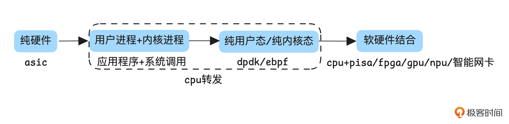

如上图所示，单机网络架构经历了从硬件实现到软件实现，再回归硬件的趋势。这一过程并非简单的循环，而是技术不断权衡与演进的结果，其核心目标是在性能与灵活性之间找到最佳平衡。

早期：硬件主导的高性能网络

在最初的阶段，网络功能主要依赖专用硬件（如 ASIC，Application Specific IntegratedCircuit）实现。这类设备包括传统的交换机、路由器、防火墙以及硬件负载均衡设备（如F5）。

这种架构的显著优势是高性能，但代价是低灵活性。设备的功能基本固化，更新和迭代周期较长，往往以月甚至年为单位。尽管各厂商通过遵循统一的网络协议实现了互联互通，但产品的实现细节差异较大，导致配置复杂、操作繁琐。

软件化：灵活性的崛起

随着互联网的快速发展，网络功能逐渐转向纯软件实现，依赖于通用硬件平台。以 SDN（软件定义网络）和 NFV（网络功能虚拟化）架构为代表，这一阶段推动了网络功能在通用硬件上的实现，使得网络软件化成为可能。

纯软件实现的主要优势是高灵活性：功能可以快速迭代，成本和开发周期大幅缩短。借助虚拟化技术和开源生态（如 Linux 的 Netfilter 框架），很多网络功能得以快速部署。然而，这种架构的缺点是性能瓶颈，尤其是用户态与内核态的频繁切换，带来了巨大的性能开销。为解决这一问题，出现了 DPDK（纯用户态转发）和 eBPF（纯内核态转发）等优化技术，通过简化转发路径，显著提升了性能。

软硬结合：性能与灵活性的再平衡

随着流量规模的持续增长，尤其是大带宽场景的出现，纯软件实现逐渐无法满足需求。为此，软硬件结合的解决方案应运而生，将部分处理卸载到专用硬件，为 CPU 减负。

寻找平衡：变化与不变的分界

单机性能架构的发展本质上是在转发效率与灵活性之间不断寻找平衡。

具体而言，对于变化较大的部分，我们倾向于灵活性，适合采用软件 +CPU 的方式实现；变化较小的部分则倾向于效率，适合卸载到硬件实现。尽管有些硬件具备一定的编程能力（如FPGA 的 Verilog HDL、Tofino 的 P4），但其灵活性相较软件实现仍然较低，不适合处理复杂逻辑，所以常常被设计成 match-action 这种较为固定的转发逻辑。

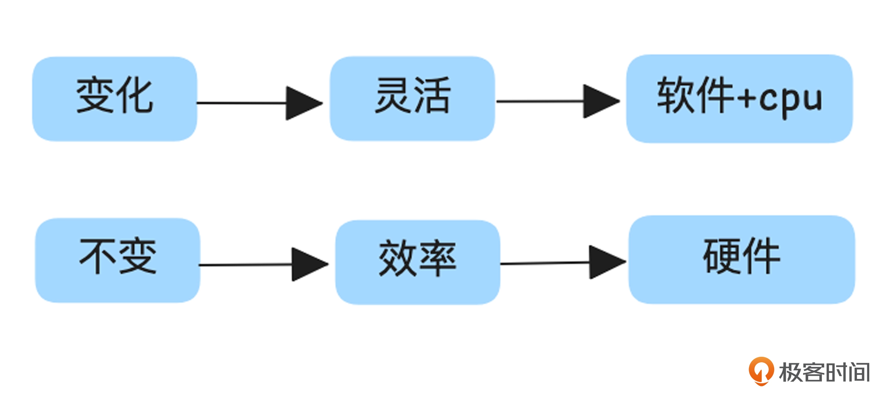

通过架构分层设计，将“变化”的部分赋予灵活性，“不变”的部分赋予高效率，不仅满足了性能需求，同时也保留了网络功能的快速迭代能力，从而实现了性能与灵活性的最佳平衡。

### 小结

今天的内容就是这些，我给你准备了一个思维导图回顾要点。

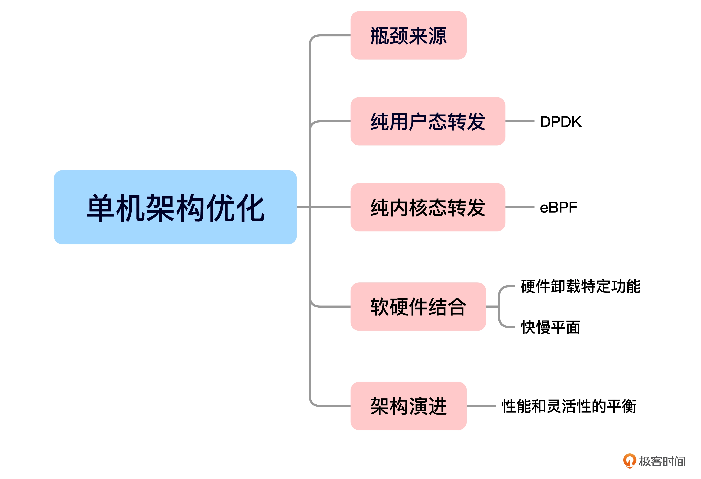

我们首先通过分析 Linux 系统中发送和接收数据包的流程，探讨了性能瓶颈的来源，主要包括上下文切换、内存拷贝和复杂的内核处理等。

接着，我们学习了如何通过 DPDK（数据平面开发工具包）绕过内核处理，将数据包转发任务放到用户态完成，从而显著提高网络性能。

随后，我们介绍了 eBPF（扩展伯克利包过滤器）技术，它允许在用户态进行控制面表下方的操作，在内核态独立完成数据包转发。我们还讨论了 eBPF 的基本原理以及它在性能优化中的应用。

我们还探讨了通过软硬件结合的方式进一步提升性能，例如将拆包、合包、校验和等操作卸载到专用硬件上。这部分你重点要掌握如何通过“快慢平面”架构来优化性能。

最后，我们回顾了单机性能在架构层面的演进过程及其背后的逻辑。强调了在性能和灵活性之间找到平衡的关键。关注系统中“变化”和“不变”的地方，帮助我们作出合适的架构决策。

我想说性能提升永无止境，选择最契合使用场景的方式就好。正如我们的交通工具，既有高效的飞机、高铁等，也有便捷的长途汽车、公交、私家车和自行车，重要的是根据需求和能力做出平衡和选择。

### 思考题

1、用户态和内核态切换为什么一定会引起上下文切换？

2、有一些业界的通过卸载来分担 CPU 压力的技术，比如 TSO、GSO、LRO、GRO，你能说出他们的工作原理吗？

欢迎你在留言区和我交流互动，如果这节课对你有启发，也推荐你分享给身边更多朋友。

## 拓展阅读

课程里我提到基于 eBPF 发展出了一些典型项目，它们分别是cilium、katran、tetragon、falco、bpftrace 和 bcc，如果你有兴趣，可以通过后面的超链接去了解。
