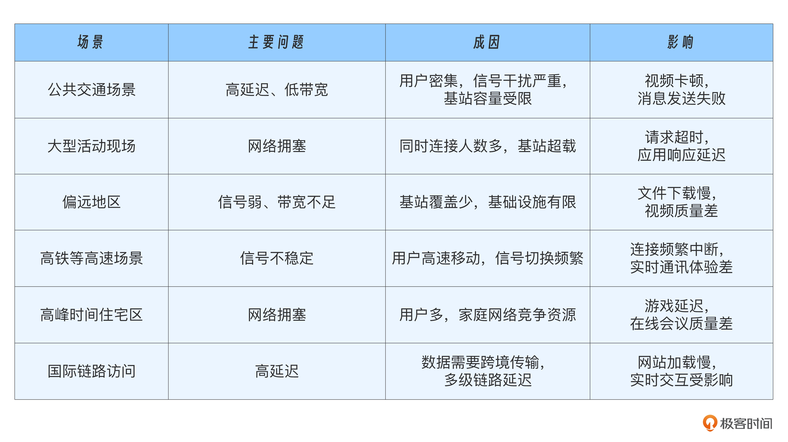
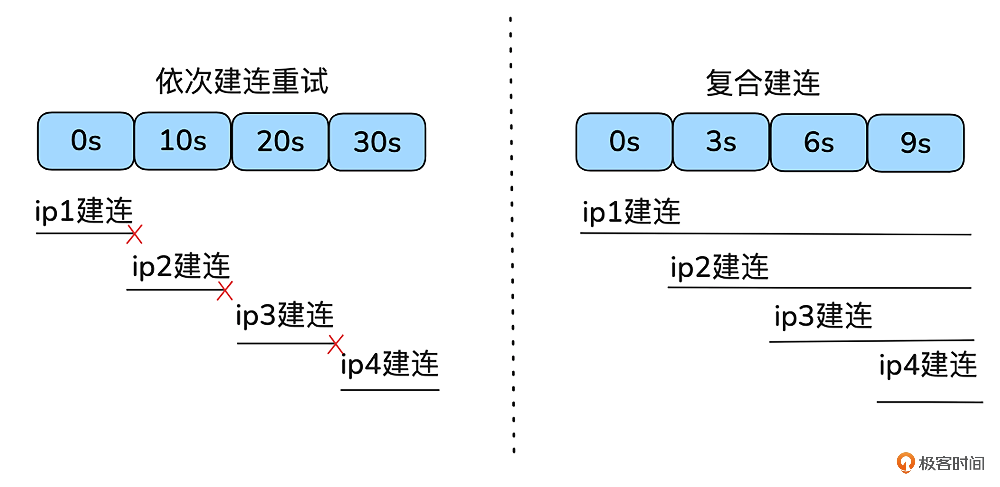
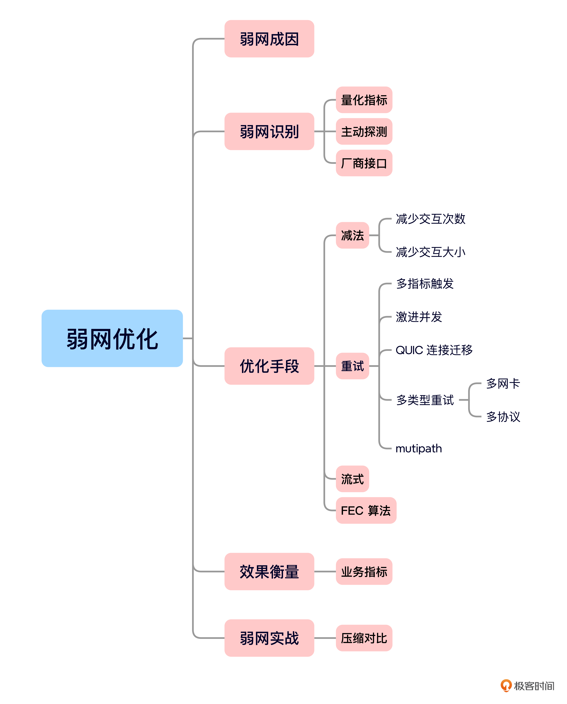

# 11 | 减法与重试：怎样优化弱网？

你好，我是谢友鹏。

前几节课中，我们讨论了单机性能优化的各种技巧，但当用户的网络质量本身较差时，这些优化手段可能并不足以解决问题。在面对大规模用户时，弱网问题几乎是不可避免的。弱网环境会导致高延迟、网络抖动甚至请求处理失败，严重影响应用的稳定性和用户体验。

那么，弱网问题是如何产生的？我们又该采取哪些措施，让服务在弱网环境下也能保持流畅和稳定呢？今天，我们将剖析弱网的成因，并分享一套优化方案，帮助你的应用在网络条件较差时依然能够平稳运行，提升用户的整体体验。

### 弱网的成因

在用户的角度来看，弱网主要体现在高延迟和低带宽两个方面，这与网络的复杂链路、信号强度、基站距离、网络制式（如 3G、4G、5G）以及网络拥塞密切相关。

高延迟通常因为信号强度不足或数据包在多级链路中传递导致时间放大，而低带宽则可能因无线干扰、网络负载或远距离传输效率受限而减小。此外，大型活动场所或高用户密度区域也会加剧这些问题。

以下是一些常见的弱网场景及其特点：



### 弱网识别

了解了弱网的成因后，我们来看看如何识别弱网。弱网最终会体现在请求的不同阶段的数据上。因此，我们可以通过分析请求在各阶段的网络数据特征，量化弱网的判断标准。

以常见的 HTTPS 下载为例，一个请求通常经历以下几个阶段：DNS 解析、TCP 握手、SSL握手、HTTP 请求发送，最后是 HTTP 响应接收。


我们可以对每个阶段的关键耗时进行量化，耗时的计算方式如下。

- DNS 解析时间：从请求发起到完成域名解析所需时间。

- TCP 握手时间：三次握手完成的耗时。

- SSL 握手时间：完成安全连接建立的时间。

- HTTP 首包时间：接收到第一个 HTTP 响应字节的时间。

- 吞吐量：已接收的字节数与统计时间的比值。

通过采集这些数据，并在数据分析大盘中进行可视化展示，我们可以建立符合业务场景的弱网判断标准。

在数据分析时，除了关注平均值，我们更要留意分位值（如 P99.9）。比如，某个 RPC 接口历史数据显示 99.9% 的请求能在 1 秒内完成响应，则可以将超过 1 秒的请求视为弱网情况。需要注意的是，这类统计可能包含服务端问题引起的异常，因此需持续监控数据波动，并及时分析和调整策略。

除了基于请求特征的数据分析，我们还可以通过主动探测的方式识别弱网。例如，定期对各IP 地址进行探测，评估其延时、丢包率等参数，并提前将不达标的 IP 剔除服务链路。

此外，还可以借助手机厂商提供的指标（如无线信号强度）作为补充信息，进一步提升弱网识别的准确性。

### 优化手段

一旦通过识别出是弱网场景，我们便可以有针对性地进行优化了。弱网优化的两大法宝是“减法”和 “重试”。减法旨在减少网络交互的次数和传输数据的大小，而重试则是在失败情况下通过合理的策略弥补网络的不可靠性。

### 减法

首先我们谈谈减法，网络上的弱网问题主要表现为高丢包率和低带宽。高丢包率意味着交互失败的概率较高，因此减少交互次数能够显著提升请求的成功率。而低带宽则限制了单位时间内的数据传输量，这让减少交互数据的大小成为必要的优化方向。


减少交互次数可以从网络协议和应用逻辑两个维度入手。

从网络协议的角度看，我们可以通过一些优化手段来做到这一点。例如，TCP 长连接可以让多个请求复用同一个连接，而不是每次重新建立连接。如果使用 HTTP/2，那么这种复用已经内置支持了。此外，在加密通信中，SSL 会话复用技术可以避免重复握手过程，而采用 TLS1.3 协议更是可以进一步减少握手交互次数，大幅降低延迟。

从应用逻辑角度看，我们可以通过缓存、批量请求和合并发送等方式来减少交互。缓存是一个简单却有效的手段，通过将用户高频访问的数据提前存储在客户端或边缘节点上，弱网中的加载速度会显著提升。比如一些小程序，会基于用户的行为预测，将可能访问的内容预先下载到客户端上。再比如，批量请求可以将多个小任务打包为一个大请求，或者通过像 GraphQL 的合并发送功能那样，聚合多个数据源，减少交互频率。

同时，低带宽会限制单位时间内的数据传输量，因此优化数据大小同样重要。我们可以利用压缩算法对传输数据进行无损压缩，或者在必要时降低图片和视频的分辨率，甚至允许一定程度的有损压缩。这样可以让用户在弱网环境中更快看到内容，而不会卡在加载界面。

### 重试

学习完如何通过“减法”优化弱网后，接下来我们谈一谈用重试来优化弱网的策略。重试的一个前提是服务端要支持幂等。

首先，可以从网络协议入手，降低重试的成本。例如，启用 TCP SACK（SelectiveAcknowledgment），允许接收端选择性确认收到的数据段，从而减少因丢包导致的重传范围。与此同时，启用快速重传（Fast Retransmit） 可以在检测到丢包时更快地触发重传，避免因超时等待而延误。此外，这样还能有效防止 TCP 窗口因丢包大幅收缩，从而维持较高的传输效率。

然后，还可以对请求的各个阶段限制针对弱网的超时时间，如 TCP 握手、SSL 握手、首包超时 (请求发出到收到响应的第一个字节的超时时间)，任意一个阶段超时立即开始重试。

在弱网环境中，复合建连是一个非常高效的策略。它通过并行连接多个候选 IP 地址，大幅缩短整体连接时间。我画了一个常规的依次建连，然后失败重试和通过复合建连进行并行重试的对比图，让你对这个策略有一个直观的了解。



假设某请求需要依次尝试 4 个 IP 才能成功，如果采用传统的顺序重试，每次都等待 10 秒超时才切换到下一个 IP，建立连接可能需要 30 秒以上。而使用复合建连时，在 DNS 解析完成后立即尝试第一个 IP，如果 3 秒内未成功，则并行尝试第二个 IP，以此类推。如果第 4 个 IP最终成功，整个建连时间仅需 9 秒左右。虽然这种方法会额外消耗并发连接资源，但相比时间的巨大提升，这点资源开销是值得的。

然后，使用对移动互联网支持更友好的协议，也可以提升重试成功的概率，比如使用 QUIC，因为其使用 ID 标识一个连接，而不是像 tcp 那样使用四元组，所以在用户网络切换（如移动流量切 wifi）的时候，可以连接迁移。

最后，不要把鸡蛋放到一个篮子里。选择不同的方式进行重试会增加成功的概率，比如多网卡（移动网络、wifi）、多协议（QUIC、TCP）等。

我们甚至可以在同一连接同时使用多个路径传输数据，并在需要时通过路径迁移来切换路径的技术， 如苹果已经在用的 multipath tcp、以及近些年在推进的 mutipath quic。

### 流式和异常处理

除了“减法”和“重试”两大核心策略外，弱网优化还有一些实用的小技巧。

例如，尽可能支持流式处理，通过边接收边处理的方式减少用户的等待时间，提升弱网环境下的体验。再如，使用 FEC （Forward Error Correction, 前向纠错） 算法，在牺牲一定的带宽和增加少量冗余数据的前提下，提高数据的抗丢包能力，从而在高丢包率的网络中保证传输的稳定性和数据的完整性。这种技术在 WebRTC 中被广泛应用，用于实时音视频传输，确保在弱网条件下音视频的流畅性和可用性。

最后，在处理网络异常时，要尽可能保留已经成功传输的数据。以文件上传为例，在低带宽和高丢包的弱网环境中，大文件传输往往容易中断。如果服务能够支持流式追加存储，那么即使每次只传输几百 KB 的数据，遇到网络异常时，已上传的部分也能被完整保留。下一次传输可以从断点继续，逐步积累，直至整个文件上传完成。

### 效果衡量

学习完弱网优化的方法后，我们不妨探讨一个在实际工作中常常遇到的问题：如何衡量弱网优化的效果？我认为，效果的衡量应该以业务指标为核心，而非单纯依赖网络层的数据变化。

举个例子，如果你的网络服务面向支付链路，那么最重要的衡量指标应该是“有多少笔交易从无法支付成功变成能够支付成功”。相比之下，支付耗时降低了百分之多少虽然是一个有意义的数据，但它并不能直接反映优化对核心业务的影响。

再比如，如果你的网络服务支持云盘上传或下载，那么合适的衡量指标可以是“完成率提升了多少”或“上传失败的比率下降了多少”，而不是简单地看平均上传时间是否减少。因为对于用户来说，数据能否成功传输是首要关切，耗时的提升只是次要的感知。

通过关注业务指标，我们可以更加精准地评估弱网优化的实际效果，从而确保技术改进真正为用户体验和业务价值带来切实的提升。

### 弱网实战

接下来我们进入实验环节。

### 实战设计

接下来我们会通过 Linux 上的限速工具模拟低带宽的弱网场景，然后对比经过 Gzip 压缩和未经压缩的请求性能差异。

### 开始实战

使用 tc 的命令可能稍显复杂。因此，我们将使用一个基于 tc 封装的工具 Wondershaper，它操作起来更容易 。首先，我们将 wondershaper 下载到实验环境中，并针对指定的网卡进行限速配置，以此模拟弱网场景。

```
#查看网卡名字，我这里是ens33.
$ ifconfig
ens33: flags=4163<UP,BROADCAST,RUNNING,MULTICAST>  mtu 1500
       inet 172.16.253.136  netmask 255.255.255.0  broadcast 172.16.253.255
       inet6 fe80::20c:29ff:fe67:37ea  prefixlen 64  scopeid 0x20<link>
       ether 00:0c:29:67:37:ea  txqueuelen 1000  (Ethernet)
       RX packets 1573  bytes 434894 (434.8 KB)
       RX errors 0  dropped 0  overruns 0  frame 0
       TX packets 828  bytes 146044 (146.0 KB)
       TX errors 0  dropped 0 overruns 0  carrier 0  collisions 0
# 配置限速，上下行都限制为100k/s
$sudo ./wondershaper -a ens33 -u 100 -d 100
# 通过sudo ./wondershaper -a ens33  -s可以查看生效的tc规则。
```

然后，用命令行生成一个 1M 大小的文件，用于测试。

```
$ sudo mkdir -p /home/download
$ cd /home/download
$ sudo dd if=/dev/zero of=file.txt bs=1M count=1
```

之后需要安装 Nginx，并将 /etc/nginx/nginx.conf 配置修改为 nginx.conf，然后加载Nginx。

```
#安装nginx
$sudo apt-get install nginx -y
# 如果你的设备已经启动了nginx，执行sudo nginx -s reload重载配置即可。
$ sudo nginx
```

现在我们可以在另一台机器上进行测试了。先使用未压缩的方式请求资源，观察请求耗时和传输数据量。

```
$ time curl -o /dev/null -v  http://172.16.253.136:8080/download/file.txt
 % Total    % Received % Xferd  Average Speed   Time    Time     Time  Current
                                Dload  Upload   Total   Spent    Left  Speed
 0     0    0     0    0     0      0      0 --:--:-- --:--:-- --:--:--     0*
* Connected to 172.16.253.136 (172.16.253.136) port 8080
> GET /download/file.txt HTTP/1.1
> Host: 172.16.253.136:8080
> User-Agent: curl/8.5.0
> Accept: */*
>
< HTTP/1.1 200 OK
< Server: nginx/1.24.0 (Ubuntu)
< Date: Wed, 11 Dec 2024 16:40:07 GMT
< Content-Type: text/plain
< Content-Length: 1048576
< Last-Modified: Wed, 11 Dec 2024 16:14:05 GMT
< Connection: keep-alive
< Vary: Accept-Encoding
< ETag: "6759ba4d-100000"
< Accept-Ranges: bytes
<
{ [6962 bytes data]
100 1024k  100 1024k    0     0  11951      0  0:01:27  0:01:27 --:--:-- 14886
* Connection #0 to host 172.16.253.136 left intact
real  1m27.745s
user  0m0.019s
sys  0m0.055s
```

可以看出，本次请求耗时 1 分 27 秒。

再使用压缩的方式请求资源，观察请求耗时和传输数据量。

```
$ time curl -o /dev/null -v -H "Accept-Encoding: gzip" http://172.16.253.136:8080
 % Total    % Received % Xferd  Average Speed   Time    Time     Time  Current
                                Dload  Upload   Total   Spent    Left  Speed
 0     0    0     0    0     0      0      0 --:--:-- --:--:-- --:--:--     0*
* Connected to 172.16.253.136 (172.16.253.136) port 8080
> GET /download/file.txt HTTP/1.1
> Host: 172.16.253.136:8080
> User-Agent: curl/8.5.0
> Accept: */*
> Accept-Encoding: gzip
>
< HTTP/1.1 200 OK
< Server: nginx/1.24.0 (Ubuntu)
< Date: Wed, 11 Dec 2024 16:43:50 GMT
< Content-Type: text/plain
< Last-Modified: Wed, 11 Dec 2024 16:14:05 GMT
< Transfer-Encoding: chunked
< Connection: keep-alive
< Vary: Accept-Encoding
< ETag: W/"6759ba4d-100000"
< Content-Encoding: gzip
<
{ [1051 bytes data]
100  1051    0  1051    0     0   123k      0 --:--:-- --:--:-- --:--:--  128k
* Connection #0 to host 172.16.253.136 left intact
real  0m0.023s
user  0m0.006s
sys
0m0.010s
```

从响应头 Content-Encoding: gzip 可以看出，请求使用了 Gzip 压缩，而整个请求耗时不到 1秒。

现在你可以直观地感知到，弱网请求下减少数据量的优化意义了吧？至此实验结束，你可以使用如下命令恢复网卡的限速。

```bash
sudo ./wondershaper -a ens33  -c
```

### 小结

今天的内容就是这些，我给你准备了一个思维导图回顾要点。



今天我们围绕弱网优化展开了一系列学习与实践。

首先，我们探讨了弱网的成因，发现其主要源于各种场景下网络出现高延时和低带宽的问题，这些问题为服务的可靠性和用户体验带来了挑战。

接着，我们学习了如何识别弱网场景。从指标量化入手，通过结合主动探测以及调用厂商接口等方法，我们能够综合判断网络环境是否处于弱网状态，为后续优化奠定基础。

随后，我们重点分析了弱网优化的核心手段——“减法”和“重试”。

通过减少交互次数与数据传输量，减法直接减少了网络压力，提高了弱网下的服务效率。而重试则通过定义触发条件和采用更激进的“复合建连”等策略，利用并发建连来减少失败重试的代价，进一步提升了体验。同时，为了让重试更加有效，我们讨论了尝试 QUIC 连接迁移、多网卡、多协议，甚至使用 muti path 并发尝试等多样化方法的必要性，从而在更多场景中取得成功。

在掌握了优化手段后，我们探讨了如何衡量优化效果的问题。与单纯依赖网络指标不同，我们认为应该通过业务指标来评价优化效果，例如支付成功率的提升或下载任务的完成率，而非仅关注延时和丢包率的变化。

最后，通过对比弱网环境下启用压缩与未启用压缩的请求耗时，我们验证了“减法”在弱网优化中的重要性，你可以课后亲自动手试试看，这样印象更深刻。

### 思考题

1. 我们今天讲到可以通过压缩的方式减少传输数据量来优化弱网，那你知道什么情况下，不适合使用压缩的策略吗？

2. 假设你在调试一个弱网环境中的网络应用程序，发现 DNS 解析时间过长严重影响了请求的整体性能。结合这节课提到的优化思想，你会采取哪些措施来降低 DNS 解析对应用性能的影响？请具体说明原因和原理。

欢迎你在留言区和我交流互动，如果这节课对你有启发，也推荐你分享给身边更多朋友。
