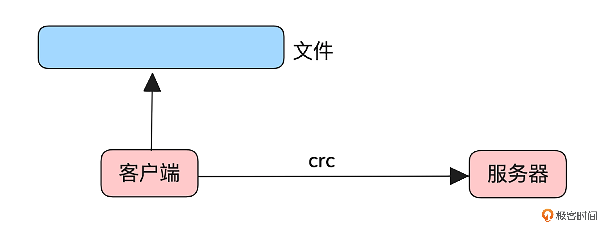
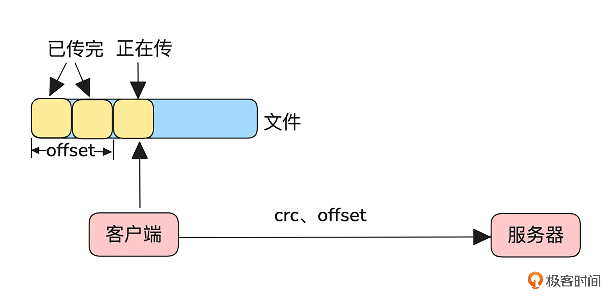
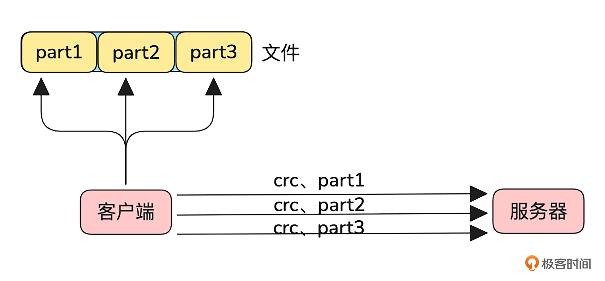
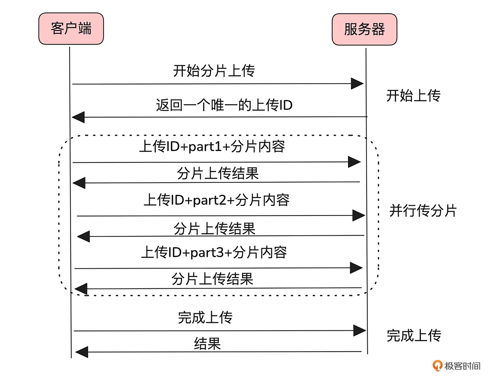
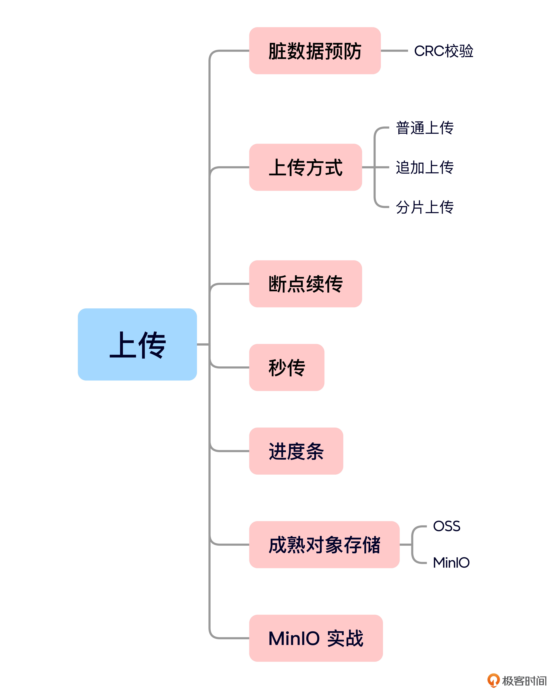

# 12 | 分片、并发与续传：怎样高效上传资源？

你好，我是谢友鹏。

在数字时代，文件上传已成为日常应用中不可或缺的一环。从用户将照片上传至社交媒体，到企业将海量数据存储在云端，上传的效率与可靠性直接影响用户体验。

今天这节课，我们就来聊聊如何防范上传过程中的脏数据问题，之后我还会带你深入了解分片上传、追加上传、断点续传、秒传等提升性能和可靠性的关键技术。掌握了这些，以后你实现和优化上传服务时也会更加得心应手。

### 重视脏数据问题

在存储和缓存服务中，“脏数据”一直是一个令人头疼的问题。所谓脏数据，是指由于传输中断、文件损坏或并发操作等原因，导致存储或缓存中的数据与用户实际上传的数据不一致。这种问题往往比传输失败更让用户反感，所以在讨论具体上传方案之前，我们需要先讨论如何有效防范脏数据的产生。

一种常见的防范方法是对上传数据进行唯一性校验。通常使用的校验算法包括 MD5 和 CRC。尽管 MD5 能提供更高的准确性，但其计算对 CPU 的性能损耗较大，而 CRC 校验则相对高效，常常被用于网络传输中做数据校验。

### 上传方式

知道了怎么预防脏数据，我们来看看怎样高效地上传一个文件。

普通上传

如果只是简单完成上传这件事，倒是挺简单的。如下图所示，只需要客户端文件读取到内存，然后通过 HTTP 的 put 请求，就可以将文件上传到服务器了。



为了防止脏数据，还可以在 http header 中带上文件的 crc 校验值，服务器收完文件校验一下这个值，再结合前面讲的对比一下文件前后若干字节的内容就可以了。

这种实现方式唯一的优点是简单，适合文件较小，网络质量较好的场景。

追加上传普通上传对于小文件来说问题不大，但面对大文件时，弊端就显现出来了。首先，大文件可能超出机器内存的负载能力。其次，一旦传输失败，就需要重新上传整个文件，导致资源浪费。特别是在网络状况不佳的情况下，失败的可能性和重试成本都会显著增加。

为了解决这些问题，我们可以对普通上传稍作改进，采用追加上传的方式。与普通上传需要一次性传输完整文件不同，追加上传通过分块读取文件进行逐步传输。每次传输都会携带当前分块的偏移量（offset），即该块内容在整个文件中的起始位置。这种方式有效减少了内存占用，并增强了上传的可靠性。



为了确保上传数据的一致性，服务端会在每次接收到上传请求时，校验客户端携带的偏移量是否与当前已存储文件的偏移量一致。如果不一致，服务端将返回一个错误，提示客户端应该从正确的偏移量开始继续上传。这一机制可以有效避免数据覆盖或丢失。

追加上传还天然支持断点续传功能。上传失败时，客户端只需向服务端查询已成功存储文件的偏移量，从该位置继续上传即可，无需从头开始。这不仅节省了带宽，还显著提高了传输效率。

这种上传方式特别适用于动态文件和边传边消费的场景，比如直播视频流、视频监控、日志采集等。此类数据在上传时往往无法预先确定文件大小，并需要随着生成过程即时传输。

分片上传

你可能会想，在追加上传中，文件按顺序被分块上传，而如果面对的是一个已经下载到本地的大文件，为什么不直接在客户端将其切分成多个部分，并行上传以提高效率呢？

其实这就是分片上传的核心思想。下面就是这一过程的示意图。



结合图片我们可以看到，文件被划分为三个部分，客户端可以同时读取并将它们并发上传到服务端。这种方式极大提升了传输效率。而且，在网络异常的情况下，仅需重传失败的分片，避免重新上传整个文件，浪费资源。

按照这种方式，如何将多个分片关联到同一文件呢？

想要解决这个问题，我们需要先了解分片上传的过程，分片上传通常分为开始上传、并行上传分片和完成上传三个步骤。我画了一张简图，便于你理解这三步的交互。



- 首先，在开始上传阶段，客户端向服务端请求上传，获取一个唯一的上传 ID。这个 ID 将用来标识该文件及其所有分片。

- 然后是并行上传分片阶段，每次上传一个分片时，客户端都需要附带该分片的编号和唯一的上传 ID。

- 最后，在完成上传阶段，服务端根据分片编号和上传 ID，将这些分片按序合并为完整文件。

分片上传比较适合提前下载好的大文件上传场景，如上传安装包、本地视频等。

### 秒传

在掌握了各种上传方式之后，我们再来了解一种更“聪明”的优化技术——秒传。秒传的设计目标是提升重复性文件上传的效率，让用户免于浪费时间和带宽去重复上传服务端已经存储的文件。

秒传的核心在于文件的唯一标识。客户端会为每个文件生成一个唯一的标识符，这通常是通过特定的校验算法计算得出的。客户端带着唯一标识符上传，服务端在接收上传请求的过程中判断出该文件已经存在，就直接返回上传完成，无需客户端继续上传数据。

在实现秒传时，可以使用上传方案中提到的 CRC 值作为唯一标识的一部分。然而，仅依赖CRC 可能会有冲突的风险。为提高准确性，可以在计算整个文件的 CRC 值之外，增加对文件开头若干字节的校验。这种双重校验机制既能显著降低冲突概率，又能更好地保障文件一致性，使秒传技术更加可靠。

### 进度条

除了上传速度，上传过程中提供清晰的进度反馈也是提升用户体验的重要因素，尤其是在处理大文件上传时更为关键。

大部分情况下，我们使用客户端已经发送的字节数与文件的总字节数来估算上传进度。这种方式实现简单，并且对交互协议没有过多要求。然而，这只是一种“估算”，因为在实际操作中，客户端调用 send 函数时，内核的发送缓冲区可能已经接收了数据，但并不代表这些数据已经成功地传输到服务器。只要发送缓冲区足够大，send 调用就可能成功，但数据是否到达服务器仍然不可知。因此，仅通过客户端的发送字节数来估算进度，存在一定的偏差。

如果想精准地知道上传的实际进度，只能通过服务端的反馈来获取准确的进度信息。值得注意的是，这种请求体与响应体交替传输的方式，不符合传统 HTTP 协议的“请求 - 响应”模型。虽然可以通过魔改协议来实现，但这种方式在经过代理或中间层处理时可能会出现问题。

所以如果需要实时反馈上传进度，并确保在复杂网络环境下的稳定性，推荐使用支持双向通信的协议，如 WebSocket，或者自行设计基于 TCP 的私有协议。这类协议允许客户端和服务端双向随时发起请求和响应，能够更精确地控制和反馈上传进度。

### 成熟对象存储

事实上，开发上传服务可以充分利用现有的成熟对象存储解决方案，大幅减少开发和运维成本。例如，阿里云的 OSS 已经具备我们讲到的追加上传、分片上传、秒传等功能，能够满足各种复杂的上传需求。

另一个例子是开源的 MinIO，它兼容 AWS 的 S3 存储接口，并提供了强大的上传功能。通过

```
其 S3 上传 API PutObject 可以看出，我们可以使用 x-amz-write-offset-bytes 头来
```

指定写入的偏移量，从而实现追加上传功能。此外，通过 API UploadPart 也能看出，MinIO也支持分片上传功能。

### MinIO 分片对比实验

下面让我们开始今天的实战吧。我们通过部署一个单机的 MinIO 服务，然后来对比一下普通上传和分片上传的性能差异。

### 安装 MinIO 服务

我们将会根据 MinIO 的官方文档部署一个 MinIO 服务。先下载可执行文件。

```
$ wget https://dl.min.io/server/minio/release/linux-amd64/minio
$ chmod +x minio
$ sudo mv minio /usr/local/bin/
```

然后将minio.service的内容拷贝到 /usr/lib/systemd/system/minio.service。

接着，添加用户组和用户，并创建存储目录。

```
$ sudo groupadd -r minio-user
$ sudo useradd -M -r -g minio-user minio-user
$ sudo mkdir -p /home/minio-user/data
$ sudo chown minio-user:minio-user /home/minio-user/data
```

之后，我们将环境变量文件 minio 内容拷贝至 /etc/default/minio。这时候，就可以启动minio 服务了。

```
#启动服务
$ sudo systemctl start minio.service
#检查状态
$ sudo systemctl status minio.service
$ journalctl -f -u minio.service
```

- 从结果中可以看到其服务端口。

```
Dec 13 16:56:52 server6 minio[1936]: API: http://172.16.253.136:9000  http://127.
Dec 13 16:56:52 server6 minio[1936]: WebUI: http://172.16.253.136:9001 http://127
```

### MinIO 客户端准备

接下来，我们根据其官方手册 minio-mc 安装一个 MinIO 的客户端。

```
$ curl https://dl.min.io/client/mc/release/linux-amd64/mc \
 --create-dirs \
 -o $HOME/minio-binaries/mc
$ chmod +x $HOME/minio-binaries/mc
$ export PATH=$PATH:$HOME/minio-binaries/
```

客户端通过设置别名与 MinIO 关联。

```
#minio默认api端口为9000
$ mc alias set myminio http://localhost:9000 myminioadmin 12345678
#查看别名是否生效
$ mc admin info myminio
```

### 对比测试

做好前面的准备，就可以做对比测试了。

首先我们生成一个 200M 的测试文件。

```
$ sudo dd if=/dev/urandom of=random_file bs=1M count=200
```

之后再创建一个名为 test 的 bucket。

```
$ mc mb myminio/test
```

然后以禁止分片的方式进行上传。

```
$ time mc put random_file myminio/test/random_file --disable-multipart
/home/random_file:                   200.00 MiB / 200.00 MiB ┃▓▓▓▓▓▓▓▓▓▓▓▓▓▓▓▓▓▓▓
real  0m1.885s
user  0m0.843s
sys  0m0.235s
```

可以看到，这次上传用了 1.88s。

然后删除 MinIO 中的测试文件。

```
$ mc rm myminio/test/random_file
```

再次以分片的方式并行上传相同的测试文件。

```
$ time mc put random_file myminio/test/random_file --parallel 4 --part-size 50MiB
/home/random_file:                   200.00 MiB / 200.00 MiB ┃▓▓▓▓▓▓▓▓▓▓▓▓▓▓▓▓▓▓▓
real  0m1.690s
user  0m0.854s
sys  0m0.182s
```

可以看到这次并行上传用了 1.69s，比不分片上传快了一点。因为我这里是同机上传，事实上这种差异会在网络质量不好的时候更为明显。

### 小结

这节课的内容就是这些，我给你准备了一个思维导图回顾要点。



今天，我们从多个角度全面探讨了上传技术的实现与应用，现在我们回顾一下这节课的重点。

我们首先学习了文件和缓存系统中预防脏数据的措施，明确了如何在高并发场景下保证数据的完整性和一致性。

接下来，我们深入分析了普通上传、追加上传和分片上传三种技术方案的特点与适用场景，同时穿插介绍了断点续传的实现方法。相信你现在已经掌握了如何通过分片上传提升大文件传输的效率，以及在网络中断或异常情况下恢复上传的关键步骤。这些技术方案为构建稳定可靠的上传服务提供了多种选择。

之后，我们还讨论了秒传技术，通过利用文件的唯一标识（如哈希值）避免重复上传服务器中已存在的资源，从而显著节省带宽和时间。此外，我们也学习了上传过程中进度条的实现方式，分析了从客户端估算到服务端反馈的不同实现途径。

在实践环节，我们基于 MinIO 进行了普通上传与分片上传的对比实验，你可以课后自己上手试一试。

### 思考题

1. 分片上传是切分的分片数越多，效率就越高吗？

2. 在文件上传过程中，追加上传和分片上传有哪些本质区别？它们分别适合什么样的应用场景？

欢迎你在留言区和我交流互动，如果这节课对你有启发，也推荐你分享给身边更多朋友。
