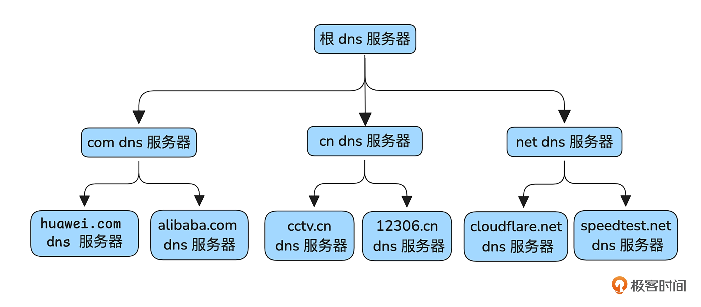
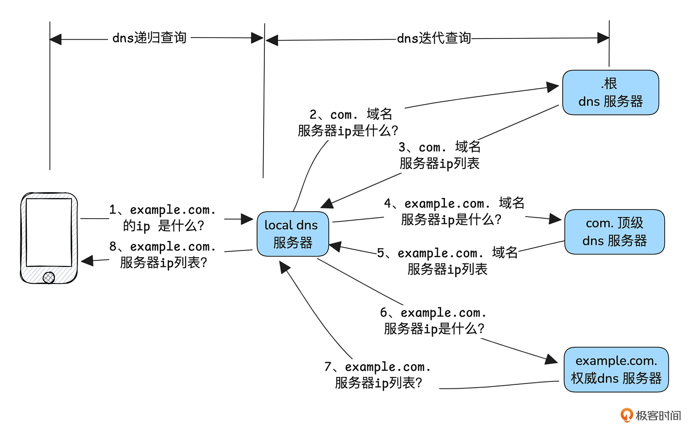
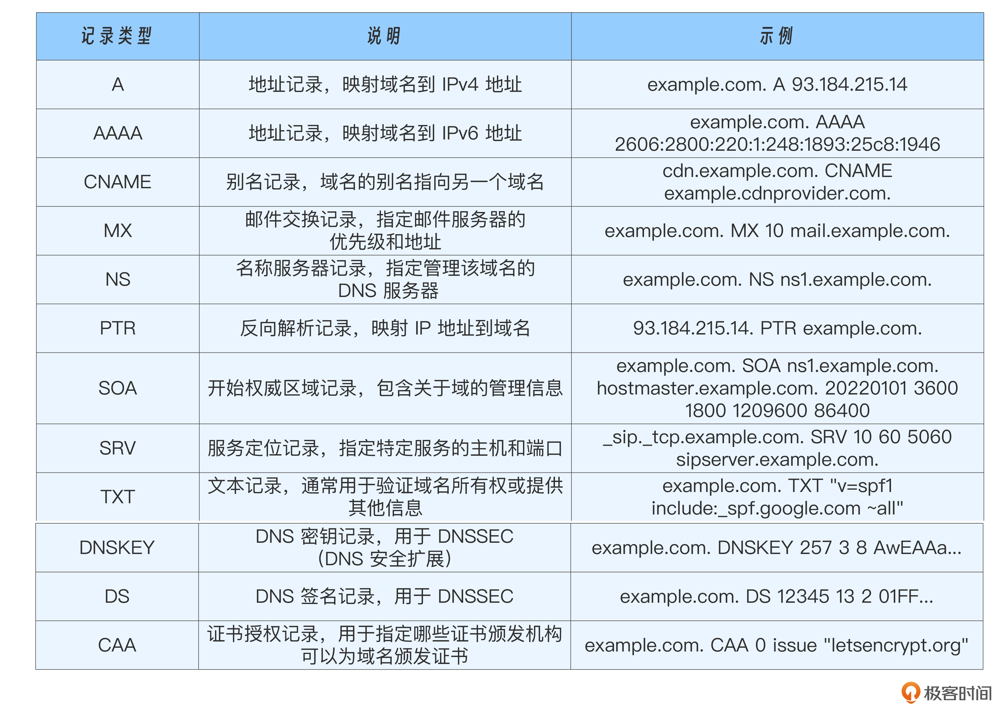
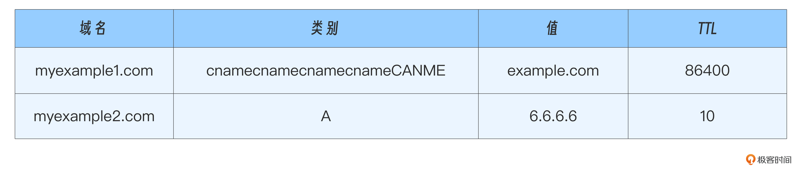
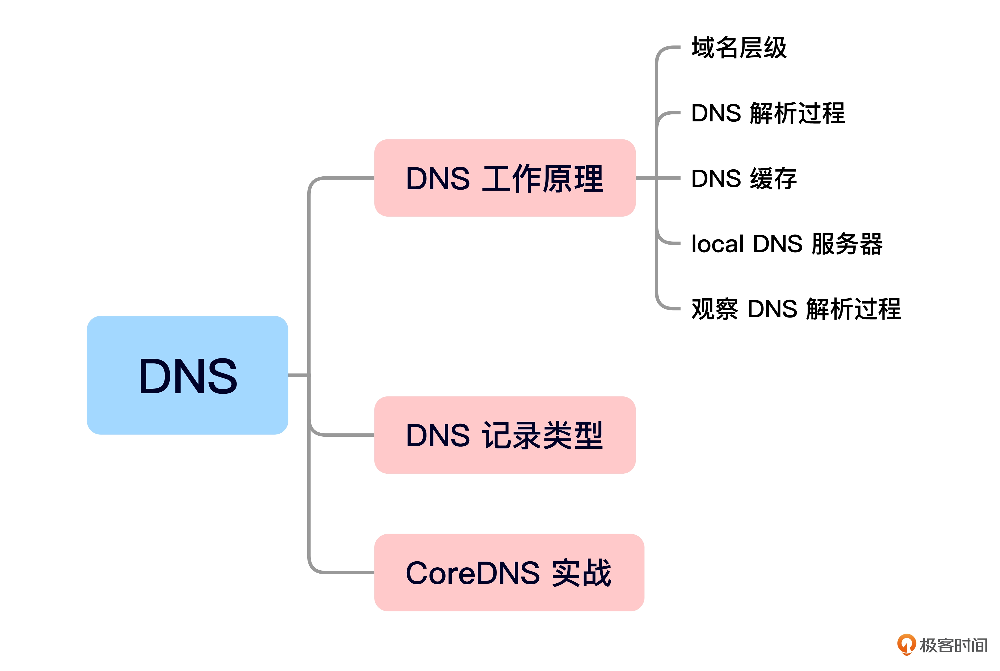

# 13 | DNS：域名解析系统是怎样工作的？

你好，我是谢友鹏。

前面的课程中我们已经多次使用过 DNS。简单来说，DNS 就像一个庞大的电话簿，它将我们容易记住的域名转化为计算机可以理解的 IP 地址。那么，DNS 是如何完成这个转换的呢？

这节课我们就来详细解析 DNS 的工作原理和它的层级结构，并通过具体实例熟悉域名解析的过程，帮助你理解 DNS 是如何完成这一任务的。

### DNS 的工作原理

首先，自己维护域名是比较合理的。例如，当我开设了新公司并申请了新的域名时，我可以选择部署自己的 DNS 服务器，将域名与 IP 地址的映射关系保存在这个服务器上。或者，我也可以将这些映射关系托管在服务商的 DNS 服务器上。

然而，这里有一个问题：当别人访问我的域名时，如何才能知道我的 DNS 服务器的 IP 地址，从而解析这个域名呢？

### 域名层级划分

为了解决这个问题，DNS 采用了分层的架构。域名系统通过分层结构来分配和维护解析请求。这个架构类似于一棵倒置的树，其结构如下图所示：



从上图可以看出，DNS 服务器分为多个层次。最顶层是根域名服务器（Root NameServers），接着是顶级域名（TLD， Top-Level Domain）服务器（如 .com、.cn、.net 等），然后是二级域名服务器（如 huawei.com、alibaba.com 等）。每一层的服务器都向上一层的机构进行注册，确保域名解析可以顺利进行。

你可以在 iana (Internet Assigned Numbers Authority) 官网查看到全球所有根域名服务器以及各个顶级域名（TLD）服务器的详细信息。

当你查询一个域名时，DNS 会从根域名开始逐步查找，直到找到完整的 IP 地址。例如，想要解析 example.com 的 IP 地址，DNS 会将 example.com 从后往前分解成根、顶级域名和权威服务器三部分。虽然我们在日常使用中通常不会看到根的 “.”，但在域名解析时，系统会自动补全这个根域名。


### DNS 解析过程

接下来，我们就来详细看看 example.com 域名解析过程。

首先。向根 DNS 服务器询问 .com 顶级域名的服务器地址。根服务器会返回 .com 顶级域名的DNS 服务器地址。

然后，向 .com 顶级域名的 DNS 服务器查询 example.com 的权威 DNS 服务器地址。顶级域名服务器会返回解析 example.com 的权威 DNS 服务器地址。

最后，向 example.com 的权威 DNS 服务器查询对应的 IP 地址，权威 DNS 服务器会返回example.com 的实际 IP 地址。

虽然 DNS 查询看起来需要多层次的迭代，但实际上，大部分查询并不在客户端设备上执行。DNS 查询通常通过一个本地 DNS 服务器来完成，这个服务器通常在入网时就已经分配好了，并且通常在离客户端较近的地方。客户端只需要向本地 DNS 服务器发起一次递归查询。

本地 DNS 服务器会代为执行上述的迭代查询过程，查询完所有层次后，将最终结果返回给客户端。这个过程的示意图如下：



这张图详细梳理了客户端 DNS 查询 example.com 的 IP 过程，详细步骤是这样的。

1. 客户端向本地 DNS 服务器发起查询请求，询问 example.com 的 IP 地址。

2. 本地 DNS 服务器向根域名服务器（Root DNS Server）发起查询，询问 .com 顶级域名服务器的地址。

3. 根域名服务器返回 .com 顶级域名服务器的地址给本地 DNS 服务器。

4. 本地 DNS 服务器向 .com 顶级域名服务器发起查询，要求获取 example.com 的权威 DNS服务器地址。

5. 由.com 顶级域名服务器返回 example.com 的权威 DNS 服务器地址给本地 DNS 服务器。

6. 本地 DNS 服务器向 example.com 的权威 DNS 服务器发起查询，询问 example.com 的实际 IP 地址。

7. 权威 DNS 服务器将 example.com 的实际 IP 地址返回给本地 DNS 服务器。

8. 本地 DNS 服务器将查询的 IP 地址结果返回给客户端设备。

经过这样一个繁琐的过程，客户端终于查询到了 example.com 的 IP。

看到这里你可能有这样的疑问：域名和 IP 的对应关系并不会经常变化，需要每次请求都经过这么繁琐的查询过程吗？客户端又是怎样找到本地 DNS 服务器的呢？接下来我们就来解答这两个问题。

### DNS 缓存

DNS 查询并不总是需要经过完整的流程，因为 DNS 服务器会根据配置的 TTL（生存时间）缓存查询结果。每个 DNS 服务器都会缓存已解析的 DNS 记录，直到 TTL 到期。

我们可以使用下面的命令行，观察到这一结果：

```yaml
$ nslookup -debug example.com
Server:    127.0.0.53
Address:  127.0.0.53#53
------------
   QUESTIONS:
 example.com, type = A, class = IN
   ANSWERS:
   ->  example.com
 internet address = 93.184.215.14
 ttl = 5
   AUTHORITY RECORDS:
   ADDITIONAL RECORDS:
------------
Non-authoritative answer:
Name:  example.com
Address: 93.184.215.14
------------
   QUESTIONS:
 example.com, type = AAAA, class = IN
   ANSWERS:
   ->  example.com
 has AAAA address 2606:2800:21f:cb07:6820:80da:af6b:8b2c
 ttl = 5
   AUTHORITY RECORDS:
   ADDITIONAL RECORDS:
------------
Name:  example.com
Address: 2606:2800:21f:cb07:6820:80da:af6b:8b2c
```

从结果 ttl = 5 中可以看到，example.com 的 DNS 域名解析结果会被缓存 5 秒，也就是说每一次域名解析 example.com 后，接下来的 5 秒再次查询这个域名的请求都会直接使用缓存的值。

一些操作系统会对 DNS 缓存做统计，比如在 Ubuntu 中，就可以这样查看本机 DNS 缓存统计。

```
$ sudo resolvectl statistics
Transactions
                      Current Transactions:   0
                        Total Transactions: 179
Cache
                        Current Cache Size:   2
                                Cache Hits:   6
                              Cache Misses:  40
Failure Transactions
                            Total Timeouts:   2
        Total Timeouts (Stale Data Served):   0
                   Total Failure Responses:   0
Total Failure Responses (Stale Data Served):   0
DNSSEC Verdicts
                                    Secure:   0
                                  Insecure:   0
                                     Bogus:   0
                             Indeterminate:   0
```

可以看到，当前机器上有 2 条缓存，查询过程命中了 6 条，未命中 40 条。

缓存也可能会带来负面效果，比如某个域名的缓存设置的 TTL 特别长，但是期间更换了 IP 地址，那么缓存有效期内就会访问失败，这时候你可以清理 DNS 缓存来解决。比如 Ubuntu 可以使用下面命令清除缓存：

```bash
sudo resolvectl flush-caches
```

### 本地 DNS 服务器

解决了缓存问题后，我们来讲解第二个问题：客户端如何知道本地 DNS服务器的 IP 地址？ 一般有两种方式，通过 DHCP（Dynamic Host Configuration Protocol） 动态获取，或者通过手动配置。

先来看，通过 DHCP 动态获取当 ISP（互联网服务提供商）搭建一个网络时，通常会部署一个 DHCP 服务器。该服务器除了为网络中的设备动态分配 IP 地址、子网掩码、网关等信息外，还会通过 DHCP 协议将本地 DNS 服务器的地址分配给设备。这样，客户端设备接入网络后，可以自动获取并使用本地 DNS 服务器的地址，无需手动配置。

另外一种方式就是手动配置 DNS 服务器。用户可以自定义 DNS 服务器的地址。例如

在公司网络中，可以将本地设备的 DNS 服务器地址配置为公司的内部 DNS 服务器，用于解析内部域名。普通用户也可以手动配置公共 DNS 服务器，例如 Google 的 8.8.8.8 或Cloudflare 的 1.1.1.1，作为本地 DNS 服务器。

Linux 下可以通过修改 /etc/resolv.conf 配置来更改使用的本地 DNS 地址。比如我当前的配置如下：

```
$ sudo cat /etc/resolv.conf
nameserver 127.0.0.53
options edns0 trust-ad
search localdomai
```

可以看到，本机会向 nameserver 127.0.0.53 发起 DNS 请求。你可以用下面的方法请求一个域名验证这个事情。

```
$ nslookup example.com
Server:    127.0.0.53
Address:  127.0.0.53#53
Non-authoritative answer:
Name:  example.com
Address: 93.184.215.14
Name:  example.com
Address: 2606:2800:21f:cb07:6820:80da:af6b:8b2c
```

你可以尝试修改一下配置中的 nameserver，比如改为 Google 的 8.8.8.8 公共 DNS 服务器，然后再次发起 DNS，会发现查询服务器的 IP 发生了变化。

另外，有一个在测试网络功能时非常实用的小技巧。你可以直接在 /etc/hosts 文件中添加域名与 IP 地址的映射，这样系统会优先使用该文件中的映射，而不需要通过 DNS 服务器查询。比如，我在 /etc/hosts 中添加一条后面这样的记录，然后 ping 一下 example.com 来验证。

```
#在/etc/hosts中添加一条记录
100.100.100.100 example.com
#ping 验证。
$ ping example.com
PING example.com (100.100.100.100) 56(84) bytes of data.
^C
--- example.com ping statistics ---
5 packets transmitted, 0 received, 100% packet loss, time 4126ms
```

通过上面的小实验，可以验证 linux 会优先使用 /etc/hosts 配置的映射，测试完别忘了将/etc/hosts 恢复。

### 观察 DNS 解析过程

DNS 解析的工作原理我们就讲到这，你可以通过下面的命令观察从根域名服务器、顶级域名服务器以及根域名服务器解析的记录。

```
$ dig example.com +trace
; <<>> DiG 9.18.28-0ubuntu0.24.04.1-Ubuntu <<>> example.com +trace
;; global options: +cmd
.      5  IN  NS  d.root-servers.net.
.      5  IN  NS  h.root-servers.net.
.      5  IN  NS  b.root-servers.net.
.      5  IN  NS  a.root-servers.net.
.      5  IN  NS  c.root-servers.net.
.      5  IN  NS  e.root-servers.net.
.      5  IN  NS  k.root-servers.net.
.      5  IN  NS  f.root-servers.net.
.      5  IN  NS  i.root-servers.net.
.      5  IN  NS  l.root-servers.net.
.      5  IN  NS  g.root-servers.net.
.      5  IN  NS  j.root-servers.net.
.      5  IN  NS  m.root-servers.net.
;; Received 239 bytes from 127.0.0.53#53(127.0.0.53) in 2215 ms
com.      172800  IN  NS  l.gtld-servers.net.
com.      172800  IN  NS  j.gtld-servers.net.
com.      172800  IN  NS  h.gtld-servers.net.
com.      172800  IN  NS  d.gtld-servers.net.
com.      172800  IN  NS  b.gtld-servers.net.
com.      172800  IN  NS  f.gtld-servers.net.
com.      172800  IN  NS  k.gtld-servers.net.
com.      172800  IN  NS  m.gtld-servers.net.
com.      172800  IN  NS  i.gtld-servers.net.
com.      172800  IN  NS  g.gtld-servers.net.
com.      172800  IN  NS  a.gtld-servers.net.
com.      172800  IN  NS  c.gtld-servers.net.
com.      172800  IN  NS  e.gtld-servers.net.
com.      86400  IN  DS  19718 13 2 8ACBB0CD28F41250A80A491389424D341522D946B0DA0
com.      86400  IN  RRSIG  DS 8 1 86400 20241227050000 20241214040000 61050 . cR
;; Received 1171 bytes from 198.41.0.4#53(a.root-servers.net) in 289 ms
example.com.    172800  IN  NS  a.iana-servers.net.
example.com.    172800  IN  NS  b.iana-servers.net.
example.com.    86400  IN  DS  370 13 2 BE74359954660069D5C63D200C39F5603827D7DD0
example.com.    86400  IN  RRSIG  DS 13 2 86400 20241221012406 20241214001406 299
;; Received 235 bytes from 192.55.83.30#53(m.gtld-servers.net) in 419 ms
example.com.    3600  IN  A  93.184.215.14
example.com.    3600  IN  RRSIG  A 13 2 3600 20241224074721 20241203063240 60915
example.com.    86400  IN  NS  a.iana-servers.net.
example.com.    86400  IN  NS  b.iana-servers.net.
example.com.    86400  IN  RRSIG  NS 13 2 86400 20241223235724 20241203063240 609
;; Received 318 bytes from 199.43.133.53#53(b.iana-servers.net) in 251 ms
```

其中带有.root 的是根域名服务器，带有.gtld 的是顶级域名服务器，a.iana-servers.net 和b.iana-servers.net 是 example.com 的权威域名服务器。如果你想继续查看一下 a.iana-servers.net 的详细信息，可以通过下面命令查看：

```sql
$ whois a.iana-servers.net
  Server Name: A.IANA-SERVERS.NET
  IP Address: 199.43.135.53
  IP Address: 2001:500:8F:0:0:0:0:53
  Registrar: CSC Corporate Domains, Inc.
  Registrar WHOIS Server: whois.corporatedomains.com
  Registrar URL: http://cscdbs.com
>>> Last update of whois database: 2024-12-15T04:53:43Z <<<
```

从中你可以看到这个域名服务器的注册者、注册网址，以及最后一次更新时间等信息。

### DNS 的记录类型

前面我们只讲了通过域名解析 IP 地址，其实 DNS 的记录类型远不止这一种，我将常见的记录类型列了一个表格，供你参考。



日常开发中，我们最常使用的是前三个，A 记录用于将域名映射到 IPv4 地址，AAAA 记 录用于将域名映射到 IPv6 地址，CNAME 用于将一个域名映射成另一个域名。其中，CNAME 在CDN 等网络产品中被广泛使用。

### 实战：通过 CoreDNS 实现自己的域名解析服务

今天我们将使用 CoreDNS 来实现一个自定义的域名解析服务器。CoreDNS 是一个开源的DNS 服务器，广泛应用于多个领域，包括 Kubernetes（K8s）等官方项目。通过 CoreDNS，我们可以轻松地构建一个灵活、高效的 DNS 服务，并对域名解析过程进行自定义配置。

首先要安装 CoreDNS，你可以在这里下载对应的版本并安装。

```
#下载coredns。
$ wget https://github.com/coredns/coredns/releases/download/v1.12.0/coredns_1.12.
#解压。
$ tar -xvzf  coredns_1.12.0_linux_amd64.tgz
#拷贝到bin目录。
$ sudo cp coredns /usr/local/bin/
#查看版本进行验证。
$ coredns -version
CoreDNS-1.12.0
linux/amd64, go1.23.3, 51e11f1
```

接下来我们添加配置文件。先创建 /etc/coredns 目录，然后分别将 Corefile 拷贝到/etc/coredns/Corefile，myexample1.zone 拷贝到 /etc/coredns/myexample1.zone，将myexample2.zone 拷贝到 /etc/coredns/myexample2.zone。

配置使用 5300 端口作为 DNS 服务（避免与默认的 53 端口冲突），然后配置如下的域名解析关系：



现在我们就可以用下面的命令启动 CoreDNS 服务了。

```
coredns -conf /etc/coredns/Corefile
```

DNS 搭建完成后，我们来测试一下这两个域名的解析结果。先用下面命令解析myexample1.com 的域名。

```
#使用本机的5300端口的dns服务器解析域名myexample1.com
$ dig @127.0.0.1 -p 5300 myexample1.com
; <<>> DiG 9.18.28-0ubuntu0.24.04.1-Ubuntu <<>> @127.0.0.1 -p 5300 myexample1.com
; (1 server found)
;; global options: +cmd
;; Got answer:
;; ->>HEADER<<- opcode: QUERY, status: NOERROR, id: 12769
;; flags: qr aa rd; QUERY: 1, ANSWER: 2, AUTHORITY: 1, ADDITIONAL: 1
;; WARNING: recursion requested but not available
;; OPT PSEUDOSECTION:
; EDNS: version: 0, flags:; udp: 1232
; COOKIE: 1c2034b035c56c40 (echoed)
;; QUESTION SECTION:
;myexample1.com.      IN  A
;; ANSWER SECTION:
myexample1.com.    86400  IN  CNAME  example.com.
example.com.    2377  IN  A  93.184.215.14
;; AUTHORITY SECTION:
myexample1.com.    86400  IN  NS  ns1.myexample1.local.
;; Query time: 0 msec
;; SERVER: 127.0.0.1#5300(127.0.0.1) (UDP)
;; WHEN: Sun Dec 15 12:26:19 UTC 2024
;; MSG SIZE
rcvd: 169
```

结果可以看出，myexample1.com CNAME 到了 example.com，而 example.com 的 IP 地址是 93.184.215.14。

现在用下面命令解析 myexample2.com 的域名。

```
#使用本机的5300端口的dns服务器解析域名myexample2.com
$ dig @127.0.0.1 -p 5300 myexample2.com
; <<>> DiG 9.18.28-0ubuntu0.24.04.1-Ubuntu <<>> @127.0.0.1 -p 5300 myexample2.com
; (1 server found)
;; global options: +cmd
;; Got answer:
;; ->>HEADER<<- opcode: QUERY, status: NOERROR, id: 12357
;; flags: qr aa rd; QUERY: 1, ANSWER: 1, AUTHORITY: 1, ADDITIONAL: 1
;; WARNING: recursion requested but not available
;; OPT PSEUDOSECTION:
; EDNS: version: 0, flags:; udp: 1232
; COOKIE: cb70e956e173a368 (echoed)
;; QUESTION SECTION:
;myexample2.com.      IN  A
;; ANSWER SECTION:
myexample2.com.    10  IN  A  6.6.6.6
;; AUTHORITY SECTION:
myexample2.com.    10  IN  NS  ns1.myexample2.local.
;; Query time: 0 msec
;; SERVER: 127.0.0.1#5300(127.0.0.1) (UDP)
;; WHEN: Sun Dec 15 12:24:47 UTC 2024
;; MSG SIZE  rcvd: 133
```

我们从结果可以看出，myexample2.com 的 IP 地址是 6.6.6.6。

### 小结

今天的内容就是这些，我给你准备了一个思维导图回顾要点。



今天我们深入分析了 DNS 的工作原理，特别是其分层架构以及查询的机制。通过案例演示，我们进一步了解了从根域名服务器到最终 IP 地址返回的完整过程。

然后，我们了解了 DNS 的缓存机制，以及自己的机器是怎样找到本地 DNS 服务器的。之后，我们学习了 DNS 的记录类型，比如我们常用的域名到 IPv4 地址的 A 记录，一个域名到另一个域名到 CNAME 记录等。

最后，我们通过一个简单的 CoreDNS 配置示例，展示了如何搭建一个自定义的 DNS 解析服务，增强了我们对 DNS 实际应用的理解。

### 思考题

1. 今天的实战中，我们使用 CoreDNS 搭建了自己的 DNS 服务器，并配置了两个自定义域名的解析（myexample1.com 和 myexample2.com）。然而，这种配置方式只能解析我们手动配置的域名。若希望同时支持解析其他未维护的域名，该如何操作呢？

2. 在大规模的分布式网络系统里面如 CDN、DNS 常常被用于就近调度，这种调度是怎样判断客户端的地理位置的呢？

欢迎你在留言区和我交流互动，如果这节课对你有启发，也推荐你分享给身边更多朋友。
