# 14 | CDN架构（上）：怎样加速静态资源下载？

你好，我是谢友鹏。

在前面的课程中，我们已经学习了多种性能优化手段，但这些方法集中在点对点的优化上，尚未充分利用地理位置的优势来进一步提升性能。接下来的两节课，我们将重点探讨如何加速静态资源的下载，还会深入探索 CDN（内容分发网络）的原理。

CDN 作为一种分布式网络架构，能够有效地将内容缓存至离用户更近的节点，从而显著降低延迟、提升下载速度。接下来，我们先从全局的角度出发，学习 CDN 的基本原理、调度机制、组成和度量指标。今天的内容比较多，不过如果你能耐心跟下来，一定会不虚此行。

下节课，我们还会学习 CDN server 的优化手段，并通过动手实践构建一个简单的 CDN 节点，更好地理解其工作原理。

## CDN 静态加速原理

我找到了一张示意图，配合图片你会更容易理解 CDN 的原理。

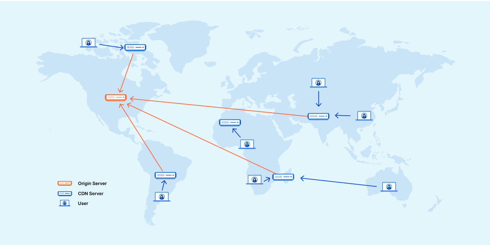

图片来自：what-is-a-cdn

如图所示，Origin Server（源站）是指业务服务器所在的原始站点。如果没有经过 CDN 加速，那么全球用户在下载资源时，需要与该源站进行网络交互。如果使用了 CDN 加速，用户的请求就可以通过距离自己地理位置较近的 CDN Server 来处理。因为 CDN 服务器分布在全球各地，所以用户请求的路径就会大大缩短，进而提升性能。

想要实现就近调度，CDN 就要解决这样几个问题：

1. 怎样让用户本来去 Origin Server 的请求，转移到 CDN Server 上？

2. 怎么找到用户地理位置较近的 CDN Server 的？

3. CDN Server 上的资源是怎么来的？

## CDN 常见调度方式

我们先来看看都有哪些常见调度方式。

### 本地 DNS

如果你认真学习了上节课，了解了 DNS 的原理，或许第一个问题已经难不倒你了。DNS 的解析结果可以是 CNAME，用来将一个原始的域名映射到另一个域名。所以我们只需修改原始域名的 DNS 结果为 CNAME CDN 加速域名，原始域名的请求就会被转发到 CDN 加速域名，从而实现流量的重新定向。

所以，只需要将访问源站用的原始域名 CNAME 到 CDN 的加速域名，后续的流量调度就会交由 CDN 处理了。我画了个简化后的交互示意图，帮助你理解这个交互过程。

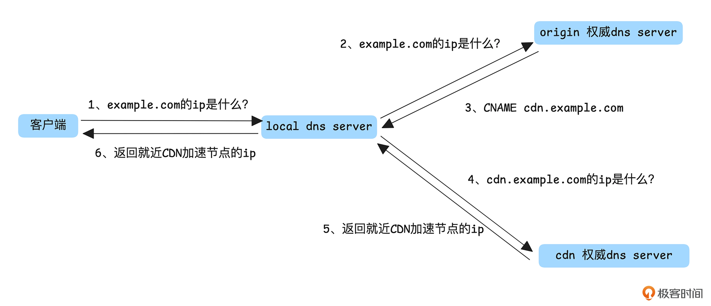

上图是我省略了向根域名服务器和顶级域名服务器的 DNS 查询过程后的请求调度过程。

假设我是 example.com 的维护者，现在我想对其进行 CDN 加速，那么我需要先找某个 CDN厂商给我分配一个加速域名，假设是 cdn.example.com。然后，我会将原始域名example.com 的 dns 解析结果配置成 CNAME 类型的记录，值为 cdn.example.com。这样客户端进行 cdn.example.com 域名解析的时候就会按照上图的步骤解析出 CDN 加速节点的IP。

那么 CDN 的权威 DNS server 是怎么找到用户地理位置较近的 CDN Server 的呢？

这是因为分配公网 IP 的时候和地理位置做了绑定。大家可以根据公网 IP 查询地理位置，你可以在 ipinfo.io 输入一个公网 IP 查查看。


比如我输入了一个极客时间的公网 ip 101.200.86.225，可以看到，这个 IP 位于北京。

而客户端通常与发起请求时，本地 DNS server 的地理位置是比较近的，所以 CDN 的权威DNS server 依据本地 DNS server 的公网 IP，推断出用户的位置。

通过域名 CNAME 方式是目前实现调度到 CDN 加速最常用的做法，因为它简单、侵入性小，只需要修改 DNS 配置，就能够无缝地将流量切换到 CDN。

但是，这种方式也存在一些不足之处。首先，调度服务器无法直接获取客户端的公网 IP 地址，它只能依赖于本地 DNS server 的地理位置来做调度。如果客户端与本地 DNS server 的物理距离较远，可能会导致调度偏差。其次，域名本身承载的信息量有限。比如，如果需要根据请求的 URL 来判断请求的资源，并基于资源类型进行调度，这种基于 DNS 调度的方式就无法实现。

### http 302

CDN 还可以通过 HTTP 302 重定向进行调度。我们这就来看看它的具体过程。首先，将原始域名的解析结果指向 CDN 的调度服务器。客户端请求到达 CDN 调度服务器后，调度服务器会根据请求信息，特别是客户端的公网 IP，决定是否将请求重定向到最近的 CDN 加速节点。我画了个示意图，帮助你更直观地理解这种调度方式。

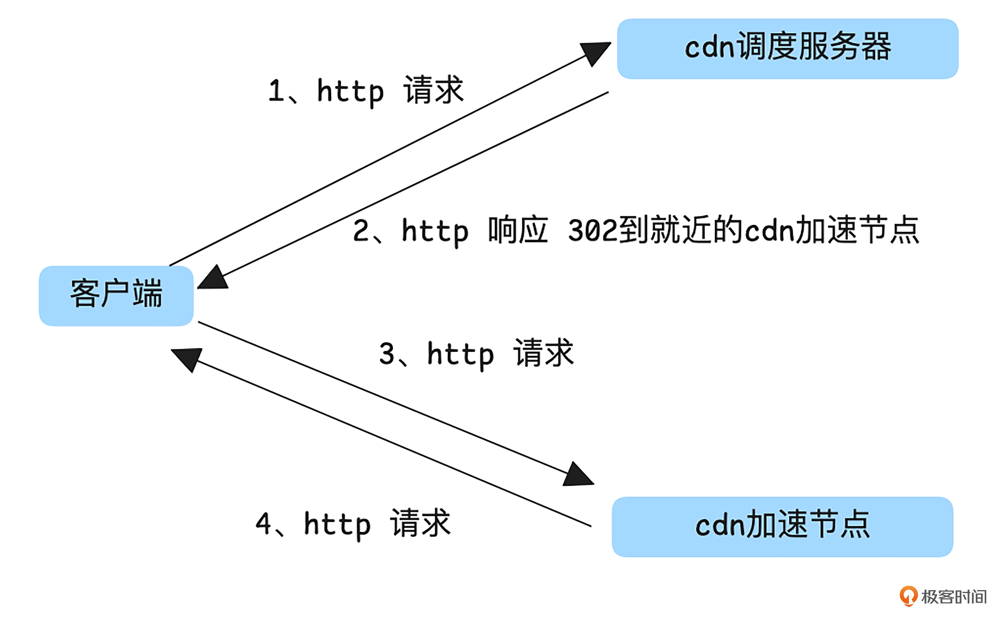

如图所示，我省略了 DNS 请求和 TCP 握手的过程。当客户端请求源站的域名时，请求会首先到达 CDN 调度服务器，调度服务器能够通过客户端的公网 IP，判断出客户端的地理位置。然后返回 HTTP 302 响应，客户端收到 HTTP 302 请求后，follow 302 响应中 Location 地址，将请求重定向到就近的 CDN 加速节点。和通过本地 DNS CNAME 调度方式相比，这种方式可以更准确地获取用户的地理位置。

然而，这种调度方式也存在一些缺点。

1. 客户端需要支持 HTTP 302 重定向：如果客户端原本没有实现 HTTP 302 重定向功能，可能需要对客户端进行改造才能支持该功能。

2. 增加了 HTTP 请求的数量：HTTP 302 重定向会导致多出一次 HTTP 请求。这意味着每个请求都要经历额外的 TCP 握手，如果是 HTTPS 请求，还需要额外的 TLS 握手。这会增加网络交互的次数，带来一定的延迟。

### Anycast

除了在应用层调度外，还有一些厂商尝试采用基于网络层调度，比如 Cloudflare 采用Anycast 技术进行流量调度。Anycast 允许多个服务器共享同一个 IP 地址，并通过路由协议动态地将客户端的请求路由到距离其最近的服务器。

其基本原理是在全球多个位置广播相同的 IP 地址段，并利用 BGP 路由协议的寻路原则，选择路径最短的服务器节点进行响应。这种基于最短路径选择的调度方式，不仅提高了性能，还能有效减少延迟。

此外，多个服务器共享同一个 IP 地址使得 Anycast 成为防御 DDoS 攻击的有效手段。当攻击流量通过网络传播时，Anycast 能将流量分散到不同的节点，从而缓解攻击压力，提高网络的容错性和可用性。

你可以通过 Cloudflare 的官方文档深入了解其 Anycast 网络的工作原理和优势。

### HTTPS API 或 SDK

除了上述调度方式，CDN 厂商还可以提供 HTTPS API 或让用户集成 SDK 来实现调度。这种方式的主要优势在于它能够高度定制化，允许用户根据实际需求调整更多的调度参数。然而，这种方式的缺点也很明显——它对原有请求流程的侵入性较大，需要对客户端进行较为复杂的改造，因此实施起来的成本和难度较高。

## HTTP 缓存

在前面的讨论中，我们解答了如何将客户端请求调度到就近的 CDN 服务器的问题。那 CDN服务器上的资源是怎么来的呢？其实，CDN 服务器是一个缓存。如果客户端请求到的 CDN 服务器没有缓存对应的资源，它会向源站请求并缓存该资源，接着将资源返回给客户端，并存储一份缓存。下次相同的请求到达时，资源就会直接从缓存中返回。

与 DNS 缓存的简单 TTL 设置不同，CDN 中的缓存遵循一套复杂的 HTTP 缓存规则，旨在满足多种场景的需求。HTTP 缓存相关的字段较多，而且不同版本的迭代造成了一些字段功能重叠，其中 rfc7234 定义了很多 HTTP 缓存的内容。

之所以搞这么复杂，是为了满足不同场景的多样化需求。就像不同人对食物的保质期是有不同接受度一样，有些人是不会吃快过保质期的食物的，而有些人可以接收过期一两天的食物。另外，同一个人对于不同食物的保质期敏感度也是不同的，比如同样是过期的食物，酒水就可以接受，果汁就不行。

为此，HTTP 的缓存协议里面会通过一些字段来控制资源的缓存行为和刻画资源的新鲜度。请求中也会通过一些控制字段来刻画客户端对于资源的接受程度。

### 响应缓存控制

我先将响应中缓存控制的常用字段列成表格，供你参考。

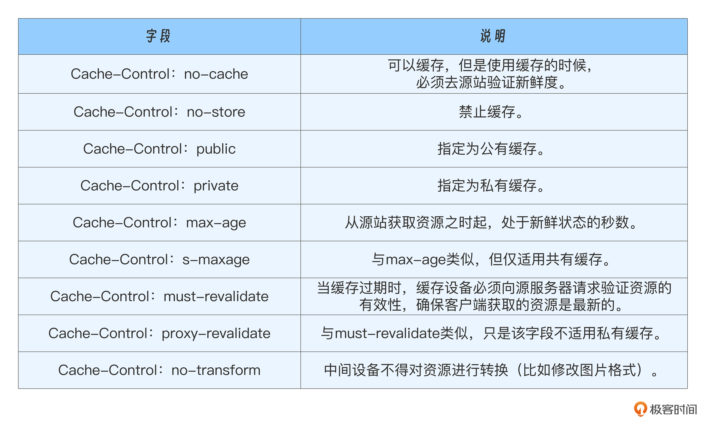

### 资源新鲜度计算

上面表格中 Cache-Control：max-age、Cache-Control：s-maxage 可以用来计算资源新鲜度。除此之外，还有几个常用的参与资源新鲜度的字段，我列到下面的表格，供你参考。

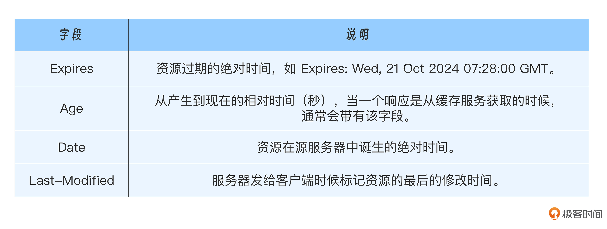

接下来，我们看一下在资源新鲜度的计算过程里，是怎样使用上面的字段的。

首先，我们可以使用以下公式判断一个缓存资源是否过期。

```
response_is_fresh=freshness_lifetime > current_age
```

其中，freshness_lifetime 为资源的“新鲜度生命周期”，即缓存资源在过期前的有效时间。current_age 为缓存资源的“当前生存时间”，即资源从被创建到当前的时间。这两个值都是使用相对时间来计算的。缓存服务器会计算 freshness_lifetime - current_age，并根据请求中的Cache-Control 头来综合决定是否返回缓存资源。

freshness_lifetime 的计算

新鲜度生命时间（freshness_lifetime）表示资源从诞生到过期的相对时间（以秒为单位），其计算按照如下优先级依次计算，如果某个优先级的字段符合计算条件则跳过后面的计算：

1. 共享式缓存优先使用应答中的 s-maxage。

2. 使用应答中的 max-age。

3. 应答中的 Expires 减去 Date。

4. 启发式缓存估算的时间推荐使用 Date 和 Last-Modified 计算的缓存间隔时间除以 10，即：

```
if ((last_modified > 0) && (date > 0) && (date - last_modified) > 0) {
   return (date - last_modified) / 10;
}
```

关于启发式缓存，更详细的内容你可以参考 rfc7234) 中相关章节。

current_age 的计算

current_age 表示资源自创建以来已经存在的时间（以秒为单位）。它的计算考虑了以下因素。

1. Age 字段：表示资源从创建到当前的时间。多级缓存的场景，上一级缓存会设置该字段。

2. Date 字段：表示响应报文在源服务器创建的时间。

3. 主机时间：服务器的当前时间。

我画一个多级缓存的图，方便你理解 Date 和 Age 是怎么携带的。

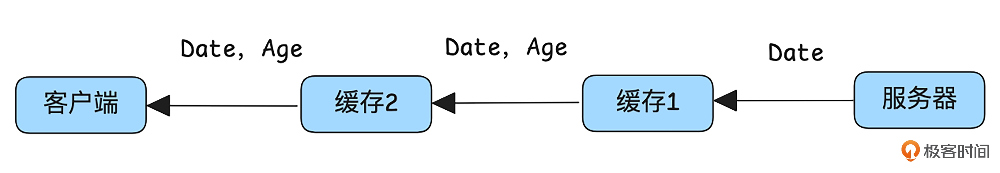

如上图所示，服务器产生资源的时候会设置 Date，该字段一路传递到客户端，并且值不会被修改。每经过一个缓存会添加或修改 Age 字段。

current_age 计算方法通常两种。我们分别来看看。

第一种方法是用收到响应的时间减去 Date 字段的值。比如，用 response_time 表示收到响应的时间，用 date_value 表示 Date 字段的值。

```
current_age = response_time - date_value
```

但是，接收端和源服务器间很可能会有时钟偏差（Clock Skew），为了防止这种情况，就要将负数结果赋值为 0，所以该计算方案最终如下：

```
current_age = max（0, response_time - date_value）
```

第二种方法就是逐跳计算。接收端收到响应报文时的 Age 值，就等于上一跳节点中缓存的Age 值加上传输时延。我们用 previous_hop_age_value 表示上一跳节点中缓存对的 Age 值，用 response_delay 表示传输时延，那么计算公式如下：

```
current_age = previous_hop_age_value + response_delay
```

respose_delay 可以粗略地计算为得到响应时间减去发出请求的时间。看这里你可能会问，为什么不要再除以二呢？

因为 HTTP 对 Age 的计算策略是宁可多算。也不肯少算的，多算顶多缓存新鲜时间变短，产生额外的新鲜度验证；但是少算的话，即使过期了，客户端还会把它当成新鲜的用。

所以 respose_delay 的计算方式如下：

```
response_delay = response_time - request_time
```

这种方法的好处是 response_time 和 request_time 都是本地的时间，不存在时间偏差。

经过以上两种方式计算后，我们取较大的一个作为 current_age。我将整个计算过程总结如下。

```
#第一种计算方式
age_value_by_date = max（0, response_time - date_value）
#第二种计算方式
response_delay = response_time - request_time
age_value_by_hop = previous_hop_age_value + response_delay
#两种取大的
current_age = max(age_value_by_date, age_value_by_hop)
```

现在算出来 freshness_lifetime 和 current_age，我们就知道资源的新鲜度了。

### 请求缓存控制

资源的新鲜度相当于食物的保质期，那请求的缓存控制就相当于不同人对不同食物保质期的容忍度。我将客户端缓存控制常用字段列成表格，供你参考。

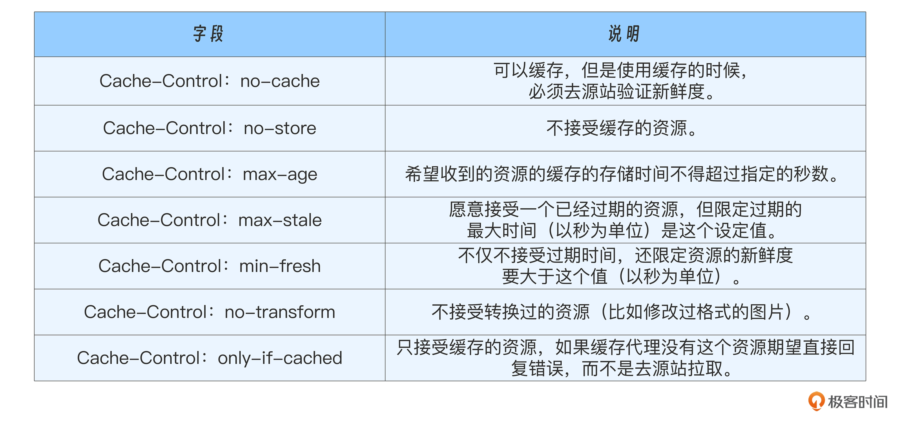

可以发现有些字段和响应中的控制字段是一样的，只不过放在响应中表示的是对资源的约束，放在请求中则表示客户端的诉求。

现在，我们计算了资源的新鲜度，并且知道了请求方对资源新鲜度的要求，缓存服务器就可以在资源存在时间这个维度上决定是否使用缓存资源回复请求了。

### 再验证

有时候请求方不止期望通过时间维度来判断是否使用缓存，还期望向对方发起再验证，用来校验自己能否继续使用本地的缓存，获取最新的资源。我将最常用的两个再验证字段列成表格，供你学习。

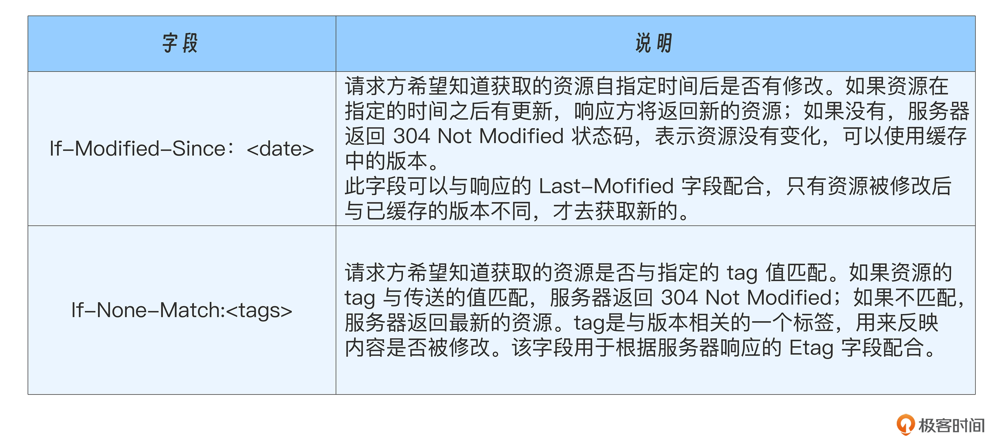

我将这两种再校验的过程，各用一个例子画成交互图，方便你更直观地理解。

首先是 If-Modified-Since 再校验过程。

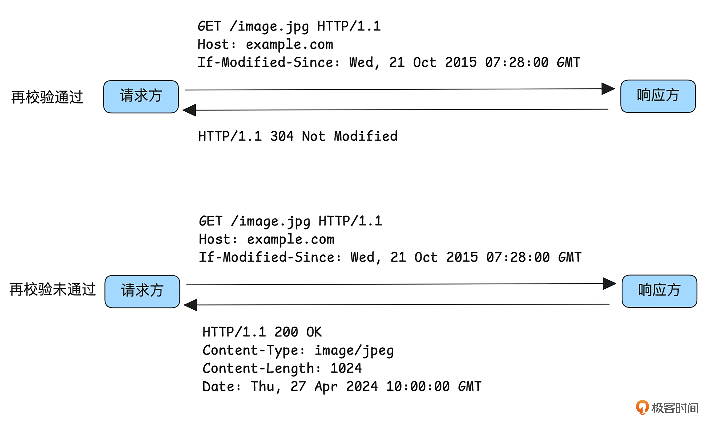

然后是 If-None-Match 再校验过程。

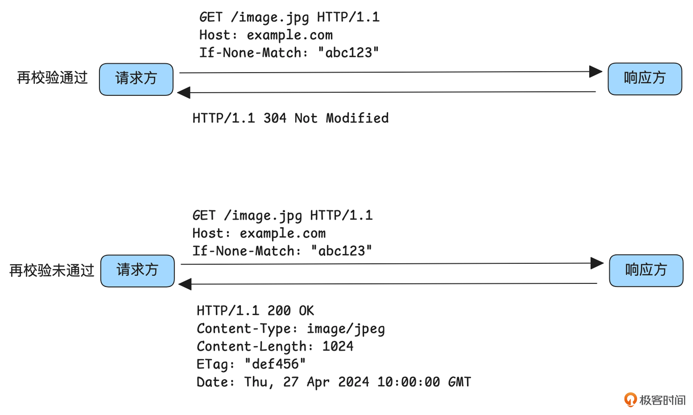

通过交互可以发现，无论再校验是否成功，请求方都通过一次交互就获取了有效资源，而且校验成功的情况，无需传输资源，节省了带宽。

### 其他

除了控制、新鲜度和再验证外，我们再看几个对缓存行为造成影响的 HTTP 字段。

Vary

Vary 指示缓存响应的选择性字段。这意味着资源的缓存可能依赖于请求中某些特定的头部。例如，如果请求的 Accept-Language 或 Accept-Encoding 不同，服务器可能会返回不同的内容。所以缓存服务器处理带有 Vary 相关资源的时候，要将其算入到缓存 CacheKey 的维度。

Authorization

该字段是允许用户代理在与源服务器通信时进行身份验证信息。rfc7234 规定公有缓存不能对这类请求进行缓存。

W/

W/ 是 ETag 头部的一个扩展，表示“弱验证标签”。与强验证标签不同，弱标签不要求资源完全一致，而只要求资源在语义上等效。这使得缓存可以更灵活地判断资源是否已改变，减少不必要的请求。

Pragma：no-cache

与 Cache-Control：no-cache 功能类似，同时出现时候忽略该字段，另外 Pragma：no-cache只会在请求里携带，而 Cache-Control：no-cache 请求和响应都可以携带。

## CDN 组成

前面我们从问题出发，逐步揭开了 CDN 的面纱，现在我画一个 CDN 的全局架构图，帮助你加深理解。

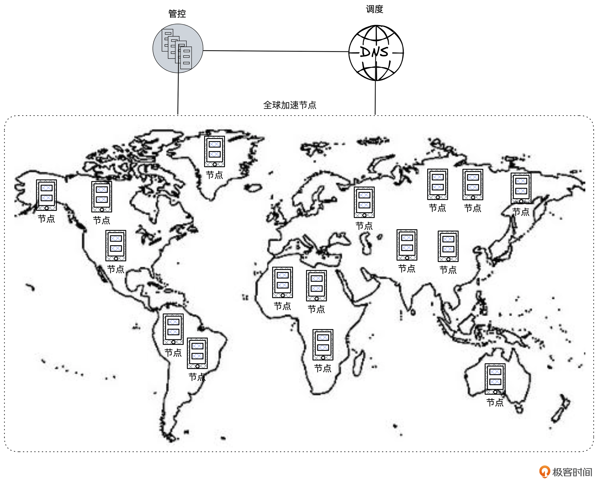

从上图可以看出，CDN 系统主要由三大核心组成部分构成。

1. 管控系统：负责节点的运维管理、业务接入、资源预热和刷新等功能。

2. 调度系统：用于根据用户请求的地域和网络条件，动态地选择最合适的 CDN 加速节点，优化请求响应时间。

3. 加速节点：这些节点上运行带有缓存功能的网络代理，主要负责缓存资源、处理用户请求并进行数据分发，从而减少原始服务器的负载并加速资源的访问。

### 度量指标

现在，我们已经从整体上学习了 CDN 架构，那么这个架构的性能如何度量呢？我们可以参考一下阿里云CDN 的性能指标。

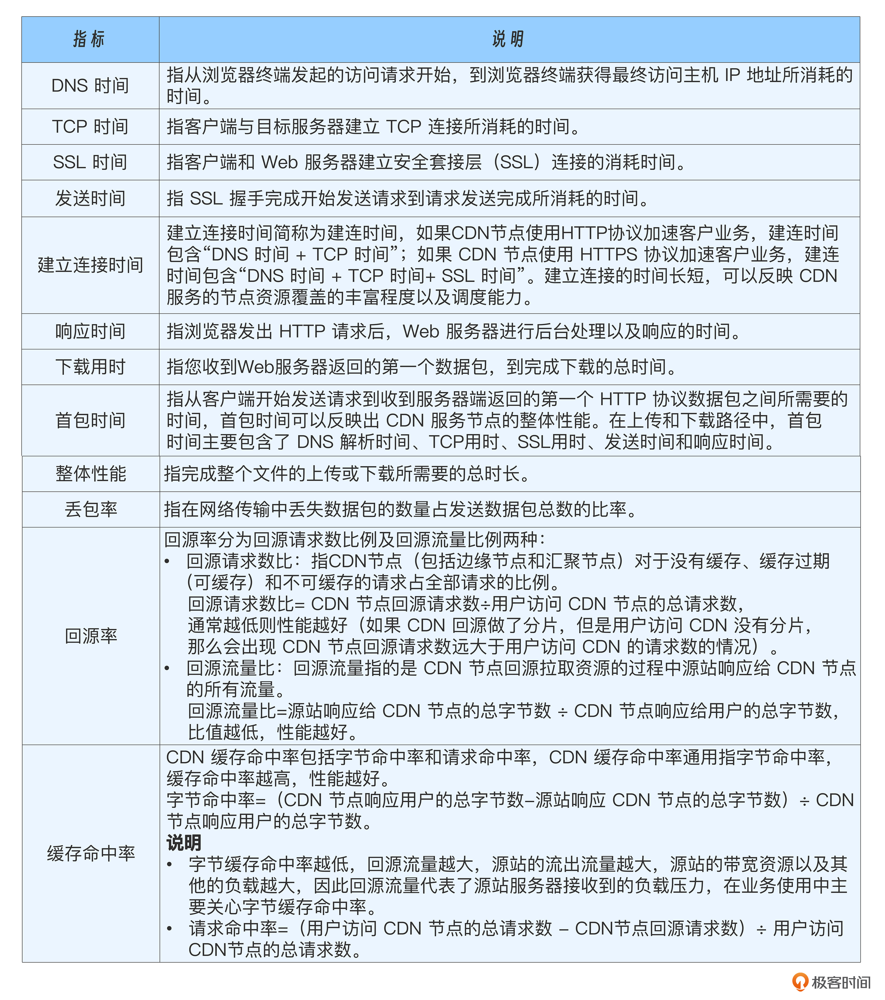

其实各大 CDN 厂商的度量指标通常都比较相似。通过了解和使用这些度量指标，你就能评估并对比不同 CDN 的表现了。

## 小结

今天的内容就是这些，我给你准备了一个思维导图回顾要点。

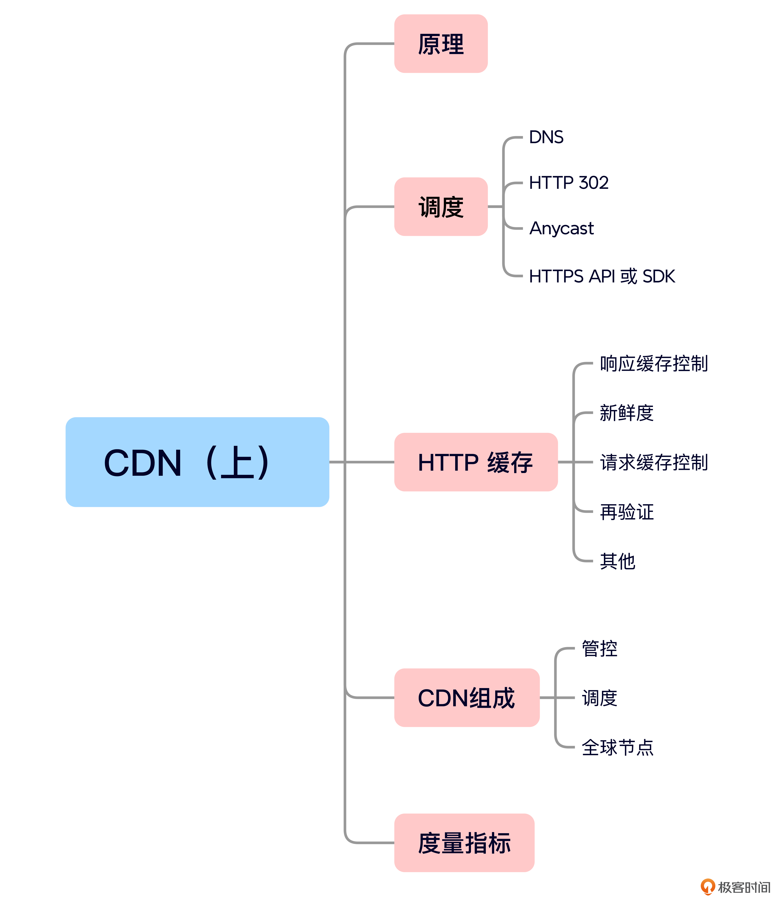

我们从 CDN 的原理出发，学习到 CDN 通过就近返回静态资源来优化性能，由此就产生了三个问题。

1. 怎样让用户本来去 Origin Server 的请求，转移到 CDN Server 上？

2. 怎么找到用户地理位置较近的 CDN Server 的？

3. CDN Server 上的资源是怎么来的？

围绕前两个问题，我们学习了 CDN 调度原理，包括 DNS、http 302、Anycast 和 HTTPS API或 SDK，并了解了各种调度的优缺点。为解决第三个问题，我们学习了 HTTP 缓存。

随着问题的解决，我们逐步掌握了 CDN 的全貌，知道了 CDN 由管控、调度和全球节点系统组成。最后我们提到了阿里云 CDN 的度量指标，这能帮我们明确可以从哪些维度评估一个CDN 的好坏。

今天的内容就到这里，下节课我们将结合一些重要度量指标，如命中率、响应时间、回源率等讲解怎样科学设计缓存节点。

## 思考题

1. CDN 节点本质上是“缓存”还是“存储”，你能说出两者本质上的区别吗？

2. 调度的维度真的只是“就近”吗，如果你是 CDN 厂商，你还会综合哪些维度进行调度？

欢迎你在留言区和我交流互动，如果这节课对你有启发，也推荐你分享给身边更多朋友。
