# 15 | CDN架构（下）：怎样加速静态资源下载？

你好，我是谢友鹏。

上节课，我们学习了 CDN 的原理、调度、整体架构和衡量指标。这节课我们将深入学习 CDN的节点系统，重点了解如何优化命中率、应对热点场景，设计高效的 CDN 节点集群架构。随后，我们还会学习存储结构和回源优化方案。

学完这些内容，你将全面掌握 CDN 节点的工作原理与优化方法。此外，我们还会动手实战，构建一个可用的 CDN 缓存服务器，帮助你更好地理解其在实际场景中的应用。

## 节点集群架构

首先我们来梳理一下节点集群的架构。

### 命中率

通过上节课的学习，我们已经了解了 CDN 节点系统作为 HTTP 缓存代理的工作原理。命中率是缓存系统的核心指标。如果对前面的高可用章节还有印象，你可能已经猜到，CDN 的调度系统将客户端的请求分配到一个集群，而不是单一服务器。

为了提升缓存的命中率，CDN 节点系统通常采用层次化架构，一个 CDN 加速节点至少会被划分成两层。我画了个两层的 CDN 节点架构图来加深你的理解。

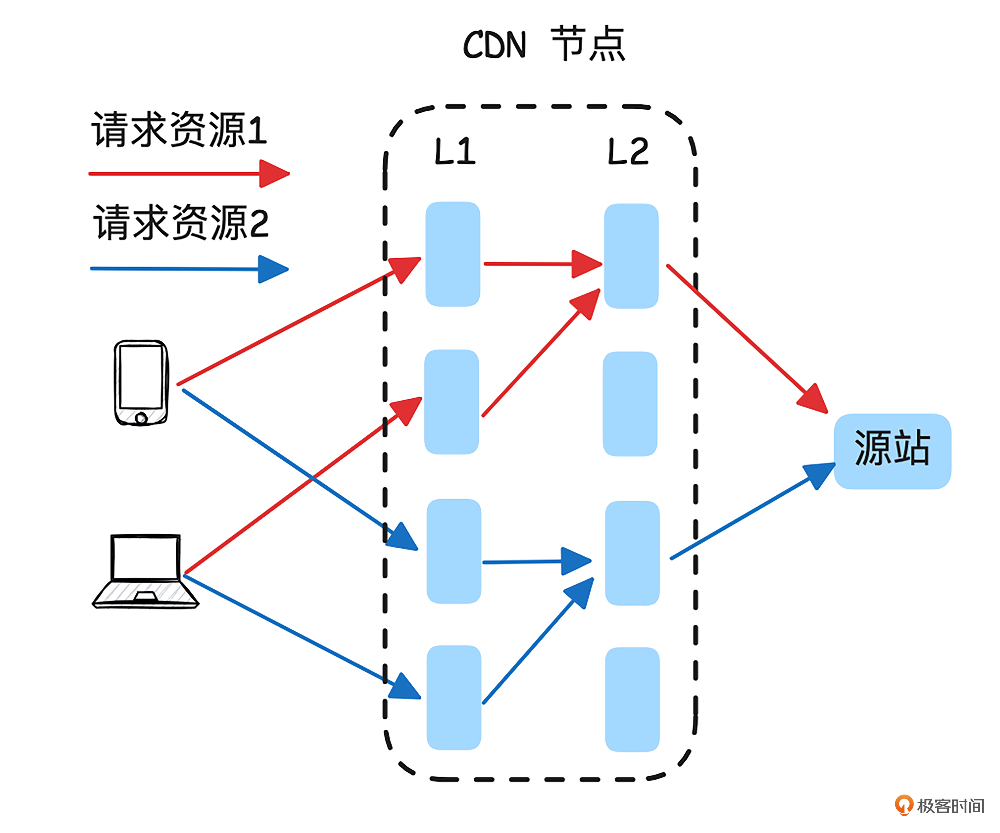

如上图所示，客户端请求调度到 L1 层时，通常采用轮询方式，将四个请求均匀分配到不同的CDN 服务器上，这样每个请求都可能无法命中缓存。而在层级架构下，为了提高命中率，L1到 L2 的请求会根据缓存键（通常是 URL）采用一致性哈希算法进行分配。这样，相同资源的请求会被定向到 L2 层的同一台 CDN 服务器，从而提升命中率。

### 热点

这种先通过轮询调度到 L1，再通过一致性哈希调度到 L2 的做法，不仅提升了命中率，还有效解决了热点请求的问题。因为在 L1 层，热点请求会被均匀分配到不同的服务器上，很多热点请求能够在 L1 层直接命中。这样就有效分散了各个服务器的负载，避免了单台服务器因频繁访问而成为瓶颈。

## 节点单机架构

接下来，我们会从存储结构入手了解节点单机架构。

### 存储结构

前面我们了解了命中率指标后，现在再看看性能指标，一个好的存储结构有助于提升 CDN 的性能。需要注意的是，这里的“存储结构”指的是缓存系统的存储结构，而非存储系统的结构。

存储系统的目标是稳定、可靠。例如，网盘就是一种存储系统，它不能因为自身故障或存储资源不足而丢失该文件。与此不同的是，缓存的目标是利用局部性原理，高效利用有限的存储资源。不同目标造就不同方案，我通过一个表格来对比下它们的差异。

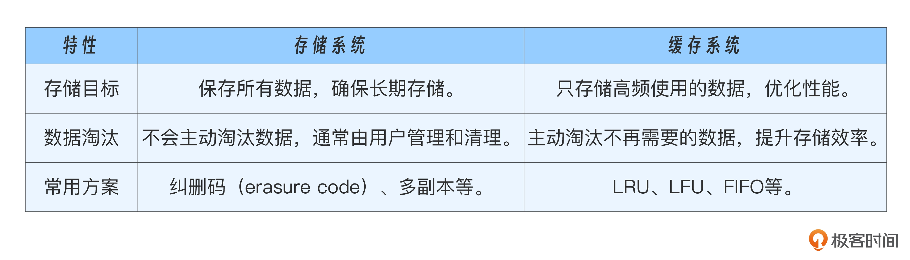

如上表所示，缓存为了最大化利用有限的资源会采用一些算法来删除或覆盖数据。比如 LRU（Least Recently Used）表示根据内容的最近使用时间，淘汰最久未被使用的数据。LFU（Least Frequently Used）表示根据内容的访问频率，淘汰最不经常被访问的数据。FIFO（First-In-First-Out）表示按照内容进入缓存的顺序，淘汰最早进入缓存的数据。

假设我们不对存储的数据做任何约束，不同大小的存储对象就可能会按照下图所示排布。


随着 LRU 等淘汰算法不停地运行，最终可能会产生很多如下图所示的存储碎片。


为了避免存储碎片化并简化存储管理，CDN 缓存服务器通常将存储空间划分为若干相同大小的存储单元。

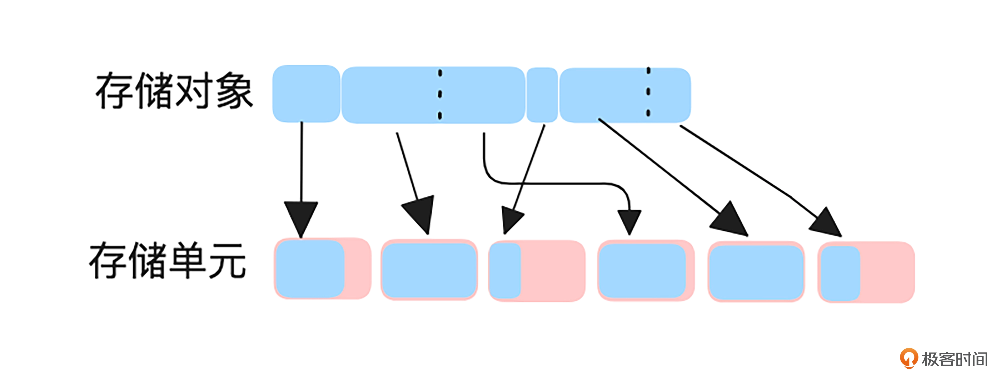

我画了一张存储对象在存储单元中分布的示意图，帮助你更直观地理解这一设计。如上图所示，小于或等于存储单元大小的存储对象会独占一个存储单元，而大于存储单元的对象则会被拆分成多个存储单元来存储。

当我们采用这种设计时，需要特别注意存储对象的大小与存储单元的匹配。如果存储对象过大，一个对象可能会占用多个存储单元，导致读写操作次数增加，可能引发性能问题；而存储对象过小呢，又会造成存储单元空间的浪费，影响存储效率。

因此，如果你的 CDN 服务中存储对象的大小差异较大，可以考虑以下解决方案。

1. 支持多个级别的存储单元：缓存系统可以配置不同大小的存储单元，以适应不同大小的存储对象。

2. 调度不同大小的存储对象到合适的存储单元：根据存储对象的大小，调度其请求到不同大小的存储单元集群，以优化存储空间的利用率和提升性能。

确定存储方式后，我们还需要能够快速查找数据，而哈希表是高效查找的一个理想选择。找到存储对象后，我们还希望能够迅速获取该对象的基本信息，因此需要为每个对象构建元数据。元数据通常包括校验值（如 CRC、MD5 等）、文件大小、与新鲜度计算相关的参数、HTTP的 Vary 字段等。

最后，根据不同的存储介质，可以将缓存划分为多个级别。例如，内存可以作为一级缓存，硬盘作为二级缓存，进一步地，硬盘又可以根据性能将其划分为 SSD 硬盘和普通硬盘。

### 回源优化

搞定存储结构后，我们再来看看怎样设计回源策略。回源指的是请求未命中 CDN 缓存服务器，需要去源站获取数据。

### 合并回源

首先，需要设计合并回源机制。当多个并发请求试图获取相同的数据时，如果它们都未命中缓存并独立地向源站发起回源请求，会导致源站带宽的显著增加。因此，必须采取措施，确保只发起一次回源请求，以避免重复的回源操作。

一种简单的解决方案是，为每个需要回源的文件维护一个请求队列，确保只有一个请求进行回源，其他请求则等待回源结果并直接使用缓存数据。如果回源请求失败，队列中的其他请求会继续发起回源请求。

对于大文件，还可以进一步优化，为文件的每个分片维护一个请求队列，这样就可以及时将分片数据返回给客户端，提高整体响应速度。我画了一个简图，方便你理解。

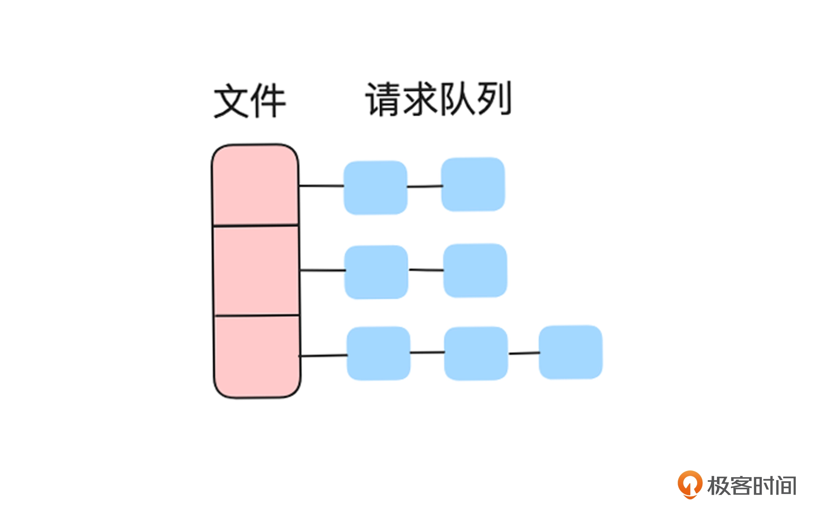

如上图所示，多个并发请求首先会进入文件分片的请求队列，每个队列只需要一个请求回源成功。回源期间，如果有新的带 Range 的请求到达，则只需将该请求添加到对应分片区间的请求队列中。

### 预取

刚刚我们提到请求可以携带 Range 来获取部分数据，当客户端通过这种请求获取部分数据时，缓存服务器可以提前从源站拉取后续数据，以便在后续请求到达时能够直接命中缓存，提升效率。我画个示例图，来展示这个过程。

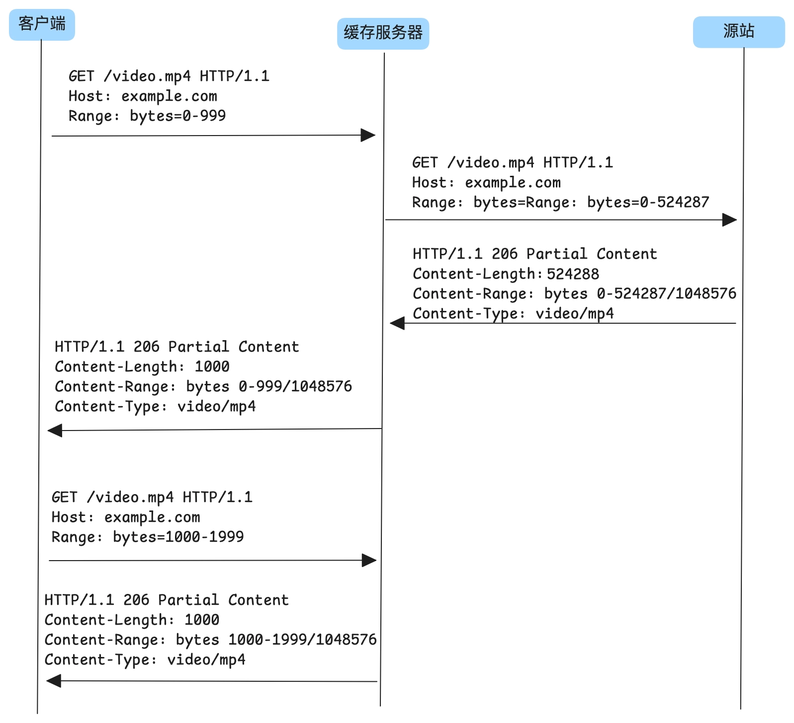

如上图所示，客户端的第一个请求期望从缓存服务器获取 0-999 字节的数据，未命中缓存。此时，缓存服务器没有仅请求该分片，而是直接从源站拉取了整个资源。当第二个分片请求到达缓存服务器时，缓存服务器已经拥有完整的资源，因此能够直接从缓存中返回数据，无需再向源站回源。

### 分段回源

使用预取的方式回源，如果请求完第一个分片后，不再请求后面的分片（比如浏览短视频的时候，可能没看完就划走了），对于源站来说造成了回源带宽放大的问题。

为避免这种情况，同时提高缓存命中率，可以采用分片回源策略。具体而言，缓存服务器在收到客户端请求某个分片时，可以根据自己的对齐方式逐步回源，而不是一次性获取所有后续分片。我画了个示意图，帮助你更好地理解这个过程。

如上图所示，客户端的第一个请求期望从缓存服务器获取 0-999 字节的数据，未命中缓存。此时，缓存服务器按照自己的对齐方式，以 512KB 的分片向源站回源。这样，后续请求范围在0-512KB 的数据就可以直接从缓存中命中。

通过这种折中式的分段回源，我们不仅避免了回源带宽的过度放大，还能提前预取一部分资源，从而提升缓存命中率和整体响应效率。

## 实战：使用 trafficserver 构建 CDN 节点

完成理论学习后，我们就可以动手实践了。trafficserver 是一个开源的缓存代理服务器。它不仅提供了较为全面的缓存功能，还支持通过插件扩展，适用于构建 CDN 缓存节点。

### 实验设计


今天我们将使用 Traffic Server 构建一个 CDN 缓存服务器，Nginx 模拟源站。实验将在一台机器上完成，Traffic Server 监听 8888 端口，Nginx 监听 8800 端口。

### 模拟源站

首先，我们先按下面步骤安装 Nginx。

```bash
sudo apt-get install nginx -y
```

然后，将配置文件 /etc/nginx/nginx.conf 替换为 nginx.conf。之后启动 Nginx，并进行验证。

```
#创建源站资源放置目录
$ sudo mkdir -p /home/download
#创建一个1M大小的文件
$ sudo dd if=/dev/zero of=/home/download/1MB_file.txt bs=1M count=1
#启动nginx
$ sudo nginx
$ ps -ef | grep nginx
root        3317       1  0 11:08 ?        00:00:00 nginx: master process nginx
nobody      3318    3317  0 11:08 ?        00:00:00 nginx: worker process
nobody      3319    3317  0 11:08 ?        00:00:00 nginx: worker process
#http访问源站。
$ curl -o /dev/null -v  http://localhost:8800/download/1MB_file.txt
```

通过上述操作，不仅能从源站请求成功，还能看到资源有效期为 86400 秒，参考如下结果。

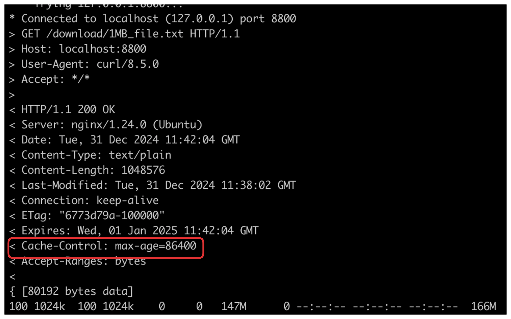

### 使用 trafficserver 搭建 CDN 缓存节点

搞定源站后，我们用下面的方法安装 trafficserver。

```bash
#安装trafficserver
sudo apt-get install -y trafficserver
#查看版本
$ traffic_server -V
Traffic Server 9.2.3 Apr  1 2024 05:10:25 localhost
traffic_server: using root directory '/usr'
Apache Traffic Server - traffic_server - 9.2.3 - (build # 040105 on Apr  1 2024 a
```

上述操作注意查看一下版本号，trafficserver 不同版本之间有一些配置差异。如果你用的版本和我的不同，请根据官方手册适当调整后面步骤中配置。

安装完 trafficserver 后，会在 /etc/trafficserver 目录生成很多默认配置，你可以在对应版本的配置手册（比如我这里使用的 9.2.x 版本）查看这些配置的作用。

我针对本实验修改了一些配置，修改说明如下。

records.config

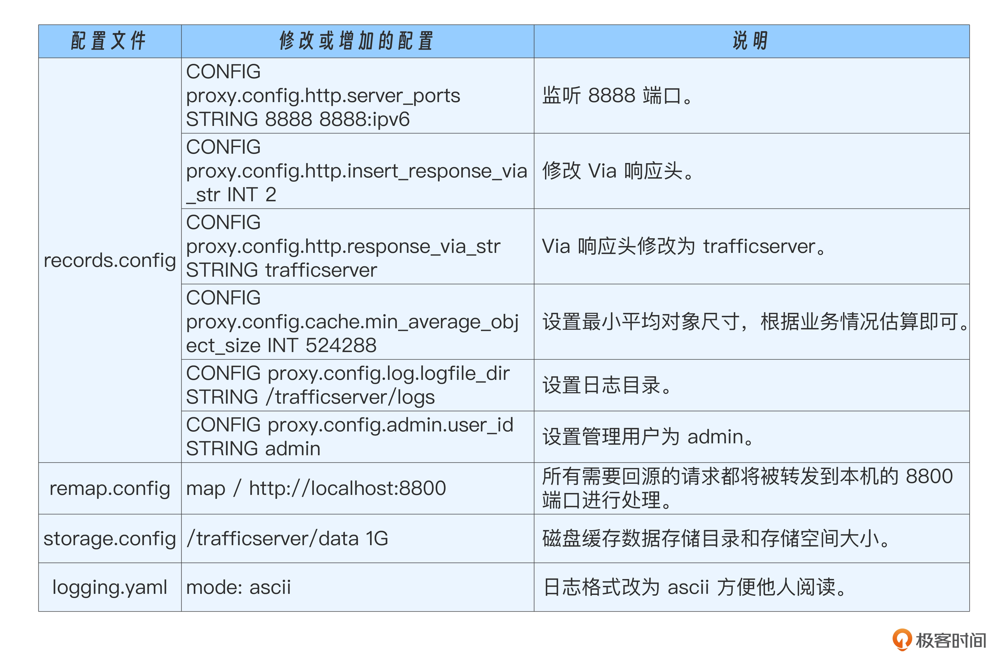

其中 min_average_object_size 就是我们分析存储结构时候，影响存储单元大小的一个配置。只不过 trafficserver 上存储结构更为复杂，你可以参考 cache-architecture 查看详细情况。

为了方便查看，我将修改后的 /etc/trafficserver 目录下的配置文件都放在了 trafficserver，你可以直接替换。

搞定配置后，还需要创建配置中指定的用户和目录。如果你的机器上没有 admin 用户，先添加该用户组和用户。可以参考后面的命令创建。

```
$ sudo groupadd admin
$ sudo useradd -m -g admin admin
```

然后，创建刚刚配置中指定的目录。

```bash
#创建日志和缓存数据目录
sudo mkdir -p /trafficserver/logs
sudo mkdir -p /trafficserver/data
#为创建的目录用户和配置文件，指定用户为admin
sudo chown admin:admin -R /trafficserver
#为配置文件目录指定用户admin。
sudo chown admin:admin -R /etc/trafficserver
#我这个版本安装的trafficserver，默认的run目录，需要指定为admin用户，
#也可通过traffic-layout命令修改，然后在runroot.yaml指定目录，详细操作见官方手册。
sudo chown admin:admin -R /run/trafficserver
```

搞定前面的步骤，现在就可以启动 trafficseerver 了。

```
#使用admin用户启动trafficserver
su - admin -c 'traffic_manager start'
#检查一下进程
$ ps -ef | grep traffic
root        6842    6811  0 15:05 pts/2    00:00:00 su - admin -c traffic_manager
admin       6843    6842  0 15:05 ?        00:00:00 -sh -c traffic_manager start
admin       6848    6843  0 15:05 ?        00:00:00 traffic_manager start
admin       6853    6848  5 15:05 ?        00:00:00 /usr/bin/traffic_server -M --
admin       6855    6853  0 15:05 ?        00:00:00 traffic_crashlog --syslog --w
```

接下来，我们向 trafficserver 发起 2 请求。

```bash
curl -o /dev/null -v  http://localhost:8888/download/1MB_file.txt
```

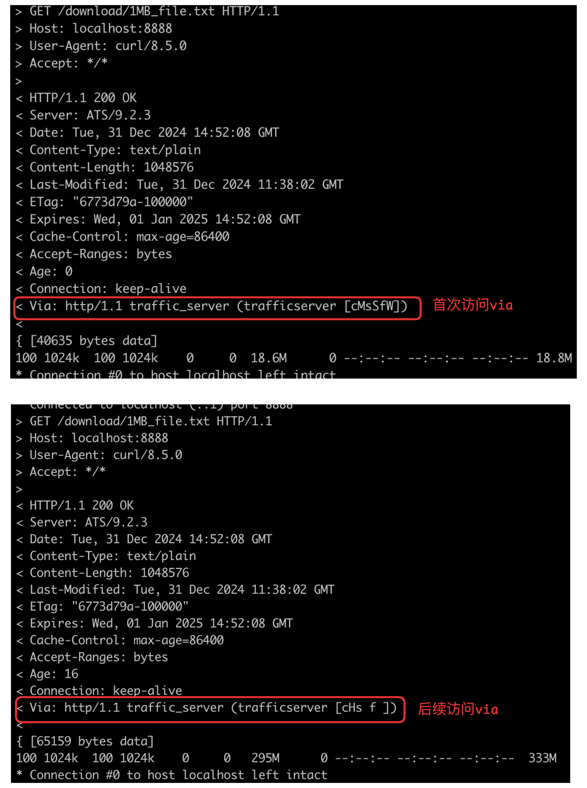

你会发现两次请求的 Via 是不一样的。通过 trafficserver 的 Via 解析工具，我们就可以解析对应的含义。

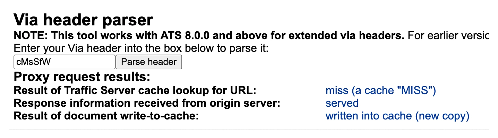

第一次的 Via 表示请求没有命中缓存，这个请求回源站获取资源并写入了缓存。

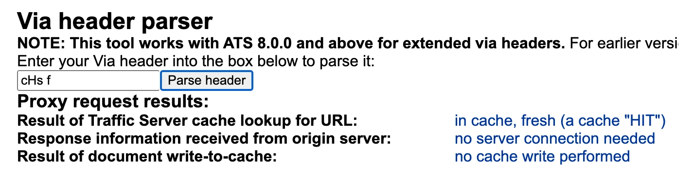

第二次的 Via 表示请求命中了缓存。

除了 Via，你还可以在日志中获取请求处理的关键信息。

```
$ sudo cat /trafficserver/logs/squid.log
1735656728.249 49 ::1 TCP_MISS/200 1048952 GET http://localhost:8800/download/1MB
1735656744.304 1 ::1 TCP_HIT/200 1048953 GET http://localhost:8800/download/1MB_f
```

比如，上面日志中 TCP_MISS 表示未命中缓存，TCP_HIT 表示命中了缓存。

## 小结

今天的内容就是这些，我给你准备了一个思维导图回顾要点。

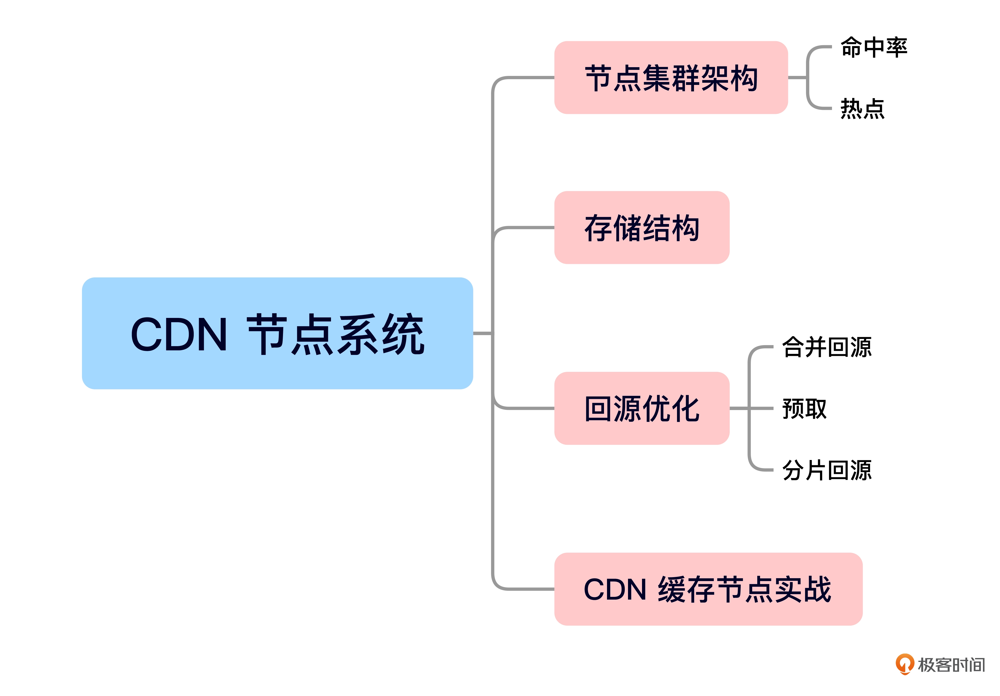

这节课，我们围绕 CDN 节点系统继续深入，现在我们来回顾一下今天的重点。

首先，我们从命中率指标出发，了解到 CDN 缓存集群要采用分层架构。分层后先轮询再一致性哈希的调度方式不仅能提升命中率，还能防止热点请求都到同一个机器。之后，我们学习了CDN 的存储结构以及一些回源优化策略，比如合并回源、预取和分片回源。

最后是实战环节，我们使用 trafficserver 搭建了一个 CDN 缓存服务器，建议你课后自己动手试试看，这样学习效果会更好。

## 思考题

1. 一致性哈希的原理是什么，为什么不用普通的哈希算法？

2.trafficserver 默认的 cachekey 是 url，如果你有个业务 url 中有些参数不想作为 cachekey 的一部分该怎么办？

欢迎你在留言区和我交流互动，如果这节课对你有启发，也推荐你分享给身边更多朋友。
