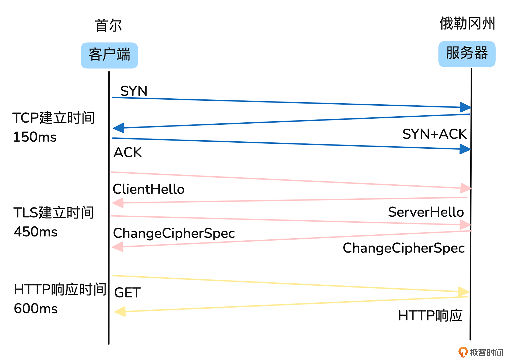
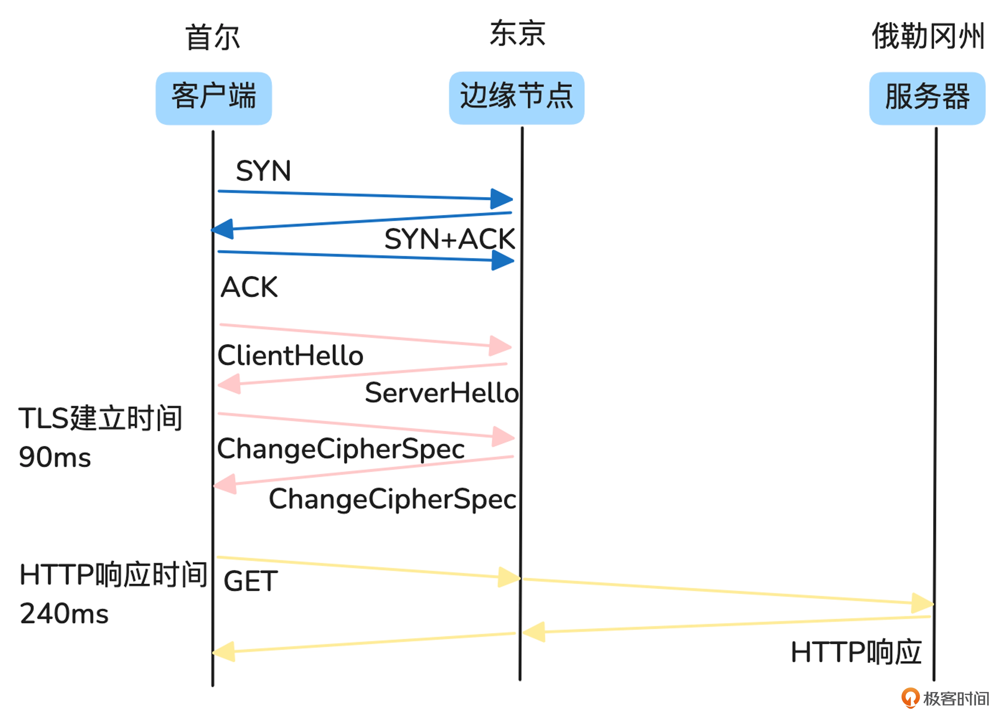
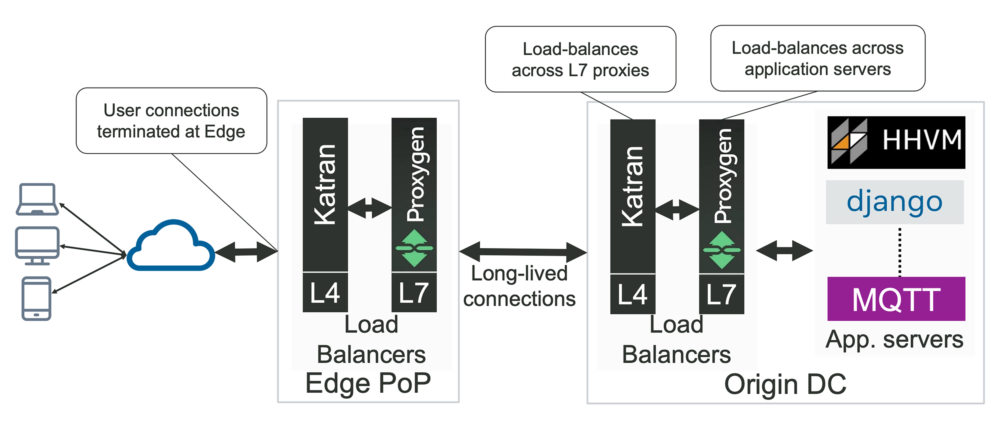
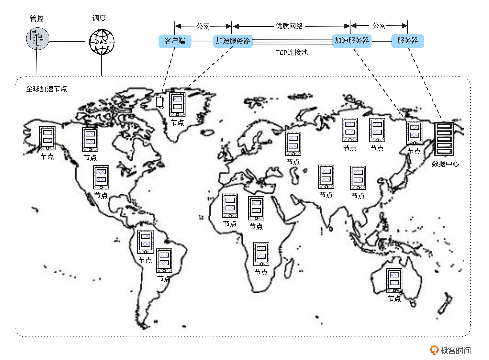
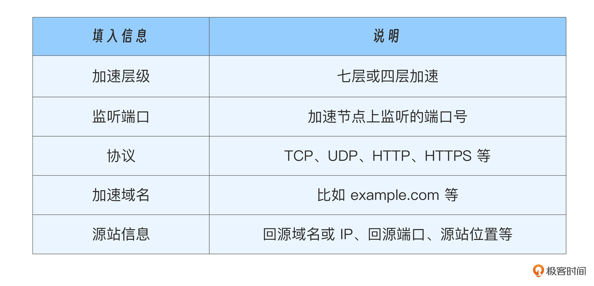
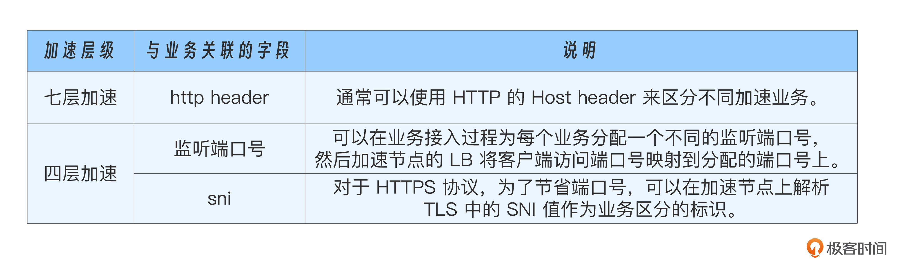
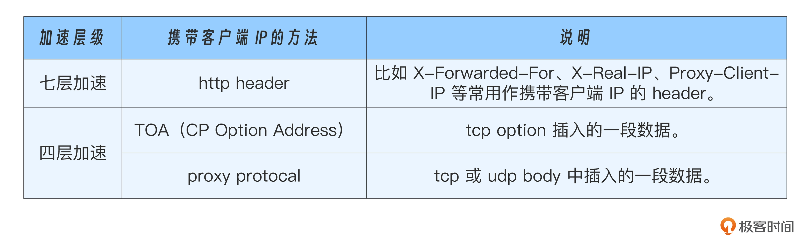
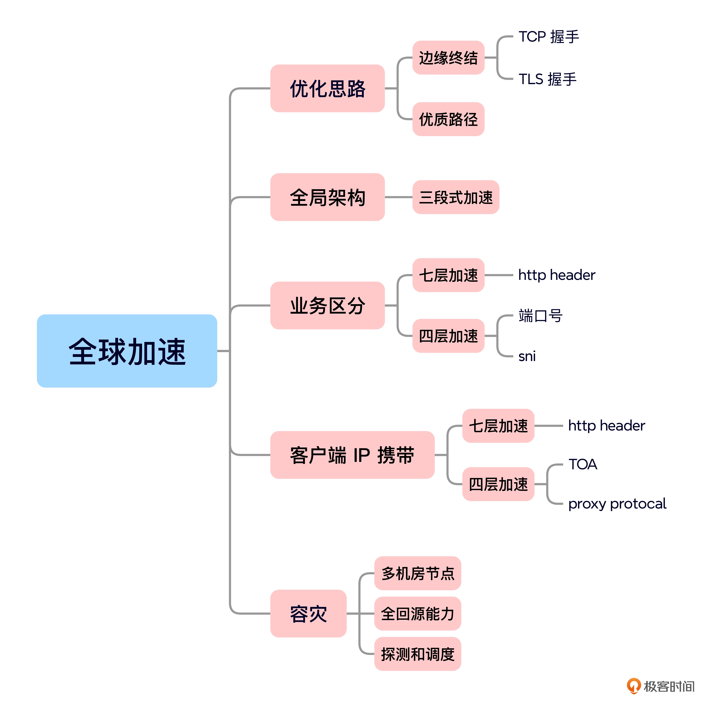

# 16 | 全球网络加速架构：怎样加速动态请求？

你好，我是谢友鹏。

前面两节课我们学习了 CDN，但它并不能适用于所有场景。有些请求必须回源处理，比如支付请求，出于安全性和准确性的考虑，必须由源站来处理。远距离通信会受到网络质量的影响，导致传输速度慢或不稳定，特别是我国的跨境通信流量，由于需要经过 GFW（GreatFirewall，防火长城），还可能面临“误杀”的风险。

为应对这些挑战，我们可以借助全球加速技术来优化网络传输。

## 全球加速的优化思路

全球加速的两个核心优化思路是网络协议提前终结和使用优质的网络传输路径。

通过协议在边缘终结，我们可以将 TCP 和 TLS 等交互环节从长距离通信中移除，将这些耗时操作尽可能终结在靠近用户的边缘节点上，这样就能显著减少延迟。而优质传输路径的选择则更加关注链路的稳定性和安全性，例如通过专线传输来避免 GFW 的干扰，并且提升传输质量和速度。

### 协议在边缘终结

在前面的课程中，我们提到“做减法”是一种优化弱网的有效方式。对于长距离跨境网络，也是一种弱网环境。虽然最终请求需要回到源站，但在传输用户数据前会涉及多次交互（如 TCP和 SSL 握手）。通过在靠近用户的边缘节点提前终结部分协议交互，以达到做减法的目的。

Facebook（现 Meta）在其分享的 facebook-billion-user-load-balancing 中详细介绍了相关优化方案。我根据其实践的分享，画了个加速前的交互耗时图。

如上图所示，在没有进行加速时，韩国首尔的客户端 HTTP 访问美国俄勒冈州的服务器，建立tcp 连接的时间为 150ms，建立 TLS 连接的时间为 450ms，最终收到 http 响应的时间为600ms。

为此，Facebook 在东京建设了边缘节点，我根据其实践分享的内容，画了个加速后的协议交互耗时图。

如上图所示，在东京的边缘节点终结首尔地区客户端的 TCP 和 TLS 握手之后，TLS 建立时间为 90ms，HTTP 响应的时间为 240ms。从 Facebook 的实践数据来看，相对于加速前的交互，在边缘就近终结 TCP 和 TLS 协议，会让整体耗时大幅缩减。

那么问题来了，我们学过网络是分层的，没有 TCP，HTTP 如何传输？事实上，HTTP 确实依赖 TCP，但通过复用已有的 TCP 连接，可以减少重复建立连接的开销。Facebook 的全球加速实现在双边的 LB 上，其架构图如下所示：

图片来自：lpc_from_xdp_to_socket_fb.pdf

如上图所示，Facebook 在全球很多地方建立了 Edge PoP（边缘 PoP 点），并在 Edge PoP和 Origin DC（源数据中心）都部署了 LB，这样就可以复用 LB 之间的 TCP 连接，从而达到在边缘终结 TCP 握手的目的了。至于 TLS 握手，则需要将证书安全部署到边缘节点，并且Edge PoP 和 Origin DC 搭建一个能传输明文的优质、安全的路径。

### 使用优质传输路径

边缘节点与数据中心之间的优质、安全传输路径通常是专线。尤其在我国的跨境网络流量需要经过防火长城（GFW）的背景下，租用跨境专线成为一种有效的解决方案。因为租用跨境专线需要向国家进行备案，避免了遭遇 GFW 的“误杀”. 因此，专线通信更为畅通和安全。

## 全球加速基础设施

现在，我们学习了 Facebook 的全球加速的实践，知道了通过在边缘终结一些协议可以减少整体网络耗时，还知道了针对我国特殊的跨境网络可以通过使用专线来提升质量。那怎么将这些知识演变成通用的全球加速基础设施，来服务多种业务呢？

### 网络架构

为了更好地理解全球加速的原理，我绘制了一张网络架构图，帮助你从全局的角度掌握全球加速的工作方式。

如上图所示，全球加速的架构与传统的 CDN 有些相似，但又有所不同。CDN 主要通过将请求调度到离用户最近的缓存节点来减少延迟，未命中的请求才会回到源站。而全球加速除了将请求引导至接入加速节点外，还进一步将流量引导到离目标服务最近的接出加速节点。这种“三段式的网络加速”设计不仅可以在前后两段就近终结一些协议交互，还可以在两个加速节点之间复用 TCP 连接，从而减少中间最长一段距离的网络交互。

而优质传输路径的选择，在于选择和客户端就近的接入节点以及和源站就近的接出节点，然后“两点确定一线”，从而确定数据在全球加速中的传输路径。客户端就近接入的原理与 CDN 的调度原理一样，这里就不再展开了。源站就近接出节点的选择，需要将请求与管理员配置的加速信息关联。

管理员在为一个业务配置加速的时候，会填入以下信息：

有了这些信息，全球加速系统就能将请求与管理员配置的加速信息匹配，选择合适的接出节点，并规划出最优的传输路径。

全球加速系统通常支持七层（应用层）和四层（传输层）两种加速方式。七层加速和四层加速的请求通常通过不同的方式来区分被加速的业务，我列一个表格供你参考。

### 客户端 IP 和端口携带

搞定全球加速的原理和全局架构后，还有一个细节需要处理。我们的请求对源站隐藏了客户端的 IP，如果源站需要这些信息，该怎样携带呢？

我列了个表格，方便你了解常用的携带客户端 IP 方法。

四层加速的两个方法对应链接分别为 TOA（TCP Option Address）和 proxy protocal。

如上表所示，对于 HTTP 协议来说，只需要指定一个 http header 便可以携带客户端的原始IP，除了表格中列出的 header，你也可以自己定义一个，只需要与源站保持一致即可。

对于四层加速就稍微有些麻烦了，首先需要靠近客户端的接入节点获取到客户端的 IP 后，向后转发的过程中，通过私有协议将此信息透传到后面的代理。然后在接出节点回源的时候，通过设置 toa 或 proxy protocal 将客户端信息带到源站。

其中，proxy protocal 协议是在原始 body 中插入了一段客户端信息，需要源站使用 proxyprotocal 的监听端口，将这段客户端信息替换为报文中的原 IP，然后传输 body 数据的过程跳过这段内容，源站中你可以使用 Nginx 实现 proxy protocal 协议的解析。

## 容灾

对于一个全球加速服务来说，搞定功能后，还有至关重要的一点是保证稳定性。那么如何实现这一点呢？

首先，加速节点应当具备高度的可用性，避免单点故障。因此，节点应该像 CDN 的节点一样，采用多机房的逻辑集群部署，而非依赖单一的服务器。

此外，所有参与加速的节点服务器都应包含完整的源站信息，以便在加速路径中的某个节点出现问题时，能够直接回源，确保请求能够顺利完成。

最后，可以在全球范围内部署多个探测服务。这些探测服务实时监控各个节点和路径的健康状况，将探测结果汇聚到中心调度服务。调度服务可以根据这些探测结果动态调整流量的调度策略，避免将流量引导到存在故障的节点，进一步增强系统的稳定性和容灾能力。

## 小结

今天的内容就是这些，我给你准备了一个思维导图回顾要点。

这节课我们一起探讨了全球加速技术。

首先我们学习了长距离网络，特别是跨境网络的优化思路为在边缘终结部分协议，以及选取优质的网络路径。

之后，为了确定数据在全球加速中的传输路径，我们通常要通过与客户端就近选取接入节点和源站就近选取接出节点，以此“两点确定一线”规划出加速路径。对于我国跨境的线路，可以通过租赁专线来避免 GFW 误杀。

接入节点的选取与 CDN 的就近调度原理一样，接出节点的选取需要将请求与管理员配置的信息匹配得出。对于七层加速，请求业务信息可以通过 header 关联。对于四层加速，请求的业务信息可以通过端口号关联，如果是 HTTPS 请求，也可以通过解析 SNI 来关联。

之后我们学习了如何携带客户端 IP。对于七层加速，可以通过 header 携带；对于四层加速，可以通过 toa 或 proxy protocal 携带。

最后，全球加速技术中的容灾方法也是一个重点，常用方法包括设计多机房的节点、全部节点都具备回源能力，任意加速转发失败，直接回源。还可以在全球部署探测服务，及时探测出故障节点，在调度的时候摘除故障节点。

## 思考题

1.TCP 协议在边缘终结，并结合中间优质链路的 TCP 复用，除了减少握手时间外，还能带来哪些理论上的优势？请结合 TCP 拥塞对性能的影响思考一下。

2. 你可以在网上搜索一下全球加速之类的词，看一看现在有哪些公有云加速产品，判断一下哪些比较适合我国互联网产品出海加速？

欢迎你在留言区和我交流互动，如果这节课对你有启发，也推荐你分享给身边更多朋友。
