# 18 | VPN：怎样构建安全的企业网络？

你好，我是谢友鹏。

上节课我们学习了如何通过 TLS 协议在公网中安全传输数据。TLS 协议通过在传输层和应用层之间添加一层安全协议，实现了加密、认证和完整性校验。然而，TLS 更适用于点对点的安全通信场景，对于某些需要更通用解决方案的情况，TLS 并不是最优选择。

例如，一个公司的多个办公地点希望通过公网连接，形成一个逻辑上的统一网络，不仅需要确保通信的安全性，还希望异地操作能像局域网内一样方便，比如访问远程办公的共享文件夹，而不需要额外的加密配置。此时，VPN（虚拟专用网络）就成为一种理想的解决方案，它通过在网络层建立安全的隧道，既满足了数据加密的需求，又让跨网络的操作更加流畅和便捷。

## VPN 原理

在正式讲解今天的内容之前，需要说明一下，这节课讨论的 VPN 特指工作在 IP 层、具有安全功能的 VPN，不包括基于 SSL 的 VPN（如 OpenVPN）。

### VPN 是什么？

VPN（Virtual Private Network，虚拟专用网）是一种通过公共网络来安全地扩展专用网络的技术。我画张图来帮助你更直观地理解它的作用。

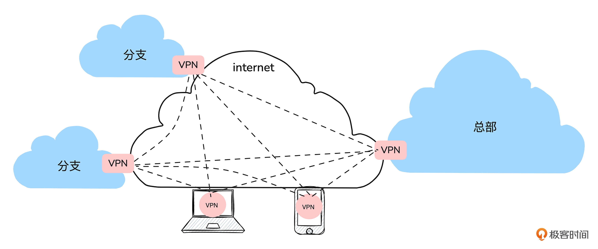

如上图所示，VPN 通过在公共网络中创建一个虚拟的、加密的隧道，使用户可以安全地在公共网络上传输数据，仿佛他们的设备直接连接到了专用网络上一样。这种技术不仅提升了专用网络的功能和安全性，还可以让用户在公共网络上访问原本无法直接访问的资源，因此 VPN常被应用于远程办公、跨分支机构组网等场景。

### 怎样既安全又通用？

简单来说，VPN 的核心理念就是“公网私用”。那它是如何做到既安全又通用的呢？其实，其安全机制和 TLS 类似，无外乎是加密、认证、完整性校验和防重放。与 TLS 不同的是，用于企业组网的 VPN 通常不是在传输层和应用层之间插入安全协议，而是在网络层（IP 层）实现了这些功能。

我画了一张 TLS 和 VPN 在 TCP/IP 模型中的位置和各层的典型协议，方便你更直观地理解。

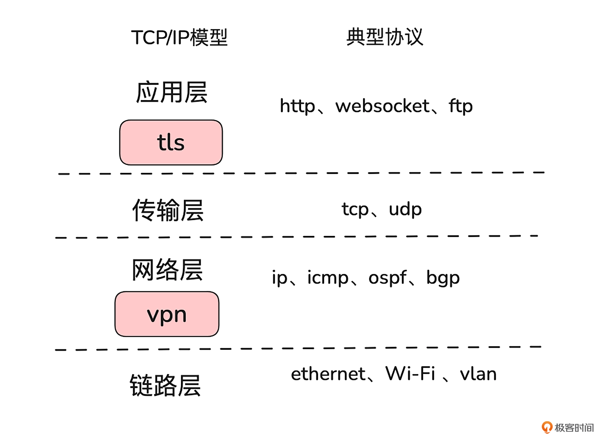

如上图所示，因为 VPN 工作在网络层，无论上层应用协议是什么（比如应用层是 HTTP、WebSocket、ftp，或比如传输层使用 TCP 或 UDP），所有数据最终都会通过 IP 层传输。因此，VPN 可以对任意基于 IP 的通信进行加密和保护。而不需要像 TLS 那样在每个协议上都要自己再套一层 TLS 的壳。

### IPSec vs WireGuard

工作在 IP 层的 VPN 协议中，IPSec 协议是目前网络设备中支持最广泛的协议，同时被 Linux之父誉为“艺术品”的 WireGuard 协议也值得关注。我列了个表格对比了两种协议的特性。

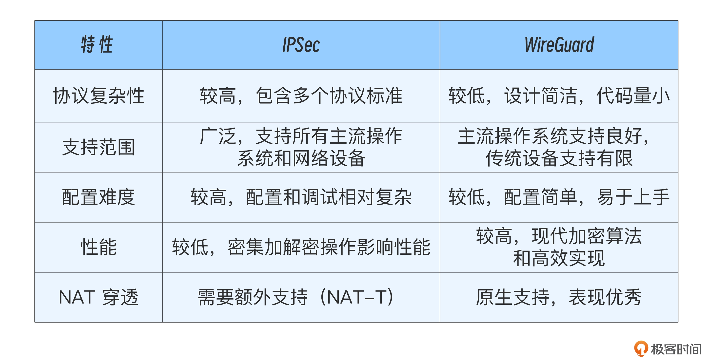

通过以上对比可以看出，IPSec 的优势在于存量网络设备支持较为完善，缺点在于复杂度高。而 WireGuard 优势在于简洁，已经被集成到了 Linux 内核，但是传统的网络设备支持有限。

### 组网

对 VPN 有了初步的认识后，我们继续学习其组网知识。不同子网的用户能够像直连到专用网络上一样，跨越公网发送和接收数据，主要归功于 VPN 的加解密功能不在客户端进行，而是通过 VPN 网关来完成。因此，对于用户来说，只需要将流量通过路由引导到 VPN 网关，剩下的隧道建立和加解密等功能都由 VPN 网关处理即可。

虽然部分 VPN 协议支持传输模式（保留原始 IP，只对 IP 的有效载荷进行加密），但在实际应用中，子网之间的互通一般使用隧道模式，因为隧道模式可以封装完整的 IP 数据包，适用于更广泛的场景。我绘制了一张典型的隧道模式 VPN 组网图供你参考。

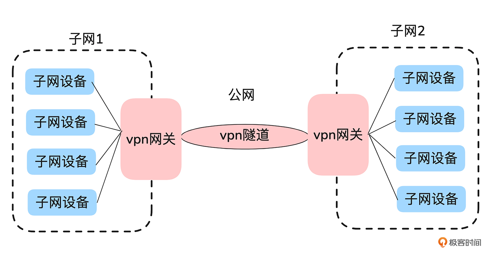

如图所示，子网 1 和子网 2 通过两个 VPN 网关建立了一个安全的隧道。子网内的设备如果需要与对端子网通信，只需要将目标子网的路由指向本地的 VPN 网关。这样，数据包就会被发送到 VPN 网关，而 VPN 网关会完成数据包的隧道封装和加密。

接下来，我们看一下隧道模式下数据包的封装变化。

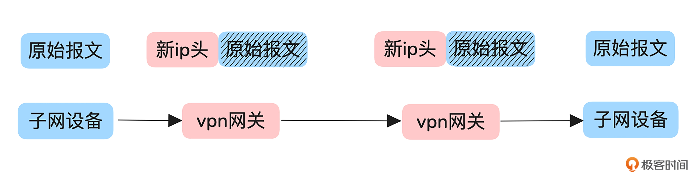

如上图所示，当子网 1 的设备需要访问子网 2 的设备时，数据包的流转过程如下：

1. 子网 1 的设备通过路由，将报文发送到本地 VPN 网关。

2. VPN 网关接收到数据包后，会对其进行封装。首先，在原始数据包的外层添加一个新的公网 IP 头，指向对端 VPN 网关。然后对原始数据包进行加密，生成隧道报文。

3. 封装好的数据包通过公网发送到对端 VPN 网关（通常使用 UDP 协议监听固定端口，比如Wireguard vpn 默认使用 51820 端口，IPSec vpn 默认使用 500 和 4500 端口）。

4. 对端 VPN 网关收到报文后，首先进行解封装，移除隧道头。然后解密报文并完成认证检查。

5. 解密后的原始数据包会被转发到子网 2 内的目标设备，像普通路由报文一样处理。

整个过程对于子网中的设备来说是完全透明的。它们既不需要额外配置，也无法感知到跨越公网的过程，仿佛只是在一个局域网内通信。

前面我们是基于子网之间网络打通的场景展开讨论的。对于出差在外的用户，由于无法像子网那样通过固定的 VPN 网关连接到其他子网，他们通常会在自己的终端设备（如笔记本、电脑或手机）上安装 VPN 软件，使自己的设备充当临时的 VPN 客户端网关。通过这种方式，用户可以在外部网络中安全地访问公司内部资源。

### 关键概念

无论是通过固定网关的子网连接，还是外部用户的临时接入，本质上都是通过路由将流量引导至 VPN，然后通过 VPN 将流量封装进隧道，穿越公网后发送到目的网络所在的 VPN。

这里还需要回答几个关键问题：

1. VPN 网关是怎样知道需要其他 VPN 保护哪些子网流量的？

2. VPN 网关又是怎样知道将哪些流量的请求发往哪些 VPN 的？

3. VPN 网关之间是怎样使用相同的加密、认证等材料的？

这些信息通过 VPN 隧道建立时的 协商（Handshake） 来完成。协商过程主要是为了

确定使用的加密算法、认证算法、交换双方要保护的子网范围等信息。

有些 VPN 协议还定义了交换密钥方法，比如 IPsec 协议中的密钥交换协议 ike。这里我们可以看看华为文档中 IPsec 协议中的 IKE（Internet Key Exchange）与 IPsec 的关系图。

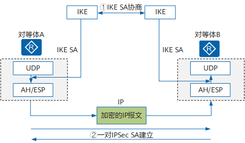

图片来自：support.huawei.com

如上图所示，VPN 隧道建立时，首先会通过 IKE 协议协商出 IKE SA（安全联盟），其中包含密钥。然后，在 IKE SA 的保护下，协商出 IPsec SA，用于加密、认证和保护流量。

相比之下，WireGuard 协议简化了很多流程，没有密钥协议过程，直接使用预先配置的非对称密钥完成隧道建立。

不同 VPN 有不同的表达方式，我将一些比较共性和关键的概念列个表格方便你理解。

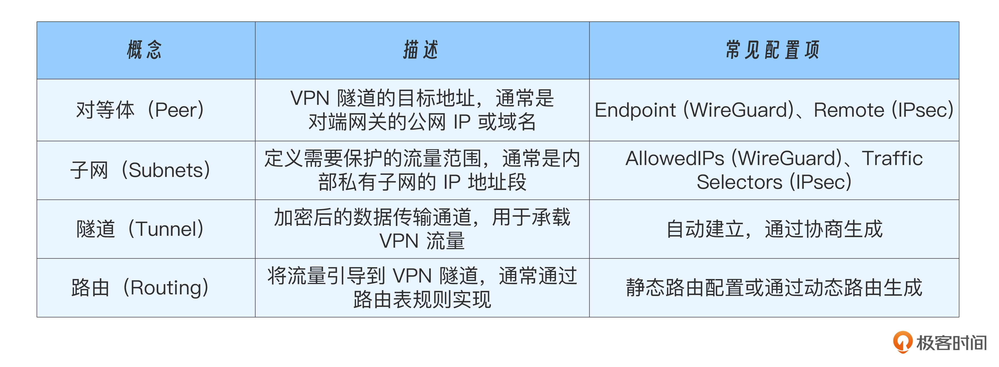

## VPN 实战

如果学完这些理论，你还是有些迷糊，那么我们就继续在实战中学习吧。

### 实验设计

首先，我们来看一下今天实验的网络拓扑图：

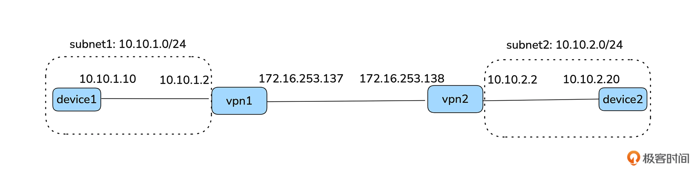

如上图所示，假设图 172 网段的网络是公共网络。今天的目标是通过配置 VPN，在公共网络（172 网段）上建立安全的加密通道，打通两个子网（10.10.1.0/24 和 10.10.2.0/24）的通信。

### 开始实战

子网的配置需要跟你的实验环境进行调整，后面是我自己的实验环境，可以给毛呢做个参考。

### 配置子网

首先，我们需要配置两个子网：将 device1 和 vpn1 添加到子网 10.10.1.0/24，device2 和vpn2 添加到另一个子网 10.10.2.0/24。

让我们来一起完成配置过程。

第一步，创建子网。

在虚拟机中添加两个网络，分别属于 10.10.1.0/24 和 10.10.2.0/24 网段。

具体步骤是这样的。首先，打开 VMware Fusion，进入“设置”->“网络”。然后，解锁网络配置，点击加号 (+) 来添加一个新的虚拟网络。最后，将子网 IP 和掩码填入。

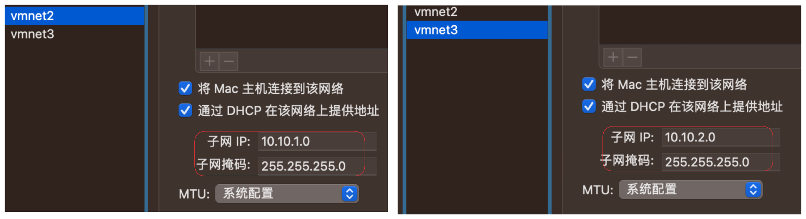

第二步，将虚拟机添加到对应的子网。

依次进入“虚拟机”-“设置”->“添加网络适配器”，选择刚才创建的虚拟网络。

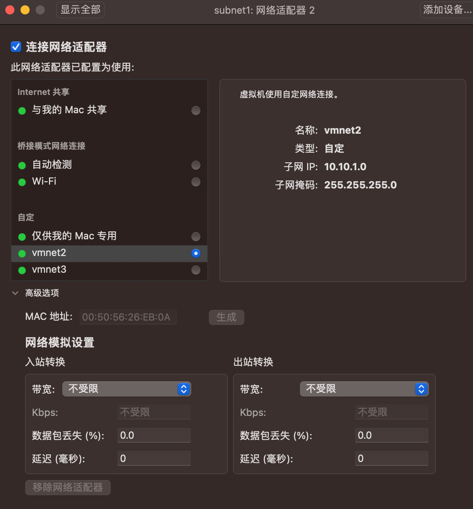

此时登陆虚拟机可以看到新配置的虚拟网卡：

```
$ ip link show
1: lo: <LOOPBACK,UP,LOWER_UP> mtu 65536 qdisc noqueue state UNKNOWN mode DEFAULT
   link/loopback 00:00:00:00:00:00 brd 00:00:00:00:00:00
2: ens33: <BROADCAST,MULTICAST,UP,LOWER_UP> mtu 1500 qdisc pfifo_fast state UP mo
   link/ether 00:0c:29:c8:e2:26 brd ff:ff:ff:ff:ff:ff
   altname enp2s1
3: ens37: <BROADCAST,MULTICAST> mtu 1500 qdisc noop state DOWN mode DEFAULT group
   link/ether 00:50:56:26:eb:0a brd ff:ff:ff:ff:ff:ff
   altname enp2s5
```

第三步，启动网卡并配置 IP。

首先用下面命令启动网卡。

```bash
sudo ifconfig ens37 up
```

然后用下面命令配置 ip。

```bash
sudo ifconfig ens37 10.10.1.10 netmask 255.255.255.0 up
```

第四步， 四个虚拟机都配置完成后，我们进行简单的网络验证来验证网络连通性。

此时，device1 与 device2 不通，但在各自子网内部，设备能够互通。而且 vpn1 和 vpn2 之间也能正常互通。我们可以用 ping 验证。

```
#device1 ping device2 不通
$ ping 10.10.2.20
PING 10.10.2.20 (10.10.2.20) 56(84) bytes of data.
^C
--- 10.10.2.20 ping statistics ---
4 packets transmitted, 0 received, 100% packet loss, time 3069ms
#device1 ping vpn1 能通
$ ping 10.10.1.2
PING 10.10.1.2 (10.10.1.2) 56(84) bytes of data.
64 bytes from 10.10.1.2: icmp_seq=1 ttl=64 time=1.33 ms
64 bytes from 10.10.1.2: icmp_seq=2 ttl=64 time=1.16 ms
#vpn1 ping vpn2 能通
$ ping 172.16.253.138
PING 172.16.253.138 (172.16.253.138) 56(84) bytes of data.
64 bytes from 172.16.253.138: icmp_seq=1 ttl=64 time=2.14 ms
64 bytes from 172.16.253.138: icmp_seq=2 ttl=64 time=1.21 ms
#vpn2 ping device2 能通
$ ping 10.10.2.20
PING 10.10.2.20 (10.10.2.20) 56(84) bytes of data.
64 bytes from 10.10.2.20: icmp_seq=1 ttl=64 time=0.859 ms
64 bytes from 10.10.2.20: icmp_seq=2 ttl=64 time=1.46 ms
```

### 配置 VPN

搞定子网后，我们就可以开始配置 vpn 了。首先安装 wireguard 相关工具。

```bash
sudo apt install wireguard-tools
```

然后在两个 VPN 上生成各自的私钥和公钥。我已经生成的公私钥为 vpn1 的privatekey和publickey，vpn2 的privatekey和publickey，你也可以直接使用。

```
#生成私钥
wg genkey > privatekey
#生成公钥
wg pubkey < privatekey > publickey
```

参照 vpn1 的配置文件 /etc/wireguard/wg0.conf和 vpn2 的配置文件 /etc/wireguard/wg0.conf，进行修改，然后用后面的命令启动 VPN。

```
$ sudo wg-quick up wg0
```

两边的 VPN 都启动后，可以查看一下 VPN 的状态。

```
vpn1:~$ sudo wg show
interface: wg0
 public key: YiL95lWnimaMT4Zj5orOqADBxwf+bLKx3Y7OF5yQ4S8=
 private key: (hidden)
 listening port: 51820
peer: rZqn0uL9IiNA2sWrVkbTymPiTgpWbBkByTH1/QHBRRA=
 endpoint: 172.16.253.138:51820
 allowed ips: 10.10.2.0/24
```

### 配置被保护流量的路由

VPN 隧道建立完成后，我们需要在子网设备上配置路由，使得流量能够通过 VPN 隧道转发到对端子网。如下操作，device1 上配置去对端网段的路由都以 vpn1 为网关。

```
#device1上配置去10.10.2.0/24网段的流量，都以vpn1为网关
$ sudo ip route add 10.10.2.0/24 via 10.10.1.2 dev ens37
#验证一下去device2的路由是否生效
$ ip route get  10.10.2.20
10.10.2.20 via 10.10.1.2 dev ens37 src 10.10.1.10 uid 1000
```

同理，device2 上配置去对端网段的路由都以 vpn2 为网关。

```
#device2上配置去10.10.1.0/24网段的流量，都以vpn2为网关
$ sudo ip route add 10.10.1.0/24 via 10.10.2.2 dev ens37
#验证一下去device1的路由是否生效
$ ip route get 10.10.1.10
10.10.1.10 via 10.10.2.2 dev ens37 src 10.10.2.20 uid 1000
   cache
```

至此，配置结束，我们在 device1 上访问一下 device2，会发现可以连通了。

```
$ ping 10.10.2.20
PING 10.10.2.20 (10.10.2.20) 56(84) bytes of data.
64 bytes from 10.10.2.20: icmp_seq=1 ttl=62 time=4.47 ms
64 bytes from 10.10.2.20: icmp_seq=2 ttl=62 time=3.16 ms
64 bytes from 10.10.2.20: icmp_seq=3 ttl=62 time=3.24 ms
64 bytes from 10.10.2.20: icmp_seq=4 ttl=62 time=3.22 ms
```

如果你想继续观察一下 VPN 报文，使用 sudo wg-quick down wg0 关闭 VPN 功能，然后启动VPN 和流量访问的时候，使用下面命令在 VPN 上抓包。

```
$ sudo tcpdump -i any port 51820 -w wireguard.pcap
```

我们可以用 Wireshark 打开抓包文件wireguard.pcap，它并没有暴露子网流量的 IP，还对数据进行了加密。

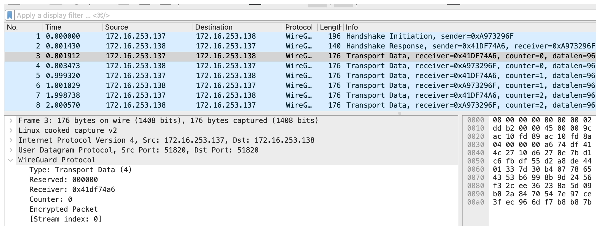

好，我们的 VPN 实验到此结束。

## 小结

今天的内容就是这些，我给你准备了一个思维导图回顾要点。

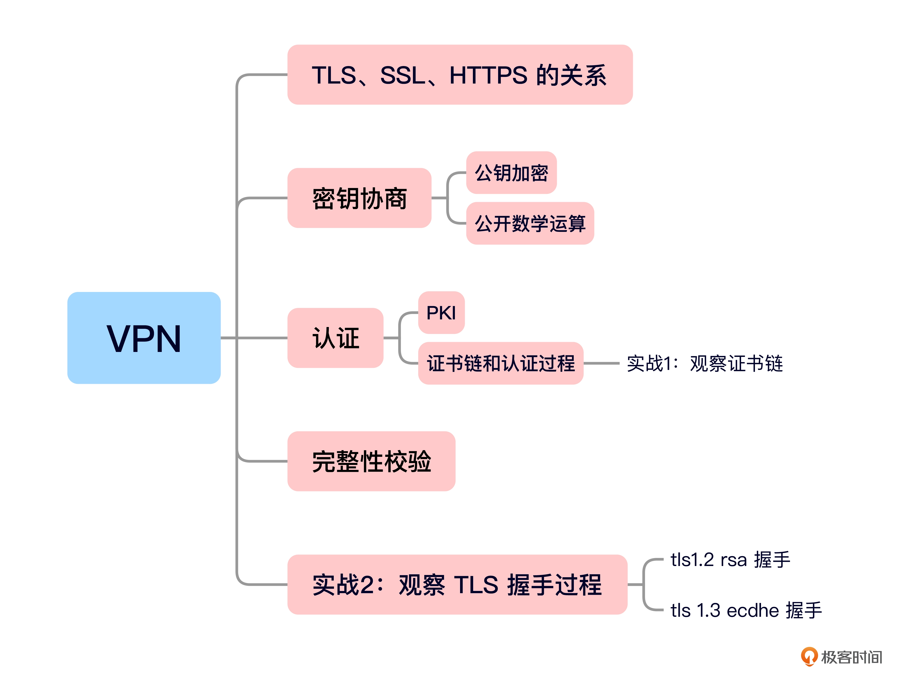

这节课我们了解了 VPN 的原理与应用场景。在公共网络中，VPN 通过创建加密隧道，将多个地理位置分散的网络节点逻辑上连接成一个安全的专用网络。这使得跨网络的操作如同在同一局域网内一样便捷。

然后，我们对比 TLS 和 VPN 工作等网络层，分析了其具备更高的通用性的原因。

之后，我们对比了两种典型的 VPN 协议：IPsec 和 WireGuard。IPsec 以广泛的设备兼容性见长，但复杂度较高。而 WireGuard 则以简单高效著称，适合现代化需求。再之后，我们学习了 VPN 打通子网场景的组网，还了解了一些关键概念。

最后，我们将在实践中学习了如何配置 WireGuard VPN 隧道，实现跨子网的互联互通，建议你课后也动手试试看。

## 思考题

1. 通过这节课的学习，你明白 VPN 的隧道究竟是什么了吗？

2. 使用 VPN 的隧道模式从理论上自己的 IP 地址会被包含在隧道里面了，那从管控者的角度出发，还有什么办法知道你的原始 IP 地址吗？

欢迎你在留言区和我交流互动，如果这节课对你有启发，也推荐你分享给身边更多朋友。
