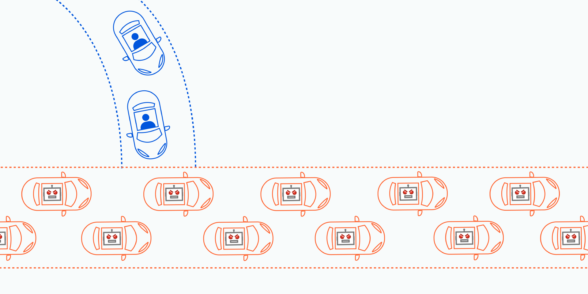
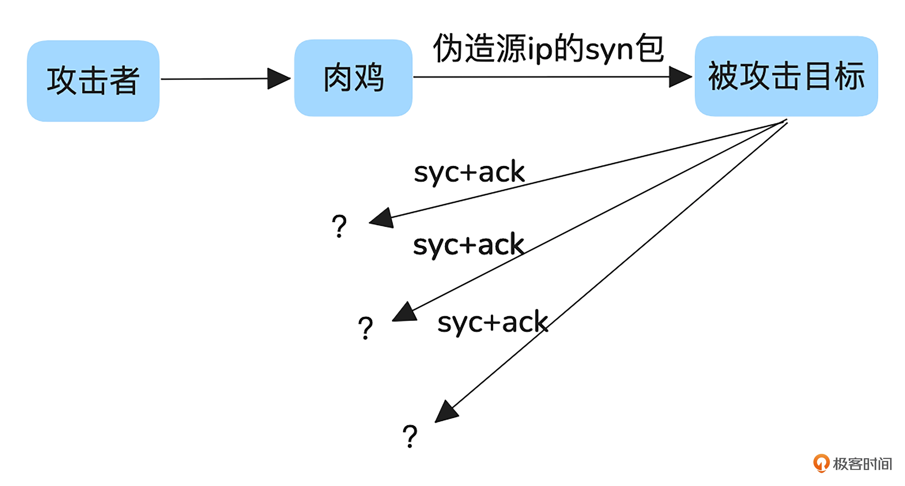
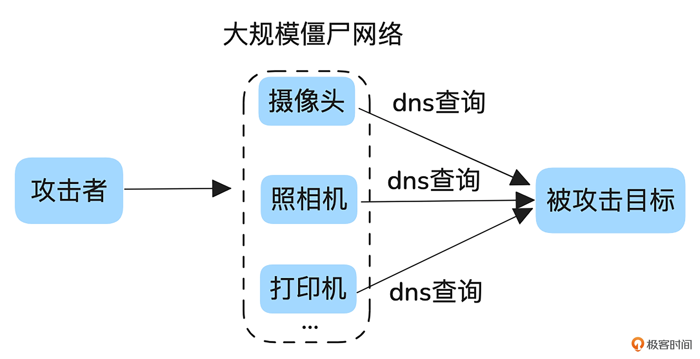
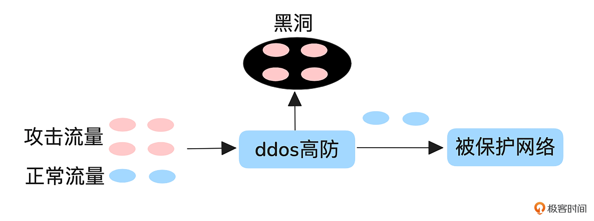
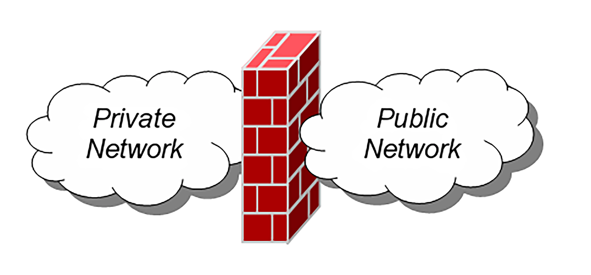
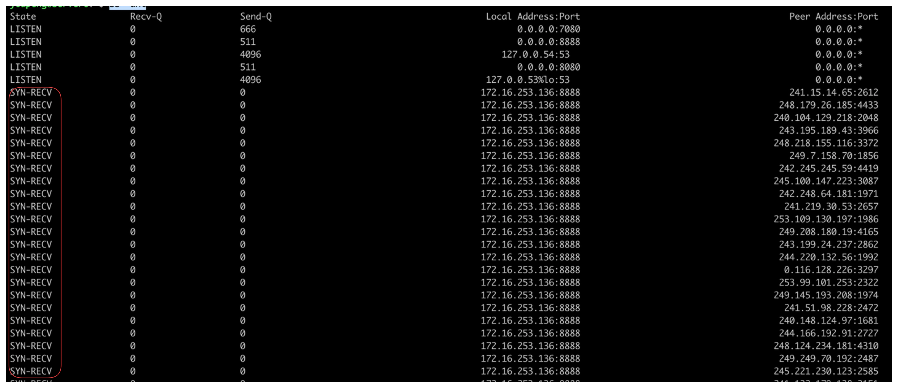
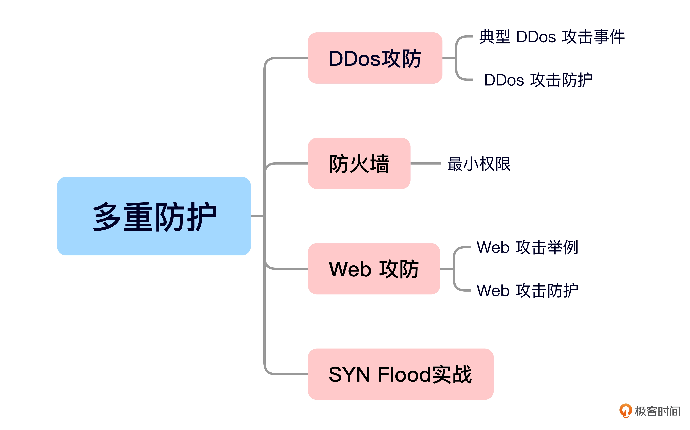

# 19 | 多重武装：怎样建设安全的网络架构？

你好，我是谢友鹏。

前两节课，我们通过学习 TLS 和 VPN 技术，掌握了如何在公网安全传输数据。然而，对于一个企业而言，仅仅保障数据传输安全远远不够。企业的网络安全体系需要多个安全产品和策略协同工作，从而构建一套全面的防御体系。

常见的网络安全防护措施包括：DDOS（分布式拒绝服务）攻击防护、边界安全防护、Web应用层防护，身份与访问管理、移动端安全、云计算安全等。

今天这节课，我们将重点从 DDOS 防护、边界安全和 Web 应用安全三个方面，分析常见威胁及相应的防护策略。

## DDoS 防护

首先，我们先学习 DDoS 防护。

### 什么是 DDoS 攻击？

知己知彼方能百战百胜，我们首先要知道 DDoS 攻击是什么？DDoS 攻击是指，通过大规模互联网流量淹没目标服务器或其周边基础设施，以破坏目标服务器、服务或网络的恶意行为。

这里我引用一个形象比喻的图。



图片来自：what-is-a-ddos-attack

如上图所示，DDoS 攻击好比攻击者恶意对被攻击公司门口造成交通堵塞，妨碍常规车辆抵达预定目的地。

可见 DDoS 攻防比拼的是资源。攻击者通常会提前控制大量的互联网设备（俗称肉鸡），然后在某一个时间，集中对目标进行攻击。从而消耗目标服务的带宽、CPU、内存等重要资源，影响其为正常用户提供服务。

### 典型 DDOS 攻击事件

我们通过两个典型的 DDOS 攻击加深一下对其认知。

### SYN Flood 攻击

1996 年，《Phrack》期刊首次公开了 SYN Flood 攻击的原理，这一研究引起了人们对 DDoS攻击潜在威胁的广泛关注。SYN Flood 攻击利用了 TCP 三次握手中的一个关键环节——服务端需要为每个连接分配资源来暂存连接信息。然而，攻击者通过发送大量伪造的源 IP 地址的SYN 报文，占用这些宝贵的资源，使服务器无法处理正常用户的连接请求。

为了便于理解，我们来看一张 SYN Flood 攻击过程的示意图：



如上图所示，攻击者通过一批被控制的肉鸡（僵尸网络），向目标服务器发送大量伪造源 IP 地址的 TCP SYN 报文。当服务器收到这些 SYN 报文时，会在半连接队列中记录这些连接信息，并尝试通过发送 SYN-ACK 报文来完成握手。

如果伪造的源 IP 地址对应一个真实可达的设备，对方会因四元组不匹配（源端口或其他参数不同）返回一个 RESET 报文，服务器收到后会释放该连接资源。但如果伪造的源 IP 地址对应的设备是不可达的，服务器将无法确定连接状态（可能是丢包或其他异常）。在这种情况下，服务器会等待超时重传几次后，才释放被占用的资源。攻击导致服务器的半连接队列被恶意流量填满，无法处理正常用户的连接请求。

那我们有什么应对策略呢？启用 SYN cookie 可以缓解 SYN Flood 攻击。

SYN cookie 的原理是这样的，当服务器收到 SYN 请求时，它并不会立即在内存中分配资源，而是通过生成一个加密的“cookie”并发送给客户端。只有当客户端返回正确的 cookie 并完成握手时，服务器才会真正为该连接分配资源。这样即使攻击者发送大量伪造的 SYN 请求，服务器也不会因占用资源而导致拒绝正常用户的连接请求，有效避免了 SYN Flood 攻击带来的资源耗尽问题。

不过，这里的“不分配资源”指的是不占用半连接队列的资源，但它还是会消耗资源的。只要有请求，仍然会消耗带宽、CPU、内存等。如果攻击流量足够大，单靠服务器开启 SYN Cookie仍然无法有效抵御攻击。

### 大规模设备攻击

我们来看另一个 DDoS 攻击的经典案例。2016 年，Dyn 公司遭遇了一次大规模的 DDoS 攻击，攻击源头是大量物联网设备（如智能摄像头、照相机等）被黑客通过恶意软件控制后，成为了“僵尸网络”发动攻击。



如图所示，攻击使用恶意软件，将大量物联网设备变成了攻击的工具。这些设备通过发送海量的 UDP 流量，将 Dyn 的 DNS 服务淹没，导致其无法正常提供服务。这次攻击揭示了物联网设备在安全上的严重漏洞，许多设备由于使用默认密码或弱密码，容易被攻击者控制并参与攻击。

与 SYN Flood 攻击不同，这类攻击从单个请求上看和正常请求没什么差别。这类攻击需要借助专业的 DDoS 高防产品从大规模的数据中找出攻击特征。

### DDOS 攻击防护

首先，DDoS 高防产品通过配备大量资源（如带宽和计算能力）来应对攻击流量，确保系统在面对大规模攻击时依然能正常运行。

其次，如下图所示，DDoS 高防产品会分析流量的特征（例如来源 IP、请求频率、请求模式、设备指纹、流量分布等），从而区分正常流量与恶意流量。恶意流量一旦被识别，高防系统将通过黑洞路由等手段将其隔离，确保正常用户的访问不受任何影响。



不过，用堵车的比喻来说，DDoS 攻击者并不总是直接堵住目标大门，而是可能堵住了离目标几千米远的某个路口。即攻击并非仅针对目标服务器本身，而是可能影响到整个网络路径。

为了更好地防护这种攻击，现在许多高防产品会与运营商合作，通过近源清洗来解决这个问题。通过在网络的上游（如运营商层级）对流量进行清洗，恶意流量在到达目标服务器之前就被过滤掉，这样可以减少攻击对整个网络的负载，从源头减少攻击的冲击。

除了依赖 DDoS 高防产品外，在协议设计和方案实施时，我们还应尽量确保在无法验证对方身份之前，请求与响应的“资源对等”。这样可以有效避免攻击者利用系统漏洞，通过放大攻击以少量资源换取大量攻击流量，从而实现“四两拨千斤”的效果，导致防守方在资源对抗中处于不利地位。你可以通过阅读 “NTP 放大 DDoS 攻击” 和 “Memcached DDoS 攻击”的相关原理和案例来加深理解。

## 防火墙

相信通过前面的讲解，你已经意识到 DDoS 防护并不能完全区分攻击流量和正常流量。因此，在流量正式进入内网之前，我们有必要增加一层防火墙，来进一步提升边界安全。



图片来自：wikipedia

如上图所示，这层防火墙有效地将互联网流量与内网隔离。建立这样的“墙”时，我们需要遵循“最小化”原则，例如最小权限、最小网段、最少开放端口等。这就像小区只开放一个主要入口，并通过门禁卡或访客登记严格控制通行，避免无关人员通过其他通道进入，从而减少潜在的攻击点。

除了主动隔离不符合访问规则的流量外，我们还可以通过黑名单机制来拦截已知的威胁来源，从而进一步强化安全防护。

## Web 应用安全

DDoS 防护和防火墙在确保网络“边界安全”方面起到了重要作用，能够有效抵御大规模流量攻击和恶意访问。然而，这些防护措施并不能完全防止 Web 应用层的攻击，尤其是针对应用本身的精细化攻击。

### Web 攻击举例

首先，我们看两个 web 攻击的例子，来认识 Web 攻击。

我们先来看一下 SQL 注入攻击的例子。假设有一个网站的登录页面，用户需要输入用户名和密码，后台程序根据输入的用户名和密码生成 SQL 查询来验证用户的身份。

当用户输入合法的用户名和密码时，后台程序会生成类似这样的 SQL 查询：

```sql
SELECT * FROM users WHERE username = 'john' AND password = 'password123';
```

这条查询会从数据库中查找用户名为 john 且密码为 password123 的用户。如果找到了匹配的记录，用户就被认为是合法用户，登录成功。

假设攻击者在登录表单的用户名输入框中输入了如下内容：

```
' OR 1=1 --
```

那么整个 SQL 查询变成了：

```sql
SELECT * FROM users WHERE username = '' OR 1=1 --' AND password = 'password123';
```

现在我们来逐步解析这个注入的过程。

首先，攻击者输入了一个单引号。因为查询中的用户名是用单引号包围的，所以输入的单引号将结束用户名字段的值，使得 SQL 查询的后续部分成为无效或错误的部分。

接下来，攻击者添加了一个 OR 1=1 语句。1=1 是一个永远成立的条件，也就是说，不管数据库中是否存在该用户名和密码，这个条件总是成立的。因此，这部分查询就变成了始终为真的逻辑，实际上绕过了原来的用户名和密码验证。

最后，攻击者添加了 --。在 SQL 中，-- 是注释符号，表示从这里开始，后续的内容将被忽略。因此，AND password = ‘password123’ 后面的部分就被完全忽略掉了。

经过注入后，SQL 查询实际上变成了：

```sql
SELECT * FROM users WHERE username = '' OR 1=1 --';
```

这个查询将返回所有用户的信息，因为 1=1 始终为真，所以查询的条件永远成立，数据库会返回所有用户的记录，而不管密码是什么。

从上面例子可以看出，SQL 注入攻击是通过将恶意 SQL 代码注入到应用程序的输入字段，改变数据库查询的逻辑，从而绕过身份验证或执行未授权的操作。所以使用参数化查询来确保用户输入的任何内容都被当作普通数据处理，而不是 SQL 代码，可以预防这个 case。比如后端代码写成这样：

```sql
cursor.execute(
   "SELECT * FROM users WHERE username = %s AND password = %s",
   (username, password)
)
```

上面例子中，%s 是占位符，数据库会确保 username 和 password 作为数据传递，而不会解释为 SQL 语句的一部分，这就避免了攻击者通过注入 SQL 代码来改变查询逻辑。

我们再看一个跨站请求伪造（CSRF - Cross-Site Request Forgery）攻击的例子。假设用户已经登录了某个网上银行系统。攻击者利用用户在该系统中的登录状态，诱使用户点击一个恶意链接，这个链接实际上会提交一个转账请求：

```xml

```

由于用户已经登录，浏览器会自动携带用户的 cookie 信息，恶意请求就会被当作用户自己的请求执行，导致用户资金被转移到攻击者的账户上。

为了防止 CSRF 攻击，开发者可以在每个敏感请求（如转账）中添加 CSRF 令牌。每次用户提交请求时，表单中都会包含一个唯一的令牌，服务器会验证该令牌是否合法。如果令牌无效或不存在，服务器就会拒绝该请求：

```xml
<form action="/transfer" method="POST">
 <input type="hidden" name="csrf_token" value="1234567890abcdef" />
 <!-- 用户输入的转账信息 -->
</form>
```

每次请求时，服务器会验证这个令牌，确保请求来自用户的合法操作，而不是恶意网站的伪造请求。此外，开发者还可以验证请求的 Referer 头，确保请求是从合法页面发出的。

### Web 攻击防护

以上两个例子只是 Web 攻击类型的冰山一角，实际上还有许多不同类型的 Web 攻击，如跨站脚本攻击（XSS）、路径遍历、文件上传漏洞等，都可能对 Web 应用造成威胁。为了更全面地防护 Web 应用层的攻击，可以将其交给 WAF（Web 应用防火墙，Web ApplicationFirewall）。WAF 能够通过特定的规则和算法，实时监控和拦截恶意请求，提升 Web 应用的安全性。

## SYN Flood 攻击实战

温馨提示：请勿攻击别人的服务，这是违法的。

理论部分我们先讲到这里，接下来我们实战一下 SYN Flood 攻防。

首先，我们先准备一个被攻击的 HTTP 服务。先安装 Nginx，然后，修改配置文件/etc/nginx/nginx.conf 的内容为 nginx.conf。

```
#启动nginx进程
$ sudo nginx
```

启动后，本机验证服务是否正常。

```
#通过curl验证http请求是否正常
$ curl http://127.0.0.1:8888 -vo /dev/null
 % Total    % Received % Xferd  Average Speed   Time    Time     Time  Current
                                Dload  Upload   Total   Spent    Left  Speed
 0     0    0     0    0     0      0      0 --:--:-- --:--:-- --:--:--     0*
* Connected to 127.0.0.1 (127.0.0.1) port 8888
> GET / HTTP/1.1
> Host: 127.0.0.1:8888
> User-Agent: curl/8.5.0
> Accept: */*
>
< HTTP/1.1 200 OK
< Server: nginx/1.24.0 (Ubuntu)
< Date: Sat, 11 Jan 2025 13:57:46 GMT
< Content-Type: text/plain
< Content-Length: 13
< Connection: keep-alive
< Content-Type: text/plain
<
{ [13 bytes data]
100    13  100    13    0     0   5356      0 --:--:-- --:--:-- --:--:--  6500
* Connection #0 to host 127.0.0.1 left intact
```

然后，我们将这台机器的 SYN Cookie 关掉。

```
#关闭tcp_syncookies
$ sudo sysctl -w net.ipv4.tcp_syncookies=0
#查看当前tcp_syncookies是否开启
$ sysctl net.ipv4.tcp_syncookies
net.ipv4.tcp_syncookies = 0
```

接下来我们在另一个机器攻击刚刚的服务器。

```
#安装hping3
$sudo apt-get install hping3
#进行syn flood攻击，其中-S 表示发送tcp SYN报文、--rand-source表示随机使用源ip
# -i u5 表示每5微秒发送一个包(这个值决定了攻击的强度)。-p 表示端口。
$ sudo hping3 -S --rand-source -i u5 -p 8888 172.16.253.136
```

此时，能在被攻击上查看到大量处于半连接状态的 TCP 连接，你可以用下面这个命令查看：

```
ss -ant
```



如上图所示，可以发现有很多不同的 IP 和该机器的 8080 端口尝试建立 tcp 连接，并且这些连接都处于 SYN-RECV 状态。

可以用下面的命令查看 tcp 半连接队列溢出计数。

```
$ netstat -s | grep -i listen
   11417254 SYNs to LISTEN sockets dropped
$ netstat -s | grep -i listen
   11425768 SYNs to LISTEN sockets dropped
```

多执行几次，你会发现此计数一直在增长。

这个时候，你可以用下面的命令打开 SYN Cookie：

```
$ sudo sysctl -w net.ipv4.tcp_syncookies=1
```

通过上面命令打开 SYN Cookie 后，再查看 tcp 半连接队列溢出的计数，已经不再增长了。

如果你想让攻击更猛烈一点，可以指定 -- flood 参数来尽量快地发送攻击报文。

```bash
#进行syn flood攻击
sudo hping3 -S --flood --rand-source -p 8888 172.16.253.136
```

我的实验环境中，在执行这样大规模的攻击后，机器上连命令行都敲不动了。最后再提醒一下，这里只是为了让你提升自己的安全意识，不可以攻击别人的服务，这是违法的。

## 小结

今天的内容就是这些，我给你准备了一个思维导图回顾要点。



这节课，我们学习了如何通过多层次的安全防护来确保公网服务的安全性。

首先，我们学习了 DDoS 攻击攻防知识。DDoS 攻击是一种通过大量恶意流量淹没目标服务器的攻击方式，旨在消耗服务器的带宽、CPU 和内存等资源，导致正常用户无法访问服务。为了应对这种攻击，DDoS 防护产品通过配备大量资源来抵御攻击流量，并使用流量特征分析技术区分正常流量和恶意流量，确保在面对大规模攻击时仍能保证服务的稳定性。

之后我们探讨了边界流量安全。边界安全防护通过防火墙等手段，在流量进入内网之前提供一道额外的屏障，帮助隔离不符合访问规则的流量，避免攻击者通过开放端口或其他安全漏洞进入企业内部网络。边界防火墙应该本着“最小开放”的原则。

此外，Web 安全也同样值得关注。为了进一步提升 Web 应用的安全性，企业还需要部署Web 应用防火墙（WAF）。它可以实时监控和拦截恶意请求，有效防止 SQL 注入、跨站脚本等常见的 Web 攻击。

最后，我们通过 SYN Flood 攻击实验，加深了对 DDoS 攻击的认识。

总结来说，一个成熟的公网服务，至少应该武装 DDoS 高防、边界防火墙和 WAF 等多种安全产品，才能有效应对各种网络威胁，保障数据安全和服务可用性。

## 思考题

1. 为什么 SYN Cookie 三次握手之后再分配资源，要比未使用 SYN Cookie 的两次握手就开始分配资源能防止攻击？

2. 你还知道哪些攻击和防护？

欢迎你在留言区和我交流互动，如果这节课对你有启发，也推荐你分享给身边更多朋友。
