# 20 | 兼容：网络协议怎样在存量中迭代？

你好，我是谢友鹏。

网络是一个庞大且复杂的分布式系统，遍布全球的设备和服务依赖网络协议进行通信。

随着技术的发展，网络协议也在不断迭代更新，但现实的挑战在于，无法让所有网络设备一下子同时升级到新的协议。所以如何在保持现有网络基础设施的同时，实现协议的平滑过渡和演进，成为了我们必须面对的重要课题。今天的课程，我们将深入探讨网络协议兼容这一话题。

## 协议兼容

为了实现协议的演进，协议设计时需要考虑未来的扩展需求。

常见的协议扩展设计方式之一是预留“保留位”。许多协议在设计时都会留出“保留位”，以便未来进行扩展。保留位的主要目的是字节对齐，确保协议能够高效地进行编解码。当某些字段的功能暂时不确定时，这些位就被保留下来，未来如果需要添加新的功能或字段时，可以利用这些保留位进行微小的扩展。

比如后面图中圈出的就是 tcp header 的保留位。

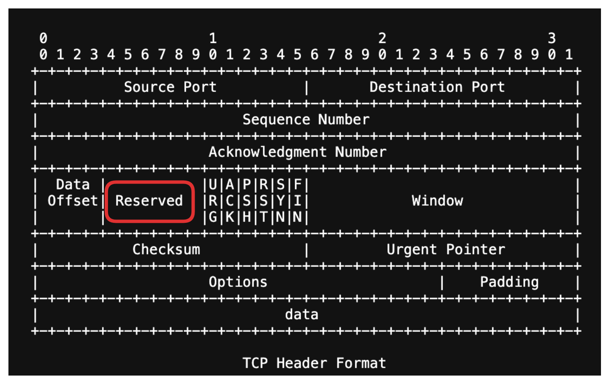

如果说“保留位”是为了兼顾性能并顺便为扩展做准备，那么设计可选字段则是故意为扩展留出空间的设计。例如，TCP 协议中的 Options 字段，为协议的扩展提供了很大的灵活性。

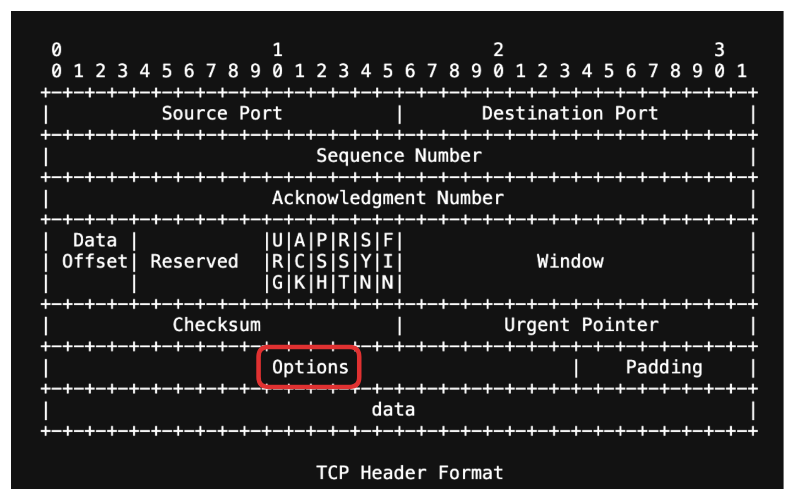

用 Wireshark 打开一个 TCP 报文可以看到，tcp options 里面包括很多个 option。

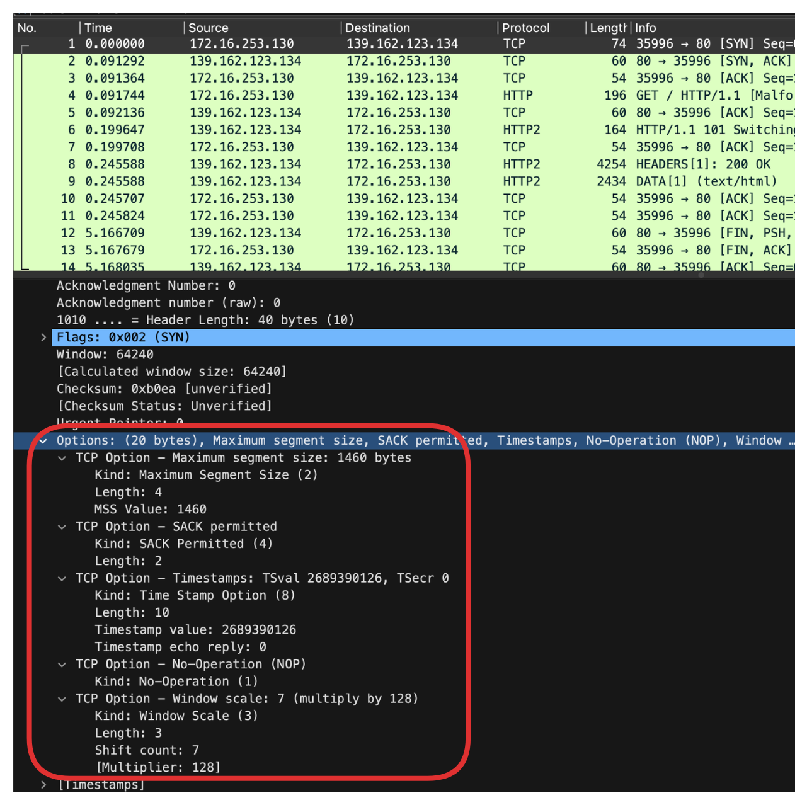

如图所示，每个 TCP Options 选项包括 kind、length 和 value 三个部分。由于 TCP 是底层协议，性能要求非常严格，因此如果某些 kind 选项不需要 value，就可以省略 length 和 value字段，以节省带宽和减少开销。这需要在协议中标明哪些 kind 可以省略 length 和 value，以确保协议的正确解析。

在应用层协议设计中，我们通常不需要如此严格地计算每一位的开销，因此可以采用更通用的TLV（Type-Length-Value）格式。TLV 格式与 TCP 的 Options 类似，都是由三部分组成——Type 表示字段类型，Length 表示字段值的长度，Value 是实际的数据。

与 TCP 的 Options 不同，在应用层协议中，Length 字段是必选的，即使没有 Value，Length也需要设置为 0。这样，TLV 格式能够提供更多灵活性和扩展性。

如果想进一步简化协议设计，使用 protobuf 可以直接通过编解码函数自动生成。像 gRPC就采用了这种方式，减少了手动编码和解码的复杂度。

如果说前面的设计更多是为了支持小幅的扩展，那么版本号则是为了兼容未来可能的重大变更。通过版本号的设计，协议的演进可以有序进行。例如，IP 协议中的版本号设计，使得我们现在能够区分 IPv4 和 IPv6 等不同的协议版本。

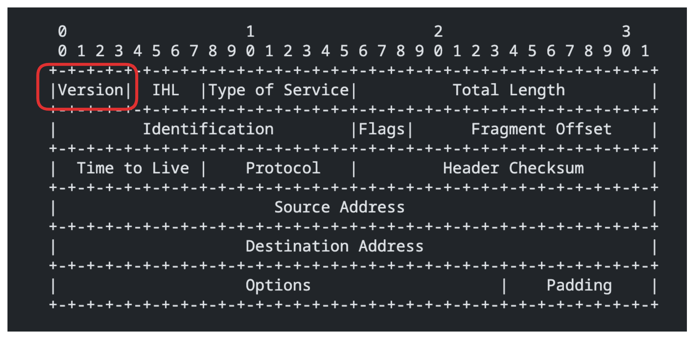

## 协商

在引入版本号后，如何确定使用哪个版本成为关键。网络中常见的做法是通过协商来确定使用的协议版本或算法。例如，SSL/TLS 的加密算法协商、HTTP 版本的协商等。接下来，我们将通过 HTTP 版本的协商来学习协议是怎样兼容升级的。

### h2 协商

首先我们先学习一下怎样协商使用 h2。

### 通过 http header 协商

第一种方式是通过 HTTP 头中的 Upgrade 协商来切换到 HTTP/2 协议。虽然这种方式能够实现 HTTP/2 协商，但它并不是主流的做法，通常用于无加密的 h2c（HTTP/2 clear text）协商。为了让你更清晰地理解这个过程，我画了一张简单的交互图。

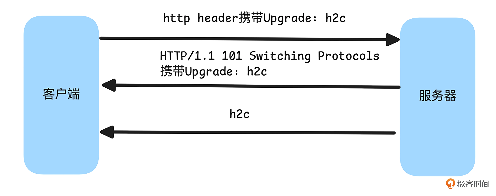

如图所示，客户端在 HTTP 请求头中添加 Upgrade: h2c 和 HTTP2-Settings，以提议升级到HTTP/2 协议。如果服务器支持 h2c，通常会发送 HTTP 101 响应头并携带 Upgrade: h2c，此时协议就切换为 HTTP/2。

我们可以通过实验来观察这一过程。首先，使用 curl 进行调试时，需要确保其版本支持HTTP/2，可以通过以下命令验证：

```
$ curl -V
```

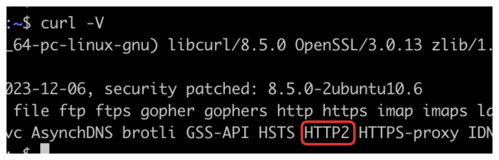

如果输出中包含 HTTP2，则表示 curl 支持 HTTP/2，可以继续执行下面的测试。否则，需要更新 curl，或者参考tools-for-debugging-testing-and-using-http-2 等资料启用 HTTP/2 支持。

在客户端发起的请求中，使用 Upgrade: h2c 和 HTTP2-Settings 头部，向服务器发起 HTTP/2协商请求。你可以参考后面的示例。

```
$ curl -v -o /dev/null --http1.1 -H "Connection: Upgrade" -H "Upgrade: h2c" -H "H
 % Total    % Received % Xferd  Average Speed   Time    Time     Time  Current
                                Dload  Upload   Total   Spent    Left  Speed
 0     0    0     0    0     0      0      0 --:--:-- --:--:-- --:--:--     0* H
* IPv6: 2400:8902::f03c:91ff:fe69:a454
* IPv4: 139.162.123.134
*   Trying 139.162.123.134:80...
* Connected to nghttp2.org (139.162.123.134) port 80
> GET / HTTP/1.1
> Host: nghttp2.org
> User-Agent: curl/8.5.0
> Accept: */*
> Connection: Upgrade
> Upgrade: h2c
> HTTP2-Settings: AAMAAEAAAAIA...
>
< HTTP/1.1 101 Switching Protocols
< Connection: Upgrade
< Upgrade: h2c
<
{ [39 bytes data]
100  6619    0  6619    0     0   1279      0 --:--:--  0:00:05 --:--:--  1324
* Connection #0 to host nghttp2.org left intact
```

从返回结果中，可以看到，客户端请求中携带了 Upgrade: h2c 和 HTTP2-Settings，这表示客户端希望将协议切换到 HTTP/2。服务器响应了一个 HTTP 101 Switching Protocols 响应头，表示同意进行协议升级。

如果你想观察更详细的内容，可以按照下面的命令，使用抓包工具捕获流量。

```bash
sudo tcpdump host nghttp2.org -w h2c.pcap
```

然后使用 Wireshark 打开 h2c.pcap 文件，在 HTTP GET 请求中，你将看到 Upgrade: h2c和 HTTP2-Settings 头部的相关信息。

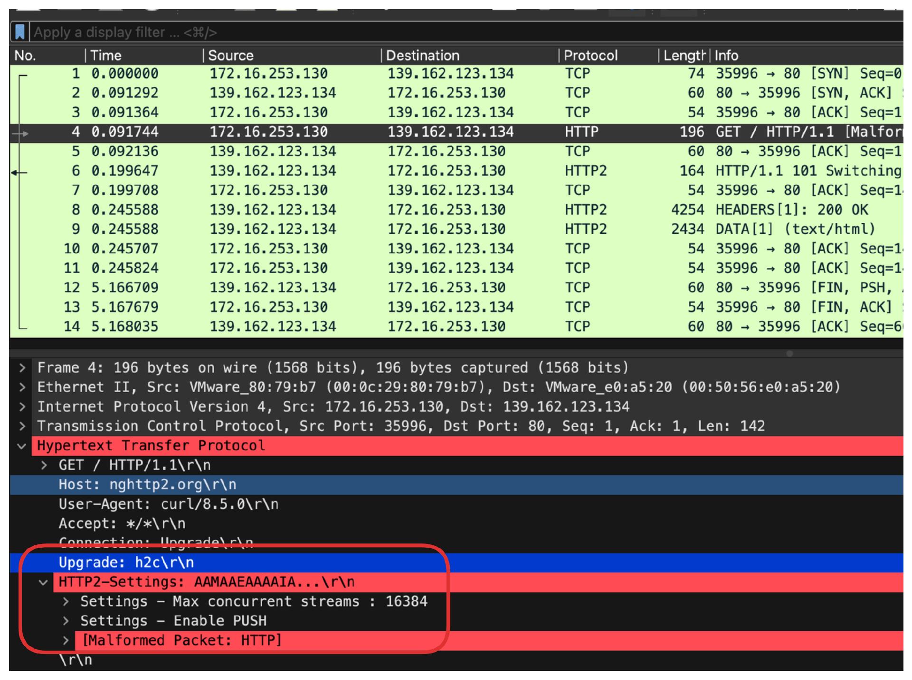

接下来，选择 HTTP 101 Header 包，可以看到切换到 h2c 的响应。

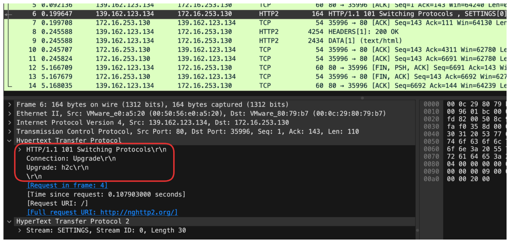

这一步之后，客户端和服务端便开始使用 h2c 来进行接下来的通信。

### 通过 TLS 握手携带 ALPN（Application-Layer Protocol Negotiation）协商

我们刚刚学习了通过 HTTP 的 Upgrade header 协商升级到 HTTP/2。然而，这种在 HTTP 协议中协商版本的方法存在一个明显的问题——客户端和服务器在通信开始时无法确定具体使用哪种协议，只能同时携带两种协议的数据，显得既复杂又不优雅。

那么，有没有办法在发起 HTTP 请求之前就确定是否使用 HTTP/2 呢？

对于 HTTPS 来说，在发起 HTTP 请求之前必须先完成 TLS 握手。因此，我们可以利用 TLS握手的过程携带 HTTP 版本的信息，从而实现协议版本的协商。正因如此，在 HTTPS 下，HTTP/2 的协商通常不会使用 Upgrade 机制，而是通过 TLS 握手中的 ALPN（Application-Layer Protocol Negotiation，应用层协议协商）来完成。

我再画个图，帮你理解这个交互过程。

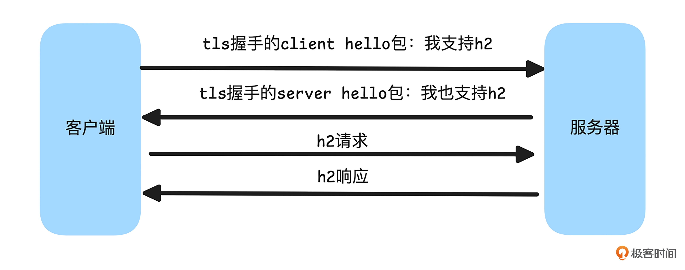

我们可以通过以下命令行发起一次指定 HTTP/2 的 HTTPS 请求，来观察 ALPN 协商的过程：

```
#使用--tls-max 1.2避免使用tls1.3。因为tls1.3的server hello的alpn已经被加密，会导致你无法在
$ curl -v -o /dev/null --http2 --tls-max 1.2 https://nghttp2.org
 % Total    % Received % Xferd  Average Speed   Time    Time     Time  Current
                                Dload  Upload   Total   Spent    Left  Speed
 0     0    0     0    0     0      0      0 --:--:-- --:--:-- --:--:--     0* H
* IPv6: 2400:8902::f03c:91ff:fe69:a454
* IPv4: 139.162.123.134
*   Trying 139.162.123.134:443...
* Connected to nghttp2.org (139.162.123.134) port 443
* ALPN: curl offers h2,http/1.1
} [5 bytes data]
* TLSv1.2 (OUT), TLS handshake, Client hello (1):
} [217 bytes data]
*  CAfile: /etc/ssl/certs/ca-certificates.crt
*  CApath: /etc/ssl/certs
{ [5 bytes data]
* TLSv1.2 (IN), TLS handshake, Server hello (2):
{ [104 bytes data]
* TLSv1.2 (IN), TLS handshake, Certificate (11):
{ [2036 bytes data]
* TLSv1.2 (IN), TLS handshake, Server key exchange (12):
{ [115 bytes data]
* TLSv1.2 (IN), TLS handshake, Server finished (14):
{ [4 bytes data]
* TLSv1.2 (OUT), TLS handshake, Client key exchange (16):
} [37 bytes data]
* TLSv1.2 (OUT), TLS change cipher, Change cipher spec (1):
} [1 bytes data]
* TLSv1.2 (OUT), TLS handshake, Finished (20):
} [16 bytes data]
* TLSv1.2 (IN), TLS handshake, Finished (20):
{ [16 bytes data]
* SSL connection using TLSv1.2 / ECDHE-ECDSA-AES128-GCM-SHA256 / X25519 / id-ecPu
* ALPN: server accepted h2
* Server certificate:
*  subject: CN=nghttp2.org
*  start date: Nov 20 00:01:47 2024 GMT
*  expire date: Feb 18 00:01:46 2025 GMT
*  subjectAltName: host "nghttp2.org" matched cert's "nghttp2.org"
*  issuer: C=US; O=Let's Encrypt; CN=E6
*  SSL certificate verify ok.
*   Certificate level 0: Public key type EC/prime256v1 (256/128 Bits/secBits), si
*   Certificate level 1: Public key type EC/secp384r1 (384/192 Bits/secBits), sig
*   Certificate level 2: Public key type RSA (4096/152 Bits/secBits), signed usin
{ [5 bytes data]
* using HTTP/2
* [HTTP/2] [1] OPENED stream for https://nghttp2.org/
* [HTTP/2] [1] [:method: GET]
* [HTTP/2] [1] [:scheme: https]
* [HTTP/2] [1] [:authority: nghttp2.org]
* [HTTP/2] [1] [:path: /]
* [HTTP/2] [1] [user-agent: curl/8.5.0]
* [HTTP/2] [1] [accept: */*]
} [5 bytes data]
> GET / HTTP/2
> Host: nghttp2.org
> User-Agent: curl/8.5.0
> Accept: */*
>
{ [5 bytes data]
 0     0    0     0    0     0      0      0 --:--:-- --:--:-- --:--:--     0< H
< date: Mon, 16 Dec 2024 16:07:38 GMT
< content-type: text/html
< last-modified: Mon, 21 Oct 2024 11:52:15 GMT
< etag: "6716406f-18b4"
< accept-ranges: bytes
< content-length: 6324
< x-backend-header-rtt: 0.001166
< strict-transport-security: max-age=31536000
< server: nghttpx
< alt-svc: h3=":443"; ma=3600, h3-29=":443"; ma=3600
< via: 2 nghttpx
< x-frame-options: SAMEORIGIN
< x-xss-protection: 1; mode=block
< x-content-type-options: nosniff
<
{ [6324 bytes data]
100  6324  100  6324    0     0  12879      0 --:--:-- --:--:-- --:--:-- 12879
* Connection #0 to host nghttp2.org left intact
```

从 ALPN: curl offers h2,http/1.1 中可以看出，客户端通知服务端自己支持 h2 和 http1.1。从ALPN: server accepted h2 可以看出服务端选择使用 h2 来通信，然后之后的数据传输就用 h2来进行了。

如果你想观察一下这些数据携带的细节，可以按照下面的操作抓个包观察一下。

```bash
sudo tcpdump host nghttp2.org -w h2.pcap
```

然后，打开抓包文件h2.pcap，可以看到，客户端和服务端的 ALPN 拓展分别在下图所示的TLS 握手的 client hello 和 server hello 报文中。

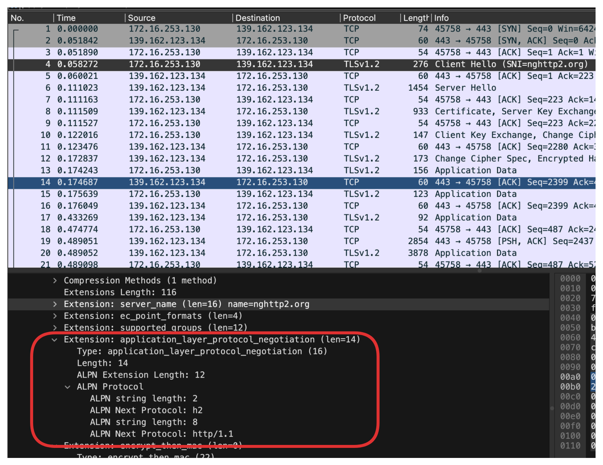

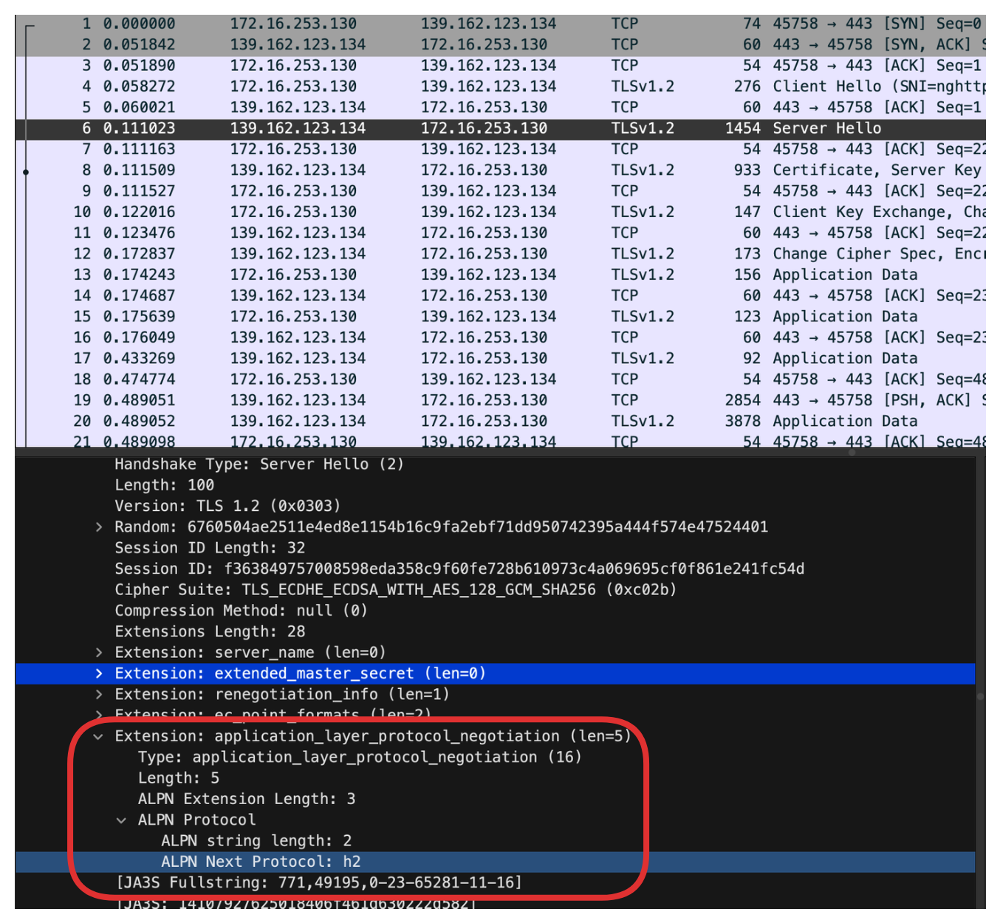

### h3 协商

学习完 HTTP/2 的协商升级方式后，我们接下来将讨论如何将协议从 HTTP/1 或 HTTP/2 升级到 HTTP/3。需要注意的是， HTTP/3 与 HTTP/1 和 HTTP/2 在传输层上有显著的差异。

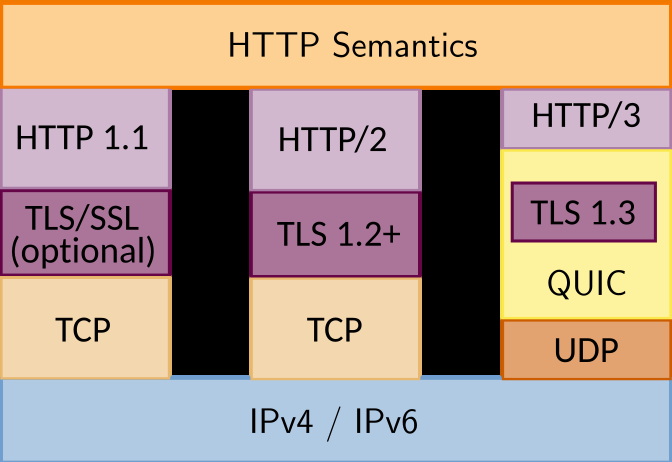

(图片来自：wiki/HTTP/3)

如图所示，HTTP/1 和 HTTP/2 使用 TCP 协议，而 HTTP/3 使用的是 QUIC 协议，基于 UDP实现。由于这两者在传输层的差异，客户端在不知道服务器是否支持 HTTP/3 时，必须首先使用 HTTP/1 或 HTTP/2 进行通信，也就是需要先进行 TCP 三次握手。如果客户端在 TLS 握手过程中发现服务器支持 HTTP/3，该如何处理呢？

如果直接切换到 QUIC 协议（UDP），则会浪费 TCP 的三次握手，增加不必要的交互。

通过 Alt-Svc 告知下次再切换协议

为了避免不必要的连接延迟，客户端第一次请求时会使用 HTTP/1 或 HTTP/2，与服务器通信。如果服务器支持 HTTP/3，它会在 HTTP 响应头中携带 Alt-Svc 头部，告知客户端自己支持哪些协议，并可以通过 ma（max age）参数，告知客户端在该有效期的后续通信使用HTTP/3 。我画了个交互流程，方便你理解这一过程。

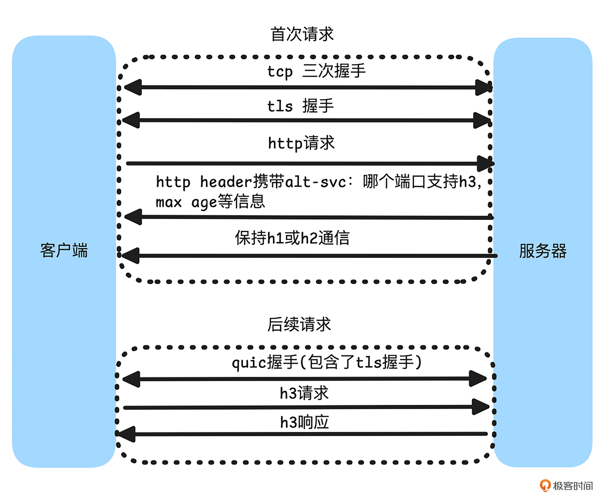

在 Chrome 浏览器中，你可以通过开发者工具（F12），在 Network 面板中查看 Alt-Svc 的具体内容。如果访问一个支持 HTTP/3 的网站（常见支持 h3 的测试网站：HTTP3-test，你也可以在 http3check.net 测试某个网站是否支持 h3），这里你会看到类似以下内容的 Alt-Svc信息。

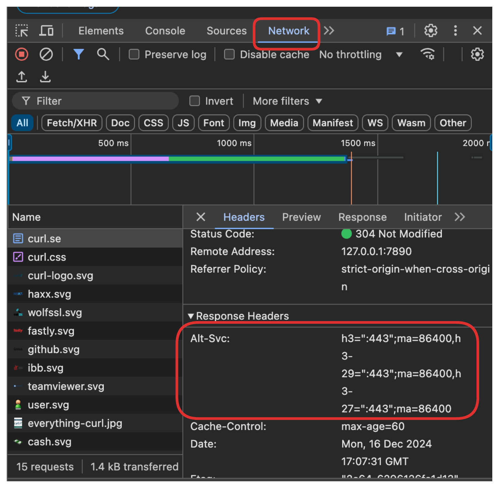

通过 Alt-Svc 头，服务端不仅告诉客户端其 443 端口支持 HTTP/3，还提供了有效期（如86400 秒）以及支持的 HTTP/3 草案版本（如 29 和 27），这对于兼容性和协议发展中的版本非常有帮助。

### 协议切换实验

我们可以做个实验验证一下，客户端首次会使用 h1 或 h2，后续请求根据 Alt-Svc 信息协议切换 h3 的过程。

首先，我们需要一个支持 http3 的 curl 工具，目前 curl.se 的 http3 官方指导文档提供了多种通过源码编译出支持 http3 curl 的方式，你可以选择一种进行编译。你也可以在已经集成好h3 curl 工具的 docker 镜像里进行实验，我下面就会用这种方法演示。

首先，安装 docker，并拉取带有 h3 功能 curl 的镜像，然后进入镜像。

```bash
#安装docker
$sudo apt install docker.io
#拉取镜像
$sudo docker pull docker.gs/ymuski/curl-http3
#查看镜像是否拉取成功
$ sudo docker images
REPOSITORY                    TAG       IMAGE ID       CREATED         SIZE
docker.gs/ymuski/curl-http3   latest    62f6283a36a7   15 months ago   689MB
#运行镜像
~$ sudo docker run -it --rm docker.gs/ymuski/curl-http3 /bin/bash
```

然后，按照下面的命令行，在镜像中多次指定 –alt-svc 参数的方式访问支持 HTTP/3 协议的服务器。

```bash
curl --alt-svc altsvc.cache https://curl.se/ -vo /dev/null
```

这时你会观察到，如下图所示的结果：

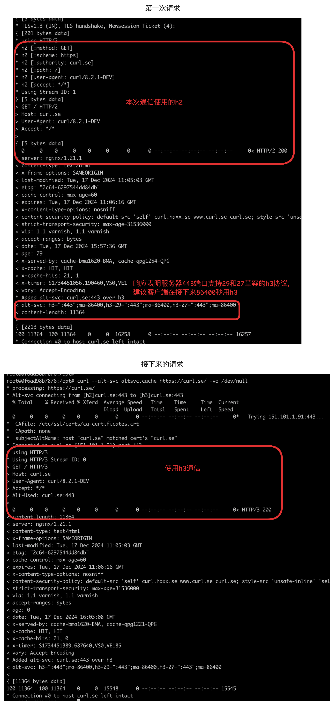

```
结合图片可以看出，第一次请求时，没有使用 HTTP/3，而是在服务器响应中会包含 Alt-
Svc 信息，后续的请求会使用 HTTP/3。你可以通过响应头中返回的协议版本（如 HTTP/2
```

200 或 HTTP/3 200）来判断当前使用的协议版本。

如果你想测试 h3 的其他情况，可以使用下面的命令。

```bash
#优先使用h3通信，如果失败会回退h1或h2。
curl --http3 https://curl.se/ -vo /dev/null
#只会使用h3通信。
curl --http3-only altsvc.cache https://curl.se/ -vo /dev/null
```

### 域名解析的时候，服务器顺便告诉自己支持协议

使用 Alt-Svc 进行协议协商存在一定的“先有鸡还是先有蛋”的问题。客户端必须先与服务器建立连接，才能通过 HTTP 头部协商协议，这就要求客户端首先发起 TCP 三次握手。这种协商方式并不优雅，因为在传输层已经分叉（HTTP/1、HTTP/2 和 HTTP/3 使用不同的协议），如何在传输层之前就知道是否支持 HTTP/3 呢？

一种解决方案是，类似于 IPv4 和 IPv6 的兼容方式，客户端可以在 DNS 解析过程中获取服务端是否支持 HTTP/3 的信息。基于这样的思路，2023 年 11 月推出了 DNS 的新纪录类型——SVCB and HTTPS Resource Records，你可以通过 rfc9460 来查看详细情况。我画了个交互图，方便你理解这个过程。

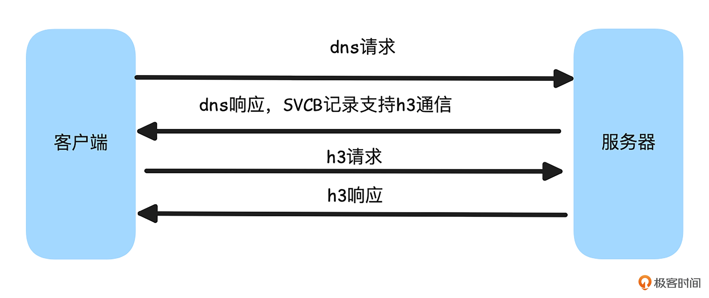

接下来，我们通过一个小实验来查看域名解析的 SVCB 记录。由于这个协议推出的时间较新，要想看到这个结果，需要同时满足以下条件：

1. 需要较高版本的、支持该特性的工具。

2. 使用已经支持此协议的域名。

3. local dns 需要支持该特性，如果你的 local dns 不支持，可以指定 8.8.8.8 google 的公共dns 来解析。

满足以上条件的前提下，执行以下命令，可以观察到这个 SVCB 中的 h3 信息。

```
$ dig 8.8.8.8 google.com  HTTPS
; <<>> DiG 9.18.28-0ubuntu0.24.04.1-Ubuntu <<>> 8.8.8.8 google.com HTTPS
;; global options: +cmd
;; Got answer:
;; ->>HEADER<<- opcode: QUERY, status: NXDOMAIN, id: 51169
;; flags: qr rd ra; QUERY: 1, ANSWER: 0, AUTHORITY: 0, ADDITIONAL: 1
;; OPT PSEUDOSECTION:
; EDNS: version: 0, flags:; udp: 65494
;; QUESTION SECTION:
;8.8.8.8.      IN  A
;; Query time: 40 msec
;; SERVER: 127.0.0.53#53(127.0.0.53) (UDP)
;; WHEN: Mon Dec 16 13:11:11 UTC 2024
;; MSG SIZE  rcvd: 36
;; Got answer:
;; ->>HEADER<<- opcode: QUERY, status: NOERROR, id: 58705
;; flags: qr rd ra; QUERY: 1, ANSWER: 1, AUTHORITY: 0, ADDITIONAL: 1
;; OPT PSEUDOSECTION:
; EDNS: version: 0, flags:; udp: 65494
;; QUESTION SECTION:
;google.com.      IN  HTTPS
;; ANSWER SECTION:
google.com.    5  IN  HTTPS  1 . alpn="h2,h3"
;; Query time: 5 msec
;; SERVER: 127.0.0.53#53(127.0.0.53) (UDP)
;; WHEN: Mon Dec 16 13:11:11 UTC 2024
;; MSG SIZE
rcvd: 64
```

从结果“alpn=h2，h3”可以看出，google.com 支持 HTTP/2 和 HTTP/3。当客户端通过 DNS解析得知服务器支持 HTTP/3 后，它就可以在建立连接前决定是否使用 HTTP/3，这样就避免了协议协商的延迟。

## 小结

今天的内容就是这些，我给你准备了一个思维导图回顾要点。

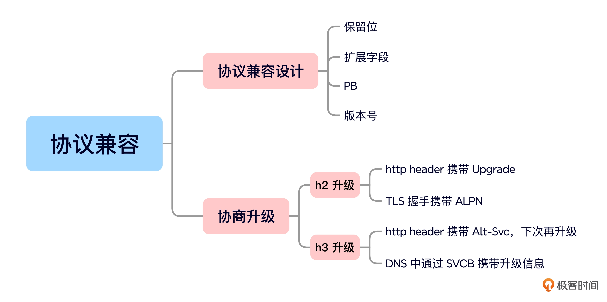

今天我们学习了如何在保持现有网络基础设施的同时，实现协议的平滑过渡和演进。

首先，我们从协议的兼容设计入手，了解了如何通过保留位、扩展字段、协议缓冲（PB）等方式进行扩展设计，确保向后兼容。同时，我们讨论了如何预留版本号，以便未来可以支持更大范围的变动和演进。

接下来，我们通过 HTTP 协议的版本升级过程，详细学习了协议协商升级的方法。例如，HTTP/2（h2）通过 HTTP 头部的 Upgrade 字段进行协商，TLS 握手过程中通过 ALPN 协议进行协商。而在 HTTP/3（h3）的升级过程中，我们则通过 HTTP 头部中的 Alt-Svc 来通知后续请求使用新的协议。此外，我们还探讨了在 DNS 解析过程中，如何通过 SVCB（ServiceBinding）记录来感知服务端支持的能力和协议版本。

在课程中，我们对每一个协商过程进行了实验，帮助你更深入地理解协议升级和协商的实际操作方式。

## 思考题

1. 从 HTTP 的协商中你得到什么启发？

2. 你设计协议的时候做过哪些权衡？

欢迎你在留言区和我交流互动，如果这节课对你有启发，也推荐你分享给身边更多朋友。
