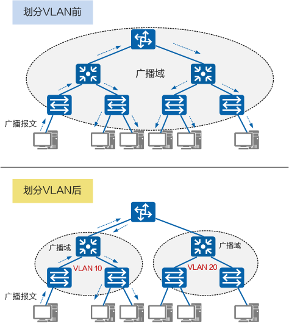
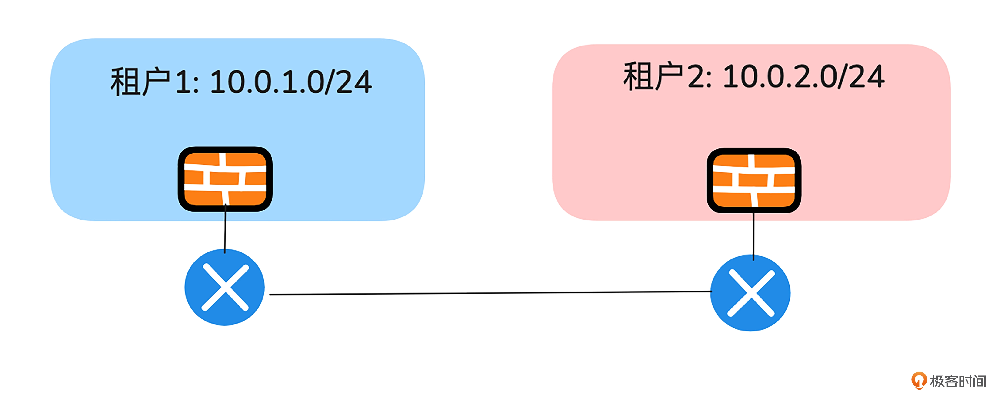
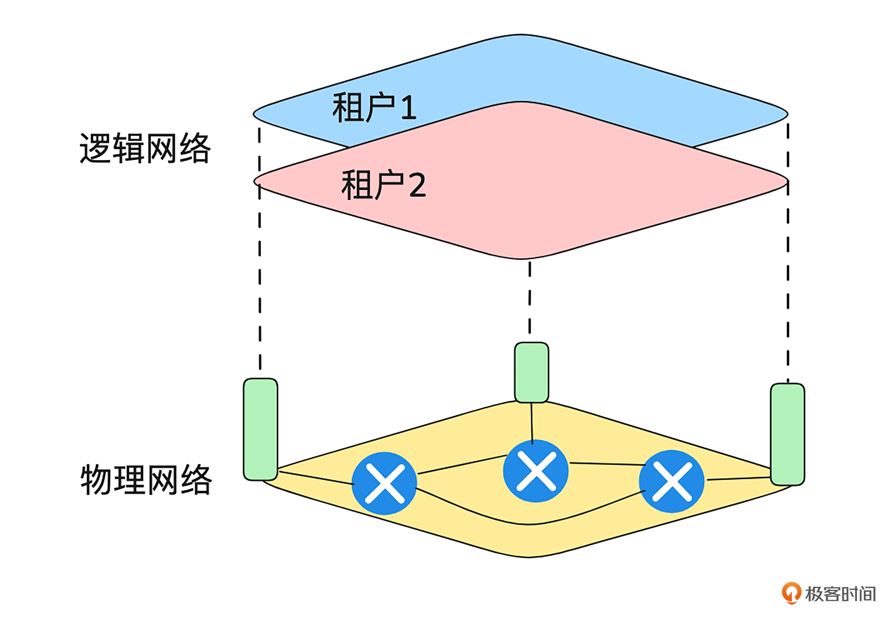
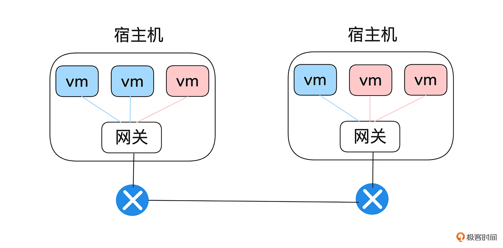
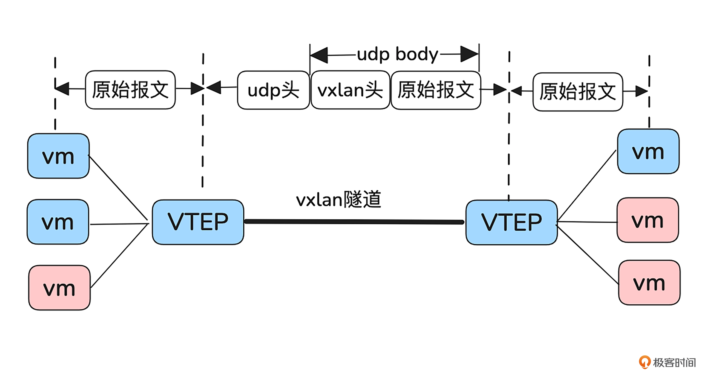
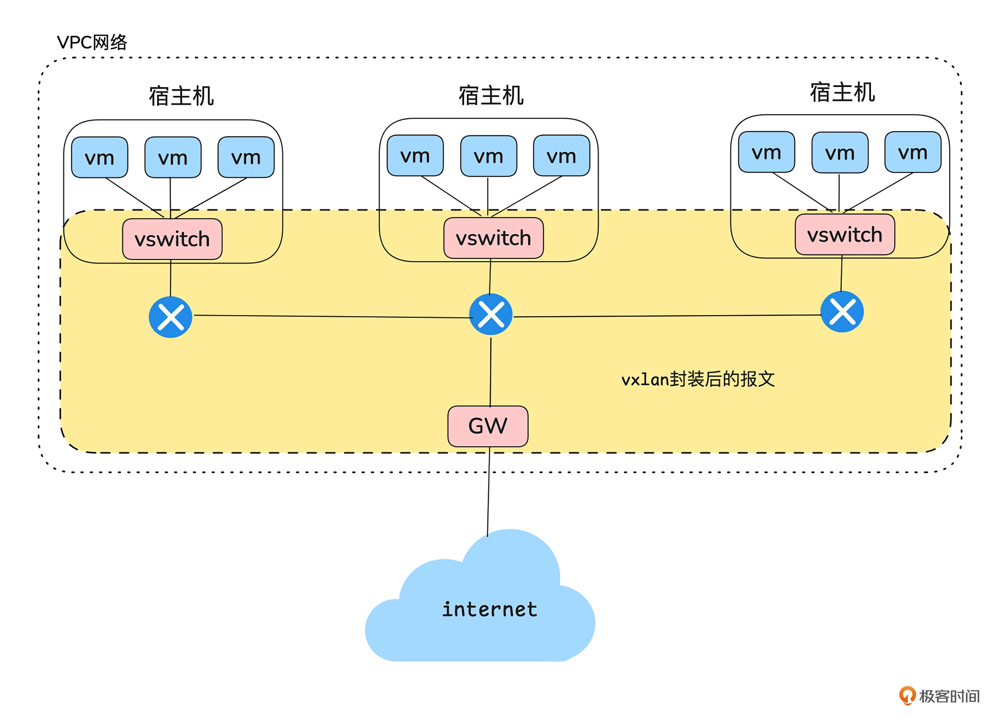
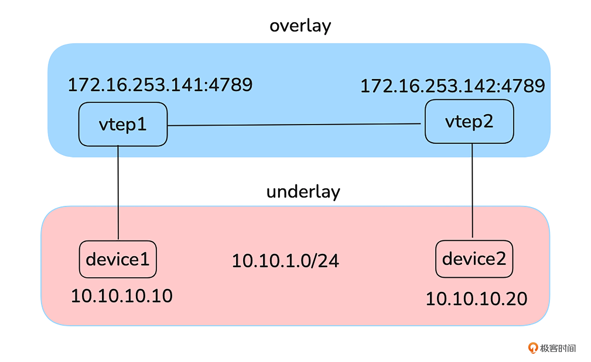
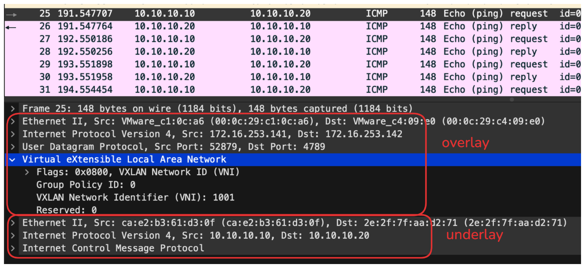
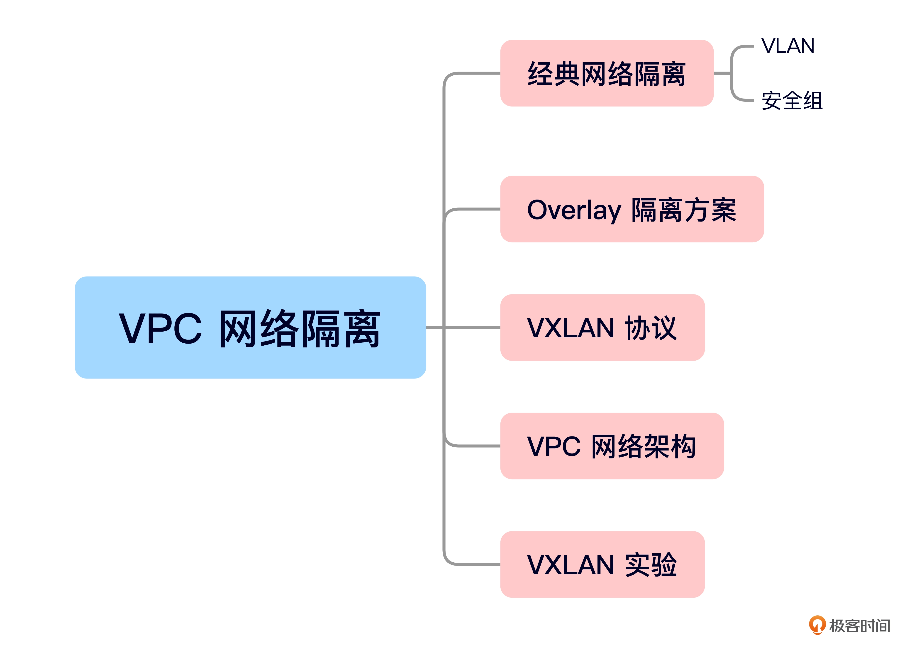

# 21 | VPC架构：云网络时代多租户怎样无感隔离

你好，我是谢友鹏。

上节课，我们学习了网络协议如何向前兼容迭代，确保向前发展时能够兼顾历史遗留的需求。

今天，我们将围绕云计算的租户网络如何隔离的话题，探索 VPC 在架构层面是怎样在原有网络设备“无感”情况下，完成这一挑战的。

## 经典网络的隔离

云计算的核心优势在于“弹性”，即按需共享基础设施。资源池化后，计算、存储和网络可以灵活分配和扩展，从而大大提升灵活性和效率。然而，随着多个租户共享同一基础设施，如何保证租户间的网络隔离成为了一个关键挑战。

在经典网络中，通常使用 VLAN 来实现二层隔离，并通过安全组来隔离三层及以上的网络。我们先来复习一下这两个基本概念。

### VLAN 隔离

网络采用分层设计，每个数据包会经过多层转发，最终到达目标设备。为了在局域网内找到目标设备，必须发送 ARP 请求，这个请求会广播到局域网内的所有设备，直到目标设备回应。这样，广播的范围就是广播域。如果广播域过大，每次 ARP 请求就会占用大量带宽，造成资源浪费，甚至引发性能问题或网络瘫痪。

为了解决这个问题，VLAN（虚拟局域网）技术应运而生。VLAN 可以将一个物理局域网划分为多个逻辑广播域，从而避免了广域的广播风暴，且确保不同 VLAN 之间的完全隔离。

我引用一张 VLAN 隔离广播域的前后对比图，这样你能更直观地理解这个概念。



图片来自：VLAN

从上图可以看出，将一个物理局域网划分为 VLAN 10 和 VLAN 20，两个 VLAN 内的设备只能在各自的广播域内进行 ARP 广播，这样就有效减少了广播带宽占用。

隔离后 VLAN10 和 VLAN20 下挂的主机，发起 arp 的请求只会在各自的广播域进行广播。这样不仅避免了大范围的广播风暴，还在二层隔离了网络。因此在 VPC 出现之前，云厂商会为每个租户分配一个 vlan tag，使其在二层隔离。

### 安全组隔离

虽然 VLAN 可以隔离二层流量，但不同 VLAN 之间依然可能通过路由器进行流量转发，实现跨 VLAN 的通信。为了解决这个问题，我们需要为不同租户划分不同的子网，并通过安全组规则来控制网络访问。

为此，需要给不同租户划分不同的子网，并通过安全组规则限制网络访问。我从租户的网络视角画一个示例图来帮助你理解。



上图展示了两个租户的网络架构，其中租户 1 和租户 2 分配到同一个机房，但处于不同的网段，并通过各自的安全组进行隔离。安全组像是一个虚拟防火墙，通过规则控制哪些 IP、端口和协议可以访问。

Linux 中可以通过 iptable 规则来实现安全组功能，所以经典网络可以对一个租户的所有虚拟机下发只允许自己网段访问的安全组规则。

### 经典网络隔离方式在云计算的挑战

在云计算环境中，传统的 VLAN 和安全组网络隔离方式虽然能够提供一定程度的隔离，但随着云计算规模的扩大，这些方式也面临着一些新的挑战。主要表现为以下几个方面。

1. 安全：一些租户可能缺乏网络安全意识，导致安全组网段配置过大或设置为“全部通过”。这种做法会带来安全风险，恶意用户可能利用这些漏洞攻击同一网络中的其他用户。

2. 虚拟机迁移：在云环境中，虚拟机通常需要迁移到不同的集群或机房。然而，在跨集群或跨机房迁移时，网络的拓扑结构和 VLAN 配置可能会不同，这使得迁移变得复杂。

3.VLAN 数量有限：VLAN 的数量有限制，通常最多支持的 VLAN ID 为 4096 个（0 到4095）。对于大规模云环境，尤其是在跨多个数据中心和可扩展的网络架构中，VLAN 的数量可能无法满足需求。

4. 租户无法自定义组网：基于 VLAN 和安全组的传统隔离方式通常是由云服务商定义和管理的，这意味着租户不能完全自定义自己的网络架构和拓扑。租户如果需要更精细或个性化的网络配置时，往往会受到这些限制，无法灵活地根据自己的需求调整网络结构。

## Overlay 网络

随着 VPC 架构的出现，这些问题得以解决。VPC 并没有延续传统的基于物理网络划分的隔离方式，而是在原有的物理网络上为每个租户抽象出一层独立的逻辑网络。



提到逻辑隔离，你可能会联想到 namespace。在软件领域，namespace 广泛用于隔离资源。例如，在 C++ 等高级编程语言中，不同 namespace 内的同名函数可以共存而不冲突。类似地，在 Linux 中，network namespace 可以为每个虚拟机提供独立的网络栈，即使它们共享同一台宿主机，也能拥有逻辑上独立的路由和网络配置。

在 VPC 架构里面，每个宿主机上运行着类似于管理 namespace 的程序，它们充当着 VM（虚拟机）的网关。每个 VM 发出的报文都会从特定分组的网络接口进入网关，从而做到逻辑隔离。我画个示例图来帮你理解。



如上图所示，每个宿主机上都会运行一个管理本机 VM 网络转发的“网关”。所有 VM 通信都先经过网关，而且网关通过不同的接口与不同租户的 VM 连接。这样网关就能控制只让相同租户的 VM 通信了。

现在还有一个问题，跨宿主机通信的时候，怎样在不影响原有报文的情况下携带租户的信息呢？

为了解决这一问题，网络中就产生了 Underlay 和 Overlay 两层网络。Underlay 网络是物理基础设施层，由交换机、路由器及连接链路等硬件设备构成，负责提供最基础的网络连接和传输，确保数据包能够在物理设备之间传递。而 Overlay 网络则是建立 Underlay 网络之上的逻辑网络，通常通过隧道技术将租户的 ID 信息包含在内，用于隔离不同租户。

## VXLAN

在 VPC 中，最常用的隧道协议是 VXLAN，其组网图如下：



如上图所示，负责 VXLAN 隧道加解封装功能的设备称为 VTEP（VXLAN Tunnel Endpoint）。不同宿主机上的虚拟机通信，通过 VTEP 通信的时候，将原始报文封装在了新的 udp payload中，并且还插入了 VXLAN 头，这样就可以在 VXLAN 头携带不同逻辑网络的 ID 了。在VXLAN 中区分不同逻辑网络的 ID 叫做 VNI（VXLAN Network Identifier）。

通过 rfc7348，我们可以看到 vxlan 协议的详细信息，其 Header 格式如下：

```
0                   1                   2                   3
   0 1 2 3 4 5 6 7 8 9 0 1 2 3 4 5 6 7 8 9 0 1 2 3 4 5 6 7 8 9 0 1
  +-+-+-+-+-+-+-+-+-+-+-+-+-+-+-+-+-+-+-+-+-+-+-+-+-+-+-+-+-+-+-+-+
  |R|R|R|R|I|R|R|R|            Reserved                           |
  +-+-+-+-+-+-+-+-+-+-+-+-+-+-+-+-+-+-+-+-+-+-+-+-+-+-+-+-+-+-+-+-+
  |                VXLAN Network Identifier (VNI) |   Reserved    |
  +-+-+-+-+-+-+-+-+-+-+-+-+-+-+-+-+-+-+-+-+-+-+-+-+-+-+-+-+-+-+-+-+
```

从 vxlan header 可以看出，其协议设计的非常简洁。rfc 中只规定了 1 比特的 flag “I”，用于表示 VXLAN 是否有效。还有 24 bit 的 VNI，用于区分不同逻辑组网。其余只留下一些Reserved 保留位用于扩展。

有了 VXLAN 协议作为扩展，我们可以看到，经典网络中的一些挑战得到了有效解决。

1. 安全：VXLAN 通过创建不同的逻辑网络，确保不同租户的网络相互隔离。这样，用户配置错误导致的不同租户网络互通的安全问题得以避免。

2. 虚拟机迁移：VXLAN 将 Underlay 网络的报文完整封装到 VTEP 的 UDP 报文中，使得原本无法互通的二层网络得以打通，尤其适用于跨机房的网络连接。这一特性对云网络中的节点迁移非常有利。

3. 扩展 VLAN 范围：传统的 VLAN 标识符（VLAN ID）只有 12 位，最多支持 4096 个 VLAN（0 到 4095）。而 VXLAN 使用了 24 位的 VNI（VXLAN Network Identifier），支持的虚拟网络数量显著增加，理论上可以支持超过 1600 万个独立的网络。

4. 租户自主网络规划：VXLAN 使每个租户都拥有独立的逻辑网络，租户可以根据需要自由规划自己的网段，而无需担心与其他租户发生冲突，增强了网络的灵活性与可扩展性。

## VPC 架构

综合刚刚学习的知识，我们可以得出基于 VXLAN 进行租户隔离的 VPC 网络架构。



上图所示，每个宿主机上都会运行一个虚拟交换机（vswitch），所有虚拟机（VM）之间的通信都会经过这个交换机。vSwitch 充当虚拟隧道终端设备（VTEP），负责 VXLAN 的加解封装。通过 VXLAN 中的 VNI（虚拟网络标识符），跨宿主机通信的 VM 可以区分不同租户的网络。

在数据包经过宿主机的 VPC 网络并出站时，vSwitch 会对报文进行封装，随后经过网关（GW）进行解封装，以确保与外部 Internet 的设备兼容。

整个过程通过在物理网络基础上引入一层 Overlay 层网络，实现了在现有的 VM、路由器、交换机等存量设备无感知的情况下，完成租户网络的隔离和流量的正确转发。

## VXLAN 实战

光学理论感觉抽象的话，我们就实战抓个包，观察一下 vxlan 报文究竟长什么样吧。

### 实战介绍

我先画一个实验的组网图。



如上图所示，我们将在两台机器配置点对点的 VXLAN 隧道，然后观察通过该隧道加封装后的VXLAN 报文。

### 开始实战

我们可以在配置前先把包抓上。

```bash
sudo tcpdump port 4789 -w vxlan.pcap
```

### 配置 VLAN

开启 ip 转发功能。

```bash
# 启用 IP 转发
sudo sysctl -w net.ipv4.ip_forward=1
```

先使用以下命令检查一下你的设备上是否支持 vxlan。

```
$ lsmod | grep vxlan
vxlan                 155648  0
```

之后在 vtep1 上执行后面的命令。

```bash
# 创建 VXLAN 接口
sudo ip link add vxlan0 type vxlan id 1001 dstport 4789 \
remote 172.16.253.142 local 172.16.253.141 dev ens33
#添加ip地址
sudo ip addr add 10.10.10.10/24 dev vxlan0
# 启动 VXLAN 接口
sudo ip link set vxlan0 up
```

在 vtep2 上执行后面的命令。

```bash
# 创建 VXLAN 接口
sudo ip link add vxlan0 type vxlan id 1001 dstport 4789 \
remote 172.16.253.141 local 172.16.253.142 dev ens33
#添加ip地址
sudo ip addr add 10.10.10.20/24 dev vxlan0
# 启动 VXLAN 接口
sudo ip link set vxlan0 up
```

现在可以验证 VXLAN 的状态了。

```
$ ip link show vxlan0
3: vxlan0: <BROADCAST,MULTICAST,UP,LOWER_UP> mtu 1450 qdisc noqueue state UNKNOWN
   link/ether ca:e2:b3:61:d3:0f brd ff:ff:ff:ff:ff:ff
可以看出 vxlan0 的 VXLAN 网络接口已经启动，支持广播和多播，且接口的 MTU 为 1450
字节，MAC 地址是 ca:e2:b3:61:d3:0f，广播地址是 ff:ff:ff:ff:ff:ff。
```

然后我们看一下路由 10.10.10.0/24 网段的路由，就会发现此时已经自动生成了该网段到VXLAN 接口的路由。

```
$ ip route get 10.10.10.0/24
Warning: /24 as prefix is invalid, only /32 (or none) is supported.
10.10.10.0 dev vxlan0 src 10.10.10.10 uid 1000
   cache
```

然后我们查看一下桥接设备的 MAC 地址表。

```
$ bridge fdb
01:00:5e:00:00:01 dev ens33 self permanent
33:33:00:00:00:01 dev ens33 self permanent
33:33:ff:c1:0c:a6 dev ens33 self permanent
01:80:c2:00:00:00 dev ens33 self permanent
01:80:c2:00:00:03 dev ens33 self permanent
01:80:c2:00:00:0e dev ens33 self permanent
00:00:00:00:00:00 dev vxlan0 dst 172.16.253.142 via ens33 self permanent
2e:2f:7f:aa:d2:71 dev vxlan0 dst 172.16.253.142 self
```

通过 00:00:00:00:00:00 dev vxlan0 dst 172.16.253.142 via ens33 self permanent 可以看出VXLAN 接口已经通过其隧道与其他网络设备建立了通信，并且正在路由到目标设备172.16.253.142。

现在我们可以进行子网的流量访问了。

```
$ ping 10.10.10.20
PING 10.10.10.20 (10.10.10.20) 56(84) bytes of data.
64 bytes from 10.10.10.20: icmp_seq=1 ttl=64 time=1.08 ms
64 bytes from 10.10.10.20: icmp_seq=2 ttl=64 time=1.09 ms
64 bytes from 10.10.10.20: icmp_seq=3 ttl=64 time=1.18 ms
64 bytes from 10.10.10.20: icmp_seq=4 ttl=64 time=1.45 ms
```

之后我们用 Wireshark 打开 tcpdump 抓包文件，就能看到 Underlay 和 Overlay 的详细封装情况了，结果类似后面的截图。



## 小结

今天的内容就是这些，我给你准备了一个思维导图回顾要点。



今天我们学习了 VPC 网络隔离方面的核心知识。

首先，我们回顾了经典网络中的隔离方法。经典网络使用 VLAN 实现二层网络隔离，安全组用于三层网络隔离。但这种隔离方式在云计算环境中面临着诸多挑战，比如用户误配置带来的安全隐患、虚拟机迁移的困难、VLAN 数量的限制以及用户无法自主规划网络等问题。

为了应对这样的挑战，VPC 架构应运而生。VPC 中常采用 VXLAN 协议进行 Overlay 封装，于是我们沿着这条线索，学习了 Overlay 网络、VXLAN 协议及其组网架构。

随后，我们将所学的知识结合起来，绘制了基于 VXLAN 协议的 VPC 网络架构。在这个架构中，我们仅引入了具备 VTEP 功能的交换机和网关，而没有改变现有的网络设备处理方式，就实现了“无感”隔离。

最后，我们通过一个实验，构建了 VXLAN 隧道并进行了抓包，进一步加深了对 VXLAN 协议的理解。

## 思考题

1. 课程中我们多次学习了隧道知识，现在你能用自己的话总结一下什么是隧道吗？除了VPN、VXLAN 隧道，你还知道哪些网络隧道？

2. 实验中我们指定了 VTEP 的对端 ip 和端口，这样只有两个 VTEP 建立起隧道，但是云网络中有那么多宿主机，需要为每个宿主机两两配置 VXLAN 隧道吗？

欢迎你在留言区和我交流互动，如果这节课对你有启发，也推荐你分享给身边更多朋友。
