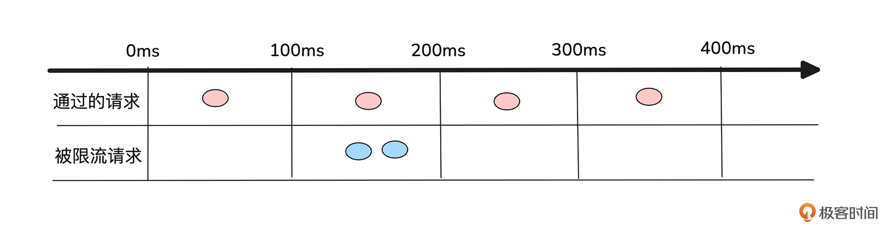
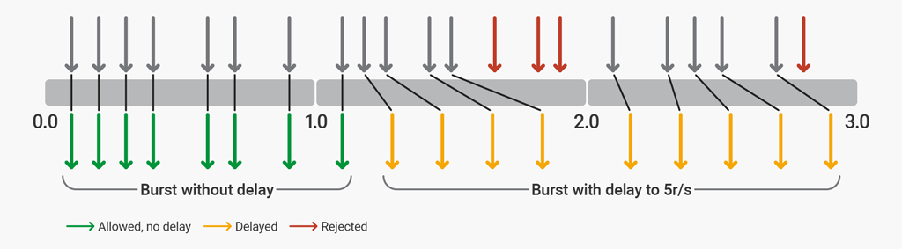
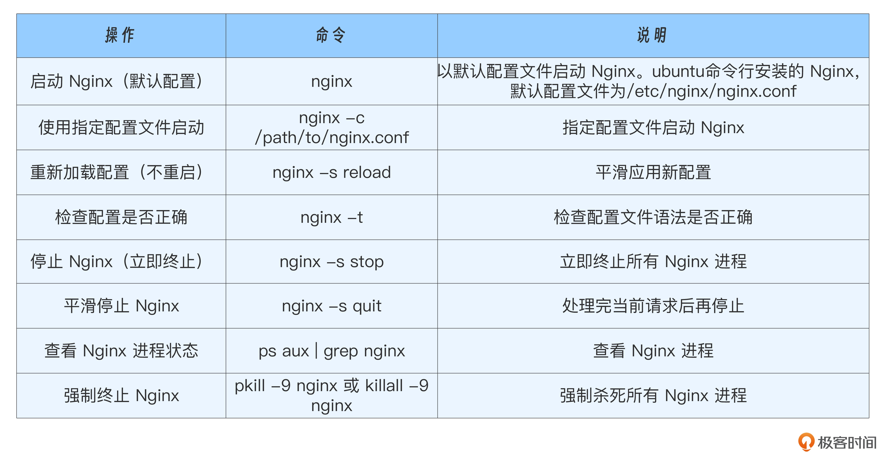
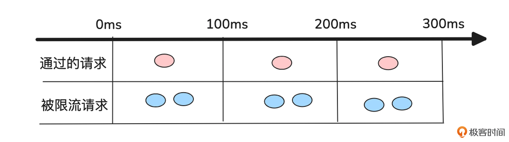
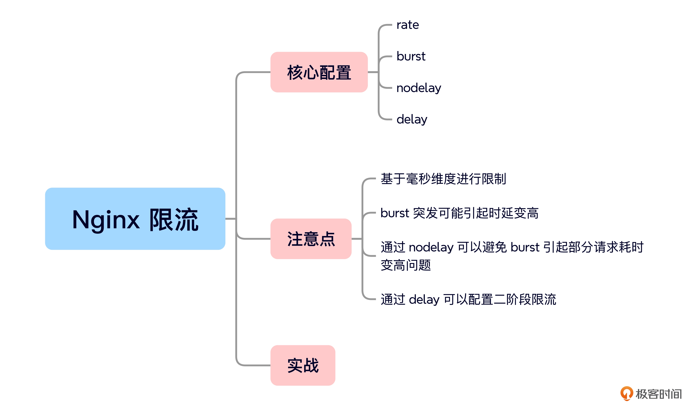

# 加餐 | 搞懂Nginx限流的关键概念

你好，我是谢友鹏。

在前面第六节课的讲解里，我并没有详细解释 Nginx 限流的概念，而是在扩展阅读中鼓励大家自己动手修改参数尝试，并结合给出的资料做分析。现在课程正文告一段落，我特意安排了今天的加餐，和你分享一下如何通过实验加深对 Nginx 限流的理解。

Nginx 提供了 ngx_http_limit_req_module 模块，用于配置限流策略。然而，其中的一些概念可能较难理解，甚至容易引发误解。

Nginx 官方博客 rate-limiting-nginx 详细讲解了限流的原理及相关细节，能够帮助我们澄清许多常见误区，建议你优先参考这篇第一手资料。如果你希望进一步加深理解，我们今天将结合实验进行分析和探讨。

### Nginx 限流原理

Nginx 的限流机制基于漏桶算法（Leaky Bucket），用于控制请求速率，以防止服务器因接收过多请求而过载。其核心思想是通过设定速率限制流量的进入，从而平稳处理请求，避免突发流量对系统造成冲击。


图片来自：rate-limiting-nginx

Nginx 的限流配置中有几个关键概念。

```
rate（速率）：控制每秒允许的最大请求数。例如，rate=10r/s表示每秒最多允许 10 个
```

- 请求。如果超过这个速率，请求将会被限流。

- burst（突发流量）：允许突发请求的最大数量。在突发流量内，Nginx 不会立即拒绝请求，而是将它们放入一个缓冲队列中，等待在速率允许的情况下进行处理。

```
nodelay（无延迟）：当配置了burst时，若启用了nodelay选项，突发流量将被立即处
理，而不是排队等待。如果不启用nodelay，超过rate的请求将按rate的速度逐个处
```

- 理，可能会引起延迟。

```
delay（延迟）：在两阶段限流（nginx 1.15.7 及以后的版本支持）中，delay控制突发流量
的一部分请求会立即处理，而另一部分则会按rate的限制进行排队。
```

为什么一个限流功能还玩得这么花呢？我们逐一来看看。

首先，要注意的是 Nginx 是基于毫秒维度进行限制的。怎么理解这个意思呢？假如你配置的是 rate=10r/s，字面上意思是 1 秒可以通过 10 个请求，但 Nginx 实现的时候会换算成毫秒，也就是每 100ms 通过一个请求。我画了一个示意图来帮你理解这个过程。



如上图所示，假设在第 0 到 100ms 之间有一个请求，第 100 到 200ms 之间有三个请求，虽然在这 1s 内还没达到 10 个请求，但是由于 100 到 200ms 之间的请求数量大于 1，所以也会有两个请求被限制。

但现实中我们无法要求请求来的这么平顺，经常有些请求就是“一股一股的来的。按照传统的漏桶算法，是不能够应对突发的，超过限制的请求会直接回复失败。

为此 Nginx 做了改进，通过配置 burst 为超限制的请求分配一个队列，先不返回失败，而是在队列中慢慢处理，直到队列也放不下的时候，再返回失败。默认情况下，在队列中的请求也会按照配置的 rate 换算成毫秒的时间间隔进行处理，比如还是刚刚的例子，如果配置burst=10，那么第 100 到 200ms 之间的两个请求就不会立即被限制，而是在队列中按照100ms 的间隔，慢慢处理。

虽然通过 burst 在一定程度上应对了突发，但也增加了时延，试想如果有 10 个请求都排在了队列，那排在最后的那个请求，要等 1s 的时间才会得到处理。显然对于一些时延敏感的业务来说，大幅增加请求时延是不可接受的。

为此，可以配置 nodelay 来解决。nodelay 的作用是让 burst 队列中的请求立即得到处理，而不是排队。有了 nodelay 之后，队列中的突发流量就会立即得到处理，但是队列的位置还是按照 rate 配置的速度慢慢释放。

综上，如果 burst 配置得比较大，又配置了 nodelay 的话，那后端系统就可能收到瞬间比较大的尖刺流量。如果不配置 nodelay，又会引起时延问题，很明显这里是一个需要“平衡”的命题。

为此 Nginx 在 1.15.7 版本之后支持了两阶段限流。所谓两阶段限流就是通过 delay 指定队列中的一部分突发流量立即得到处理，还有一部分慢慢排队处理，相当于指定了队列中 nodelay请求生效的最大个数。

比如官方给出的这个例子：



```
Illustration of rate‑limiting behavior with rate=5r/s burst=12 delay=8
```

图片来自：rate-limiting-nginx

```
假如配置 rate=5r/s burst=12 delay=8，前 8 个请求（即延迟值）会被 Nginx 代理并立
```

即转发。接下来的 4 个请求（突发量减去延迟值）会被延迟，以确保不会超过 5 次请求 / 秒的速率限制。之后的 3 个请求会被拒绝，因为突发请求数已经超出限制。随后的请求将被延迟处理。

### 实战

接下来，我们将通过一系列实验来验证上述结论。在实验过程中，我们会多次修改 Nginx 的配置。因此，首先需要了解一些基本操作，包括 Nginx 的启动、如何使配置生效、以及如何指定不同的配置文件进行测试。

我将 Nginx 的基本操作整理成一个表格，方便刚刚接触 Nginx 的同学查阅。



掌握了 Nginx 的基本操作之后，就可以开始今天的实验了。

### 实验 1：Nginx 是基于毫秒维度进行限制的

Nginx 配置如下。

```javascript
worker_processes auto;
pid /run/nginx.pid;
error_log /var/log/nginx/error.log warn;
events {
       worker_connections 768;
}
http {
   upstream http_backend {
       server 127.0.0.1:80 max_fails=3 fail_timeout=10s;
   }
   #配置限流规则perserver，限流值为每秒1个请求
   limit_req_zone $server_name zone=perserver:10m rate=10r/s;
   # 定义自定义日志格式，记录请求方法、请求路径、状态码、请求时间等
   log_format main '$remote_addr - $remote_user [$time_local] "$request" '
                     '$status $body_bytes_sent "$http_referer" '
                     '"$http_user_agent" "$http_x_forwarded_for" '
                     '$request_time $upstream_response_time';
   # 定义日志文件路径
   access_log /var/log/nginx/access.log main;
   server {
       listen 8080;
       server_name localhost;
       location / {
           limit_req zone=perserver;
           proxy_pass http://http_backend;
       }
   }
}
```

脚本 3_req_per_102ms.sh，每 102ms 发送一批请求，每一批请求包括 3 个请求，一共发送3 批，并在结果中打印 http 状态码和请求时间。

```bash
#!/bin/bash
URL="http://127.0.0.1:8080"
#每一批发送的个数
REQUEST_BATCH_COUNT=3
#每一批的发送间隔
BATCH_INTERVAL=0.12
#总共几组批数据
for (( j=1;j<=3;j++))
do
   for (( i=1;i<=$REQUEST_BATCH_COUNT;i++))
   do
       curl -o /dev/null -w 'http_code:%{http_code}, time_total:%{time_total}s\n
   done
   sleep $BATCH_INTERVAL
done
```

测试结果：

```
./3_req_per_102ms.sh
http_code:200, time_total:0.000749s
http_code:503, time_total:0.000416s
http_code:503, time_total:0.001093s
http_code:200, time_total:0.000719s
http_code:503, time_total:0.000347s
http_code:503, time_total:0.000462s
http_code:200, time_total:0.002446s
http_code:503, time_total:0.000271s
http_code:503, time_total:0.000473s
如结果所示，在每批请求中，部分请求被限流（返回http_code:503），而不是正常返回。
```

这是因为请求的速率超出了 Nginx 每 100ms 处理一个请求的限制。实验限流过程如下图所示：



我们修改一下脚本，改为 1_req_per_102ms.sh，每 102ms 发送一批请求，每一批请求包括 1个请求，一共发送 9 批。同样的，在结果中打印 http 状态码和请求时间。

```bash
#!/bin/bash
URL="http://127.0.0.1:8080"
#每一批发送的个数
REQUEST_BATCH_COUNT=1
#每一批的发送间隔
BATCH_INTERVAL=0.12
#总共几组批数据
for (( j=1;j<=9;j++))
do
   for (( i=1;i<=$REQUEST_BATCH_COUNT;i++))
   do
       curl -o /dev/null -w 'http_code:%{http_code}, time_total:%{time_total}s\n
   done
   sleep $BATCH_INTERVAL
done
```

测试结果如下。

```
./1_req_per_102ms.sh
http_code:200, time_total:0.000949s
http_code:200, time_total:0.000929s
http_code:200, time_total:0.000862s
http_code:200, time_total:0.000911s
http_code:200, time_total:0.000992s
http_code:200, time_total:0.000920s
http_code:200, time_total:0.000942s
http_code:200, time_total:0.001131s
http_code:200, time_total:0.000905s
```

从结果可以看出，这回全部请求都成功了。

### 实验 2：burst 的作用是让多余的请求放到队列中，以应对突发

我们在实验 1 的基础上，增加一个配置 burst=10，这样将突发的请求放到一个容量为 10 的队列中慢慢处理，而不是之间限流。修改后的完整配置如下：

```javascript
worker_processes auto;
pid /run/nginx.pid;
error_log /var/log/nginx/error.log warn;
events {
       worker_connections 768;
}
http {
   upstream http_backend {
       server 127.0.0.1:80 max_fails=3 fail_timeout=10s;
   }
   #配置限流规则perserver，限流值为每秒1个请求
   limit_req_zone $server_name zone=perserver:10m rate=10r/s;
   # 定义自定义日志格式，记录请求方法、请求路径、状态码、请求时间等
   log_format main '$remote_addr - $remote_user [$time_local] "$request" '
                     '$status $body_bytes_sent "$http_referer" '
                     '"$http_user_agent" "$http_x_forwarded_for" '
                     '$request_time $upstream_response_time';
   # 定义日志文件路径
   access_log /var/log/nginx/access.log main;
   server {
       listen 8080;
       server_name localhost;
       location / {
           limit_req zone=perserver burst=10;
           proxy_pass http://http_backend;
       }
   }
}
```

测试结果如下。

```
# ./3_req_per_102ms.sh
http_code:200, time_total:0.000781s
http_code:200, time_total:0.092473s
http_code:200, time_total:0.189501s
http_code:200, time_total:0.178522s
http_code:200, time_total:0.274155s
http_code:200, time_total:0.375448s
http_code:200, time_total:0.351153s
http_code:200, time_total:0.446500s
http_code:200, time_total:0.546228s
```

从上面的结果可以看出，增加 burst 后，对于超出的请求并不会立即失败了，而是先放到队列中慢慢处理，由此也引发了一些请求的耗时明显增高。如果你想看的超出队列立马被限流的请求，可以自己修改测试脚本，改为 1s 发送 20 个请求来观察。

### 实验 3：nodelay 的作用是让 burst 队列中的请求立即得到处理，而不是排队

我们在实验 2 的基础上再次修改配置，增加 nodelay，修改后的完整配置如下：

```javascript
worker_processes auto;
pid /run/nginx.pid;
error_log /var/log/nginx/error.log warn;
events {
       worker_connections 768;
}
http {
   upstream http_backend {
       server 127.0.0.1:80 max_fails=3 fail_timeout=10s;
   }
   #配置限流规则perserver，限流值为每秒1个请求
   limit_req_zone $server_name zone=perserver:10m rate=10r/s;
   # 定义自定义日志格式，记录请求方法、请求路径、状态码、请求时间等
   log_format main '$remote_addr - $remote_user [$time_local] "$request" '
                     '$status $body_bytes_sent "$http_referer" '
                     '"$http_user_agent" "$http_x_forwarded_for" '
                     '$request_time $upstream_response_time';
   # 定义日志文件路径
   access_log /var/log/nginx/access.log main;
   server {
       listen 8080;
       server_name localhost;
       location / {
           limit_req zone=perserver burst=10 nodelay;
           proxy_pass http://http_backend;
       }
   }
}
```

测试结果如下。

```
./3_req_per_102ms.sh
http_code:200, time_total:0.005532s
http_code:200, time_total:0.000868s
http_code:200, time_total:0.000922s
http_code:200, time_total:0.000867s
http_code:200, time_total:0.001258s
http_code:200, time_total:0.001695s
http_code:200, time_total:0.002135s
http_code:200, time_total:0.001116s
http_code:200, time_total:0.000744s
```

从结果可以看出，配置 nodelay 后，在队列中的突发请求不再排队处理了，而是立即得到处理。

### 实验 4：delay 的作用是让一部分 burst 队列中的请求立即得到处理，另一部分慢慢排队

我们在实验 3 的基础上，再稍做修改，将 nodelay 改为 delay=2，修改后配置如下：

```javascript
worker_processes auto;
pid /run/nginx.pid;
error_log /var/log/nginx/error.log warn;
events {
       worker_connections 768;
}
http {
   upstream http_backend {
       server 127.0.0.1:80 max_fails=3 fail_timeout=10s;
   }
   #配置限流规则perserver，限流值为每秒1个请求
   limit_req_zone $server_name zone=perserver:10m rate=10r/s;
   # 定义自定义日志格式，记录请求方法、请求路径、状态码、请求时间等
   log_format main '$remote_addr - $remote_user [$time_local] "$request" '
                     '$status $body_bytes_sent "$http_referer" '
                     '"$http_user_agent" "$http_x_forwarded_for" '
                     '$request_time $upstream_response_time';
   # 定义日志文件路径
   access_log /var/log/nginx/access.log main;
   server {
       listen 8080;
       server_name localhost;
       location / {
           limit_req zone=perserver burst=10 delay=2;
           proxy_pass http://http_backend;
       }
   }
}
```

测试结果如下。

```
http_code:200, time_total:0.004384s
http_code:200, time_total:0.001285s
http_code:200, time_total:0.000779s
http_code:200, time_total:0.000827s
http_code:200, time_total:0.077353s
http_code:200, time_total:0.175678s
http_code:200, time_total:0.150180s
http_code:200, time_total:0.241388s
http_code:200, time_total:0.341522s
```

从结果可以看出，在启用 delay=2 后，部分请求立即得到处理，而超出的请求会被延迟处理。这种方式有效地平衡了延迟和流量控制。

### 小结

今天的加餐就到这里，我给你准备了一个思维导图回顾要点。



今天，我们学习了 Nginx 限流的原理，并深入理解了几个关键概念：

- rate（速率）：定义每秒允许的最大请求数。但 Nginx 在实际执行时是按照毫秒级别进行控制，而非整秒。

- burst（突发流量）：指定允许的突发请求数量。在该范围内的请求不会被立即拒绝，而是进入缓冲队列，等待在限流速率允许的情况下依次处理。

- nodelay（无延迟）：用于配合 burst 选项。如果启用，突发请求会立即处理，而不会按rate 速率排队，否则超出的请求会逐个按速率处理，可能引入延迟。

- delay（延迟）：在 Nginx 1.15.7 及以上版本支持的两阶段限流中，delay 允许部分突发请求立即处理，而另一部分则按 rate 限制排队执行，从而更灵活地控制流量节奏。

随后，我们通过实验验证了这些概念的实际效果，加深了对 Nginx 限流机制的理解，也推荐你课后自己动手试试看。

欢迎你在留言区和我交流互动，如果这节课对你有启发，也推荐你分享给身边更多朋友。
