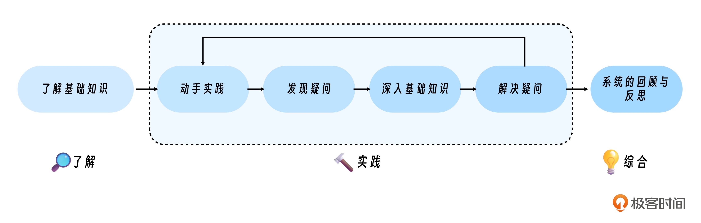
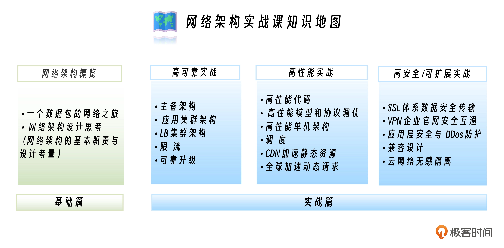
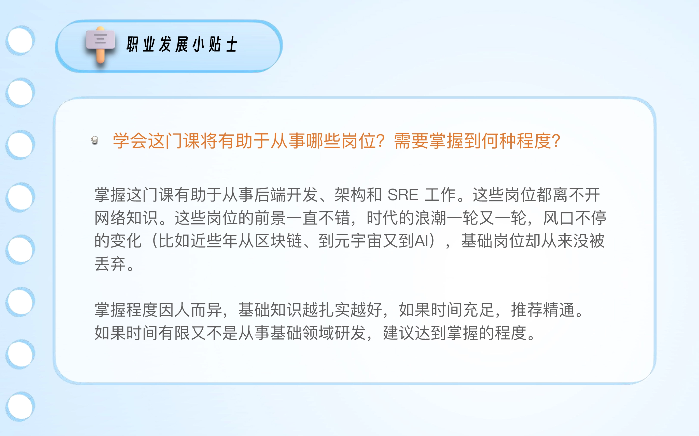

# 开篇词 | 如何练好网络架构这门“内功心法”？

你好，我是谢友鹏，欢迎加入我的专栏，和我一起开始网络架构实战之旅。

先自我介绍一下，我一直在大厂从事网络相关的研发工作。我的经历涵盖了企业级路由器、防火墙上的 VPN 开发，到 SD-WAN、接入网关、CDN、全球加速网络、云网络代理等多个系统的设计与研发。在多年的工作中，我不仅解决了大量的技术难题，还积累了丰富的网络架构设计经验，涉及到高性能、高可靠等方面。

## 为什么要学习网络架构？

网络架构的学习看似枯燥，实则是每一位工程师不可或缺的“内功”。随着技术的飞速发展，框架和工具层出不穷，如何在这些快速迭代的技术浪潮中脱颖而出？我认为，打好基础是最关键的，正如武侠小说中所说：“先修炼内功，方可见得外功。”

为什么“网络架构”的内功这么重要呢？原因有三方面。

第一，功能开发离不开“网络”支持。现代分布式架构中，应用之间的交互依赖于网络。网络架构的设计直接影响到系统的性能、稳定性和安全性。因此，无论你是从事后端开发，还是专注于网络优化，理解网络架构都将极大提升你的技术高度。

第二，网络“架构”思维即分布式架构思维。网络是一个庞大的分布式系统，网络架构设计不仅要考虑可扩展性、负载均衡、容错能力等问题，还要应对跨域、跨地域的复杂挑战。深入学习网络架构，将帮助你更好地理解和设计其他分布式系统。

第三，“网络架构”是系统架构的基础。网络架构决定了数据如何流动，服务如何交互，系统如何高效稳定运行。对于从事架构设计的工程师来说，深入理解网络架构，不仅能帮助我们应对快速变化的技术挑战，还能在设计系统时提高自适应能力和灵活性。

## 学习网络架构有哪些难点？

“道理我都懂，但总是学了就忘。”这可能是很多人在学习网络架构时的痛点。作为一个多年来专注于网络领域的工程师，我深知这一点。

那么网络架构的学习究竟难在哪里呢？我认为主要是两方面的难点：

1. 网络知识庞大且复杂。网络是一个庞大的知识体系，理论内容较为枯燥。若只是死记硬背，容易遗忘。要理解网络架构，需要深入掌握其原理与细节，而不仅仅是记忆。

2. 缺乏实战场景。特别是对于初学者和少有实践经验的工程师，理论和实践脱节是常见的学习困境。比如，大家都知道分布式架构要设计成高可靠，但面对具体问题时，却不知道从何入手；又比如，很多人都学过，TCP 的滑动窗口和拥塞控制，但却不知道，如何在实际调优中进行应用。

## 怎样学习网络架构？

学习网络架构并非一蹴而就的过程，关键在于理论与实践相结合。因此，我希望通过这门课程，分享我的学习与实践经验，帮助你练好网络架构这门“内功心法”。

以下是我的学习方法，我通过一张图与你分享：

这一过程大概分为三个阶段。

第一阶段，了解基础知识。首先，快速了解网络架构的基础概念，建立起对网络架构的基本框架和思维方式。这个阶段的目标不是深入，而是“混个脸熟”，对整体知识脉络和核心概念建立初步的了解。

第二阶段，实践中学习。在理解了基础之后，真正的学习开始。通过动手做实验、调试、优化和解决问题，深入掌握理论背后的应用。在这个过程中，常常会遇到各种各样的技术挑战。你可以带着这些问题去深入研究，不断突破，直到问题解决。

比如，你可能学过 TCP 的流控和拥塞控制等理论，但如果从未用这些理论分析过实际问题，很难真正掌握它们。如果给你一个 TCP 性能问题让你去排查，你就需要思考究竟是流控导致的，还是拥塞引起的，或者是其他原因？

接着，还要通过收集各种特征和数据，与理论知识结合进行分析和验证。这个实践过程就是深入理解理论的最佳机会。一旦你成功解决了问题，这部分内容也会自然而然地转化为你自己的知识。

第三阶段，综合性的理论回顾和反思。经过一段时间的实践后，会对很多个点有深入的理解。这个时候，我会再回过头来，系统地复习和总结基础知识。这个阶段，不是重新学习，而是将之前学到的知识通过实际问题联系起来，做到融会贯通。

通过这种反复的循环，你可以真正掌握网络架构的核心原理，将理论知识与实践能力结合，形成自己的技术体系。事实上，这种让自己尽快“置身其中”的学习方法，适用于大部分技术的学习。

## 这门课是怎么设计的？

这门课程的设计初衷，就是为你提供一个理论结合实践的网络架构学习场景。希望通过课程内容的讲解，激发你深入思考，让你更好地理解网络架构的深层次原理，并且能学以致用，运用所学解决实际工作里的问题。

我画了一张图为你展示课程的设计思路。

课程分为基础篇和实战篇两大部分。

首先基础篇将从最基本的网络概念入手，帮助你建立网络架构的初步认知。我们将通过一个数据包的网络之旅学习一个数据包从客户端发出，到达服务器的完整过程，了解数据包如何在网络中流转，以及涉及的各类操作和协议。之后还会探讨网络架构的基本职责与设计要素，帮你建立构建高效、稳定网络架构的全局视角。

接下来是实战篇，这部分我们将从网络架构的高可靠、高性能、高安全和可扩展四部分展开实战。

在高可靠部分，我们会学习如何设计高可靠的架构，包括主备架构、集群架构、限速限流和无损升级等技术方案。掌握这些内容后，你不仅能设计多机房、多城市的高可用架构，还能构建可横向扩展的负载均衡和服务器集群，确保系统在任何情况下都能稳定运行。

在高性能部分，我们会聚焦于如何在代码层面、网络协议层面以及单机架构层面进行性能提升。你将学习性能调优的方法、如何设计高效的调度机制、以及如何实现 CDN 和全球加速等优化方案。这些技能将帮助你设计出高效的网络架构，优化服务的响应速度和吞吐量。

在高安全部分，将讲解 SSL 加密传输的基本原理、VPN 技术的实现和应用层的安全防护措施。学习这些内容后，你将能够解决 SSL 校验等常见安全问题，并设计出安全可靠的网络架构，保护数据的安全性。

在可扩展性部分，你将掌握网络架构的可扩展性设计原理，学习如何通过“兼容性”和“无感升级”实现网络的持续演进。学会这部分内容，我们就可以在不干扰现有业务的情况下，不断优化和扩展网络架构，以支持业务的长远发展。

整个课程的学习目标是，让你全面掌握现代网络架构设计的核心技能，并能够将理论应用到实际项目中，解决各类网络架构设计和优化问题。

## 写在最后

课程里设计了大量实验动手环节，课程实验将在 VMware Fusion 环境下进行，通过加载ubuntu-24.04.1-live-server-amd64.iso 镜像来模拟实际的网络架构和问题解决过程。

课程仓库链接：https://github.com/xyp-root/geektime-hands-on-network-architecture

当然了，实战时难免会遇到各种问题，请保持积极的心态，相信“遇到问题的时候就是成长的时候”。我在导学篇为你分享了问题定位排查思路和网络诊断的常用工具，供你参考。

在学习这门课之前，建议你先掌握一些网络的基础知识。

如果你是网络领域的新人，可以选择阅读一两本经典的入门书籍，例如《计算机网络：自顶向下方法》或《TCP/IP 详解 卷 1：协议》。如果时间有限，可以快速浏览这些书，先对基础概念有一个初步的了解。

在学习课程时，建议多思考“为什么”，特别是在实践和实验环节中遇到问题时，尝试深入分析。如果一时想不明白，可以查阅相关的 RFC 文档，或者回过头在书籍中寻找答案。通过这样的学习方式，不仅能加深对理论的理解，还能提升解决实际问题的能力。

相信当你学完课程之后，再回头复习这些基础书籍时，一定会有全新的感悟与收获。

最后，向你推荐一个概念——“技术债务”。如果在学习过程中遇到一时搞不懂的内容或做不出的实验，不必过于纠结，可以先将这些问题记录下来，暂时放一放，继续后面的学习。隔一段时间回头翻看自己的“技术债务清单”，你会发现，随着经验的积累和知识的扩展，之前的问题可能已经豁然开朗了。

