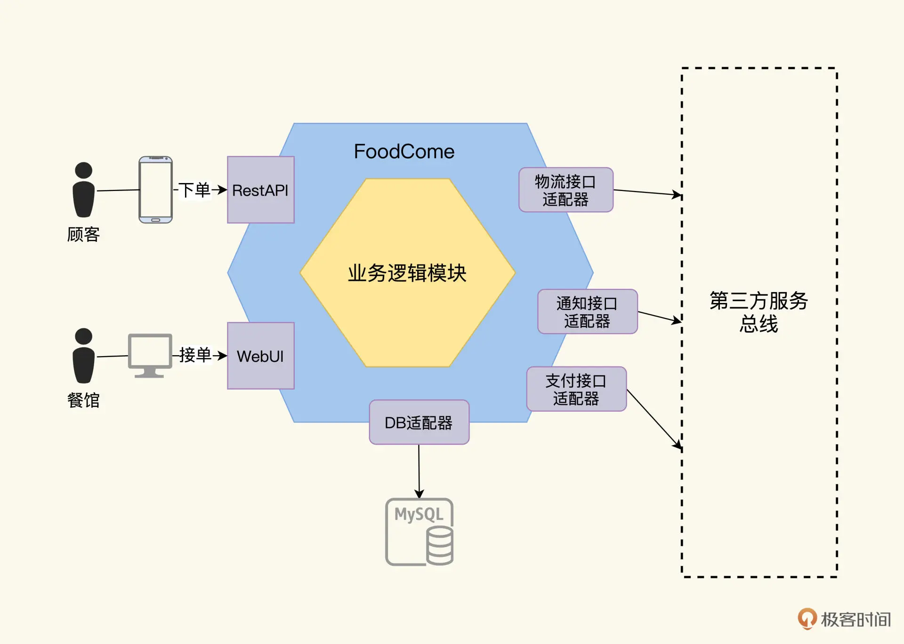
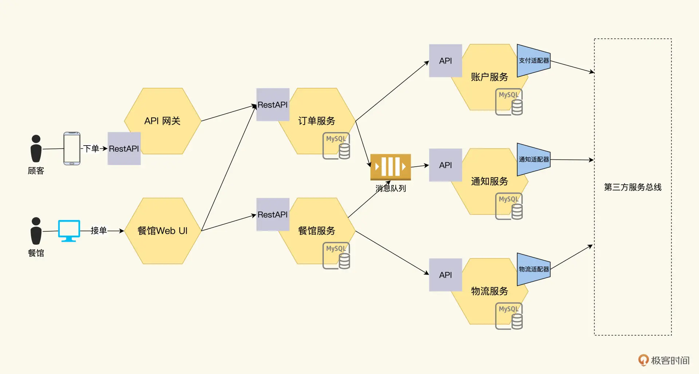
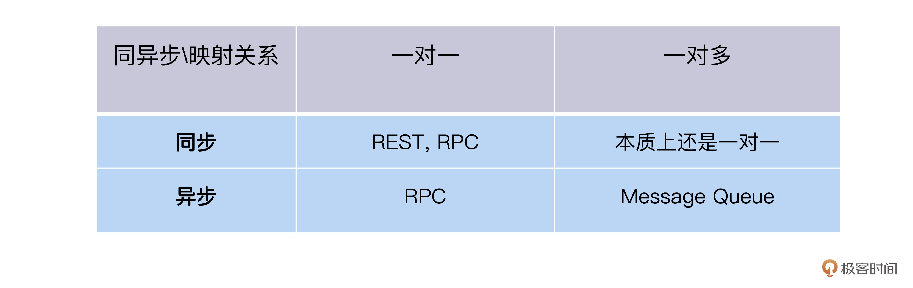
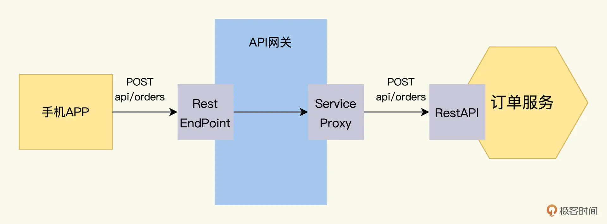
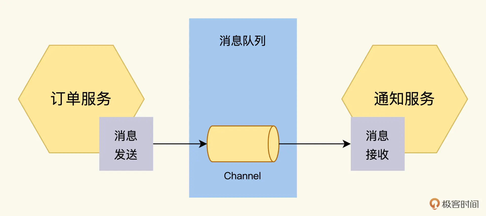
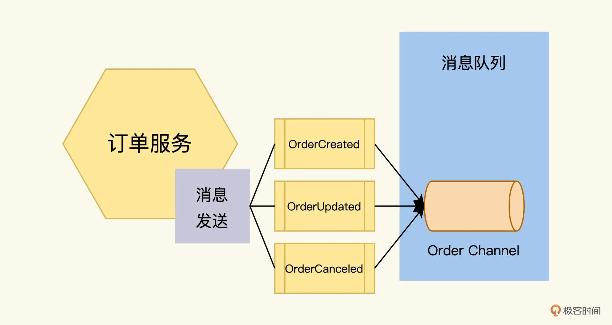
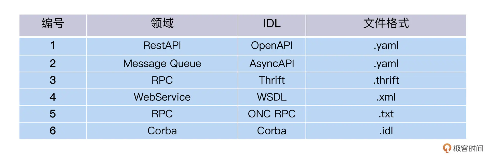
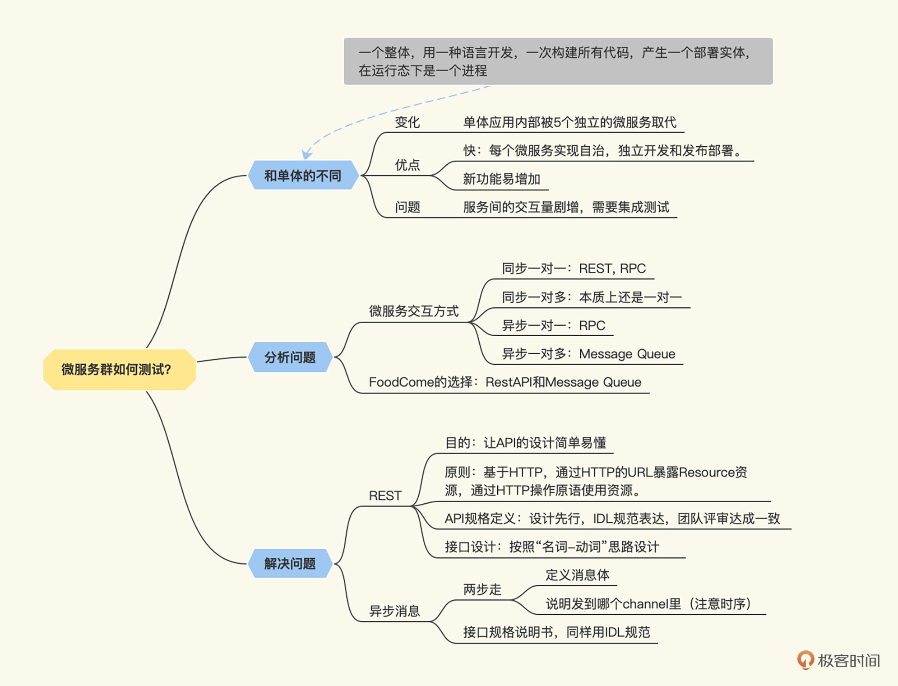

# 08 | 需求提炼（二）：微服务集群要测什么？

你好，我是柳胜。

随着互联网发展和软件场景普及，单体应用逐渐暴露出致命缺陷，比如过于庞大，大大增加系统的复杂度、交付速度变慢，协作困难、错误难以隔离、维护成本巨大等等。

同时，软件技术也在发展，出现了 VMware、Docker 和 Kubernetes 等轻量化部署方式，这使得拆分的困难变小，部署的成本降低。微服务架构诞生后，一个系统拆分成多个独立开发和运行的服务，这个服务不管大小，业界都管它叫微服务。它们也有一套服务治理的技术规范，用来保证部署和运行的可靠性和扩展性。

微服务集群的开发方式确实方便了用户需求快速实现和交付，但今天我们的关注点是，从测试角度看，微服务相比单体应用有什么不一样？有没有新的测试点？

这一讲我们将继续延续 FoodCome 的例子，看看它从单体应用变成微服务架构之后，给测试工作带来的变化和挑战。

## 微服务架构下的 FoodCome

在上一讲，单体应用的 FoodCome 是这样的：



- FoodCome单体架构图

随着业务规模的扩大，开发人手增加，FoodCome 被拆分成 5 个微服务，具体如下：

- 订单服务：处理用户下的订单；

- 物流服务：Foodcome 内部的物流管理，与外部物流对接；

- 餐馆服务：管理餐馆的信息，参与订单的工作流；

- 账户服务：管理订单里的顾客信息，和外部的支付系统对接。

- 通知服务：产生消息通知用户，和外部的邮件系统对接。

由此组成的 FoodCome 的微服务架构如下图：



- FoodCome微服务架构图

在这个架构下，原先单体应用的对外接口保持不变，但是单体应用内部被 5 个独立的微服务取代。用户的订单请求先通过 API 网关到达订单服务，完成支付后，餐馆接单，再通过物流系统交付订单。

每个微服务实现自治，独立开发和发布部署，加快发布速度。而且增加新功能也很方便，比如登录鉴权，在这个图中再增加一个认证服务就可以，这是给客户带来的好处。

现在的问题是，这给测试带来哪些变化呢？分拆后，FoodCome 系统变成了微服务集群，就像一部巨大机器，由多个零件组成，互相咬合，一起工作。作为测试人员，不但要验证每个零件是合格的，还要有办法预测它们组装起来的机器也能正常工作。

这里的测试难点是，微服务的数量增加，服务间的交互量也会剧增，相比单体系统，集成测试在微服务集群架构下更加关键。

要做集成测试，我们就先搞明白微服务间是怎么交互的。在微服务架构下，交互可以有多种风格，比如 RPC 远程过程调用、REST 风格、Message Queue 消息队列等等。根据交互的方法和风格，我把它们整理出一个表格，方便你理解。



在 FoodCome 采用了两种交互方式，RestAPI 和 Message Queue。

RestAPI 用来处理实时性强的服务间交互，比如前端通过 API 网关调用订单服务来下订单。



Message Queue 用来处理异步的交互，订单服务和通知服务之间通过 Message Queue 来交换信息.



下面我们来看一下这两种交互方式的具体实现，然后找出测试点。

## REST

我们需要先知道 Rest 接口是怎么设计的，才能找出后面都要测什么。

### 什么是 REST

REST 是 Representational State Transfer 的缩写，叫做表现层状态转换。听起来挺拗口，但我一说你就能懂，它其实是一组松散的规范，不是严格的协议，也不是强制的标准。这个规范的目的就是让 API 的设计更加简单易懂。

它包含以下几个基本原则：

1.REST 是基于 HTTP 协议的；

2. 通过 HTTP 的 URL 暴露 Resource 资源；

3. 通过 HTTP 的操作原语，提供对 Resource 的操作，GET、 POST、PUT、DELETE 对应着增删改查的操作。

只要开发人员懂 HTTP 协议，按照上面的规则用 REST 风格表达他的 API 是很容易的。同样，另外一个开发人员看到 REST API，也很快就能知道这些 API 是干什么用的，几乎不用看难懂的文档。

这是 REST 的优点，REST 风格下设计的 AP，学习成本非常低，所以互联网上有很多服务都是通过 REST 方式对外提供 API，比如亚马逊的 AWS 云服务、Google 的 Document 服务等等。

当然，现实中的 REST，从 2000 年概念诞生到现在发展了 20 年，在上面的基本规范上又增加了很多内容，让 REST 接口具备自解释、可发现等优势，有兴趣你可以看 RichardSon 提出的 REST 四级成熟度模型。

### Order Service 的 REST API 设计

遵循 REST 规范，Order Service 的接口设计可以按照“名词 - 动词”的思路来捋清。

首先寻找名词，Order，它对应 REST 上的一个 Resource 资源：

```
http://api.foodcome.com/api/v1/orders
```

再找到动词“下单”，它对应 HTTP 协议上的 POST 原语，对 Orders 资源发送 POST 请求就是下单：

```
POST http://api.foodcome.com/api/v1/orders
```

之后将“查询订单”这个动词，转成 HTTP 协议上的 GET 原语，查询条件 orderID 以参数形式加在 URL 里：

```
GET http://api.foodcome.com/api/v1/orders?orderID=123456
```

同样，修改订单使用 PUT 原语，删除订单使用 DELETE 原语。

我们再用同样的方法来把其他名词“顾客”和“餐馆”，转成 Resource 和操作：

```
http://api.foodcome.com/api/v1/customers
http://api.foodcome.com/api/v1/restaurants
```

### Order service 的 RestAPI 规格定义

不成熟的开发团队，经常是一边写代码，一边设计 API，这样做的结果不难推测，一千个开发人员会写出一千个 Order Service API，虽然他们都声称遵循了 REST 规范。

所以，好的实践是，开发团队需要先设计 RestAPI，并把它表达出来，然后团队就可以进行评审，达成理解一致。

那表达的载体是什么呢？这里就要提到 Interface Definition Language 这个概念了，顾名思义，IDL 是接口定义语言，它通过一种独立于编程语言的语法规则来描述 API。不同类型的API，它的 IDL 是不一样的。

我们用 REST 主流的 IDL，也就是 OpenAPI 的语法规范，来描述下订单的这个接口的参数，把请求和响应写在一个 YAML 文件里。

```
"/api/v1/orders":
   post:
     consumes:
     - application/json
     produces:
     - application/json
     parameters:
     - in: body
       name: body
       description: order placed for Food
       required: true
       properties:
         foodId:
           type: integer
         shipDate:
           type: Date
         status:
           type: String
           enum:
           - placed
           - accepted
           - delivered
     responses:
       '200':
         description: successful operation
       '400':
description: invalid order
```

到这里，FoodCome 服务间的 REST 接口规格说明书就生成了！

这个规格说明书定义了客户端和服务端之间的契约，顾客要下单的话，客户端应该向服务端"api/v1/orders"发送一个请求，里面包含了食品的代码、日期等等，而服务端成功则返回一个 HTTP 200 的响应，失败返回一个 HTTP 400 的响应。

## 异步消息

说完了同步常用的 REST，我们再分析一下异步消息。

什么是异步消息呢？消息就是客户端和服务端交换的数据，而异步指的是调用的方式，客户端不用等到服务端处理完消息，就可以返回。等服务端处理完，再通知客户端。

异步消息在微服务集群的架构里，能够起到削峰、解耦的作用。比如 FoodCome 在订餐高峰时段，先把订单收下来，放到消息队列，排好队，等待餐馆一个个处理。所以异步消息是现在业界很常用的一种服务交互方式，它的技术原理是消息队列，技术实现是消息代理，有Kafka、RabbitMQ 等等。

而开发人员在设计微服务时，首先要设计异步消息接口，定义好我的微服务什么时候往消息队列里放消息，放什么样的消息。同样，也要定义好取消息的时机和方法。

### 异步消息接口设计

好，那我们就来看一下订单服务是怎么设计它的异步消息接口的。

首先，要定义消息体，订单服务会向外发出三种消息 OrderCreated、OrderUpdated、OrderCancelled。消息里包含了 order ID、order items、order Status 这些字段。

其次，还要说明这个消息发送到哪个 channel 里。Channel 就是消息的队列，一个消息代理里可以有多个 channel，每个 channel 有不同的功能。

因为 order 的消息有严格的时序，比如，OrderCancelled 和 OrderCreated 这两个消息的顺序反了的话，会引起程序处理的混乱。所以，我们把这三种消息都发送到一个叫 order 的channel 里。

如下图：



### 异步消息接口规格说明书

好，下面就到关键环节了，对于测试人员来说，我们最关心的就是接口规格说明书，跟 REST一样，消息队列也需要找到 IDL 来描述接口上的信息。

RestAPI 的主流 IDL 是 OpenAPI，相对应地，MessageAPI 的 IDL 是 AsyncAPI。上面的Order 消息接口，用 AsyncAPI 规范来定义，会是下面这个样子：

```
asyncapi: 2.2.0
info:
 title: 订单服务
 version: 0.1.0
channels:
 order:
   subscribe:
     message:
       description: Order created.
       payload:
         type: object
         properties:
           orderID:
             type: Integer
           orderStatus:
             type: string
```

这段代码描述的是，订单服务在运行时会向 Order channel 输出 OrderCreated 消息，这个OrderCreated 消息包含了 2 个字段，order 的 ID 和 order 的状态。

## 在设计阶段测试要做什么？

刚刚我们花了不少篇幅分析 API 设计，如果你之前一直只做测试，也许会疑惑：“这些看起来是开发领域的知识啊，是不是跑题了？”其实我想说的是，API 领域是开发、测试共同关注的。测试应该主动参与到这些领域的活动，才能让测试更加有效。

我曾经看到过两个微服务团队各自开发都很快，但是微服务一上线，就发现问题了，有的是接口就对不上，有的是数据类型不一致等等千奇百怪的问题，这些问题花了大把诊断时间不说，甚至会给客户带来损失。

单体应用基本没这些问题，它们是微服务集群的典型问题，那微服务集群的测试，该怎么避免这些问题呢？

有两个比较好的实践，推荐你尝试一下。

第一，测试设计先行原则。

测试设计先行，需要的是开发设计先行。开发不做设计，测试干着急也没法设计。怎么督促开发设计先行呢？一个关键指标是，它在设计阶段是否输出了接口规格说明书。对于开发工作来说，是需要去代码实现的开发需求。对于测试工作来说，它就是测试需求，需要根据它写测试案例。

第二，找到合适的 IDL 来表达接口设计。

一份周密、高质量的测试需求，会是成功测试的开始。所以这个接口规格说明书不仅要有，还得规范，能指导我们生成测试案例。

怎么做到呢？让开发人员写一份 Word 文档？一千个开发人员能写出一千个规格说明。这时，IDL 的价值就显现出来了，它提供一套规范和语法，像一门专用语言，能精准描述接口。而且它与编程语言无关，可以根据 IDL 做 Java 的实现，也可以是 C++, JavaScript，Python 等等。

OpenAPI 和 AsyncAPI 是 IDL 族群里的 2 种。我这里列出一个常见的 IDL 列表，你可以看看你领域里的 IDL 是什么。



找到了 IDL，你和团队就可以一起商量怎么践行设计先行原则，使用 IDL 设计接口了。有了规格说明书之后，之后我们还会讲到，在测试阶段怎么运用它们设计、开发测试案例，敬请期待。

## 小结

这一讲，我们先分析了 FoodCome 升级成为微服务集群架构后，发生了哪些变化。其中最主要就是服务间的交互量大幅增加。Foodcome 采用了 2 种交互方式，一是 RestAPI 同步接口，用来接收用户的订单；二是 Message Queue 的异步接口，用来处理用户的订单。

这两种 API 在设计中用到了不同的 IDL：OpenAPI 和 AsyncAPI，产生出来的接口规格说明书是 YAML 文件。这个 YAML 文件对开发很重要，可以保证他们开发出来的微服务在集成时，能咬合在一起；对于测试来说也很重要，这是后续测试的测试需求。在后面的测试阶段，我们需要去验证，服务是不是遵循了接口。

当然微服务架构还有一些其他变化，比如服务的治理模式，分布式事务，可靠性的实现等等。我们本专栏关注和自动化相关的测试需求，其他变化可能需要开一个新专栏才能详细讨论。



## 思考题

在你的项目组里，能不能推行设计先行，你预想会遇到什么困难，要怎么应对呢？

欢迎你在留言区和我交流互动，也推荐你把这一讲分享给更多同事、朋友。
