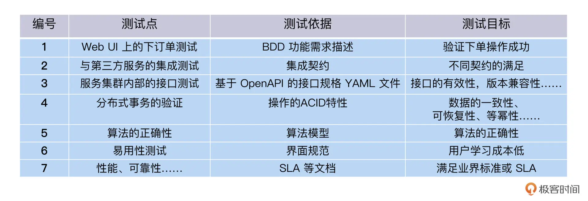

# 09 | 3KU法则：为一个订餐系统设计全栈测试方案

- 登录

### 下线通知

- 该账号已在其他同类设备登录，如非本人操作，则密码可能已经泄露，建议立即更换密码

- 确定

你好，我是柳胜。

上一讲，我们找出了 FoodCome 订餐系统各截面的测试需求，今天我们就根据这些需求，完成测试设计，给这个订餐系统设计一个全栈的测试方案。我们前面讲到的很多思路和原则，都能在今天的课程里得以应用。

这个测试方案非常关键，它能回答自动化测试设计中的四大基本问题：做不做自动化？在哪里做、怎么做、怎么运行。这四个基本问题梳理清楚了，自动化测试项目就相当于有了骨架。

## FoodCome 的订餐需求

我们先列出前几讲提炼的测试需求，每项需求都过一遍上面的问题清单。让我们头脑中的测试方案，形成一个文档化的列表。

结合 FoodCome 订餐系统的例子，我们把测试需求整理如下：

- 登录

- 测试需求表1.0

订餐系统还有很多其他的测试需求，比如兼容性、安全性等等，因为本专栏的关注点是自动化测试，我在这里就不再列出来了。

### 下线通知

## 做不做自动化测试？

- 该账号已在其他同类设备登录，如非本人操作，则密码可能已经泄露，建议立即更

有了文档化的测试需求列表后，我们在设计自动化测试方案时，需要先想清楚，这些需求做不

- 换密码

做自动化测试？

- 确定

测试四象限法则能帮我们有效完成这个思考过程。这个测试四象限，是布雷·麦瑞克提出来的方法模型：根据需求的性质和等级 2 个维度，对测试需求进行分类。

一个维度是测试需求的性质，是技术性还是业务性的？通俗来说就是，如果这个需求越靠近程序员的思维，比如算法、接口、事务等等，它的技术性就越强；而越靠近用户的思维，比如工作流，场景等等，就是业务性越强。

该试读文章来自《自动化测试高手课》，如需阅读全部文章，请购买文章所属专栏，新人首单¥59
