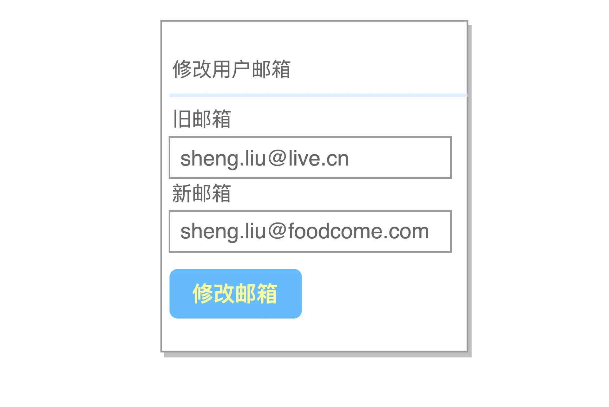
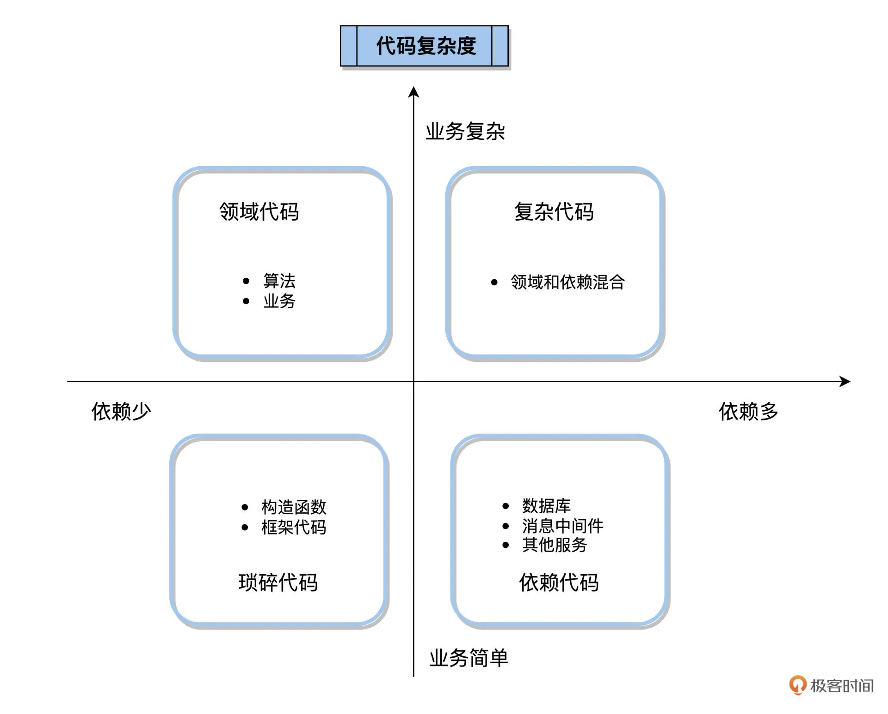
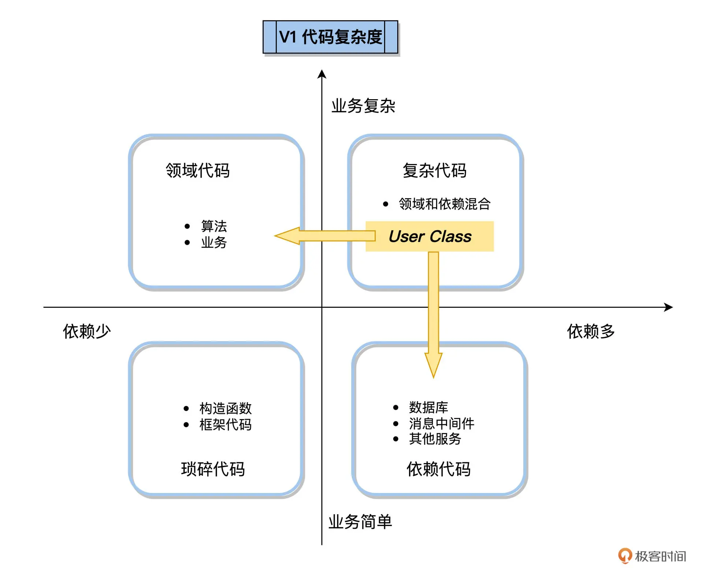
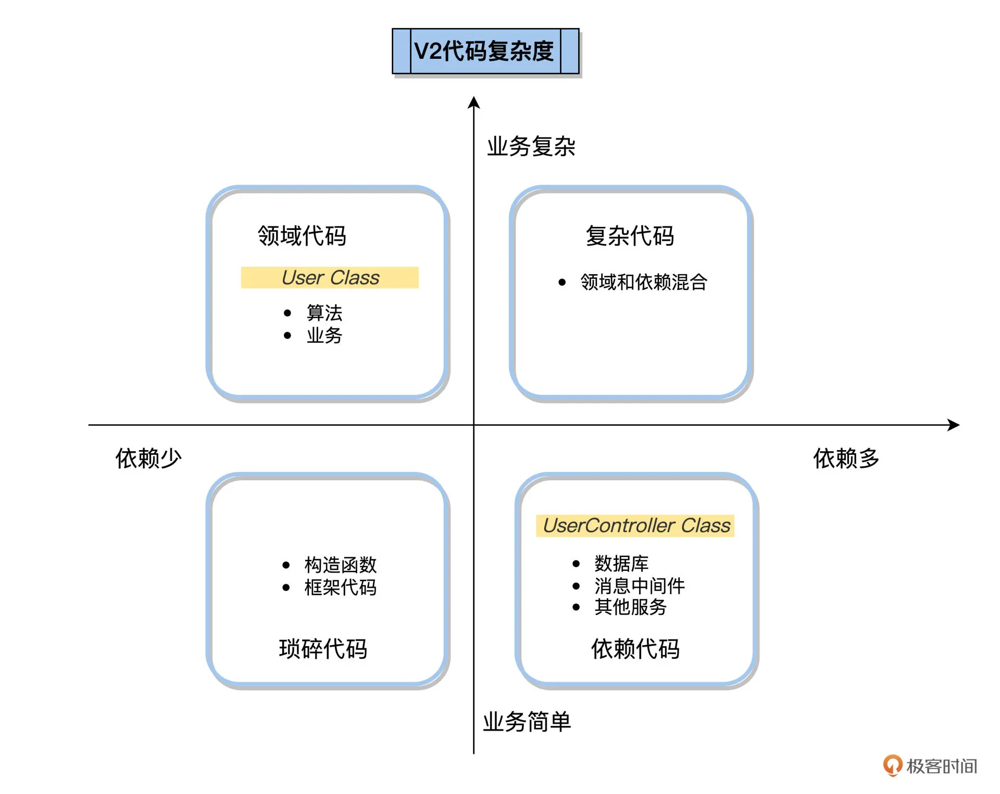
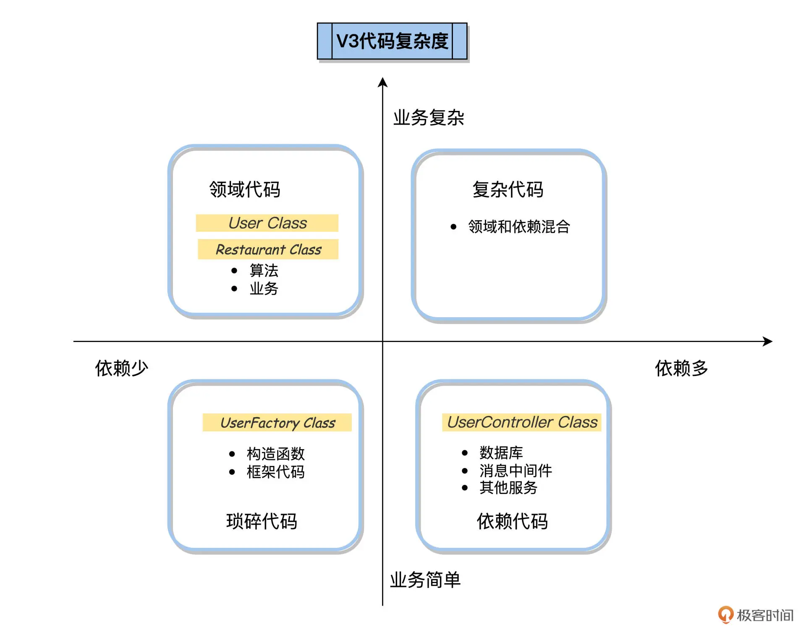
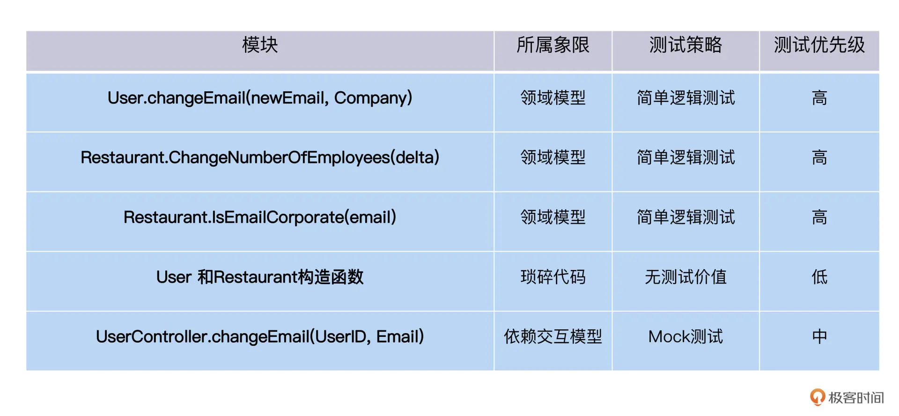
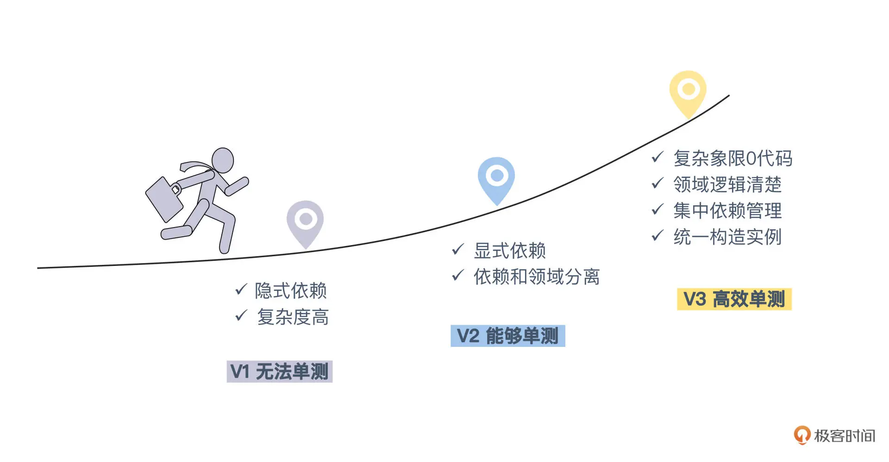

# 11 | 单元测试（二）：四象限法让你的单测火力全开

你好，我是柳胜。

上一讲，我们写了 OrderServiceTest 测试类，来测试 FoodCome 的 OrderService 类。这样不管开发代码还是测试代码，都是简单清楚的。这是因为 FoodCome 的开发人员对代码有一个好的设计，实现了 Controller、Service、Repository 等 Class 的职能划分，OrderService类里专注订单管理，我们写出的 OrderServiceTest 才能集中火力测试。

但是好的设计不是天上掉下来的，有的团队在刚一开始写的代码结构性并不好，这有可能是项目的问题，需求不明确、赶进度，也有可能是开发人员的技术功底不扎实、抽象能力不够。所以，在软件生命周期内，需要持续重构，才能打磨出好的设计。

今天我们就用一个例子，来看看好的代码设计是怎么打磨出来的，而且，我们要从测试的角度来评估设计的效果，那就是单元测试容易写、覆盖率高、干净易懂，这又叫代码可测试性。

作为自动化测试架构师，你需要掌握观察和评估代码可测试性的能力，有能力推动你的开发团队做好代码设计，走向单元测试。

## 从一个需求说起

有一天，老板给 FoodCome 订餐系统提了一个需求，希望用户在页面上可以修改自己的邮箱地址。



这个修改行为后端实现起来似乎很简单，修改邮箱就是更新数据库里的用户信息。但在FoodCome 平台上有一个业务逻辑，邮箱地址域名如果是 @foodcome.com，这说明是平台上注册的餐馆商家，否则，就是普通顾客。

这样，我们就需要在用户修改邮箱的时候，加入一个判断，如果邮箱地址的修改是从普通域到@FoodCome 域，商家在平台里的数量就 +1，否则，就 -1。

这个需求看起来很简单，是吧。但是我要告诉你，即使这么简单的逻辑，也需要做好设计，否则，写出来的代码可能完全无法单元测试，不信就来看看吧。

## 版本 V1

既然老板提了需求，自然要赶紧完成。开发人员小胜同学立刻在下班前完成了一个版本，新建了一个 User 类，在 User 类里有一个 changeEmail 的方法，负责修改邮箱地址。这是第一版代码 User.java 下的内容：

```java
public class User
{
   public int UserId { get; private set; }
   public string Email { get; private set; }
   public UserType Type { get; private set; }
   public void ChangeEmail(int userId, string newEmail)
   {
       //查询出来用户的ID，email和type
       object[] data = Database.GetUserById(userId);
       UserId = userId;
       Email = (string)data[1];
       Type = (UserType)data[2];
       //如果和修改前的email相同，直接返回
       if (Email == newEmail)
           return;
       //从数据库里获得商家的数量
       int numberOfRestaurtants = Database.GetRestaurant();
       //判断用户要修改的类型是商家还是顾客
       string emailDomain = newEmail.Split('@')[1];
       bool isEmailRestaurant = emailDomain == "foodcome.com";
       UserType newType = isEmailRestaurant
           ? UserType.Restaurant
           : UserType.Customer;
       //如果是修改成为商家，那么商家数量+1，如果是修改为顾客，商家数量-1
       if (Type != newType)
       {
           int delta = newType == UserType.Restaurant ? 1 : -1;
           int newNumber = numberOfRestaurtants + delta;
           Database.SaveRestaurant(newNumber);
           MessageBus.SendEmailChangedMessage(UserId, newEmail);
       }
       //提交用户信息修改，入库
       Database.SaveUser(this);
   }
}
public enum UserType
{
   Restaurant = 1,
   Employee = 2
}
```

上面的代码并不复杂，主要功能是判断邮件地址是否为 FoodCome，然后更新数据库，发送通知到消息总线上。

那它的可测试性怎么样呢？

我们引入一个代码复杂度四象限法则来完成这个评估，它的原理是，用以下 2 个维度来评估代码：

1. 领域复杂度，代码的领域复杂度越高，里面的业务逻辑就越多。

2. 对外依赖度，依赖度越高，说明代码和外部的 Class 交互点多。

每个维度都有高低，2 个维度的高低组合在一起就成了四个象限。

1. 业务复杂、依赖又少，是业务逻辑集中的代码。比如业务算法。

2. 业务简单、依赖又少，是一些简单代码，比如构造函数，数据对象等。

3. 业务复杂、依赖多，是复杂度高的代码，测试起来也会比较困难。

4. 业务简单、依赖多，是管理依赖的代码。比如消息总线。



我们要把开发的代码放到四个象限里，每个象限对应不同的测试策略。那小胜同学的 UserClass，应该放到哪个象限呢？

User Class 里包含了 changeEmail 的业务逻辑，就是根据 Email 的地址决定如何变更Restaurant 的数量。同时，User Class 里还有 2 个外部依赖：Database 和 MessageBus，这个依赖还是隐式的，没有声明在成员变量里，你得看代码才能找到 2 个外部依赖是怎么使用的。

显然，User class 属于领域和依赖混合的代码，应该归属于复杂代码象限。

那么在这种情况下，怎么测试 User Class 呢？

为了调用 changeEmail 方法，你可能会想到 Mock Database 和 MessageBus 两个对象，但难点是，根本没有办法把 Mock 对象传递 changeEmail 方法里去。

所以，现在我们是没有办法单元测试 User Class 的，它的可测试性为 0。

因此，小胜同学需要重构代码，把复杂代码象限的代码分解到领域代码象限和依赖代码象限。



## 版本 V2

下面来到第二个版本，小胜将业务逻辑和与外部依赖的交互分离，创建了一个新的UserController Class 来专注管理外部依赖。

UserController.java 的代码如下：

```java
public class UserController
{
   //在controller里声明两个外部依赖
   private readonly Database _database = new Database();
   private readonly MessageBus _messageBus = new MessageBus();
   //changeEmail方法里调用依赖
   public void ChangeEmail(int userId, string newEmail)
   {
       object[] data = _database.GetUserById(userId);
       string email = (string)data[1];
       UserType type = (UserType)data[2];
       var user = new User(userId, email, type);
       int numberOfRestaurants = _database.GetRestauruant();
       string companyDomainName = "foodcome.com";
       //调用User的changeEmail，返回变化的商家数量。
       int newNumberOfRestaurants = user.ChangeEmail(
           newEmail, companyDomainName, numberOfRestaurants);
       //调用依赖，变更数据库和发布消息
       if(newNumberOfRestaurants!=numberOfRestaurants){
         _database.SaveCompany(newNumberOfRestaurants);
         _database.SaveUser(user);
         _messageBus.SendEmailChangedMessage(userId, newEmail);
       }
   }
}
```

同时我们要修改 User Class，它不负责任何依赖，只关注 changeEmail 的业务逻辑，根据输入参数，算出来新的商家的数量。

User.java 的代码如下：

```java
public class User
{
   public int ChangeEmail(string newEmail,
   string companyDomainName, int numberOfRestaurants)
  {
   if (Email == newEmail)
       return numberOfRestaurants;
   string emailDomain = newEmail.Split('@')[1];
   bool isEmailCorporate = emailDomain == companyDomainName;
   UserType newType = isEmailCorporate
       ? UserType.Restaurant
       : UserType.Customer;
   if (Type != newType)
   {
       int delta = newType == UserType.Employee ? 1 : -1;
       int newNumber = numberOfRestaurants + delta;
       numberOfRestaurants = newNumber;
   }
   return numberOfRestaurants;
 }
}
```

我们发现，相比版本 1 ，版本 2 有了进步，多了 UserController Class 来专门负责管理外部交互，隐式依赖的 Database 和 MessageBus 变成了显式成员变量。User class 专门负责业务逻辑，判断为餐馆还是客户。

我们再用复杂度四象限来观察现在的代码，它的分布情况变为下图这样。

可以看到，复杂代码消失了，原先一个 User.java 文件里的逻辑被分散到了两个文件里，一个是 UserController.java，它专注于管理依赖，位于依赖代码象限；还有修改后的 User.java，专注于业务逻辑实现，位于领域代码象限。



现在可以测试了！

User Class 只有一个 changeEmail 的方法，方法里只是对邮件地址做判断，并计算新的餐馆数量，将新值返回，不会涉及到操作数据库和消息总线。User Class 可以测试了，因为不需要做任何 Mock，我叫它简单测试。

而 2 个外部依赖 Database 和 MessageBus 都被显式地封装在 UserController Class 里，我们可以通过构造函数来传递 Mock 对象，UserController 也是可以测试的，我叫它 Mock 测试。

但是，版本 2 依旧不够清爽，还存在两个问题。

1. UserController 里实例化了 User class，这包含了业务逻辑（如何构造一个 User 对象），而我们希望 UserController 更为纯粹，专注依赖管理；

2. User class 和 Restaurant 数据也存在耦合，通过 User Class 的 ChangeEmail 函数返回了Restaurant 的 newNumofRestaurant，这和 User 的行为模型毫无关系。

好，撸起袖子加油干，我们来完成第三个版本，一次性解决上面提到的问题。

## 版本 V3

首先，使用 UserFactory 模式封装 User 实例化逻辑，如下：

```java
public class UserFactory
{
   public static User Create(object[] data)
   {
       Precondition.Requires(data.Length >= 3);
       int id = (int)data[0];
       string email = (string)data[1];
       UserType type = (UserType)data[2];
       return new User(id, email, type);
   }
}
```

可以看到 UserFactory 也是可以简单测试的✌️！这是阶段性胜利，可喜可贺。

然后，我们常见一个 Restaurant Class 用来封装关于 Restaurant 的业务逻辑，如下：

```java
public class Restaurant
{
   public string DomainName { get; private set; }
   public int NumberOfRestaurant { get; private set; }
   public void ChangeNumberOfRestaurants(int delta)
   {
       Precondition.Requires(NumberOfRestaurants + delta >= 0);
       NumberOfRestaurants += delta;
   }
   public bool IsEmailCorporate(string email)
   {
       string emailDomain = email.Split('@')[1];
       return emailDomain == DomainName;
   }
}
```

Restaurant Class 也是可以简单测试的！

参考 UserFactory 的思路，再做一个 RestaurantFactory，专门做 Restaurant 对象的构建，此处省略代码，实现起来其实并不复杂，有兴趣你可以自己写写看。

而 UserController 更关注与外部依赖的管理和交互，如下：

```java
public class UserController
{
   private readonly Database _database = new Database();
   private readonly MessageBus _messageBus = new MessageBus();
   public void ChangeEmail(int userId, string newEmail)
   {
       object[] userData = _database.GetUserById(userId);
       User user = UserFactory.Create(userData);
       object[] restaurantData = _database.GetRestaurant();
       Restaurant restaurant = RestaurantFactory.Create(restaurantData);
       user.ChangeEmail(newEmail, restaurant);
       _database.SaveUser(user);
       //如果restaurant数量有变化，就写数据库，发送通知信息
       if(restaurant.numberChanged()){
         _database.SaveRestaurant(restaurant);
         _messageBus.SendEmailChangedMessage(userId, newEmail);
        }
   }
}
```

UserController Class 里没有业务逻辑，只有 Database 和 MessageBus 的管理和操作。在单元测试时，只需要用 Mock 替代，就 OK 了！UserController 是可以轻松 Mock 测试的！

经过前面的操作，User Class 变化如下：

```java
public class User
{
   public int UserId { get; private set; }
   public string Email { get; private set; }
   public UserType Type { get; private set; }
   public void ChangeEmail(string newEmail, Restaurant restaurant)
   {
       if (Email == newEmail)
           return;
       UserType newType = company.IsEmailCorporate(newEmail)
           ? UserType.Employee
           : UserType.Customer;
       if (Type != newType)
       {
           int delta = newType == UserType.Employee ? 1 : -1;
           restaurant.ChangeNumberOfRestaurants(delta);
       }
   }
}
```

Oh Yeah, User Class 是可以简单测试的！

现在我们再来看一下 V3 版本代码在复杂度四象限的位置，变成了这样：



经过 3 个版本后，我们把代码重构完，复杂代码完全被消解掉了，分解到了其他 3 个象限。

现在，我们就可以为不同象限的代码，制定好单元测试策略和优先级了。我特意准备了一张总结表放在了后面。



有了这张表，你就可以使用上一讲提到的测试方法来做业务逻辑测试和 Mock 测试了！

## 小结

向着提高代码可测试性的目标，复杂代码经过一步步的重构，被分解到了依赖管理和业务逻辑两个领域，如果也算上数据库代码的话，正好和软件架构的 MVC 模式一致。这不是凑巧，这恰恰说明好的代码结构等同于单元测试高覆盖率。如果你的项目，单元测试做不下去，测试覆盖率提不上来，那应该重构代码了。

反之也一样，如果开发人员声称做了非常好的设计，那么我们通过单元测试，就应该能直观感受到这个好的设计。期待今天这讲内容成为你开启开发领域大门的一把钥匙。



另外，结合今天的三个版本的代码例子，你也应该发现了，单元测试并不是眉毛胡子一把抓。

首先，你应该关注业务逻辑能否在单元测试里充分测试，这是跟我们自动化测试高度关联的地方。而 Mock 的目标，则是辅助业务逻辑能够更早更快地测试。以后，当开发人员骄傲地跟你说：“代码行覆盖率达到 80%”的时候，你应该和他一起检查下，他到底测了什么。

单元测试看起来已经是个完美的测试方案了，那在单元测试层面还有什么做不到的事么，下一讲我们就来揭晓答案。

## 思考题

制定单元测试覆盖率 100% 的目标有价值么？如果让你制定目标，你会怎么做？

欢迎你在留言区跟我交流互动，也推荐你把这讲内容分享给更多同事、朋友。
