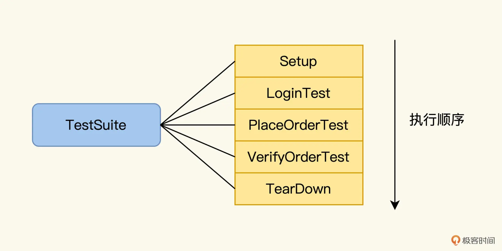
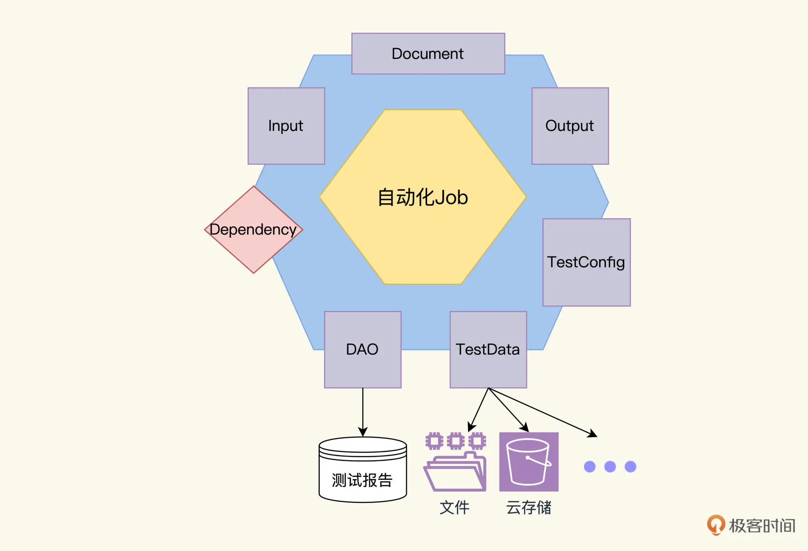
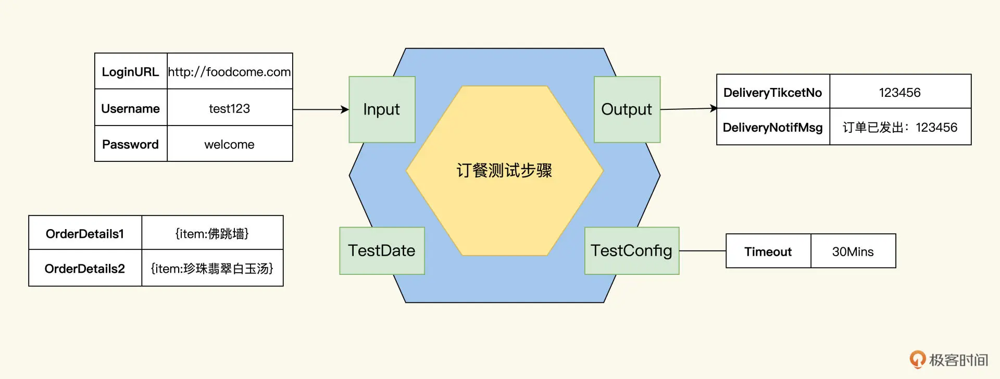
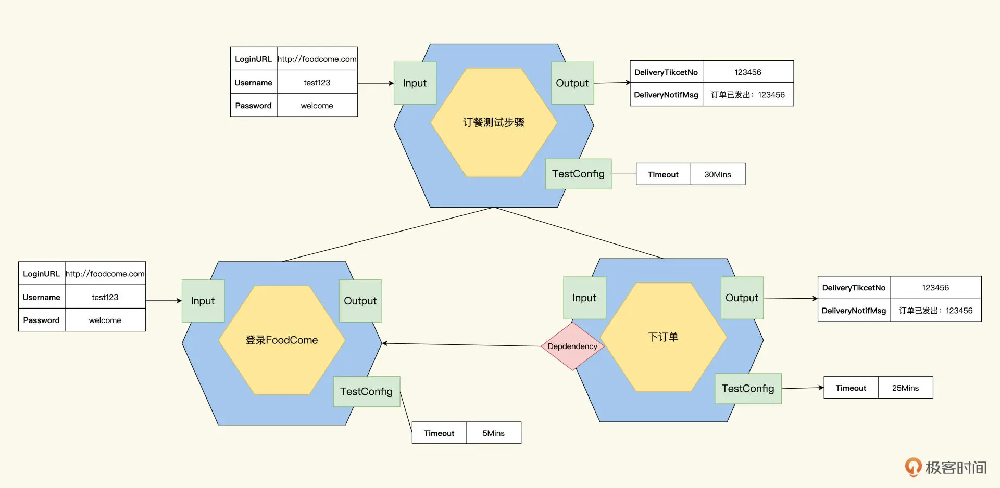
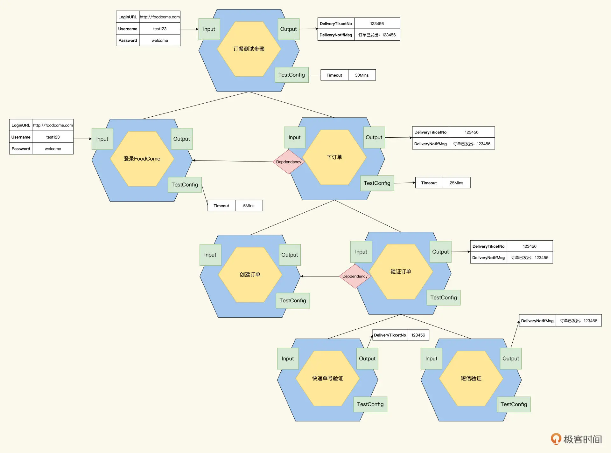
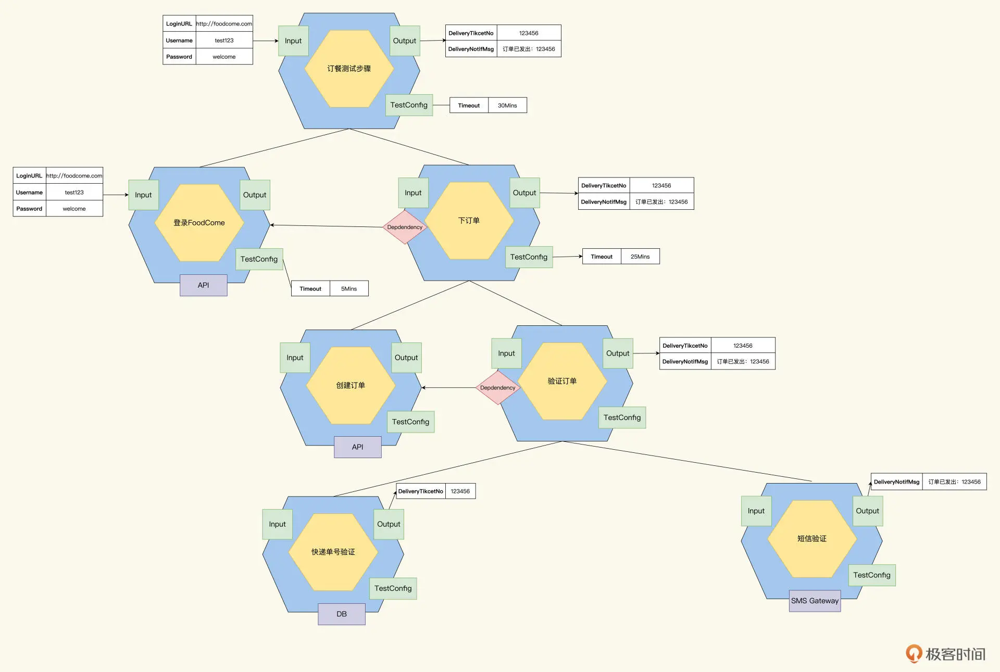
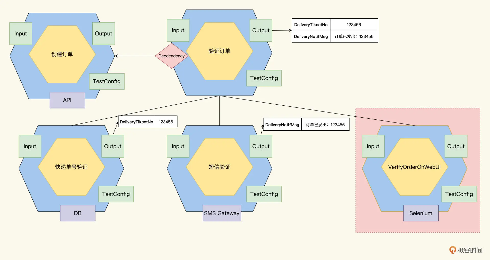
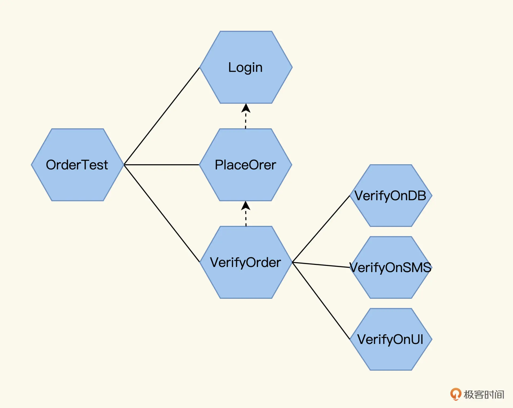
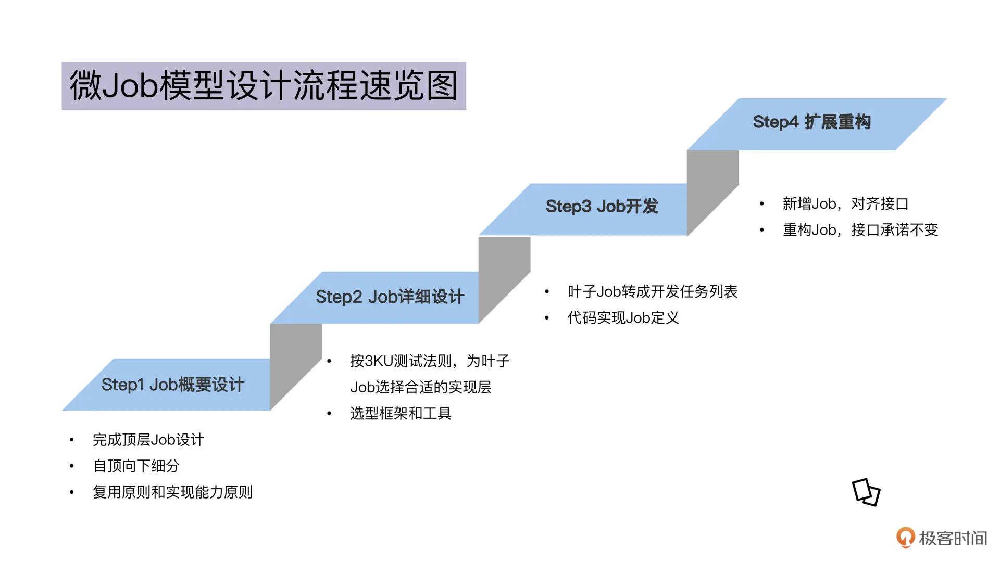

# 19 | 排兵布阵：自动化测试的编排、扩展与重构

你好，我是柳胜。

通过前面两讲，我们一起推导了一个自动化测试 Job 元数据模型。接下来，我不但会把这个Job 模型用到自动化测试设计里，还要“点石成金”，让你充分体会到这个模型的强大力量。

在讲解设计过程之前，我想先和你聊聊，现在的自动化测试设计有什么问题。

如果你做过自动化测试开发，对现有设计一定不陌生。通常做法是创建一个 TestSuite，它包含多个 TestCase，每个 TestCase 完成一个测试任务，然后顺序跑下来，测试就执行完了。就像下面这样。



- 传统做法

我相信，很多自动化测试开发人员刚入行的时候，就是这么学习和组织自动化测试案例的，一直到现在。

但你有没有想过，这种测试案例的组织方法是来源于单元测试。它的方法论是，有一个开发方法，就需要有一个对应的 Test 方法，两者一一对应。因为先有开发的代码存在，那么 Test 方法有多少个，都负责干什么事，这些都一眼到底，几乎不需要测试设计，往 Test 方法里填充代码就可以了。

这种自动化测试开发方法，我叫它“轻设计，重实现”的方法。不过，这种方法反过来也会潜移默化地影响自动化测试人员的思维方式。不想好自动化测试的设计，上来就先写代码，结果代码写出来又长又冗余。

而自动化测试已经发展了这么多年，早就不再局限于开发阶段的单元测试了，有 API 测试、UI测试等等。这些高层面的自动化测试案例，其设计往往以功能为入手点，对业务进行分解，进行自动化建模。在这个过程中，就不能像单元测试那样，有现成的开发方法做对标和参考了。

而在这样的背景下，自动化测试案例的设计，逐渐成长为一个非常重要的环节。所以，我们应该要走向“重设计，轻实现”的自动化测试开发方法。

所谓重设计，其实就是我们要像开发人员一样，去设计自动化测试案例，要考虑后面这三大关键问题：

1. 概要设计。要写多少个 TestJob，它们之间关系是什么？

2. 详细设计。每个 TestJob 该怎么实现？

3. 需要扩展和重构怎么办？

## 概要设计：要写多少个 Test Job？

我们先从概要设计开始梳理。一说概要设计，你是不是马上想到的问题就是：要写多少个Test？

但其实这个问题无法直接解答。因为刚开始规划一个软件系统的自动化测试，我们只知道一个大概的场景需求，并不会一下子就知道，需要开发多少个 Test Job。

比如下单功能，它是从 Web UI 下单，然后用户通过快递得到食物。为了去测试它，需要多少个 Test Job？做多少个检查点？这些问题，需要从概要设计中梳理出答案。

那概要设计怎么做？一步步来。

第一步，我们先把大概的自动化测试需求梳理出来，建模成为测试 Job，这里我们把测试 Job模型再“召唤出来”，一一去对号入座。



- 测试Job模型

### 先完成第一个根 Job

Job 的名字是“UserPlaceOrder”。Job 的 Input 是什么呢？要想启动 Job，需要有一个实例的URL，还有登录所需的 User Name 和 Password。

接着往下分析，Job 的 Output 是什么呢？用户得到食物。那用户得到食物的标准是什么？因为物流是 Foodcome 的第三方服务，FoodCome 处理完食物的标准是：生成物流单号，并且用户收到了“食物快递发出”通知短信。那我们 UserPlaceOrder 的 Job Output 就是DeliveryTicketNo 和 DeliveryNotificationMessage 两个信息。

Job 的 TestConfig 是什么呢？这里我们需要考虑的一个 Job 参数就是 Timeout。

从自动化测试的执行效率角度看，每一个 Test Job 都应该承诺在一定时间内完成，这样自动化测试的运行时间才能可控可预期。另外，从业务角度，每个业务都有SLA的时间要求。

设想一下，我们对客户承诺，处理一个订餐的单子最长时间是 30 分钟，那么对应在 Test Job的实现中，30 分钟后，如果还没有输出 DeliveryTicketNo 和 DeliveryNotificationMessage 这两个信息，客户的承诺没有达到，Job 应该就会失败。所以，我们在 TestConfig 里设定Timeout=30mins。

现在，UserPlaceOrder 的 Job 我们就梳理出来了，画成六边形是这个样子：



它的 XML 表达是这样一个文档：

```xml
<TestJob name="UserPlaceOrder" description="创建订单">
 <Input>LoginURL</Input>
 <Input>UserName</Input>
 <Input>Password</Input>
 <Output>DeliveryTicketNo</Output>
 <Output>DeliveryNotifyMsg</Output>
 <TestConfig>Timeout:30mins</TestConfig>
</TestJob>
```

这个 Job 写出来后，你就完成了 UserPlaceOrder 这个 Job 的概要设计，也相当于开发完成了一个小型系统的概要设计。

对于开发来说，系统用一个模块就能完成，还是由多个微服务共同完成，这取决于业务复杂程度和实现能力。

那对于自动化测试设计来说，这个 UserPlaceOrder 是直接就可以开发了，还是需要继续细化成子 Job，怎么决策呢？我们可以从复用性和实现能力两个角度，来决定是否拆分。

### 根据复用性进行拆分

先从复用的角度来看，登录是所有功能的前置条件，如果我们把登录测试任务提炼出来，是可以提高 ROI 的。按照这个思路，我们把 UserPlaceOrder Job 拆分成 Login 和 PlaceOrder 两个 Job，像这样。



### 根据实现能力拆分

再琢磨一下，PlaceOrder 这个 Job 包含了创建订单和验证订单两块逻辑。创建订单从 Web UI上完成，而快递单号需要从数据库里查到，但是短信要从短信网关上得到，所以DeliveryTicketNo 和 DeliveryNotifMsg 是两个技术上独立的实现的方法，它们应该被分割成两个 Job，每个实现用不同的技术，这也遵循了面向对象设计单一职责的 SRP 原则。



在分解 Job 的时候，子 Job 要实现父 Job 的对外承诺，也就是 Input 和 Output。而且在运行的时候，一个父 Job 的所有子 Job 都太运行通过，父 Job 才能通过。

这就是我们要创建一个 VerifyOrder 抽象 Job 的原因。因为它下面的 2 个子 Job，即快递单号和通知短信都要成功，verifyOrder 才算成功。

同样的道理，createOrder 和 verifyOrder 都要成功，它们的父 Job placeOrder 才算成功。这样，我们的 Job 设计就咬合在一起了。

讲到这里，我们再回顾开头那个问题：要写多少个 Test Job。是不是就有答案了？

作为测试架构师，或者自动化测试设计人员，你的首要任务是完成抽象 Job 的设计，把Input、Output、Testconfig、Testdata 先定义好。之后要继续抽象再做拆分，还是按现在定义的 Job 实现接口，这个要交给你的自动化测试团队来决定。你其实不需要过多关心他们是怎么实现的，又用了多少个 Job。

但是我们要注意， Job 的拆分是有一个度，太大了，将来维护和诊断就会很费力气。你想想诊断一个 1000 行的代码模块和一个 100 代码模块，哪个更容易，就能明白了。拆分得太细了，就会让复杂度升高。

拆不拆分，你要遵循这两大原则：第一，提高复用性，也就是 ROI；第二，方便独立实现和维护。

## 详细设计：Test Job 怎么实现？

可能你注意到了，设计 Job 的过程，在思维上是一个笼统的想法逐渐细化的过程，反映在 Job模型上，就是从一个 Job 生长成一棵 Job 树的过程。

你可以看看后面这张图，它能形象地描述这个过程。


设计完成后，这个 Job 树的每一个叶子，就是我们概要设计的成果，它是我们最终细化到可开发的实例 Job，也就是传统的 Test Case 了。

这些实例 Job，我们还要决定怎么来实现，放在金字塔的哪个层面做测试，具体用什么工具框架，详细设计做完之后，就能进入具体实现环节了。

按照第一模块讲的 3KU 法则（可以回顾第二讲），我们就可以确定每个 Job 要在金字塔的哪一层来完成。确定了这一点，工具和框架自然也就可以确定了。

对于我们的订餐系统，Login 放在 API 层面，使用 RestAssure 框架；CreateOrder 在 API 层面，使用 RestAssure 框架；DeliveryTicketNoVerify 在 DB 层面，使用 JDBC；DeliveryNotifMsg 在 SMS gateway 层面，使用 Java 或 Python。

我在六边形下面加了一个紫色的方块，来代表实现方法。



到这里，我们就可以进入到实现阶段了。自动化测试 Job 就是一个个具体的模块，有输入、有输出、有实现方法，足以指导自动化测试开发人员去开发代码了。

而负责 Job 开发的自动化测试开发人员，并不需要了解整个 Job 蓝图，只要他按照接口去做，就可以把实体 Job 组装到场景里。这个跟开发的思维是一样的，每个开发人员遵循详细设计开发一个个模块，最后整个系统就会运转起来，也就是模块化开发。

## 扩展和重构

设计做得好不好，还要考察扩展和重构的能力。所以，我们要看一下，Job 模型是怎么支持扩展和重构的。

### 扩展

假设未来有一天，我们发现前面的设计方案有瑕疵：比如，这个工作流没有走 UI 层面，没有验证 UI 上的功能表现。那我们就想加一个 verifyOrderOnWebUI 来验证订单，那怎么办呢？

我们还是先梳理 verifyOrderOnWebUI 的 Input 和 Output，它所需要的 Input 用户名、订单号这些信息，是否已经存在，又是由哪个 Job 输出的。明确了这些，只需要把verifyOrderOnWebUI 的 Depdency 指向它即可。其实意思就是，前面的 Job 运行完了，有了这些信息了，verifyOrderWebUI 就可以运行。

在这个具体的场景里，我们把 verifyOrderOnUI 就作为 verifyOrder 下的一个子 Job，可以复用 verifyOrder 的 Depdency 和 Input。



### 重构

跟软件开发一样，自动化测试也需要修改、重构。在传统的自动化测试代码里，没有 TestJob这个概念，往往是一个工具下面带着一群 TestCase 代码。

TestCase 之间的依赖和数据交互这些逻辑会存在隐式的耦合，一换工具，全部的 Test Case都要重新写，即使重写其中一个 Test Case，也要倍加小心，说不定就会影响到其它的TestCase。

而有了 TestJob 之后，每一个 TestJob 都有清楚的接口，可以有自己独立的实现方法。这也符合面向对象设计中的单一职责 SRP 原则和开放 - 封闭 OCP 原则。我们可以把修改的影响，控制在 TestJob 的范围内。



这个修改可以是代码的修改，也可以是工具的替换。比如，有一天我们发现 verifyOrderOnUI的 web 测试工具 Selenium 不好用了，想替换成 Nightwatch，怎么办？很简单，这个替换仅限于这个 Job，所以用 Nightwatch 重写一遍，只要保证 Input 和 Output 不变，就是对外承诺不变，我们心里就有底了。

## 小结

为了让你理解透彻，我再用类比的方式，为你概括一下微测试 Job 理论：一个微测试 Job，就好比开发里的一个微服务，它是有独立的接口，配置和实现方法。运行这个微 Job 就是完成了测试任务，它会有自己的状态，通过、失败还是无法运行；同时，它会输出自己获得的数据，供其他 Job 使用。

我为你准备了一张图，帮你快速回顾微 Job 模型的设计流程，你可以保存下来做个参考。



在我看来，这个微 Job 模型是一种新的设计思维。它给我们带来好处是，让自动化测试有了设计先行的理论基础，而且能够分解复杂的测试场景，降低和工具框架的耦合。

但这也带来了新的问题，虽然方法论上站住了，但落地的时候会有挑战，因为 Job 会比以前切得更碎，Job 模型转成自动化测试案例的时候，这最后一公里路应该怎么走？下一讲我们再继续。

## 思考题

你的手工测试案例是怎么设计的呢？想想能不能也用 Job 模型来设计呢？

欢迎你在留言区跟我交流讨论，也推荐你把这一讲分享给更多朋友。
