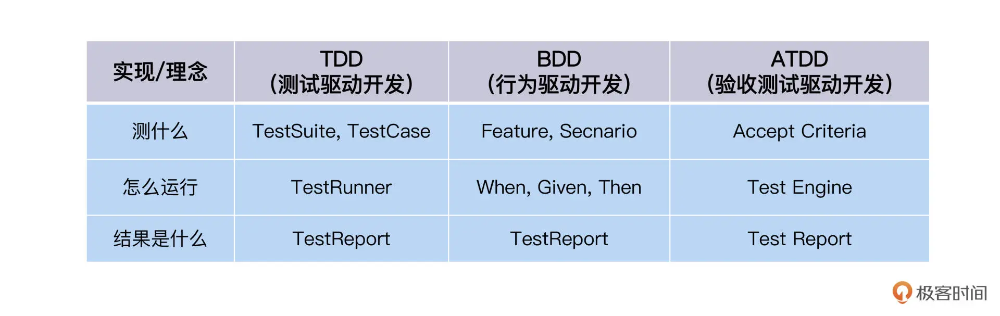
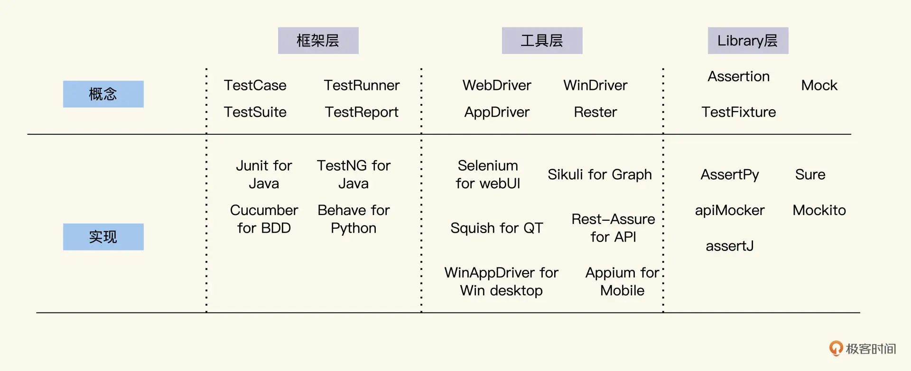
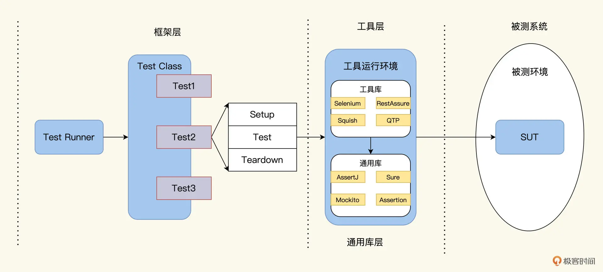
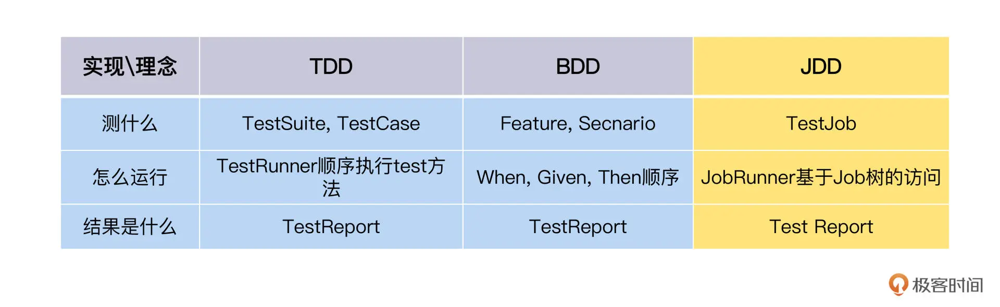
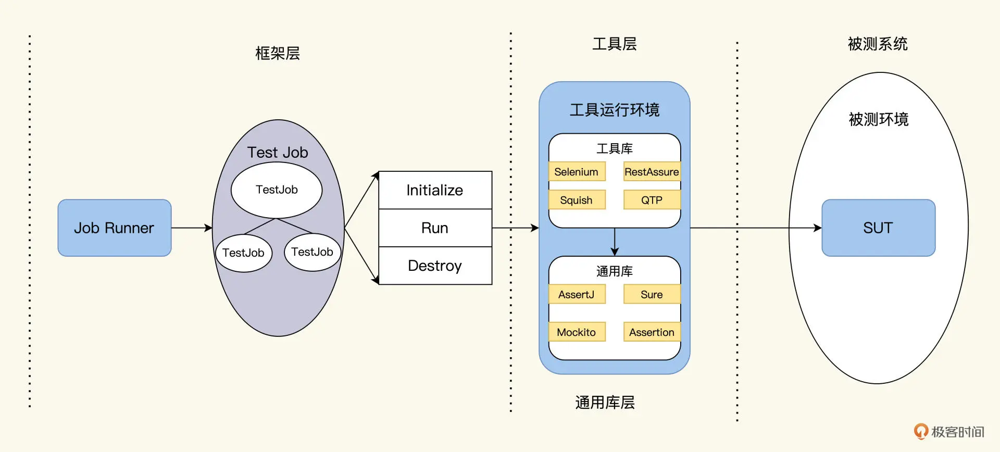
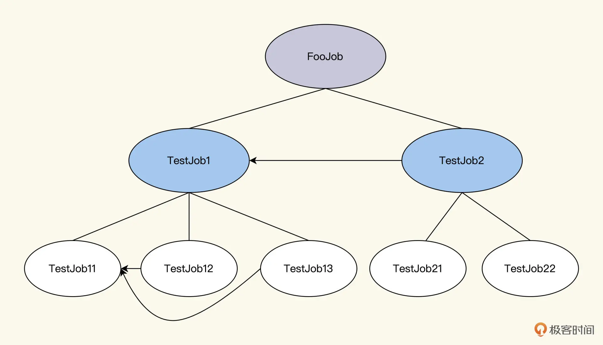
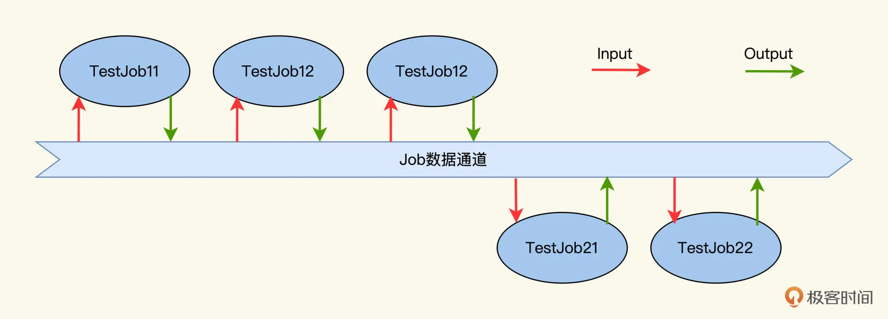

# 20 | 链接工具：要驱动工具，不要被工具驱动

你好，我是柳胜。

在上一讲的微测试 Job 设计方法论里，我们把工具打入了“地牢”，但你可能还是对它念念不忘。毕竟设计开发的最后一公里路，Job 模型还是要转换成一个具体工具的自动化测试案例。

战略上我们都不愿束缚思想，被特定工具牢牢“绑票”，而战术上又要用好工具。因此，如何驱动工具实现 Job 模型这个问题，我们就必须解决，要是做不到，我们就不得不走回老路，看着那些工具稳坐 C 位。

我们不想看到这种情况，所以这一讲，我们继续深挖后面这两个问题：

1. 主流的工具框架能不能被驱动？

2. 这些工具框架怎么和微测试 Job 模型对接，执行 Test Job？

解决完这些问题，微测试 Job 模型就算是可以落地了。

## Job 模型往哪里放

要想让 Job 模型落地，我们首先要找准它应该落在哪个地方。尤其在业界，自动化测试工具和技术可谓层出不穷、眼花缭乱。我们势必要理清它们之间的关系是什么，才能知道 Job 模型应该放在哪里。

按功能效用，我把各种自动化测试技术划分成了三个层面：框架层、工具层和 Library 层。

先来看框架层，这一层负责自动化测试的设计。其实它主要回答了设计的三个问题：测什么、怎么运行、结果是什么。

问题相同，解法各异。不同的测试理念，最终催生了面向这三个问题的不同答案，比如TDD、BDD、ATDD。我画了一张表格，帮你更直观地对比它们：



第二个层面就是工具层，这一层负责自动化测试的实现，把测试任务转换成代码，用各种工具跟被测试对象打交道。

比如，跟 Web 对象打交道的工具有 Selenium、QTP，跟 Windows 对象打交道的工具有WinAppDriver 等，跟 API 打交道的工具有 SoapUI 和 RestAssure 等。所以，工具的能力主要体现在对象的识别和控制能力上。

第三是 Library 层，主要提供了自动化测试运行的支持库。比如 Mock 库，Assert 库等等。

我把业界一些常用工具，按照三层来做了一个归类，如下图，你这样看会更清楚一些。



以 TDD 为例，这三个层面的调用链条是这样的：



显然，Job 模型应该要放在框架层。我给它起了个名字 JDD，加在这个表格里。



与 TDD 对比，JDD 的实现会是这样：



在这个分工图里，JDD 和 TDD 起到一样的功能，首先遍历找出所有的测试案例，计算出执行路径，交给工具层去执行。

在 TDD 里，对于 TestRunner 这两件事都比较简单，测试案例都有注解，执行路径一个个顺序执行就可以了，但在 JDD 里，对于 JobRunner，要找出 Job 树的所有叶子结点，根据依赖关系，计算出执行路径。这件事涉及到算法和实现。我们需要进一步理一下该怎么做。

## Job 模型怎么实现

我们在把自动化测试技术进行分层后，从设计到实现，现在各个环节的分工更加清楚了。但实际应用中，你会发现这个层面是模糊的。有的工具遵循了框架和工具分离，比如像Selenium，RestAssure 这些工具，它们可以和 Junit 集成、也可以和 TestNG 集成，而有的工具比如 QTP、Squish，直接提供了一揽子解决方案，从框架到工具，到检查点都是玩自己的一套。

如果你的团队正在使用多个工具，又想要落地 JDD，那就要理清这些工具的接口层面，然后才能用 JDD 来驱动它们。

### JobRunner 的实现

以 Junit 为例，我们先看看，现在最常用的 TestRunner 是怎么实现的？

测试人员要在 Test Class 里给 method 上加 @Test 注解，表示这个方法就是一个 TestCase。

```java
public class OrderTest{
 @Test
 public void testCreateOrder1(){
   //test logic 1
 }
 @Test
 public void testCreateOrder2(){
   //test logic 2
 }
}
```

TestRunner 的处理逻辑很简单，就是通过 Java Reflection 从 Test Class 里获得所有加了@Test 注解的方法，每一个方法就是一个 TestCase，运行方法就是运行 TestCase。

```java
public class TestRunner extends Runner {
   private Class testClass;
   public TestRunner(Class testClass) {
       super();
       this.testClass = testClass;
   }
   @Override
   public Description getDescription() {
       return Description
         .createTestDescription(testClass, "My runner description");
   }
   @Override
   public void run(RunNotifier notifier) {
       try {
           Object testObject = testClass.newInstance();
           for (Method method : testClass.getMethods()) {
           //判断方法是否加了@Test的注解
               if (method.isAnnotationPresent(Test.class)) {
                   notifier.fireTestStarted(Description
                     .createTestDescription(testClass, method.getName()));
                   //调用方法运行
                   method.invoke(testObject);
                   notifier.fireTestFinished(Description
                     .createTestDescription(testClass, method.getName()));
               }
           }
       } catch (Exception e) {
           throw new RuntimeException(e);
       }
   }
```

而微测试 Job 模型设计出来的 Job，用一个 XML 文件表达出来是这样的。

```xml
<TestJob name="FooJob">
 <TestJob name="TestJob1">
   <TestJob name="TestJob11"/>
   <TestJob name="TestJob12" depends="TestJob11"/>
   <TestJob name="TestJob13" depends="TestJob11"/>
 </TestJob>
 <TestJob name="TestJob2" depends="TestJob1">
   <TestJob name="TestJob21"/>
   <TestJob name="TestJob22"/>
 </TestJob>
</TestJob>
```

为了让你看得更清楚，我又画了个树状图，这样形象一点。如图所示，它是这样一个树结构，在同一个父节点下的子节点之间，可以有依赖关系。



那我们要运行 FooJob，该怎么运行呢？

你可以看到，要想运行 FooJob，实际上是运行它的两个子节点，TestJob1 和 TestJob2。但是TestJob2 依赖于 TestJob1，所以，我们就得先运行 TestJob1，再运行 TestJob2。运行TestJob1 的策略又和运行 FooJob 的策略完全一样，递归下去，把 TestJob1 这棵子树运行完。TestJob2 也按照同样的策略运行完。这时，FooJob 就执行完，返回最终执行结果了。

运行 FooJob，其实就是一个按照一定策略，去递归遍历 FooJob 树的过程。这个过程类似于树的深度优先 DFS 的前序遍历算法，只不过左右节点是靠依赖关系确定的，没有前置依赖的节点是最左节点，然后按照依赖关系从左到右排列。

JobRunner 的伪代码实现如下：

```java
public class JobRunner{
   private File jobXMLFile;
   public TestRunner(File jobXMLFile) {
       super();
       this.jobXMLFile = jobXMLFile;
   }
   public void run() {
       try {
           TestJob testJob = TestJob.loadFile(jobXMLFile);
           for(TestJob childJob:testJob.getChildJobs()){
             //当前job有依赖Job
             if(childJob.getDepends()!=null){
               //先运行依赖Job
               TestJob depdendedJob = childJob.getDepends();
               dependedJob.run();
             }else{
               //当有Job没有依赖Job，可以运行它了
               childJob.run();
             }
           }
       } catch (Exception e) {
           throw new RuntimeException(e);
       }
   }
```

JobRunner 对于上面 FooJob 的运行顺序如下：

FooJob->TestJob1->TestJob11->TestJob12->TestJob13->TestJob2->TestJob21->TestJob22

好，JobRunner 搞定了，自动化测试设计人员只管往 Job 树里加减 Job，JobRunner 会帮你理清执行的计划。如果你给每个 Job 增加一个权值，JobRunner 甚至帮你理出一个冒烟执行链。这个怎么实现，我留给你课后思考，后面我们留言区里交流。

### Job 的 Input 和 Output

说完了 JobRunner，我们再来看看输入和输出，这是 Job 模型和 TestCase 的另外一个重要区别。因为 Job 运行之前会从外接收数据，运行之后，会向外输出数据。在这个过程中，它只关心自己的逻辑和对外的承诺，并不需要关心谁会使用它的 Output。

你可以想象是这样的一个场景，有一条像传送带一样的数据通道，Job 可以从这个数据通道上取东西，也可以放东西。



要实现 Job Input 和 Output 机制，核心就是实现这个数据通道。

因为能提供数据通道功能的载体有很多种，这块我鼓励你广开思路：可能你先想到的就是Hashmap，那数据通道可以是内存里的一张 Hashmap 对象。数据都是 Key Value 方式存储在Hashmap 里，读取 Input 就是 Map.getValue(Key)，写入 Output 就是 Map.put(Key,Value)。

这种方式的优点是简单，缺点是它有一个前提，就是所有的 Job 都在一个进程里。

如果我们想跨进程来读取 Input 和 Output，可以采用最常见的文件方式。把数据放到文件系统的一个 txt 文件里，读取 Input 就是读文件操作，写入 Output 就是写文件操作。但文件方式也有局限，一个局限是并发写入需要引入文件锁的机制，另外一个局限是，本地文件也没办法应对分布式跨主机的 Job。

当然，最强大的解决方案就是 Message Queue，启动一个 Message Queque 的 Broker 服务，RabbitMQ 或者 Kafka，Job 通过 Queue Client 来操作 Queue 里的消息。

总之，方案多多，所以我想给你的选择建议是，基于我们专栏的观点“做性价比最高的自动化测试”，不要过度工作，追求强大。强大的另一面就是复杂。所以，寻找合适、够用的方案就可以。

### 驱动工具

现在我们看剩下的最后一个问题：Job 模型怎么驱动工具？

具体包括两种情况。第一种，对于那些和框架解耦的工具，像 Selenium，RestAssure，它们的 TestCase 不需要变，我们只需更换调用框架就可以了。用自定义的 JobRunner 来替代传统的 TestRunner，然后提供数据 Channel 的 API，用来操作 Input 和 Output，整个 Job 模型驱动就运转起来了。

```java
public class seleniumLoginTest{
 String username="";
 String password="";
 @setup
 public void setUp(){
   //从DataChannel里获得input
   username = DataChannel.getInput("username");
   password = DataChannel.getInput("password")
 }
 @Test
 public void login(){
   //执行登录
 }
 @TearDown
 public void tearDown(){
   DataChannel.output("output1","outputValue1");
   DataChannel.output("output2","outputValue2");
 }
}
```

另外一种情况，对于那些和框架深度绑定的工具，比如 QTP、Squish，这个时候我们要切割出它们的框架面和工具面。让工具面和新的 JDD 框架进行对接。

这个时候，你可以找它的驱动接口，去执行 Job。比如 QTP 提供了 Automation ObjectModel：

```
' A Sample Script to Demostrate AOM
Dim App 'As Application
Set App = CreateObject("QuickTest.Application")
App.Launch
App.Visible = True
App.loadTest("/user/sheng/myQTP/script")
App.run()
App.close
```

详细的接口信息，你可以从工具的官方网站得到，比如 QTP 的接口信息你可以查看这个链接。

## 小结

现在我们总结一下。现在常用的 TestCase 方式，对自动化测试设计能力的支持非常有限，它是一种弱设计。而 Job 模型则让自动化测试的设计更加强大丰富。

Job 模型怎么落地呢？我们先把业界的自动化测试实现理念捋了一遍，分成了框架层、工具层和通用库，这样就清楚多了。Job 模型落地在框架层，需要实现自己的 JobRunner，对 Job树进行遍历，生成执行路径。

另外，Job 的 Input 和 Output 是 Job 之间的重要交互方式，我们也找出了三种实现方法，分别是 Hashmap，文件和 Message Queue。

在 Job 模型下，自动化测试层次更加清楚，设计和实现的分工也更加清晰明确。

设计的产出结果是整理出 Job 树，Job 树的表现形式是一个 XML、Yaml 或者 Json 文件，这就相当于开发用 Swagger 来表达 OpenAPI 的设计；而到了自动化测试实现阶段，才是工具登场的时候，利用工具实现 Job 模型，就像是开发去实现 Swagger 定义的 API 一样。这样就达到了分层清楚，驱动工具的效果。

后面三讲内容，我们就利用 Job 模型来讲解更多的实践案例，下一讲先从一个最简单的金融交易自动化测试开始，金融业务的特点是复杂，精准度要求高，Job 模型能不能理清复杂的金融业务呢？敬请期待。

## 思考题

你的自动化测试设计目前是怎么做的？是以什么方式输出这个设计方案的？

欢迎你在留言区跟我交流讨论，也推荐你把这一讲分享给更多朋友。
