# 22 | 设计实战（二）-一个全周期自动化测试Pipeline的设计

你好，我是柳胜。

说起交付流水线，你可能立马想到的是 Jenkins 或 CloudBees 这些工具，它们实现了从 CodeBuild 到最终部署到 Production 环境的全过程。

但 Jenkins 只是工具，一个 Pipeline 到底需要多少个 Job，每个 Job 都是什么样的，这些问题Jenkins 是回答不了的，需要使用工具的工程师去思考去设计。在实践中，通常是 DevOps 工程师来做这个设计。

既然我们学习了微测试 Job 模型，也知道了它能帮助我们去做自动化测试设计，那用这个模型，能不能帮我们做 Pipeline 设计呢？其实，Pipeline 本质上也是一个自动化测试方案，只不过它解决的场景是把软件从代码端到生产端的自动化。

掌握设计思维是测试工程师向测试架构师的必由之路，假设今天你需要设计一个 Pipeline，把一个 Example Service 的代码，最终部署成为生产环境的一个服务进程。完成这个工作，你不仅能弄明白 CICD 的原理和实现，而且对自动化测试 Job 怎么集成到 CICD，也将了如指掌。

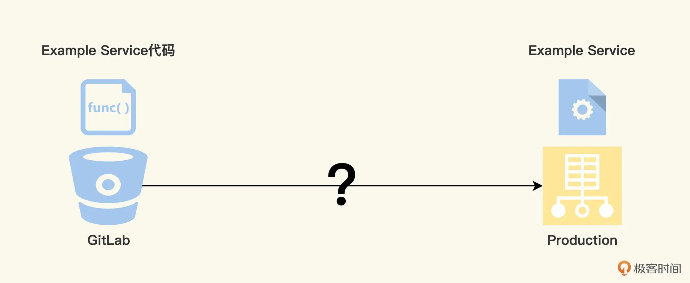

## Example Service 的 Pipeline 的目标

还是按照 Job 模型的设计原则，先理出 Pipleline 的第一个根 Job。

Pipeline 的起点在哪里呢？很显然，它从一个 GitLab 的 repo 开始，准确来说，要能访问Example Service 的代码。怎么能访问代码呢？我们需要知道两个信息，代码仓库的 URL 地址和访问的 token。

1.GitLab 的代码仓库地址：http://gitlab.example.com/sheng/exampleservice.git

2. 访问 token：token-123456

Pipeline 的终点到哪里呢？很简单，最后 Example Service 能够在生产环境运行起来，运行起来的标志，就是 Example Service 的工作 URL：http://prod.example.com

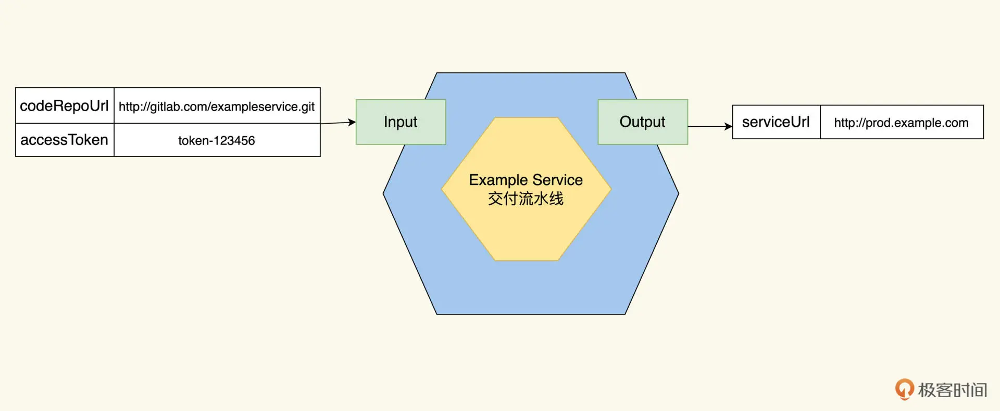

## 划分 Pipeline 的阶段

这个从代码转成生产环境服务的过程，至少要完成两次转换。

第一次转换是把代码转成可部署包，第二次是把可部署包转换成运行态服务。为了把好验证关的大门，我们还要在这两次转换中间再加入一个测试任务，那么 Pipeline 就可以分解成 3 个子 Job，分别是开发 Job、测试 Job、部署 Job，它们依次完成，全部运行通过，最后才能部署到生产环境。如下图：

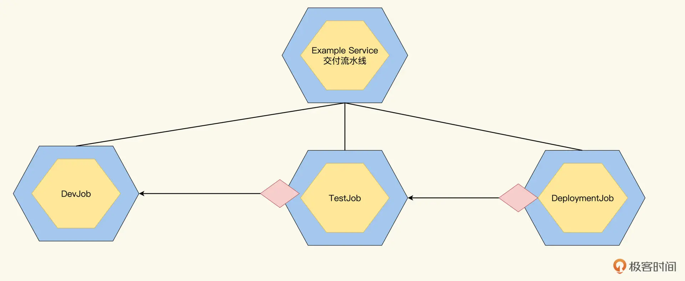

这三个 Job，我们依次来看一下它们都需要干什么活。

首先，我们来看看 DevJob。开发阶段测试 Job，作为整个 Pipleline 的初始 Job，Pipeline 的Input 就是 DevJob 的 Input。

1.GitLab 的代码仓库地址：http://gitlab.example.com/sheng/exampleservice.git

2. 访问 token： token-123456

DevJob 要做什么呢？它前面连接了代码库，后面要对接集成测试，它的主要职责就是把代码变成可部署的 Package。

Input 有了，DevJob 要输出什么呢？我们要知道，DevJob 的输出会作为下一阶段 Job 的输入，设计 DevJob 的输出就跟接口设计一样，不同的接口都能让系统工作，但我们要选择最合适那一种。

比如，我们可以让 DevJob 输出一个 Example Package 的仓库地址，代表 Package 已经打好了，并上传到了仓库，或者我们输出单元测试报告；甚至，DevJob 也可以什么都不输出，让下一个 TestJob 自己去按照双方约定好的 Ftp 服务器上去取包。

哪种方案更合适呢？

这里你要考虑两点：第一，我的输出别人是否用得到？像单元测试报告这种信息，是我DevJob 内部的工作产物，别人不会感兴趣。按照面向对象设计原则，这些细节应该隐藏在DevJob 内，不向外公布。

第二，我的输出是不是信息显式而充分的？像多个 Job 都遵循一个约定，去指定的 FTP 服务器上去取放 Package，这个信息交互就是隐式的，没有在接口上体现出来。这样是有隐患的，如果之后各个 Job 变更重构的时候，就会出问题。

根据这个原则，我们让 DevJob 输出一个 Example Package 的仓库地址

DevPackageURL: http://nexus.exmaple.com/content/repositories/exampleservice_1.0.1.jar如果 DevJob 输出了这个 URL，就代表 DevJob 已经运行通过，把代码变成了 Package，而且把 Package 放到了组件管理平台 Nexus 上去，别人就可以用了。

你可能会问，拿到了 Package URL 还需要 Nexus 的用户名密码才能访问。那下一个 Job 从哪里获知用户名和密码呢？这时，就可以用到我们 Job 测试模型的 TestConfig 属性了。直接把用户名、密码放在 TestConfig 就可以了。

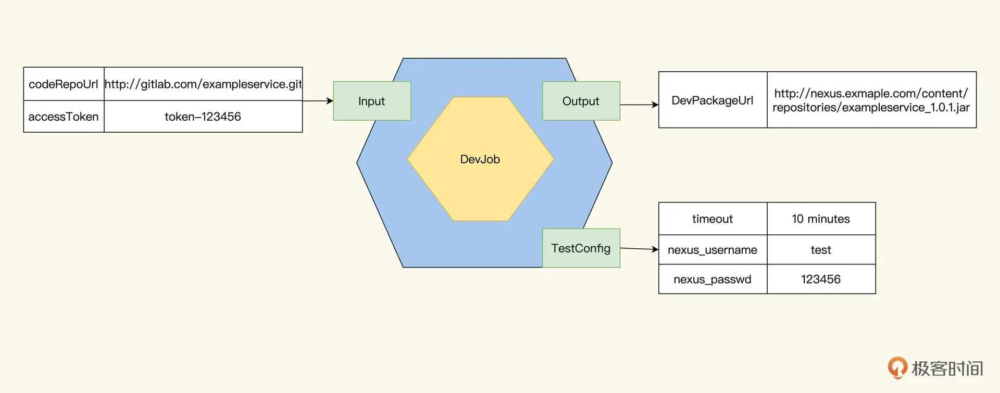

同样的思路，我们也能整理出 TestJob 的 Input 是 DevPackageUrl，Output 是ReleasePackageUrl：

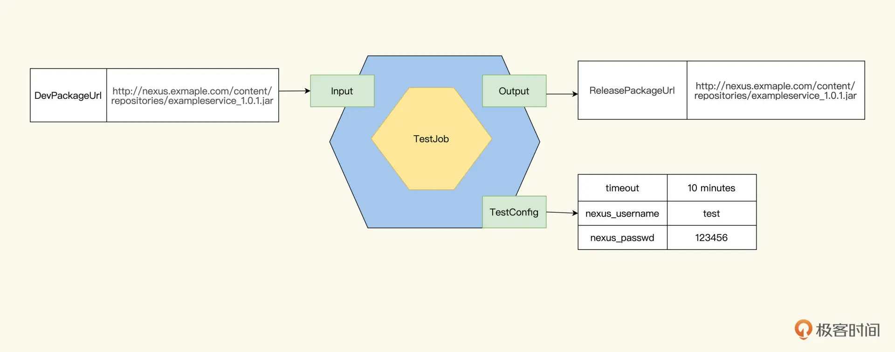

DeployJob 的 Input 是 ReleasePackageUrl，作为 Pipeline 最末一个 Job，Pipeline 的输出就是 DeployJob 的输出：

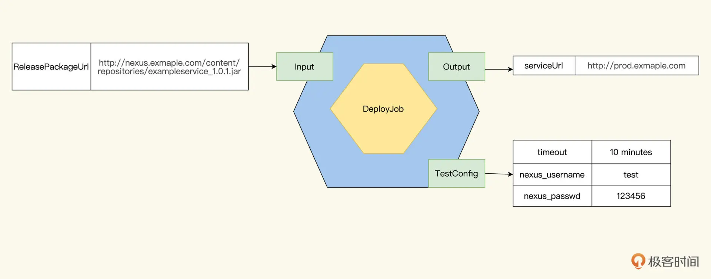

推演到现在，整个 Job 树就成了后面这样：

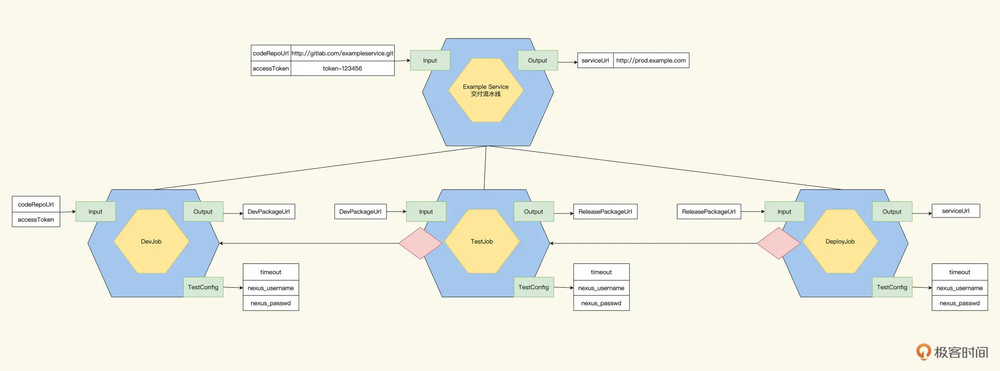

我们把 Pipeline 拆分成 Dev、Test 和 Deploy 三个 Job 后，就可以把它们分别指派给开发人员、测试人员、运维人员，由他们来推进下一阶段的设计了。至此，概要设计告一段落。

## 各阶段 Job 的详细设计

我们在上面的设计中规划了 3 个阶段，明确了作为 Pipeline job 的第一级子 Job：DevJob、TestJob、DeployJob。但每个阶段要做什么具体任务，还需要进一步详细设计。

### DevJob

我们先看 DevJob，它的 Output 是一个可执行包。

怎么完成从代码到可执行包的转换呢？当然要进行构建，也就是 Build。

BuildJob 的模型很容易梳理，它的 Input 是 codeRepoUrl，而 Output 是 DevPackageUrl。BuildJob 从代码库里抓取代码，构建，然后打包生成 Package，上传到对象仓库，就完成了。

但 build 通过了后，是不是可以直接产生 DevPackage 呢？这里我分享一个“保险”措施，为了保证质量，我们可以在 build 之后，加上一个测试任务，也就是单元测试 UnitTestJob。单元测试通过之后，再输出 DevPackage。

UnitTestJob 就是运行单元测试，单元测试成功还是失败，就是 UnitTestJob 的结果。所以，UnitTestJob 的 Job 模型里，只设置一个 Dependency 就好了，指向 BuildJob。BuildJob 成功之后，才能运行 UnitTestJob。这里的 UnitTestJob，我们选用 Junit 开发框架就能实现。

现在 DevJob 被细分成了两个子 Job：BuildJob 和 UnitTestJob。

按照 Job 模型的规则，子 Job 都运行成功，父 Job 才能成功。所以，BuildJob 和 UnitTestJob运行成功，DevJob 才算成功，而 DevJob 成功了，后面的 TestJob 才能触发运行。

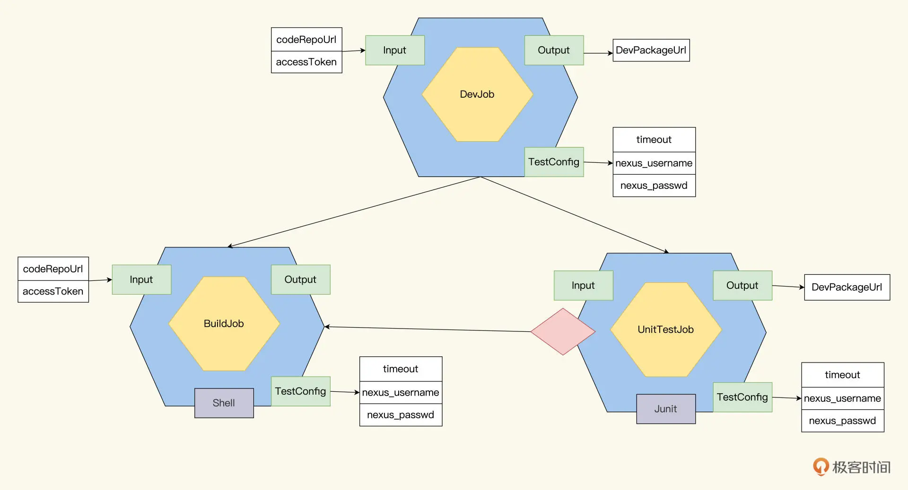

### TestJob

经过第二模块里策略篇的学习，我们知道了测试的策略有单元测试、接口测试和系统测试。单元测试一般是开发人员来做，已经包含在 DevJob 里了。而接口测试和系统测试，就需要放在TestJob 里。

先来看 APITestJob 的模型。APITestJob 作为 TestJob 的第一个子 Job，APITestJob 的 Input就是它的父 Job TestJob 的 Input，也就是 DevPackageUrl。有了这个信息，APITestJob 就可以开发实现了，它的自动化工具可以选用 RestAssure。

然后是 E2ETestJob 的模型，它的 Dependency 是 APITestJob，而 Output 是ReleasePackageUrl。至于 E2ETestJob 的自动化技术，我们可以选用 Selenium。

现在，可以把 TestJob 分解成了 2 个子 Job，APTestJob 和 E2ETestJob，Job 树如下：

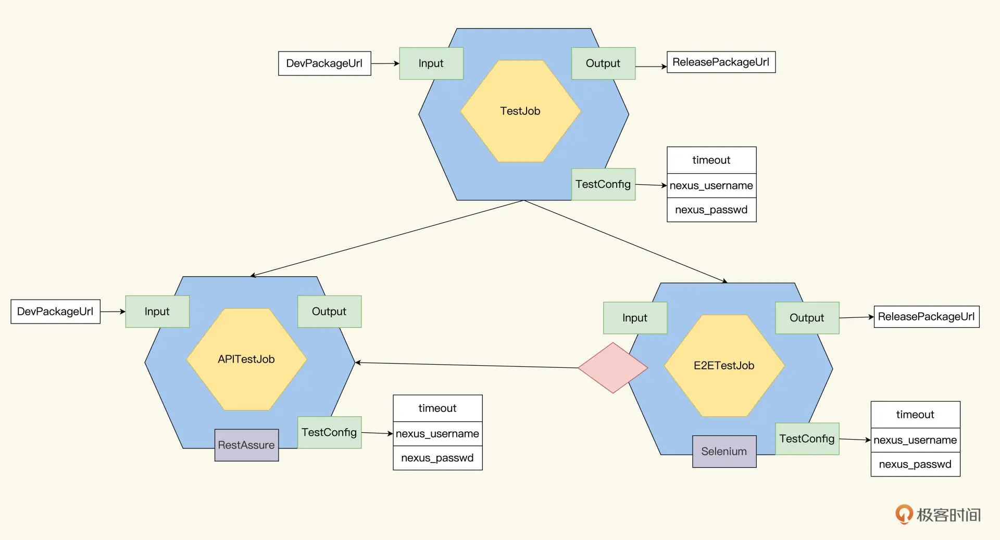

### DeploymentJob

又下一城，咱们一鼓作气，继续来看 DeploymentJob。

当 Pipeline 移动到 DeploymentJob 的时候，它会检查前置依赖 TestJob 的状态，只有成功了，DeploymentJob 才会运行。在运行的时候，DeploymentJob 会从 Input 获得一个ReleasePackageUrl，然后经过一系列部署操作，把 Package 部署到生产环境里开始运行，输出一个 serviceUrl。

为了完成这个过程，简单的做法是，DeploymentJob 不需要再细分子 Job，你可以直接把它当作一个可执行 Job，用部署脚本来实现。

## 转成自动化测试开发计划

搞定上面的设计后，现在 Job 树变成了这样：

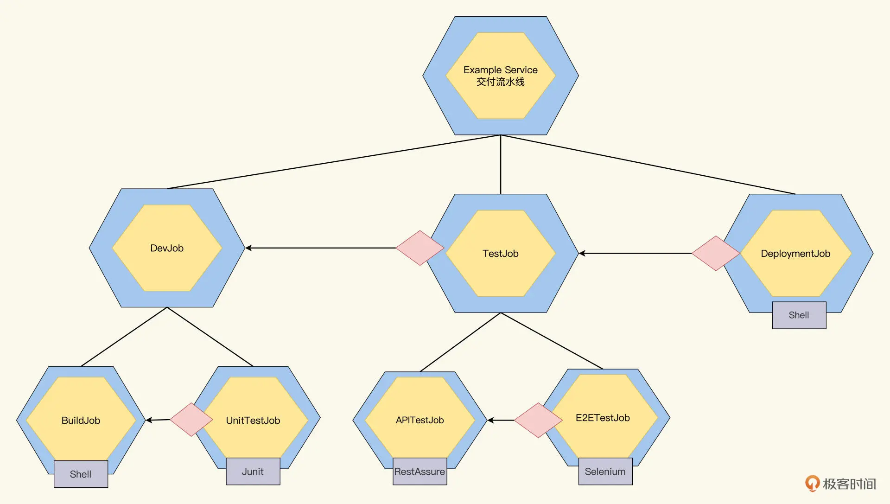

现在每一个叶子结点，就是可执行的 Job，需要自动化实现。

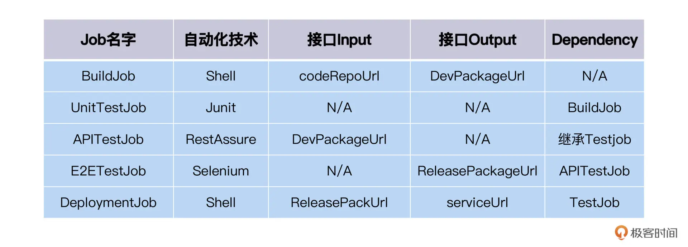

## 变更和扩展

在 Pipeline 搭建起来后，我们还要持续维护。这里有两种情形，一种是新增 Job，还有一种是扩展 Job。

先看新增 Job 的场景，我给你举个例子。比如开发人员有一天要引入 Sonar，做代码质量检测，那我们该怎么做呢？

动手前，我们还是先分析一下。Sonar 扫描，也是基于代码 CodeRepoUrl，这个和 DevJob的 Input 一致。这样，我们可以建立一个 SonarJob，作为 DevJob 的子 Job，可以复用DevJob 的 Input。

那 SonarJob 和 BuildJob，还有 UnitTestJob 是什么关系呢？这就看我们想怎么定义它们的依赖关系了。也就是谁在前端，谁在末端。

一般来说，代码扫描，应该发生在代码变更的最早时刻。一旦有代码提交，就首先检查代码的质量，如果代码质量不符合预定标准，就终止 Pipeline。实践里这样选择，是为了优先保证代码的质量。

基于这样的目标，我们就把 SonarJob 添加到 DevJob 下的第一个子 Job，让 BuildJob 依赖SonarJob，而 UnitTestJob 保持不变，还是依赖 BuildJob。

另外还有一种情形，就是某一个 Job 当时设计实现比较简单，后来需要扩展。比如DeploymentJob，刚开始我们用一段 Shell 脚本就可以轻松执行它。但随着 Deployment 要求提高，我们需要在 Deployment 结束后，还要执行测试任务，验证质量，然后再发布serviceUrl。面对这种情况，我们该怎么办？

其实这个场景，就跟开发一样，一旦代码规模扩大了，就需要分拆模块了。

在我们的 Job 树里，原先的 DeploymentJob 需要分拆了，拆分成 ExecuteDeployment 和TestDeployment，让 TestDeployment 依赖于 ExecuteDeployment。之前的 DeploymentJob变成一个抽象 Job，它的脚本实现挪到 ExecuteDeploymentJob 里，在新 TestDeployment里，加上测试任务即可。如下图：

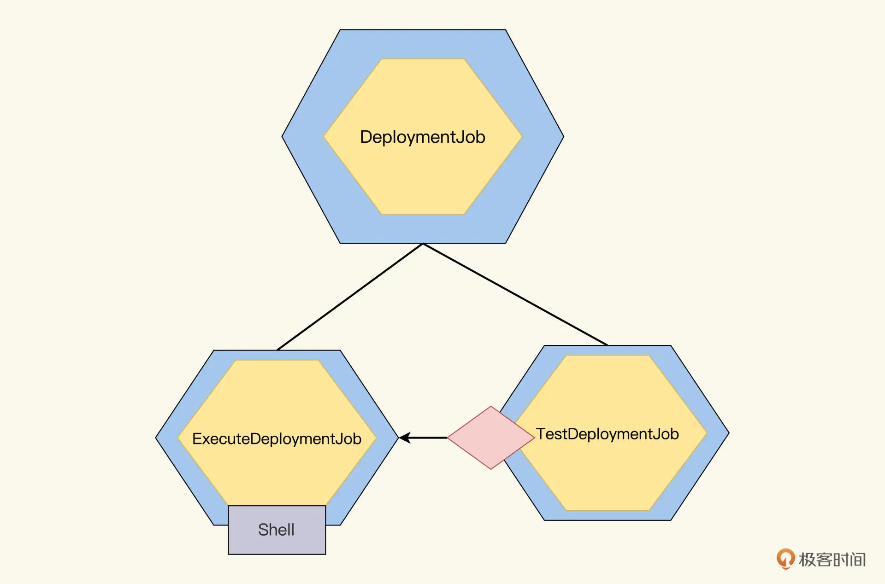

## 小结

为了检验咱们的 Job 模型威力几何，今天我们再次锻炼设计思维，进行了部署 Pipeline 的设计。经过案例演练，你现在是不是对 Job 模型更加熟悉了呢？

咱们回顾一下关键流程。概要设计里，我们完成了抽象 Job 的定义，对应着 Pipeline 划分的三大阶段：开发阶段、测试阶段和部署阶段，然后逐层细化，一直到实例 Job。而在详细设计里，我们不仅要确定实例 Job 的接口，而且还要确定它们的自动化测试实现技术。

做完设计，每一个叶子节点的 Job 都是要去开发实现的自动化测试任务。我们就可以整理出一个自动化测试开发任务列表了。

后面是 Job 树叶子工作表，供你复习回顾。

一个优秀模型，不光着眼于眼前的需求，还具备应对未来变化的能力。除了概要设计和详细设计，我们还推演了未来的应变策略。

当规模扩大时，原先的可执行 Job 的逻辑变得复杂的时候，我们依然可以根据 Job 模型，把可执行 Job 再进行分解成多个子 Job。需要注意的是，我们遵循的原则是只有叶子结点 Job才是可执行 Job，不再进行分解的 Job，而一旦 Job 下挂了子 Job，那这个 Job 就变成了抽象Job，只负责接口的定义。

今天讲了 Pipeline 设计，也是对前面 Job 设计内容的复习巩固。接下来，我们就要进阶到另外一个难度级别的设计了，不仅有多端协作，还有分布式事务，这种场景怎么设计？我们下讲见。

## 思考题

你负责或者参与的 Pipeline 原先是怎么设计的？看完这一讲，你想到怎么优化它了么？

欢迎你在留言区跟我交流互动。如果觉得这一讲对你有启发，也推荐你把它分享给更多朋友、同事。
