# 23 | 设计实战（三）-一个分布式多端视频会议自动化测试设计

你好，我是柳胜。

这几年疫情肆虐全球，远程办公越来越普遍了，视频会议的市场也变得更加火热。视频会议软件的质量，自然也需要测试保驾护航。

不过，视频会议软件自动化测试非常有挑战性，因为它有很多难点：第一，协作复杂；第二，分布式执行；第三，验证有技术难度。

今天，我们就来为视频会议软件设计一套自动化测试方案，用来测试视频会议的会议功能。

## 场景还原

我们先从视频会议的时序图开始分析，你就明白视频会议的自动化测试有多复杂了。这里我选择了一个迷你 demo，但麻雀虽小，五脏俱全。假定会议用户有三位：使用 Web 端的用户A、桌面用户 B，以及手机用户 C。

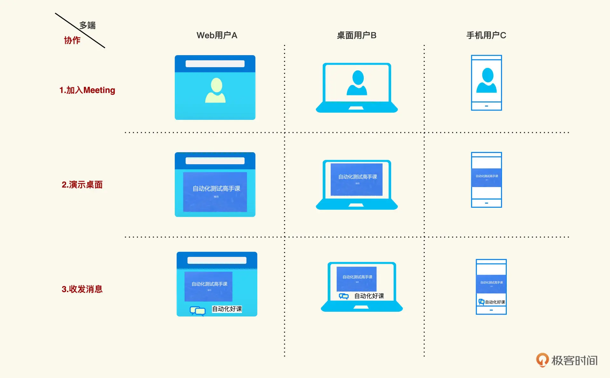

如图所示，Web 用户 A 先在浏览器创建一个 Meeting，发送邀请链接给桌面用户 B 和手机用户 C，然后 B 和 C 加入会议，A、B、C 三个人同时在线。

这时，用户 A 开始演示自己的屏幕，B 和 C 要收到 A 演示的屏幕；A 如果在聊天区里发送一个消息，B 和 C 也要收到这个消息。

这样一个复杂的场景，我们既要测试视频会议的分布式协作能力，还要测试会议的准确度，另外还要保证效率性能。这三方面的测试目标，我用表格的方式来举例说明，你可以看看。

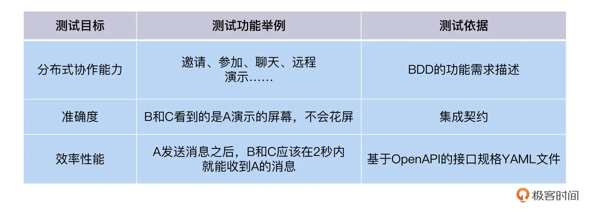

## 视频会议测试概要设计

那么，自动化测试该怎么设计和实现，才能达到上面的目标？我们先从概要设计开始分析。

还是遵循从顶向下的设计思路，我们先捋出来要完成视频会议测试，需要测试哪几个功能区。

首先是初始化，初始化的过程，是保证所有的客户端都进入到视频会议里；然后测试演示功能区，也就是完成一个客户端演示，其它客户端观看演示的过程；接着要测试聊天功能区，一个客户端发送聊天，其它客户端接收聊天；最后是退出，测试完毕后，各个客户端依次退出视频会议系统。

根据这个思路，我们先把视频会议 Job 切分成 4 个子 Job，如下图所示：

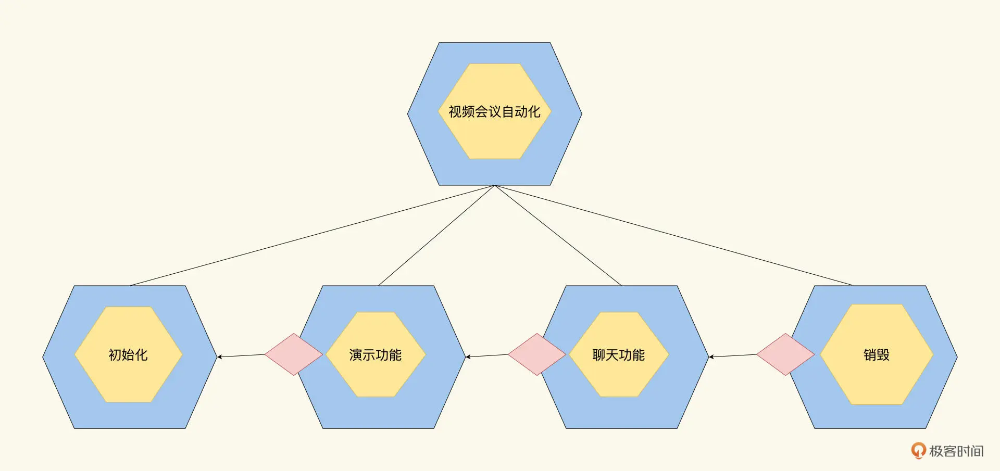

4 个功能首尾衔接，按照依赖关系和重要程度，权值高的排在前面。如果权值高的失败了，后续的 Job 就没有必要运行了。根据 Job 模型层级原则，如果有任何一个子 Job 失败了，视频会议自动化 Job 就会失败。

为了支持分布式，我们还需要在 Job 模型里加入一个 host 属性，指明本 Job 运行的主机环境。

像这样，host=“10.0.0.1”，就代表着本 Job 会被发送到 10.0.0.1 这台机子上去运行。

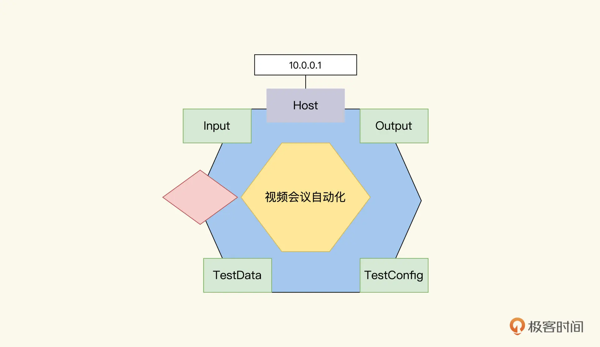

有了这个属性后，后面我们就好建模了。接下来，我们依次来看各个功能区怎么设计。

## 初始化功能设计

初始化 Job，要完成的任务是 A、B、C 进入会议，同时在线。怎么设计呢？

我们还是先按操作顺序梳理一下 A、B、C 都做了什么。

首先，A 要做一个 CreateMeeting 的操作，把它发到 10.0.0.1 主机上运行，输出一个MeetingUrl；然后，B 和 C 从 Input 里取到 MeetingUrl，在 10.0.0.2 主机上执行JoinMeetingDesktop，在 10.0.0.3 主机上执行 JoinMeetingAndroid 的 Job。

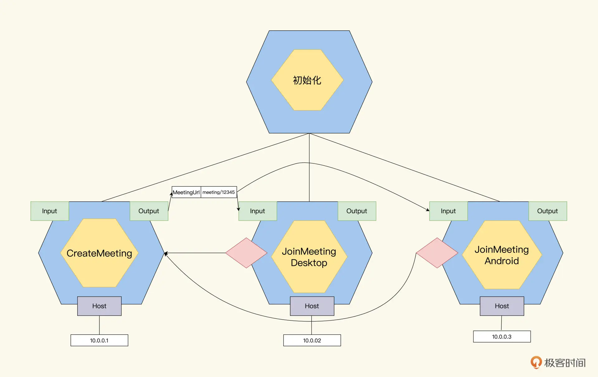

但有一个问题，初始化 Job 的运行结果是，A，B，C 都加入了 Meeting。怎么验证 A、B 和C 都加入到会议里了呢？又由谁去做这个验证呢？

可以这样设计，等 A、B、C 都执行完操作以后，再运行一个 VerifyJoin 的 Job，来验证 ABC是否都已经成功加入 Meeting 了。

在 Job 树上会有这样的结构：把 A、B、C 聚合成一个 ScheduleMeeting 的 Job，然后VerifyJoinJob 的 Dependency 指向 ScheduleMeeting Job。

在执行的时候，等到 ScheduleMeeting Job 执行完且结果为通过的情况下，VerifyJob 会才会开始执行。如果 A、B、C 其中有一个失败了，ScheduleMeeting 就会失败，VerifyJoin 的 Job也就没必要再去执行了。

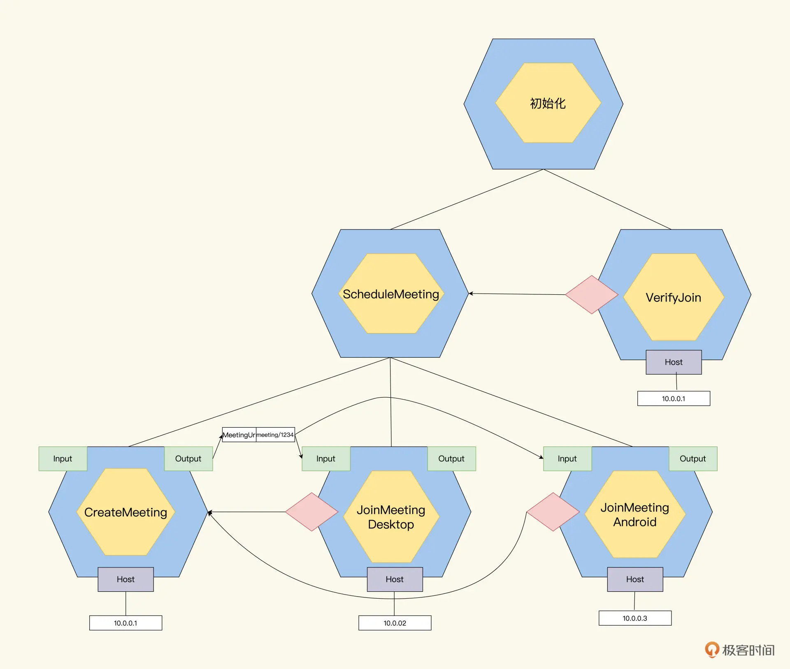

这种设计的好处是，整体自动化测试的健壮性很强。按照 Job 树的运行原理，运行顺序是这样的：CreateMeeting 先运行，然后是 JoinMeetingDesktop 和 JoinMeetingAndroid，最后再运行 VerifyJoin。任何一个失败，后面都不必运行了。

不过，这种设计也有一个问题，就是自动化测试运行的效率。VerifyJoin 的要等到ScheduleMeeting Job 全部执行完了，才能执行，整个自动化测试任务执行时间是这 4 个 Job执行时间的总和。

time(Total）=time(CreateMeeting)+time(JoinMeetingDesktop)+time(JoinMeetingAndroid)+time(VerifyJoin)假设 CreateMeeting 花了 30 秒，JoinMeetingDesktop 花了 20 秒，JoinMeetingAndroid 花了25 秒，VerifyJoin 花了 15 秒。那根据这个公式，总共执行时间是 30+20+25+15 = 90 秒，总共一分半的时间。

### 优化执行时间

怎么让执行时间缩短呢？面对这个问题，你可能会想到，有没有办法把串行执行变成并发执行呢？这样时间就缩短了。

没错，对于 Job 树上同一层级且没有依赖关系的子 Job 们，谁先执行、谁后执行都无所谓。为了加快执行速度，我们可以优化 JobRunner 的机制，用并发线程执行它们。

沿着这个思路，我们可以解除一些依赖关系，让执行效率得到提升，让 VerifyJoin Job 不再依赖于 ScheduleMeeting Job，VerifyJoin 和 ScheduleMeeting 同时启动。

VerifyJoinJob 并不知道 ScheduleMeeting 是否开始，何时结束，它就是不停地轮询 A、B、C是否都加入 Meeting，如果得到确认就返回，否则会直到超时报错。没错，这里我们可以用上Job 模型的 TestConfig 里的 TimeOut 参数，比如，我们给 VerifyJoinJob 设置 TimeOut 参数是 3 分钟。

在这个方案下，我们再算一下执行时间是多少。ScheduleMeeting 的执行时间的计算公式如下：

executeTime(ScheduleMeeting)=executeTime(CreateMeeting)+Max(executeTime(JoinMeetingDesktop),executeTime(JoinMeetingAndroid))30+Max(25,20)=55 秒

而 VerifyJoin Job 是和 ScheduleMeeting 是并发执行的，只要 ScheduleMeeting 成功运行，ABC 同时上线，VerifyJoin Job 就会立即成功返回。

所以，和上面同样的 Job，现在优化了 JobRunner 后，整个自动化测试的任务执行时间就缩短到了 55 秒。相比优化之前的 90 秒，自动化测试的运行速度加快了 40%。

而且，健壮性也得到了保证，即使有错误发生，也不会超过 3 分钟。根据上面的描述，你可以脑补一下相应的 Job 树还有它的时间计算公式。

## 演示功能设计

演示功能又是一个需要多端协作的场景。这是个什么场景呢？简单来说，A 开始演示 PPT 的时候，B 和 C 都要能看到这张 PPT。

我们可以用“初始化功能设计”的思路，来完成这个设计，A 要执行 presentPPT 的 Job，然后在 B 和 C 上分别执行 viewPPT 的 Job，就可以完成这个任务了。

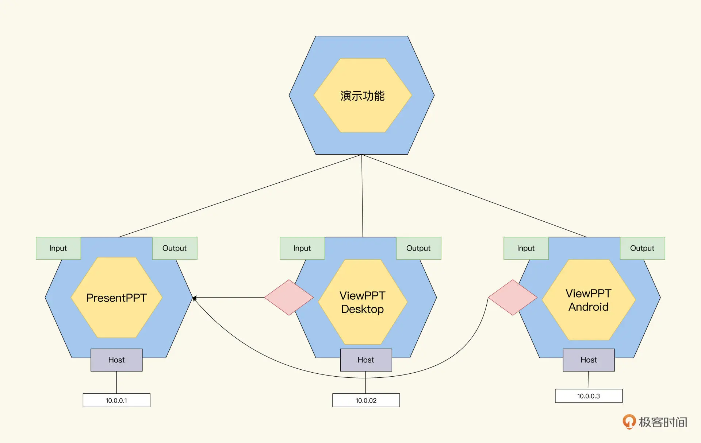

但是，相比“初始化功能”，“演示功能”有两个特殊的地方需要考虑，一个是屏幕相似度，另一个是屏幕切换的流畅度。

### 屏幕相似度

如何验证演示的正确性？当 A 展示一张 PPT 的时候，怎么让程序验证，B 和 C 看到的和 A 演示的是一样的 PPT 呢？

比如出现这样的屏幕是正常的。

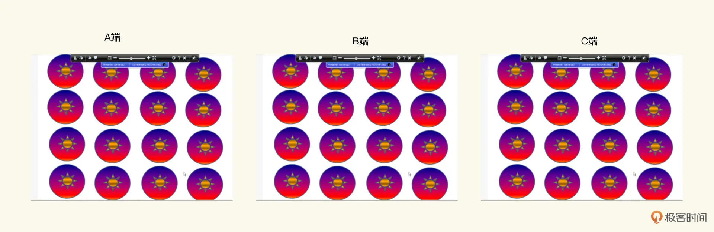

但下面这样，C 端出了问题，没有完整显示，下半部分有一块黑色区域。

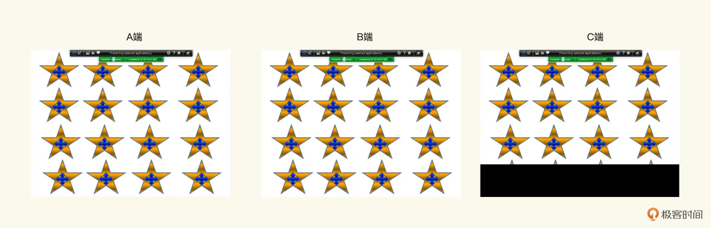

看到这里，你可能已经想到了，视频会议的屏幕演示，其实就是一帧帧的图片，我们可以采用位图比较的思路，来验证 A，B，C 所看到的屏幕是不是一致。

怎么实现位图比较呢？如果自开发的话，可以自己去写图像比较的算法，来计算两张图片之间的相似度。我给你列了一个表，里面提炼了几个经典算法的原理和优缺点。

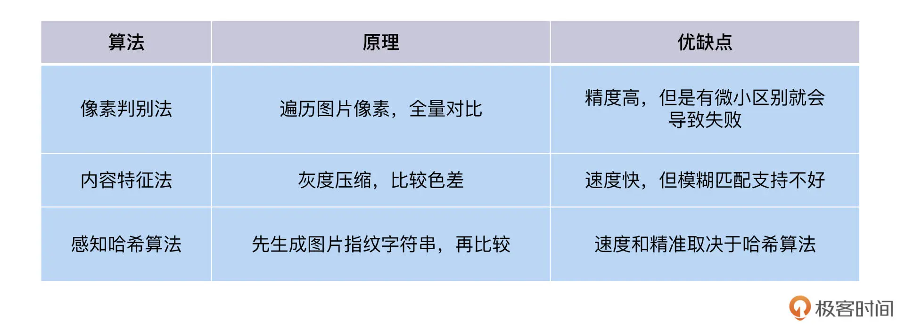

从上表可以看到，不同的算法，都有各自的优缺点和适用场景。而且，开发和维护这些算法的代码，也是一个不小的工作量。

那有没有智能对比图片的办法呢？图片识别和比较是 AI 擅长的领域，它们应用到测试领域就是 AI 测试。业界有两个比较成熟的两个 AI 测试工具，Applitools 和 Sikuli。

Applitools 是一个 AI 赋能的测试工具，通过视觉 AI 进行智能功能和视觉测试。具体怎么实现呢？

A 端先把自己的屏幕抓屏，保存成图片上传到 Applitools 服务器，形成一个基线。B 和 C 也把自己的屏幕图片上传到同样的基线，Applitools 会自动对同一基线的图片对比，得出结果。A、B、C 端执行的代码如下：

```
//创建基线 "Image-PresentScreen1"
eyes.open("Video Meeting", "Image-PresentScreen1 ", new RectangleSize(800, 600));
//对屏幕抓图
File file = Screen.capture();
BufferedImage img = ImageIO.read(file);
eyes.check("Image buffer", Target.image(img));
//关闭Eyes.
eyes.close();
```

在 Applitools 的网站可以看到三条成功的记录，A 和 B 和 C 上传的图片，Applitools 经过对比是一致的，所以结果为成功。

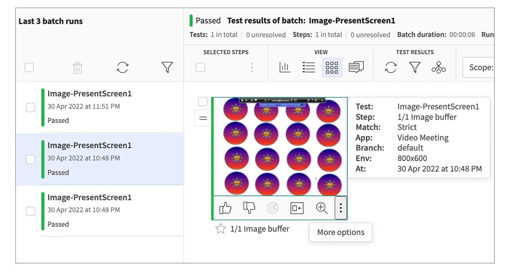

在图片上，还有两个图标，点赞和消赞，分别对应着 Accept Diff 和 Reject Diff。当 Applitools发现图片不匹配时，比如在图片中有动态的值（日期，时间，用户名等等），每次运行的值都不一样，你可以通过点击这点赞的图标 Accept Diff，来反馈训练 Applitools 的图片识别算法，反馈次数越多，训练出的识别能力越精准。

Applitools 很好用，但有一个限制，它需要图片上传到 Applitool 自己的官方服务器进行识别。如果我们对数据有安全的顾虑，Sikuli 更适合。Sikuli 由美国麻省理工学院研究开发，是一款基于视觉的测试工具，也提供了图片比较函数，代码示例如下：

```java
Screen screen=new Screen();
Pattern pa1=new Pattern("/Users/37397/Desktop/Screen Shot 2018-03-27 at 6.02.42 P
String img=screen.capture().save("/Users/1234/Desktop/Automation/Test_Sikuli/", "
Finder f1=new Finder(screen.capture().getImage());
f1.find(pa1);
if(f1.hasNext()){
  Match m=f1.next();
  System.out.println("Match found with "+(m.getScore())+"100"+"%");
  f1.destroy();
}
else{
  System.out.println("No Match Found");
}
```

### 屏幕切换流畅度

演示的流畅也是需要测试的。怎么度量演示的流畅？我们可以用延迟时间来评价。也就是当 A切换屏幕之后，B 和 C 上的画面也开始切换，这个时间差就是延迟时间。

现在的问题就变成了——怎么来截取这个时间差？这就涉及到一个分布式事务的概念，如果我们定义的 Transaction 是 timeBetweenPresentAndView，那么 Transaction Start 是在 A 端开始 Present 的时候，而 Transaction End 是在 B 端看到 PPT 的时候。

分布式事务怎么实现？在 Job 模型里，我们可以用 Input 和 Output 来实现。A 的 Job 在Present 之后就立刻记录下当前的时间戳，输出一个TR_START_timeBetweenPresentAndView=1342629206455，而 B 的 Job 在看到 PPT 之后，也立刻记录下时间戳，输出一个TR_END_timeBetweenPresentAndView=1342629276772。

那它们怎么聚合成最后的事务呢？这时候，我们可以创建一个 aggreateTransaction 的 Job，专门负责从 Input 里拿到这些数据，然后计算输出 TR_timeBetweenPresentAndView 的时间。

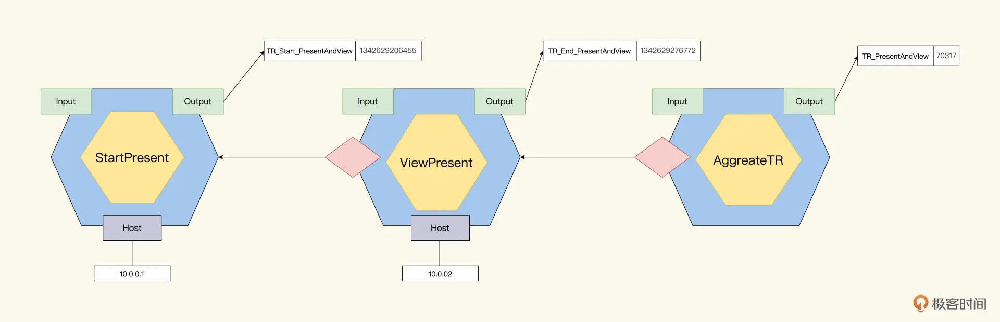

聊天功能和演示功能类似，由 A 发送一个 Message，B 和 C 都要接收它。这里也有准确性和时效性的问题。解决方案和演示功能相似，你可以自己梳理一下 Job 树，巩固前面学到的内容。

## 实现与扩展

到这里，我们把刚才的设计整理一下，整体成果 Job 树如下：

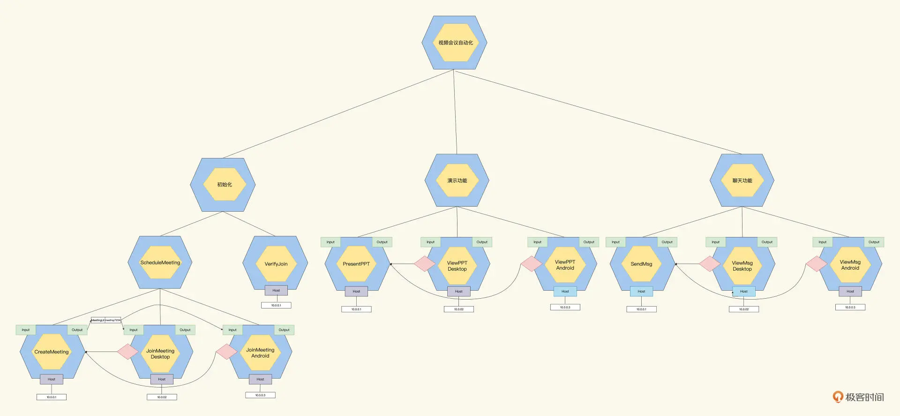

从图里可以看到，我们一共用 15 个 Job 完成了这个视频会议自动化测试场景的设计。接下来，我们对照 Job 树，继续推演需要实现的子 Job 和适合的工具。

### 实现

所有的叶子结点 Job，都是后面测试实现阶段中，测试开发同学需要开发实现的实体 Job，把它列成一个 Job 树叶子工作表：

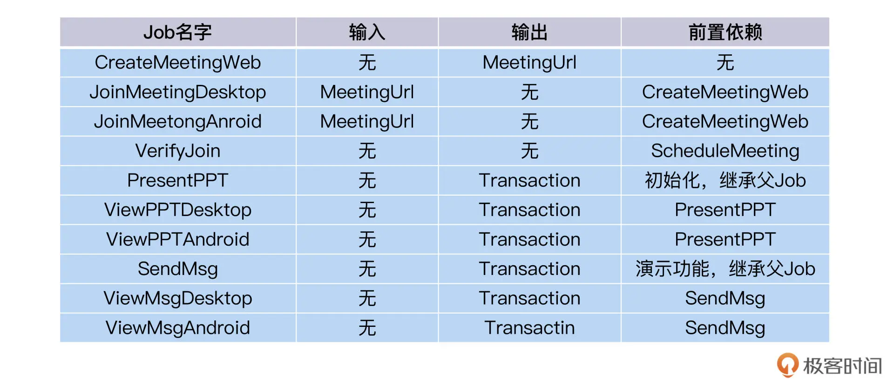

然后就到了每个 Job 选型工具的确定。工具的列表可以参考我为本专栏准备的 Gitub 地址。选型遵循 3KU 法则，寻找合适的测试层面和成熟的工具。

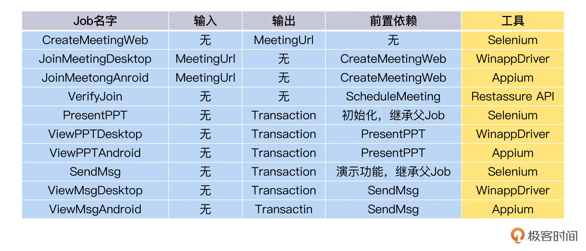

### 扩展

在刚才的 Job 设计中，视频会议的 Desktop 端是 Windows，所以 JoinMeetingDesktop Job的实现用 WinAppDriver。

如果未来有一天，我们的视频会议有了 Mac 端，这个时候 Job 设计怎么变化？

我们可以想一下，不论是 Mac 还是 Windows、Linux，它们都只是视频会议的不同载体，但上面实现的业务是一样的。也就是说，我们上面基于业务做的 Job 设计依然有效。

这时，可以把 JoinMeetingDesktop 变成抽象 Job，增加 3 个子 Job：JoinMeetingWindows、JoinMeetingMac、JoinMeetingLinux，它们是对 JoinMeetingDesktop 的实现。当JoinMeetingDesktop 运行的时候，会把子 Job 都运行一遍，Windows、Linux、Mac 就都得到了测试验证。

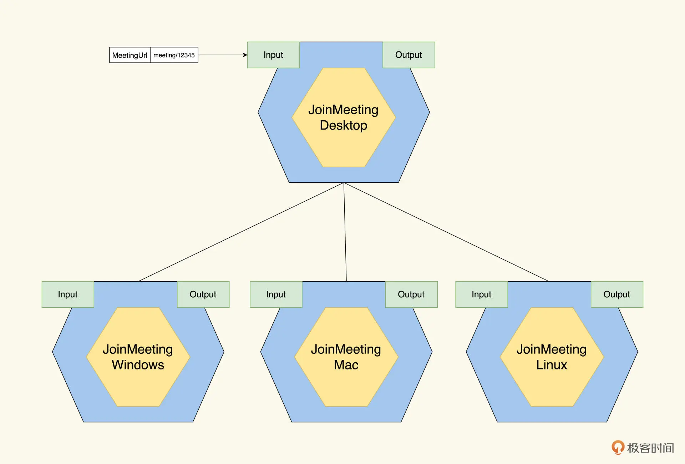

## 小结

今天我们通过视频会议的 Job 设计，把一个分布式多端协作的交互场景，分解成一个个简单可开发任务，并且分析了子任务的 Input 和 Output。其实，这个分解过程就是我们的自动化测试设计要做的工作。不难发现，用好我们的 Job 模型，这个分解工作就能迎刃而解了。

不过，之前我们的 Job 模型不支持分布式，所以，我们对 Job 模型又做了扩展，增加了 Host属性，支持分派 Job 到不同的主机上运行。在 Host 属性可以增加多台主机名，那么就可以实现一个 Job 发送到多台机子上运行。

还是按照 Job 设计的思路，我们分而治之，把视频会议自动化的整个任务分解成了四个功能区：初始化 Meeting，演示功能区，聊天功能区和退出 Meeting。然后，我们再对每个功能下钻细化，直到可执行的实例 Job。

视频会议自动化测试中，还会涉及一些具体的技术实现，比如图像比较，自开发算法和使用主流工具两种思路，我都为你做了简要分析。

自开发算法的问题是，开发打磨出一个可用的图像相似度算法会耗费人力，说白了就是投产比并不划算。

所以，我们可以借鉴业界已有的技术，比较成熟的两款工具是 Applitools 和 Sikuli。我用一个例子来介绍 Applitools AI 识别图像的实现思路，你也可以把它应用在你的工作中去。

在设计过程中，我们也发现了执行效率可优化的空间。没有依赖关系的 Job 们，我们可以通过并发线程来执行它们，只有当存在依赖关系时，才需要顺序执行。通过这样一个机制上的优化，我们就能把视频会议自动化的执行时间缩短将近一半。

到这里，基于 Job 模型的自动化测试设计思路和案例就讲完了，相信你收获了一种全新的设计思路和实现方法。但在收获的同时，关于怎么落地，你一定还会有不少疑问，我完全能够理解。

一个新的设计方法，需要很多配套的实现。比如，围绕着 OpenAPI 设计就有一个工具生态圈：有 OpenAPI 规范来书写接口文档，有 Swagger 来可视化展现接口，有 OpenAPIgenerator 来自动生成代码。下一讲，我们就一起学习一下基于 Job 模型的框架实现和代码例子，敬请期待。

## 思考题

今天讲的视频会议的自动化测试场景设计，你觉得还有没有什么重要功能，是我们没有进行测试设计的？怎么用 Job 模型来完成这个功能呢？

欢迎你在留言区和我交流互动，也推荐你把今天学的内容分享给更多同事、朋友，一起应用Job 模型来完成各种自动化测试设计。
