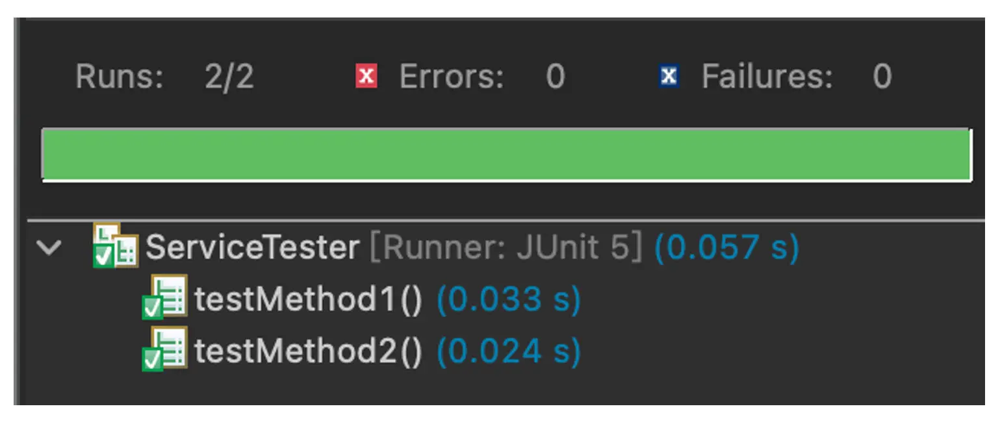
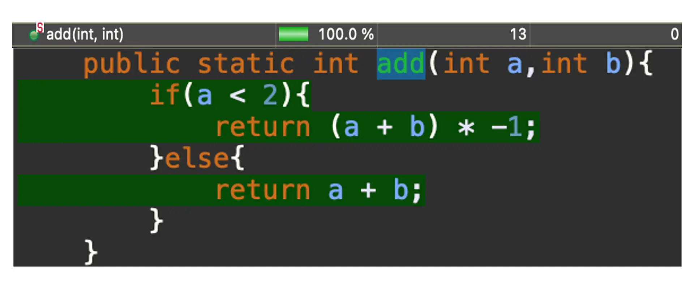
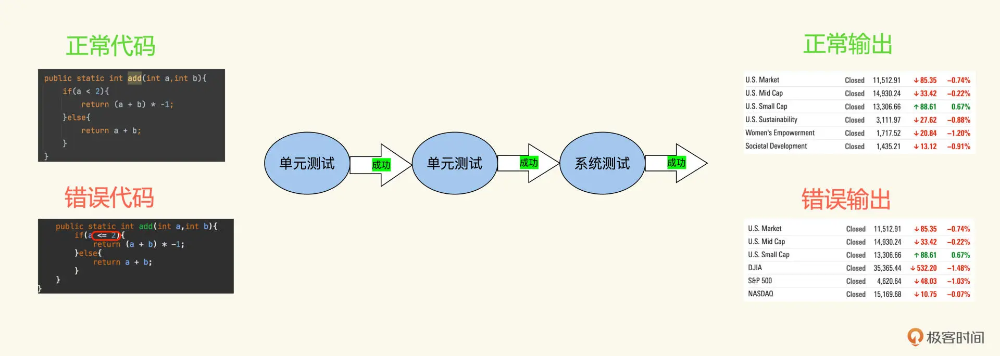
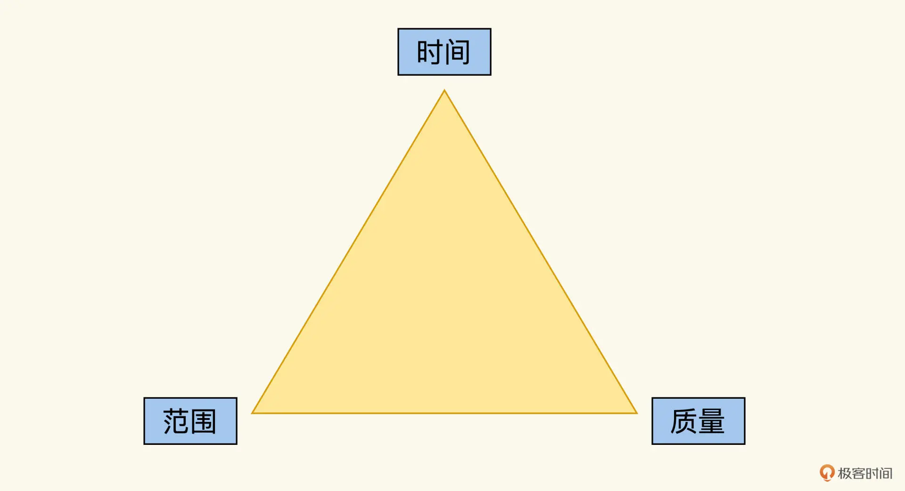
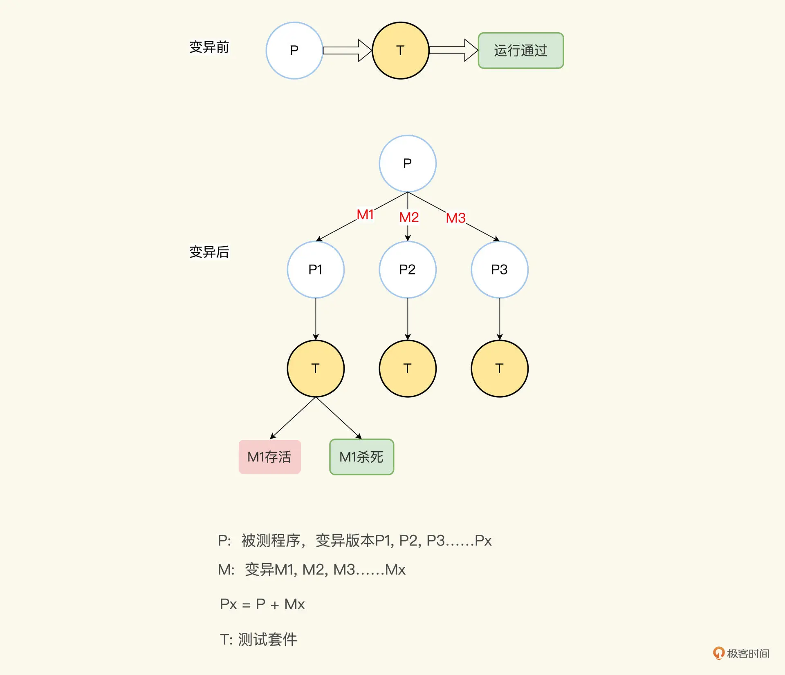
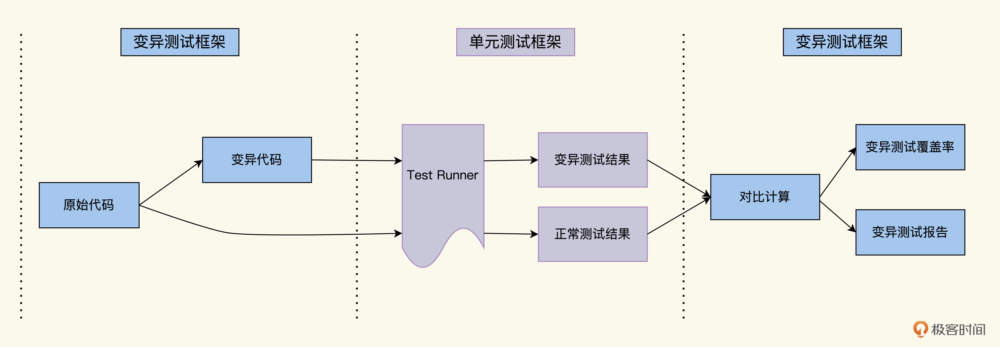
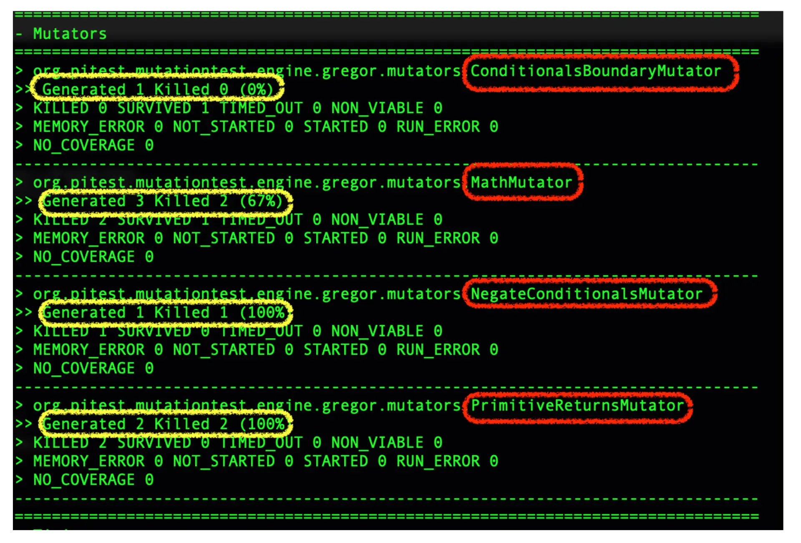
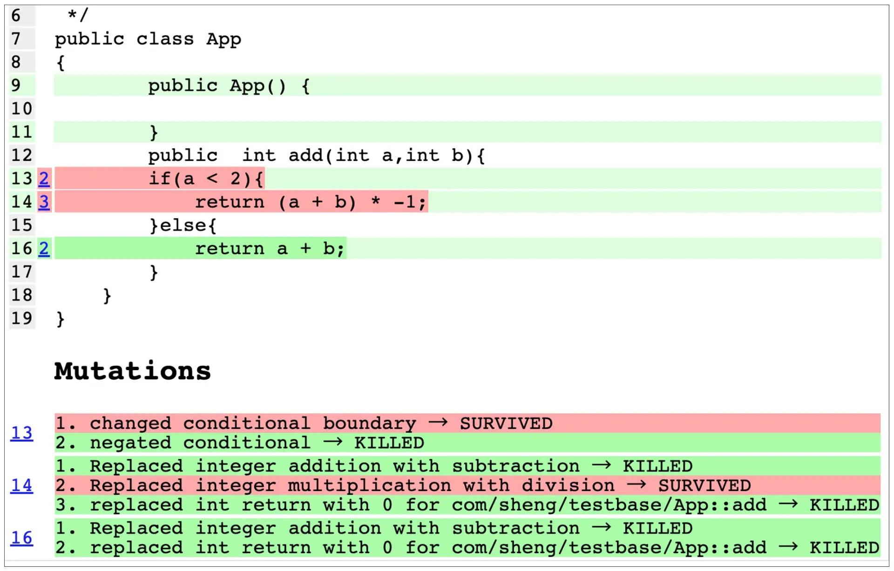
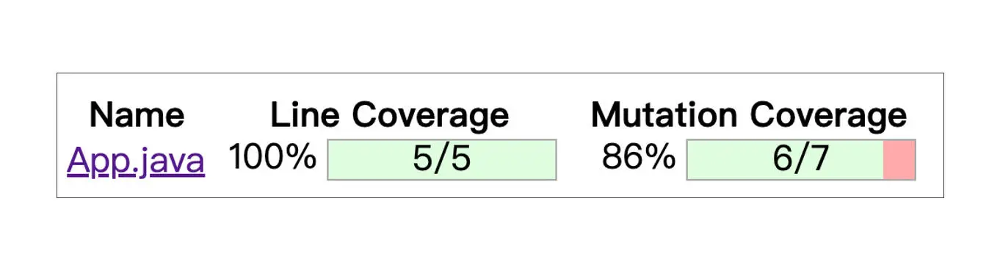

# 26 | 见微知著：单元测试度量避坑

你好，我是柳胜。

通过前面的学习，我们不难发现单元测试的 ROI 又高，速度又快。在我看来，单元测试是一块没有充分发挥价值的蓝海。可惜很多公司不重视单元测试，也不愿意投入；有的公司虽然做了单元测试，但发现效果不明显，时间久了，单元测试也就流于形式。

想要真正在团队、乃至公司推动单元测试，就要见到效果，进入到一个有反馈刺激的正循环里。一旦进入到这样的循环，哪怕起点再低，也能一步步优化提升，走向成熟。因此，在这个循环机制中，反馈尤为重要。那这个反馈来自哪里呢？没错，是合理有效的度量。

这一讲，我会结合例子带你一步步推导，如何用度量驱动单元测试的落地和提升。

## 失效的单元测试覆盖率

如何度量单元测试的效果？很多人会脱口而出——“单元测试覆盖率”。而且，还能讲出很多覆盖率的方法论，语句覆盖率、分支覆盖率、判定覆盖率等等。但是，单元测试的高覆盖率一定会有高的代码质量么？

我们先看看单元测试覆盖率是怎么产生的，看看它的原理是什么，然后再判断单元测试覆盖率这个指标有什么问题。

后面是一段代码例子。有这样一个名为 add 的函数，它的入口是 a，b 两个整形参数。如果 a小于 2，计算结果就是 a+b 的负数，a 大于 2，就返回 a+b。看起来逻辑很简单，是吧？

```java
public service{
 public static int add(int a, int b){
   if(a<2){
     return (a+b)* -1;
   }else{
     return a + b;
   }
 }
}
```

好，如果现在咱们要测试这个 add 函数，要设计多少个测试案例呢？

按照代码覆盖率的思路来考虑这个问题，我们是不是要设计出 2 个案例：一个案例是走 a<2，一个是走 a>2。这样 2 个案例走 2 个分支，我们覆盖率达到 100%。就能达到效果了，对吧？

我们这就来写 2 个 Junit Test 方法，代码例子如下：

```
@Test
public testMethod1(){
 Assert.assertEquals(Service.add(1,2),-3);
}
@Test
public testMethod2(){
 Assert.assertEquals(Service.add(3,2),5);
}
```

运行一下 Junit，全部通过。



给出的报告是代码语句覆盖率 100%：



好，现在有了 100% 覆盖率，我们可以放心了么？

有一天，我们的团队来了一个新手开发人员，他在修复 bug 的时候，不小心把 a 小于 2，改成了 a<=2，像下面这样：

```java
public service{
 public static int add(int a, int b){
   if(a <= 2){
     return (a+b)* -1;
   }else{
     return a + b;
   }
 }
}
```

这是一个错误，对不对？那我们的测试案例能不能捕捉到这个 bug 呢？

很不幸，我们的 2 个测试案例还是会通过，对不对？它们一个走了 a<2 的分支，一个走了a>2 的分支。这两个分支上的逻辑依然没变，所以测试的结果是通过。

通过这个例子，我带你还原了一个“Bug 泄漏”的场景。意思就是说，虽然我们的单元测试案例代码覆盖率达到了 100%，但还是捕捉不到回归 Bug。沿用我常用的织网捕鱼的例子，鱼（Bug）还是从网眼里漏出去了。

这看起来是一个很小的错误，但对于某些类型的产品却有可能会致命。比如，对数据精准度要求极高的金融产品来说，单元测试没捕捉到，集成测试和系统测试也错过了，这个算法的错误会呈现一个放大效应。经过一系列算法的计算，在 UI 上呈现的数据会大相径庭。



从上图里不难看到，错误代码计算出的金融指数跟正确值差了二十多倍，这给客户带来的损失也是巨大的。

现在，我们清楚地看到了单元测试代码覆盖率这个指标是有问题的，即使做到 100%，也会有Bug 泄漏。怎么堵住这个泄漏问题呢？

你可能想到了这样的解决方案，在等价类基础上再增加边界值测试用例。对应到例子里就是，在边界 2 上，增加一个 a=2 的测试案例。这样刚才开发人员的错误，就能捕捉到了，这个测试案例的测试结果会失败。

这看起来是有效的。但我们对测试还是没有信心，因为今天是 a=2 出了问题，我们补上了，明天 b=3 再出问题，我们再补一个。每次都是亡羊补牢，被动地去完善我们的测试设计。

被动补救只能治标，不能治本。那有没有更有效、更主动的解决方法呢？这就需要我们先找到泄漏的根本原因。

这个泄漏的根本原因，其实是每个测试案例的检查点多少、数据设计合理与否，这些取决于测试开发人员的理解，经验甚至责任心，这个是用代码覆盖率衡量不出来的。我们沿用上一讲的质量三角图继续分析：



单元测试的代码覆盖率属于“范围”这个支撑点，可以衡量测试的范围。但是还少了两个支撑点，时间和质量。还记得前面我打的比方么？测试工程师设计案例捕捉 Bug，就像织网捕鱼，能捕捉到多少鱼，不光取决于网的大小（覆盖率），网眼的密度也很关键。

网眼的密度，就相当于单元测试的质量。怎么度量它呢？我们继续往下看。

## 如何度量单元测试的质量

上一讲我们引入了 Bug 泄漏率这个指标度量自动化测试的质量。而单元测试的质量也是同样的思路，我们要度量的就是单元测试捕捉 Bug 的效果。

### 单元测试 Bug 泄漏率

在单元测试阶段，我们捕捉到了多少回归 Bug？有多少 Bug 是应该由单元测试捕捉到，却泄漏到下一阶段的？这个效果可以用一个比率来度量，那就是单元测试 Bug 泄漏率。

为了突出重点，我列出两个公式辅助你理解：

单元测试泄漏的 Bug = 本应该在单元测试捕捉到的 Bug（实际没捕捉到）。

单元测试 Bug 泄漏率 = 单元测试泄漏的 Bug/ 单元测试泄漏的 Bug+ 单元测试捕捉到的 Bug

这个泄漏率定义有点绕，绕的地方就在于如何定义“本应该在单元测试捕捉到”。因此，我们需要将泄漏的 Bug 按照它们的根源分类，分析一下 Bug 对应在测试的哪个层面，看看我们本应该在单元测试、API 测试还是 UI 测试层面发现这个 Bug。

做 Bug 归因的思考，是一个很好的实践。但是把归因后的 Bug 作为度量，违背了一个原则，度量数据的来源应该是来自未经人加工的数据。

想一想，为什么要遵循这个原则呢，背后的道理是什么？因为数据要驱动良性循环，而不是恶性循环。

如果单元测试的质量用单元测试 Bug 泄漏率来评价，那么负责单元测试的人，肯定不愿意把Bug 归因于单元测试的泄漏。所以，在团队内部，就形成了一个互相甩锅的局面。你说是我的问题，我说是他的问题，最后得出的度量指标也不能让人心悦诚服。

理论是自洽的，落地是有问题的。单元测试能否脚踏实地推进，关键在于能否找出一个合理的自动的单元测试质量的度量方法。这样的方法有没有呢？这就要用到一个新方法——变异测试。

### 变异测试覆盖率

变异测试是什么呢？它是一种通过向代码植入错误，来度量测试案例有效性的测试方法。它的结果是变异测试覆盖率，可以用来量化测试质量。

明确了变异测试的概念，我们再理解变异测试覆盖率就更容易了。假如，我们的被测程序是P，我们的测试组件是 T，正常情况下，用 T 测试 P，结果是成功。现在我们向 P 植入一个变异 M1，形成一个 P1 版本的程序，这时我们再运行 T，应该会失败，对不对？因为有了变异嘛，T 失败了，说明变异被捕捉到了，也叫杀死了变异。

如法炮制，我们也可以向 P 植入另外一个变异 M2，形成 P2，T 如果还是成功，那就是变异被放过了，也就是变异存活了。

我们每植入一个变异 M，就运行一次 T，记录运行的结果。最后再来统计一下，用被杀死的变异数量除以总共植入的变异数量，这个量化的比率，就是变异测试覆盖率。

变异测试覆盖率越高，我们的 T 就越有效。我给你画了一张变异测试原理图，每个字母对应的含义如下：



刚才我给你描述了变异测试的过程，再结合上面的图解，我们发现相比传统测试，变异测试新增了两个环节：一个是前置环节用来产生变异，中间还是运行传统测试；然后多了一个后置环节，变异测试结果和正常测试结果对比，来判断变异是否杀死，然后统计多次变异的运行结果，产生变异测试报告和变异测试覆盖率。

把生成变异以及生成变异测试报告这两个环节都自动化了，就是变异测试框架。借助业界已有的变异测试框架，我们很轻松就能完成变异测试。



下面我们用一个变异测试框架 PItest，对我们上面的 Java 代码做变异测试。

PItest 用法很简单，在项目的 pom 文件里加入 Pitest 的插件，然后运行 mvn 命令，就会自动产生变异，自动运行 T 产生报告。

下面是 PItest 的执行日志，PItest 针对刚才我们的 add 函数，用了 4 种策略（看红框），产生了 7 个变异（看黄框），包括修改边界、修改运算符、反转条件、修改返回值。

前面我们说的程序员手误把 a<2 变成 a<=2，就是我们 PItest 框架生成的 7 个变异之一，属于修改边界的情况。



我们继续来看最后的结果报告。7 个变异被杀死 5 个，变异测试覆盖率 71%。




存活下来的变异分别是 Conditional Boundary 和 Math 计算，PITest 对这些变异规则都有介绍，你可以参考 PItest 官网网站，链接在这里。

好，既然有了变异测试覆盖率量化指标，我们就有了目标。为了提高变异测试覆盖率，我们来增加测试案例，杀死变异。

现在，有 2 个存活的变异，一个是把 a<2 修改成 a<=2, 另一个是乘运算改成了除运算。相应地，我们需要增加边界测试案例 3，a=2，b=2，代码例子如下：

```java
@Test
public testMethod1(){
 Assert.assertEquals(Service.add(1,2),-3);
}
@Test
public testMethod2(){
 Assert.assertEquals(Service.add(3,2),5);
}
//***新增TestMethod3
@Test
public void testMethod3(){
 assertEquals(Service.add(2,2),4)
}
```

再次运行变异测试框架，变异测试覆盖率从 71% 上升到 86%。



现在有了 3 个测试案例。如果你仔细看一下这 3 个案例，会发现 2 号案例是 3 号案例的一个子集，如果把 2 号案例删掉，代码语句覆盖率 100%，变异测试覆盖率还是 86%，那么 2 号案例就是一个冗余的案例，可以把它删掉。

```java
@Test
public testMethod1(){
 Assert.assertEquals(Service.add(1,2),-3);
}
//***新增TestMethod3
@Test
public void testMethod3(){
 assertEquals(Service.add(2,2),4)
}
```

现在我们还剩下一个变异，就是 a+b 乘以 -1，被修改成了 a+b 除以 -1。这个变动，我们现有的 2 个测试案例没有杀死它，那我们怎么办，有没有办法设计出新的测试案例呢？这个问题，我留给你课后思考。

说到这里，我们总结一下。今天这一讲，最重要的就是重新审视单元测试的有效性。

希望你看完以后，再说起单元测试质量的时候，不再停留于盲目追求把网织得很大（即追求高测试覆盖率），而是转向把网编织得足够密这个目标上来。而这个网的密度，我们可以用软件变异测试覆盖率这一方法来度量。

## 小结

今天，我们从单元测试覆盖率的例子入手，发现即便覆盖率高达 100%，Bug 还是会发生泄漏。更严重的是，这个泄漏率很难去度量。无法度量，自然就无法在组织层面驱动有效的单元测试。那么我们该拿什么指标，来度量单元测试的有效性呢？

为此，我们研究了一下变异测试的原理和实现。它的基本理论是，向代码植入 n 个错误，运行测试案例看捕获错误的效率，这就是变异测试覆盖率。而且，变异测试可以借助测试框架实现自动化。

我们引入了 PITest 测试框架，结合例子演示了如何自动地生成变异，运行测试，到得出变异测试覆盖率整个过程。

从例子里可以看到，变异测试覆盖率能够度量出测试案例设计的质量，这个质量不仅包含遗漏的测试案例，测试检查点，还能帮我们发现冗余重复的测试案例，测试检查点。

由此可见，变异测试无论从度量模型还是实现手段上都行得通，它满足了我们对单元测试质量度量设计的要求。不但能检测 Bug 泄漏，而且可以自动化，无需人工参与。

有了度量，也有实现方法，你就可以推动单元测试在组织中落地了！下一讲，我会带你重新审视 ROI，并基于 ROI 规律为你分享度量设计的三种方法，敬请期待。

## 思考题

最后，给你留两道思考题：

1. 变异测试的思路是否仅限于单元测试？可以用在其它测试场景中么？

2.“每一次代码迭代，就是一次变异”，这句话你怎么理解？

欢迎你在留言区跟我交流互动。如果觉得今天讲的方法对你有启发，也推荐你分享给更多朋友、同事。
