# 29 | 落地实践：搭建可持续度量的技术平台

你好，我是柳胜。

前面我们花了不少篇幅来讨论度量体系的设计，在方法论上扫清了障碍。

理论讲得通，实践也要做得通。想要在工作中落地、出效果，那就一定要把度量可视化。什么是度量可视化呢？简单来说，就是让相关人员能直观看到度量展现出来的样子。

在正文开始之前，我先分享几个可视化的例子，帮你建立更直观的感受。就拿单标度量来说，它通常是一个数字值。比如冒烟自动化测试覆盖率 38.14%，就可以展现成下面这样的数字仪表盘。

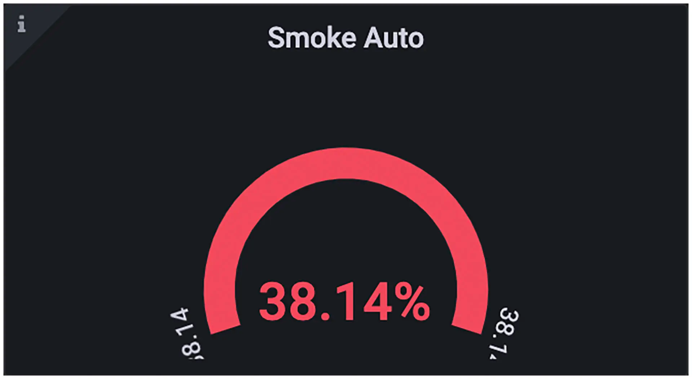

而对标度量是时间轴上的一条折线或柱状图。下面展现的是 Bug 泄漏率随着时间的变化趋势图：

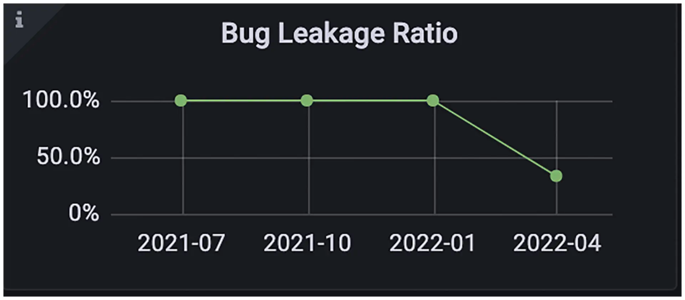

为了比较两个数值的差异，我们也可以把相似的度量放在一张折线图里。

比如下面这张图，展现的是不同归因的 Bug 数量。Bug 的根源有的来自于 API，有的来自数据，还有的是需求等等，把它们放在一起对比，有助于你看出软件开发周期的薄弱环节。

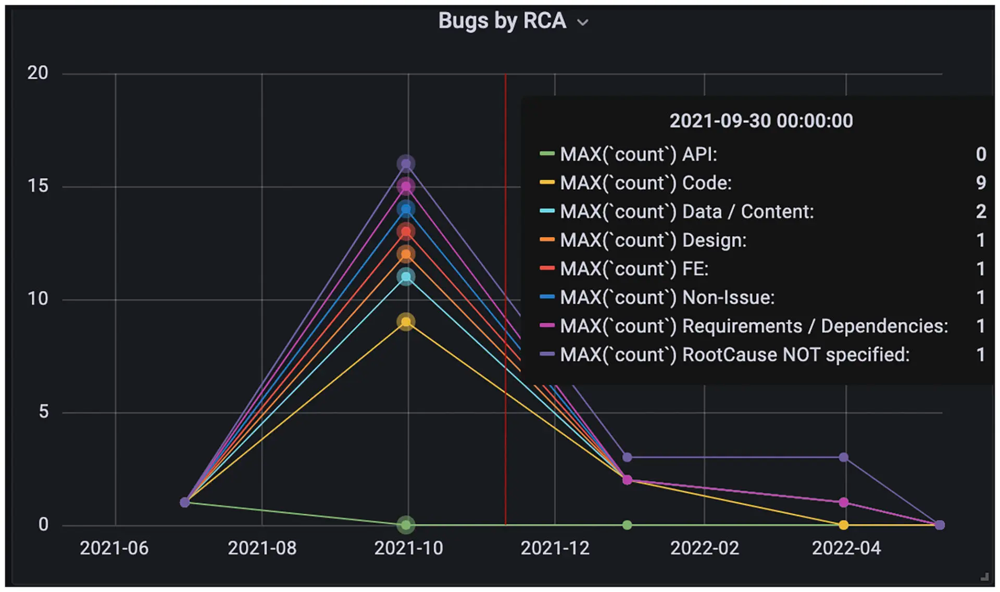

这几类可视化的图片还只是冰山一角。这一讲，我将为你揭秘，这种度量数据可视化的实现相关技术和工作原理是什么。此外，我还会和你分享一下如何在自己的团队里，快速搭建一个度量数据实时观测平台。

## ETLA 数据全周期技术

度量的工作无非就是收集、处理和展示数据，所以从本质上说，度量技术就是一个数据工程。

在业界，典型的数据处理过程就是 ETL，ETL 是怎么来的呢？这就要说到数据生命周期的前三个阶段：分别是提取数据（Extract）、聚合数据（Transform）以及持久化数据（Load）。

三个阶段的英文单词首字母组合起来，就是 ETL，ETL 完成了业务系统的数据经过抽取、清洗转换之后加载到数据仓库的过程，用在度量技术里，也就是把分散、零乱、标准不一致的原始数据转换成统一的度量的过程。

但是度量生成后，最终还需要用图表形式实现可视化。所以，我们再给 ETL 加上一个 A，A是 Analyze 的首字母，而 ETLA 就是我们今天要学习的全周期数据度量技术。

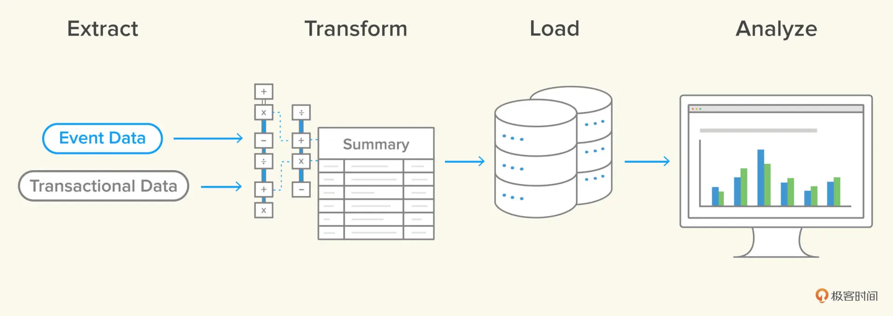

数据生命周期的这四个阶段，每个阶段都有不同的技术工具，下面我们就一一地学习。

### 数据提取（Extract）

Extract 是从数据源里提取数据，这个数据源可以是 API，也可能是数据库，或者文件系统等等所有能提供数据的地方。

在整个软件生命周期里，从需求到设计，开发，测试再到生产运维，会产生大量的数据，我们来理一下有哪些数据跟软件质量相关的，它们应该怎么提取。

你可以参考我整理的数据源表格，如下所示：

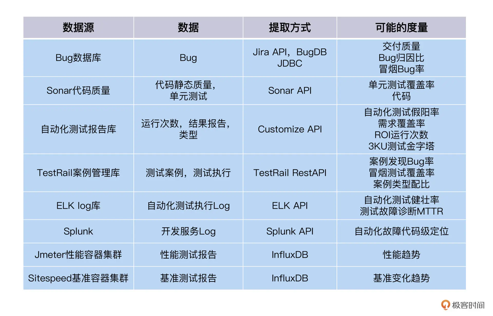

在 Extract 环节，我给你分享两条实践原则，它们都来自我的实践经验：

第一，提取的数据要尽可能得多。因为在分析阶段，你可能会用到多种数据才能算出一个度量，不要等到用的时候，才想到临时提取。

尤其那些趋势的度量，它们需要一定周期的时间序列数据才能计算出来。比如季度环比 Bug增长率，当前是第二季度，不仅需要第二季度的 Bug 数据，还需要第一季度的 Bug 数据才能做环比。如果是同比增长率，那就还需要一年前的 Bug 数据。所以，提前提取好数据，有备无患。

第二，提取数据的过程不要人工污染。这个原则在前面已经说过了，人工的污染指的是个人的判断和决策加到数据里去了。比如说，在提取 Bug 的过程中，有的 Bug 没有标注发生的环境，你给它们加了一个默认值，都认作是测试环境，这就把 Bug 数据污染了。

### 数据转换及加载（Transform & Load）

Transform 和 Load 是解决度量数据聚合转换和持久化的问题。这两个环节的技术方案做不做，怎么做，都取决于你的场景需求。别忘了我们贯穿始终的最优 ROI 思维，要把做“必要”的工作当作目标，不要“过度”工作。

举一个例子，在 Extract 环节，我们已经把 TestRail 里的测试案例信息提取出来了，那还需要在 Load 环节，再设置一个新的数据库来保存它们么？

这时你需要考虑这样做的收益和付出的成本，根据 CAP 原理，如果技术方案里出现了分布式数据源，会大大增加系统的复杂度，你就必须在 CAP 里三选二，不能得三。要么是追求数据一致性，舍弃掉及时可用性，要么是为了及时可用性，你就得忍受数据可能不一致的状态。

所以，针对 TestRail 案例库，你要慎重考虑。如无必要，无需增加实体，这也符合我们早在第二讲就提到过的奥卡姆剃须刀原则。所以，你可以把测试案例的数据聚合成度量，自动化测试案例百分比，冒烟测试百分比等等，不用 Load，直接对接 Analyze 环节做可视化了。

不过在度量场景里，有一种情况，你不得不考虑增加一个度量数据库。是什么场景呢？

在度量分析里，我们要经常要做两种分析，横向分析和纵向分析。

横向分析是比较不同集合的相似度量数据。比如对两个项目的 Bug 泄漏率进行对比，这样能够启发我们寻找组织内的最佳实践。纵向分析则是比较同一个度量它的历史数据和当前数据。比如 Bug 的趋势，自动化测试假阳率的趋势。

我们不难发现，想要实现纵向分析，需要我们先记录时间轴上一个个数据点，最终整合为时间序列数据。

有些原始数据源只会保存最新的数据信息，比如我们获得“Open 的 Bug”趋势，昨天“Open 状态的 Bug”是 100 个，今天可能是 120 个。

如果昨天没有记录下 100 这个数字，今天你就无法追溯回去，这种情况，我们就应该把每次采集到的数据以时间序列的格式存进度量数据库里。

度量数据库存储的是时间序列数据，它的 Json 表达是这样的：

```json
{
"fleet": "JiraBugs",
"tags": "FoodCome",
"datapoints":
[
 {
   "Bugs_OPEN": 100
   "timestamp": 1466734431563,
 },
 {
   "Bugs_OPEN": 120
   "timestamp": 1466734432763,
 }
]
}
```

时间序列数据库英文又叫 TSDB（Time Series Database）, 它是一种非关系数据库，业界主流的有 InfluxDB、Graphite、Prometheus、MongoDB 等等。你可以参照这个列表来选择TSDB 作为自己组织的度量数据库。

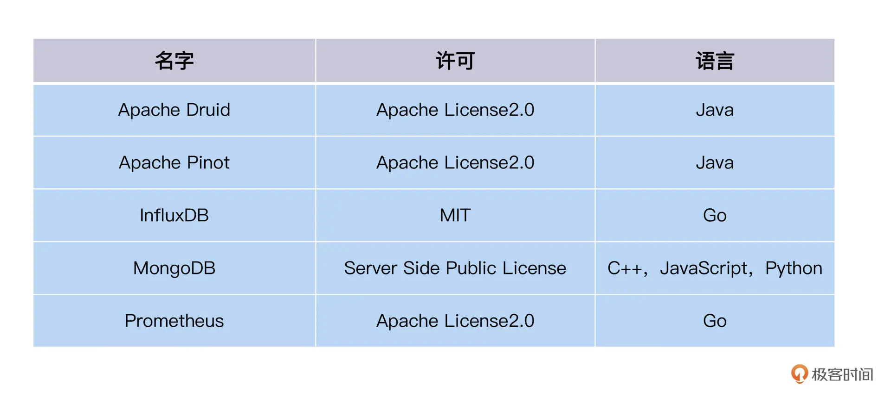

完整列表参考这里。

### 可视化（Analyze）

做了这么多准备工作，我们现在终于到了最重要的环节，也就是度量数据的可视化。

这个环节可用工具不少。你既可以选择自开发可视化前端，也可以选择现成的工具，主流的工具有 Grafana、Kibana、Tableau 等等，它们都提供了基本的数据展现功能，像柱图、线图、点图和表格等等。

不过，它们在应用领域上有一些微小区别，Grafana 有免费版，在 DevOps 领域有经验优势。像 Amazon 的内部服务监控 Telemetry，Oracle Public Cloud 的度量服务 T2 都是用 Grafana作为可视前端的。而 Tableau 是商业版，在 Business Inteligence 上更为擅长。

对测试度量可视化需求来说，要展现数字度量表盘、线图、柱图等等，不管是 Tableau、Kibana 还是 Grafana，都能胜任。其中 Grafana 具有轻量开源的特点，我们就看一下Grafana 怎么实现数据可视化。

Grafana 用 Docker 启动很简单，执行下面命令：

```bash
docker run -d -p 3000:3000 --name=grafana -v /home/ec2-user/data/grafana:/var/lib
```

访问本机的 3000 端口，你就会看到 Grafana 的 Home 页面了。下面是演示图：

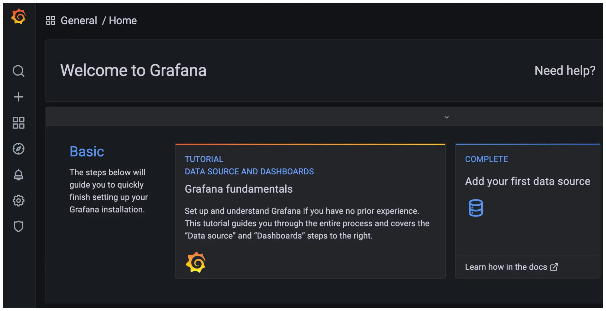

Grafana 是一个 Web UI 前端，自带了一个 Sqlite 小数据库。不过 Sqllite 不是存储度量数据的，而是用来放 Grafana 的访问账号和其它配置信息的。

那 Grafana 的度量数据源从哪里来呢？我们可以在数据源配置中心里，看看 Grafana 支持哪些数据源。

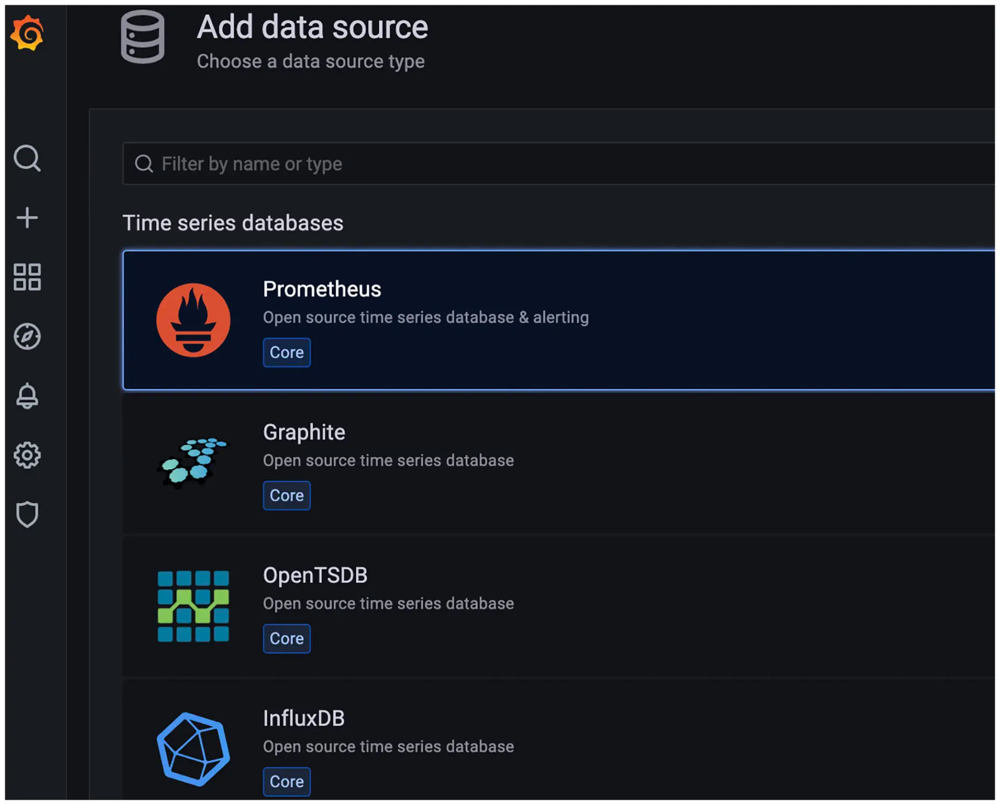

这有一个数据源的列表，我们可以看到 Grafana 支持的数据源类型，有时间序列数据库Graphite、InlfuxDB 等等，也有基于 Log 文件的数据源 ElasticSearch 等，还有关系型数据库MySQL、PostgresSQL、MS SQL Server，Cloud 数据源 Cloud Watch、S3 等等。你可以看看这个链接。

有了数据源后，下一步就是把度量数据展现在 Grafana 上了。

在 Grafana 的世界里，一个度量会通过一个 Panel 来完成可视化。所以，Panel 的定义要包含两个信息：度量的数据来自哪里，以及度量以什么方式展现。

我们沿用上面的 JiraBugs 做例子。在 Panel 的 Query Setting 里，我们可以设置查询 SQL，来告诉 Grafana 数据怎么取，设置参数如下所示：

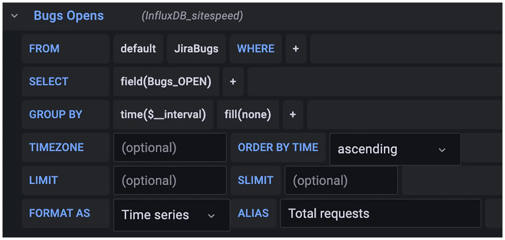

这样设置之后，存在 InfluxDB 里的 JiraBugs 的数据点就会被拉出来。因为每个 Bugs_OPEN数据点都会有一个时间戳，所以上面的 SQL 会查出这样一个数据集，如下所示：

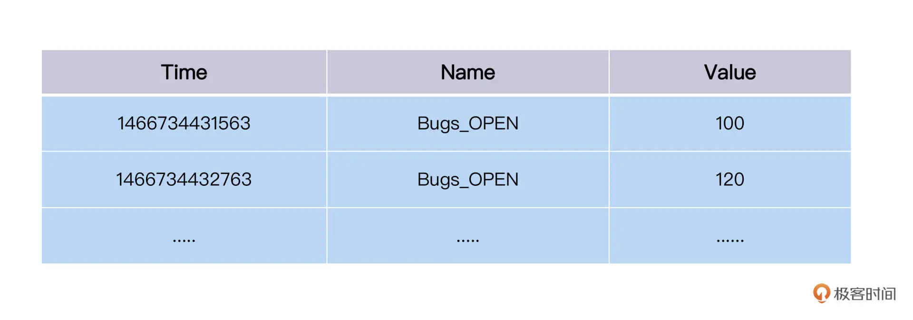

这些时间序列的数据该怎么展现呢？我们只需在 Grafana 的 Visualization 下拉列表里，选择展现的样式：

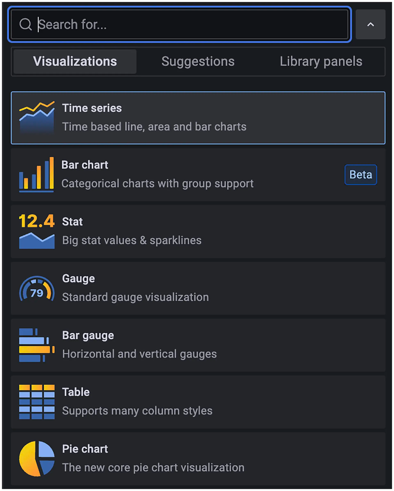

这时，我们设定 Panel 的展现形式为 Time Series 折线图，Grafana 就会把上面的时间序列数据画成一条折线图：

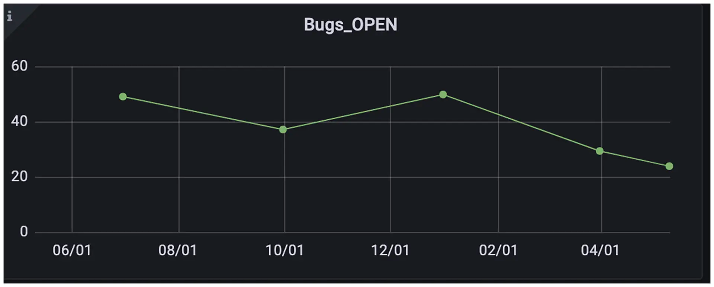

如果我们更换 Panel 的展现形式是 Table，Grafana 就会为我们画出一张表格：

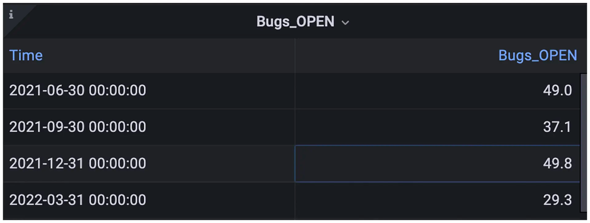

到现在，相信你能体验到 Grafana 的强大功能了！

你只需准备好度量数据源，这个数据源可以是数据库，文件系统，API，云端数据，然后告诉Grafana 这个数据源在哪里。Grafana 会把它的时间序列数据拉出来，并根据你的定制，展现成各种格式的图表，这就完成了数据可视化。

而且，Grafana 还内嵌了一些数据聚合函数，像 Sum、Mean 等运算。如果你想查看一个测试工程师平均每天处理多少个 Bug，你可以把 Bug 先 Sum 在一起，再求 Mean，这些计算都在Grafana 侧前端完成的，而不需要更改度量数据库。

因此，你可以这样理解：Grafana 也做了一部分 ETLA 的 Transform 工作。

学会了一个 Panel 的制作以后，你就可以如法炮制，制作多个 Panel，放在一个 Dashboard里。Dashboard 是一个度量集合，用来反映一个组织或者一个项目的关注的所有度量。

比如，下面的 Dashbaord 反映了一个敏捷开发的 Squad 小组的活动状态，包括开发代码质量，自动化测试覆盖率，执行效率等等：

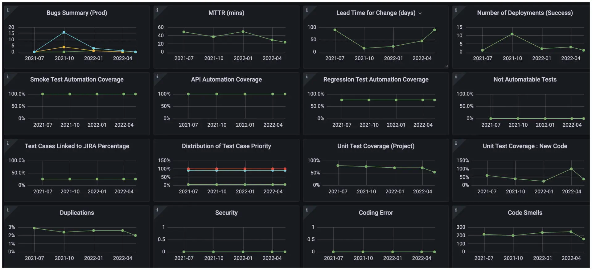

上图的度量集合有的来自 Bug 数据库，有的来自静态代码扫描结果，还有来自 Ops 工具等等不同数据。通过这样一个 Dashboard，能把这些度量组织在一起，你就能对这个项目的质量状态一目了然了！

能观测，我们还不满足，我们还要能够设定目标，用于发现短板，驱动优化和提升。这块怎么实现呢？

利用 Grafana 的告警功能，我们就能给度量设置阈值。比如我们设置好，当 Bug 泄漏率超过了 20%，就需要告诉团队，需要采取行动了。

这个“告诉”的方式，可以是发一封邮件，也可以直接提交一个工单，结合你的团队习惯，使用团队成员都习惯的工作跟踪系统即可。详细使用方法，你可以参照 Grafana Alerts文档链接。

## 自动化测试报告展现

上面我们学习了数据可视化的整个技术链条。只要有数据点和时间戳信息，就可以把它们放到度量数据库里，让 Grafana 生成各种各样的图表。

这种数据可视化方案跟传统的报告相比，有巨大的优势。第一，高度可定制化，图表的展现形式多种多样，聚合的函数也丰富。第二，动态观测，每次刷新 Dashboard，都会获得新的数据，图表也会随之更新。

在我看来，自动化测试报告未来的样子就应该接近于这种数据可视化方案，在第二十四讲我曾经说过，传统自动化测试报告数据和格式都很固定，展示样式死板，自开发成本又高。

这里推荐你考虑把 Grafana 作为自动化测试报告的展现前端。这样一来，作为自动化测试开发人员，我们只需要关注数据，画图做表的工作都可以交给 Grafana。

这个逻辑上是可行的。因为自动化测试会反复运行多次，每运行一次，就相当产生一个时间序列上的时间点。只不过，这个时间点对应的数据并不是一个简单的数据点，而是一个 Json 树形对象结构，包含了本次测试运行产生所有的结果数据。

逻辑上可行，实践中有没有落地呢？Jmeter 的性能测试就可以用 Grafana+influxDB+Jmeter的 Docker 容器编排，一站式完成。

实现思路是这样的：

1.Jmeter 在 BackendListener 添加 InfluxDBBackendListener，把结果数据传送给它；

2.InfluxDBBackendListener 把数据写入 InfluxDB 实例；

3.Grafana 连接 InfluxDB，使用封装好的 Dashboard 模版来展现性能测试报告。

整个过程，不需要写任何代码，只要运行 Jmeter，就可以在 Grafana 上看报告了！我给你准备了一个GitHub的链接，你可以看到 docker-compose.yaml 和 Jmeter 的运行脚本。

最后在 Grafana 上展现的性能测试报告如下：

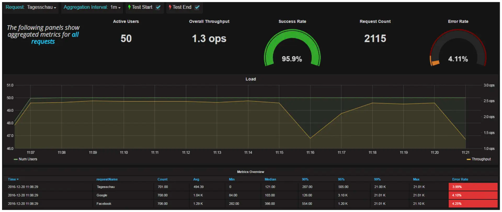

那么剩下的问题是，我们 UI 自动化测试报告，API 自动化测试报告，是不是也可以做成这样的 Grafana Dashboard 呢？是否可以做，可以的话要如何做，我把这个问题留给你思考一下。

## 小结

在这一讲，我们学习了度量技术平台的实现思路。在前端，技术平台展现的是度量图表，但背后是整个 ETLA 的工作流，这个工作流其实也是数据的流动：从数据的提取 Extract，到数据的聚合 Transform，数据的持久化 Load，最后到数据可视化 Analyze。

在数据生命周期 ETLA 的每个阶段都有相应的工具和技术，这一讲我给你分享了一个 ETLA 的落地技术方案。

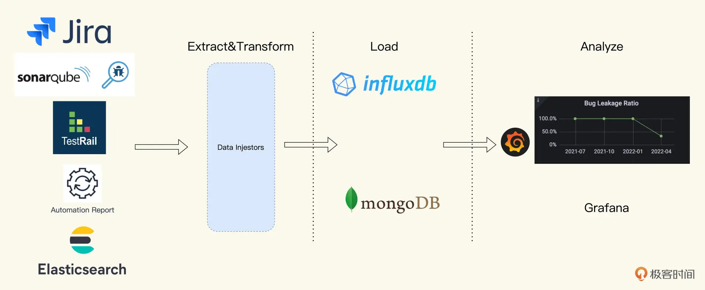

在 Extract 环节，我给你准备了一个数据源列表，这些数据源是你将来展现质量度量的原始素材。你需要开发 Data Injgestor 去从这些数据源里拉取数据并转换成度量，存放到 Load 度量数据库里，或者直接连接 Analyze。

在 Load 环节里，我们需要选择合适的持久化数据源，因为度量要有结构多样，历史对比的能力，所以这里推荐的是非关系型数据库 MongoDB，时间序列数据库 Influxdb 等。

你也可以结合项目需求，采用其它类型的数据库，我就曾经用过 MySQL 来存储一些变更频繁的度量数据，比如 Bug。

在数据可视化这个环节，我重点给你讲解了 Grafana 这个工具。它免费且功能强大，一个Dashboard 上可以展现多个 Panel，每个 Panel 对应一个度量。这样，你的团队就能在一个Dashboard 里看到全面的质量数据。发现质量短板后，还可以通过设置度量阈值的方式，给团队设定提升目标，完成整个数据驱动的循环。

在度量数据可视化的实现过程中，我们也发现 Grafana 的数据可视化能力，同样可以用在自动化测试报告的展现中。

这里我用了一个 Jmeter 性能测试报告的例子，使用 Docker 容器 Jmeter+InfluxDB+Grafana做到了运行测试、保存结果数据、展现报告的一站式解决方案。非常方便，你也可以动手试试看。

你还停留在 HTML 的自动化测试报告么，来试试 Grafana 强大的报表能力吧。

## 思考题

根据这一讲学到的内容，请你思考一下，你工作里的 UI 自动化测试报告、API 自动化测试报告是不是也可以做成 Grafana Dashboard 呢？

欢迎你在留言区跟我交流互动。如果觉得今天讲的方法对你有帮助，也推荐你分享给更多朋友、同事。
