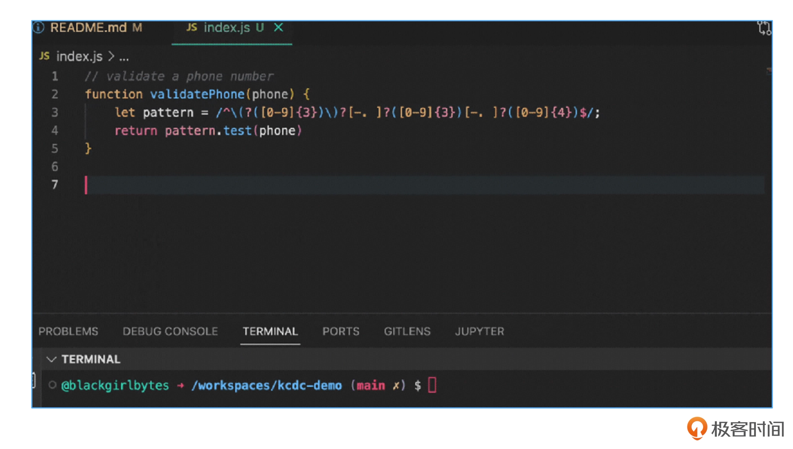
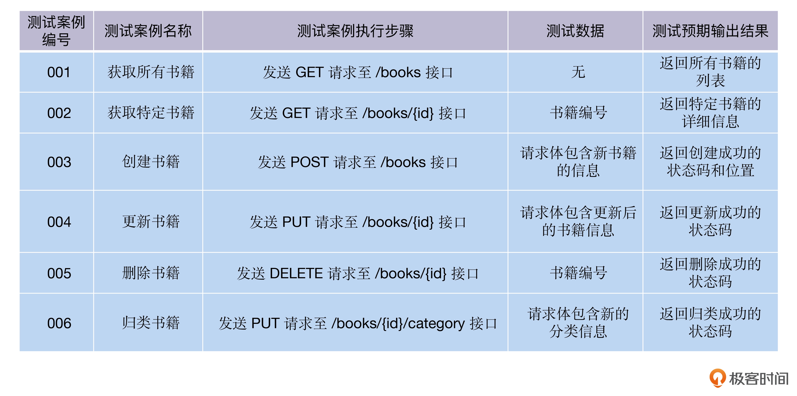

# 有了ChatGPT，自动化测试工程师可以躺平了吗？

你好，我是柳胜，好久不见。

自从 2022 年 11 月 ChatGPT 推出之后，各行各业都受到了影响。很多人都在思考自己的工作岗位会不会在将来几年里被 ChatGPT 替代。我就曾经在朋友圈里看到一个帖子说“有了ChatGPT，初级程序员和自动化测试员毫无悬念地可以躺平了！”。

这一讲特别加餐，我就和你讨论一下这个话题——ChatGPT 能不能替代自动化测试工程师。

想要把这个问题讨论清楚，我们需要分三步走。

首先，我们将会扮演面试官，给 GPT 做初步“面试”。我们先来考验一下 GPT 这位“候选人”的能力，明确 ChatGPT 是什么，它擅长什么事儿，又不擅长做什么。

然后进入实战面试环节，结合例子看看自动化测试的哪些工作内容能够交给 ChatGPT 完成，完成的效果又会如何。

最后，我们再根据 GPT 模拟面试的表现来讨论它会如何影响自动化测试的从业者。

## ChatGPT 的初步面试

初步面试，我们从 ChatGPT 的“简历”开始看起，也就是要对它的“身世”有一个大致了解。

从名字上看得出，ChatGPT 是一款 Chat 聊天功能的产品，这个产品的背后是 GPT 技术。GPT 是生成型预训练变换模型 Generative Pre-trained Transformer 英文首字母的缩写，这是一种基于大型语言的人工智能模型。

这个 transformer 是 ChatGPT 的核心，它能把用户的问题（即 input）转换成答案（即output）。

别看说起来很简单，其实这个转换过程是很复杂的，涉及到对自然语言的上下文解析、海量文字数据的训练等等。如果你对 GPT 工作的技术底层原理有兴趣，我推荐你通过后面这个链接做扩展阅读，这是我觉得把 Transformer 是什么解释得最清楚的一篇文章。

不过，作为 ChatGPT 的使用者，我们只需要了解它的特点就可以了。

Transformer 知识渊博，对于各种问题，能够给出有价值的答案，这个能力是通过海量的文字数据训练出来的。

我结合例子给你解释会更直观：GPT-3 有 45TB 的训练数据，1750 亿个参数；到了 GPT-4，数据量要翻 4、5 倍，参数更是达到了 5400 亿。你可能感觉，45TB 听起来并不大。但我补充一个信息你就明白了，ChatGPT-3 学习完了全部的维基百科、Github 和 Stack Overflow 网站，这三大网站的数据才占了不到 45TB 的 1%。

因为学习过海量的数据，ChatGPT 掌握的知识上达天文地理、政治历史，下达软件设计、代码搬砖。ChatGPT 在软件领域的一个典型的应用就是 GitHub 的 Copilot，它能够辅助程序员自动生成代码。目前 Copilot 已经集成在 Microsoft Visual Studio 里，程序员用自然语言的方式告诉 Copilot 要实现什么功能，Copilot 就会在 IDE 里生成相应的代码。

为了让你有个直观的认识，我们还是结合一个代码实现例子来看看。



这个例子里，我想让 Copilot 写一个函数来验证电话号码。怎么来操作呢？这里我在注释里写的 “validate a phone number”，就相当于给 Copilot 发送了一个指令。而后面的validatePhone 函数就是 Copilot 写出来的，我们也不用记那些头疼的正则表达式写法了，Copilot 直接就替我们搞定了。

有没有觉得像是个奇迹！ChatGPT 是怎么做到的呢？当它输出代码的时候，真的像工程师一样经过了分析需求、设计模块、写出代码这样的思考路径么？下面我就来为你揭秘一下ChatGPT 的工作原理。

ChatGPT 是基于大语言模型，和图像识别的人工智能不一样，一张图片里的动物是小狗还是小猫，需要人打上标签，然后图像识别程序从标签中学习。

ChatGPT 学习知识的过程，不需要人来给知识打标签，告诉它这句话是什么意思，那句话是什么意思。它自己会在大量的文字数据里，总结某一个词汇序列在不同上下文里有什么区别，它的特征被总结成一种叫做词嵌入 Word Embedding 的东西，遵循这个东西，ChatGPT 输出的词汇序列就会像人说的话那样。

做到这个还不够，我们都知道，语言词汇组合序列是很大的，表达出来的意思也是多样的。一个人可能说偏激的话，也可能说冰冷的话，怎么让 ChatGPT 有一个正确的三观呢？

这时就需要人的介入了，就像大人教育孩子一样，当 ChatGPT 输出文字后，人就会对这段话打分，把这个分数再反馈到 ChatGPT 的学习系统里，让 ChatGPT 不断地变化，成长为一个健康人格的人。这让我不禁想起毛主席在《白求恩的故事》里讲的那一段经典的话：

- 这是一个高尚的人，一个纯粹的人，一个有道德的人，一个脱离了低级趣味的人，一个有益于人民的人。

## 自动化测试和 ChatGPT 第一次亲密接触

好，ChatGPT 的基本情况我们现在已经掌握了，接下来就要测试一下它的“专业水平”了。让我们看看自动化测试中的工作内容，哪些可以交给 chatGPT 完成更好，哪些是我们还能够坚守的阵地。

### 能力面试第一关：接口设计文档

我们以一个接口测试为例，考验一下 ChatGPT 能做什么。

假设我们希望它根据一个图书馆图书管理系统的接口设计需求，来生成相应的接口设计文档。

这个工作如果交给程序员来做，他需要理解需求，然后写出设计文档，这个过程怎么也得花费半天时间。那 ChatGPT 可以完成这个工作么，效率怎么样，我们来验证一下。

```
我要设计一个restAPI接口，对图书馆里的书进行管理。要求能实现如下的功能
1.书籍的增删改查
2.能够对书籍进行归类
3.每一本书都有编号，作者，书名，价格4个属性
```

- 请给出接口设计文档

把前面这个需求提交给 ChatGPT，它给出了后面这样的结果。

- 1. 获取所有书籍请求：GET /books响应：[ { “id”: 1, “title”: “图书标题”, “author”: “作者”, “price”: 9.99, “category”: “分类”}, { “id”: 2, “title”: “图书标题”, “author”: “作者”, “price”: 12.99, “category”: “分类” }, … ]2. 获取特定书籍请求：GET /books/{id}响应：{ “id”: 1, “title”: “图书标题”, “author”: “作者”, “price”: 9.99, “category”: “分类” }3. 创建书籍请求：POST /books请求体：{ “title”: “图书标题”, “author”: “作者”, “price”: 9.99, “category”: “分类” }响应：201 Created Location: /books/{id}4. 更新书籍请求：PUT /books/{id}请求体：{ “title”: “新的图书标题”, “author”: “新的作者”, “price”: 12.99, “category”: “新的分类” }响应：204 No Content5. 删除书籍

- 请求：DELETE /books/{id}响应：204 No Content6. 归类书籍请求：PUT /books/{id}/category请求体：{ “category”: “新的分类” }响应：204 No Content这是一个基本的接口设计文档，你可以根据实际需求进行调整和扩展。请确保在实际开发中进行安全性和权限控制，以确保只有授权的用户可以进行操作。

可以看到，对照我们前面提出的 4 个要求，ChatGPT 给出的设计文档还是像模像样的，它用4 个属性定义了一本书，restAPI 提供了增加、删除、修改、查询和归类 5 个接口。

### 能力面试第二关：生成测试案例

接口确定了后，我们继续“出题”，看看 ChatGPT 生成测试案例的表现如何。

- 请根据以上设计文档，生成测试案例

这次，ChatGPT 给出的答案是这样的。

- 根据以上的设计文档，以下是一些可能的测试案例，用于验证 API 的功能和正确性：1. 获取所有书籍请求：GET /books预期响应：

- HTTP/1.1 200 OK Content-Type: application/json [ { “id”: 1, “title”: “图书标题”,“author”: “作者”, “price”: 9.99, “category”: “分类” }, { “id”: 2, “title”: “图书标题”,“author”: “作者”, “price”: 12.99, “category”: “分类” }, … ]2. 获取特定书籍请求：GET /books/1预期响应：HTTP/1.1 200 OK Content-Type: application/json { “id”: 1, “title”: “图书标题”, “author”:“作者”, “price”: 9.99, “category”: “分类” }3. 创建书籍请求：POST /books Content-Type: application/json { “title”: “图书标题”, “author”: “作者”,“price”: 9.99, “category”: “分类” }预期响应：HTTP/1.1 201 Created Location: /books/14. 更新书籍请求：PUT /books/1 Content-Type: application/json { “title”: “新的图书标题”, “author”: “新的作者”, “price”: 12.99, “category”: “新的分类” }预期响应：HTTP/1.1 204 No Content5. 删除书籍请求：DELETE /books/1预期响应：HTTP/1.1 204 No Content6. 归类书籍请求：PUT /books/1/category Content-Type: application/json { “category”: “新的分类” }预期响应：HTTP/1.1 204 No Content

- 以上测试案例涵盖了常见的 CRUD 操作和归类操作，可以用来验证接口的功能和正确性。你可以根据实际情况扩展和调整这些测试案例，确保覆盖各种场景和边界条件。

这回的测试案例结果就让人不太满意了。为什么呢?

不难看出，ChatGPT 把它之前做的接口设计文档里的每一个需求都重复了一遍，就当成测试案例了。

但是，在实际工作中，一个测试案例是有格式的，比如条件、步骤、测试数据和预期结果等等。

怎么让 ChatGPT 按照我们的格式输出呢？这时，我们可以给 ChatGPT 一些提示，告诉它更多细节，也就是我们期望它能输出什么。然后，我们再把问题描述细化一下。

- 请参照下面的测试案例例子

```
测试案例编号：123456
```

- 测试案例名称：登陆测试案例执行步骤：

```
   1.打开页面
   2. 输入用户名，密码
   3. 点击登陆按钮
测试数据：用户名/密码
   1. test1/welcome
   2. test2/welcome
测试预期输出结果：页面显示"登陆成功"的消息
```

- 请按照上面的案例格式来重新生成图书接口的测试案例，以表格形式展现

有了详细的指示后，ChatGPT 很快就明白我们要它做什么了。它给出一份测试案例表格。



到这里，我们好像摸到了点门道，ChatGPT 能不能给出我们满意的答案，取决于问题的质量。这里就要提到最近火热的 Prompt 提示词工程，这个工程说白了就是人类怎么指导 AI 执行任务，怎么和 AI 交流。

实际上，刚才我们要求 ChatGPT 按照格式输出案例的时候，就用到了 Prompt 提示工程的范例提示技术。我们先给出了一个测试案例的范例，然后再发送指令让 ChatGPT 按照例子来执行任务，在这种情况下，ChatGPT 就能把任务完成得更好。

关于 prompt 提示词工程，你有兴趣的话可以课后参照这个学习文档了解更多。

### 能力面试最终考验 ：生成测试代码

好，测试案例设计这关考验告一段落，下面就到了重头戏——让 ChatGPT 给我们生成自动化测试代码了，它能不能胜任呢？

来，首先还是告诉 ChatGPT 我们想要什么。

- 请给出上面案例的自动化测试代码

ChatGPT 很快就给出了一个 python test 的测试代码。

```sql
import requests
import pytest
# 接口基础URL
base_url = "http://example.com/api"
# 测试案例数据
test_data = [
   {
       "case_id": "001",
       "name": "获取所有书籍",
       "method": "GET",
       "url": f"{base_url}/books",
       "expected_status": 200,
       "expected_result": "返回所有书籍的列表"
   },
   {
       "case_id": "002",
       "name": "获取特定书籍",
       "method": "GET",
       "url": f"{base_url}/books/1",
       "expected_status": 200,
       "expected_result": "返回特定书籍的详细信息"
   },
   {
       "case_id": "003",
       "name": "创建书籍",
       "method": "POST",
       "url": f"{base_url}/books",
       "data": {
           "title": "图书标题",
           "author": "作者",
           "price": 9.99,
           "category": "分类"
       },
       "expected_status": 201,
       "expected_result": "返回创建成功的状态码和位置"
   },
   {
       "case_id": "004",
       "name": "更新书籍",
       "method": "PUT",
       "url": f"{base_url}/books/1",
       "data": {
           "title": "新的图书标题",
           "author": "新的作者",
           "price": 12.99,
           "category": "新的分类"
       },
       "expected_status": 204,
       "expected_result": "返回更新成功的状态码"
   },
   {
       "case_id": "005",
       "name": "删除书籍",
       "method": "DELETE",
       "url": f"{base_url}/books/1",
       "expected_status": 204,
       "expected_result": "返回删除成功的状态码"
   },
   {
       "case_id": "006",
       "name": "归类书籍",
       "method": "PUT",
       "url": f"{base_url}/books/1/category",
       "data": {
           "category": "新的分类"
       },
       "expected_status": 204,
       "expected_result": "返回归类成功的状态码"
   }
]
@pytest.mark.parametrize("test_case", test_data)
def test_book_api(test_case):
   method = test_case["method"]
   url = test_case["url"]
   data = test_case.get("data")
   expected_status = test_case["expected_status"]
   expected_result = test_case["expected_result"]
   # 发送请求
   response = requests.request(method, url, json=data if data else None)
   # 断言状态码
   assert response.status_code == expected_status
   # 断言响应结果
   assert expected_result in response.text
```

这段代码我拿到 Python 的编辑器里，把变量 base_url 替换成实际的 url，就能运行了！如果你的项目是基于 Java TestNG 或者 JUnit 的，你也可以使用上面的提示词工程来构建任务，你可以把它作为课后作业自己实际试验一下。

到这里，我们已经完成了一次和 ChatGPT 的亲密接触。体验了 ChatGPT 的强大能力，完成了一次用人工智能做自动化测试的概念验证（POC）的实验。

这次“面试”ChatGPT 的给我的感受是：它刚开始表现得像是一个初级的自动化测试工程师，能中规中矩地完成我们交给它的任务。虽然代码有让人不满意的地方，但当我们指出问题时，它能很快纠正。

这有点让我不禁好奇，ChatGPT 的能耐到底有多大？会不会纸上谈兵，工作上能不能落地，接下来我再给你分享一些我的体验。

## 实际测验

我在实际工作中，也做了更多的尝试，调用 ChatGPT 的 API，按照提示词的模式和 ChatGPT交互，把 ChatGPT 的答案结果和实际工作场景做自动化的集成。在这个过程中，我把我的观察和体会分享给你。

第一，ChatGPT 给出的答案质量很大程度取决于问题的模式和详细程度。有的时候，和ChatGPT 的交互也不是一次就能完成的，尤其在我们有复杂任务的时候，可以将它分解出多个层次的问题，一步步地和 ChatGPT 交互，直到得出最终的答案。

在这里，GPT 有一个技术限制，一轮的问题和答案的字数总共不能超过 4096 个单词，也就是说，问题越长，ChatGPT 就会相应地缩短答案，满足总词汇不超过 4096 的限制。到了ChatGPT-4 后，这个限制提高到了 8192 个单词。

我做过一个实验，把软件功能需求和性能需求发给 ChatGPT 让它完成测试案例设计，它第一次给出的案例非常简单，一条需求对应一个案例，并没有考虑反转案例、案例组合这些场景。

之后，我又补充了一些信息，要求 ChatGPT 继续细化，它第二次给出的结果就更丰富了。有的案例还超出了我的预料，比如说，当它知道了我的产品技术架构是微服务集群，就设计了一些 Failover 故障恢复还有 Scalability 扩容的案例。这显然用上了它的知识宝库。它会带来一些惊喜，总体来说，像是一个合格的顾问，能给我们支招。

第二，ChatGPT 生成的代码到底靠不靠谱呢？

我还是结合例子来带你分析体会。有一次，我让 ChatGPT 生成一段访问 Bitbucket 接口的代码，发现它给的代码里调用了一个不存在的 API，所以编译就失败了。于是我让 ChatGPT 确认一下这个 API 是否正确，它立刻承认了错误，说这个 API 是不存在的。

为什么 ChatGPT 会犯这样的错误，它怎么会自己构造出一个不存在的 API 呢？

我查了一些文档，发现遇到 ChatGPT 撒谎的人不止我一个。不过它撒谎的原因现在还是一个谜。一个我比较认同的说法是：ChatGPT 的答案输出是一个个单词输出的，它对词汇的格式是很有经验的，但每个问题不一样，ChatGPT 经常要对这个格式上出现的单词做出预测，出现什么样的单词是会遵循概率，而不是事实。

也就是说，它认为要这行代码要去调用一个什么名字的 API，是预测出来的。虽然大多数情况下预测是对的，但有一部分还是会错误的。

在这种情况下，我们可以使用提示词工程的另外一个模式，就是确认模式。如果我们在每次ChatGPT 做出来回答后，都要求它自己确认一遍答案，往往这个时候它就会纠正自己的错误。

## 未来会意味着什么？

ChatGPT 将来还推会出更多版本，功能更强大。但现在，我们已经可以从桅杆的一角看到整个大船的轮廓了。能看到 ChatGPT 带来的变化是革命性的，它要颠覆很多。

这个颠覆的过程，就是核心竞争力不断被重新定义的过程。比如，我们以前常说，自动化测试工程师的核心能力是熟悉各种测试框架、能够编写代码。那么 ChatGPT 介入到自动化测试工作后，代码能自动生成、文档能自动编写、甚至报告都能自动排版。这些活它都能干了，自动化测试工程师会不会失业呢？

我的答案是，自动化测试工程师不会失业，但会重新被定义。现在自动化测试岗位的 JD 里的测试框架，开发语言等等关键字，将来会被替换成其他真正需要人类思考分析权衡才能完成的工作，比如测试开发设计、测试策略定制，还有和人工智能融合的技术，比如 Prompt 提示词工程、企业私有 GPT 测试训练等等工作。

这些变化的背后的推力就是 ChatGPT 的出现，这会大大压缩传统低级岗位的生存空间和时间。企业对培养新人成本的忍耐力越来越低，而对高级岗位的需求依然存在，而且更大。

这种变化会随着 ChatGPT 在各个行业落地，在未来几年内就会发生。但又不会一帆风顺的。记住 ChatGPT 是一个人工智能模型，它也许偶尔会超越人类，但离不开从人类的知识里汲取和学习。而作为测试工程师，我们也要利用好 ChatGPT，和它做朋友，从它身上学习，快速地完成从低级岗位到高级岗位的成长。

好，这次加餐就到这里。非常期待你在评论区分享一下你的想法，比方说聊一聊你做好迎接ChatGPT 的准备了么。如果这节课对你有帮助，别忘了分享给更多朋友。
