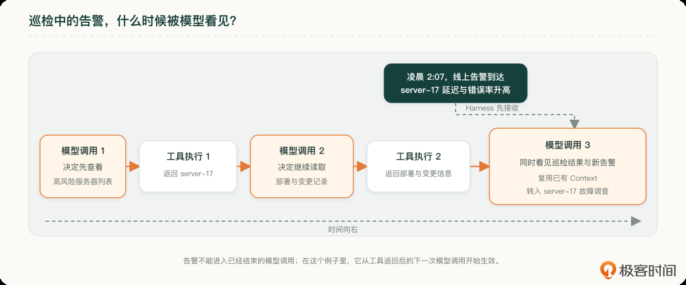
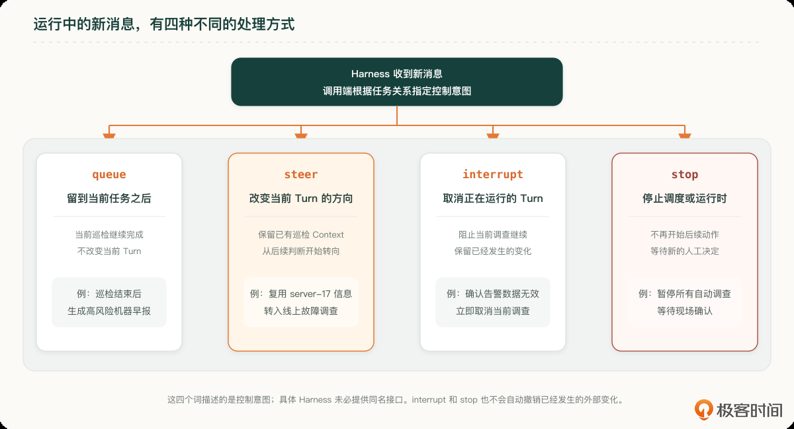
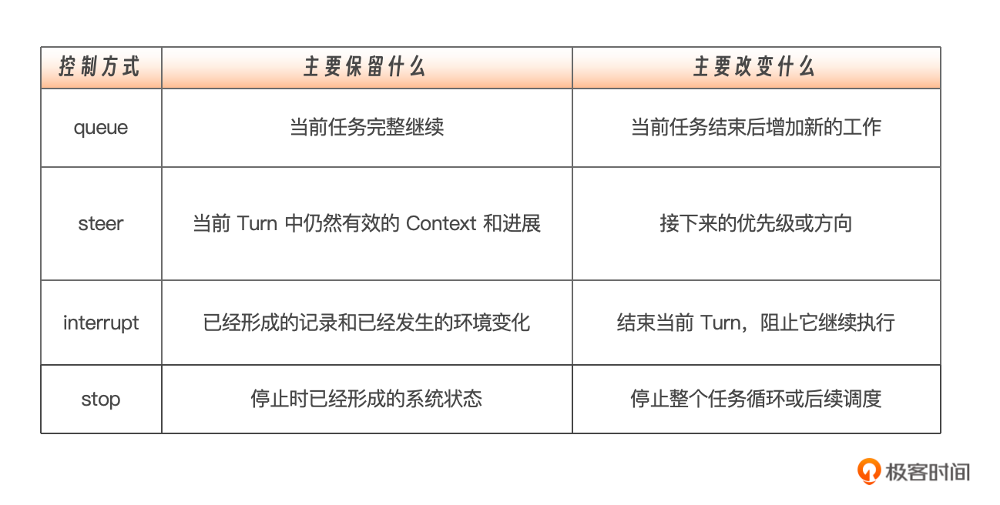
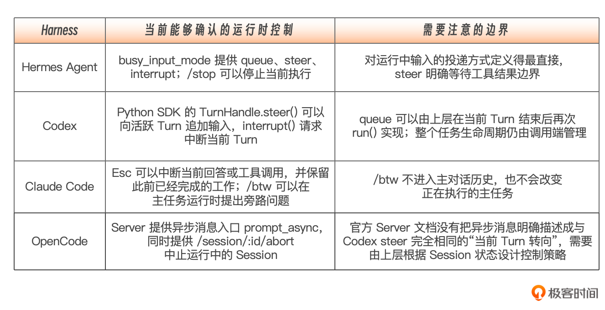
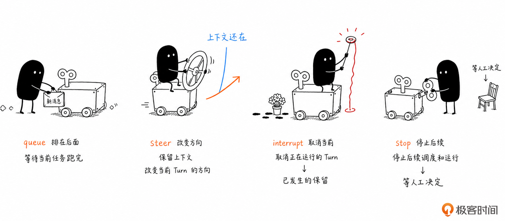

# 02 | 一封迟到的信：怎样改变一个正在工作的Agent？

你好，我是 Tyler。

上一讲，我们把一项真实工作交给了 Harness。模型根据当前信息判断下一步，Harness 在环境中执行动作，再把得到的结果带回下一轮模型调用。如此循环下去，Agent 才能从一句任务要求出发，一步步查找资料、调用工具，最终形成可以检查的结果。

但任务一旦持续运行，新的问题就会出现：如果 Agent 已经开始工作，这时又来了一条新消息，它什么时候才会真正影响正在进行的任务？

## 一条告警，怎样进入正在运行的任务？

我们还是从一个 On-call Agent 开始。

没有故障时，它持续巡检高风险服务器，读取当前部署、最近的配置变更和监控指标。当它检

```
查到 server-17 时，已经知道这台机器正在运行 payment-api，凌晨一点四十分刚刚调整
```

过数据库连接池。

凌晨两点零七分，一条告警到达：

```
server-17
payment-api P95 延迟超过 3 秒
错误率升至 8.4%
```

这条告警没有重复服务器上的部署信息，也没有告诉 Agent 最近发生过什么变更。但这些背景，Agent 在刚才的巡检中已经拿到了。

所以，更合理的做法并不是重新启动一个什么都不知道的新 Agent，而是把这条告警直接交给正在工作的 Agent：让它利用已经掌握的信息，暂时从巡检转向故障调查，处理完以后再继续原来的任务。

问题是，告警到达 Harness 的那一刻，模型就会立即看到它吗？

不会。消息到达 Harness，与消息真正进入模型输入，是两个不同的时刻。这就是这一讲要讨论的“一封迟到的信”。

## 告警会在哪一步生效？

上一讲我们已经看到，一项看起来连续运行的任务，实际上由模型调用和环境操作反复交替组成。

现在，把新的告警放进这条时间线。



- 巡检中的告警何时进入正在运行的 Turn

第一轮模型调用决定先查看高风险服务器列表。Harness 完成查询，把结果带入下一轮。模型

```
选中 server-17，决定读取它的部署和变更记录，于是 Harness 开始执行相应的工具调用。
```

就在工具运行期间，告警到达了 Harness。

这时，刚才那轮模型调用已经结束，正在执行的读文件动作也已经发出。新告警不可能回到过去，改写已经结束的模型调用，也不能凭空改变一个已经发出的工具请求。

等部署和变更记录返回以后，Harness 才有机会把这份工具结果与刚刚收到的告警一起放进下一轮模型输入。

直到这个时候，模型才真正“看见”告警。

```
它会发现，server-17 上运行的是 payment-api，连接池在二十多分钟前刚刚发生过调
```

整，现在又出现了延迟和错误率异常。因为之前的巡检结果仍然保留在当前任务中，它不需要重新调查这些背景，就可以直接判断下一步应该检查什么。

这就是运行中转向真正有价值的地方：新的信息改变了接下来要做的事，但此前仍然有效的Context 和工作结果可以继续保留。

## 指令先到 Harness，再进入模型

为了把这个过程说清楚，需要先区分两个运行概念。

我们可以把 Thread 理解为一项持续工作的会话状态；Turn 则是其中一次由输入启动、持续执行直到结束的 Agent 运行。一个 Turn 内部仍然可能经历多轮模型判断、工具执行和结果返

```
回。Codex 当前的 Python SDK 也是以 Thread 保存会话状态，并通过 Thread.turn() 获
```

得一个可以继续控制的活跃 Turn。

当一条新消息在 Turn 运行期间到达时，至少要解决三个问题：

1. 它属于哪个 Thread，又要影响哪个正在运行的 Turn？

2. 它要改变当前工作，还是等当前工作结束以后再处理？

3. 它从哪个位置开始进入后续判断？

这三件事并不全部交给模型决定。告警内容是什么意思，由模型理解。它应该送到哪个Thread、是否要干预当前 Turn，则需要调用端和 Harness 明确指定。至于消息什么时候真正进入模型输入，还取决于 Agent 当时运行到了什么位置。

因此，一条自然语言指令其实回答了“要改什么”；Harness 的控制接口还要回答“改哪项任务，以及从什么时候开始影响它”。

这两个层次不能混在一起。

## 运行时新消息的四种去向

一项任务运行几个小时以后，新消息会不断到达，但它们并不都应该立即改变当前工作。

```
我们可以先把运行时控制抽象成四种意图：queue、steer、interrupt 和 stop。这些词
```

描述的是四种不同的控制目的，并不意味着所有 Harness 都提供完全同名的 API。

比如，你发来一句：巡检结束后，把今夜的高风险机器整理成早报。

```
这件事并不紧急，也不应该打断正在进行的巡检。最合适的处理方式是 queue：保留当前任
```

务，把新工作放到后面。

```
刚才的线上告警则不同。原来的巡检结果仍然有用，只是 server-17 的优先级突然变高。此
时更适合 steer：继续保留当前 Turn 中已经取得的信息，但修改接下来的工作方向。
```

如果值班工程师随后发现，告警采集器的时间配置有误，当前调查正在基于错误数据不断向下

```
推进，就应该考虑 interrupt。它取消的是当前这次执行，让 Agent 不再沿着已经失效的方
```

向继续工作。

还有一种情况更彻底。比如值班负责人要求暂停自动调查，等待现场确认，目前也没有新的执行方案。此时需要停止整个任务循环，不再继续调度新的动作。我们可以把这种生命周期层面

```
的控制称为 stop。
```



- 运行中消息的四种控制路径

四种控制意图的区别可以概括为：



```
这里尤其要注意 interrupt 和 stop 的区别。
interrupt 通常仍然保留 Thread，你可以随后给出新的要求，再启动后续工作；stop 更接
```

近任务或运行时生命周期控制，意思是暂时不要再继续执行。

具体产品怎样实现，还要看它自己的运行时设计。

## 转向也要等到模型能够重新判断

```
steer 的目标是尽快改变正在运行的任务，但“尽快”并不意味着它可以回到过去。
```

一条新指令无法修改已经结束的模型调用，也无法撤回已经产生的环境变化。真正有意义的问题是：Harness 下一次什么时候可以让模型重新判断？

在刚才的例子中，模型已经发出了读取服务器信息的动作。对于这种很快结束的只读操作，通常没有必要强行打断。等工具返回以后，把告警和工具结果一起交给模型，既保留了刚取得的信息，又能立即改变后续方向。

```
Hermes 对这一点给出了非常明确的运行规则。它的 busy_input_mode 支持 queue、
steer 和 interrupt；其中 steer 会等待下一个工具结果边界再把新消息交给 Agent，默
认的 interrupt 可以在模型生成阶段更快响应，但不会直接取消一个已经运行起来的工
具。/stop 则用于取消当前 Turn 及其前台工作。
Codex 的控制接口采用了另一种表达方式。当前 Python SDK 中，Thread.turn() 会返回
TurnHandle，调用者可以通过 steer() 向正在运行的 Turn 追加输入，也可以通过
interrupt() 请求中断。App Server 对 turn/steer 的定义也很明确：它向一个已经处于
```

运行状态的普通 Turn 增加新的用户输入，并不会另外创建一个 Turn。

至于这条输入具体在哪一个内部模型调用中开始发挥作用，不应该脱离具体运行事件凭空假设。调用端可以继续观察 Turn 的事件流，判断 Agent 后续采取的动作是否已经受到新指令影响。

```
因此，steer 更准确的理解是：修改一个仍在运行的任务接下来怎样继续，而不是修改它刚
```

才已经做过什么。

## 中断也不会让时间倒流

这里还有一个非常重要的边界。假设 Agent 已经修改了配置文件，然后你才发出

```
interrupt。
```

中断当前 Turn，并不会自动把文件恢复到修改前。

同样，如果 Agent 已经向外部系统提交了请求，已经启动了一个进程，或者已经完成了一次数据库写入，那么终止后续推理也不会让这些副作用自动消失。

所以，运行控制和状态回滚是两件不同的事。

```
Harness 可以通过 interrupt 或其他机制阻止后续动作；已经发生的环境变化，则需要
```

Git、文件快照、数据库事务、幂等设计或补偿操作来恢复。这一点在设计长程 Agent 时非常重要。能“停下来”，并不代表能“回到原来的状态”。

## 不同 Harness 把控制权放在哪里？

理解了这些控制意图以后，再去看 Codex、Hermes、Claude Code 或 OpenCode，就不容易被具体产品的动作命名带偏。



Hermes 的这些行为由当前 CLI 文档直接定义；Codex Python SDK 和 App Server 也明确暴

```
露了同 Turn 的 steering 与 interrupt。Claude Code 当前文档说明，Esc 可以在 Turn 中停止
当前响应或工具调用，并保留已经完成的工作，而 /btw 在主任务运行时独立回答旁路问题，
```

不会干扰主 Turn。OpenCode Server 则明确提供异步消息发送和 Session abort，但其文档没有进一步承诺异步消息一定具备“当前活跃 Turn steering”的语义。

这些 API 和默认行为以后都可能变化。真正稳定的问题始终只有三个：这条消息属于哪项工作？它选择了哪种控制意图？它从什么时候开始影响后续行为？

## 小结

学到这里，我们回头看一下这封“迟到的信”。

告警在凌晨两点零七分已经到达 Harness，但那一刻并不代表模型已经看到它。只有当Harness 把它放进后续的模型输入，它才真正成为 Agent 判断的一部分。于是，运行中的消息出现了几种不同去向。

```
queue 把新工作放到当前任务之后；steer 保留仍然有效的 Context 和进展，只改变接下来
要做什么；interrupt 结束已经失效的当前 Turn；stop 则进一步停止任务循环或后续调
```

度。



它们共同解决的问题是：环境已经发生变化，但我们不希望每发生一次变化，就把整个任务推倒重来。

这也是为什么运行时干预很像一次 Hotfix。真正好的干预，不是重新接管 Agent 的每一个步骤，而是在现实世界偏离原计划时，尽可能保留仍然有效的部分，只修正已经失效的方向。

这种思想也并不是新事物。在经典自动规划研究中，Plan Repair 讨论的就是类似问题。当执行环境或目标发生变化以后，可以完全重新规划，也可以尽量在原计划基础上进行修复。对今天的长程 Agent 来说，同样的问题重新出现了。

只不过过去我们修的是 Plan，现在还要同时考虑已经积累的 Context、完成的工具操作、形成的中间结果，以及 Agent 对外部环境已经产生的影响。

## 课后题：任选一题

思考题：为什么运行时干预要遵循最小变更原则？

2006 年的《Plan Stability: Replanning versus Plan Repair》讨论了一个很有意思的问题：当环境或目标发生变化以后，我们可以从头重新规划，也可以尽量保留原有计划中仍然有效的部分，只修改无法继续执行的部分。论文把这种对原计划扰动程度的关注称为 Plan Stability。

长程 Agent 面临着类似的问题。一条运行中的指令如果改变得太少，可能无法应对新的环境；如果直接推倒重来，又可能丢掉已经取得的 Context、中间结果，甚至破坏此前已经形成的外部承诺。

为什么对长程 Agent 的运行时干预，也应该像 Hotfix 一样遵循最小变更原则？

观察题：让巡检 Agent 转入 On-call

打开 Github 中的随讲实验 Notebook，从第一个单元格开始依次运行。

```
Notebook 会先启动一个巡检 Turn。Agent 读取 server-17 的部署和变更记录以后，一条只
包含服务器、时间和异常现象的告警会通过 TurnHandle.steer() 进入同一个正在运行的
Turn。Codex 当前 Python SDK 明确提供 turn()、steer() 和 interrupt() 这组低层控
```

制接口。

任务结束以后，请重点检查四件事：告警是否进入了原来的 Turn；故障调查是否使用了告警到达以前已经取得的变更信息；Agent 是否按照任务要求继续后续工作；无关文件是否保持不变。

```
Notebook 后半部分还会通过一个没有副作用的慢任务演示 interrupt()。你可以直接比
较：steer 修改的是一个任务接下来怎样继续，而 interrupt 则结束当前这次执行。
```

期待你在留言区记录想法或者提出疑问，如果今天的内容对你有帮助，别忘了分享给身边更多朋友。
