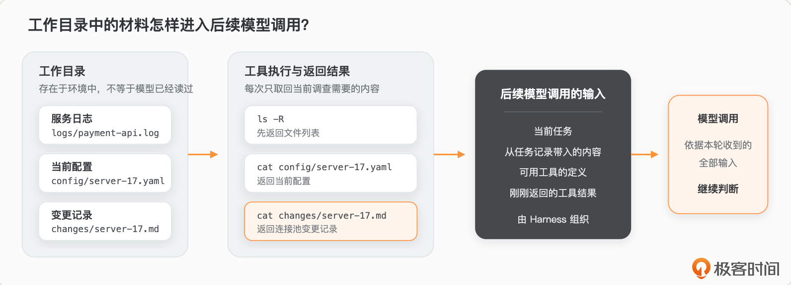
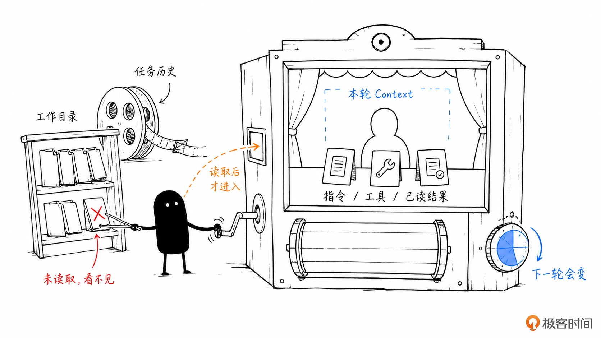

# 03 | 上下文引擎：模型每轮对话都会看见什么？

你好，我是 Tyler。

上一讲，我们知道了运行过程中到达的新指令，要等 Harness 把它加入后续某次模型调用，才会真正进入模型的视野。接下来，我们把目光移到调用内部：除了刚刚送进去的指令，模型究竟还看见了什么？

这个问题很容易被忽略。我们知道 Agent 可以访问整个工作目录，也很容易进一步认为，只要某份材料与当前任务有关，它自然会找到并读取。实际运行并不总是如此。Agent 会不会找到一份文件、什么时候读取，都取决于它当时看到的内容，以及下一步选择去做什么。

## 文件就在目录里，Agent 为什么没有用上？

延续故障调查例子，这次就从一份始终没有被打开的变更记录开始。凌晨三点，上一讲的告警

```
已经送入正在运行的巡检任务。Agent 从部署查询结果中得知，server-17 最近调整过连接
```

池，也把这项变化列入了调查线索。

为了弄清这次调整究竟发生在什么时候、改了哪些参数，团队还把详细变更记录放进工作目录

```
的 changes/server-17.md。Agent 已经看过告警，读过服务日志，也查看了当前配置，
```

却还没有打开这份文件。它在报告中写道：

- 部署记录显示近期调整过连接池。具体变更时间和参数仍待核对。

要继续判断连接池调整和故障之间的关系，还需要知道这次变更究竟发生在什么时候、改了哪些参数。

工程师查看 Agent 已经执行过的命令，很快发现，Agent 只看到了部署查询返回的变更摘要，从来没有读过那份详细记录。

工作目录里可以放日志、代码、部署记录，也可以有上百份暂时用不到的材料。模型虽然可以通过工具读取这些文件，却不会保证把所有相关材料都主动找出来。只有某份文件真正被读取，其中的内容才有机会进入后续模型调用。

这和工程师使用内部知识库很像。你有权限搜索和打开里面的文档，并不代表每次分析都一定能找到最相关的那一份。只有真正检索并读过以后，其中的内容才会参与当前判断。

接下来我们随着这张图，来看看 Agent 补查这份记录时，文件内容是怎样进入模型输入的。



首先，工程师要求 Agent 核对详细变更。上一讲我们已经知道，这条新要求会从后续调用开始影响任务。于是，下一次模型调用开始时，模型看见了这条要求、此前的调查历史，以及当前可以使用的工具。此时它仍然没有看见文件正文，只能根据已有信息决定下一步，于是提出查看当前工作目录。

这次模型调用到这里结束。

```
Harness 随后执行命令，取得文件列表。下一次调用开始时，模型看见了 alerts/、
logs/、changes/ 等目录名称。此时，它只知道详细变更很可能保存在 changes/ 中，却
还不知道具体是哪一份文件。模型于是继续查看 changes/ 目录。等 Harness 返回其中的文
件列表后，它才知道这里有一份 server-17.md。
为了核对详细变更，模型接着提出读取 changes/server-17.md。Harness 打开文件，把
```

参数调整的时间、修改内容和执行人作为工具结果返回。文件读取完成后，Harness 把这些内容带入后续模型调用，它们才开始影响模型接下来的判断。

模型把变更时间与告警时间放在一起比较，重新修改报告：

- 故障发生前二十分钟调整过连接池参数。两者在时间上相邻，连接池变更应列为优先调查线索；现有信息还不足以确认它就是根因。

## 模型这一轮看见的，不是整个工作目录

刚才那份变更记录一直存在于任务环境中。模型先从目录列表中知道有这份记录，随后读取文件，正文才进入后续模型调用。到了这一步，记录里的时间和参数才开始影响模型的判断。

把第一讲的 Agent Loop 再往里看一层，就会发现，每次循环到新的模型调用，模型拿到的内容都可能已经发生变化。

模型某一轮实际收到的全部输入，就是这一轮的 Context，也就是上下文。当前任务、各级指令、适用的项目规则、仍然需要保留的任务历史、本轮可用的工具，以及刚刚返回的工具结果，都可能出现在其中。

工作目录里放着 Agent 可以继续查找的材料，任务记录保存这项工作此前发生过什么，而Context 只对应当前这一次模型调用，决定模型此刻能够依据哪些内容继续判断。

一份文件可以一直放在工作目录里，却从未进入任何一次模型调用。任务记录中也可能保存着比当前 Context 更多的历史。这些内容以后仍然可能被用到，但并不意味着它们已经出现在这一轮 Context 中。

客户端里的命令和事件记录也不能和 Context 混为一谈。它们能够告诉工程师 Agent 什么时候发起读取、工具返回了什么，以及后续行动怎样变化；但这些记录是用来查看任务运行过程的，并不等同于某一次模型调用的完整 Context。

## 谁来准备模型每一轮看到的内容？

工具结果返回以后，如果任务还要继续，Harness 就要准备下一次模型调用。前面已经发生的对话、需要继续带上的指令、刚刚得到的新结果以及这一轮允许模型使用的工具，都要在调用开始以前整理好。

```
Codex 的源码里可以直接看到这一步。在 codex-rs/core/src/client_common.rs
中，单次模型调用会使用一个 Prompt。我摘出了和这一讲最相关的几个字段。
pub struct Prompt {
   pub input: Vec<responseitem>,
   pub(crate) tools: Arc<[ToolSpec]>,
   pub base_instructions: BaseInstructions,
   // ...
}</responseitem>
这里的 input 是这次调用要交给模型的会话内容，tools 是这一轮允许模型使用的工具，
base_instructions 则保存基础指令。
真正调用模型时，Codex 会把这些内容整理成 Responses API 使用的 instructions、
tools 和 input。instructions 提供模型需要遵守的要求，tools 列出这一轮可以调用
的工具，input 则包含本轮要交给模型的消息和其他内容。
刚才读取 changes/server-17.md，走的就是这个过程。
文件还只是工作目录里的一个文件时，它的正文并不在这一轮的 input 里。如果模型要依据
```

这份详细记录继续判断，就需要先提出读取文件，Harness 再真正执行这个操作。

工具执行结束以后，返回结果还要整理成模型能够接收的记录。等下一次模型调用开始时，文件中的变更时间和参数才真正进入模型视野，并开始影响后面的判断。

但这里还有一个问题：同一个 Turn 中，下一次模型调用为什么会拿到一份新的 Context？

```javascript
真正把这些模型调用串起来的，是 codex-rs/core/src/session/turn.rs 中的
run_turn()。它内部有一条持续循环：
loop {
   let sampling_request_input = sess
       .clone_history()
       .await
       .for_prompt(...);
   run_sampling_request(
       ...,
       sampling_request_input,
       ...
   ).await;
   // 处理模型输出和工具调用
   // 工具结果进入历史
   // 需要继续时再次进入循环
}
关键在于，sampling_request_input 是在循环内部生成的。
```

Codex 不会在 Turn 开始时准备一份固定 Context，然后一直使用到结束。模型提出动作以后，Harness 执行动作，新的结果进入任务历史；只要任务还要继续，下一次模型调用开始以前，Codex 就会根据更新后的历史重新准备输入。

```
刚才读取 server-17.md 就是如此。最初的模型调用没有文件正文；目录查询返回以后，后
```

续调用多了文件位置；真正读取文件以后，再下一次调用才看到了具体的变更时间和参数。

```
所以，Prompt 让我们看到一次模型调用最终带上什么，run_turn() 则让我们看到这些内
```

容怎样随着任务推进不断变化。

模型作出判断，Harness 执行动作，新结果进入历史，再重新准备下一次模型调用。Agent 就是在一次次变化的 Context 中，把任务继续往前推进。

## 小结

电影《楚门的世界》里，楚门生活在一座看起来完整的小镇。他看得见街道、邻居和大海，却不知道镜头之外还有一个更大的世界。对他来说，节目组安排在眼前的一切，就是他所认识的现实。

模型也有自己的“海景镇”。对楚门来说，镜头之外的世界不可见；对模型来说，没有进入这一轮调用的内容同样不可见。工作目录里尚未读取的文件、任务历史中没有带入当前调用的信息，都不会参与这一轮判断。


模型看到的世界，不等于工作目录里实际存在的全部内容。对于工作目录里的普通文件，模型虽然具备读取能力，却不意味着它一定会主动找到并读取。只有文件真正经过工具读取，其中的内容才有机会进入后续模型调用。

工作目录里放着 Agent 可以继续查找的材料，任务记录保存这项工作此前发生过什么，而Context 是模型这一轮实际收到的输入。客户端里的命令和事件，则帮助工程师查看这项任务是怎样运行的。

如果你读过第一季，刚才这段源码应该会非常熟悉。三年前，在第一季第 28 讲文末的总结图里，我们把这部分称为“提示引擎”：在每次模型调用以前，把知识、工具、示例和历史对话整理成模型真正收到的 Prompt。三年以后再看 Codex 和 OpenCode，这套做法仍然清楚可

```
见，源码里也继续使用 Prompt、build_prompt()、SessionPrompt 这样的名字。
```

现在讨论更多一些的 Context Engineering，关注的仍然是这个核心问题。随着 Agent 开始读取文件、调用工具、获得新的结果，并在运行过程中接收新的指令，提示引擎还要继续准备下一轮模型输入。

所以下次 Agent 没有用上某份材料，先不要急着随意改提示词。先确认它是否发现了这份材料，是否真正读取过，以及读取结果是否在关键判断发生以前进入了模型调用。



## 课后题

### 观察题：一份材料从什么时候开始影响回答？

在临时目录中放入一份简短的部署记录。第一次让 Agent 只根据告警文字列出已经确认的事实，不要读取部署记录。随后在同一项任务中要求它读取这份文件，再回答一次相同的问题。

对照两次回答和中间的工具记录，观察部署信息从哪一次回答开始出现。

### 思考题：模型看得越多，判断就一定越好吗？

如果把项目规则、历史事故、监控指标和全部工具说明一次性交给模型，遗漏可能会减少，但模型也会同时收到大量与当前任务无关的信息。提供的信息过少，又可能迫使 Agent 反复寻找，甚至错过关键信息。

如果你正在设计一项长期运行的 On-call 服务，你觉得哪些内容应该从任务开始就进入Context，哪些内容只需留下查找入口，又有哪些材料应该等 Agent 确认需要以后再读取？

期待你在留言区分享见解，也欢迎你把这节课分享给身边更多朋友。
