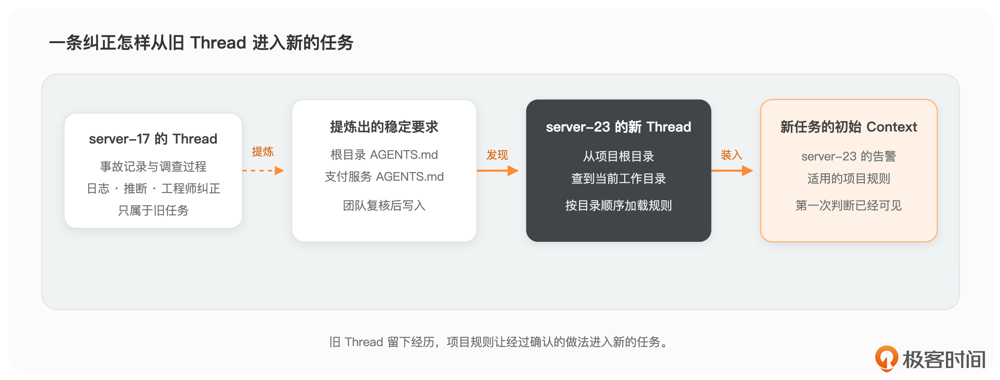
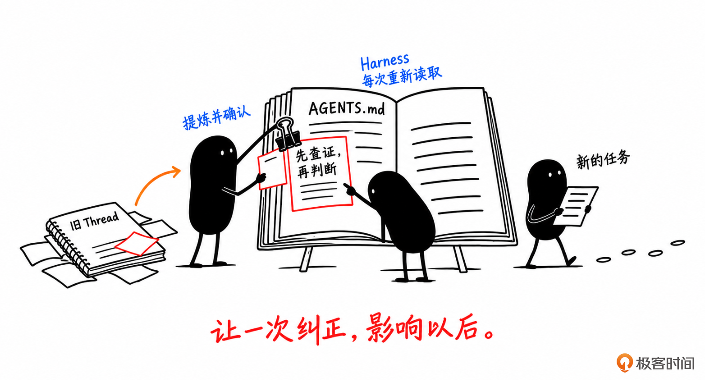

# 04 | AGENTS.md：如何设计规则指导Agent未来行动

你好，我是 Tyler。

```
上一讲， server-17 调查结束前，工程师纠正了 Agent 的一个问题：连接池调整发生在故
```

障以前，可以把它列为调查线索，却不能仅凭时间上的先后就认定它是根因。Agent 接受了这次纠正，也把报告改对了。

可等这项任务结束，再开始一场新的事故调查，这次纠正还会留下来吗？我们继续往下看。

## 上一次已经改对，为什么新的任务又错了？

```
上次的纠正事件告一段落，支付服务又出现了一次新的告警。这次出问题的是 server-23。
```

Agent 查看发布记录以后，发现一次应用发布发生在错误率上升之前，很快就在报告里写道“本次故障由应用发布引起”。

工程师看到这里，马上想起了上一场调查：这个问题不是已经纠正过了吗？确实纠正过，只是

```
那句话当时留在 server-17 的 Thread 里。
```

前面我们已经见过 Thread。同一项任务继续运行，或者以后重新打开原来的 Thread，前面的

```
调查历史仍然可以接着使用。但 server-23 已经是另一项新的调查。新的 Thread 不会因为
```

旧 Thread 中曾经出现过一句纠正，就自动把它变成自己的工作要求。

所以上一次改对，只解决了当时那份报告。

```
如果希望 server-23 也按照同样的标准调查，还要把那次纠正留下来。
```

## 哪些纠正值得留下？

最简单的办法，是把上一场事故的整段调查记录复制给新的 Agent。这样，那句纠正肯定不会丢。但请求编号、连接池参数、当时的日志片段、已经排除的判断，也都会一起带过来。新事故的排查还没有开始，Agent 就要先从大量旧信息中判断哪些仍然有用。

```
其实，需要留下来的只有其中很小的一部分。比如“server-17 的连接池变更应列为优先调查
线索”，这句话只属于上一场事故，没有必要交给 server-23。而“时间上先后发生的两件
```

事，不能直接写成因果关系”换一台服务器、换一次发布、换一种故障，它依然成立。

工程师可以把上一次明确下来的要求整理成后面这样。

```
# 故障调查报告要求
- 报告必须区分已确认事实、当前推断和待验证项。
- 时间上先后发生的两件事，不能直接写成因果关系。
- 根因判断必须注明对应的日志、指标或变更记录位置。
```

这里已经没有上一场事故的服务器名称，也没有连接池参数。留下来的是以后遇到类似任务时，团队仍然希望 Agent 遵守的调查方法。

所以，一次纠正要不要长期留下，可以先看它离开当前任务以后是否仍然成立。只属于这场事故的信息继续留在 Thread 里。经过确认、以后遇到同类任务仍然适用的要求，再沉淀为项目规则。

规则要留下的，是可以重复使用的做法。这个判断很重要。如果 Agent 每犯一次错，就永久增加一条针对当时场景的补丁，规则很快就会越来越长，其中还可能夹杂早已失效或者互相矛盾的要求。

## 规则写在哪里，决定哪些任务会使用它

```
在 Codex 中，这类项目要求可以写进 AGENTS.md。
```

这套 On-call 项目的目录是后面这样。

```
oncall-agent/
├── AGENTS.md
└── services/
   ├── inventory-api/
   └── payment-api/
       └── AGENTS.md
根目录的 AGENTS.md 可以写所有事故调查都要遵守的要求，比如报告必须区分事实和推断。
支付服务自己的日志位置、指标名称和调查要求，则可以放在 services/payment-
api/AGENTS.md。
```

Codex 每次开始新的 run 时，会先读取 Codex Home 中适用的全局规则，再从项目根目录一路查到当前工作目录。每一层目录最多采用一份规则文件；如果同一目录同时存在

```
AGENTS.override.md 和 AGENTS.md，会优先使用前者。找到的项目规则按照从根目录到
```

当前工作目录的顺序组合。

```
比如，从 oncall-agent/services/payment-api/ 启动 Codex，项目根目录和
payment-api 目录里的规则都可以被找到。
如果从 oncall-agent/启动，查找会在这里停止，不会继续向下寻找 payment-api 目录
里的 AGENTS.md。因此，更具体的规则放在哪一层，会直接影响哪些运行能够从一开始拿到
```

它。



- 项目规则如何在新的任务中继续生效

```
Codex 的源码也直接体现了这套查找方式。codex-rs/core/src/agents_md.rs 的文件
```

头先说明了整体规则：从当前工作目录向上寻找项目根目录，再收集项目根目录到当前工作目

```javascript
录之间的 AGENTS.md，并按这一顺序组合；查找不会越过项目根目录。
具体的路径发现由 agents_md_paths() 完成。摘出与目录范围和顺序直接相关的部分：
let project_root = find_nearest_ancestor_with_markers(
   fs,
   &dir,
   project_root_markers,
   FindUpErrorPolicy::Ignore,
   sandbox,
)
.await?;
let search_dirs = if let Some(root) = project_root {
   let mut dirs = Vec::new();
   let mut cursor = dir.clone();
   loop {
       dirs.push(cursor.clone());
       if cursor == root {
           break;
       }
       let Some(parent) = cursor.parent() else {
           break;
       };
       cursor = parent;
   }
   dirs.reverse();
   dirs
} else {
   vec![dir]
};
find_nearest_ancestor_with_markers() 从当前工作目录向上寻找项目根目录。默认
情况下，Codex 使用 .git 等项目标记确定根目录；如果没有找到，便只检查当前工作目
```

录。

接下来，代码先从当前工作目录逐级向上收集目录。此时得到的顺序是从当前目录到项目根目

```
录，因此还要执行一次 dirs.reverse()，把它调整为从项目根目录到当前工作目录。
```

每一层目录中，Codex 又会按照候选文件名的优先级寻找规则文件：

```
names.push(LOCAL_AGENTS_MD_FILENAME);
names.push(DEFAULT_AGENTS_MD_FILENAME);
这里的 LOCAL_AGENTS_MD_FILENAME 对应 AGENTS.override.md，
DEFAULT_AGENTS_MD_FILENAME 对应 AGENTS.md。因此，同一目录同时存在这两个文件
时，Codex 会优先采用 AGENTS.override.md。配置中还可以继续增加其他候选文件名；
```

每一层目录只采用首先找到的那一份。

```javascript
路径确定以后，读取逻辑再按照 agents_md_paths() 返回的顺序逐一打开文件：
let paths = agents_md_paths(config, cwd, fs, sandbox).await?;
for p in paths {
   let mut data = fs
       .read_file(&p, ReadFileOptions::default(), sandbox)
       .await?;
   // ...
   loaded.entries.push(InstructionEntry {
       contents: text,
       // ...
   });
}
因此，从 oncall-agent/services/payment-api/ 启动 Codex 时，根目录的规则会先
被读取，payment-api 目录里的规则随后加入。越接近当前工作目录的规则出现得越晚，越
```

能针对当前任务补充更具体的要求。

```
如果从 oncall-agent/ 启动，目录查找到项目根目录便已经结束，Codex 不会继续向下寻
找 services/payment-api/AGENTS.md。
```

这里可以看到，规则写在哪一层，不只是文件整理方式的差别。它会直接决定哪些运行能够加载这项要求，以及不同层级的要求按照什么顺序进入模型输入。

```
现在，工程师把刚才整理出的事故调查要求写进了适用的 AGENTS.md，重新开始 server-
23 的调查。
```

这一次，Agent 查看应用发布以后，没有直接宣布根因，而是写道：

- 应用发布发生在错误率上升之前，目前应列为优先调查线索。是否存在因果关系，还需要继续核对发布内容、日志和指标变化。

这时，上一次只在一场调查中生效的纠正，已经对新的任务产生了影响。

这就是项目规则和旧 Thread 的差别。旧 Thread 保存那一次任务发生过什么；项目规则留下的是以后还要继续采用的做法。

## 有了 Memory，为什么还要项目规则？

不过，现在很多 Agent 已经有了 Memory。你有没有想过，既然过去工作中的信息可以被记下

```
来，为什么还要专门维护 AGENTS.md？
Claude Code 正好提供了一个很清楚的例子。它同时支持 CLAUDE.md 和 Auto Memory。
CLAUDE.md 用来保存项目级指令和工作要求，Auto Memory 则由 Claude 在工作过程中自己
```

维护，可以记录用户纠正、项目经验以及以后可能有用的信息。

```
比如，Agent 在调查中发现：payment-api 的日志通常需要先通过 request_id 关联。这
```

是一条从实际工作中获得的经验，以后可能有用，可以记录到 Memory。而没有充分信息以前，事故报告不能直接宣布根因。

如果团队已经把它确定为正式的调查要求，就更适合放在项目规则里。它可以跟着项目进入版本管理，团队成员能够看到、修改和 Review。

两类信息可以同时存在。Memory 适合积累工作过程中得到的经验；项目规则适合保存团队已经确认、希望后续任务持续遵守的要求。这也给 Agent 的“自进化”留下了一条很重要的边界。

Agent 可以从反复出现的纠正中发现规律，甚至主动提出“这项要求已经出现过多次，是否需要加入项目规则？”但一条经验什么时候足够稳定，可以开始影响以后所有相关任务，还需要考虑它是否准确、适用于哪些范围，以及团队是否真的希望长期采用。

另外，项目规则仍然只是交给模型遵守的指令。涉及必须禁止的操作，不能只靠在

```
AGENTS.md 或 CLAUDE.md 中写一句要求，还需要 Sandbox、权限、审批、Hook 等由
```

Harness 实际执行的控制。Claude Code 也把项目指令与权限、Hooks 等机制分别处理。

## 不同 Harness 怎样处理项目规则？

Codex 并不是唯一提供这类机制的 Harness，只是不同产品使用的文件名称和查找方式有所不同。

Harness

- 项目规则主要加载方式

- 每次 run 开始时读取全局规则，

Codex

- AGENTS.md、AGENTS.override.md到当前工作目录

- Session 开始时加载当前目录及

Claude Code

- CLAUDE.md、.claude/rules/目录中的规则可以在处理相应文

- 启动时读取当前 Location 向上

OpenCode

- AGENTS.md时还会继续发现嵌套规则

- 启动时读取当前路径适用的规则

Hermes

- .hermes.md、AGENTS.md 等 Context Files以后继续发现局部规则

不同 Harness 的实现细节并不相同。切换到另一套 Harness 时，除了确认规则文件叫什么，还要进一步弄清三件事：它从哪个目录开始查找规则文件，这决定当前任务能够发现哪些规则；根目录与子目录中的规则怎样组合、谁的优先级更高，这决定通用要求和模块要求如何共同生效；规则文件修改以后，是立即影响当前任务，还是要等到下一次 Run、Session 或重新进入相应目录后才会生效。只有这些边界明确，才能判断一条规则究竟会影响哪些任务。

## 小结

电影《盗梦空间》里，柯布最初做的是潜入别人的梦境，从意识深处寻找秘密。后来，他接到了一项更难的任务：把一个念头植入目标的意识。等目标醒来以后，这个念头还会继续影响他的选择，这次植入才算真正成功。


```
同样道理，成功的规则不是生效一次，而是稳定影响 Agent 后续做法。我们再回到 server-
23。同一种错误之所以再次出现，是因为上一次的纠正最初只留在旧 Thread 中。继续原来的
```

任务，那句话还在那里；换一项新的调查，它不会自动跟过来。

如果团队希望某个做法以后继续使用，就需要先从具体任务中提取仍然成立的要求，再把它写进合适的项目规则。以后新的任务开始时，Harness 会重新读取这些规则，同样的要求也就能够继续影响 Agent 的判断。



发现了么？我们没有修改模型参数。工程师只是把一次任务中的纠正整理成了稳定规则，并把它留在以后还会被 Harness 读取的位置。每次进入相关项目，Agent 都会再次拿到这些要求，于是它的做法开始变得稳定。

```
下一讲，我们继续调查 server-23。新的规则已经留下来了，可这项调查如果持续几个小
```

时，对话、日志和工具结果还会不断增加。Thread 可以保存任务历史，模型却不可能永远把所有历史原样带进每一次调用。

当历史越来越长，Harness 会怎样处理它，又怎样让 Agent 记得这项调查已经做到哪里？

## 课后练习

### 观察题：让一次纠正影响新的任务

准备两份具有相似时间关系的故障材料。先在第一条 Thread 中告诉 Agent：“时间上的先后不能直接作为根因结论”，让它修改报告。

随后结束这项任务，再创建一条新的 Thread，调查第二份材料，观察这条要求是否还会出现。

```
接着把同一句要求写进项目的 AGENTS.md，重新创建任务，再比较 Agent 的判断方式。
```

重点观察的是：同一句要求只留在旧 Thread 中，和已经写进项目规则以后，新的任务有什么不同。

### 思考题：什么经验值得变成项目规则？

一次任务结束以后，Agent 可能留下很多信息：某条命令解决了当前故障，某个日志字段值得以后优先检查，一种判断方式刚刚被工程师纠正，还有一些要求已经成为团队长期采用的工作规范。

哪些内容应该继续留在 Thread，哪些适合进入 Memory，哪些已经值得写进项目规则？如果Agent 可以主动提出新的规则，团队又应该在什么条件下允许它开始影响以后的任务？

期待你在留言区积极发言。如果这节课对你有启发，欢迎分享给身边更多朋友。
