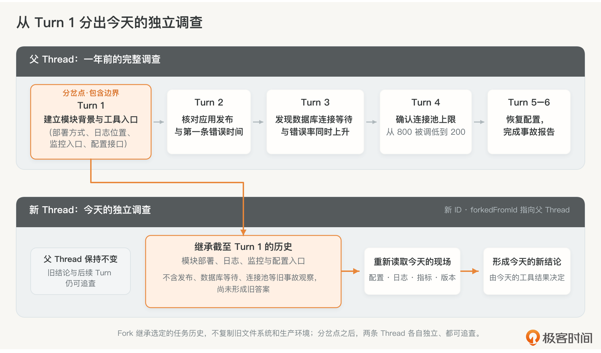
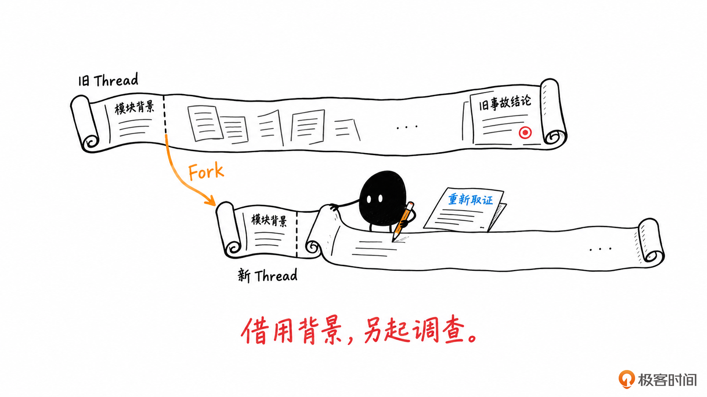

# 06 | 会话分支：怎样借助旧经历，开始一场新的调查？

你好，我是 Tyler。

一条 Agent Thread 持续保存一项任务的目标、背景、工具结果、已有判断和未完成事项，既能帮 Agent 接着往下做，也会影响它怎样理解后面的信息；换任务仍沿用原 Thread，上一项任务留下的状态就可能左右新判断。

一年后支付服务再次告警，你习惯性打开最常用的那条 Thread，Agent 很快开始排查。但问题随即出现：这条 Thread 虽然熟悉你在建设的新支付平台，眼前出故障的，却是一套多年前留下的历史模块。

这一讲，就从这次任务“串场”开始。

## Agent 为什么一直在排查另一套系统？

上午九点十七分，旧支付服务的错误率越过告警阈值。

你切换到历史模块的代码目录，然后在自己日常使用的 Thread 中输入：

- 支付接口错误率突然上升。检查最近的发布、流量变化和依赖状态，找出最可能的原因。

过去几个月，这条 Thread 一直在维护新支付平台，熟悉灰度发布、服务网格指标，也处理过Sidecar 升级的流量异常。Agent 很快沿这些经验排查，可这些方向在新平台都成立，放到旧支付服务上却逐步错位。

旧支付服务仍用独立的发布脚本，没接入新平台的灰度链路，部分实例也不经过同一套服务网格。Agent 找不到预期的 Canary 实例，就怀疑发布记录没有完整上报；查不到熟悉的服务网格指标，又去检查监控采集是否异常。它其实是在用新平台的系统结构，解释旧支付服务这套历史模块的故障。

排查迟迟没有结论，于是你回头开始看它做过什么，才发现自己顺手用了日常那条 Thread：它装满新平台的拓扑、日志路径和故障模式，工作目录虽切到历史模块，眼前仍是另一项任务的历史。Agent 的上下文很充足，只是归属错了。

你停止当前排查，开始搜索旧支付服务的历史事故。

一年前这套模块出过一次几乎相同的告警，当时处理的同学多已转岗，接手同事只记得报告最终写下的根因和处置：

- 数据库连接池配置异常。恢复配置后，服务逐渐恢复。

报告记下了现象、影响和结论，却没写清团队是怎样一步步查到的：从哪读应用日志、用什么指标看连接等待、为什么查连接池、又为什么排除应用发布，当前团队没人能完整回答。

你继续查找，直到翻出一年前归档的 Agent Thread。你打开旧 Thread，当年的调查过程终于重现。

```
Turn 1：确认历史模块的部署方式、日志位置、监控入口和配置接口
Turn 2：核对应用发布与第一条错误出现的时间
Turn 3：发现数据库连接等待与错误率同时上升
Turn 4：确认连接池上限从 800 被调低到 200
Turn 5：恢复配置，观察服务逐渐恢复
Turn 6：整理证据，完成事故报告
```

原来负责的同学已经转岗，最终报告只留下结论；重新读起这条 Thread 的 Agent，反而成了当前团队追问当年排查细节时最重要的“当事人”。报告只保存收束后的结论，Thread 里的一个个 Turn 却记下了结论形成以前的对话、工具调用和判断变化。

## Fork 怎样为新的事故建立独立的 Thread？

找到正确的历史只解决了一半：今天是一场新事故，怎样用上一年前的调查，又不让两项任务混进同一条时间线？

- 日常 Thread 不能再用，它属于新支付平台，那些背景会继续干扰对历史模块的判断。

- 直接 Resume 旧事故 Thread 也不合适：后续 Turn 会继续追加在同一条时间线上，“连接池上限被调低”这类旧结论已经属于上一场事故，今天的工具结果和处置再写在后面，两场事故就会共用一条记录，上场事故结论就会被当成新排查的起点，带偏新的排查方向。

- 新建空白 Thread 边界最清楚，却会丢掉已经查明的部署方式、日志入口和指标含义，团队只能重新熟悉系统，把当年花了好几轮才摸清的部署、日志和监控入口再摸一遍。

这时你需要的是一条新的 Thread，同时有边界地继承旧任务中仍然有效的历史。

你把分岔点选在 Turn 1：到这个位置，旧 Thread 只记录了历史模块怎样部署、日志、监控和配置从哪里取得，而应用发布、数据库等待、连接池这些只属于上一场事故的观察还没有进入。你从 Turn 1 Fork 出新的 Thread：

```
新支付平台 Thread
   └── 保留新平台的灰度发布、服务网格和 Sidecar 背景
一年前的事故 Thread
   ├── Turn 1：建立历史模块背景与工具入口
   ├── Turn 2：核对旧事故的发布与错误时间
   ├── Turn 3：发现数据库连接等待上升
   ├── Turn 4：发现连接池上限被调低
   └── Turn 5—6：恢复配置并完成事故报告
             从 Turn 1 Fork
                    ↓
今天的新 Incident Thread
   └── 继承模块背景，重新调查当前告警
```



```
你可以先用 thread/read 读取旧 Thread，长 Thread 可用实验性的 thread/turns/list
分页查看 Turn，确定分岔点后调用 thread/fork：
{
 "method": "thread/fork",
 "id": 12,
 "params": {
   "threadId": "thr_payment_incident_2025",
   "lastTurnId": "turn_legacy_module_map",
   "cwd": "/workspace/legacy-payment"
 }
}
lastTurnId 是包含边界：新 Thread 继承指定 Turn 及其以前的历史，之后的 Turn 不进入
新分支，指定 Turn 必须已结束。Fork 后 App Server 生成新 Thread ID，用 forkedFromId
记录来源、发出 thread/started 通知，父 Thread 保持不变。
```

从当前源码看，Thread Store 会先把调用方选择的位置转换成明确的分支边界：

```
enum ForkBoundary {
   Latest,
   ThroughTurn(String),
   BeforeTurn(String),
}
```

这次请求对应的是：

```
ForkBoundary::ThroughTurn(turn_id)
随后，Thread Store 准备一份 PreparedFork：
struct PreparedFork {
   source_thread_id: ThreadId,
   history_base: Option<historyposition>,
   model_context: Arc<vec<rolloutitem>>,
   _source_reservation: Box<dyn debug + send>,
}</dyn debug + send></vec<rolloutitem></historyposition>
history_base 指向继承到的持久化历史前缀，model_context 保存按边界选出的模型可
见 Context，_source_reservation 是一道保护：子 Thread 的历史引用完成持久化前，
```

阻止父历史被提前删除。因此采用引用式分页存储时，Fork 不必复制整个父 Thread，子Thread 引用已冻结的前缀，再写自己的后续记录。

```
thread/fork 还能为新 Thread 重新指定工作目录、模型、Sandbox、权限和指令，新任务
```

于是既继承选定的历史，又能在今天的代码仓库和运行策略下重新开始。

整条过程可以简化为：

```
读取父 Thread
   ↓
根据 lastTurnId 确定历史边界
   ↓
准备历史前缀和模型 Context
   ↓
```

- 按照新任务装配运行配置

```
   ↓
创建独立的 Thread ID
   ↓
记录 forkedFromId
```

## 新 Thread 怎样接回模块背景，重新调查当前告警？

Fork 完成以后，你在新的 Thread 中提交第一项要求：

```
当前任务是 INC-2026-0917。继承的内容只用于了解历史模块的部署方式、日志入口、
```

- 监控入口和配置接口。请重新确认这些入口是否仍然有效，再读取今天的发布记录、应用日志、数据库指标和连接池配置，形成当前事故的调查计划。

这段话再次声明边界：继承的内容只用来认门，今天的入口要重新确认。新 Thread 把一年前的日志、配置入口和“无灰度链路”当线索，再通过工具调用重新验证这些入口今天是否仍有效。

```
Agent 先读当前连接池配置：上限仍是 800、近期没有调整；再查数据库指标，连接等待确实
```

又在上升，但异常集中在刚完成升级的一组实例，未升级实例正常。它对齐第一条错误、发布时间和实例版本：一年前同类报错在发布前就出现，所以没有把发布认定为根因；这一次第一条错误出现在新版本实例启动之后，调查随即转向新旧版本的代码差异。

新版本增加了一条支付请求重试路径：为做幂等控制，它先取得数据库连接、准备写入幂等记

```
录，再校验请求；当请求缺少 Idempotency-Key 头时，请求因校验异常提前结束，连接却
```

没有按预期归还连接池。

你在测试环境重放同类请求，异常请求持续进入，活跃连接和数据库等待同步上升，最终复现了生产环境的错误率变化。

三条 Thread 最终保存了三项不同任务的状态：

```
新支付平台 Thread
灰度发布、服务网格、Sidecar
   → 继续服务新平台
一年前的事故 Thread
连接池上限从 800 降到 200
   → 恢复配置并关闭事故
今天的新 Incident Thread
```

- 当前连接池配置正常

```
   → 定位新版本重试路径中的连接释放问题
```

新 Incident Thread 只接回理解历史模块所需的背景，今天的日志、配置和指标形成当前事故自己的证据链。Thread 之间可以有来源关系、共享一段历史前缀，但各自的目标、现场观察、判断和待执行动作必须分开保存。

至于部署方式、日志入口、指标含义这类会被反复使用的稳定知识，还应当进一步整理进项目规则、文档或 Skill。Thread 适合保存一项任务怎样展开，不该长期充当项目知识的唯一入口。

## 小结

这一讲的核心是任务边界：有些经验可以继续用，但旧任务的目标、现场、结论和行动必须留在原时间线里。三种选择由此分清：Resume 让同一任务沿原时间线继续，Fork 截取一段历史为新任务建独立时间线，与过去无关的工作则从空白 Thread 开始。界线就是一句话——这部分历史来自过去，从这里开始，已是另一项工作。



也正因为两条 Thread 彼此独立，将来某个结论受到质疑时，才追查得到它来自哪条分支、依据了哪些工具结果、又在哪个 Turn 发生了变化。

但不是每次告警都值得翻旧 Thread、挑 Turn 再 Fork。下一讲我们就看看，怎样把一次成功调查中可复用的方法提炼出来，直接交给以后的每次任务。

## 课后题

### 观察题：让错误的 Thread 发生一次“串场”

准备两套结构不同的实验项目，先让 Agent 在项目 A 的 Thread 里完成几轮故障调查，积累 A的部署方式、日志入口和故障模式；再在同一条 Thread 提交项目 B 的告警，看它是否把 A 的架构和判断习惯带进来。然后为 B 找一条历史 Thread，从只含模块背景、尚未进入事故判断的 Turn Fork 出新 Thread，比较两次调查最先检查的内容和形成的假设。

### 思考题：哪些经验可以跨任务复用？

一套 Harness 应该怎样区分两类内容：哪些是可以跨任务复用的项目背景、查询入口和判断方法，哪些是只能留在父 Thread 中的现场状态、任务结论和待执行动作？哪些稳定知识应该进一步沉淀到项目规则、Memory 或 Skill 中，哪些又必须始终留在具体 Thread 的时间线上？

期待你在留言区积极发言，分享见解。如果这节课对你有启发，欢迎分享给身边更多朋友。
