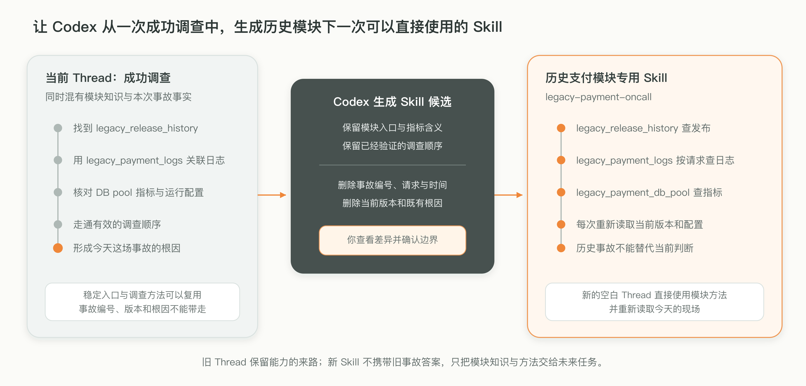
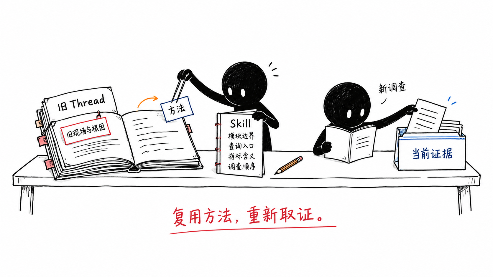

# 07 | 经验技能化：怎样把一次排查经历提炼成可复用的方法？

你好，我是 Tyler。

第 6 讲里，你从一年前事故 Thread 的合适位置 Fork 出新 Thread：沿用此前对系统的理解，把上一场事故的判断和处置留在原时间线。

事故处理完，我们回过头来看，还会有个新问题：难道这套模块每次告警，都要重翻历史Thread、再选 Turn 来 Fork？

这样做虽然可行，但 Fork 带回的是具体历史，既有可复用的模块知识，也有只属于上一场事故的请求编号、配置值和根因，不能当作长期方法。团队想留下一套可复制的排查方法，又该怎么做呢？这就是今天这讲内容要探讨的问题。

## Skill Creator 怎样把历史经验整理成 Skill？

```
你在刚完成调查的 Thread 中，调用 $skill-creator：
使用当前 Thread 作为完整案例，
为历史支付模块创建 legacy-payment-oncall Skill。
```

- 保留模块边界、查询入口、指标含义和已经验证的调查顺序。删除事故编号、请求编号、当前版本、上次填入的参数值和最终根因。新的调查必须重新读取当前日志、发布记录、指标和配置。

- 第一版只保留操作说明，

```
不要创建不必要的 references、scripts 或 assets。
$skill-creator 不是把 Thread 自动压成 Skill 的按钮，它本身是内置 Skill，规定了从案例
```

提炼方法、初始化目录、编写校验、使用中迭代的过程；当前 Thread 的工具调用、人工纠正和结果都是提炼依据。



Codex 先把 Thread 里的信息分成两堆。

```
第一堆是事故现场信息，必须留在原 Thread：本次的 request_id、实例名、版本号、连接
```

池数值都是上一场的现场信息，只说明当时发生了什么，下次要重新取得；“支付重试未归还连接”这一根因也是现场结论，留在原 Thread 证据链里，不能当成未来调查的默认方向。

另一堆是长期有效的知识，要放入 Skill，也分几类，下面依次来看

先看模块边界，这套历史支付模块有独立的发布方式和依赖，与新支付平台不同，不能套用后者的设定。

然后是查询入口，即上次调查确认可用的几组命令：

```
legacy_release_history
```

- 查询历史支付模块的发布记录

```
legacy_payment_logs
按照 request_id 关联应用日志
legacy_payment_db_pool
```

- 查询活跃连接、等待连接和连接池使用情况

```
legacy_payment_runtime_config
```

- 读取当前版本、依赖地址和运行配置

查询入口稳定、保留进 Skill；每次填入的参数、查出的日志、指标和配置都会变，下次重新读取。

```
第三类知识是指标含义：以 legacy_payment_db_pool 为例，活跃连接、等待连接、使用
```

率的数值每次不同，口径和反映的状态却稳定。

前三类偏静态，第四类是刚走通的调查顺序，即这套模块可复用的排查路径：先确认告警时

```
间、影响范围和异常实例，从最早异常样本取得关联标识；再沿同一个 request_id 核对应
```

用日志、实例版本和依赖调用，对照发布记录、指标与配置；最后把已确认事实、推断和待验证问题分开。

这套顺序不预设下一场事故的根因，却能帮 Agent 尽快取得可相互印证的材料。

至此我们保留了四类 Skill 候选知识：模块边界、查询入口、指标含义、调查顺序，也剔除事故现场标识和旧根因。

```
我们明确了保留什么、删除什么，就可以让 Skill Creator 开工了。它先用 init_skill.py
```

建目录骨架：

```
python3 <skill-creator-root>/scripts/init_skill.py \
 legacy-payment-oncall \
 --path legacy-payment/.agents/skills \
 --interface 'display_name=历史支付模块值班排查' \
 --interface 'short_description=调查 legacy-payment 模块告警' \
 --interface 'default_prompt=使用 $legacy-payment-oncall 调查当前告警'</skill-creat
脚本创建 Skill 目录，生成带初始 Frontmatter 的 SKILL.md 和 agents/openai.yaml；只
有显式指定 --resources，才会增加 scripts/、references/、assets/。
```

这次第一版只包含操作说明，因此目录结构很简单：

```
legacy-payment/
└── .agents/
   └── skills/
       └── legacy-payment-oncall/
           ├── SKILL.md
           └── agents/
               └── openai.yaml
SKILL.md 是核心，Frontmatter 至少含 name（标识 Skill）和 description（处理什么任
```

务、何时该用）；正文保存 Skill 被选中后遵循的方法。

```
agents/openai.yaml 保存界面与调用方式的补充信息；复杂后还可加三类可选资源：
scripts/（代码）、references/（按需文档）、assets/（报告模板）。
目录建好后，Codex 把这四类内容写入 SKILL.md，再运行基础校验：
```

```
python3 <skill-creator-root>/scripts/quick_validate.py \
 legacy-payment/.agents/skills/legacy-payment-oncall</skill-creator-root>
quick_validate.py 检查 SKILL.md 是否存在、Frontmatter 能否解析、
name/description 是否齐全、名称是否合规：
Skill is valid!
```

但这只说明结构合格。入口是否真实、步骤是否合理、旧结论有没有被误写成长期规则，都不在它的判断范围内。

## 为什么结构合格的 Skill 仍然带着旧事故的答案？

```
你打开 Codex 写好的 SKILL.md 逐条核对，很快发现一句不该保留的信息：
```

- 支付接口错误率上升时，优先检查新版本重试路径是否耗尽数据库连接池。

这正是上一场事故的根因。

留在 Thread 里，它是有证据的历史结论；写进 Skill，就会成为以后每次调查的优先方向。下次问题若来自依赖地址、证书或配置，Agent 仍会围着连接池找证据。

文件里还写死了上一场的实例名称；那条命令当时能跑，下次告警时相同实例可能早已不存在。

Skill 格式没问题，内容却过度贴合上一场事故：一次调查里既有长期有效的模块知识，也有只在当时成立的判断。Skill Creator 能写出初稿，却无法凭一场事故证明每一步都值得长期保留，这正是你要把关的地方。

你让 Codex 再修改一次：

- 删除旧事故的具体根因和当前实例参数。

- 保留模块边界、查询入口、指标含义和调查顺序。

- 历史事故只能提供需要重新核对的线索，不能成为新任务的默认判断。

- 每次调查都必须重新取得当前版本、日志、指标和配置。

```
修改后的 SKILL.md 变成：
---
name: legacy-payment-oncall
description: 调查 legacy-payment 历史支付模块的错误率、超时或资源耗尽告警；在需要核对该模块
---
# 历史支付模块事故调查
## 任务边界
- 确认当前调查对象是 legacy-payment 模块。
- 不要套用新支付平台的 Canary、服务网格或 Sidecar 背景。
- 历史事故只能提供检查线索，不能作为当前根因。
## 调查步骤
1. 确认告警开始时间、影响接口、实例和版本范围。
2. 使用 `legacy_payment_logs` 找到最早的异常样本，并取得 `request_id`。
3. 使用 `legacy_release_history` 对照第一条错误与模块发布记录。
4. 使用 `legacy_payment_db_pool` 核对活跃连接、等待连接和连接池使用情况。
5. 使用 `legacy_payment_runtime_config` 重新读取当前版本、依赖地址和运行配置。
6. 说明每项材料支持、削弱或尚未涉及哪项判断。
7. 输出已经确认的事实、当前推断、未决问题和下一步验证方式。
```

到这里，上一场事故的现场信息与这套模块可以长期复用的方法才真正分开。

```
改完让 Codex 再跑一次 quick_validate.py 确认结构；适用范围、查询入口和判断边
```

界，你逐项核对无误后，才能提交到模块仓库。

到这里 Agent 和人的分工也很明确了：Agent 靠 Skill 自带的校验脚本守住文件结构，方法值不值得长期保留，则由熟悉这套模块的同学判断。

## 新的调查还需要打开旧 Thread 吗？

两周以后，历史支付模块再次出现大量超时。

你不用翻旧事故，也不用打开第 6 讲的 Thread，而是在模块目录新建一条 Thread，直接输入：

```
使用 $legacy-payment-oncall 调查当前告警。
在 Codex 中你可以用 $skill-name 明确指定 Skill，任务与 description 相符时它也会被
自动选中；Codex 会从当前目录逐级向上直到仓库根目录，在沿途的 .agents/skills 目
```

录里发现它。

```
Agent 先确认告警时间和影响范围，再从最早的二十条超时请求中取得 request_id。
```

应用日志显示，这些请求都在访问结算服务时因相同的域名解析错误失败，调查范围收窄到历史支付模块与结算服务之间的调用链路。Agent 核对发现，告警前二十四小时没有发布，当前版本已稳定运行一天，发布暂时排除；连接池活跃、等待连接都正常，上一场的连接耗尽没有重现。

继续检查依赖配置，Agent 发现结算服务当天已启用新地址，历史支付模块仍指向已停用的旧域名。

报告最后写道：

- 抽查的异常请求均在访问结算服务时发生域名解析失败。结算服务已经启用新地址，历史支付模块仍使用旧域名；同一时段没有应用发布，数据库连接指标也保持正常。现有日志、配置和变更记录共同支持“依赖地址迁移后配置未同步”是本次超时的主要原因。

这次事故的根因与上一场完全不同。有了 Skill 指引，Agent 就知道要从哪里取材料，怎么组织调查，得到的结论也来自这次事故重新读取的日志、指标和配置。

原 Thread 也没失去价值，它保留了 Skill 的形成过程：哪些做法来自当时调查、哪些被删、为什么改。将来某步受质疑，还能回原始记录核对。

日常调查不必再从旧 Thread 找起点，直接调用模块自己的 Skill 即可。

## 小结

第 6 讲，团队面对新告警还要从一年前的 Thread 选 Turn、Fork 新调查。

这一讲，Codex 回看调查，初步提炼出模块边界、查询入口、指标含义和调查顺序；你再删去

```
只属于上一场事故的请求编号、配置值、实例名和根因，形成 legacy-payment-oncall。
```

以后这套模块再出问题，只需新建 Thread、调用 Skill，Agent 就从模块自己的入口取数、按当前现场判断，不必启封旧事故。

旧 Thread 继续保留方法形成的过程，供团队追查和修订；Skill 则把已经验证过的方法交给后续任务。



随着使用增多，Skill 还会加入字段说明、指标定义、查询脚本和报告模板；内容多了，怎样让Agent 只在需要时读取相应部分，就成了新问题。

下一讲，我们就来讨论 Skill 的渐进披露与分层设计。

## 课后题：任选一题

### 观察题：从历史 Thread 生成模块专属 Skill

```
选一条已完成的模块调查 Thread，在原对话中调用 $skill-creator，让 Codex 据此生成
```

一项模块专属 Skill。

```
观察 init_skill.py 创建哪些基础文件、--resources 后增加哪些目录；再运行
quick_validate.py，看它能发现哪些格式问题。
再打开生成的 SKILL.md，逐项检查是否还留着事故编号、请求编号、版本、配置值、实例
```

名和既有根因；再新建 Thread 调查同一模块的另一份事故材料，确认结论来自当前证据。

### 思考题：目录骨架能够保证什么？

```
init_skill.py 建立目录和基础文件，quick_validate.py 检查 Frontmatter、必填字
```

段和命名规则，却判断不了历史根因是否正变成未来偏见，也证明不了步骤适用于新事故。

一项 Skill 从格式合格走向方法可靠，还需要经过哪些人工审阅、工具验证和独立任务试用？你认为哪些检查适合写进自动化脚本，哪些判断必须由熟悉这套模块的同学亲自完成？
