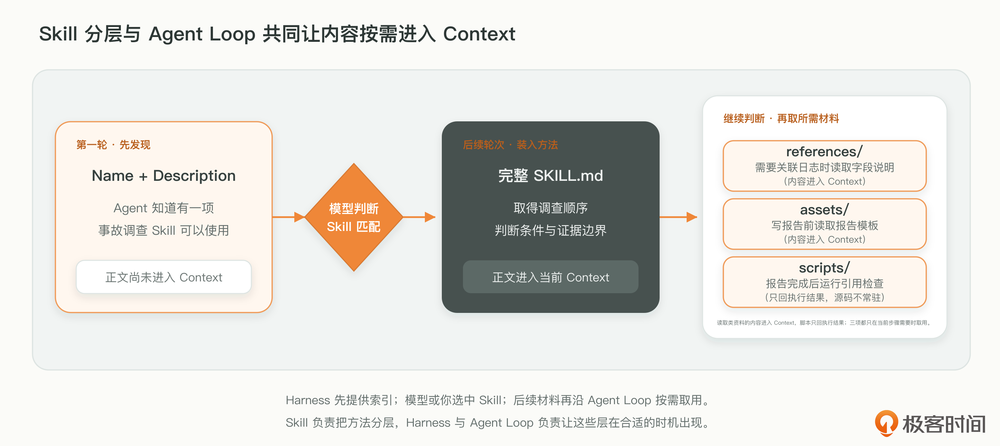
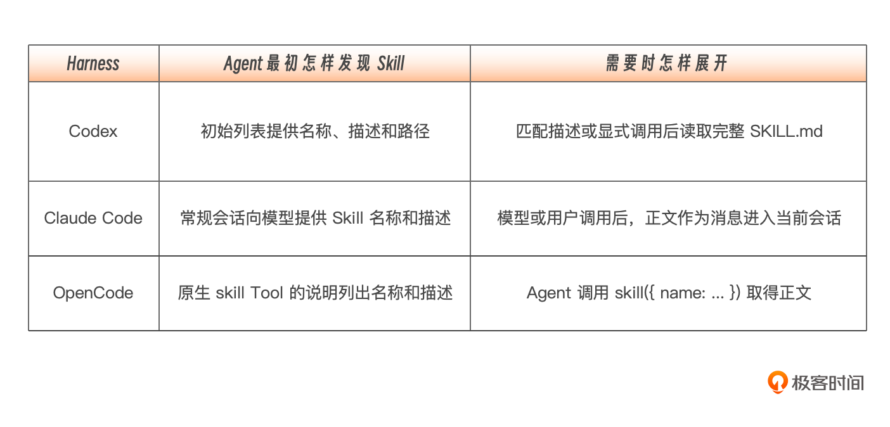

# 08 | 渐进披露：按需调阅关键上下文

你好，我是 Tyler。

```
项目刚开始时，AGENTS.md 里只有几条规则，Skill 也只有一个。随着经验积累，事故手册、
```

日志字段、报告模板和检查脚本越来越多。把它们全部交给模型看似省事，但模型每次工作前，都得先从大量无关内容里找出眼前需要的一小部分。

```
比如上一讲，我们让 Codex 从历史支付模块的一次成功调查中生成了 legacy-payment-
oncall Skill。当这项 Skill 继续变长，Agent 怎么才能按需要调阅它当前最需要的信息呢？
```

## 一项 Skill 变长以后，为什么不能一次全部装入 Context？

```
最初的 legacy-payment-oncall 只有一份很短的 SKILL.md。它记录了发布记录、应用
```

日志、连接池和运行配置四个查询入口，以及一条已经验证过的调查顺序：先确认告警范围、取得异常请求的编号，再沿该编号对齐应用日志、实例版本和依赖调用，接着核对发布、指标和当前配置。

历史模块使用的日志字段很特殊，需要一份字段对照表；事故报告必须引用日志、指标和配置位置，需要一份报告模板；报告写完以后，还要运行脚本检查引用是否完整。

```
如果把这些内容继续写进 SKILL.md，目录看起来仍然很简单，代价却会出现在每次调用
```

中。Agent 一旦使用这项 Skill，完整正文就会进入 Context。即使这次告警尚未走到日志分析，字段表已经跟着进来了；报告还没有开始写，模板和检查说明已经先占去了相当一部分Context。

```
不把完整方法写进 AGENTS.md、而是放进 Skill，只解决了第一层问题：与这套模块无关的任
```

务不再长期携带它。

要让同一项 Skill 内部的细节也按需出现，我们还得继续拆分，像下面这样。

```
legacy-payment-oncall/
├── SKILL.md
├── references/
│   └── log-fields.md
├── assets/
│   └── incident-report.md
└── scripts/
   └── check_report.py
SKILL.md 只保留主干步骤，并写清什么时候查哪份资料、运行哪个脚本；日志字段说明放
进 references/，报告模板放进 assets/，需要重复执行的引用检查放进 scripts/。
```

但文件分开存放，并不等于按需加载。我们这就来看看 Agent 调查时怎样逐层取出需要的内容。

## 渐进披露怎样借助 Agent Loop 发生？

第一讲我们把 Agent 连续工作的过程拆成一条循环：模型根据眼前信息判断下一步，Harness执行动作，再把结果带回后续调用。渐进披露并不需要另搞一套机制：除了任务开始时的能力索引，后面的内容何时出现，仍由这条循环推动。

巡检开始时，Harness 并不交出每项 Skill 的完整正文，只先提供名称、描述和路径，让模型知道当前有哪些能力可用。

```
这时，legacy-payment-oncall 出现在模型视野中的内容大致如下。
name: legacy-payment-oncall
description: 调查历史支付模块的超时、错误率和连接异常。需要核对该模块的发布、日志、数据库连接池
名称给出这项能力的叫法，description 说明它处理什么问题、何时适用。巡检没有告警
时，完整 SKILL.md 仍留在文件系统里。
等历史支付模块出现超时，模型看到告警与 Skill 描述，判断能力匹配，便选择 legacy-
payment-oncall（你也可以显式输入 $legacy-payment-oncall 直接指定）。Harness
随即读取完整 SKILL.md，把调查方法带进接下来的模型输入。
```

此时模型知道了主干步骤，却还没看到字段表和报告模板。它先读告警，锁定最早一批异常请

```
求。要从旧格式日志里取出 request_id 时，SKILL.md 提醒它查看 references/log-
fields.md，模型提出读取，这一次调用就结束。Harness 打开字段表，带进下一次调用，
模型这才认出 request_id 所在字段、取到编号，继续核对发布、数据库指标和当前配置。
调查结束、要形成报告时，模型才会读取 assets/incident-report.md；报告写完，再
提出运行 scripts/check_report.py，由 Harness 执行并把结果送回下一次调用。模型
```

根据执行结果判断哪些结论缺引用、哪些待验证项没标出。

注意这几次取用都由模型在 Agent Loop 里主动发起：模型不能自己翻阅文件，它提出读取或运行，Harness 才执行，并把结果放进下一次调用；因此什么时候取用，跟着调查进度走，而不是 Harness 预先猜测该塞给模型什么。

```
三类资料进入上下文的方式也不相同：references/ 里的字段说明、assets/ 里的报告模
板，由模型在相应步骤读取，内容本身进入上下文；scripts/ 里的检查脚本交给 Harness
```

执行，回到上下文的只有执行结果，源码并不常驻。

主干步骤、可读资料、可执行脚本各就其位，模型在哪个阶段，就只拿到那个阶段需要的东

```
西。这也让方法更好维护：字段口径变了只改 references/ 里的对照表，脚本变了只换
scripts/，主干 SKILL.md 不必跟着重写。
```



这三层并不是同时、以同一种方式出现：开始时只有名称和描述；描述匹配后模型选择 Skill；完整方法进入 Context 后，模型再沿调查过程判断何时读取资料、使用模板或运行脚本。这就是 Skill 的渐进披露。

所以渐进披露的运行基础仍然是第一讲的 Agent Loop，只是多了两件 Harness 要做的事：循环开始前准备好能力索引，Skill 被选中时装入正文。Skill 把方法整理成可分批取用的几层内容，Agent Loop 让它们随任务推进逐步展开；只有目录分层、没有这条循环，几份文件仍然只是一堆彼此分开的材料。

## Harness 怎样把 Skill 接入这条 Loop？

```
Agent Skills 规范把方法组织成三层：名称和描述负责发现，完整 SKILL.md 提供工作方法，
references/、scripts/、assets/ 保存较长的资料、程序和模板，为 Agent Loop 准备
```

了不同深度的入口。

```
以 Codex 为例，它从当前工作目录向仓库根目录查找 .agents/skills/，任务开始时只整
理一份含名称、描述和路径的 Skill 列表。模型按描述选择能力，你也可用 $skill-name 指
定；Skill 被选中后，Harness 才把完整 SKILL.md 装入任务。
同目录里的参考资料和脚本不会自动进入 Context，SKILL.md 要说明什么情况下读取哪份文
```

件；模型走到相应步骤，才通过文件读取或命令执行取用，Harness 再把结果带回 AgentLoop。

初始 Skill 列表本身也有 Context 预算。安装的 Skill 太多时，Codex 会先缩短描述，必要时还

```
会省略一部分 Skill。因此，description 不只是一句介绍，它本身就是入口，决定一项
```

Skill 能否被正确发现。

描述写得太宽泛，比如只写“处理各类问题”，模型在无关任务里也可能误选这项 Skill；写得太窄、漏掉“数据库连接池”这样的关键词，真正的连接池告警到来时它又不会被选中。发现这一步错了，后面的分层再精细也用不上。

Claude Code 和 OpenCode 也实现了相近的分层，只是发现目录和调用入口不同。



目录和入口虽不同，三家处理的是同一组问题：先给足以选择能力的信息，选中后装入完整方法，更长的资料则留在 Context 外，直到真正需要。

## 小结


随着手册越积越多，真正的问题不再是能不能把方法交给 Agent，而是它能否在需要的那一刻，找到并读到其中正确的那一部分；否则拥有和用不上并没有区别。

让 Agent 拥有更多方法，不等于把所有手册同时堆给它。有用的设计是先给一份足以选择方向的索引，确认需要再打开正文，走到具体步骤才取用资料和脚本。

```
AGENTS.md 适合保存相关任务始终要遵守的短规则；Skill 保存只在某类任务中使用的完整方
```

法；Skill 内部较长的说明、模板和程序，还可以继续放在独立文件中按需取用。

渐进披露减少了无关内容对当前判断的干扰，却没有把 Skill 变成必须照做的流程，它的正文仍是供模型理解和选用的工作方法。它和第五讲的上下文压缩也不同：压缩是内容进入Context 之后再裁剪，渐进披露则是一开始只放入口、随任务展开，尽量不让无关内容占用预算。

下一讲，我们继续来看：当某些动作无论如何都不能越过边界时，Harness 怎样用Sandbox、权限和审批真正限制 Agent 的行动空间。

## 课后题

### 观察题：一项 Skill 的三层内容何时出现？

```
为一项 Skill 准备简短的 description、主干 SKILL.md、一份参考资料和一个检查脚本。
```

先给 Agent 一项与这项 Skill 无关的任务，再提交一项明确匹配描述的任务。

观察运行记录：模型最初能看到哪些 Skill 信息，完整正文从什么时候开始影响行动，参考资料是否等到对应步骤才被读取，检查脚本的源码和执行结果又分别怎样出现。

### 思考题：不用 Skill，只用 MCP，能否重做出同样的渐进披露？

假设不再提供原生 Skill，只能接入 MCP Server，但你仍希望模型先看到简短的能力索引，匹配后再取得完整方法，走到具体步骤才读取资料或获得工具。

MCP 可以提供 Prompts、Resources 和 Tools，却不会替 Host 决定什么时候把哪一项内容交给模型。

为了重做出刚才的三层加载过程，Host 至少要保存哪些状态，又要在什么时刻完成发现、选择、读取和工具开放？与声明一项 Skill 相比，这套实现多出了哪些工程工作，又换来了哪些更精确的控制？

期待你在留言区记录想法或疑问。如果这一讲对你有帮助，别忘了分享给身边更多朋友。
