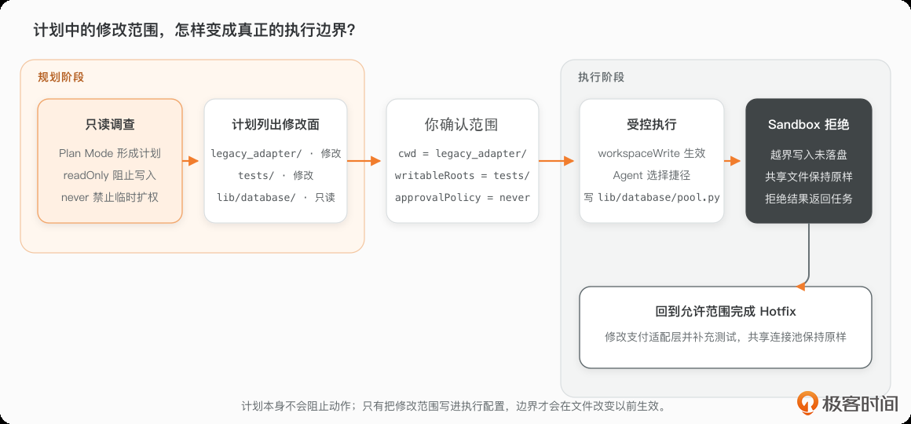
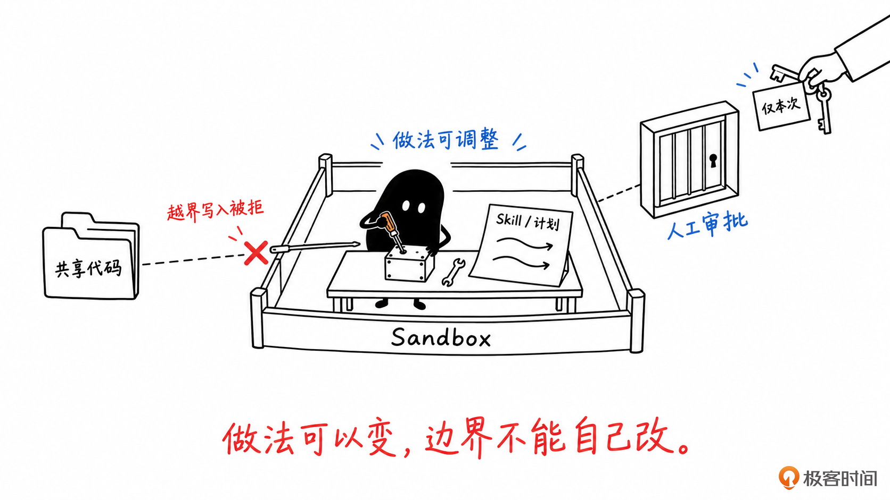

# 09 | 令行禁止：用隔离与审批守住授权边界

你好，我是 Tyler。

上一讲，我们把历史支付模块的排查方法，整理成了一个能按需展开的 Skill。它会告诉 Agent去哪里查资料、按什么顺序核对。可光有怎么查的经验还不够，真要动手改代码之前，你一般还会让 Agent 先列一份计划，写明这次准备动哪些地方、哪些地方别碰。

```
可这些说到底，都只是写给模型看的要求。哪怕计划里白纸黑字写着“不要修改 lib 目录里的
```

共享代码”，Agent 真动起手来，也可能撞见新情况，觉得改共享代码反而更省事。

这不奇怪，Agent 看到新情况，本来就会调整做法。真正要解决的是另一个问题：活可以让它自己决定怎么干，但哪些地方能碰、哪些地方不能碰，不能由它做主。

接下来这次 Hotfix，Agent 会在半路发现一条省事得多的捷径，直接改共享连接池，一行就能搞定，可那是订单、退款也在用的公共代码，我们偏偏不让它改。这一讲就先说清楚，为什么非要拦住它。

## 最省事的方案，为什么不能让它自己改？

历史支付模块再次出现连接超时。

```
Agent 照着 legacy-payment-oncall 这个 Skill 核对应用日志和连接池指标，很快把范围
```

缩到一段旧的支付适配代码。这段代码向数据库要连接时，没有单独设置等待时间，于是一直沿用共享连接池三十秒的默认值。流量一上来，大量请求都卡在等连接这一步，队列越堆越长。

团队决定先做一个很小的 Hotfix：历史支付请求如果五秒内拿不到连接，就快速失败，不再一直等到三十秒。

你没有急着让 Agent 动手，而是先让 Codex 进入 Plan Mode，沙箱设成只读，并把

```
approvalPolicy 设为 never。这样它可以翻看支付适配层、共享连接池和现有测试，先
```

把问题和方案理清楚；但在规划阶段，它改不了任何文件，也没法临时给自己申请更大的权限。

确认主要调用关系以后，Agent 给出了计划：

```
修改 services/payment/legacy_adapter/，
```

- 为历史支付请求显式设置五秒连接等待时间。

```
补充 tests/payment/legacy_adapter/ 中的回归测试，
```

- 验证连接池繁忙时请求能够快速失败。

```
lib/database/pool.py 只用于确认接口，
本次 Hotfix 不修改。
```

- 不访问网络，不修改其他服务和部署配置。

你确认方案后，又让 Agent 照着这份计划，生成执行阶段要用的权限配置：

```
根据已经确认的 Hotfix 计划生成权限配置。
```

- 只允许修改支付适配层和对应测试目录；仓库中的其他代码可以读取，但不能修改；禁止网络访问；执行过程中不允许申请扩大权限。

- 只生成配置，不开始修改代码。

Agent 生成了一份配置草案：

```json
{
 "cwd": "/workspace/services/payment/legacy_adapter",
 "approvalPolicy": "never",
 "sandboxPolicy": {
   "type": "workspaceWrite",
   "writableRoots": [
     "/workspace/tests/payment/legacy_adapter"
   ],
   "networkAccess": false
 }
}
这份配置可以这样读。workspaceWrite 用的是默认拒绝、显式放行：工作目录，也就是
cwd 指向的支付适配层，本来就在可写范围里，能直接改；工作目录之外、这次又确实要动
的测试目录，再通过 writableRoots 额外开放给它；剩下的所有位置，包括
lib/database/，默认只读。networkAccess 设为 false，联网这条路也一并关死。
```

它默认的逻辑是“没有点名允许的，都不能做”，而不是“没有点名禁止的，都可以做”。反过来想：要是只列一串“不许碰”的路径，你就得成天担心漏掉某个目录，或是将来新增的某个文件；只守着放开的那几个位置，边界天然就是闭合的。

计划里说“适配层和测试可改、其余只读”，落到配置上，正好就是“工作目录加一个额外可写根”，严丝合缝，没给共享代码留下半点缺口。

Agent 可以帮你写配置，但不能自己决定这份配置生不生效。核对过它的权限范围和刚才批准的计划一致后，手动把这组设置应用到 Codex，Hotfix 这才开跑。

真动起手来，Agent 很快发现一个规划阶段没留意到的细节：支付适配层里一共有三处会向数据库要连接，每一处都得补上五秒等待。

这时，另一种方案明显更省事了。与其改三个地方，不如直接把共享连接池的默认等待时间从三十秒改成五秒：

```
lib/database/pool.py
```

只需要改一行。

单看眼前这次故障，这方案甚至挺合理。问题是，共享连接池不是历史支付模块一家在用，订单、退款、结算也都连着它。这次 Hotfix 本来只打算动历史支付，一旦改了这里，其他业务会跟着一起受影响。

Agent 还是尝试了这项修改。Sandbox 随即拒绝写入：

```
目标文件：lib/database/pool.py
```

- 处理结果：拒绝原因：目标文件不在允许修改的范围内

共享连接池纹丝没动。拿到这个失败结果，Agent 明白此路不通，只能回到支付适配层，在三个调用位置分别把等待时间设成五秒，再补上对应的回归测试。

Hotfix 最终完成，其他业务也没有受到影响。



## 计划里已经说“不要改”，为什么还不够？

计划里已经说“不要改”，为什么还不够？因为计划和 Sandbox 管的不是一回事。

计划、Skill 和项目规则，负责告诉 Agent 应该怎么做。可一进入执行阶段，它会不断拿到新信息，方案也可能跟着变。就像刚才，它发现有三个调用点都要改，立刻重新盘算：那我直接改共享默认值，是不是更划算？

这种临场重新判断，恰恰是 Agent 的价值所在。要是要求它定好计划后，无论看到什么都不许变，那它就又退化成一个只会照固定步骤运行的脚本了。

所以我们要拦的不是“改变方案”，真正不能跟着一起变的，是权限。

计划可以告诉 Agent “不要改共享代码”。Sandbox 则进一步保证：“只要这组权限配置还在生效，即使你后来觉得改共享代码更好，也不允许修改。”

前者管的是模型怎么想，后者管的是哪些修改真能落地。这也是为什么，光在 Skill 或计划里

```
写一句“禁止修改 lib”并不够，模型可能判断错，它发出的 Shell 命令还可能顺带拉起格式化
```

工具、代码生成器之类的子进程。真正不许发生的修改，必须在执行环境这一层被拦住。

审批处理的则是另一类情况：有些权限平时关着，但你可以看现场情况，决定要不要临时放行一次。比方说任务默认不能联网，可某一步确实要下载依赖，这时 Harness 可以先停下来、说明原因，再由你决定开不开。

关键是，审批放出去的应该是一次性的例外，而不是一张长期通行证。某一步真要联网装依赖，就只开这一次、只开联网这一项，任务一结束，权限原样收回；这次为什么放行，也会连同理由记下来，事后查得到。

反过来，如果你发现自己几乎每次都在批同一件事，那多半不是现场总有例外，而是计划或默认边界本身定得不对，该回头改的是计划和配置，而不是靠一次次点“同意”，把边界慢慢磨穿。

简单概括一下就是：Sandbox 守住已经确定的边界，审批处理允许临时商量的例外。

```
这次 Hotfix 之所以把 approvalPolicy 设成 never，正是因为团队事先就想清楚了：真到
```

了非改共享连接池不可的地步，这事就已经不是原来那个小 Hotfix 了。受影响的调用方、要回归的测试范围、发布风险全都得重新评估，应该重新规划，而不是干到一半再给 Agent 加权限。

## 怎样把计划真正变成权限？

还有个细节值得注意：权限配置本身，也是 Agent 照着计划生成的。

这完全没问题：计划里已经写明哪些能改、哪些只能看，让 Agent 把这些要求翻译成 Codex的沙箱配置，能省掉你一遍遍整理参数的功夫。

但有一件事不能交给它：

- Agent 可以生成自己的权限配置，但不能自己批准自己的权限。

否则就成了它一边觉得“改共享代码更方便”，一边又能自己把共享目录加进可写范围，前面立的规矩就作废了。

所以，这里的顺序应该很清楚：Agent 先形成计划，你确认；Agent 再根据计划生成权限配置，你再次检查；确认无误以后，才把配置应用到 Codex 开始执行。

你第二次检查，看的不是配置写得规不规范，而是它和计划能不能逐条对上：计划说改两处，可写范围就得恰好盖住这两处，不多出第三个位置；计划说不联网，网络开关就必须是关的。

这一步说白了，是在核对两个“范围”是不是相等。几分钟的事，却能挡住最危险的一类问题：Agent 把自然语言计划翻译成机器配置时，顺手把边界放宽了那么一点。

正式动手前，还能做个很简单的自检：在支付适配层里建一个临时文件，应该成功；再到

```
lib/database/ 里建一个，必须失败。实际结果和计划对上了，刚才划定的范围才算真的
```

管住了。这一步验的不是代码写得对不对，而是边界本身有没有真的生效；配置一旦写错，再周密的计划也拦不住越界的修改。

除了“哪个目录能写”，一套完整的本地隔离，通常还管着另外几件事：能不能联网，能不能运行工作目录之外的命令或安装程序，能不能读到特定的环境变量和凭据。这次 Hotfix 用不上网络，也不用装新东西，这些口子就都先收着。不同 Harness 给的开关名字和粗细程度不完全一样，但你每次要核对的始终是同一组：文件、网络、命令，以及 Agent 能读到的凭据。

这里说的沙箱，管的主要是本地执行。要是 Agent 通过 MCP、连接器或者服务接口去改云资源、工单和生产配置，真正动手的是远端系统，那还得靠远端自己的账号、权限和审批接着把关。

具体做法就是：给 Agent 的远端账号，默认最好只有只读权限；真要写，就换一个单独的、范围收得很窄的凭证，删除、发布这类动作则一律走工单或审批。这样就算本地沙箱被绕过，真正能改动生产的那道门，还是攥在远端系统手里。

所以不管用哪套 Harness，你真正要搞清楚的都不只是“有没有沙箱”，而是：哪些动作由Harness 拦，哪些由本地运行环境拦，出了本地之后，又由哪个系统接着管权限。

回到这次 Hotfix，沙箱没替 Agent 想出正确答案，它只是让一项不该发生的修改，没有真的发生。由你决定哪些地方不能动，Agent 在剩下的范围里自己把事情做好。

## 小结



《魔法师的学徒》里，被施了魔法的扫帚会不知疲倦地一趟趟挑水，却不知道该在哪里停下，最后几乎把屋子淹没。Agent 往往也是这样：问题通常不在会不会做事，而在不知道自己的行动应该停在哪里。

Skill 和计划告诉它应该怎样做，Sandbox 守住真正不能越过的地方，审批则处理那些允许人工临时放行的例外。

这次 Hotfix 里，Agent 先定计划，再照着计划生成权限配置；你确认、手动应用之后，Codex才开跑。后来它找到一条更省事的共享改法，可以提，却不能自己给自己加权限；等它真去改共享代码，沙箱直接拒绝了写入。

这就是我们希望保留的关系：Agent 可以自己改变做法，但不能自己改变边界。

不过话说回来，这次越界虽然被拦住了，Agent 下次再遇到类似问题，并不会自动记住今天发生过什么。

下一讲，我们换到 Hermes，看看怎样让 Agent 通过做过的工作沉淀经验，并让这些经验真正改变后面的工作。

## 课后题

### 观察题：让 Agent 根据计划生成权限

```
准备好支付适配层、测试目录，再加上一份位于 lib 里的共享代码。先让 Codex 在只读环境
```

里定出计划，再让它照着计划生成沙箱配置；你确认后，手动应用配置、开始执行。

观察共享代码的写入是否被拒绝，以及 Agent 能否在失败以后回到允许修改的地方继续完成任务。

### 思考题：谁来批准 Agent 的权限？

Agent 可以根据计划生成自己的权限配置，但如果它还能自己批准并立即启用这份配置，就可能在执行过程中给自己增加权限。

计划、生成配置、审核配置和开始执行这几步里，哪些可以交给 Agent 自动完成，哪一步必须由你或独立系统来确认？

期待你在留言区记录想法或提出疑问。如果这一讲对你有启发，别忘了分享给身边更多朋友。
