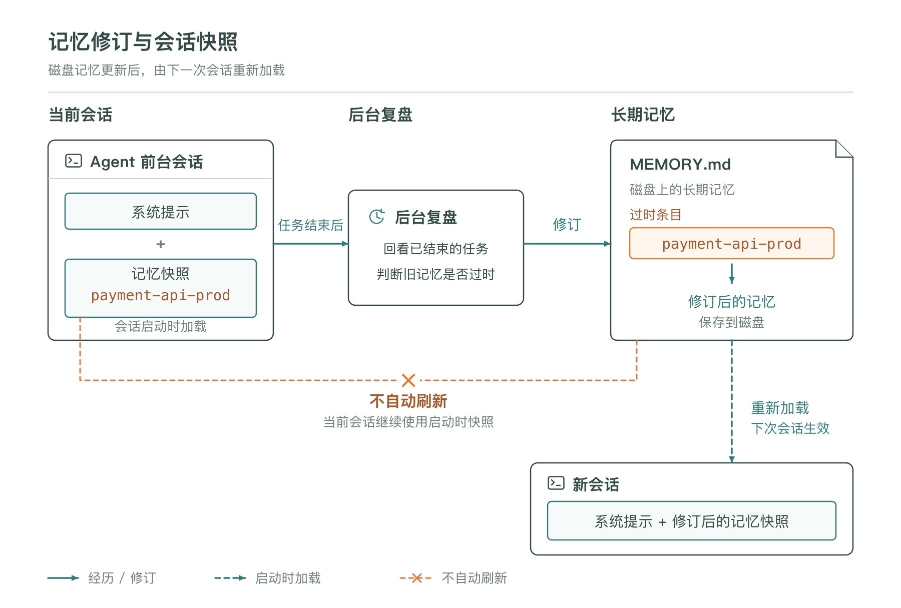
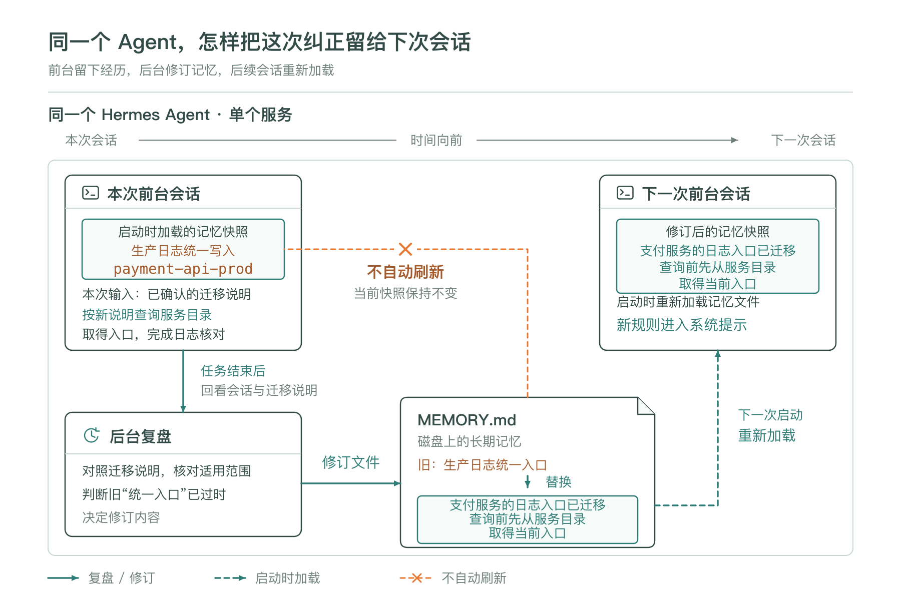
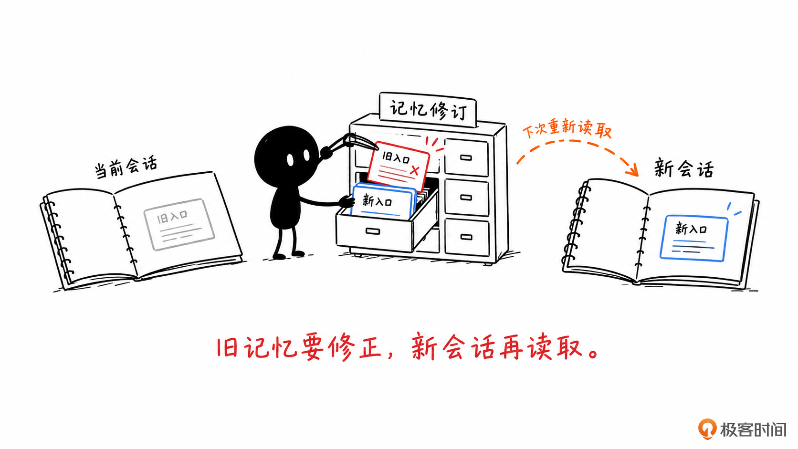

# 12 | 记忆维护：Hermes怎样修正过时的记忆？

你好，我是 Tyler。

假设你让 Agent 帮忙排查一次支付问题。它记得，支付服务的日志要去某个固定入口找。这个经验过去帮过它不少忙。但这次，日志入口迁移了。

你告诉它新的位置，它找到了日志，任务也继续推进。到这里，这次问题似乎已经解决了。可是，留在长期记忆里的，还是那个旧入口。

下一次再遇到类似问题，它会从哪里开始查？

这一讲，我们借助一次支付日志入口的迁移，看一条旧记忆怎样被发现过时、怎样定位、怎样替换。

## 一个已经过时的记忆

答案就藏在它的记忆里。日志迁移之后，支付日志按区域和环境分开存了，各有各的入口。可Agent 的长期记忆文件 MEMORY.md 里，还留着迁移之前记下的那条规范。

```
支付服务的生产日志统一写入 payment-api-prod...
```

这条规范在迁移前是对的，那时候所有日志都在同一个入口。现在日志都按区域分了，它却没跟着变，还留在记忆文件里，被当成一条板上钉钉的事实。

当晚出现支付告警，你把告警和迁移说明一起交给 Agent，并明确说明：以后查支付日志，要先查服务目录取得入口。

这么一来，Agent 面前就摆着 2 种说法：长期记忆里还是“统一入口”，迁移说明却要求按区域和环境来查。它按新说明完成了排查，没有再走旧的统一入口。

当前这趟任务是做对了，问题却没真正解决：迁移说明只在这一次会话里，旧记录还躺在记忆文件中。不把它改掉，新会话很可能还照着统一入口去查。这正是后台复盘接下来要做的事：前台回答结束后，Hermes 会启动一轮后台复盘，把这段会话交给复盘模型，由它对照迁移说明判断旧记录是否过时、该怎样修订。会不会真改，取决于复盘自己的判断。

## 增量更新怎么才稳

上一讲讲的是复盘机制本身，这一讲接着往下看复盘启动之后的记忆维护，也就是修改怎么判断、怎么落地。复盘模型要做的，是在提示词引导下自主判断，这次对话里有没有值得记住或需要修正的内容，再决定改哪条、用 add、replace 还是 remove。Hermes 没有给“哪条旧记录算过时”写死规则，这一层判断完全归模型；memory 工具只负责执行，用 old_text 定位命中的条目再替换或删除，它不判断新事实是否真的推翻了旧事实。复盘模型拿到的，就是这样一段固定提示词：

```
Review the conversation above and consider saving to memory if appropriate.
Focus on:
1. Has the user revealed things about themselves — their persona, desires, prefer
2. Has the user expressed expectations about how you should behave, their work st
If something stands out, save it using the memory tool. If nothing is worth savin
```

大意是：回顾上面的对话，如果合适就保存到记忆；重点看用户透露了哪些值得记住的个人信息，以及他对你的行为期待；有值得保存的就调用记忆工具，没有就说“Nothing to save.”并停止。

可以看到，这份提示词只关心“值得记住什么”：它不要求逐条核对旧记忆，也没有给出“过时”的判定标准。

接下来看 Hermes 怎样把修订落到文件里。这次支付日志迁移，要做的正是替换：把“统一入口”这条旧记录，换成按服务目录查询的新规则。对应的调用长这样：

```bash
# 本文这次修订：replace，把旧入口替换成新规则
memory(
   action="replace",
   target="memory",
   old_text="payment-api-prod",
   content="支付服务的日志入口已迁移；查询前先从服务目录取得当前入口。",
)
定位靠原文匹配：old_text 给的是旧条目里的一段连续原文，工具按它找到要改的条目；
```

定位条件不唯一或找不到，工具会报错，不会自己猜。

```
支付服务的生产日志统一写入 payment-api-prod...
§
排查告警时，先确认服务、区域和环境。查询日志时带上告警时段...
```

定位确定后，替换怎样落到文件里？记忆文件里，条目之间用独占一行的 § 分隔，一条记忆可以写多行（示意里第二条就占了两行），“整条记录”就是分隔符圈出来的这一块：替换payment-api-prod 所在的条目时，下面那条保持原样。写回有保护：工具在锁内先重新读取文件、替换命中的整条，按分隔符拼回文本，检查总字符数有没有超过上限，再通过临时文件原子写回；其他会话遵守同一把锁，依次完成修改，避免互相覆盖。

MEMORY.md 保存的是修订后的条目，当时为什么改、依据是什么，都不在文件里；要查修订的依据和过程，得回到触发它的那段会话。

文件成功保存，说明修改已经写入；模型什么时候能看到这次修改，还要看记忆怎样进入会话。

那这次修订，要怎样才能真正影响以后的会话？图 1 把这条路径画了出来。



- 图 1 记忆修订与会话加载

## 改了，为什么这次还没生效

Hermes 在会话开始时把记忆文件读进系统提示，后面整轮都沿用这份加载好的内容，这就是一次记忆快照。后台就算改了磁盘上的 MEMORY.md，当前会话仍沿用启动时加载的内容，不会自动跟着刷新；修订后的记忆，要到下一次新建的会话重新加载时才生效。

对一个常年在线的服务，这就是“边跑边学”的价值：快照把前后台分开，后台写入不打断前台正在处理的请求，前台照常响应。

这次纠正从发现到生效，走的正是这样一个循环，图 2 把它画了出来。



- 图 2 这次纠正怎样留给下一次会话

当然，快照不刷新不等于当前会话永远看不到新内容。前台仍可以主动读取：通过工具读到更新后的记忆文件，模型当场就能看到。但那是主动读取的结果，不是快照自己更新了。

回到这次支付日志迁移：当前会话按迁移说明行动，靠的是会话里现给的新信息，不能证明记忆快照已刷新。

## 小结

学到这里，我们做个总结吧。



前面讨论在线与离线的分工时说过，离线那侧要留空间。这个空间里发生的就是这样一条执行

```
链：后台复盘依据会话判断旧记录是否过时，模型用 old_text 定位旧条目、以完整
content 替换，工具负责检查定位；修订写入后，由新会话重新加载，当前会话的快照保持
```

不变。

可记忆里只存了结论，没存过程。当时为什么这么改、是谁确认的，这些过程去哪找？接下来，我们回到当时那次对话里，看看修订的依据和过程怎样保留下来。

就像《记忆碎片》里那个靠便签判断现状的人：每张便签都只是写下那一秒、从他那个角度看到的一个侧面，世界一直往前走，便签却定格在原地。这些机制兜着的，就是别让一张旧侧面被当成眼前的全貌。说到底，错误的记忆比没有记忆更糟，因为它以“事实”的口吻骗你。自进化不是把经历越攒越多，是让留下的那几条，始终照得见今天的世界。

## 系统设计题

下面是一道面试中经常会问到的问题。

题面

假设你负责一个 7×24 小时在线的巡检 Agent，平时自动巡检，告警来了负责排查和恢复。它已经在线上跑了一段时间，会把排查中沉淀的经验存下来，下次遇到同类问题直接复用。最近底层平台做了一次迁移，日志查询从原来的统一入口改成按区域、环境拆分，可 Agent 排查时还是习惯性走旧入口；有时候同事临时给了一个能用的地址，它也会当成长期规则记住。

请你设计这套记忆维护的能力。希望达到的效果是，环境变了，经验能及时更新，不会拿着旧记忆误导排查；但也不能因为一次偶然成功就乱改，改了什么、为什么改，事后要查得清楚。你可以谈谈整体思路、关键环节和容易踩的坑。

追问，如果让你基于现成的 Agent 框架来做，你会看重它提供哪些能力

配套练习放在 GitHub 配套工程里，对应这一讲的练习目录，你可以照着把记忆修订这条链路亲手跑一遍。

期待你在留言区积极发言，分享见解。如果这一讲对你有启发，欢迎分享给身边更多朋友。
