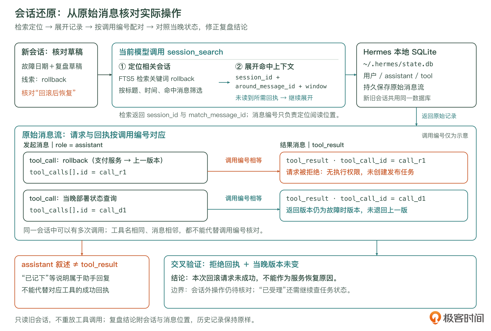

# 13 | 会话还原：Agent怎样按需核对自己的旧记录

你好，我是 Tyler。

上一讲我们留下了一个疑问：Memory 记的都是提炼过的结论，想核实当时具体做过什么，光看这些结论够吗？这一讲就来回答这个问题。

夜里处理完故障，大家都累得够呛，想着明天再说，就都去睡了。第二天回来，看到 Memory里写着一条“准备调用回滚工具”的计划，这条计划后来到底执行了没有、取消了没有，谁也没再交代。

Memory 记的是当时的打算，执行过程留在会话里。要核实，只能回到当时的会话记录里找工具回执。

Hermes 会把每一轮对话按顺序存在本地：你说了什么、Agent 调了哪些工具、工具返回了什么，都留着。要核对细节，就得按需翻回这些旧记录，把当时的请求和回执一条条对上。

## 原始消息怎么存下来

Hermes 把每一轮对话都落进本地 SQLite 库（state.db）：sessions 表存会话信息，messages表存消息，每条消息带会话归属和自增 id，按写入顺序排列。那晚的故障处理也一样，模型查了哪些日志、发起过哪个回滚调用、工具返回了什么，都按顺序留在库中。

完整是兜底的前提：快照可以被提炼、被压缩，原始记录必须全量留档，确认才不会落空。

具体到调用过程上，assistant 消息里的工具调用列表以 JSON 保存，包含调用编号、工具名和参数；工具返回的结果单独成一条消息，用调用编号指回发起它的那一条。

上下文压缩只会把旧消息标成非活跃、移出模型当前的上下文，记录本身还在库中；几周后再来核对，按会话或关键词就能翻回来。

## 怎么按需查：渐进式披露

那晚的会话可能有几百条消息，不能全塞给模型重读。Hermes 把记忆分成两层：Memory 常驻提炼过的快照，负责日常读取；原始会话落在磁盘上，通过 session_search 按需取用。

快照给速度，原始记录给确定性：日常靠快照，拿不准就下钻到当时的会话，跟一份确定的回执对上，两层合起来才是完整的闭环。session_search 的底层是 SQLite 的 FTS5 全文索引，中文等多字节语言另有 trigram 兜底。

搜索分三种形态：用关键词做发现，用会话 id 做读取，用会话 id 加消息锚点做展开。先搜“回滚”找到那一段：

```
session_search(query="回滚", limit=3, sort="newest")
```

命中结果带会话标题、时间和命中消息的 id 与片段。发现模式默认只展示用户和 assistant 的消息，工具消息留在窗口外；要核对当时的工具调用和回执，就用命中的会话 id 和消息 id 做展开：

```
# hit 是搜索结果里选中的一项。
session_search(
   session_id=hit["session_id"],
   around_message_id=hit["match_message_id"],
   window=10,
)
```

window 控制锚点两侧各读多少条，展开按消息 id 从锚点向两边取，返回所有角色、保留工具结构；窗口不够就沿边缘继续展开，搜不到就换关键词再搜。搜索有明确的限量：limit 最多10，window 最多 20，长会话整段读会截断，要分多次展开。

## 按调用编号，把回执对上请求

搜到那一段还不够。那晚可能连着调发布、日志、监控好几个工具，两条消息挨得近，也可能分属不同的调用。

配对靠调用编号：assistant 消息里的 tool_calls 存着调用编号、工具名和参数，工具结果消息的 tool_call_id 指回发起它的那条请求，编号配对把“确认”落到每一条调用上，哪条回执对应哪个请求，都有据可查，而不是靠位置猜。

图 1 画的就是从检索定位、展开记录到按编号配对的完整路径。



- 图 1 会话还原：从原始消息核对实际操作

```
配套练习做的是同一组对应关系：从 state.db 取回实际保存的消息，找到模型发起的
memory 调用，再找编号相同的工具结果；只有回执确认写入成功，才能说这次记忆操作完成
```

了。助手嘴上说“已记下”不算数，回执才算。

## 回执能证明什么，不能证明什么

展开之后，答案藏在回执的状态里。session_search 不会另调一个模型去总结旧记录，读到的就是原始消息和回执，能对照当时准备做什么、后来实际发生了什么。要核对一条总结，不能拿另一条事后生成的总结来佐证，只有当时的原始回执能证明它。快照只留下结论，回执才是确凿的证据。拿不准时，永远能回到证据本身。

回执能证明什么，要看状态。调用在动手前就被拒绝，那一步操作就没有执行。只回一句“已受理”或等待批准，说明任务还停在执行链路里，得继续查。后台任务启动时返回的 exit code0 只证明启动成功，任务跑没跑完要看后面的回执。记忆写入返回 success 也一样，可能只是提案被暂存，要等 done 才真正落盘。调用被取消、结果不可用时，系统会补一条占位消息，看到它要先分清是真实结果还是占位。编号只解决“这条回执属于哪个请求”，受理、完成、业务恢复是三个层次，要一层层分别核对，能证明到哪一层，结论就只信到哪一层。

## 这份原始记录是给谁用的

核对完的结论要回流，这正是会话还原的终点。

复盘在每轮对话收尾时由守护线程启动：这一轮有最终答复、没被中断、又到了复盘间隔，就把当前的消息快照交给复盘逻辑，判断有哪些值得沉淀。它吃的是这一轮结束时内存里的消息快照，不会重读一遍数据库。

复盘只写自己的产物：核对过的结论写进 Memory 或 Skill，受容量和审批约束，旧会话保持原样。下一次再遇到类似问题，Memory 里就是核对过的经验，而不是悬而未决的计划。

这一轮写回的快照，就是下一轮日常读取的起点：快照管日常、原始记录兜底确认，闭环每一轮都在转。会话历史没有存下企业里的一切，但至少能看出下一步该核对哪些请求、哪些时间、哪些系统。

## 小结

学到这里，我们做个总结吧。

这一讲把按需回查 Session 的全程走了一遍：session_search 找旧会话，从命中位置展开，按调用编号把请求和回执对上，每一步都是为了让确认有据可依。快照负责日常，原始记录负责兜底确认，这个闭环让记忆既轻快又可验证。

要核对经过，就按需查磁盘上的会话历史；边界也一直在：不保证存下每次调用的全部输入，也不覆盖会话外的操作。

Agent 生成的总结也可能把尝试、失败和后来的恢复压成一段顺畅叙述，省掉改变判断的细节。历史回查让它重新核对原始请求与回执，并保留记录的覆盖边界。后续记忆和技能若依据这些经历提炼，就更需要把请求归属、执行状态与业务结果分清，避免把未经确认的总结继续当作事实。

可这些会话里没有企业手册上的知识，那部分压根不在它的经历里。要把外面的知识也接进来，下一讲就看怎么做。

## 系统设计题

下面是我们本讲的系统设计题和课后练习，也是一道面试中经常会出现的问题。

题面

你们团队在 prod 环境运行着一个 7×24 小时在线的巡检 Agent，平时自动巡检，告警来了负责排查和恢复。它会在故障处理后写总结，最近却发现有些总结把“准备回滚”写成了“已经回滚”，同事据此复盘时，连服务到底怎样恢复的都说不清了。请你设计一套能力，让 Agent 在有人追问、或者发现总结有疑点时，能自己找回当时的记录，核实做过什么、结果怎样，再纠正总结。希望它不用每次都让人翻记录，也不用把所有历史重新读一遍；查不到的部分要如实说明，不能编出一个完整故事。

配套练习放在 GitHub 配套工程里，对应这一讲的练习目录，你可以照着把会话还原这条链路亲手跑一遍。

期待你在留言区记录收获或者提出疑问，如果今天的内容对你有启发，别忘了分享给身边更多朋友。
