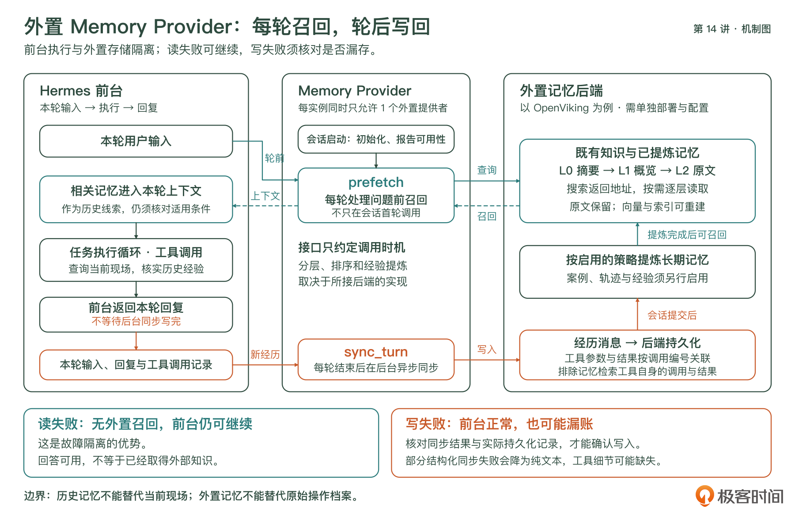
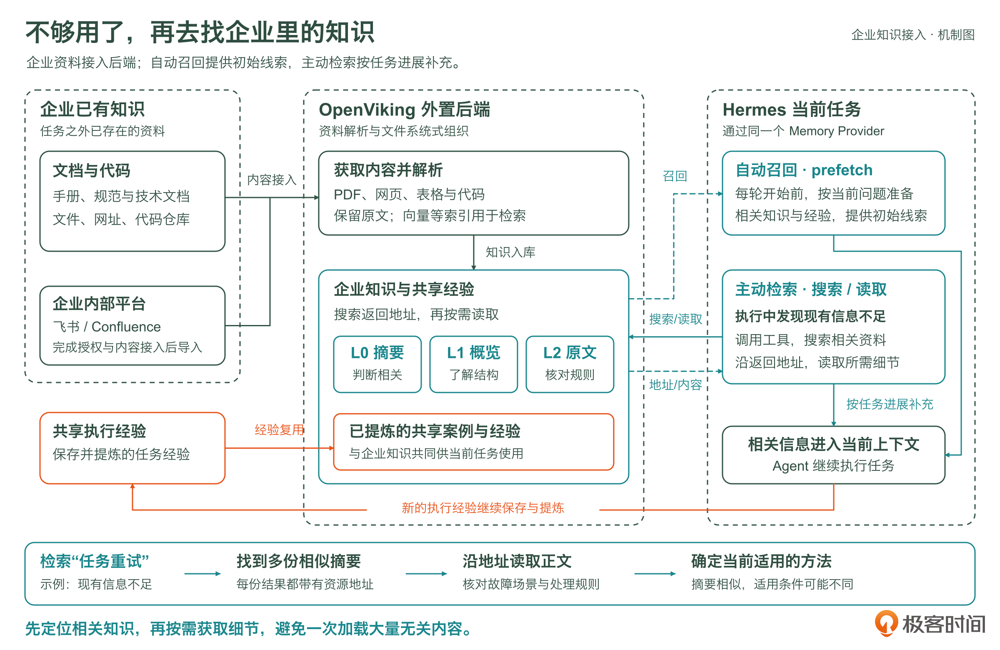
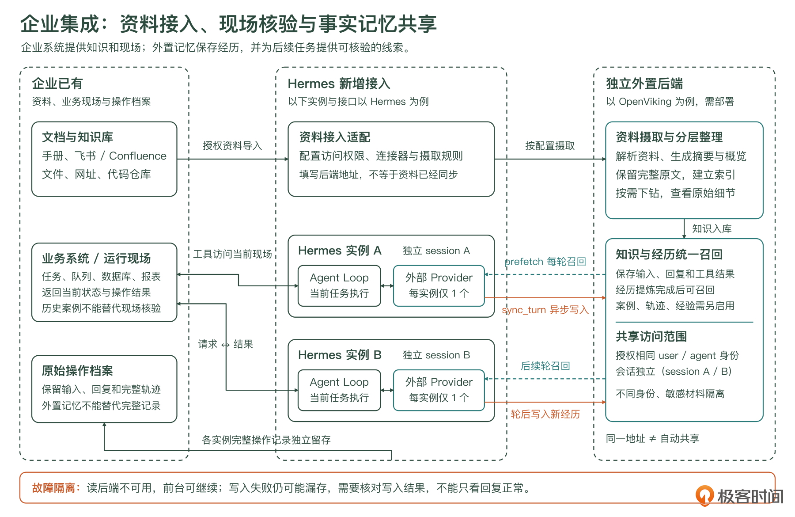
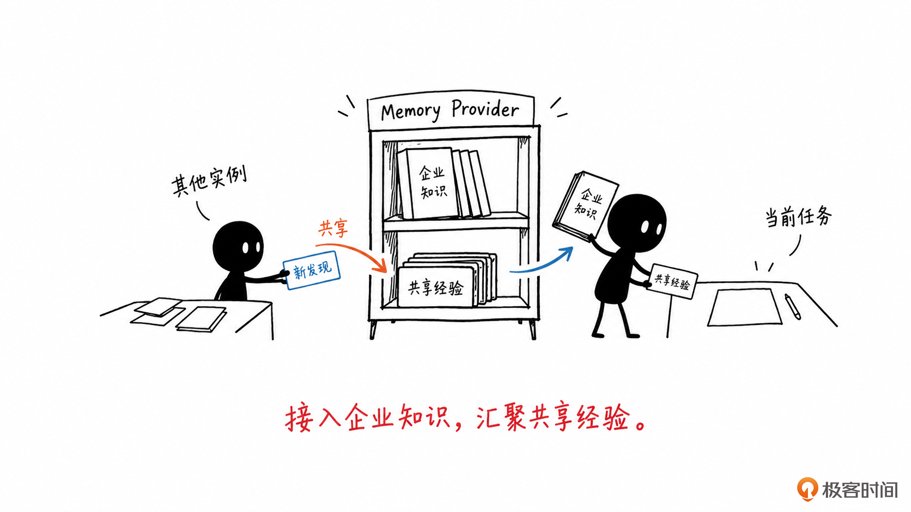

# 14 | 海纳百川：Agent怎样用上企业知识与共享经验？

你好，我是 Tyler。

上一讲我们留下了一个疑问：会话里翻出来的，都是 Agent 自己亲身经历过的事，可企业手册上的规范、别的实例踩过的坑，压根不在它自己的记录里。这些外面的东西怎么接进来？

回答这个问题前，我们需要解决两件事：一是把不同实例的执行经历汇聚起来，形成可以共享的记忆；二是把企业已有的知识接入系统，让 Agent 在需要时能够检索和使用。

Hermes 通过 Memory Provider 实现这两件事。它提供一组统一的接口，把 Agent 的任务执行与外部记忆系统连接起来。下面我们就从这个接口开始，看看执行经验怎样积累和共享，企业知识又怎样进入 Agent 的工作上下文。

## 一条统一的记忆接口

Hermes 接入外部记忆，不需要为每种后端重新设计一套执行逻辑，而是定义了统一的Memory Provider 接口。无论后端使用本地文件还是专门的记忆服务，都可以按照同一组方法接入。

```
Memory Provider 在会话启动时初始化；每轮处理问题前，通过 prefetch 召回相关记忆；
这一轮结束后，再通过 sync_turn 同步新经历。接口还负责报告后端是否可用，同一时刻只
```

允许注册一个外部 Provider。

这套机制的核心就是：每轮开始前召回相关记忆，每轮结束后同步新的经历。

接口约定的是调用时机，至于内容怎样存储、如何提炼、怎样检索和排序，则由后端实现。Hermes 不需要理解每种数据库的存储结构，也不必随着后端检索算法的变化调整执行流程。

本讲以 OpenViking 适配器为例，重点介绍两条链路：一条把不同实例的执行经历写入共享后端，另一条让 Agent 从外部检索企业知识。

## 自己的经历，汇聚到一起

我们先看看执行经验怎样积累。

在线和离线是 AI 系统的经典范式：线上运行着大量实例，持续产生数据；这些数据汇聚到离线系统，经过处理和优化，再将结果应用到线上。

这个范式本身不是什么新鲜事，Agent 的记忆共享也沿用这一思路。不同实例在执行任务时积累经历，后台把有价值的内容提炼成长期记忆，再提供给后续任务使用。与模型训练不同，这里主要更新的是外部记忆，不需要改变模型参数。

```
在 OpenViking 适配器中，sync_turn 会把本轮用户输入、助手回复和工具调用整理成后端
```

消息，并按调用编号关联工具参数与结果。这样，后端不仅能看到 Agent 最后说了什么，还能获得它执行任务的过程。

其中，记忆检索工具自身的调用和结果会被排除，避免把刚召回的旧内容再次当成新经历保存。如果每次读取旧案例都重新写入，后端就会积累大量重复记录，影响后续检索。

因此，真正需要保存的是本轮任务产生的新信息：Agent 做了什么、工具返回了什么，以及最终确认了什么。这些记录为后续的经验提炼提供了依据。

如下图所示，在 OpenViking 中，会话提交后，后端按启用的策略提炼长期记忆。画像、偏好、实体和事件属于基础类别；案例、轨迹和经验需要另外启用经验提炼。经过提炼和索引处理，新内容就可以被后续任务召回。



例如，实例 A 排查出一次报表未及时更新的原因，并将处理过程和结果保存到共享后端。实例B 遇到类似问题时，就可以召回这份经验，结合当前情况进行排查。B 的新经历也会写回后端，供后续实例使用。

要实现这种共享，各实例需要连接同一个后端，并配置相应的访问权限和记忆范围。每个实例仍然使用独立的会话，只有被授权共享的内容才能被其他实例召回。

## 不够用了，再去找企业里的知识

共享记忆解决了实例之间的经验复用问题，但还有另一类知识需要接入：企业已有的手册、规范、技术文档和代码。这些资料并不是 Agent 执行任务时产生的，却同样是解决问题的重要依据。



与执行经验不同，企业知识可以主动接入外部知识库，再由 Agent 按需检索。

在 OpenViking 中，外部资料可以通过网址、文件或代码仓库等方式接入。后端根据输入类型获取内容，并对 PDF、网页、表格和代码等资料进行解析。企业内部的飞书、Confluence 等资料，也可以在完成授权和内容接入后纳入知识库。

资料进入后端以后，又怎样让 Agent 高效地找到需要的内容呢？

后端通过文件系统式接口组织和提供知识。Agent 搜索时，先获得带有地址的结果，再根据需要读取摘要、概览和原文。原始内容得以保留，向量等索引则用于快速检索。

例如，Agent 检索“任务重试”时，可能找到多份摘要相似的文档，但它们针对的故障场景和处理规则并不相同。Agent 需要进一步阅读正文，确认当前问题适用哪种处理方法。

分层读取的价值，是让 Agent 先定位相关知识，再按需获取细节，避免一次加载大量无关内容。

除了知识的组织方式，还需要考虑 Agent 在什么时候读取这些内容。

在 Hermes 中，外部知识和共享经验可以通过同一个 Provider 接口进入当前任务，主要有两种读取方式。

```
第一种是自动召回。每轮开始前，prefetch 根据当前问题准备相关记忆，可能包括其他实
```

例提炼的案例，也可能包括企业知识库中的内容。这些信息可以直接进入模型的工作上下文。

第二种是主动检索。Agent 执行任务时，如果发现现有信息不足，可以调用 Provider 开放的搜索、读取工具，继续查找相关资料。例如，先搜索技术手册，再沿着返回的地址读取具体章节。

自动召回为任务提供初始线索，主动检索则根据任务进展补充知识，两种方式相互配合。这样，企业已有的知识就能与不同实例积累的经验一起，为 Agent 提供完成当前任务所需的信息。

## 一份经验，多处复用

现在，把前面介绍的两条链路组合起来，就得到了一套企业级共享记忆架构。

企业手册、规范和技术文档接入知识库，多个 Hermes 实例则把执行经历持续写入共享后端。Agent 在处理任务时，可以同时获取企业已有的知识和其他实例积累的经验，并通过业务工具查询当前系统的实际状态。



在这套架构中，Memory Provider 负责连接 Agent 与记忆后端，后端负责知识管理，业务工具负责查询实时状态。各实例独立执行任务，却能够通过共享记忆不断积累和复用经验。

实际运行时，还需要关注外部记忆的可靠性。读取失败时，Hermes 可以跳过本轮召回，继续执行当前任务；写入失败时，前台虽然正常回复，本轮经历却可能没有保存。因此，需要检查后台同步结果。如果记录已经写入但无法召回，则进一步检查后端的记忆提炼、索引状态和访问权限。

这就把外部记忆的读写与在线任务分开了：记忆服务出现故障时，Agent 仍然可以继续工作；后台则负责确保新的执行经历得到正确保存，供后续任务使用。

当应用需要检索大量企业资料、长期积累经验，或者支持多个实例共享记忆时，外置记忆后端就能发挥作用。

## 小结

学到这里，我们做个总结吧。



这一讲，我们通过 Memory Provider，把 Agent 的记忆从个人历史会话扩展到了外部系统。

```
Hermes 使用统一接口管理记忆的读写时机。prefetch 在每轮开始前召回相关内容，
sync_turn 在轮次结束后同步新的执行经历，具体的存储、提炼和检索交给后端完成。
```

在这个接口之上，我们建立了两条链路：一条将不同实例的执行经历汇聚起来，经过提炼后形成共享记忆；另一条把企业已有的手册、规范和文档接入知识库，让 Agent 能够自动召回或按需检索。

这样，Agent 既能利用企业已有的知识，也能复用其他实例积累的经验，并把自己的新发现继续保存下来。

现在，事实和案例已经能够在不同实例之间共享。但一次调查中真正值得复用的，往往不只是最终结论，还有完整的处理方法：先检查什么，再检查什么，遇到不同结果又该怎样继续。

下一讲，我们将进一步讨论 Hermes 怎样从执行经历中提炼出可复用的方法，让 Agent 不仅能够共享经验，还能把成功的做法应用到后续任务中。

## 思考题

今天我为你出了一道系统设计题，也是一道面试中经常会出现的问题。

题面

你的团队准备为多个在线巡检 Agent 建立共享记忆系统。不同实例需要积累和复用执行经验，同时能够检索企业已有的手册、规范和技术文档。

请设计这套系统，重点说明三个方面：如何通过统一接口连接 Agent 与外部记忆后端；如何将不同实例的执行经历汇聚、提炼并共享；如何接入企业知识，并支持 Agent 在任务中自动召回和按需检索。

同时，进一步考虑系统的运行保障：如果一个实例已经完成任务，另一个实例却无法召回它的记录，应该怎样排查？如果外部记忆服务出现故障，又该怎样避免影响当前任务，并确保执行经历不会在后台悄然丢失？

配套练习位于 GitHub 工程中这一讲的练习目录，你可以通过文件后端和 SQLite 实验验证整个过程。

期待你在留言区记录收获或者提出疑问。如果今天的内容对你有启发，也欢迎分享给更多朋友。
