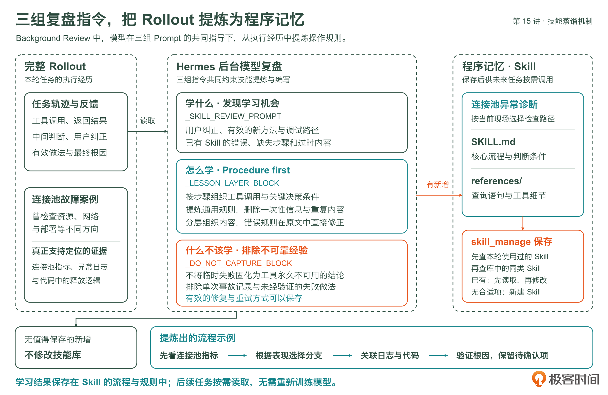
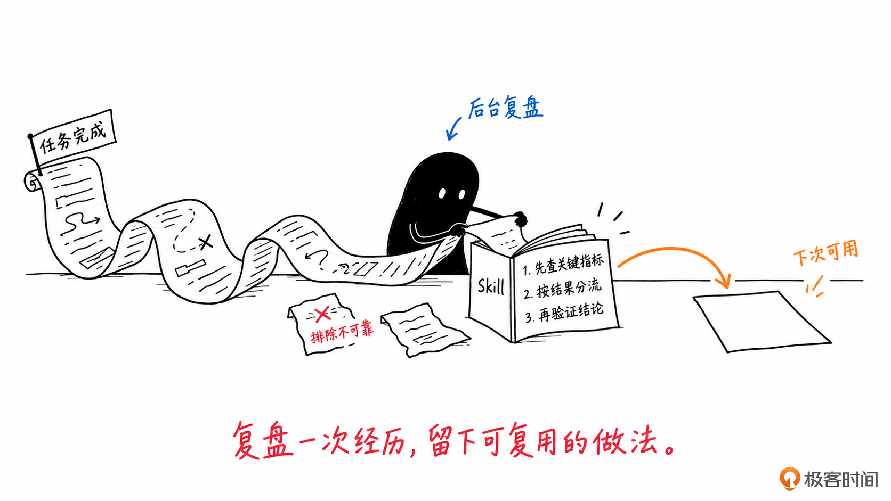

# 15 | 自主skill学习：从完成任务到领悟方法

你好，我是 Tyler。

前几讲，我们一直在讨论 Agent 的事实记忆：怎样记住重要信息、修正过时的内容，以及在不同实例之间共享经验。这类记忆主要回答“是什么”。

但 Agent 要积累的不只有事实，还有完成任务的技能。这也是我们在第 10 讲提到的另一类记忆：程序记忆（Procedural Memory）。在 Hermes 中，Skill 是承载程序记忆的重要形式，可以将操作流程、判断条件和工具使用方式组织起来，供后续任务调用。

那么，Agent 能不能在完成任务后，自动复盘自己的执行经历，从中提炼出新的技能，作为自进化的程序记忆？

这一讲，我们就来看看 Hermes 怎样从长程 Rollout 中学习并创建 Skill。

## Hermes 怎样从 Rollout 中蒸馏出 Skill？

某天，线上服务出现大量请求超时，数据库连接池持续告警。On-call Agent 独立排查了三个多小时，先后检查服务器资源、慢查询、网络和部署记录，经过大量工具调用，最终通过连接池指标、异常日志和代码检查，定位了异常处理分支中的连接泄漏问题，并通过测试重放验证了根因。

虽然故障成功定位，但整个调查走了不少弯路。回顾执行记录可以发现，如果能更早关注连接池指标，再根据结果选择检查路径，就有机会减少无关探索。

这正是自主技能学习的典型场景：从一次耗时数小时的执行经历中，提炼后续任务可以复用的诊断技能。

第 11 讲我们介绍了 Background Review 的运行机制，第 12、13 讲则展示了如何利用它维护事实记忆。这一讲沿用相同的后台复盘机制，只是学习目标变成了程序记忆。

关键变化在于复盘 Prompt。

```
在 Hermes 的 background_review.py 中，技能复盘由 _SKILL_REVIEW_PROMPT 组
```

织，其中还包含两组共用指令：

```
_LESSON_LAYER_BLOCK：规定技能应该怎样组织和编写。
_DO_NOT_CAPTURE_BLOCK：规定哪些内容不应该保存为 Skill。
```

它们共同指导模型完成技能学习，核心就是三个问题：学什么、怎么写、什么不该学。

下面直接看源码中的关键要求。为了方便阅读，代码块采用精简中文意译，并非完整英文原文。

```
第一组：_SKILL_REVIEW_PROMPT，发现值得学习的技能。
```

这组指令要求模型主动回顾执行经历，寻找能够用于后续任务的新经验。

- 回顾本次会话，主动寻找值得学习的内容。

- 重点检查：

```
1. 用户是否纠正了操作流程、执行步骤、
  输出格式或表达要求？
2. 是否发现了新的有效技术、调试路径、
  修复方法或工具使用方式？
3. 本轮使用的 Skill 是否暴露了新的问题？
```

- 发现值得学习的经验时，应考虑将其保存到技能库。

```
只有没有合适的已有 Skill 时，才创建新 Skill。
```

- 没有产生值得保存的内容时，可以不做修改。

这组 Prompt 让模型主动寻找学习机会，而不是等用户明确要求它保存经验。

对于前面的连接池故障，值得学习的是 Agent 最终找到的连接泄漏诊断路径。后台可以从Rollout 中提取相关工具调用、环境反馈和验证结果，为创建新技能提供依据。

找到学习机会后，接下来需要把具体执行经历组织成能够复用的 Skill。

```
第二组：_LESSON_LAYER_BLOCK，规定 Skill 的编写方式。
```

这组指令最重要的要求是 Procedure first，也就是优先写清执行流程。

```
Skill 应当指导 Agent 高效、正确地完成一类任务。
1. 流程优先
  按操作顺序写清步骤、具体工具调用和关键决策点。
  将经验教训融入对应步骤。
2. 提炼通用规则
  说明应该怎样做，以及为什么这样做。
  不要将本次事故的经过写成操作说明。
3. 去除一次性信息
  不保留工单编号、日期和事故流水账。
4. 避免重复
  不重复已有规则和工具本身的使用说明。
5. 分层组织
  SKILL.md 保存始终需要遵守的核心规则。
  references/ 保存按需查阅的详细资料。
```

Procedure first 强调的是 Skill 的组织方式：以执行流程为主线，按顺序安排步骤、工具调用和关键决策点，并把经验教训放在它实际影响的步骤中。

例如，从这次连接泄漏调查中，可以提炼出一套诊断流程：先检查连接池的使用和归还指标，确认是否存在异常占用，再通过日志定位可疑请求，沿代码路径检查连接的获取与释放，最后通过测试重放验证根因。

其中还需要保留适用条件。只有监控指标显示连接没有正常归还，才有依据重点调查连接泄漏；如果指标不支持这一判断，就需要继续排查其他原因。

此外，Prompt 要求删除工单编号、时间和临时状态，是为了让 Skill 能够脱离本次事故独立使用。这样，原来三个多小时的执行经历，就被整理成了一项带有操作步骤和判断条件的诊断技能。

```
第三组：_DO_NOT_CAPTURE_BLOCK，排除不可靠的经验。
```

这组指令明确规定了哪些内容不能被沉淀为长期技能。

- 不要保存：

```
1. 缺少依赖、凭据未配置、路径错误等
  依赖当前环境的临时问题。
2. 因为一次调用失败，
  就断言某个工具或功能永久不可用。
3. 已经恢复的一次性错误。
  如果重试解决了问题，应记录有效的重试方式。
4. 只描述单次工单或事故经过的任务记录。
5. 尚未找到有效解法，
  却被包装成可靠流程的失败尝试。
```

- 如果工具因环境配置而失败，应记录经过确认的修复步骤，而不是将工具判定为不可用。

例如，Agent 在排障时发现某个诊断工具无法运行，后来确认只是环境缺少依赖。这时，不能把“这个工具不可用”写成长期规则。如果安装依赖的方法具有复用价值，可以记录有效的配置步骤。

同样，如果一次调查始终没有找到可行的解法，就不能把失败尝试整理成可靠的诊断技能。

这组指令的作用，是避免临时环境问题和未经验证的操作，在后续任务中被当成长期有效的规则。

三组指令共同约束一次技能复盘：主动寻找学习机会，将执行经验组织为通用技能，并排除不可靠的内容。



## 学到的技能，怎样创建到技能库？

完成技能提炼后，后台还需要检查技能库中是否已有相同任务类型的 Skill。

Hermes 的复盘 Prompt 要求优先复用已有技能。只有现有 Skill 无法覆盖这类任务时，才创建新的 Skill，避免每次故障都产生一个重复文件。

```
假设技能库中还没有连接泄漏诊断 Skill，后台就可以创建 database-connection-leak-
investigation：
---
name: database-connection-leak-investigation
description: 调查数据库连接未正常归还及疑似连接泄漏问题。
---
# 数据库连接泄漏调查
## 适用场景
```

- 连接池活跃连接持续增长，请求结束后连接没有正常归还，或其他指标提示可能存在连接泄漏。

```
## 排查流程
1. 检查连接池活跃连接、空闲连接、
  等待请求和连接获取超时指标，
  确认是否存在连接归还异常。
2. 关联异常日志与请求记录，
  找出可能持续占用连接的请求路径。
3. 沿代码调用路径检查连接的获取与释放，
  重点核对异常处理和提前返回分支。
4. 在隔离环境中重放可疑请求，
  观察连接占用是否持续增长，
  验证疑似泄漏路径。
5. 汇总关键证据和根因。
  证据不足时保留待确认项，
  不直接将连接池耗尽判定为连接泄漏。
## 参考资料
```

- 监控查询和代码检查方法见

```
references/connection-pool.md。
```

这份 Skill 保存的是连接泄漏调查的通用流程，而不是上一次故障的调查报告。它的适用范围也与这次执行经历中得到的证据一致。

```
SKILL.md 记录适用场景、执行步骤和判断条件，具体查询语句和工具参数则保存在
references/connection-pool.md 中，供 Agent 按需读取。
实际创建由 skill_manage 完成。后台 Agent 根据复盘结果生成技能内容，再通过工具写入
```

技能库。以后遇到相关任务，Agent 就可以通过技能发现和读取机制使用这项技能。

至此，Hermes 完成了一次自主技能学习：从 Rollout 中发现值得复用的执行经验，通过复盘Prompt 提炼操作流程和判断规则，最终创建新的 Skill。

## 小结

学到这里，我们做个总结吧。



前几讲介绍的事实记忆，让 Agent 记住“是什么”；这一讲介绍的程序记忆，则让 Agent 积累“怎么做”。

Hermes 沿用 Background Review 机制，通过复盘 Prompt 主动发现技能学习机会，根据Procedure first 的要求组织操作流程，并排除不可靠的经验，最终将学习结果保存为新的Skill。

自主技能学习的价值，是把一次任务中积累的有效经验，转化为后续任务可以直接使用的技能。

现在，Hermes 已经能够从执行经历中自主创建 Skill。但随着任务和环境变化，已有技能也可能出现不足。

下一讲，我们就来看看 Hermes 怎样利用新的执行经历，持续修订和改进已有 Skill。

## 课后练习

今天的题目我选择了一道系统设计题。

题面

你的团队部署了一套 On-call Agent 系统。Agent 能够独立使用监控、日志、代码检索和测试工具排查故障，但经常需要几个小时、经过大量探索才能找到根因。

团队希望 Agent 在任务结束后，能够自主复盘完整的 Rollout，从中提炼新的诊断技能，供后续任务使用。

请设计这套自主技能学习机制：复盘 Prompt 应该寻找哪些学习信号，怎样把执行经历组织成包含步骤、工具调用和判断条件的 Skill，如何排除不可靠的经验，以及怎样确定新技能的适用范围。

进一步考虑：如果调查没有产生可靠的诊断流程，是否还应该创建 Skill？怎样避免将一项技能拆成多个只适用于单次故障的文件？

配套练习放在 GitHub 配套工程中，对应这一讲的练习目录。你可以通过触发后台复盘、查看

```
生成的 SKILL.md 和检查技能库变化，验证这条自主学习链路。
```

期待你在留言区记录自己的设计思路或者疑问。如果这一讲对你有启发，也欢迎分享给身边更多朋友。
