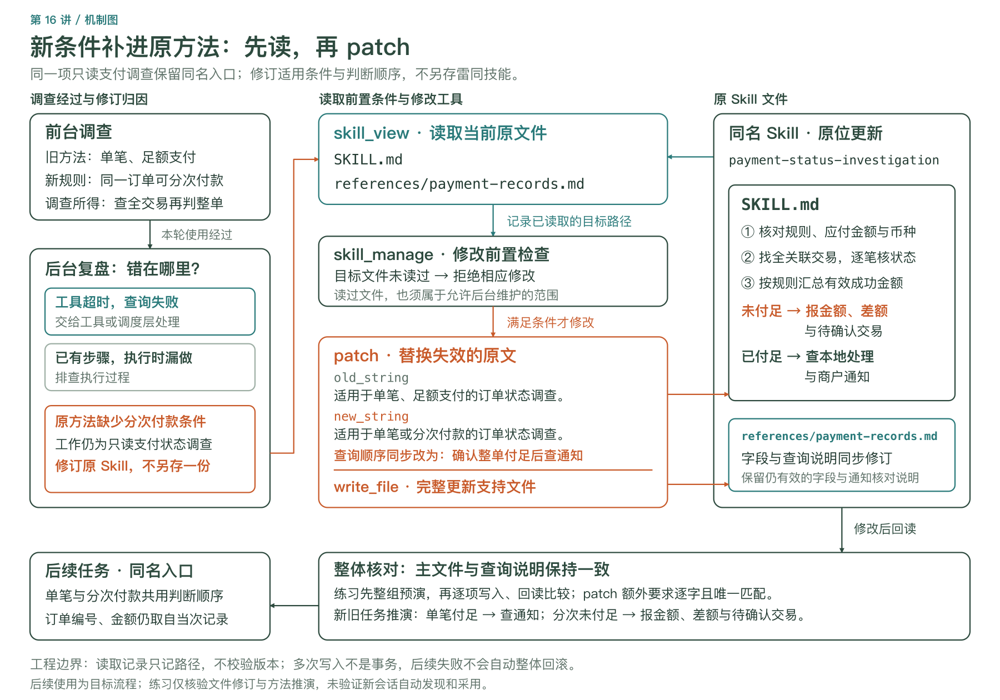
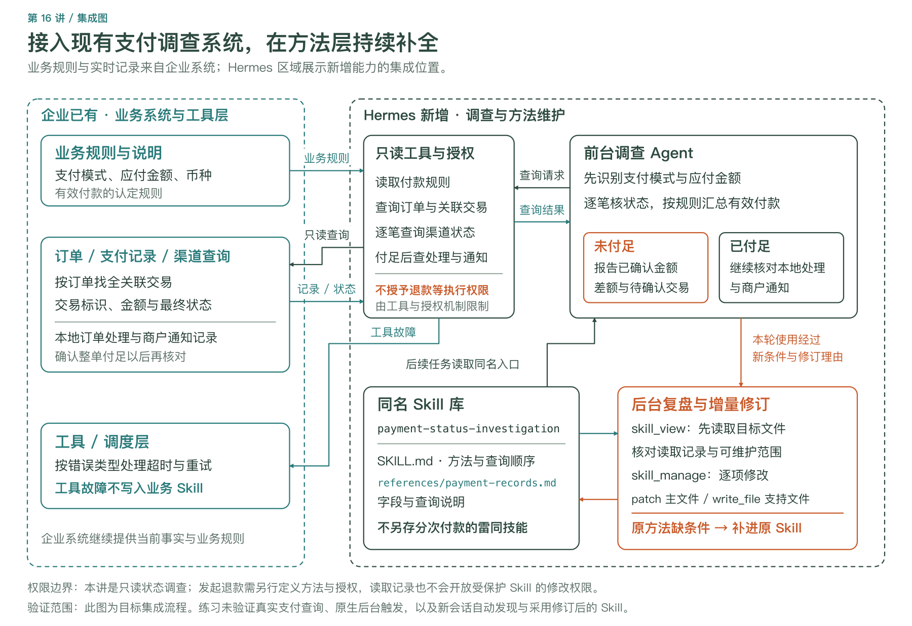

# 16 | 增量Skill演化：Agent服务怎样持续适应新需求？

你好，我是 Tyler。

上一讲，我们介绍了 Hermes 怎样从 Rollout 中自主创建 Skill，让 Agent 能够积累新的技能。

当你已经有了一套由 Harness 和 Skill 组成的 On-call Agent 服务后，随着业务系统不断发展，Agent 面对的任务分布也在变化。新的故障场景不断出现，原有 Skill 的执行流程逐渐暴露出不足。

这就带来一个问题：怎样让 Agent 从持续产生的 Rollout 中发现新的能力需求，自动修订已有 Skill，让服务适应不断变化的任务？

这一讲，我们就来讨论增量 Skill 演化。

## 任务分布变了，原来的 Skill 还适用吗？

你已经有一套 On-call Agent 服务，持续接收监控系统的告警，自主分析异常并定位故障。

最初，Agent 处理的主要是单条告警，例如接口超时、服务器负载过高或数据库连接池耗尽。

```
技能库中已经有一项 oncall-alert-triage，指导 Agent 查询指标、日志和调用链，逐步
```

定位异常原因。

随着业务系统规模扩大，服务之间的依赖关系越来越复杂。一次底层故障开始同时触发多个服务的告警，例如数据库连接池耗尽引发接口超时，又导致上游业务服务错误率升高。

Agent 仍然按照原有 Skill 逐条排查，每条告警都要重新查询指标和日志。虽然能够解释局部异常，却没有把这些告警关联起来，识别故障的传播路径和共同根因。

类似情况不断出现在执行记录中。原来以单条告警为主的任务，逐渐增加了跨服务、多告警的关联研判。Agent 面对的任务分布发生了变化，原有 Skill 缺少事件级的诊断流程。

这里需要演化的是 Skill：新的任务需求暴露了已有技能的能力缺口，需要将新的诊断经验补充到原有 Skill 中。

## 怎样从 Rollout 中发现已有 Skill 的不足？

第 11 讲我们已经介绍了 Background Review，上一讲则利用它从执行经历中创建新 Skill。这一讲继续使用相同的复盘机制，重点关注已有 Skill 在新任务中暴露出的不足。

```
Hermes 的 _SKILL_REVIEW_PROMPT 明确要求模型检查：本轮使用的 Skill 是否存在错误、
```

缺少步骤或内容过时。发现新的有效经验后，优先考虑补充相关的已有 Skill。

因此，当 Agent 在一次多告警事件中经过反复探索，最终发现多个异常来自同一个上游故障时，后台就能从这次 Rollout 中提炼新的诊断经验。

但增量演化还需要关注持续出现的任务变化。

Harness 可以汇总一段时间内产生的 Rollout，关联告警类型、调用的 Skill、工具执行过程和诊断结果，观察任务分布及执行方式的变化。

在这个例子中，新的执行记录反复呈现出同一种情况：多个服务同时告警，Agent 逐条开展调查，重复查询相同的调用链和依赖信息，最后才将这些异常关联为同一次故障事件。

从这些记录中，我们就能识别出原有 Skill 的缺口：缺少在开始排障时判断告警关联关系、识别故障传播路径的步骤。

这里还需要区分技能缺口与普通的执行问题。如果 Skill 已经包含正确的步骤，只是本轮没有执行，应先处理执行偏差；如果某个工具暂时不可用，应该处理的事处理工具故障。只有原有Skill 确实缺少新的判断条件或执行流程，才需要修订长期技能。

Hermes 的 Background Review 负责从单次执行中发现技能改进机会。跨实例、跨时间的任务分布分析，则可以由 Harness 汇总多个 Rollout 完成。

这样，持续产生的执行经历就成为增量 Skill 演化的依据。

## 怎样将新经验融入已有 Skill？

发现技能缺口后，接下来我们需要确定怎样修订原有 Skill。

这次变化仍然属于 On-call 告警诊断，只是诊断范围从单条告警扩展到了整个故障事件。因

```
此，我们继续使用 oncall-alert-triage，在原有流程中增加多告警关联研判能力。
```

Hermes 的复盘 Prompt 要求优先检查本轮使用过的相关 Skill。修改前，还必须遵循 Read-before-write：先读取当前技能文件，再根据新的执行经验生成补丁。

原来的 Skill 主要包含以下步骤：

```
1. 读取告警详情，确认异常服务和指标。
2. 查询相关日志、监控指标和调用链。
3. 定位异常原因，整理诊断结果。
```

新的任务要求 Agent 先判断告警范围，再选择适当的诊断路径。修订后的流程如下所示。

```
1. 识别任务范围，判断属于单告警还是多告警事件。
2. 单告警：
  查询相关指标、日志和调用链，定位异常原因。
3. 多告警事件：
  - 汇总相关告警及其发生时间。
  - 查询服务依赖关系和调用链。
  - 分析异常传播路径，区分上游故障与下游症状。
  - 确定优先排查对象，验证故障根因。
4. 汇总诊断结果、关键证据和待确认事项。
```

多条告警同时出现，并不意味着它们来自同一个故障源。Agent 需要结合服务依赖、调用链和故障时间线确认关联关系，再确定排查顺序。

增量 Skill 演化的关键，是把新的执行经验融入已有技能，让原有流程能够根据任务条件选择不同的处理路径。

```
在 Hermes 中，后台可以通过 skill_manage 的 patch 操作修改原有内容。这里同样遵循
```

上一讲介绍的 Procedure first：新规则应该进入它实际影响的执行步骤。

例如，原有流程直接进入单条告警排查，就应当在入口增加事件范围判断，再根据判断结果进入对应流程。只在文件末尾增加一句“多告警需要关联分析”，无法提供完整的执行顺序。

如果新的流程需要服务拓扑查询、跨服务调用链分析等工具，还要同步补充相关参考文件。修改完成后，后台重新读取 Skill，检查主文件中的步骤与参考资料中的操作方法是否一致。

对于已经运行的服务，多个 Agent 实例也会同时产生新的经验。Harness 可以汇总针对同一Skill 的修订建议，基于当前版本形成一致的修改，避免不同后台任务相互覆盖。

下图展示了从执行经历中发现新条件，并对已有 Skill 进行增量修订的过程。



## 怎样确认演化后的 Skill 仍然有效？

Skill 修改完成后，还需要检查新增能力是否正确，以及原来的执行流程是否受到影响。

对于告警诊断，我们可以从历史 Rollout 中整理两类测试任务：一类是原来的单条告警，另一类是新增的多告警关联事件。

单告警任务仍应能够直接查询指标、日志和调用链，完成故障定位。多告警任务则应先分析服务依赖和异常传播路径，再决定优先排查对象。

通过回放这些任务，可以比较修订前后的执行结果，检查 Agent 是否减少重复查询、是否正确识别告警关联，以及原有的单告警诊断能力是否得到保留。

增量演化需要同时做到两件事：扩展新任务的处理能力，保留原来已经有效的能力。

在 Hermes 已有机制中，Background Review 能够发现并修订 Skill，技能管理工具负责保存修改。对于持续运行的 Agent 服务，Harness 还可以进一步组织候选版本的回放测试、版本发布和回退。

经过验证的 Skill 应用到服务后，后续 Agent 就能直接使用更新后的诊断流程。随着故障场景继续变化，新的 Rollout 又会成为下一轮技能演化的输入。

整个过程形成了一条持续运行的反馈链路：

新任务产生 Rollout → 发现技能缺口 → 修订已有 Skill → 验证新旧任务 → 应用更新后的技能。



通过这套机制，Agent 能够不断将真实排障中积累的新经验补充到已有 Skill，让服务持续适应变化后的任务分布。

## 小结

学到这里，我们做个总结吧。

上一讲，我们介绍了怎样从 Rollout 中自主创建新 Skill。这一讲进一步讨论，已有的 Harness+ Skill 服务怎样利用新的执行经历，持续完善已经掌握的技能。

当故障场景和任务分布发生变化时，Rollout 会暴露原有 Skill 的能力缺口。Hermes 通过Background Review 提炼新的执行经验，再将新增的判断条件和操作步骤融入原有 Skill。修订后的技能经过新旧任务验证，继续用于后续任务。

增量 Skill 演化的价值，是让已有技能随着实际任务不断完善，将新的执行经验持续转化为程序记忆。

随着 Skill 不断创建和演化，技能库也会逐渐增长，出现内容重复、能力重叠和长期不再使用的技能。

下一讲，我们就来看看 Hermes 怎样进一步整理和维护不断增长的技能库。

## 思考题

今天的课后练习仍然是一道系统设计题。

题面

你已经有一套由 Harness 和 Skill 组成的 On-call Agent 服务。系统持续接收监控告警，由Agent 自主查询指标、日志和调用链，完成故障诊断。

最初，Agent 主要处理单条告警。随着业务系统规模扩大，一次故障开始触发多个服务的关联告警。原有 Skill 仍然逐条分析，重复进行大量查询，也无法有效识别故障传播路径。

团队希望系统能够从新的 Rollout 中发现这类任务变化，增量修订已有 Skill，让 Agent 掌握多告警关联研判能力，同时保留原有的单告警诊断能力。

请设计这套增量 Skill 演化机制：怎样从持续产生的执行记录中发现技能缺口，如何将新的判断条件和执行步骤融入已有 Skill，以及怎样验证修订后的技能仍然适用于原有任务。

进一步考虑：多个 Agent 实例同时发现类似缺口时，怎样组织修订，避免产生冲突？如果新增的关联研判流程改善了复杂故障处理，却影响了原来的单告警诊断，又应该怎样处理？

配套练习放在 GitHub 配套工程中，对应这一讲的练习目录。你可以通过模拟新故障场景、复盘 Rollout、修订已有 Skill 和回放新旧任务，验证增量技能演化的过程。

期待你在留言区记录自己的设计思路或者疑问。如果这一讲对你有启发，也欢迎分享给身边更多朋友。
