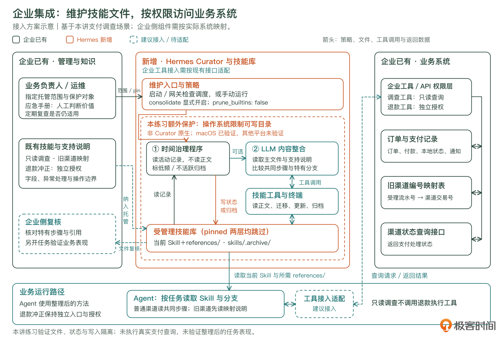
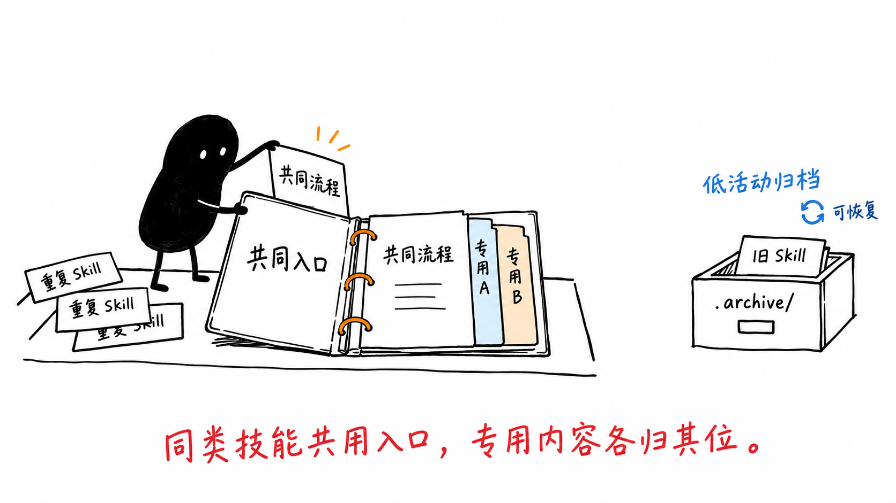

# 17 | SkillCuration：方法越积越多，谁来整理整个技能库

你好，我是 Tyler。

前两讲，我们介绍了 Hermes 怎样从 Rollout 中自主创建 Skill，以及怎样根据新的执行经验修订已有 Skill。

Agent 持续运行，技能库也会不断增长。同一类任务可能积累多份相似的技能，有些技能已经长期不用，还有一些技能的名称和描述非常接近，让 Agent 难以判断该选择哪一个。

前面我们讲过，Skill 的名称和描述会进入 Agent 的技能索引。技能越多，索引占用的上下文也越多；大量相似描述还会增加技能选择的难度。那么，能不能让 Hermes 自动整理整个技能库，合并重复的技能、归档不再使用的内容，让技能库随着能力积累保持清晰？

这一讲，我们就来看看 Hermes 怎样通过 Skill Curator 完成这件事。

## 技能越积越多，为什么需要整理？

你已经有一套持续运行的 On-call Agent 服务。经过一段时间的自主学习，技能库积累了大量故障诊断 Skill。

```
其中有两项技能：connection-pool-triage 负责数据库连接池异常排查，
connection-leak-investigation 负责连接泄漏诊断。
```

这两项技能的内容存在大量重叠。它们都要求 Agent 检查连接池指标、查询异常日志，只是后者还包含连接释放路径的代码检查和验证方法。

当 Agent 遇到连接池耗尽告警时，需要在两个相近的 Skill 之间选择，甚至连续读取两份内容，才能完成调查。

更合理的组织方式是保留一个连接池诊断入口，把连接泄漏作为其中的专用分支。通用检查流

```
程保留在 SKILL.md，专用的诊断细节放进 references/，需要时再读取。这样，Agent 能
```

够从同一个入口找到完整的诊断能力，共同的操作规则也只需维护一份。

Skill Curation 要解决的，就是把不断积累的技能重新组织起来，减少重复内容，让 Agent 更容易找到和使用正确的技能。

## Curator 怎样自动整理技能库？

Hermes 的 Curator 通过两种方式整理技能库：一是根据 Skill 最近的使用、查看和修改时间，自动归档长期没有活动的技能；二是利用模型分析技能内容，将能力重叠的 Skill 合并到共同入口。

我们先看 Hermes 怎样自动归档长期未使用的 Skill。

Hermes 会记录 Skill 的使用、查看和修改情况。Curator 根据最近活动时间，将长期未活动的

```
技能标记为 stale，达到归档条件后，再将其移入 .archive/ 目录。
```

```
整个过程由程序自动完成，不需要调用模型。stale_after_days 和
archive_after_days 分别控制状态转换和归档期限。归档后的 Skill 退出当前技能列表，
```

但文件仍然保留，可以恢复。

在本讲的配置中，内置技能的自动清理也已经开启。因此，符合条件、长期未使用的内置 Skill同样会进入归档流程。

不过，长期未使用不代表没有价值。例如，一项日常故障诊断 Skill 长期没有活动，已经可以考虑退出当前技能列表；但灾难恢复 Skill 即使几个月没有调用，也需要在重大事故发生时保持可用。

```
Hermes 支持通过 pin 保护重要 Skill。Curator 会跳过这些受保护的技能；被定时任务引用的
```

Skill 也不会因为低频使用而被自动归档。

接下来，我们看 Hermes 怎样利用模型合并内容重叠的 Skill。

```
这部分由 consolidate 控制。在本讲的设定中，它已经开启。Curator 到达维护周期、满足
```

空闲条件后，除了处理长期未活动的技能，还会启动后台 Agent，对技能库进行内容整理。

后台 Agent 会读取候选 Skill，识别重叠的任务能力，再决定保留、合并或归档。

因此，两种机制的分工非常明确：程序负责判断哪些 Skill 长期没有活动，模型负责判断哪些Skill 应该重新组织。

需要注意，Curator 只会对 Agent 自主创建的 Skill 进行模型整合。Hermes 自带的预置 Skill即使开启了自动清理，也只会根据长期未使用的情况归档，不会被模型合并或改写。从技能市场安装或外部目录提供的 Skill，同样不参与自动整合。

## 模型怎样判断哪些 Skill 应该合并？

接下来，我们重点看看模型怎样整理技能库。

```
在 Hermes 的 agent/curator.py 中，CURATOR_REVIEW_PROMPT 明确要求后台进行
```

Umbrella-building Consolidation，也就是围绕一类任务建立统一的技能入口。

后面是我根据源码整理的核心 Prompt，为了方便你理解，内容做了中文意译。

- 任务：整理整个技能库，建立面向任务类别的技能体系。

```
1. 扫描候选 Skill，识别属于同一领域或任务类别的技能组。
2. 阅读技能正文，判断这些技能是否应当合并到
  一个共同入口中。
3. 对于能够合并的技能：
  - 保留共同的执行流程和判断条件。
  - 将各项技能独有的经验融入对应步骤。
  - 将专用细节整理到 references/、scripts/ 等目录。
  - 删除重复规则和一次性事故叙述。
4. 已有合适的通用 Skill 时，优先使用它作为入口；
  否则创建新的类别级 Skill。
5. 完成内容迁移和引用调整后，
  归档已经被吸收的旧 Skill。
6. 对于任务职责不同的技能，保留独立入口。
```

这组 Prompt 最重要的要求，是让模型从整个技能库的角度判断技能之间的关系。它要考虑的是：这些技能是否共同服务于同一类任务，能否通过一个通用 Skill 加上不同的执行分支来组织？

```
回到连接池诊断的例子。connection-pool-triage 已经包含连接池异常的通用检查步
骤，connection-leak-investigation 则提供连接泄漏的深入诊断方法。
```

Curator 可以保留前者作为共同入口，将连接泄漏的判断条件补充到主流程，再把专用的代码

```
检查和测试方法整理到 references/connection-leak.md。
```

整理后的结构如下：

```
connection-pool-triage/
├── SKILL.md
└── references/
   └── connection-leak.md
这样，SKILL.md 负责指导 Agent 判断连接池异常的类型，专用参考文件则提供连接泄漏调
```

查的详细步骤。这延续了前面介绍的渐进式披露：共同的判断规则集中维护，需要深入调查时再读取对应细节。

```
源码还特别强调，将旧 Skill 原封不动地复制进另一个 Skill 的 references/，不算真正完
```

成整合。

真正的整合需要提炼共同规则、消除重复内容，并将各项技能独有的经验放到合适的位置。

```
对于包含 references/、scripts/、templates/ 等支持文件的 Skill，Curator 还需要检
```

查完整的文件结构。合并时必须迁移仍然需要的资源，并更新引用路径，才能归档原有入口。

否则，虽然技能数量减少了，Agent 执行到某一步时却找不到需要的脚本或说明，整理反而破坏了原来的能力。

当然，名称相近也不代表应该合并。例如，故障诊断 Skill 负责查询日志和指标，故障恢复Skill 则可能执行服务切换或配置修改。两者即使涉及同一套系统，执行目标和操作权限也不同，应当保留独立入口。

因此，Curator 判断技能能否整合，依据的是任务职责和执行流程，而不仅是名称或描述的相似程度。

## 整理以后，怎样保证技能仍然可用？

Curator 完成整合后，旧技能会退出当前列表，新的共同入口开始承担原来的任务。

这时，需要检查两个结果：Agent 是否能够找到新的 Skill，以及原有技能中的关键步骤是否完整保留。

对于连接池诊断，可以分别检查普通连接池耗尽和连接泄漏两类任务。Agent 应当能够通过共同入口完成基本诊断，并在需要时继续读取连接泄漏的专用说明。

Hermes 也为自动整理提供了恢复机制。

模型整合开始前，系统会保存技能库快照，并记录本次修改。被归档的 Skill 会保留在

```
.archive/ 中。整理结果可以通过运行报告检查，发现合并不当时，可以恢复归档技能或使
```

用快照回退相应修改。

这里还需要区分两种恢复操作：恢复归档技能用于找回退出当前列表的原 Skill；快照回滚则用于恢复整合前的活动技能文件。两者共同支持技能库恢复。



在完整的 Harness 中，还可以利用历史任务回放，检查整理前后的技能选择、工具调用和任务结果。

Skill Curation 的效果，最终要看 Agent 是否更容易找到正确的技能，并且能够继续执行原有的任务。

## 小结

学到这里，我们做个总结吧。



前两讲，我们让 Hermes 能够自主创建和修订 Skill。这一讲进一步介绍了 Curator，让系统能够自动整理不断增长的技能库。

Curator 通过两层机制工作：程序根据活动记录管理技能生命周期，模型则阅读技能内容，将属于同一类任务的能力整合到共同入口。

其中最重要的是 Umbrella-building Consolidation：围绕任务类别组织 Skill，把共同流程集中起来，将专用能力放在对应分支中，减少重复入口和重复规则。经过整理，技能库能够在持续积累能力的同时，保持清晰的结构和可复用的内容。

不过，技能创建、修订和整理完成后，还有一个问题：怎样知道这些变化真正改善了 Agent 的任务表现？

下一讲，我们就来讨论 Skill 的评测。

### 课后练习

下面是本讲的系统设计题和课后练习。

系统设计题

你已经有一套由 Harness 和 Skill 组成的 On-call Agent 服务。随着自主学习持续运行，技能库积累了大量诊断 Skill，其中部分能力高度重叠，还有一些长期没有活动。

系统已经启用了 Curator 的自动状态管理、语义整合和内置技能清理，希望在不依赖人工逐项整理的情况下，持续优化技能库结构。

请设计这套自动整理机制：怎样根据活动记录管理技能生命周期，怎样利用模型判断哪些 Skill应该整合，如何建立共同入口并保留专用能力，以及怎样确认整理没有破坏原有任务的执行。

进一步考虑：长期不用的应急技能应该怎样保护？如果两项 Skill 合并后，原有参考文件或脚本无法访问，怎样发现问题并恢复？

配套练习放在 GitHub 配套工程中，对应这一讲的练习目录。你可以通过 Curator 的自动归档、模型整合和恢复功能，检查技能库整理的全过程。

期待你在留言区记录自己的设计思路或者疑问。如果这一讲对你有启发，也欢迎分享给身边更多朋友。
