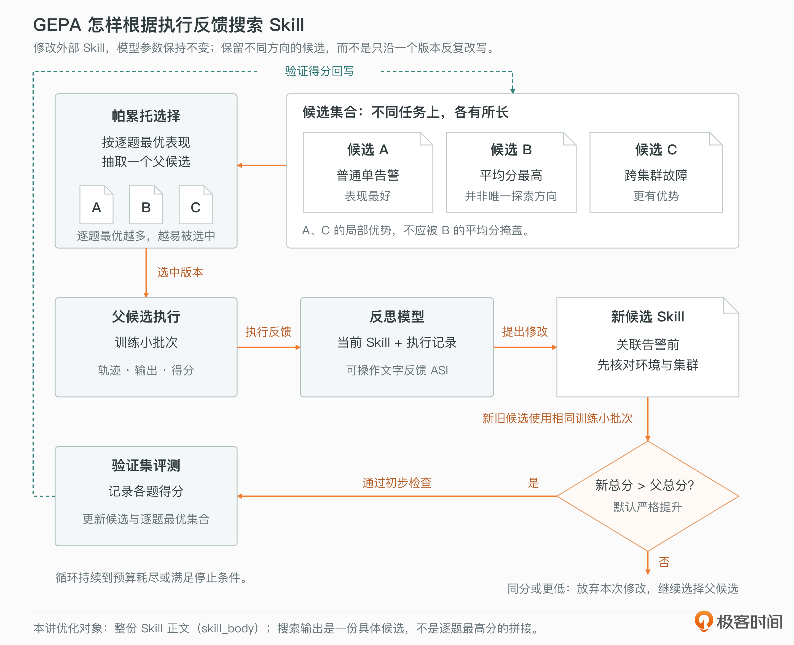
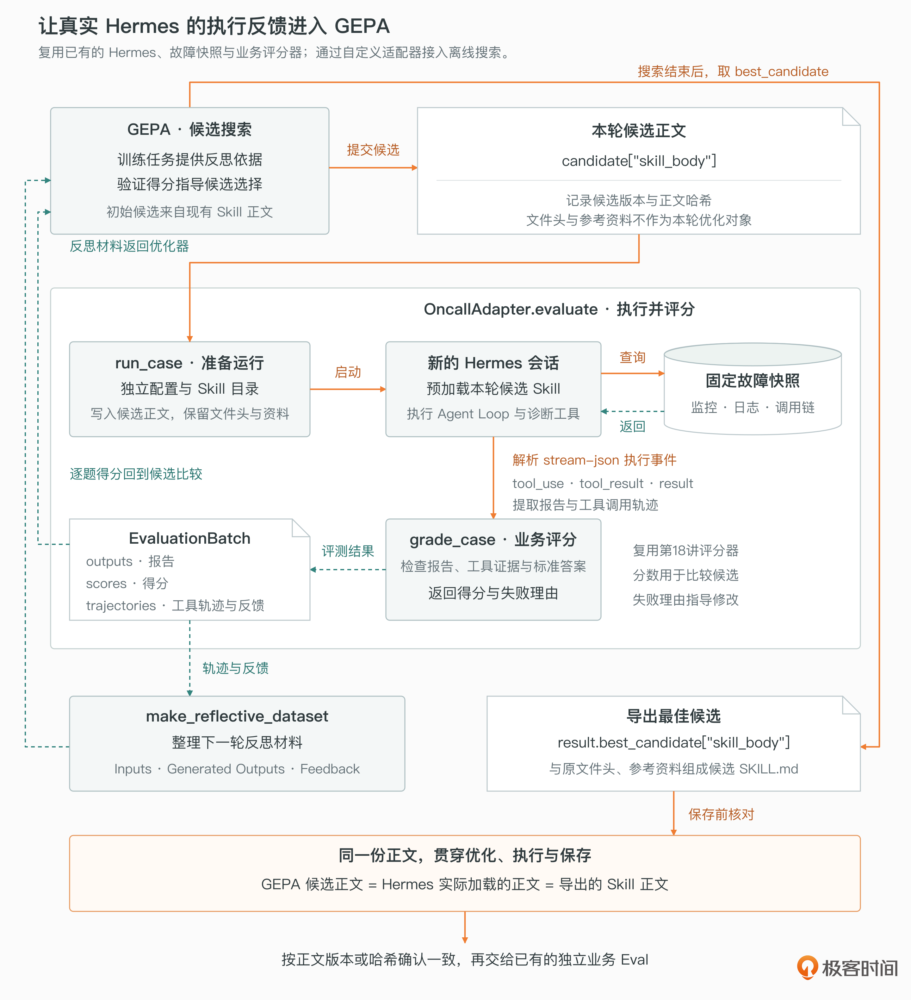
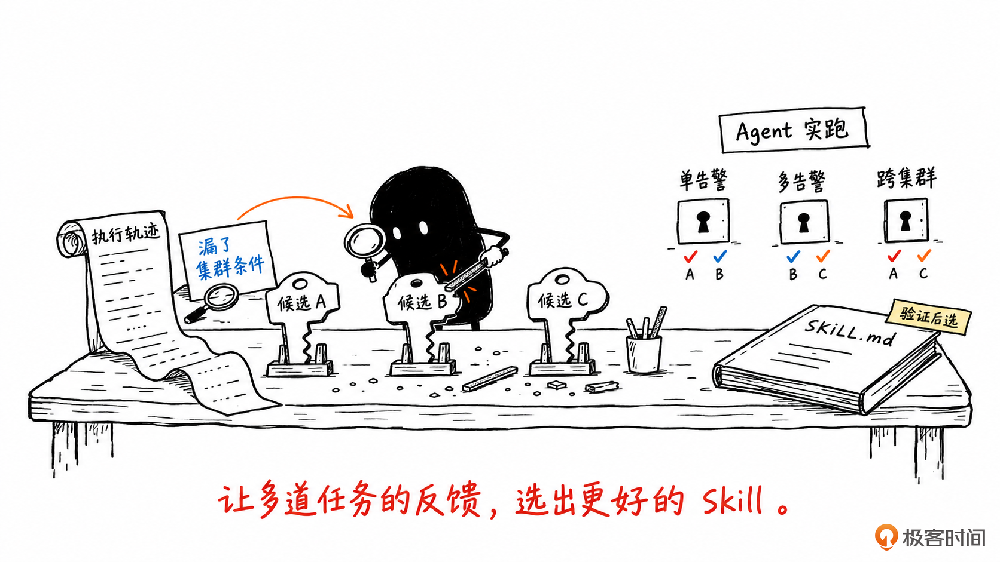

# 20 | 离线优化：怎样利用一批任务，自动寻找更好的Skill？

你好，我是 Tyler。

前面我们已经让 Hermes 能够从执行经历中自主创建和修订 Skill。但这种改进通常围绕某一次任务展开：Agent 发现问题，反思原因，再修改方法。

如果现在有了一批历史任务，每条都有执行结果和评分，我们能不能进一步让系统反复尝试不同的 Skill，自动找到表现更好的版本呢？

例如，一份告警诊断 Skill 要处理单告警、多告警关联和跨集群故障。增加集群过滤条件，可能减少关联错误，却也可能让简单任务多查几步。面对这些相互影响的任务，仅凭一次成功或失败，很难判断哪份 Skill 更好。

GEPA 提供了一种离线优化方法：根据执行反馈提出修改，再用一批任务比较不同候选，通过持续搜索找到更好的指令版本。

这一讲，我们就来看看 GEPA 怎样工作，又如何将它用于 Hermes 的 Skill 离线优化。

## GEPA 怎样根据失败反馈修改 Skill？

```
先看一个故障调查任务。Agent 需要分析生产集群 prod-eu 的接口超时，却把测试集群
staging-eu 中同名服务的告警也关联进来，导致根因判断错误。
```

评分器可以给这次任务打低分，但只有分数还不够，想要修改 Skill，还得知道错误发生在哪里。

查看执行轨迹，发现 Agent 调用告警查询工具时，只传入了服务名称和时间范围：

```
query_alerts(
   service="db-gateway",
   time_range="09:00-09:30"
)
```

由于缺少集群条件，工具返回了多个集群的同名服务记录，Agent 随后将它们错误地关联起来。

这时，除了任务得分，还可以提供一段反馈：

- 查询缺少集群过滤条件，导致不同环境的告警被错误关联。应先确认环境和集群归属，再根据服务依赖与调用链判断告警之间的关系。

GEPA 将这类有助于定位问题的反馈称为可操作的侧信息（Actionable Side Information，ASI）。它可以包含工具报错、执行轨迹和评分器解释，让反思模型不仅知道任务是否成功，还能理解失败原因。

GEPA 会将当前指令、任务输入、执行结果和反馈组织成反思材料，再交给反思模型提出新的候选。

例如，反思模型可能在 Skill 中增加如下内容：

- 多告警关联前，先按照环境、集群和故障时间窗口筛选记录，再结合服务依赖和调用链判断关联关系。不能仅凭服务名称相同或时间接近，就认定告警属于同一次故障。

这个修改针对的是通用的诊断规则，而不是把当前任务的答案写进 Skill。

GEPA 的反思式优化，就是利用执行反馈指导指令修改，再通过任务评测检验修改是否有效。

不过，一条看起来合理的规则，未必能改善整体表现。它可能修复跨集群误判，也可能增加其他任务的执行成本。因此，GEPA 还需要比较不同的候选版本。

## GEPA 怎样在不同候选之间搜索？

GEPA 的完整名称是 Genetic-Pareto Prompt Evolution。和只维护一个当前最优版本的简单搜索不同，它可以保留多个候选，探索不同的改进方向。

每轮搜索首先从已有候选中选择一个父候选，再抽取一小批训练任务进行执行，收集得分和轨迹。反思模型根据反馈提出新版本，然后让新旧候选在相同的任务小批次上比较。

默认情况下，新候选的总分必须严格高于父候选，才能通过接受检查；得分相同，也不算有效改进。通过初步检查后，GEPA 会继续评估候选在验证任务上的表现。

这里最有特点的是帕累托（Pareto）候选选择。

假设搜索过程中产生了三个候选，它们在三类故障任务上的得分如下：

- Skill 候选单告警多告警跨集群

A

- 10.70.6

从整体均分看，B 领先于其他候选，但 A 和 C 分别在单告警与跨集群任务上取得了最优成绩。如果只根据均分选择后续优化起点，这两条具有潜力的改进方向就可能被过早放弃。

GEPA 默认采用逐题帕累托选择。它会记录每道验证题上取得最高分的候选，并根据各候选在多少道题上占据最优位置，分配下一轮被选作父候选的概率。

在这个例子中，A、B、C 各自在一类任务上表现最优，因此都有机会成为下一轮的优化起点。随着更多候选加入，搜索会根据更新后的逐题表现调整选择概率，而不是始终沿着当前均分最高的版本修改。

这使 GEPA 能够保留不同任务上的有效改进，并在后续搜索中继续探索。例如，从 A 出发改善多告警分析，或者从 B 出发加强跨集群过滤，都可能产生比原有候选更好的版本。

GEPA 还支持候选合并（Merge），用于组合多组件系统中不同版本的改进。不过，如果将整份 Skill 正文作为一个文本组件，主要使用反思修改与帕累托选择即可，不需要引入组件合并。

搜索在指定预算内持续进行，直到达到停止条件。最终，GEPA 根据验证集表现返回一份具体候选，而不是把不同版本在各道题上的最高分拼接成一个不存在的版本。

GEPA 的核心价值，是让不同的修改方向通过任务执行竞争，再利用执行反馈决定下一轮探索什么。



## 怎样利用 GEPA 优化 Hermes 的 Skill？

理解了搜索机制，我们再看怎样实际使用它。

NousResearch 已经开源了 Hermes Agent Self-Evolution 项目，将 DSPy 和 GEPA 用于Skill 优化。

```
项目提供 evolve_skill.py 作为入口，负责读取现有 SKILL.md、准备评测任务、运行
```

GEPA 搜索，并保存优化结果。

```
它支持三种评测数据来源：synthetic 根据 Skill 自动生成任务，sessiondb 从历史会话提
取任务，golden 则读取已经准备好的标准评测集。
```

例如，可以使用已有的告警诊断数据集启动优化：

```
python -m evolution.skills.evolve_skill \
 --skill oncall-alert-triage \
 --eval-source golden \
 --dataset-path datasets/skills/oncall-alert-triage
```

程序找到指定 Skill，将 YAML 文件头与 Markdown 正文分开，再通过 DSPy 包装成模型程序，交给 GEPA 优化。

这里我们需要先理解 DSPy 的作用。

DSPy 将模型任务表示为具有输入、输出和指令的程序结构。Hermes Agent Self-Evolution 中

```
的 SkillModule 使用 dspy.ChainOfThought，让模型根据 Skill 内容完成测试任务，再
```

通过评分函数评价输出。

需要注意，Hermes Agent Self-Evolution 目前仍是独立的实验性项目，企业落地时还需要进行必要的适配与验证。我们在实践中就遇到过一个问题：GEPA 优化后的评测分数提高了，但最

```
终导出的 SKILL.md 却没有变化。
排查源码后发现，项目将 Skill 正文保存在 self.skill_text 中，作为
skill_instructions 输入传给 DSPy 模型，而 GEPA 实际优化的是 DSPy Predictor 的指
```

令。解决方法是将 Skill 正文设置为 Predictor 的可优化指令，并在搜索结束后提取优化后的内

```
容，重新生成 SKILL.md。这样才能确保 GEPA 搜索得到的改进真正写入 Hermes 后续使用
```

的 Skill。

对于 On-call Agent，我们更关心候选 Skill 在实际执行中的表现。例如，它有没有传入正确的集群条件，是否查询了必要的调用链，以及最终报告引用的证据是否有效。

```
GEPA 提供了 GEPAAdapter 接口，可以将这种真实执行过程接入优化器。
```

这个接口主要完成两项工作。

```
evaluate 负责运行候选并返回评分。对于 Skill 优化，它接收候选文本和一批测试任务，让
```

Agent 根据这份 Skill 执行，再返回输出、得分和执行轨迹。

```
make_reflective_dataset 负责整理反思材料。它从任务输入、工具调用、模型输出和
```

评分反馈中，提取对修改 Skill 有帮助的信息。

例如，前面的跨集群故障可以整理成这样的反思记录：

```json
{
 "Inputs": {
   "task": "调查 prod-eu 中的接口超时"
 },
 "Generated Outputs": {
   "root_cause": "staging-eu/db-gateway",
   "tool_call": "query_alerts(service='db-gateway')"
 },
 "Feedback": "查询遗漏集群条件，错误关联了测试环境的告警"
}
```

反思模型可以从中看到任务目标、Agent 实际采用的查询方式，以及错误发生的具体原因，再提出下一版 Skill。

适配器实现以后，就可以使用 GEPA 的独立 Python API 启动搜索：

```python
import gepa
result = gepa.optimize(
   seed_candidate={"skill_body": current_skill},
   trainset=train_tasks,
   valset=validation_tasks,
   adapter=agent_adapter,
   reflection_lm="openai/gpt-4.1",
   candidate_selection_strategy="pareto",
   max_metric_calls=100,
)
optimized_skill = result.best_candidate["skill_body"]
这里，current_skill 是初始 Skill 正文，train_tasks 和 val_tasks 分别提供训练与
验证任务，agent_adapter 则是按照 GEPAAdapter 接口实现的执行适配器。
```

它负责将候选 Skill 加载到 Agent 的运行环境、执行任务，并将业务评分与工具轨迹交回GEPA。对于 Hermes，可以让每个候选使用独立会话执行测试，再根据实际工具调用和最终报告生成反馈。

```
max_metric_calls 限制评测调用预算，并不代表固定运行 100 轮反思。搜索结束后，通
过 result.best_candidate 取得验证表现最好的文本候选。
```

这样，GEPA 不再只是比较不同指令生成的文字回答，而是能够根据 Agent 的实际执行表现搜索 Skill。搜索仍然使用相同的反思、候选接受和帕累托选择机制，改变的是候选的执行与评分方式。

```
最后，将优化后的正文与原来的 YAML 文件头重新组合，生成新的 SKILL.md，再通过独立
```

测试检验实际效果。整个过程不需要重新训练模型，变化的是 Agent 执行时加载的外部方法。



## 小结

学到这里，我们做个总结吧。



这一讲，我们学习了怎样利用一批任务自动寻找更好的 Skill。GEPA 首先利用执行轨迹和文字反馈进行反思，提出有针对性的修改，再通过小批次检验与帕累托候选选择，持续探索不同版本。

NousResearch 的 Hermes Agent Self-Evolution 展示了利用 DSPy 和 GEPA 组织 Skill 优化的方式。通过 GEPA 的独立适配器，我们还可以让候选在完整的 Agent 执行过程中接受评测，使搜索结果反映实际任务表现。

与围绕单次经历修改 Skill 不同，离线优化能够同时利用多道任务的反馈，让不同修改方案相互比较，逐步寻找更好的版本。

下一讲，我们继续讨论怎样让持续产生的新任务和执行反馈进入优化过程，使 Skill 不必只依靠定期开展的离线搜索获得改进。

## 课后练习

### 系统设计题

```
你的团队有一个长期运行的 On-call Agent，它通过一份 SKILL.md 执行告警诊断。现在，你
```

已经积累了一批测试任务，包括普通告警、多告警关联和跨集群故障，每条任务都可以运行并评分。

团队希望利用 GEPA 自动优化这份 Skill，而不是继续依靠人工反复修改。

请设计这套离线优化流程：怎样让 GEPA 根据执行反馈提出 Skill 修改，怎样通过候选接受与帕累托选择探索不同版本，以及怎样将 GEPA 与现有 Agent 的执行过程连接起来。

```
追问：如果优化结束后任务得分提高，但导出的 SKILL.md 没有变化，可能是什么原因？如
```

果两个候选分别擅长不同任务，为什么不应该立即只保留平均分最高的一个？

配套练习放在 GitHub 配套工程中，对应这一讲的练习目录。你可以使用 GEPA 的独立接口，为自己的 Agent 实现执行适配器，并完成一次 Skill 离线优化。

期待你在留言区记录收获或者提出疑问。如果这一讲对你有启发，也欢迎分享给身边更多朋友。
