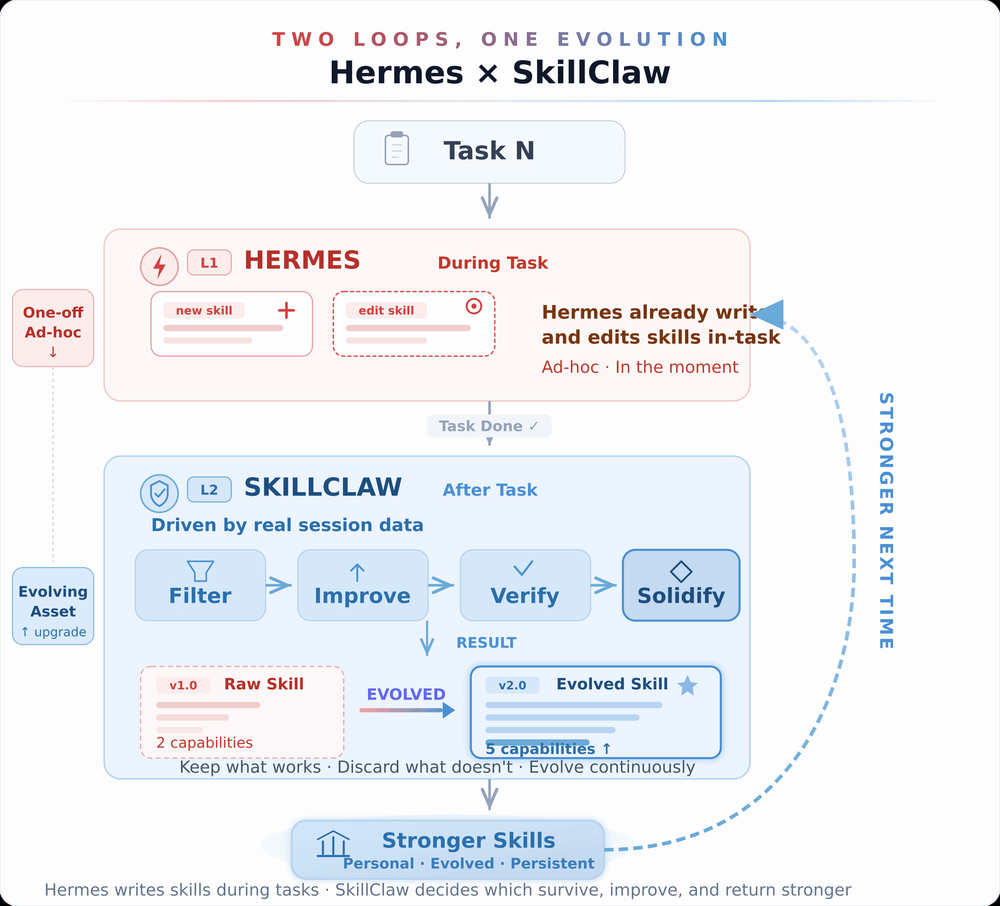
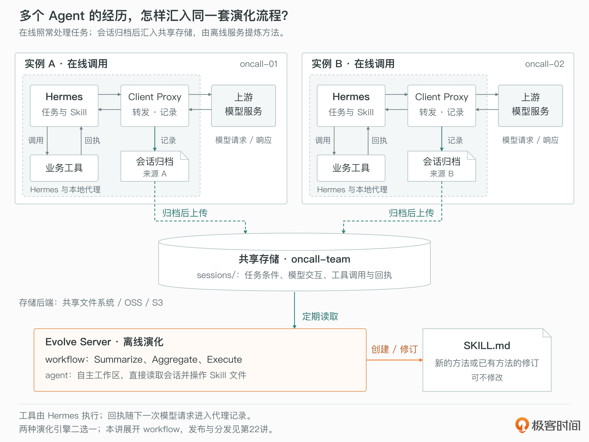
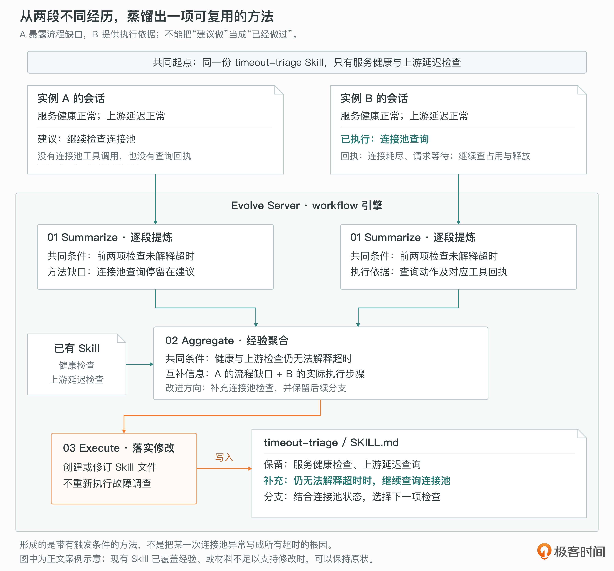
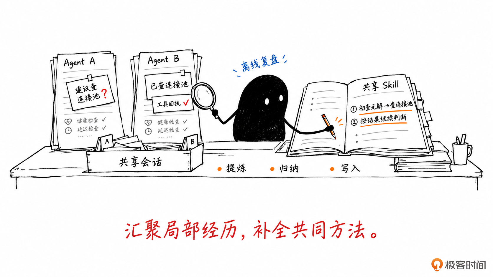

# 21 | SkillClaw（上）：怎样从多个在线Agent的经历中蒸馏Skill？

你好，我是 Tyler。

上一讲，我们利用 GEPA，根据一批历史任务来自动搜索更好的 Skill。如果进一步考虑多个在线 Agent 的场景，它们可能使用同一份 Skill，却在各自的任务中积累了不同的执行经验。那能不能将这些经验汇集起来，蒸馏成一份更完整的方法呢？

SkillClaw 提供了这样一套机制。它收集不同 Agent 的真实会话，在离线侧提炼和聚合经验，再据此创建或修订 Skill，让多个实例有机会共享这些改进。

这里与 Hermes 已有的 Skill 自进化能力有所不同。Hermes 可以在执行任务的过程中自主创建和修改 Skill，而 SkillClaw 将跨会话的技能演化放到任务完成之后，由独立的后台服务处理。这样，日常执行与经验演化就形成了两个相互连接的循环。



接下来两讲，我们就以 Hermes 为例，看看 SkillClaw 怎样实现多个在线 Agent 的技能蒸馏与共享。今天这一讲重点介绍在线会话采集和离线演化，下一讲继续探索 Skill 的发布与分发。

## 多个 Agent 的经历，怎样汇入同一套演化流程？

继续看我们的 On-call Agent。假设企业在不同机房部署了两个 Hermes 实例，它们使用同一

```
份 timeout-triage Skill，负责处理各自的生产告警。
```

这份 Skill 规定了接口超时的初始排查流程，包括服务健康检查和上游延迟查询。但在实际工作中，两个实例遇到了不同情况。

实例 A 完成这两项检查后，仍然没有定位故障。它在最终报告中建议进一步检查数据库连接池，却没有真正执行查询。

实例 B 遇到了类似的超时。完成初始检查后，它进一步调用连接池查询工具，发现连接耗尽和大量请求等待，并继续检查连接的占用与释放情况。

两段经历各有价值。实例 A 暴露了现有方法的流程缺口，实例 B 则提供了可以补充到方法中的实际操作。如果能够将它们放在一起分析，就有机会形成一份比单次经历更完整的诊断Skill。

SkillClaw 使用 Client Proxy、共享存储和 Evolve Server 连接这一过程。

其中，Client Proxy 是运行在 Agent 本地的模型 API 代理。Hermes 仍然负责加载 Skill、调用工具和完成任务，只是模型请求先经过 Client Proxy，再由代理转发给上游模型服务。

```
代理提供 /v1/chat/completions 和 /v1/messages 等兼容接口，可以在转发模型请求
```

的同时记录交互内容。

这里有一个重要的实现细节：Client Proxy 不直接执行工具，却能够通过模型交互记录还原Agent 的工具执行过程。

以实例 A 为例，Hermes 首先将接口超时任务发送给模型，模型决定调用服务健康检查工具。Hermes 完成工具调用后，将结果加入下一轮模型请求。模型看到服务健康状态正常，于是继续查询上游延迟。两项检查都无法解释故障，Agent 最终报告尚未定位，并建议检查连接池。

在这个过程中，模型响应包含发起的工具调用，后续请求则包含对应的工具回执。ClientProxy 通过连续的请求与响应，可以记录 Agent 实际执行了哪些检查，以及每一步取得了什么结果。

因此，实例 A 的经历中只有健康检查和上游延迟查询，连接池检查仍然是一项建议；实例 B的经历则包含实际的连接池工具调用及其返回结果。

SkillClaw 将这些交互整理成会话，在会话结束后归档，再按照共享配置上传到存储后端。

多个 Hermes 实例可以分别运行自己的 Client Proxy，并通过同一个共享组连接到统一存储。SkillClaw 支持本地文件系统、阿里云 OSS 和 S3，客户端与演化服务不必部署在同一台机器上。

Evolve Server 则定期读取这些会话，在离线侧集中处理不同实例积累的经历。



这样，我们就完成了跨实例经历的汇聚。接下来真正需要解决的是：两段不同的调查经历，怎样转化为一份可复用的 Skill？

## Evolve Server 怎样从多段经历中蒸馏 Skill？

SkillClaw 的 Evolve Server 负责离线技能演化。它从共享存储读取会话材料，提炼其中的任务

```
条件、执行步骤和结果，再根据这些经验创建或修订 SKILL.md。
SkillClaw 提供两种演化引擎：workflow 和 agent。其中，workflow 使用固定的三个阶
```

段：Summarize → Aggregate → Execute

我们就用前面两个实例的经历，看看这三个阶段怎样完成一次 Skill 蒸馏。

### Summarize：提炼每段会话中的有效经验

首先，Summarize 分别处理各实例的原始会话，将多轮模型交互和工具调用整理成经验摘要。

对于实例 A，关键不是它最后提到了连接池，而是它在健康检查和上游延迟查询后停止了调查，没有执行后续检查。

对于实例 B，则要保留它实际执行的连接池查询，以及工具返回的连接耗尽、请求等待等信息。

因此，Summarize 得到的两段摘要会明确区分：A 暴露了方法缺口，B 提供了实际执行依据。

注意这一步不能只保留最终回答。例如，实例 A 提出了连接池检查，但没有取得回执，不能把它写成“通过连接池检查定位了故障”。Summarize 需要保留实际动作与结果之间的关系，供后续阶段判断哪些经验可以复用。

### Aggregate：从不同经历中提炼共同的方法

Summarize 处理的是单段会话，Aggregate 则把相关经历放在一起分析。

它会结合会话使用的 Skill 和已有技能内容，寻找重复出现的方法缺口，以及不同经历中可以相互补充的操作。

回到前面的案例。实例 A 和 B 有一个共同条件：服务健康和上游延迟检查都没有解释接口超时。

区别在于，A 在这里停止了调查，B 则继续查询连接池，并获得了新的诊断信息。

将两段经历结合起来，就可以归纳出一个具体的改进方向：当现有两项检查无法解释超时时，增加连接池查询；如果发现连接耗尽或请求等待，再结合连接占用、释放情况和调用链继续判断。

这不是简单地将两份经验拼在一起，而是把它们整理为具有触发条件、执行步骤和判断分支的方法。

例如，另一个实例可能遇到连接池正常、但下游依赖异常的故障。这类经历就可以进一步补充连接池正常时的后续排查分支，而不是推翻已有的连接池检查。

Aggregate 因此能够利用不同实例的局部经验，不断完善同一项 Skill 的适用条件和诊断流程。

### Execute：将蒸馏结果写入 Skill

前两个阶段提炼出了改进方向，Execute 则负责实际修改技能文件。

```
在本例中，原有 timeout-triage 已经包含服务健康和上游延迟检查，因此可以保留已有步
```

骤，增加一段后续排查方法：

```
### 进一步排查接口超时
```

- 当服务健康状态和上游延迟检查均未解释超时问题时：

```
1. 查询数据库连接池的使用情况。
2. 如果出现连接耗尽或请求等待，继续检查连接占用、
  释放情况及相关调用链。
3. 如果连接池状态正常，转向其他下游依赖检查。
4. 证据不足时报告尚未定位，不直接认定故障根因。
```

这里的 Execute 指的是创建或修订 Skill 文件，不是替在线 Agent 重新执行一次故障调查。

Evolve Server 会根据聚合结果与已有技能内容，决定修改现有 Skill，还是创建新 Skill。如果相关经验已经被现有方法覆盖，或者没有形成足够明确的改进方向，也可以不修改文件。

到这里，我们就看到了多 Agent 技能蒸馏的实际结果：实例 A 发现的方法缺口，与实例 B 提供的执行经验经过提炼和聚合，最终形成了一段能让其他 Agent 复用的诊断方法。



```
除了固定三阶段的 workflow 引擎，SkillClaw 还支持 agent 模式。它通过基于 OpenClaw
```

的自主 Agent 工作区，直接读取会话并操作 Skill 文件，适合更灵活的修改过程。这两种演化

```
方式都可以选择，这一讲我们使用 workflow 完成实验。
```

## 怎样运行一次多 Agent Skill 蒸馏？

理解了工作原理，接下来我们运行一次完整实验。

环境由两个 Hermes 实例和一个 Evolve Server 组成。两个实例分别执行故障调查，通过各自的 Client Proxy 上传会话；Evolve Server 从同一个共享组读取材料，完成 Skill 演化。

### 配置 Hermes 与 Client Proxy

先在两个已经安装 Hermes 的实例上安装 SkillClaw。按照 SkillClaw 官方仓库 的macOSk/Linux 安装方式执行：

```bash
git clone https://github.com/AMAP-ML/SkillClaw.git
cd SkillClaw
bash scripts/install_skillclaw.sh
source .venv/bin/activate
skillclaw setup
在配置向导中选择 hermes，填写上游模型和访问凭证，并允许 SkillClaw 配置所选 Hermes
的模型连接。默认暴露给 Hermes 的模型名称是 skillclaw-model。
```

接下来，配置共享存储。假设两个实例都通过共享文件系统访问同一目录，第一个实例可以执行：

```
skillclaw config sharing.enabled true
skillclaw config sharing.backend local
skillclaw config sharing.local_root /mnt/skillclaw-share
skillclaw config sharing.group_id oncall-team
skillclaw config sharing.user_alias oncall-01
skillclaw config sharing.upload_sessions true
第二个实例使用相同的共享组和存储后端，将 user_alias 改成 oncall-02。
这里，group_id 用于将相关实例归入同一个演化空间，user_alias 用于区分经历来源。
```

两个实例的共享目录必须实际指向同一份存储。

```
sharing.upload_sessions 控制是否上传会话。SkillClaw 的新配置默认不会自动上传这
```

些材料，因此本讲需要在允许共享实验数据的前提下显式开启。

配置完成后，启动 Client Proxy：

```
skillclaw start --daemon
skillclaw status
skillclaw doctor hermes
status 检查代理运行状态，doctor hermes 检查 Hermes 的接入配置。
```

随后，可以通过一次简单请求验证模型调用链路：

```
hermes chat -Q -m skillclaw-model \
 -q "Reply with exactly HERMES_SKILLCLAW_OK"
```

确认请求能够经过 Client Proxy 后，再让两个 Hermes 实例分别执行实际的故障调查，产生包含工具调用的会话。

### 启动 Evolve Server

接下来，在能够访问共享存储的机器上安装 Evolve Server，并配置演化模型的访问凭证：

```bash
git clone https://github.com/AMAP-ML/SkillClaw.git
cd SkillClaw
bash scripts/install_skillclaw_server.sh
source .venv-server/bin/activate
cp evolve_server/evolve_server.env.example \
  evolve_server/.env
在 evolve_server/.env 中配置演化服务所需的模型地址、模型名称和访问凭证。
由于本讲希望修订已有的 timeout-triage，还可以先将这份 Skill 放入共享技能库。由持
有该 Skill 的客户端执行 skillclaw skills push，并通过 skillclaw skills list-
remote 检查共享端是否已经存在对应文件。
随后启动 workflow 引擎：
skillclaw-evolve-server \
 --engine workflow \
 --interval 300 \
 --storage-backend local \
 --local-root /srv/skillclaw-share \
 --group-id oncall-team
这里，服务端的 /srv/skillclaw-share 与客户端使用的 /mnt/skillclaw-share 应
```

对应同一份共享存储。

```
--group-id 指定需要处理的共享组，--interval 300 表示周期性检查新的会话材料。
```

同一共享组通常运行一套 Evolve Server 即可。

### 查看演化结果

现在，两个 Hermes 实例已经产生了不同的故障调查经历，Client Proxy 会在会话完成后将记录归档到共享存储。

我们可以从三个地方检查整条链路。

```
首先，查看 oncall-team/sessions/ 中的会话材料，确认实例 A 和 B 的经历都已经进入
```

同一共享组。

```
其次，查看 Evolve Server 的运行日志和 evolve_history.jsonl，确认后台处理了哪些会
```

话，以及本轮是否产生了技能修改。

```
最后，检查 oncall-team/skills/timeout-triage/SKILL.md，确认新的连接池诊断
```

分支是否真正写入文件。

```
因为我们使用 workflow 的默认直接发布模式，因此接受的演化结果可以进入正式共享技能
```

目录。另一种验证后发布的方式，我们在下一讲展开。

这里的实验结果以实际处理记录为准。SkillClaw 不保证每次收到新会话都修改 Skill；如果经验不足以支持新规则，现有方法也可以保持不变。

至此，我们就完成了多个在线 Agent 的经验蒸馏：不同 Hermes 实例产生会话，SkillClaw 汇聚和分析这些经历，最终由 Evolve Server 创建或修订可复用的 Skill。

不过，这份新方法虽然已经在共享后端形成，其他在线实例还不一定已经加载它。下一讲，我们将继续学习 SkillClaw 怎样将演化结果发布和分发出去，以及如何确认新方法真正进入其他Agent 的执行过程。

## 小结

学到这里，我们做个总结吧。



上一讲，我们利用 GEPA，根据一批历史任务搜索更好的 Skill。这一讲则通过 SkillClaw，将多个在线 Agent 的真实执行经历汇入共同的技能演化流程。

Client Proxy 负责采集和归档会话，共享存储连接不同实例与演化服务，Evolve Server 则通过Summarize、Aggregate、Execute 三个阶段，提炼执行经验、归纳共同方法，并创建或修订Skill。

多 Agent 技能蒸馏的价值，是把不同实例积累的局部经验，逐步整理成具有共同触发条件和判断分支的可复用方法。

到这里，我们完成了 SkillClaw 的在线经历采集与离线 Skill 演化。下一讲，我们继续看看新的Skill 怎样经过发布与同步，让其他 Hermes 实例使用这些改进。

## 系统设计题

下面是本讲的系统设计题和课后练习。

题面你的团队在两个机房部署了 Hermes On-call Agent，两个实例使用相同的超时诊断 Skill，却分别处理不同的故障。

实例 A 在完成健康检查和上游延迟查询后，没有定位原因，只建议继续检查连接池；实例 B在相似条件下实际查询了连接池，发现资源等待，并进一步检查连接的占用与释放情况。

团队希望使用 SkillClaw，将这两段执行经历汇入共享后端，自动提炼成一份更完整的超时诊断方法。

请设计这套机制：Client Proxy 怎样记录多个 Hermes 实例的在线会话，Evolve Server 的Summarize、Aggregate、Execute 分别处理什么内容，以及怎样确认最终产生了哪些 Skill 修改。

进一步考虑，为什么不能把实例 A 的连接池检查建议直接当作已验证方法？实例 B 的实际执行记录又能够补充哪些信息？

配套练习放在 GitHub 配套工程中，对应这一讲的练习目录。你可以配置两个 Hermes 实例、共享存储和 Evolve Server，观察在线经历怎样被提炼成 Skill 修订结果。

期待你在留言区记录收获或者提出疑问。如果这一讲对你有启发，也欢迎分享给身边更多朋友。
